# 텐배거 리포트 2026-11-06 — Applied Optoelectronics — 배수는 동종보다 30% 싸졌지만, FY26을 석 달 만에 7% 낮췄고 캐파는 아직 증자로 짓는다

> 2026-11-06 · Applied Optoelectronics(AAOI) · 기업: 데이터센터용 800G·1.6T 광 트랜시버와 케이블TV(HFC) 망 장비를 미국 텍사스·대만·중국에서 직접 만드는 미국 회사

## Chiip View

주가는 5/13 종가 고점 \$223.10에서 11/5 \$46.89까지 79% 빠졌다. 11/5 −20.9%는 장 마감 뒤 실적 발표 전에 AI 광 업종과 함께 빠진 것이고(MTSI(MACOM — 광연결 아날로그 칩 회사(티커)) −18%·LITE(Lumentum — 광부품·광모듈 회사(티커)) −19%·CRDO(Credo Technology — 데이터센터 연결 칩 회사(티커)) −18%), 실적에 대한 정규장 반응은 아직 없다. 시가총액은 \$4.50B(완전 희석 기준, 표지 주식 90.77M 기준 \$4.26B), EV \$4.19B다. 3Q26 매출 \$269.9M은 가이던스 \$255~290M의 중간 아래였고 조정 매출총이익률 28.7%는 가이던스 하단 29%에 못 미쳤다. 4Q 가이던스 \$385~420M은 발표 전 컨센서스 \$427M보다 5.8% 낮아, 8/6에 말한 FY26 '약 \$1.1B'가 \$1.00~1.03B로 내려왔다. 미국 2027 증설은 전력 확보 지연으로 늦어지고 연말 설비 목표도 월 65만 개에서 50만 개 이상으로 낮췄다. 엔진 목표주가는 \$62(+32%), 규칙 등급 Neutral이고 애널리스트 토론도 Neutral을 유지했다. **우리가 다르게 보는 곳은 'Fwd 1Y P/E 10.6배면 싸다'는 읽기다.** 그 배수의 분모(다음 4개 분기 EPS \$4.42)는 9월 말 추정이라 이번 하향이 빠졌다 — 8월 중순 컨센서스로 세면 \$3.25(14.4배), 우리 기본은 \$3.00이다. 지금 값은 엔진 배수 15.9배에서 EPS \$2.95를 가정해, 하향을 받아도 비싸지 않지만 싸다고 할 여지도 작다. 가치를 가르는 건 배수가 아니라 주당 몫이다: 주식이 1년 사이 63.3M(3Q25 가중)에서 90.8M으로 +43% 늘었고, 미이행 설비 약정 \$929M이 현금 \$621M보다 크다. 경쟁 가설 ① 하향은 일시적 공사 지연이고 수요는 그대로다(가를 자료: 3Q 어닝콜 전문의 2027 매출 발언·4Q 실적의 연말 설비 50만 개 달성, 2026-11 중순·2027-02 하순) ② 하향은 수율·부품(DSP(디지털 신호 처리 칩 — 광 트랜시버에서 고속 신호를 고르는 핵심 칩, 외부(Broadcom·Marvell 등)에서 산다)) 문제다(가를 자료: 4Q 조정 매출총이익률 29.5~31% 달성 여부, 2027-02 하순). 회사가 이 쟁점(하향 크기·약정 자금)에 답한 문장은 3Q 콜 전문이 나오면 넣는다(11/6 09:40 KST(한국 표준시) 기준 회사 답변 확인 전). 중간선거 영향 −0.6/10 — 가장 큰 채널은 CHIPS(미국 반도체지원법) 세액공제(폐지 입법 위험 하락, 노출 0.3, +0.6) · 업종 반응은 반도체 ETF(SMH(반도체 업종 ETF(VanEck Semiconductor))) 선거 뒤 CAR(누적 비정상 수익률 — 기준 대비 초과 등락의 합) −5.7%(t −2.0)로 정책 기여를 웃돈다. 정책 0단계(선거 결과) 가설이고 하원 결과는 미확정이다.

## 대시보드
| 항목 | 값 | 설명 |
|---|---|---|
| 주가 | \$46.89 | 고점 대비 -79% · 1년 +49% |
| 시가총액 | \$4.50B | 완전 희석 기준 · EV \$4.19B |
| 업사이드 | +32% | 목표주가 \$62 · 다운사이드 -59% · 손익비(강세÷약세) 1.5 |
| 구매등급 | Neutral | 애널리스트 7명: Strong Buy 2 · Buy 2 · Neutral 3 · Sell 0 · Strong Sell 0 |
| 멀티플 | Fwd 1Y P/E 10.6배 | 동종 중앙값 15.2배 |
| 가이던스 4Q26 | \$402M | 컨센서스 \$427M |
| 알파 | 5.4/10 | 텐배거 가능성 점수 |
| 이벤트 | 4Q26 실적(예상, 회사 확정 전) — 매출 \$385~420M·조정 매출총이익률 29.5~31%·조정 EPS \$0.48~0.63, 연말 800G·1.6T 월 50만 개 설비 확인. 그 전에 3Q 어닝콜 전문(재발행)과 FY26 10-K 구매 약정이 먼저 나온다 | 2027-02-26 |

## 한 장 요약
- **기업가치를 결정하는 내러티브** Applied Optoelectronics(AAOI)는 데이터센터용 400G(400기가비트/초 광 트랜시버 세대)·800G(800기가비트/초 광 트랜시버 세대)·1.6T(1.6테라비트/초 광 트랜시버 세대(레인당 200G × 8)) 광 트랜시버와 케이블TV(텔레비전) 망 증폭기를 텍사스·대만·중국 닝보에서 만드는 회사다. 레이저 칩은 텍사스 슈거랜드에서 직접 만든다. 3Q26 매출 \$269.9M(+128% YoY)은 가이던스 \$255~290M 안이었지만 중간 아래였고, 조정 매출총이익률 28.7%는 가이던스 하단 아래였다. 4Q 가이던스 \$385~420M은 발표 전 컨센서스 \$427M보다 낮아, 8/6에 말한 FY26 '약 \$1.1B'가 \$1.00~1.03B로 내려왔다. 미국 2027 증설은 전력 확보 지연으로 늦어진다
- **밸류에이션 모델로 본 주가 상방은 어디까지인가?** **목표주가 \$62(+32%), 기본과 강세 사이(강세 쪽 37%)다.** 강세 \$88(+87%)는 Fwd 1Y P/E 19.9배를 강세 EPS에 적용한 값이다. 기본 \$48, 약세 \$19. 손익비 1.5, DCF 기준 업사이드 +140%.
- **수주는 어디까지 왔나?** 1.6T 첫 주문(하이퍼스케일러) 미확인, 100% 매출 \$0.20B · 3년 1.6T LTA(대형 하이퍼스케일러) 미확인, 100% 매출 미확인 · Amazon 워런트 연동 누적 구매 미확인, 100% 매출 \$4.00B. 회사는 수주잔고 금액을 공시하지 않는다. 확인되는 것은 1.6T 첫 주문 '\$200M 초과'(2Q 콜, 2027 2Q까지 출하 목표), 3년 LTA(특정 1.6T의 10% 구매 의무, 물량은 고객 수요에 연동), Amazon 워런트의 누적 구매 \$4B 기준이다. LTA와 워런트 기준은 프레임워크라 확정 매출이 아니다(금지표)
- **누가 사 주나?** 최대 고객 케이블 MSO(복수 케이블 사업자 — 미국 대형 케이블TV·인터넷 회사) 1곳(Digicomm(Digicomm International — 케이블TV 장비 유통사(10-Q 매출채권 \$234.5M 상대방)) 경유, 이름 미공시)(10-Q 상위 1위 고객(가설)) 41%, 상위 3곳 92%. 공시·회사 발표로 확인한 몫은 99%다.
- **마진과 공급망은 어디가 약한가?** GPM 28.2%, OPM -0.5%. OPM을 가장 흔드는 BOM(제품 원가를 이루는 부품·재료 명세) 항목은 DSP 칩(외부)이고 가격 +10%에 -1.26%p다. 공급망 신뢰성은 2.7/10(병목 심각)이고 가장 약한 고리는 미국 새 공장 전력이다.
- **생산능력은 얼마나 늘어나나?** 현재 명목 캐파 330,000 개/월(800G·1.6T 설비), 착공 이상 증설 170,000 개/월(800G·1.6T 설비). FY2027 CAPEX는 매출의 47.9%다.
- **지금 가격은 무엇을 가정하나?** Fwd 1Y P/E 10.6배(다음 4개 분기 EPS 추정 \$4.42)로 동종 다섯 곳(COHR(Coherent — 광모듈·레이저 회사(티커)) 14.9·FN(Fabrinet — 광모듈 위탁 생산 회사(티커)) 15.2·CRDO 15.2·LITE 16.2·MTSI 21.0배) 중앙 15.2배보다 30% 낮고, 3년 월말 기록에서 가장 낮다(직전 최저 10/30 21.0배). 그러나 분모 \$4.42는 9월 말 추정이다 — 8월 중순 컨센서스(4Q \$0.587·1Q27 \$0.73·2Q \$0.80·3Q \$1.165)에 4Q 가이던스 중간 \$0.555를 넣으면 \$3.25, 배수는 14.4배다. 엔진 배수 15.9배로 풀면 지금 주가는 EPS \$2.95를 가정한다. DCF로 거꾸로 풀면 지금 값은 5년 매출 CAGR 11%를 요구하고 기본 시나리오는 36%다 — DCF가 크게 높은 이유는 2027·28 이익률 컨센서스(주식 보상 차감 17.5%·19.5%)를 고정했기 때문이고, 지금 GAAP 영업이익률은 −0.5%다.
- **왜 움직였나?** 2025-11-14 \$21.47에서 2026-05-13 \$223.10까지 10.4배 올랐다 — 데이터센터 매출이 3Q25 \$43.9M에서 2Q26 \$107.7M으로 늘고, 4Q25 실적 다음 날 +57%(800G 램프), 1.6T 첫 주문 \$200M이 나왔다. 고점 이후 −79%는 세 가지가 겹쳤다: ① 2Q 발표일 8/6 종가 \$124.22 → 11/5 \$46.89(−62%)인 동안 4Q26 EPS 추정은 \$0.587에서 가이던스 중간 \$0.555로 −5%에 그쳐, 하락 대부분은 배수에서 나왔다 ② 2026년 ATM(시장가 수시 증자 — 증권사를 통해 시장에서 신주를 조금씩 파는 방식) 세 번으로 13M주(\$1.6B)를 팔았다 ③ 업종 동반 하락(10/8 −14%·10/30 −13%·11/5 −21%, 10/8은 원인 미확인). 11/5 −20.9%는 실적 발표 전이다 — 실적 반응은 11/6 정규장에서 나온다.
- **3Q 실적에서 무엇이 바뀌었나?** 매출 \$269.9M(+128% YoY, +41% QoQ): 데이터센터 \$155.6M·CATV(케이블TV 망 — 케이블 회사가 가정까지 TV·인터넷을 보내는 동축·광 혼합망) \$110.9M·통신 \$2.7M. 조정 매출총이익률 28.7%(가이던스 29~30.5%, 2Q 29.8%), GAAP 순이익 \$6.3M(정부 보조금 \$8.2M 포함 — 보조금을 빼면 세전 이익 약 \$0.5M), 조정 EPS \$0.17(가이던스 \$0.11~0.26), 조정 EBITDA \$28.5M. 설비는 월 약 33만 개(2Q 말 약 20만 개). 새로 나온 것은 3년 1.6T LTA(특정 1.6T의 10% 구매 의무·회사의 캐파 구축 의무·가격 상한), 신규 대출 \$200M, 2027년 말 설비 100만 개 이상. 바뀐 것은 FY26 '약 \$1.1B' → \$1.00~1.03B, 연말 설비 65만 → 50만 개 이상, 미국 2027 증설 전력 지연이다. 3Q 영업현금흐름 −\$2.9M, 9개월 CAPEX \$702.1M, 미이행 설비 약정 \$928.8M.
- **회사는 쟁점에 뭐라고 답했나?** 쟁점은 ① 하향이 공사 지연뿐인가, 수율·부품 문제인가 ② 남은 약정 \$929M을 증자 없이 메우는가다. 3Q 어닝콜 전문이 아직 없어(11/6 09:40 KST) 회사 답변 문장을 넣지 못했다 — 회사 답변 확인 전. 보도자료에서 CFO는 2027 미국 증설이 '필요한 전력 확보에 예상보다 오래 걸려' 늦어진다고 썼고, 자금은 언급하지 않았다. 2Q 콜(8/6)에서 CFO는 투자를 현금·영업현금·일부 증자·차입으로 메운다고 답했다. 전문이 나오면 같은 주소로 다시 낸다.
- **무엇이 바뀌면 판단이 달라지나?** 위로는 4Q 매출 \$400M 이상·조정 매출총이익률 30% 이상·영업현금흐름 흑자, 연말 설비 50만 개 확인, 그리고 2027 상반기 추가 ATM이 없으면 강세 \$88(+87%) 쪽이다. 아래로는 4Q 매출이 가이던스 하단 \$385M 아래거나, 조정 GM(매출총이익률)이 29% 아래에 머물거나, 새 ATM 계약(8-K·424B5)이 나오면 약세 \$19(−59%) 쪽이다.

## 한눈에 보기

**일봉**

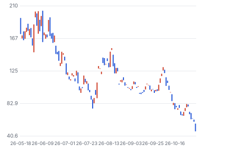

**주봉**

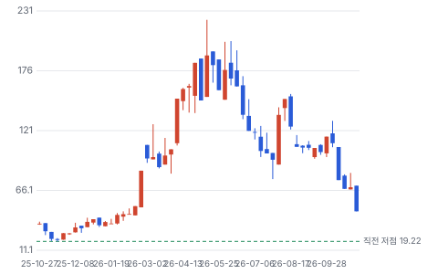

**월봉**

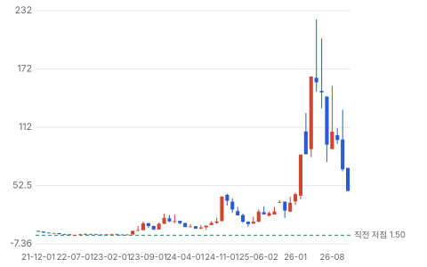

**분기 매출·EPS 실적과 컨센서스**

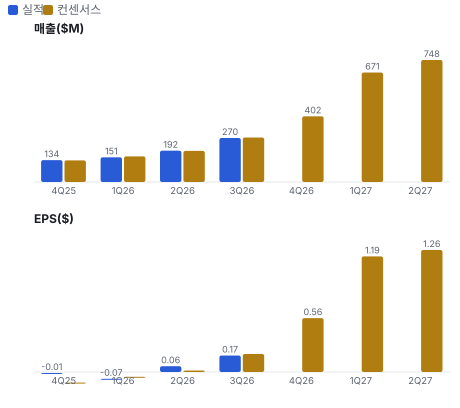

**최근 4개 분기 주가 변화 분석**

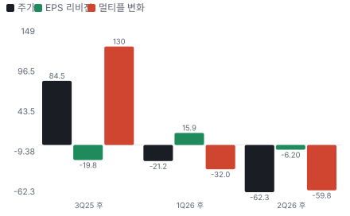

**EPS 리비전**

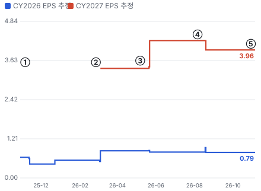

① 25-11-06 3Q25 실적 · EPS 리비전 -
② 26-02-26 4Q25·800G 램프 · EPS 리비전 -
③ 26-05-07 1Q26 매출 미달 · EPS 리비전 +2%
④ 26-08-06 2Q26·FY26 약 \$1.1B · EPS 리비전 -7%
⑤ 26-11-05 3Q26·FY26 하향·LTA · EPS 리비전 +0%

**밸류에이션 주가 시나리오**

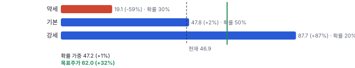

**주가별 업사이드**

**제품·서비스 포트폴리오**

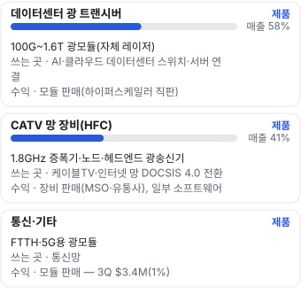

**고객 믹스(3Q26·9개월, 매출 대비)**

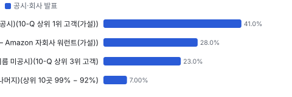

**공급 병목(10점, 낮을수록 병목)**

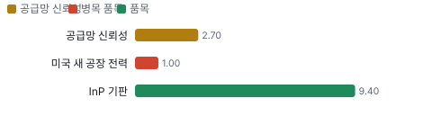

**생산능력 현재와 확충 계획(개/월(800G·1.6T 설비))**

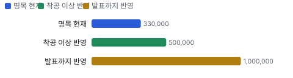

**CAPEX의 매출 대비 비중**

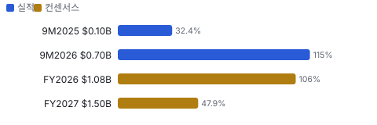

**어닝콜 변화별 주주가치 영향**

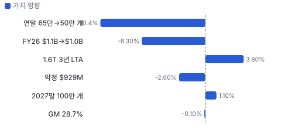

**멀티플 프리미엄(Fwd 1Y P/E, 최근 4개 분기말)**

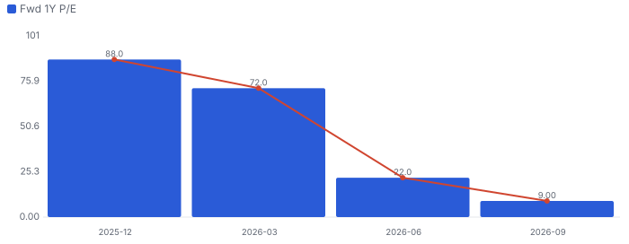

**합리적 멀티플**

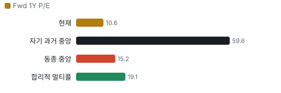

**일별 거래량 분해**

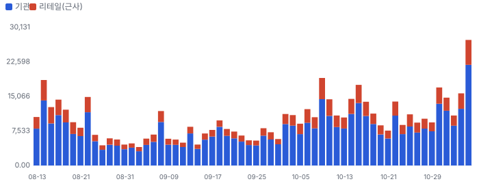

**기관 자금 흐름**

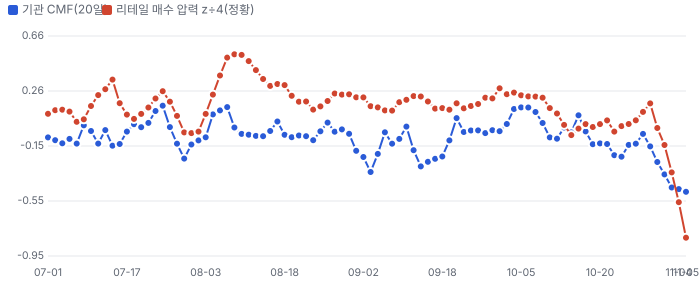

**몬테카를로**

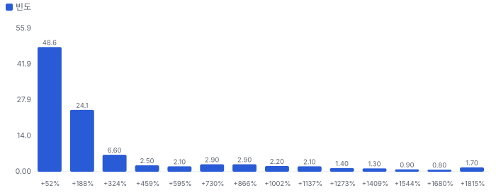

해석: 3,000번 중 2,908번(97%)에서 가치가 지금 주가 이상이었다. 가정을 흔들어도 지금 주가를 뒷받침하는 경우가 더 많다. 가운데 값은 2.24배이고, 열 번 중 여덟 번은 1.24~10.60배 사이에 든다.

## 내러티브

> **기업가치를 결정하는 이야기:** Fwd 1Y P/E 10.6배(다음 4개 분기 EPS 추정 \$4.42)로 동종 다섯 곳 중앙 15.2배보다 30% 싸다 — 그러나 그 추정은 9월 말 값이라 11/5 가이던스 하향과 미국 증설 지연이 빠져 있다. 8월 중순 컨센서스로 다시 세면 다음 4개 분기 EPS는 약 \$3.25(14.4배)다. 가치는 ① 2027년 설비 월 100만 개가 일정대로 돌고 ② 1.6T 램프에서 매출총이익률이 30% 위로 오르며 ③ 그 사이 추가 증자가 크지 않은가에 달렸다

> **멀티플·EPS 프리미엄**
> **멀티플:** Fwd 1Y P/E 10.6배, 동종 다섯 곳 중앙 15.2배(COHR 14.9·FN 15.2·CRDO 15.2·LITE 16.2·MTSI 21.0) — 11/5 업종 급락 뒤 값. 이 회사 3년 월말 기록에서 가장 낮다(직전 최저 10/30 21.0배)
> **EPS:** 3Q 조정 EPS \$0.17은 2Q 콜 가이던스 중간 \$0.185 아래(실적 직전 컨센서스 하단 \$0.14는 상회). 4Q EPS 가이던스 중간 \$0.555는 발표 전 컨센서스 \$0.587보다 5% 낮다

### 투자자들은 왜 열광했나

2025-11-14 \$21.47에서 2026-05-13 \$223.10까지 10.4배 올랐다 — 800G 매출이 1분기 만에 두 배씩 늘고, 회사가 '2027 중반까지 수요가 캐파를 넘는다'·'미국 최대 AI 트랜시버 생산 거점'을 말했으며, 1.6T 첫 주문 \$200M을 받았다. 식은 이유는 세 가지다: 매출이 분기마다 가이던스 중간을 겨우 맞추거나 밑돌았고(1Q 미달), ATM으로 13M주를 팔았으며, 매출총이익률이 29% 근처에서 오르지 않았다. 11/5 −21%는 실적 발표 전 업종 동반 하락이다

### 무엇이 기업가치를 바꾸나

> **구조적 체질 변화**
> **변화:** CATV 60%(3Q25)에서 데이터센터 58%(3Q26)로 무게중심이 넘어갔다. 동시에 장비를 리스·매입해 미국 휴스턴에 약 160만 제곱피트 생산 공간을 만든다
> **증거:** 보도자료·10-Q
> **반증:** 데이터센터 매출이 2분기 연속 QoQ 감소

> **고부가 믹스 확장**
> **변화:** 800G·1.6T로 개당 단가는 오르지만 조정 매출총이익률은 31.0%(3Q25) → 28.7%(3Q26)로 내려갔다 — 외부 DSP 원가와 초기 수율 때문(회사 설명). 4Q 가이던스 29.5~31%
> **증거:** 보도자료·2Q 콜
> **반증:** 4Q 조정 GM 29.5% 아래

> **기술 혁신**
> **변화:** 자체 레이저(100mW·CPO(광·전 통합 패키징 — 광 엔진을 스위치 칩 패키지 안에 넣는 구조(Co-Packaged Optics))용 300mW 개발), 4인치 InP(인화인듐 — 통신용 레이저 칩 기판 소재) 전환, 자동화 라인으로 800G→1.6T 전환 비용이 작다고 회사는 말한다
> **증거:** 2Q26 어닝콜(2026-08-06) 요지
> **반증:** 1.6T가 레이저가 아닌 수율로 막힌다

> **실행 속도**
> **변화:** 설비 증설 속도가 핵심이다. 월 10만 개(1Q 말) → 20만 개(2Q 말) → 33만 개(3Q 말)로 늘었지만 연말 목표는 65만 → 50만 개로 낮췄다. 레이저 장비는 주문부터 대량 생산까지 21~24개월(CEO). 납품 리드타임은 공시가 없다 **납품 리드타임 3~9개월.** 피어 비교 미확인. 이전 대비 미확인.
> **증거:** 보도자료·2Q 콜

> **M&A**
> **변화:** 인수는 없다. 대신 Amazon 워런트(누적 구매 \$4B 연동)와 3년 LTA로 고객을 묶었다. 업종에서는 Marvell-Lumentum 거래(11/2)가 경쟁 구도를 바꾼다
> **증거:** 10-Q·업종 보도
> **반증:** Marvell-Lumentum 통합 모듈이 이 회사 고객을 가져간다

> **정책·입법 연관성**
> **재정정책:** CHIPS 직접 보조금은 없다. 텍사스 TSIF(텍사스 반도체 혁신 기금 — 텍사스 주정부 반도체 투자 보조금) 최대 \$20.9M(2027-12까지, 3Q \$3.5M 인식). 연방 투자세액공제는 '해당된다고 본다'는 회사 판단 단계 10-Q 반증: CHIPS 세액공제 적용이 거부된다 의회 동의 10/10 — 하원 5/5(CHIPS법(2022) 본회의 통과·세액공제 35%는 2025-07 법 통과) · 상원 5/5(같음).
> **행정명령:** 중국산 광 트랜시버의 미국 수입 금지 논의(8월 보도) — 행정 조치 단계도 아닌 보도 수준이다. 닝보 생산분은 원산지 판단에 따라 대중 관세 대상 2Q 콜·10-Q 반증: 규칙안이 나오지 않거나 이 회사 닝보 생산까지 묶는다 의회 동의 0/10 — 하원 0/5(행정부 단독 조치 논의) · 상원 0/5(같음).
> **연관입법:** 관련 입법 없음 — 로비 공시는 미확인 lobby_watch 미확인 반증: 해당 없음

> **CAPEX 낙수효과**
> **변화:** 하이퍼스케일러 AI 투자 → 800G·1.6T 모듈. 고객 투자 발표를 이 회사 매출로 바로 옮기지 않는다 — 확인된 것은 고객 세 곳 92%·\$200M 주문·LTA 10%다
> **증거:** 10-Q
> **반증:** 2027 하이퍼스케일러 CAPEX 가이던스가 줄어든다

### 내러티브 근거

> '미국에서 직접 레이저를 만드는 AI 광 트랜시버 회사'와 '케이블 DOCSIS 4.0(케이블 인터넷 표준 4.0 — 1.8GHz 대역까지 쓰는 차세대 규격) 증폭기' 두 엔진 이야기다. 주가는 2025-11 \$20대에서 2026-05-13 \$223.10까지 10배 넘게 올랐다 — 데이터센터 매출이 3Q25 \$43.9M에서 3Q26 \$155.6M으로 3.5배가 됐고, 회사는 '수요가 캐파를 넘는다'고 반복했다. 그 사이 ATM으로 13M주(약 \$1.6B)를 팔았다. 지금은 −79%로 이야기가 '캐파를 지을 수 있나·지은 뒤 이익이 나나'로 바뀌었다. 동종 대비 멀티플 차이 -30% 중 회사 고유 몫은 -44%다. 단계는 과밀, 쏠림은 높음이다.

> **800G·1.6T 램프** · 약화
> **논리:** 하이퍼스케일러 800G·1.6T 수요가 캐파를 넘어 매출이 설비만큼 는다
> **숫자:** 데이터센터 3Q \$155.6M(+44% QoQ·+254% YoY), 설비 월 33만 개
> **반증:** 4Q 매출이 가이던스 하단 \$385M 아래

> **미국 생산 프리미엄** · 유지
> **논리:** 중국산 트랜시버 규제 논의 속에 미국 최대 생산 거점이 점유율을 더 받는다
> **숫자:** 9개월 미국 CAPEX \$315.4M, 3년 LTA
> **반증:** 중국산 트랜시버 규제가 규칙안 단계에도 오르지 않는다

> **CATV DOCSIS 4.0 두 번째 엔진** · 강화
> **논리:** 최대 MSO의 1.8GHz 증폭기(DOCSIS 4.0용 1.8GHz 대역 케이블망 증폭기) 교체가 연 \$325M 넘는 CATV를 만든다
> **숫자:** CATV 3Q \$110.9M(+57% YoY), 상위 고객 41%
> **반증:** CATV 분기 매출 \$80M 아래로 감소

> **CPO 광원(ELSFP(외부 광원 플러거블 모듈 — CPO 스위치에 빛을 공급하는 교체형 레이저 모듈)) 옵션** · 유지
> **논리:** CPO가 오면 고출력 레이저 수요가 수십 배 — 자체 레이저 회사가 이긴다
> **숫자:** 매출 0, 300mW 레이저 개발(8/6 CEO)
> **반증:** CPO 광원 공급사 선정에서 빠진다

> **반대: 증자로 짓는 성장** · 강화
> **논리:** 캐파는 주식을 팔아 짓고, 지은 캐파의 이익률은 29%라 주당 가치가 늘지 않는다
> **숫자:** 주식 63M → 91M(+43%), 미이행 약정 \$929M vs 현금 \$621M, 조정 GM 28.7%
> **반증:** 4Q 영업현금흐름 흑자 + 2027 1H 추가 ATM 없음

> **반대: 고객 세 곳 92%** · 유지
> **논리:** 한 고객의 주문 조정이 매출 30~40%를 흔든다
> **숫자:** 3Q 41%·28%·23%, 상위 10곳 99%
> **반증:** FY26 10-K에서 상위 3곳 80% 아래

## 포트폴리오

| 제품·서비스 | 구분 | 무엇 | 쓰는 곳 | 돈 버는 방식 | Mix | Mix 변화(전 분기 대비) |
|---|---|---|---|---|---|---|
| 데이터센터 광 트랜시버 | 제품 | 100G(100기가비트/초 광 트랜시버 세대)~1.6T 광모듈(자체 레이저) | AI·클라우드 데이터센터 스위치·서버 연결 | 모듈 판매(하이퍼스케일러 직판) | 58% | +1.2%p |
| CATV 망 장비(HFC(광·동축 혼합망(Hybrid Fiber-Coax) — 케이블TV 회사의 광대역 망 구조)) | 제품 | 1.8GHz 증폭기·노드·헤드엔드 광송신기 | 케이블TV·인터넷 망 DOCSIS 4.0 전환 | 장비 판매(MSO·유통사), 일부 소프트웨어 | 42% | -1.2%p |
| 통신·기타 | 제품 | FTTH(가정까지 광케이블(Fiber To The Home))·5G용 광모듈 | 통신망 | 모듈 판매 — 3Q \$3.4M(1%) | 미확인 | 미확인 |

**Mix 변화가 가장 큰 쪽은 데이터센터 광 트랜시버(+1.2%p, 전 분기 대비).** 계절성 판정: 분기 매출 계절 지수 기준 없음 → 직전 분기와 비교.

## 고객

> **3Q26·9개월 최대 고객 케이블 MSO 1곳(Digicomm 경유, 이름 미공시)(10-Q 상위 1위 고객(가설)) 41%, 상위 3곳 92%, 집중도 집중.** 공시·회사 발표로 확인한 몫은 매출의 99%이고, 나머지 고객 몫은 추정이거나 미분해다. 10-Q는 3Q 매출의 41%·28%·23%를 상위 세 고객이 냈다고 적고(1년 전 66%·24%·3%) 상위 10곳이 99%다. 이름은 쓰지 않는다. 2Q 콜에서 10% 초과 세 곳이 CATV 1곳(42%)과 데이터센터 2곳(26%·24%)이라고 했고, 매출채권 \$413.8M 중 \$234.5M이 케이블 장비 유통사 Digicomm이다. 데이터센터 두 곳 중 하나는 워런트를 받은 Amazon일 가능성이 높다 — 이름 연결은 가설

**고객별 매출 몫(3Q26·9개월)**
| 고객 | 몫 | 변화 | 근거 |
|---|---|---|---|
| 케이블 MSO 1곳(Digicomm 경유, 이름 미공시)(10-Q 상위 1위 고객(가설)) | 41% | -25%p | 공시 |
| 하이퍼스케일러 A(이름 미공시)(10-Q 상위 2위 고객 — Amazon 자회사 워런트(가설)) | 28% | +4%p | 공시 |
| 하이퍼스케일러 B(이름 미공시)(10-Q 상위 3위 고객) | 23% | +20%p | 공시 |
| 그 밖 7곳(상위 10곳 나머지)(상위 10곳 99% − 92%) | 7% | +3%p | 공시 |

> **케이블 MSO 1곳(Digicomm 경유, 이름 미공시)(10-Q 상위 1위 고객(가설))** · 공시
> **사는 것:** 1.8GHz 증폭기(Quantum Bandwidth(이 회사 케이블망 증폭기 제품군 이름))·노드
> **추정 근거:** 몫은 공시. CATV 매출 \$110.9M(41%)과 같은 크기이고 매출채권 \$234.5M이 Digicomm — 미국 최대 케이블 사업자의 DOCSIS 4.0 전환 물량이라는 것은 가설

> **하이퍼스케일러 A(이름 미공시)(10-Q 상위 2위 고객 — Amazon 자회사 워런트(가설))** · 공시
> **사는 것:** 400G·800G 트랜시버
> **추정 근거:** 몫은 공시. 워런트는 Amazon 계열 누적 구매 \$4B에 연동 — 이 고객이 Amazon이라는 것은 가설

> **하이퍼스케일러 B(이름 미공시)(10-Q 상위 3위 고객)** · 공시
> **사는 것:** 800G·1.6T 트랜시버, 100G
> **추정 근거:** 1년 전 3% → 23%. 2Q 콜 '10% 초과 고객으로 복귀', 1.6T 4번째 공급사 인증 고객이라는 설명과 맞는다(가설)

> **그 밖 7곳(상위 10곳 나머지)(상위 10곳 99% − 92%)** · 공시
> **사는 것:** CATV·통신·데이터센터
> **추정 근거:** 상위 10곳 99%에서 3곳 92%를 뺀 값

## 수주·파이프라인

> **2026-11-05 기준 4건.** 확정 \$0.20B, 미확정 \$4.00B.

**실행 속도와 방해 요인**
| 항목 | 상태 | 실행 속도 | 방해 요인 |
|---|---|---|---|
| 1.6T 첫 주문(하이퍼스케일러) | 확정 | 캐파·DSP 공급에 묶임 | DSP·소재 공급 · 1.6T 수율 |
| 3년 1.6T LTA(대형 하이퍼스케일러) | 프레임워크 | 미확인 | 최대 가격 상한 · 회사 캐파 구축 의무 |
| Amazon 워런트 연동 누적 구매 | 프레임워크 | 미확인 | 고객 수요 |
| CATV 1.8GHz 증폭기(최대 MSO) | 확정 | 미확인 | MSO 망 전환 속도 |

## 마진 구조

> **GPM 28.2%, OPM -0.5%.** 3Q25 대비 GPM +0.2%p, OPM +14.8%p. 변동비는 매출의 68%이고, 매출이 10% 늘면 OPM은 +3.0%p 움직인다. 3Q26 GAAP 매출총이익률 28.2%(1년 전 28.0%), 조정 28.7%로 가이던스 하단 29%에 못 미쳤다. 8/6 콜에서 회사는 데이터센터 믹스(800G 초기 수율·외부 DSP 원가)를 단기 역풍으로 들었다. 연구개발 14.1%·판관비 14.6%로 GAAP 영업이익률 −0.5%. 매출원가는 외부 칩(DSP)·광부품 소재가 대부분이고, 레이저 칩은 슈거랜드에서 직접 만든다

> **매출 100 중 매출원가 71.2, 매출총이익 28.8(최근 4분기, 공시).** 매출원가 요인 중 외부 칩·광부품 소재(DSP·TIA(트랜스임피던스 증폭기 — 광검출기 전류를 전압 신호로 키우는 수신 칩)·드라이버·PCB(인쇄회로기판)·하우징)이 매출의 50.0%로 가장 무겁고, 단가가 +10% 오르면 GPM이 -5.00%p 움직인다. 분기 회귀로 매출 1이 늘 때 매출원가는 0.67 늘고, 매출원가의 고정비 몫은 6%다.

**비용 요인 강도 — 비중·추세·충격(+10%)·탄력**
| 비용 | 구분 | 매출 대비 | 1년 변화 | 마진 기여 | 충격 시 마진 | 매출 탄력 | 고정비 몫 |
|---|---|---|---|---|---|---|---|
| 외부 칩·광부품 소재(DSP·TIA·드라이버·PCB·하우징) | 매출원가 요인 | 50.0% | 미확인 | 미확인 | -5.00%p | 미확인 | 0% |
| 제조 인건비·간접비(텍사스·대만·닝보) | 매출원가 요인 | 12.0% | 미확인 | 미확인 | -1.20%p | 미확인 | 50% |
| 설비 감가상각(매출원가 몫) | 매출원가 요인 | 4.5% | 미확인 | 미확인 | -0.45%p | 미확인 | 100% |
| 기타(재고 충당·단종 제품·보증) | 매출원가 요인 | 2.8% | 미확인 | 미확인 | -0.28%p | 미확인 | 30% |
| 물류·관세 | 매출원가 요인 | 2.5% | 미확인 | 미확인 | -0.25%p | 미확인 | 0% |
| 매출원가 | 공시 항목 | 71.2% | +0.5%p | -0.5%p | -7.12%p | 0.67 | 6% |
| 판관비 | 공시 항목 | 18.9% | -4.0%p | +4.0%p | 미확인 | 0.14 | 34% |
| 연구개발 | 공시 항목 | 16.7% | -1.5%p | +1.5%p | 미확인 | 0.14 | 18% |

매출 탄력 = 분기 비용을 매출에 회귀한 기울기(매출 1당 변동비), 고정비 몫 = 절편 ÷ 평균 비용. 표본이 8분기 미만이면 미확인. 매출원가 요인 비중은 margin 재료의 추정이 섞여 있고, 공시 매출원가와의 차이는 '기타 매출원가'로 둔다.

**GPM에서 OPM까지(GAAP)**
| 기간 | GPM | 연구개발 | 판관비 | 기타 | OPM |
|---|---|---|---|---|---|
| 3Q25 | 28.0% | 17.9% | 25.4% | 0.0% | -15.3% |
| 3Q26 | 28.2% | 14.1% | 14.6% | 0.0% | -0.5% |

**GPM·OPM 최근 4개 분기**
| 분기 | GPM | OPM |
|---|---|---|
| 2025-12 | 31.2% | -8.6% |
| 2026-03 | 29.1% | -8.6% |
| 2026-06 | 27.7% | -12.9% |
| 2026-09 | 28.2% | -0.5% |

**마진을 결정하는 비용 요인 — 비용 +10% 시 OPM**
| 비용 | 매출 대비 | 변화 | 고정비 | OPM |
|---|---|---|---|---|
| 외부 칩·광부품 소재(DSP·TIA·드라이버·PCB·하우징) | 50.0% | 미확인 | 0% | -5.00%p |
| 판매·관리비 | 14.6% | -10.8%p | 70% | -1.46%p |
| 연구개발 | 14.1% | -3.8%p | 80% | -1.41%p |
| 제조 인건비·간접비(텍사스·대만·닝보) | 12.0% | 미확인 | 50% | -1.20%p |
| 설비 감가상각(매출원가 몫) | 4.5% | 미확인 | 100% | -0.45%p |
| 기타(재고 충당·단종 제품·보증) | 2.8% | 미확인 | 30% | -0.28%p |
| 물류·관세 | 2.5% | 미확인 | 0% | -0.25%p |

**비용을 움직이는 요인**
| 비용 | 요인 |
|---|---|
| 외부 칩·광부품 소재(DSP·TIA·드라이버·PCB·하우징)(매출원가) | 800G·1.6T DSP 단가·공급 · 근거 추정 |
| 판매·관리비(판관비) | 인력·법무·주식 보상 · 근거 공시 |
| 연구개발(연구개발) | 1.6T·CPO 광원·레이저 · 근거 공시 |
| 제조 인건비·간접비(텍사스·대만·닝보)(매출원가) | 가동률·자동화 라인 램프 · 근거 추정 |
| 설비 감가상각(매출원가 몫)(매출원가) | 증설 장비 가동 — 3Q 감가 \$14.6M(1년 전 \$7.3M) · 근거 추정 |
| 기타(재고 충당·단종 제품·보증)(매출원가) | 단종 제품 비용 3Q \$1.1M 등 · 근거 추정 |
| 물류·관세(매출원가) | CATV 급증 운송비·대중 관세 · 근거 추정 |

**데이터센터 광 트랜시버 BOM — 매출의 58%, GPM 27%(추정 — 시장별 이익률 미공시. 회사가 데이터센터 믹스를 단기 역풍이라 해 회사 평균 28.7%보다 낮게 본다), 항목 가격 +10% 시**
| 항목 | 원가 몫 | 전가 | 제품 GPM | OPM |
|---|---|---|---|---|
| DSP 칩(외부) | 25~35% | 미확인 | -2.2%p | -1.26%p |
| TIA·드라이버·PCB·하우징 | 15~25% | 미확인 | -1.5%p | -0.84%p |
| 조립·테스트 인건비·감가 | 15~25% | 미확인 | -1.5%p | -0.84%p |
| 레이저 칩(자체 InP) | 10~20% | 미확인 | -1.1%p | -0.63%p |
| 미분해 | 15% | - | - | - |

**CATV 망 장비(HFC) BOM — 매출의 41%, GPM 31%(추정), 항목 가격 +10% 시**
| 항목 | 원가 몫 | 전가 | 제품 GPM | OPM |
|---|---|---|---|---|
| PCB·하우징·전원 | 25~35% | 미확인 | -2.1%p | -0.85%p |
| RF(무선 주파수) 증폭 칩(GaN(질화갈륨 — 고출력 RF 칩 소재)·GaAs(갈륨비소 — RF 칩 소재), 외부) | 20~30% | 미확인 | -1.7%p | -0.71%p |
| 조립·테스트 인건비 | 15~25% | 미확인 | -1.4%p | -0.57%p |
| 미분해 | 25% | - | - | - |

판매가 전가를 모르는 항목은 전가 0%로 계산했다.

**BOM 항목 가격을 움직이는 것**
| 항목 | 요인 |
|---|---|
| DSP 칩(외부) | 800G·1.6T 핵심 부품 — 외부 구매(CEO: DSP·TIA 공급이 램프의 병목 중 하나) · 근거 추정 |
| 레이저 칩(자체 InP) | 슈거랜드에서만 만든다(10-Q) · 근거 추정 |
| TIA·드라이버·PCB·하우징 | 외부 구매 부품 · 근거 추정 |
| 조립·테스트 인건비·감가 | 자동화 라인(텍사스·대만·닝보) · 근거 추정 |
| RF 증폭 칩(GaN·GaAs, 외부) | 1.8GHz 증폭기 핵심 소자 · 근거 추정 |
| PCB·하우징·전원 | 옥외 증폭기 함체 · 근거 추정 |
| 조립·테스트 인건비 | 대만·닝보 조립 · 근거 추정 |

## 공급망 병목

> **공급망 신뢰성 2.7/10, 병목 심각.** 가장 약한 고리는 미국 새 공장 전력 1.0점이고, 품목 평균은 5.2점이다. 근거가 부족한 2건(DSP 칩(외부) · 레이저 웨이퍼 장비(MBE(분자선 에피택시 — 원자층 단위로 결정을 키우는 장비)·MOCVD(유기금속 화학기상증착 — 레이저 웨이퍼 결정을 키우는 장비)))은 점수에서 뺐다. CEO는 2Q 콜에서 단기 매출이 생산능력과 핵심 부품 공급에 묶여 있다고 했고 레이저를 가장 큰 병목으로, DSP·TIA를 그다음으로 꼽았다. 레이저는 자체(슈거랜드)라 경쟁사보다 유리하다고 본다. InP 기판은 유럽 2·일본 2·중국 3곳에서 받아 2027년 말까지 확보했다고 했다. 이번 분기 새로 드러난 병목은 미국 새 공장의 전력이다 — 2027 미국 증설이 전력 확보 지연으로 늦어진다(보도자료)

**병목과 마진 — 품목 가격 +10% 시 OPM**
| 품목 | 점수 | 판정 | 구분 | OPM |
|---|---|---|---|---|
| 미국 새 공장 전력(필수) | 1.0 | 병목 심각 | 출하 차질 위험 | 미확인 |
| InP 기판(필수) | 9.4 | 병목 낮음 | 일반 | 미확인 |

> **미국 새 공장 전력** · 1.0/10
> **왜:** 2027년 말 월 100만 개 중 미국 몫의 일정
> **병목 요인:** 인증 공급사 1곳 · 캐파 부족 · 리드타임 미확인 · 재인증 미확인 · 1위 점유율 100% · 미국 텍사스 집중 100% · 물량 확보 미확인
> **풀리는 조건:** 미확인

> **InP 기판** · 9.4/10
> **왜:** 자체 레이저의 원료 — 중국 공급사 3곳은 수출 통제 위험
> **병목 요인:** 인증 공급사 7곳 · 캐파 여유 · 리드타임 미확인 · 재인증 9개월 · 1위 점유율 미확인 · 중국 3곳·일본·유럽 집중 43% · 물량 확보 장기계약
> **풀리는 조건:** 미확인

**공급사**
| 품목 | 공급사 | 몫 | 근거 |
|---|---|---|---|
| DSP 칩(외부) | 미공시(800G·1.6T DSP 공급사는 업계 2~3곳)(트랜시버 신호 처리 칩) | 미확인 | 추정 |
| InP 기판 | 유럽 2·일본 2·중국 3곳(이름 미공시)(레이저 웨이퍼 기판(4인치 전환)) | 미확인 | 회사 발표 |
| 레이저 웨이퍼 장비(MBE·MOCVD) | 미공시(결정 성장 장비) | 미확인 | 추정 |
| 미국 새 공장 전력 | 텍사스 지역 전력회사(미공시)(휴스턴 새 공장 전력 인입) | 미확인 | 회사 발표 |

## 생산능력

> **현재 명목 캐파 330,000 개/월(800G·1.6T 설비), 가동률 미확인.** 착공 이상 증설은 170,000 개/월(800G·1.6T 설비), 발표까지 합치면 670,000 개/월(800G·1.6T 설비)이다. 다 가동하면 지금보다 +203%, 착공 이상만이면 +52%다. 9M2026 CAPEX는 \$0.70B로 매출의 114.6%다. 지금 설비는 월 약 33만 개(800G·1.6T, 2Q 말 약 20만 개)다. 회사는 2026년 말 월 50만 개 이상(8/6엔 65만 개), 2027년 말 월 100만 개 이상(8/6엔 93만 개)을 말했다. 설비 '능력'이고 가동률·수율 반영 출하량이 아니다. 미국은 슈거랜드 본사(레이저 칩 전량)·Spectrum Blvd 클린룸·휴스턴 Blue Ridge(매입)·Hightower 1·2단계(리스), 대만 타이베이, 중국 닝보(새 공장 리스)로 늘린다

**생산능력 확충 계획**
| 계획 | 단계 | 증설 | 가동 시점 | CAPEX |
|---|---|---|---|---|
| 2026년 말 설비 목표(전 거점) | 장비 반입 | 170,000 개/월(800G·1.6T 설비) | 2026-12 | 미확인 |
| Spectrum Blvd 클린룸(19.6만 제곱피트, 설계·시공 \$94.1M) | 착공 | 미확인 | 2027-01 | \$0.09B |
| Hightower 1단계 3개 동(휴스턴, 약 73.6만 제곱피트 리스) | 착공 | 미확인 | 2027-03 | 미확인 |
| Hightower 2단계 2개 동(약 109만 제곱피트, 신축 리스) | 발표 | 미확인 | 2028-01 | 미확인 |
| 닝보 새 공장(3.8만 제곱미터 리스) | 발표 | 미확인 | 2027-06 | 미확인 |
| 2027년 말 설비 목표(월 100만 개 이상) | 발표 | 500,000 개/월(800G·1.6T 설비) | 2027-12 | 미확인 |

남은 계획의 CAPEX 합계는 \$0.09B(금액 미확인 5건 제외)다. 합계는 FY2027 매출의 3%다.

**증설 방해 요인**
| 계획 | 방해 요인 |
|---|---|
| 2026년 말 설비 목표(전 거점) | 미국 전력 인입·장비 리드타임 |
| Spectrum Blvd 클린룸(19.6만 제곱피트, 설계·시공 \$94.1M) | 공사 일정(지연 배상 상한 \$4.9M) |
| Hightower 1단계 3개 동(휴스턴, 약 73.6만 제곱피트 리스) | 전력 확보 지연 |
| Hightower 2단계 2개 동(약 109만 제곱피트, 신축 리스) | 신축 약 16개월·1단계 매입 옵션 이행 조건 |
| 닝보 새 공장(3.8만 제곱미터 리스) | 내부 공사·관세 |
| 2027년 말 설비 목표(월 100만 개 이상) | 미국 전력·공사, 레이저 장비 21~24개월 |

**CAPEX와 매출 대비**
| 기간 | CAPEX | 매출 | 매출 대비 | 구분 |
|---|---|---|---|---|
| 9M2025 | \$0.10B | \$0.32B | 32.4% | 실적 |
| 9M2026 | \$0.70B | \$0.61B | 114.6% | 실적 |
| FY2026 | \$1.08B | \$1.02B | 106.1% | 컨센서스 |
| FY2027 | \$1.50B | \$3.13B | 47.9% | 컨센서스 |

## 해자

> 해자는 레이저 칩을 직접 만드는 수직계열화와 미국 안 대량 생산 거점이다. 고객이 공급망 안보로 미국 생산을 원한다는 회사 설명이 있다. 그러나 트랜시버 조립은 중화권 대형사(Innolight·Eoptolink)와 경쟁하고, 매출총이익률 29%는 규모의 우위가 아직 이익으로 나오지 않는다는 숫자다

> **자체 레이저(InP) 수직계열화** · 보통
> **해자:** 레이저 칩을 슈거랜드 MBE·MOCVD로 직접 만들어 업계 레이저 부족을 덜 탄다
> **근거:** 10-Q 사업 개요·2Q 콜
> **숫자:** 레이저 칩 전량 자체, 기판 공급사 7곳
> **깨지는 조건:** 4Q 이후 1.6T 램프가 레이저가 아닌 DSP 부족으로 멈춘다 — 자체 레이저가 출하를 정하지 못한다

> **미국 내 대량 생산** · 보통
> **해자:** 미국 최대 AI 트랜시버 생산 거점을 짓는다 — 중국산 트랜시버 규제 논의에서 유리
> **근거:** 2Q 콜·10-Q
> **숫자:** 9개월 미국 CAPEX \$315.4M, 휴스턴 약 160만 제곱피트
> **깨지는 조건:** 미국산 요건이 입법·규칙으로 이어지지 않고 고객이 가격으로 중화권 모듈을 산다

> **CATV 1.8GHz 증폭기 지위** · 강함
> **해자:** 최대 MSO의 DOCSIS 4.0 증폭기 물량을 받는다 — 망 표준이 정해지면 교체가 어렵다
> **근거:** 10-Q 고객 41%·2Q 콜
> **숫자:** CATV 3Q \$110.9M(+57% YoY)
> **깨지는 조건:** 최대 MSO가 2027년 망 전환 속도를 늦춘다

## 경영진·네트워크

> 창업자 Thompson Lin(공시 영문명 Chih-hsiang Lin)이 1997년 창업 뒤 사장·CEO·회장이다. Stefan Murry가 CFO·최고전략책임자다. 내부자 지분은 9.7%다(시장 자료). 최근 3개월 임원 장내 매도(CFO·SVP(수석 부사장))와 세금 원천 매도가 있었고 장내 매수는 없다

> **Chih-hsiang (Thompson) Lin** · 창업자·사장·CEO·이사회 의장 · 1997
> **프로필:** 1997년 창업(10-Q 본문 '창업자'). 콜에서 캐파·고객·레이저 전략을 직접 말한다
> **비즈니스:** 미확인
> **정계:** 미확인
> **동문:** 미확인
> **사모임:** 미확인

> **Stefan J. Murry** · CFO·최고전략책임자 · 미확인
> **프로필:** 콜에서 재무·캐파 숫자를 낸다. 2026-08~10 장내 매도 4,000주씩 3회(Form 4)
> **비즈니스:** 미확인
> **정계:** 미확인
> **동문:** 미확인
> **사모임:** 미확인

**네트워크 정량화**
| 연결 | 강도 | 닿는 매출 | 가중 노출 | 매출 대비 | 근거 |
|---|---|---|---|---|---|
| 비즈니스: 창업자 경영 — 장기 증설 결정을 직접 한다 | 2/5 | \$0.00B | \$0.00B | 0% | 지분·연결이 닿는 매출 근거 없음(로비 공시 미확인) https://www.sec.gov/Archives/edgar/data/1158114/000168316826008351/aaoi_ex9901.htm |

가중 노출은 연결이 닿는 매출의 크기다. 연결이 그 매출을 만들었다는 뜻이 아니며, 인과는 공개 자료로 입증하지 못한다.

## 약세 논리 및 셀온 조건

| 약세 논리 | 근거 | 반박 | 가를 자료 |
|---|---|---|---|
| 증자로 짓는 성장 | 주식 63.3M → 90.8M(+43%), ATM 3회 \$1.6B, 미이행 설비 약정 \$928.8M vs 현금 \$621.5M | 신규 장비 대출 \$170M(+\$50M 증액 가능)·4Q 흑자 가이던스 | 4Q 영업현금흐름(2027-02 하순), 새 ATM 8-K·424B5 |
| 하향은 수율·부품 문제 | 조정 GM 28.7% < 가이던스 하단 29%, CEO(8/6) 4Q 1.6T의 큰 걱정은 소재 공급 | 회사는 원인을 전력·공사로 설명(보도자료) | 3Q 어닝콜 전문(11월 중순), 4Q 조정 GM 29.5~31% |
| 고객 세 곳 92% | 3Q 41%·28%·23%, 상위 10곳 99% | CATV와 데이터센터 두 시장, LTA 3년 | FY26 10-K 고객 집중(2027-02~03) |
| LTA 가격 상한 | LTA에 최대 가격 상한, 물량은 고객 수요 연동(10-Q) | 상한은 지금 단가가 아니다 | LTA 고객 매출 몫·1.6T 매출 공시 |
| 2027 추정 과대 | 2027 매출 추정 \$2.34B와 \$3.13B로 34% 차이, 연말 설비 65만 → 50만 개 | 2027년 말 설비 목표는 올라갔다 | 3Q 콜 전문의 2027 발언, 컨센서스 수정(11월) |

## 어닝콜 변화

**직전 콜 대비 새로 나오거나 바뀐 내용 → 가치 영향**
| 항목 | 내용 | 직전 콜 | 최신 콜 | 모델 동인 이동 | 확신도 | 가치 영향 |
|---|---|---|---|---|---|---|
| 부정 | FY26 매출 | 약 \$1.1B(8/6 콜) | 9개월 \$612.9M + 4Q \$385~420M = \$1.00~1.03B | 기준연도 매출 -\$0.07B | 0.8 | -6.3% |
| 부정 | 2026년 말 설비 | 월 65만 개 이상 | 월 50만 개 이상(미국 전력 확보 지연) | 1년차 성장률 -15.0% | 0.8 | -10.4% |
| 업데이트 | 2027년 말 설비 | 월 93만 개 이상 | 월 100만 개 이상 | 장기 성장 수렴값 +0.20% | 0.5 | +1.1% |
| 신규 | 하이퍼스케일러 LTA | LTA 협상 중(3곳, 8/6) | 3년(2026-06~2029-05) 특정 1.6T의 10% 구매 의무·가격 상한 | 1년차 성장률 +5.0% | 0.5 | +3.8% |
| 부정 | 매출총이익률 | 3Q 가이던스 29~30.5%, 2Q 29.8% | 3Q 28.7%, 4Q 가이던스 29.5~31% | 출발 이익률 -0.80% | 1.0 | -0.1% |
| 부정 | 설비 약정·자금 | 2Q 콜 '현금·영업현금·일부 증자·차입' | 미이행 설비 약정 \$928.8M, 신규 대출 \$200M, 3차 ATM \$588M | 매출÷투하자본 -20.0% | 1.0 | -2.6% |
| 업데이트 | 고객 집중 | 2Q 42%·26%·24% | 3Q 41%·28%·23% | 할인율(WACC) — | 1.0 | +0.0% |
| **합계** | 단독 합 |  |  | 동시 적용 -14.4% |  | **-14.5%** |

**사건별 EPS 리비전**
| # | 날짜 | 구분 | 사건 | CY2026 EPS 전→후 | CY2027 EPS 전→후 | 리비전 | 주가 반응 |
|---|---|---|---|---|---|---|---|
| ① | 25-11-06 | 실적 | 3Q25 실적 | \$0.64 → \$0.43 | - → - | - | -1.8% |
| ② | 26-02-26 | 실적 | 4Q25·800G 램프 | \$0.55 → \$0.84 | - → \$3.39 | - | +56.9% |
| ③ | 26-05-07 | 실적 | 1Q26 매출 미달 | \$0.84 → \$0.85 | \$3.39 → \$3.44 | +1.6% | -5.5% |
| ④ | 26-08-06 | 실적 | 2Q26·FY26 약 \$1.1B | \$0.80 → \$0.79 | \$4.25 → \$3.96 | -6.8% | +9.2% |
| ⑤ | 26-11-05 | 실적 | 3Q26·FY26 하향·LTA | \$0.79 → \$0.79 | \$3.96 → \$3.96 | +0.0% | - |

**해석:** 3개 구간 누적 주가 -45% = EPS 리비전 -13% × 멀티플 -37%. 더 크게 움직인 쪽은 **멀티플**이다.

## 밸류에이션

> **목표주가 \$62, 업사이드 +32%.** 자리는 기본과 강세 사이(강세 쪽 37%)이고 도달 확률은 약 33%다. 기본 \$48, 강세 \$88(+87%), 약세 \$19(-59%). DCF 기준 업사이드는 기본 +140%, 강세 +1018%, 약세 +62%다(WACC 8.9%).

배수 기준 기본 \$48(+2%)과 DCF 기본 업사이드 +140%는 방향은 같고 폭이 크게 다르다. 배수는 다음 4개 분기 EPS \$3.00에 엔진이 고른 15.9배(동종 중앙 15.2배에서 출발, 희석·실행 할인 −10% 포함)를 곱한다. DCF는 FY27 매출 +130%(우리 덮어쓰기 — 9월 말 추정 +208%보다 낮다) 뒤 감속, 2027·28 이익률 컨센서스 17.5%·19.5%를 고정하고 장기 GAAP 15%로 두며 WACC 8.9%로 할인한다. 차이의 원인은 두 가지다 — DCF 할인율은 업종(통신 장비) 베타 0.92로 만든 것이고 이 주식의 시장 베타는 약 4이며, 2027·28 이익률을 지금 GAAP −0.5%가 아니라 컨센서스로 시작한다. 우리는 이 두 가정이 아직 확인 전이라 배수 쪽에 무게를 둔다. 목표 \$62는 기본과 강세 사이(강세 쪽 37%)이고, 약세 \$19까지 −59%라 손익비는 1.5다.

> **약세 \$19 (-59%)** · 확률 30%
> **가정:** 12.0배 × EPS \$1.60
> **근거:** 미국 전력 지연이 2027 상반기까지 이어지고 1.6T 수율·DSP 공급이 막혀 2027 매출이 \$1.6~1.8B에 머문다. 조정 GM 27~28%, 추가 ATM으로 주식 100M주 이상

> **기본 \$48 (+2%)** · 확률 50%
> **가정:** 15.9배 × EPS \$3.00
> **근거:** 연말 설비 50만 개 근처, 2027 매출 약 \$2.3B(8월 중순 컨센서스 수준), 조정 GM 30~31%. 주식 약 96~100M주. 다음 4개 분기 EPS는 8월 추정 \$3.25에서 하향분을 뺀 값

> **강세 \$88 (+87%)** · 확률 20%
> **가정:** 19.9배 × EPS \$4.40
> **근거:** LTA·\$200M 주문으로 1.6T가 2027 상반기에 빠르게 늘고 설비 2027년 말 100만 개 경로가 지켜진다. 2027 매출 \$3B 이상·조정 GM 32%. 9월 말 추정 \$4.42 수준

**멀티플 선정 — Fwd 1Y P/E**
| 단계 | 조정 | 근거 |
|---|---|---|
| 동종 중앙값 | 15.2배 | 범위 14.9~21.0배, 5곳 |
| 펀더멘털 | +13% | 성장·이익률·ROIC로 본 합리적 멀티플 19.1배와의 차이의 일부만 인정 |
| 해자 | +7% | 자체 레이저(InP) 수직계열화 보통 · 미국 내 대량 생산 보통 · CATV 1.8GHz 증폭기 지위 강함 |
| 반복 매출 | +0% | 재료 없음 |
| 수주 전환·가시성 | +0% | 가시성 재료 없음 |
| 내러티브 | -5% | 단계 과밀 |
| 사이클·실행 판단 | -10% | 동종 다섯 곳은 GAAP 영업이익률 10~32%인데 이 회사는 TTM −6.8%이고 조정 매출총이익률 28.7%로 가이던스(29~30.5%) 아래였다. 1년 사이 주식 수가 63M에서 91M으로 +43% 늘었고 미이행 설비 약정 \$929M이 현금 \$621M보다 커서 추가 증자 가능성이 남는다 — 같은 EPS라도 희석·실행 할인 −10% |
| **선정** | **15.9배** | 지금 10.6배 |

**동종 레인지**
| 회사 | Fwd 1Y P/E | Fwd 2Y P/E | Fwd 3Y P/E | 성장 | 영업이익률 | ROIC |
|---|---|---|---|---|---|---|
| COHR | 14.9 | 12.4 | 11.0 | 50% | 25% | 12% |
| LITE | 16.2 | 11.8 | 9.4 | 113% | 48% | 58% |
| FN | 15.2 | 12.9 | 11.3 | 34% | 11% | 26% |
| MTSI | 21.0 | 16.0 | 13.7 | 41% | 40% | 35% |
| CRDO | 15.2 | 10.8 | 8.0 | 90% | 48% | 33% |
| **Applied Optoelectronics** | 10.6 | 6.7 | 4.6 |  |  |  |

지금 주가가 요구하는 5년 매출 CAGR 11%, 기본 시나리오 36%. 몬테카를로 중앙값 업사이드 +124%.

> 의사결정 보조(투자자문 아님): ① 매수 매력: 연 기대수익 +44.0% (자기자본비용 8.9% 대비 +35.0%p) · 자본비용 초과 확률 97% · 안전마진 1.24 → 정량 신호 강함 / ② 위험 예산 지표(이론): 1/4 켈리 10.0% (상한 10%) · 5년 하위10% +91% · 30%+ 손실 확률 0% / ③ 상방(5년): 기대 6.19배 · 2배 88% · 3배 61% · 10배 18% · 상위10% 16.25배

## 매수 위치(일봉)

> **현재가 \$46.89는 '지지선 미확인'.** 이 자리에서 목표주가까지 +32.2%, 첫 일봉 저항까지 +63.4%, 다음 지지까지 하방 미확인.

**가격대별 업사이드(일봉 기준)**
| 가격대 | 가격 | 목표주가까지 | 첫 저항까지 | 다음 지지까지 | 손익비 | 근거 기법(강도) |
|---|---|---|---|---|---|---|
| 현재가 | \$46.89 | +32.2% | +63.4% | 미확인 | 미확인 | - |

**일봉 저항**
| 저항 | 가격 | 현재가 대비 | 근거 기법(강도) |
|---|---|---|---|
| 저항 1 | \$76.60 | +63.4% | 120일 지그재그 저점 · 20일선(1.3) |
| 저항 2 | \$94.93 | +102.5% | 120일 지그재그 저점 · 50일선 · 스윙 저점(2.8) |
| 저항 3 | \$103 | +119.1% | 피보 78.6%(1.0) |

일봉만 쓴다(주봉·월봉 제외). 손익비 = 목표주가까지 업사이드 ÷ 다음 지지까지 하방. 가격대별 기대값 참고표이며 매수·매도 시점 지시가 아니다.

## 애널리스트 토론

> **토론 결론 Neutral(규칙 등급 Neutral).** 규칙 등급 Neutral(목표 \$62, +32%, 약세 −59%, 손익비 1.5)을 유지한다. Strong Buy 자리의 DCF +140%는 '2027·28 이익률 컨센서스를 고정한 값'이라는 반박에 막혔고, Sell 자리의 증자 논리는 '신규 장비 대출 \$170M'·'4Q 흑자 가이던스' 반박으로 크기가 줄었다. 위로도 아래로도 한 단계를 옮길 만큼 살아남은 반박이 없다

**패널(가상 애널리스트)**
| 자리 | 애널리스트 | 핵심 논리 | 틀리는 조건 | 최종 투표 |
|---|---|---|---|---|
| Strong Buy | 한서진(가상 리서치 하우스 동방증권) | Fwd 1Y P/E 10.6배는 동종 중앙 15.2배보다 30% 싸고, DCF로 거꾸로 풀면 지금 값은 5년 매출 CAGR 11%만 요구한다 — 기본 시나리오는 36%다 | 4Q 매출이 가이던스 하단 \$385M 아래 | Buy |
| Buy | 오태윤(가상 리서치 하우스 새벽리서치) | 3년 1.6T LTA와 2027년 말 설비 월 100만 개 상향은 2027~28 물량의 바닥을 깐다 | 1Q27 1.6T 매출이 공시되지 않거나 LTA 고객 몫이 10%에 못 미친다 | Neutral |
| Neutral | 윤채린(가상 리서치 하우스 한누리자산) | 싼 배수와 큰 DCF는 2027 추정을 믿을 때 얘기다 — 그 추정은 이번 하향 전 값이고, 3Q 콜 전문으로 회사 답을 듣기 전에는 어느 쪽도 정할 수 없다 | 3Q 콜에서 2027 매출 범위를 숫자로 낸다 | Neutral |
| Sell | 강도현(가상 리서치 하우스 정직증권) | 캐파를 주식을 팔아 짓는다 — 1년 주식 +43%, 미이행 설비 약정 \$929M이 현금 \$621M보다 크다. 조정 매출총이익률 28.7%로는 주당 가치가 쌓이지 않는다 | 4Q 영업현금흐름 흑자와 2027 1H 추가 ATM 없음 | Sell |
| Strong Sell | 배은호(가상 리서치 하우스 곧은리서치) | 고객 세 곳이 92%이고 LTA에는 가격 상한이 붙었다 — 물량이 와도 단가는 고객이 정한다 | FY26 10-K에서 상위 3곳 80% 아래, 4Q GM 31% 위 | Sell |

**투표**
| Strong Buy | Buy | Neutral | Sell | Strong Sell |
|---|---|---|---|---|
| 0 | 1 | 2 | 2 | 0 |

> **개회 · Strong Buy**
> **발언:** 지금 값은 다음 4개 분기 EPS \$2.95에 동종 배수를 준 것과 같다. 8월 추정으로 세도 \$3.25다 — 하향을 다 받아도 싸다

> **개회 · Buy**
> **발언:** LTA는 고객이 1.6T의 10%를 3년 동안 사야 한다는 계약이다. 2027년 말 설비 목표는 오히려 올라갔다

> **개회 · Neutral**
> **발언:** 목표 \$62는 +32%지만 약세 \$19는 −59%다. 손익비 1.5는 이 정도 변동성(베타 4)에서 넉넉하지 않다

> **개회 · Sell**
> **발언:** 2026년에만 ATM 세 번, 13M주를 팔았다. 설비 약정 \$929M은 아직 남아 있다

> **개회 · Strong Sell**
> **발언:** 1년 전 상위 고객이 66%였다가 41%로 내려간 건 분산이 아니라 다른 두 고객이 커진 것이다 — 세 곳 합은 93%에서 92%다

> **반박1 · Neutral → Strong Buy**
> **발언:** DCF +140%는 2027·28 이익률 컨센서스 17.5%·19.5%(SBC 차감)를 그대로 고정한 값이다. 지금 GAAP 영업이익률은 −0.5%다

> **반박1 · Sell → Buy**
> **발언:** LTA는 '조건부'이고 물량은 고객 수요에 연동된다. 금지표대로 프레임워크는 매출 확정이 아니다

> **반박1 · Buy → Sell**
> **발언:** 신규 대출 \$200M 중 \$170M은 장비 담보 기간 대출이다 — 남은 약정을 증자 없이 메울 길이 하나 생겼다

> **반박1 · Strong Buy → Strong Sell**
> **발언:** CATV 41%는 DOCSIS 4.0 전환 물량이라 데이터센터와 따로 움직인다. 세 곳이라도 두 시장이다

> **반박1 · Strong Sell → Neutral**
> **발언:** 콜 전문을 기다릴 것도 없다. 회사가 8/6에 말한 FY26 \$1.1B를 석 달 만에 7% 낮췄다

> **반박2 · Strong Buy → Sell**
> **발언:** 증자는 \$103~183에 했다. 지금 \$47에서 더 팔 이유가 약하고, 4Q 가이던스 순이익 \$46~60M이면 영업현금흐름이 돌아선다

> **반박2 · Sell → Strong Buy**
> **발언:** 4Q 가이던스 EPS는 96M주 기준이다 — 회사도 희석을 이미 넣었다. 그리고 3Q 영업현금흐름은 −\$2.9M였다

> **반박2 · Neutral → Buy**
> **발언:** 2027년 말 100만 개는 설비 능력이다. 연말 65만 개 목표를 50만 개로 낮춘 회사의 1년 뒤 숫자를 그대로 쓸 수 없다

> **반박2 · Buy → Strong Sell**
> **발언:** 가격 상한은 상한일 뿐 지금 단가가 아니다. 1.6T 개당 단가는 800G보다 높다(CEO 산술 월 50만 개 ≈ \$300~350M)

> **반박2 · Strong Sell → Strong Buy**
> **발언:** 두 시장이라도 CATV 1곳이 41%다. 그 MSO가 2027년 망 전환을 늦추면 매출 40%가 같이 늦어진다

> **최종 · Strong Buy** · Buy
> **발언:** 하향을 다 받아도 배수가 동종보다 낮다

> **최종 · Buy** · Neutral
> **발언:** LTA와 2027 설비 상향을 본다

> **최종 · Neutral**
> **발언:** 3Q 콜 전문과 4Q 영업현금흐름을 먼저 본다

> **최종 · Sell**
> **발언:** 추가 증자 여부가 주당 가치를 정한다

> **최종 · Strong Sell** · Sell
> **발언:** 고객 집중과 가격 상한은 남는다

남은 반대 의견: Sell 자리: 3Q 영업현금흐름 −\$2.9M과 미이행 약정 \$929M이 그대로인 한 다음 증자는 시점의 문제다

패널은 가상 인물이고 실존 IB의 의견이 아니다.

## 시장 평가

> **셀사이드(IB 애널리스트)**
> **한 줄:** 커버리지가 7명으로 얇고 목표가 범위가 \$92~220로 넓다. 목표가 평균은 실적 전 값이라 11/5 가이던스 하향은 아직 반영되지 않았다
> **의견 분포:** Strong Buy 2·Buy 2·Hold 3 — 7명
> **목표가:** \$151.33(범위 \$92~220) — 현재가 대비 +223%
> **의견 변경:** B. Riley \$109→\$92(Neutral)·Needham \$170 하향, Northland 상향(Marvell-Lumentum 거래 뒤) — 실적 전 엇갈림

> **바이사이드(기관 투자자)**
> **한 줄:** 기관 비중 65%로 MTSI(98%)보다 낮고 13F 공개분은 순증이 작다. 임원은 고점 이후에도 장내 매도만 했다
> **13F 기관(3Q26 제출분):** 166곳 집계 — 늘린 곳 68·줄인 곳 39, 순증 +17만 주
> **기관 보유:** 65%
> **내부자:** 장내 매도만(CFO 4,000주 ×3, SVP 3.2만 주 등), 장내 매수 0 — 8~10월

> **언론·업계**
> **한 줄:** 커뮤니티 매체는 실적 전 '싸졌다'는 쪽이었다. 증설 지연·FY26 하향은 발표 뒤라 아직 다루지 않았다
> **보도 초점:** 실적 프리뷰 '좋아 보인다'·'밸류에이션 매력'(Seeking Alpha), 신규 대출 \$200M, Marvell-Lumentum 거래 수혜 — Seeking Alpha·TipRanks·MarketBeat

## 체크리스트

| 시점 | 무엇 | 의미 |
|---|---|---|
| 2026-11-06(미국) | 실적 뒤 첫 정규장 반응 | 11/5 −21%는 발표 전 업종 하락 — 실적 반응은 따로 본다 |
| 2026-11 중순 | 3Q 어닝콜 전문: 하향 원인·2027 매출·약정 자금 답변 | 경쟁 가설 ①·②를 가른다(재발행) |
| 2026-11~12 | 컨센서스 수정·목표가 변경 | Fwd 1Y 배수의 분모가 얼마나 내려가나 |
| 2027-01-10 | Spectrum Blvd 클린룸 완공 목표 | 미국 증설 일정의 첫 확인 |
| 2027-02 하순(예상) | 4Q26 실적: 매출 \$385~420M·조정 GM 29.5~31%·연말 설비 50만 개·영업현금흐름 | FY26 \$1.0B와 2027 경로, 자금 필요 |
| 2027-02~03 | FY26 10-K: 고객 집중·구매 약정·리스 개시 | 약정 \$929M의 남은 크기와 Hightower 리스 부채 |

## 출처
- https://www.sec.gov/Archives/edgar/data/1158114/000143774926035282/aaoi20260930_10q.htm
- 2Q26 어닝콜(2026-08-06) 요지
- https://www.sec.gov/Archives/edgar/data/1158114/000168316826008351/aaoi_ex9901.htm

_구매 등급·목표주가 모두 규칙이 계산한 모델 값으로, 개인의 보유 종목·자금 사정을 반영하지 않는다 · 공개 자료 기반 분석이며 투자 권유가 아님 · 1차 판정, 미검증 · Chiip ten-bagger_