# 텐배거 리포트 2026-11-06 — Formula One Group — 독점 상업권은 2110년까지, 2026년 이익은 중동이 깎았고 지배주주는 11/5에 사라졌다

> 2026-11-06 · Formula One Group(FWONK) · 기업: F1 상업권(개최권·중계권·스폰서)을 2110년까지 독점하고 2025년 MotoGP 지분 84%를 인수한 미국 스포츠 IP 회사(Liberty Media, Series C 주식)

## Chiip View

주가는 11/4 종가 \$98.93이고, 11/5 장중에는 말론 B주 교환 발표로 \$105.88(+7.0%)까지 올랐다. 시가총액은 \$25.92B(완전 희석 기준, 기본 주식 기준 \$25.18B)다. 엔진 규칙 등급은 Neutral, 목표주가는 \$116이다(11/4 종가 대비 +17%, 11/5 장중가 대비 +10%). 애널리스트 토론도 등급을 옮기지 않았다. **우리가 다르게 보는 곳은 '좋은 자산'과 '싼 주식'을 같은 말로 쓰는 셀사이드다.** 9명 전원이 Strong Buy지만, Fwd 1Y EV/EBITDA는 26.2배(원자료 기준)로 동종 중앙 20.0배보다 31% 비싸다. 이 리포트 EV \$29.61B 기준으로는 24.6배다. 동종 배수만 주면 지금 가격을 정당화하는 데 12개월 뒤 다음 4개 분기 조정 EBITDA \$1.48B가 필요하고, 이는 강세 시나리오 값이다. 엔진은 독점 상업권·잔고 가시성을 해자·반복 매출 프리미엄으로 반영해 27.9배를 골랐다. 그 배수에서는 \$1.06B면 충분해, 판단은 이익보다 배수에 달렸다. 경쟁 가설 ① 11/5 상승은 지배구조 재평가, 곧 인수 옵션이다 — 가를 자료: 13D(5% 넘는 지분을 경영 참여 목적으로 보유한 주주가 내는 SEC 공시) 제출·인수 제안 공시와 3Q 13F(11/14 마감)의 기관 변화. ② 상승은 3Q 실적 기대다 — 가를 자료: 3Q26 보도자료 8-K(11/5 콜 직후). 중간선거 영향 +1.3/10 — 정책 채널 없음(스포츠 상업권 노출 0) · 업종 반응(XLC(미국 커뮤니케이션 서비스 업종 상장지수펀드) CAR(누적 초과수익률 — 사건 뒤 시장 대비 더 오르거나 내린 폭) +3.2%, t 2.19). 정책 0단계(선거 결과) 가설이고 하원 결과는 미확정이다.

## 대시보드
| 항목 | 값 | 설명 |
|---|---|---|
| 주가 | \$98.93 | 고점 대비 -7% · 1년 -2% |
| 시가총액 | \$25.92B | 완전 희석 기준 · EV \$29.61B |
| 업사이드 | +17% | 목표주가 \$116 · 다운사이드 -17% · 손익비(강세÷약세) 4.9 |
| 구매등급 | Neutral | 애널리스트 9명: Strong Buy 9 · Buy 0 · Neutral 0 · Sell 0 · Strong Sell 0 |
| 멀티플 | Fwd 1Y EV/EBITDA 26.2배 | 동종 중앙값 20.0배 |
| 가이던스 3Q26 |  | 컨센서스 \$1,262M |
| 알파 | 4.0/10 | 텐배거 가능성 점수 |
| 이벤트 | 라스베이거스 그랑프리(11/19~21) — 회사가 직접 개최해 티켓·호스피털리티 매출을 4Q에 인식. 3Q26 실적 콜은 11/5 10:00 ET(이 리포트 작성 시점에 회사 자료 게시 전) | 2026-11-21 |

## 한 장 요약
- **기업가치를 결정하는 내러티브** Liberty Media(FWONK)는 F1(포뮬러 원 — FIA가 승인하는 세계 최상위 자동차 경주 대회(Formula One)) 상업권을 2110년까지 독점하고 2025년 MotoGP(세계 최상위 오토바이 경주 대회, 2025년 7월 Liberty가 지분 84% 인수(옛 Dorna Sports))를 인수한 스포츠 IP 회사다. 2026년은 중동 분쟁으로 4월 두 경기가 취소돼 2Q 매출이 \$934M(−30%)으로 꺾였지만, 계약 잔고 \$16.9B와 2027년 24경기 복귀가 이익을 받친다. 11/5 말론의 고의결권 주식 교환으로 지배주주가 사라졌다
- **밸류에이션 모델로 본 주가 상방은 어디까지인가?** **목표주가 \$116(+17%), 약세와 기본 사이(약세 쪽 29%)다.** 강세 \$183(+85%)는 Fwd 1Y EV/EBITDA 34.8배를 강세 EBITDA에 적용한 값이다. 기본 \$131, 약세 \$82. 손익비 4.9, DCF 기준 업사이드 -53%.
- **수주는 어디까지 왔나?** 계약 잔여 수익(전사) 20%, 100% 매출 \$16.85B · 라스베이거스 그랑프리 10년 연장 0%, 100% 매출 미확인 · Sky(영국·이탈리아 유료방송 Sky — F1 중계권자(영국 2034년, 이탈리아 2032년까지)) 영국(2034)·이탈리아(2032) 연장 0%, 100% 매출 미확인. 개별 수주 대신 다년 계약 잔고가 있다. 12/31/2025 잔여 이행 의무 \$16.9B — 2026년 \$3.34B, 2027년 \$3.18B, 2028~2032년 \$8.45B, 그 뒤 \$1.89B(10-K). 올해 갱신·신규 계약은 건별 금액을 공시하지 않는다
- **누가 사 주나?** 최대 고객 방송사(F1 중계권)(Sky·Apple TV(애플의 동영상 서비스 — 2026년부터 미국 F1 중계권자) 등 50여 계약) 27%, 상위 3곳 69%. 공시·회사 발표로 확인한 몫은 100%다.
- **마진과 공급망은 어디가 약한가?** GPM 35.2%, OPM 9.4%. OPM을 가장 흔드는 BOM(제품 원가를 이루는 부품·재료 명세) 항목은 팀 상금(콩코드 배분)이고 가격 +10%에 -2.93%p다. 공급망 신뢰성은 6.1/10(관리 가능)이고 가장 약한 고리는 FIA(국제자동차연맹(Fédération Internationale de l'Automobile) — F1 규정·심판 기관) 승인·상업권이다.
- **생산능력은 얼마나 늘어나나?** 현재 명목 캐파 24 시즌당 F1 경기 수, 착공 이상 증설 0 시즌당 F1 경기 수. FY2028 CAPEX는 매출의 3.2%다.
- **지금 가격은 무엇을 가정하나?** 같은 지표의 값이 둘이라 기준부터 밝힌다. Fwd 1Y EV/EBITDA는 원자료 기준(11/5 시총·6/30 순차입) 26.2배이고, 이 리포트 기준(11/4 종가·완전 희석 시총 \$25.92B + 프로포마 순차입 \$3.68B = EV \$29.61B, 다음 4개 분기 조정 EBITDA \$1.203B)으로는 24.6배다. 동종 4곳(TKO(UFC·WWE를 가진 미국 스포츠 엔터테인먼트 회사 TKO Group) 19.2·LYV(미국 공연·티켓 회사 Live Nation) 20.7·MANU(영국 축구 구단 Manchester United) 14.7·BATRK(MLB 애틀랜타 브레이브스 구단을 가진 Atlanta Braves Holdings) 73.3배) 중앙은 20.0배다. 지금 가격은 독점 상업권에 동종보다 25~31% 높은 배수를 준다. DCF(WACC 8.65%, 영구성장 3.5%)로는 주당 가치가 주가의 절반 아래다. 지금 주가가 요구하는 5년 매출 CAGR은 23%이고, 기본 시나리오는 7%다.
- **왜 움직였나?** 1년 동안은 제자리다(−2%). 대신 길이 컸다. ① 1~3월 −17%(12/31 \$98.51 → 3/20 \$81.42): 중동 분쟁으로 바레인·사우디 4월 경기가 열리지 못했다(회사는 1Q 콜에서 취소 결정을 설명했고, 발표일 원문은 이 회차에 확인하지 못했다). ② 5/7 1Q 실적: 매출 \$711M·조정 OIBDA(감가상각 전 영업이익(Operating Income Before Depreciation and Amortization) — 조정 OIBDA는 주식보상·인수비용 등 제외) \$181M이 컨센서스(\$673.5M·\$132M)를 넘어 당일 +5.4%. ③ 8/6 2Q 실적: 조정 OIBDA가 −27% 밑돌았지만 라스베이거스 연장·2027 24경기 복귀가 나와 +3.8%, 8/24 \$106.66까지 올랐다. ④ 9/1~10/27 −11%: 원인 미확인. ⑤ 10/28~11/4 +11%: 11/2 Antonelli 최연소 챔피언 확정과 실적 전 매수가 겹쳤다(정황). ⑥ 11/5 장중 +7%: 말론 B주 교환·포이즌필 8-K, 3Q 실적 발표일. 지난 4개 실적 구간을 나누면 EPS 리비전 +29%, 멀티플 −24%다 — 이익 추정은 올랐는데 배수가 그만큼 내려왔다.
- **2Q 콜·11/5 공시에서 무엇이 바뀌었나?** 2Q26 매출 \$934M은 F1 \$764M(5경기, 작년 9경기)과 MotoGP \$170M이고, 조정 OIBDA \$206M이다. F1 팀 상금은 \$316M, 1H 팀 상금 비율은 61.7%였다. 회사는 연간 약 200bp 개선을 유지했다. 2026년은 말레이시아가 10월 바레인 그랑프리를 대신 열어 23경기가 된다. 2027년엔 24경기로 돌아가고, 라스베이거스 그랑프리는 2037년까지 연장됐다. 8/11에는 2032년 2.375% 전환사채 \$600M(전환가 \$138.68)를 냈다. 2027년 전환사채 \$475M 상환과 캡드콜 재원이다. 11/5 8-K로 말론 측이 B주 231.7만 주를 A·C주 603.7만 주로 바꿨다(1주당 2.6주, 웃돈은 시총의 1.5%). 이로써 의결권은 약 48%에서 약 3%가 됐다. 이사회는 10%(수동 기관 15%) 이상 취득 시 발동하는 포이즌필을 2027-11-03까지 걸었다. 3Q26 실적은 작성 시점에 게시 전이다.
- **회사는 쟁점에 뭐라고 답했나?** 쟁점은 '지배주주가 사라진 회사가 팔릴 수 있나'다. 회사는 말론이 '여러 제3자로부터 원치 않은 인수 제안'을 받은 것이 교환의 계기였다고 적었다. 그러나 회사 자체 매각에 대해서는 답하지 않았다(회사 답변 없음). 이사회 의장은 이번 교환이 '다음 장을 위한 유연성'을 준다고만 말했다. 포이즌필은 이사회가 제안을 따져 볼 시간을 벌기 위한 장치라고 설명했다. 2Q 콜의 자본 배분 답도 '성장 투자 지원과 기회 평가'라는 원칙뿐이다. 3Q 콜(11/5 10:00 ET(미국 동부 시간)) 답변은 전문이 나오면 이 리포트를 다시 내며 반영한다.
- **무엇이 바뀌면 판단이 달라지나?** 위로는 ① 3Q·4Q 조정 OIBDA가 컨센서스(\$312~395M·\$331~418M)를 웃돌고 라스베이거스가 작년을 넘거나 ② 2027 일정이 24경기·스프린트 확대로 나오거나 ③ 인수 제안이 공시되면 기본 \$131(+32%) 쪽이다. 아래로는 ① 2027 일정에서 중동 경기가 다시 빠지거나 ② FY26 팀 상금 비율이 개선되지 않거나 ③ 지배구조 기대가 식어 배수가 동종 중앙 20배로 내려오면 약세 \$82(−17%) 쪽이다.

## 한눈에 보기

**일봉**

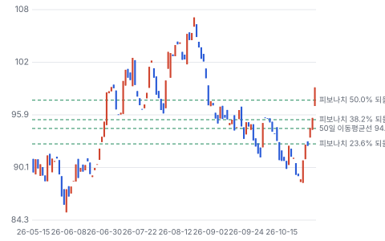

**주봉**

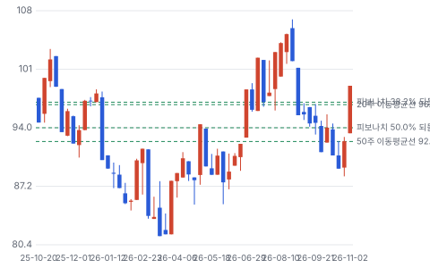

**월봉**

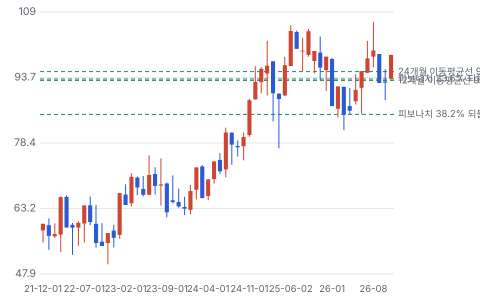

**분기 매출·EPS 실적과 컨센서스**

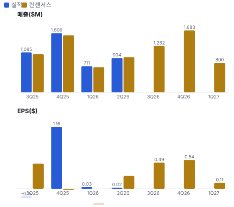

**최근 4개 분기 주가 변화 분석**

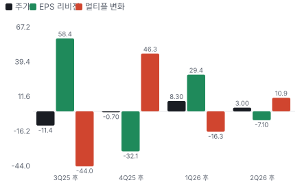

**EPS 리비전**

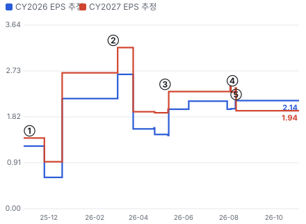

① 25-11-05 3Q25 실적 · EPS 리비전 +0%
② 26-02-26 4Q25 실적 · EPS 리비전 +18%
③ 26-05-07 1Q26 실적 · EPS 리비전 +22%
④ 26-08-06 2Q26 실적 · EPS 리비전 -16%
⑤ 26-08-11 전환사채 발행 · 실적 창과 겹침

**밸류에이션 주가 시나리오**

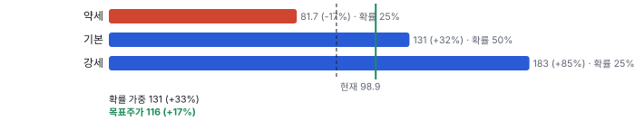

**주가별 업사이드**

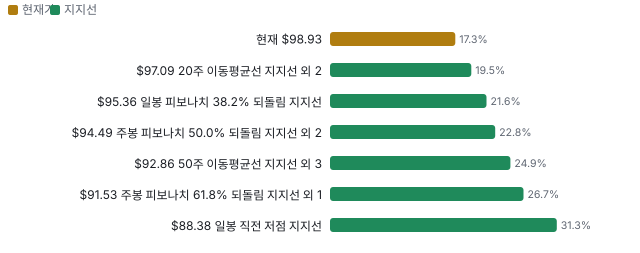

**제품·서비스 포트폴리오**

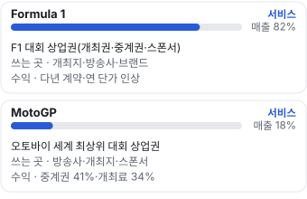

**고객 믹스(FY2025, 매출 대비)**

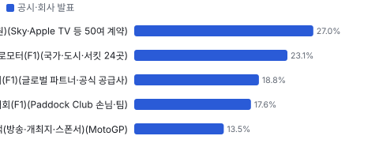

**공급 병목(10점, 낮을수록 병목)**

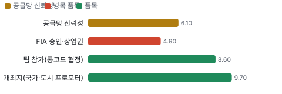

**생산능력 현재와 확충 계획(시즌당 F1 경기 수)**

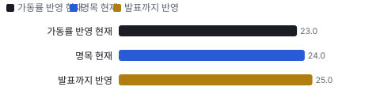

**CAPEX의 매출 대비 비중**

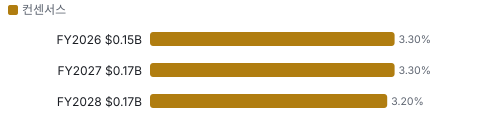

**어닝콜 변화별 주주가치 영향**

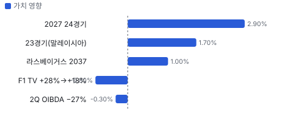

**멀티플 프리미엄**

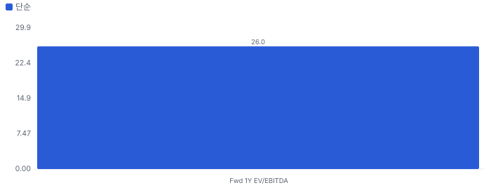

**합리적 멀티플**

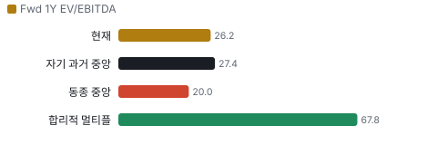

**일별 거래량 분해**

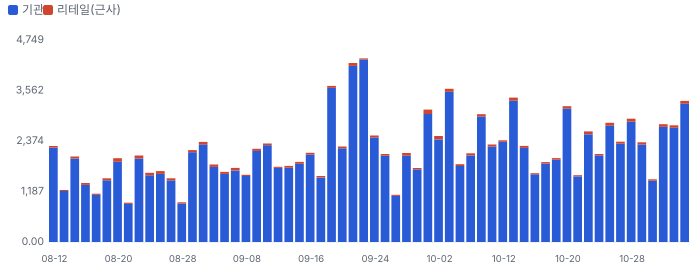

**기관 자금 흐름**

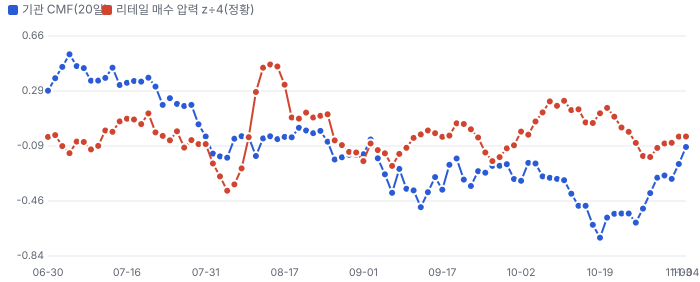

**몬테카를로**

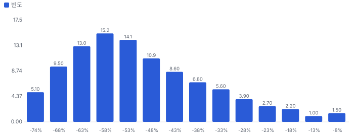

해석: 3,000번 중 17번(1%)에서 가치가 지금 주가 이상이었다. 가정을 흔들어도 지금 주가를 뒷받침하지 못하는 경우가 더 많다. 가운데 값은 0.46배이고, 열 번 중 여덟 번은 0.32~0.71배 사이에 든다.

## 내러티브

> **기업가치를 결정하는 이야기:** 기업가치는 세 가지로 정해진다 — 개최료·중계권·스폰서 단가가 매년 오르는 속도, 팀 상금 비율(콩코드 협정)이 그 이익을 얼마나 나눠 가지느냐, MotoGP가 F1의 수익 구조를 따라오느냐. 지금 가격은 Fwd 1Y EV/EBITDA 26배로 동종(TKO 19배·LYV 21배)보다 높다

> **멀티플·EPS 프리미엄**
> **멀티플:** Fwd 1Y EV/EBITDA 26.2배(2026년 경기 취소로 눌린 이익 기준), Fwd 2Y 22.8배 — 과거 월말 값(19.5~44.5배)은 애널리스트 1명의 추정을 분모로 써서 지금 값과 기준이 다르다 — 같은 기준의 10월 말 값은 19.5배
> **EPS:** GAAP EPS는 인수 무형자산 상각·이자·소수주주 몫 때문에 작다(Fwd 1Y P/E 78배) — 이익 지표로 EBITDA를 쓴다

### 투자자들은 왜 열광했나

넷플릭스 다큐와 라스베이거스 그랑프리로 미국 팬이 늘고, 2026년 Apple TV 중계로 젊은·여성 시청자가 들어왔다. 2026년 새 규정 첫해에 20세 Antonelli가 최연소 챔피언이 됐다. 열기가 식은 쪽은 실적이다 — 중동 2경기 취소로 2Q 조정 OIBDA가 컨센서스를 27% 밑돌았다

### 무엇이 기업가치를 바꾸나

> **구조적 체질 변화**
> **변화:** 트래킹 주식 정리 끝 — 2025-12 Liberty Live(Live Nation 지분을 담은 옛 트래킹 주식 — 2025-12-15 분리) 분리로 F1·MotoGP 단일 회사, 11/5 고의결권 해소
> **증거:** 10-Q·8-K
> **반증:** 새 지배주주 등장 또는 포이즌필 상시화

> **고부가 믹스 확장**
> **변화:** 스폰서 비중 18.6% → 21.7%(F1, 2024 → 2025), 호스피털리티·라스베이거스 직접 개최
> **증거:** 10-K
> **반증:** 스폰서 매출 성장이 개최료 성장보다 낮아진다

> **기술 혁신**
> **변화:** 해당 없음 — 2026년 새 차량 규정은 FIA·팀 몫이고 매출 구조를 바꾸지 않는다
> **증거:** 10-K
> **반증:** 해당 없음

> **실행 속도**
> **변화:** 해당 없음(납품이 없는 상업권 사업) — 대신 4월 경기 취소 뒤 말레이시아 대체 개최(10월)를 약 3개월 안에 성사
> **증거:** 2Q26 10-Q
> **반증:** 추가 취소 시 대체 개최 실패

> **M&A**
> **변화:** 2025-07 MotoGP 84% 인수(\$3.66B), 16% 소수주주 상환 권리
> **증거:** 10-Q
> **반증:** MotoGP 매출 성장 정체

> **정책·입법 연관성**
> **재정정책:** 해당 없음 — 연방 재정 지원 대상 아님 10-K 검색 반증: 해당 없음 의회 동의 2/10 — 하원 1/5(관련 세출 논의 없음) · 상원 1/5(같음).
> **행정명령:** 해당 없음 — 직접 관련 행정명령 없음. 중동 분쟁은 외교 변수 10-Q 반증: 해당 없음 의회 동의 0/10 — 하원 0/5(행정부 조치 없음) · 상원 0/5(같음).
> **연관입법:** 해당 없음 — 미국 스포츠 중계 관련 법안에 F1 직접 노출 공시 없음 10-K 반증: 해당 없음

> **CAPEX 낙수효과**
> **변화:** 해당 없음 — 서킷 투자는 개최지가 하고 회사는 개최료를 받는다
> **증거:** 10-K
> **반증:** 해당 없음

### 내러티브 근거

> 'F1은 미국에서 커지는 독점 스포츠 IP'라는 이야기는 컨센서스 등급 9명 전원 Strong Buy일 만큼 컨센서스다. 2026년은 중동 2경기 취소로 실적이 눌렸고, 11/5 말론 B주 교환으로 '지배주주 없는 회사 = 인수될 수 있는 회사'라는 새 이야기가 붙었다. 동종 대비 멀티플 차이 +31% 중 회사 고유 몫은 -61%다. 단계는 컨센서스, 쏠림은 중간이다.

> **미국 성장(Apple·라스베이거스)** · 유지
> **논리:** 미국이 F1의 다음 성장 시장이다
> **숫자:** 라스베이거스 티켓이 7월 말에 작년 9월 말 수준(회사)
> **반증:** 4Q 라스베이거스 매출이 작년보다 줄거나 Apple 시청 성장이 멈춘다

> **팀 상금 레버리지** · 유지
> **논리:** 매출이 팀 상금보다 빨리 늘어 마진이 오른다
> **숫자:** 1H26 팀 상금 비율 61.7%, 2027~2030 안정
> **반증:** FY26 팀 상금 비율이 전년보다 높게 끝난다

> **MotoGP에 F1 방식 이식** · 태동
> **논리:** MotoGP 중계권·스폰서가 F1처럼 재평가된다
> **숫자:** MotoGP 조정 OIBDA 1H26 \$92M — 연결의 24%
> **반증:** 2027년 MotoGP 매출 성장이 한 자릿수 초반에 머문다

> **지배주주 소멸·인수 옵션** · 태동
> **논리:** 말론 의결권이 사라져 회사가 인수 대상이 될 수 있다
> **숫자:** 교환 웃돈 = 시가총액의 1.5%(회사)
> **반증:** 포이즌필 연장 또는 1년 안에 제안 공시가 없다

> **반대 내러티브: 개최국 위험과 비싼 배수** · 정체
> **논리:** 중동 의존과 Fwd 1Y EV/EBITDA 26배가 성장 둔화를 견디지 못한다
> **숫자:** 동종 중앙 20.0배 대비 약 +31% 프리미엄
> **반증:** 2027 일정에 중동 경기가 그대로 열린다

## 포트폴리오

| 제품·서비스 | 구분 | 무엇 | 쓰는 곳 | 돈 버는 방식 | Mix | Mix 변화(전년 대비) |
|---|---|---|---|---|---|---|
| Formula 1 | 서비스 | F1 대회 상업권(개최권·중계권·스폰서) | 개최지·방송사·브랜드 | 다년 계약·연 단가 인상 | 미확인 | 미확인 |
| MotoGP | 서비스 | 오토바이 세계 최상위 대회 상업권 | 방송사·개최지·스폰서 | 중계권 41%·개최료 34% | 미확인 | 미확인 |

## 고객

> **FY2025 최대 고객 방송사(F1 중계권)(Sky·Apple TV 등 50여 계약) 27%, 상위 3곳 69%, 집중도 보통.** 공시·회사 발표로 확인한 몫은 매출의 100%이고, 나머지 고객 몫은 추정이거나 미분해다. 고객은 개최지(국가·도시·서킷 프로모터), 방송사, 스폰서, 호스피털리티·화물 이용자다. F1 매출의 26.7%가 개최료, 31.3%가 중계권, 21.7%가 스폰서, 나머지 약 20%가 호스피털리티·화물·F2(포뮬러 2 — F1 아래 단계 육성 대회)·F3(포뮬러 3 — F2 아래 단계 육성 대회)·라이선스다(10-K). 10-K에서 10% 넘는 단일 고객 공시는 찾지 못했다 — 50여 방송 계약과 24개 개최지로 분산돼 있다

**고객별 매출 몫(FY2025)**
| 고객 | 몫 | 변화 | 근거 |
|---|---|---|---|
| 방송사(F1 중계권)(Sky·Apple TV 등 50여 계약) | 27% | -2%p | 공시 |
| 개최지 프로모터(F1)(국가·도시·서킷 24곳) | 23% | -6%p | 공시 |
| 스폰서(F1)(글로벌 파트너·공식 공급사) | 19% | +0%p | 공시 |
| 호스피털리티·화물·하위 대회(F1)(Paddock Club(F1 경기장 안의 최고가 호스피털리티 상품) 손님·팀) | 18% | -2%p | 공시 |
| MotoGP 고객(방송·개최지·스폰서)(MotoGP) | 14% | +14%p | 공시 |

> **방송사(F1 중계권)(Sky·Apple TV 등 50여 계약)** · 공시
> **사는 것:** 경기 중계권·F1 TV(F1이 직접 파는 온라인 중계 구독 상품) 구독
> **추정 근거:** F1 매출 31.3% × F1/연결 비중 86.4%(FY25 F1 \$3.873B ÷ 연결 \$4.482B) · prior = 2024년 F1 32.8%(MotoGP 연결 전 단순 비교)

> **개최지 프로모터(F1)(국가·도시·서킷 24곳)** · 공시
> **사는 것:** 경기 개최권(라스베이거스는 직접 개최 티켓 매출 포함)
> **추정 근거:** F1 매출 26.7% × 86.4% · prior = 2024년 29.3%

> **스폰서(F1)(글로벌 파트너·공식 공급사)** · 공시
> **사는 것:** 트랙 광고·타이틀·디지털 노출
> **추정 근거:** F1 매출 21.7% × 86.4% · prior = 2024년 18.6%

> **호스피털리티·화물·하위 대회(F1)(Paddock Club 손님·팀)** · 공시
> **사는 것:** Paddock Club·화물 운송·F2·F3·라이선스
> **추정 근거:** F1 기타 매출 \$787M ÷ 연결 \$4.482B

> **MotoGP 고객(방송·개최지·스폰서)(MotoGP)** · 공시
> **사는 것:** MotoGP 중계권 41%·개최권 34%·스폰서 13%(MotoGP 매출 기준)
> **추정 근거:** 2025-07-03부터 연결 — 연결 매출에서 F1·기타를 뺀 몫(계산)

## 수주·파이프라인

> **2026-08-06 기준 4건.** 확정 \$16.85B.

**실행 속도와 방해 요인**
| 항목 | 상태 | 실행 속도 | 방해 요인 |
|---|---|---|---|
| 계약 잔여 수익(전사) | 확정 | 앞섬(계획 8%, +11%p), 이대로면 2028-12 완료 | 경기 취소 시 개최료·중계권 감액 조항 |
| 라스베이거스 그랑프리 10년 연장 | 확정 | 미확인 | 시 당국·카지노 협조 |
| Sky 영국(2034)·이탈리아(2032) 연장 | 확정 | 미확인 | 미확인 |
| 튀르키예 이스탄불 5년 복귀 | 확정 | 미확인 | 미확인 |

## 마진 구조

> **GPM 35.2%, OPM 9.4%.** 2Q25 대비 GPM -0.1%p, OPM -11.5%p. 변동비는 매출의 47%이고, 매출이 10% 늘면 OPM은 +3.9%p 움직인다. 2Q26 매출 \$934M에서 팀 상금 \$316M(34%)과 기타 매출원가 \$289M(31%, 호스피털리티·화물·라스베이거스 운영·MotoGP 원가)이 빠져 매출총이익 \$329M, 판관비 \$129M·D&A \$112M을 빼 GAAP 영업이익 \$88M이다. 팀 상금은 'F1 팀 몫 전 조정 OIBDA'의 일정 비율이라 매출이 늘면 같이 늘고, 비율은 2026년 약 200bp 낮아진 뒤 2030년까지 안정이다

> **매출 100 중 매출원가 64.5, 매출총이익 35.5(최근 4분기, 공시).** 매출원가 요인 중 F1 팀 상금(프라이즈 펀드)이 매출의 33.8%로 가장 무겁고, 단가가 +10% 오르면 GPM이 -3.38%p 움직인다. 분기 회귀로 매출 1이 늘 때 매출원가는 0.34 늘고, 매출원가의 고정비 몫은 25%다.

**비용 요인 강도 — 비중·추세·충격(+10%)·탄력**
| 비용 | 구분 | 매출 대비 | 1년 변화 | 마진 기여 | 충격 시 마진 | 매출 탄력 | 고정비 몫 |
|---|---|---|---|---|---|---|---|
| F1 팀 상금(프라이즈 펀드) | 매출원가 요인 | 33.8% | 미확인 | 미확인 | -3.38%p | 미확인 | 10% |
| 기타 매출원가(호스피털리티·화물·라스베이거스·MotoGP) | 매출원가 요인 | 30.9% | 미확인 | 미확인 | -3.09%p | 미확인 | 50% |
| 매출원가 | 공시 항목 | 64.5% | -3.9%p | +3.9%p | -6.45%p | 0.34 | 25% |
| 판관비 | 공시 항목 | 12.5% | +1.1%p | -1.1%p | 미확인 | 0.15 | 4% |
| 감가상각 | 공시 항목 | 10.6% | +2.0%p | -2.0%p | 미확인 | 0.08 | 13% |

매출 탄력 = 분기 비용을 매출에 회귀한 기울기(매출 1당 변동비), 고정비 몫 = 절편 ÷ 평균 비용. 표본이 8분기 미만이면 미확인. 매출원가 요인 비중은 margin 재료의 추정이 섞여 있고, 공시 매출원가와의 차이는 '기타 매출원가'로 둔다.

**GPM에서 OPM까지(GAAP)**
| 기간 | GPM | 연구개발 | 판관비 | 기타 | OPM |
|---|---|---|---|---|---|
| 2Q25 | 35.3% | 0.0% | 8.3% | 6.2% | 20.9% |
| 2Q26 | 35.2% | 0.0% | 13.8% | 12.0% | 9.4% |

**마진을 결정하는 비용 요인 — 비용 +10% 시 OPM**
| 비용 | 매출 대비 | 변화 | 고정비 | OPM |
|---|---|---|---|---|
| F1 팀 상금(프라이즈 펀드) | 33.8% | 미확인 | 10% | -3.38%p |
| 기타 매출원가(호스피털리티·화물·라스베이거스·MotoGP) | 30.9% | 미확인 | 50% | -3.09%p |
| 판관비(주식보상 포함) | 13.8% | +5.5%p | 90% | -1.38%p |
| 감가상각·무형자산 상각 | 12.0% | +6.0%p | 100% | -1.20%p |

**비용을 움직이는 요인**
| 비용 | 요인 |
|---|---|
| F1 팀 상금(프라이즈 펀드)(매출원가) | 팀 몫 전 OIBDA × 콩코드 협정 배분율(1H26 61.7%) · 근거 공시 |
| 기타 매출원가(호스피털리티·화물·라스베이거스·MotoGP)(매출원가) | 경기 수·라스베이거스 직접 개최·MotoGP 원정 경기 비중 · 근거 공시 |
| 판관비(주식보상 포함)(판관비) | 인력·마케팅·MotoGP 조직 구축 · 근거 공시 |
| 감가상각·무형자산 상각(기타) | MotoGP 인수 무형자산 상각(2025-07~) · 근거 공시 |

**Formula 1 BOM — 매출의 82%, GPM 30%(공시 — 2Q26 F1 매출원가 \$536M(팀 상금 \$316M + 기타 \$220M)), 항목 가격 +10% 시**
| 항목 | 원가 몫 | 전가 | 제품 GPM | OPM |
|---|---|---|---|---|
| 팀 상금(콩코드 배분) | 51% | 미확인 | -3.6%p | -2.93%p |
| 호스피털리티·화물·라스베이거스 운영 | 35% | 미확인 | -2.5%p | -2.01%p |
| F1 판관비 | 14% | 0% | -1.0%p | -0.80%p |

**MotoGP BOM — 매출의 18%, GPM 56%(공시 — 2Q26 MotoGP 매출원가 \$75M), 항목 가격 +10% 시**
| 항목 | 원가 몫 | 전가 | 제품 GPM | OPM |
|---|---|---|---|---|
| IRTA(MotoGP 팀 협회(International Road Racing Teams Association) — 팀 지원금을 받는 쪽) 팀 지원금·라이더 비용 | 35~50% | 미확인 | -1.9%p | -0.34%p |
| 원정 경기 화물·이동 | 20~35% | 0% | -1.2%p | -0.22%p |
| MotoGP 판관비 | 17~23% | 0% | -0.9%p | -0.16%p |
| 미분해 | 10% | - | - | - |

팀 상금(콩코드 배분) 가격이 +10% 오르면 영업이익은 -31.1% 움직인다. 판매가 전가를 모르는 항목은 전가 0%로 계산했다.

**BOM 항목 가격을 움직이는 것**
| 항목 | 요인 |
|---|---|
| 팀 상금(콩코드 배분) | 2Q26 \$316M ÷ F1 비용 \$625M — 이익에 연동돼 매출이 줄면 함께 준다(자동 완충) · 근거 공시 |
| 호스피털리티·화물·라스베이거스 운영 | 2Q26 기타 매출원가 \$220M ÷ \$625M — 경기 수·항공 화물 단가에 연동 · 근거 공시 |
| F1 판관비 | 2Q26 \$89M ÷ \$625M — 고정비 성격 · 근거 공시 |
| IRTA 팀 지원금·라이더 비용 | 10-K: 팀은 IRTA를 통해 지원금을 받는다 — 금액 비중은 미공시 · 근거 추정 |
| 원정 경기 화물·이동 | CFO: 원정(플라이어웨이) 경기는 화물·이동·IRTA 비용이 더 크다 · 근거 추정 |
| MotoGP 판관비 | 2Q26 \$19M ÷ MotoGP 비용 \$94M = 20% · 근거 공시 |

## 공급망 병목

> **공급망 신뢰성 6.1/10, 관리 가능.** 가장 약한 고리는 FIA 승인·상업권 4.9점이고, 품목 평균은 7.7점이다. 근거가 부족한 1건(항공·해상 물류)은 점수에서 뺐다. 공급망은 부품이 아니라 '경기를 열 수 있는 권리와 사람'이다. 필수 투입은 FIA 승인(2110년까지 독점 상업권), 11개 팀의 참가(콩코드 협정 2026~2030), 개최지(2028년까지 일정 배정 완료), 경기마다 장비를 옮기는 항공·해상 물류다. 2026년에 개최지 병목이 처음 드러났다 — 중동 분쟁으로 바레인·사우디 4월 경기가 열리지 못했다

**병목과 마진 — 품목 가격 +10% 시 OPM**
| 품목 | 점수 | 판정 | 구분 | OPM |
|---|---|---|---|---|
| FIA 승인·상업권(필수) | 4.9 | 병목 주의 | 출하 차질 위험 | 미확인 |
| 팀 참가(콩코드 협정)(필수) | 8.6 | 병목 낮음 | 일반 | 미확인 |
| 개최지(국가·도시 프로모터)(필수) | 9.7 | 병목 낮음 | 일반 | 미확인 |

> **FIA 승인·상업권** · 4.9/10
> **왜:** 단일 공급원이지만 계약 기간이 길다
> **병목 요인:** 인증 공급사 1곳 · 캐파 여유 · 리드타임 미확인 · 재인증 미확인 · 1위 점유율 100% · 프랑스(FIA 본부) 집중 100% · 물량 확보 장기계약
> **풀리는 조건:** 해당 없음

> **팀 참가(콩코드 협정)** · 8.6/10
> **왜:** 다음 협정(2031~) 협상 때 배분율이 쟁점이 된다 · 팀 1곳 몫 1/11, 영국 기반 팀 6곳(Red Bull(오스트리아 음료 회사 레드불의 F1 팀)·Mercedes(독일 자동차 회사 메르세데스의 F1 팀)·McLaren(영국 F1 팀 맥라렌)·Williams(영국 F1 팀 윌리엄스)·Aston Martin(영국 F1 팀 애스턴마틴)·Alpine(르노 계열 F1 팀 알핀), 추정)
> **병목 요인:** 인증 공급사 11곳 · 캐파 균형 · 리드타임 미확인 · 재인증 미확인 · 1위 점유율 9% · 영국·이탈리아 중심 집중 55% · 물량 확보 장기계약
> **풀리는 조건:** 해당 없음

> **개최지(국가·도시 프로모터)** · 9.7/10
> **왜:** 중동 분쟁이 이어지면 추가 변경 가능(회사) · 유럽 개최 약 10곳/24(추정), 중동 4곳
> **병목 요인:** 인증 공급사 24곳 · 캐파 여유 · 리드타임 미확인 · 재인증 미확인 · 1위 점유율 4% · 유럽·중동·미주·아시아 집중 42% · 물량 확보 장기계약
> **풀리는 조건:** 미확인

**공급사**
| 품목 | 공급사 | 몫 | 근거 |
|---|---|---|---|
| FIA 승인·상업권 | FIA(규정·승인·일정 승인) | 미확인 | 공시 |
| 팀 참가(콩코드 협정) | F1 11개 팀(2026년 Cadillac(GM 계열 F1 팀 — 2026년 11번째 팀으로 참가) 합류)(경주 참가) | 미확인 | 공시 |
| 개최지(국가·도시 프로모터) | 24개 개최지 프로모터(경기 개최·개최료 지급) | 미확인 | 공시 |
| 항공·해상 물류 | DHL(공식 물류 파트너) | 미확인 | 보도 |

## 생산능력

> **현재 명목 캐파 24 시즌당 F1 경기 수, 가동률 96%.** 착공 이상 증설은 0 시즌당 F1 경기 수, 발표까지 합치면 1 시즌당 F1 경기 수이다. 다 가동하면 지금보다 +4%, 착공 이상만이면 +0%다. FY2028 CAPEX는 \$0.17B로 매출의 3.2%다. 생산능력은 시설이 아니라 경기 수다. 협정상 24경기가 상한이고(팀 동의 없이 초과 불가), 2026년은 중동 2경기 취소 뒤 말레이시아 대체로 23경기다. 2027년 24경기 복귀와 스프린트 확대가 회사 계획이다. MotoGP는 2026년 22경기

**생산능력 확충 계획**
| 계획 | 단계 | 증설 | 가동 시점 | CAPEX |
|---|---|---|---|---|
| 2027년 24경기 복귀(튀르키예 5년 복귀 포함) | 발표 | 1 시즌당 F1 경기 수 | 2027-03 | 미확인 |
| 스프린트 경기 확대 | 발표 | 미확인 | 2027 | 미확인 |
| Paddock Club·오스틴 1번 코너 시설 확장 | 착공 | 미확인 | 2026-10 | 미확인 |

남은 계획의 CAPEX 합계는 \$0.00B(금액 미확인 3건 제외)다. 합계는 FY2028 매출의 0%다.

**증설 방해 요인**
| 계획 | 방해 요인 |
|---|---|
| 2027년 24경기 복귀(튀르키예 5년 복귀 포함) | 중동 분쟁 |
| 스프린트 경기 확대 | 팀 동의·개최지 수요 |
| Paddock Club·오스틴 1번 코너 시설 확장 | 미확인 |

**CAPEX와 매출 대비**
| 기간 | CAPEX | 매출 | 매출 대비 | 구분 |
|---|---|---|---|---|
| FY2026 | \$0.15B | \$4.59B | 3.3% | 컨센서스 |
| FY2027 | \$0.17B | \$5.08B | 3.3% | 컨센서스 |
| FY2028 | \$0.17B | \$5.50B | 3.2% | 컨센서스 |

## M&A 시너지

> **MotoGP(옛 Dorna(MotoGP 상업권 회사의 옛 이름(Dorna Sports)) Sports) 인수(2025-07-03, \$3.66B): 시너지가 다 나면 연 \$0.02B(확률 가중 이익 기여), 인수 배수 EV/EBITDA 19.3배 → 시너지 반영 17.6배.** 세후 시너지 가치는 통합 비용을 빼고 \$0.12B. EPS 효과는 2026년 +13.1%에서 2029년 +15.0%.

**MotoGP(옛 Dorna Sports) 시너지가 생기는 길**
| 종류 | 시너지 | 연 규모 | 완성 | 확률 | 어떻게 생기나 | 근거 |
|---|---|---|---|---|---|---|
| 매출 | 중계권·스폰서 재계약(F1 방식) | \$0.10B(이익률 50%) | 2029 | 30% | F1이 쓴 중계권 묶음 판매·글로벌 스폰서 영업·호스피털리티를 MotoGP에 옮긴다 — 2026년 스페인·포르투갈 신규 중계 계약 | 추정 — 회사는 시너지 금액을 밝히지 않았다 |
| 원가 | 제작·물류 공동 조달 | \$0.01B | 2028 | 30% | 중계 제작·화물 계약을 함께 맺는다 | 추정 — 회사 발표 없음 |

시너지 가치 = 세후 이익 기여 5년 + 말기 가치(할인율 9%, 성장 0) − 통합 비용. 매출 시너지는 그 매출의 이익률만 반영하고, 모든 시너지에 실현 확률을 곱했다.

## 해자

> 해자는 FIA와 맺은 2110년까지의 독점 상업권, 콩코드 협정으로 묶인 11개 팀, 그리고 24경기 상한이 만드는 개최권 희소성이다. 경쟁 대회가 같은 위상을 만들려면 팀·제조사·FIA 승인을 동시에 가져와야 한다

> **독점 상업권** · 강함
> **해자:** F1 상업권을 2110년 말까지 독점한다
> **근거:** 10-K: 100년 계약(100-Year Agreements)
> **숫자:** 잔여 84년
> **깨지는 조건:** FIA가 계약 해석·규정 권한으로 상업 결정을 제약한다

> **팀 참가 고정** · 강함
> **해자:** 11개 팀이 2030년까지 참가를 약속했다
> **근거:** 10-K: 2026 콩코드 협정(2026~2030)
> **숫자:** 팀 상금 비율 2030년까지 대체로 안정(CFO)
> **깨지는 조건:** 2031년 협정 협상에서 팀 배분율이 크게 오른다

> **개최권 희소성** · 보통
> **해자:** 24경기 상한과 대기 수요가 개최료 단가를 받친다
> **근거:** F1 CEO: 2028년까지 일정 배정 완료, 튀르키예 복귀
> **숫자:** 개최료 = F1 매출 26.7%(FY25)
> **깨지는 조건:** 개최료 갱신 단가 하락 또는 개최지 이탈

> **계약 잔고** · 강함
> **해자:** 4년치 매출이 계약돼 있다
> **근거:** 10-K 잔여 이행 의무 \$16.9B
> **숫자:** 잔고 ÷ TTM 매출 3.9배
> **깨지는 조건:** 경기 취소가 반복돼 감액 조항이 발동한다

## 경영진·네트워크

> Liberty CEO Derek Chang(2025년 취임), F1 CEO Stefano Domenicali, MotoGP CEO Carmelo Ezpeleta가 사업을 이끈다. 최대 의결권자였던 John Malone은 11/4 고의결권 B주를 모두 넘기고 의결권 약 48% → 약 3%가 됐으며 명예회장에서 물러나 고문으로 남는다. 공개 자료로 확인한 범위에서 경영진의 정계 연결이 매출로 이어진 근거는 없다

> **Derek Chang** · Liberty Media 사장·CEO · 2025
> **프로필:** 2Q 콜 진행·자본 배분 답변
> **비즈니스:** 미확인
> **정계:** 미확인
> **동문:** 미확인
> **사모임:** 미확인

> **Stefano Domenicali** · Formula One 사장·CEO · 2021
> **프로필:** 개최지·중계권·스폰서 협상
> **비즈니스:** 미확인
> **정계:** 미확인
> **동문:** 미확인
> **사모임:** 미확인

> **Carmelo Ezpeleta** · MotoGP CEO · 미확인
> **프로필:** MotoGP 경영(인수 뒤 지분 일부 보유한 롤오버 매도인 쪽)
> **비즈니스:** 미확인
> **정계:** 미확인
> **동문:** 미확인
> **사모임:** 미확인

> **John C. Malone** · 고문(11/4부터, 전 명예회장) · 미확인
> **프로필:** B주 2,316,537주를 A·C주로 교환(1주당 2.6주) — 의결권 약 3%
> **비즈니스:** 미확인
> **정계:** 미확인
> **동문:** 미확인
> **사모임:** 미확인

**네트워크 정량화**
| 연결 | 강도 | 닿는 매출 | 가중 노출 | 매출 대비 | 근거 |
|---|---|---|---|---|---|
| 비즈니스: 특별위원회 의장 Chase Carey는 전 F1 회장 — 교환 협상을 맡았다(11/5 보도자료) | 1/5 | \$0.00B | \$0.00B | 0% | 매출 연결 근거 없음 https://www.sec.gov/Archives/edgar/data/1560385/000110465926123092/tm2628888d1_ex99-1.htm |

가중 노출은 연결이 닿는 매출의 크기다. 연결이 그 매출을 만들었다는 뜻이 아니며, 인과는 공개 자료로 입증하지 못한다.

## 약세 논리 및 셀온 조건

| 약세 논리 | 근거 | 반박 | 가를 자료 |
|---|---|---|---|
| 배수가 이미 비싸다 | Fwd 1Y EV/EBITDA 26.2배(원자료 기준) vs 동종 중앙 20.0배(+31%), DCF 업사이드 −53% | 2026 이익은 중동 2경기 취소로 눌린 값 — Fwd 2Y는 22.8배 | 4Q26·FY26 조정 OIBDA(2027-02 하순) |
| 개최지 위험이 숫자로 드러났다 | 2026년 바레인·사우디 4월 경기 취소, 2Q 조정 OIBDA 컨센서스 대비 −27% | 말레이시아 대체 개최로 23경기, 팀 상금이 이익에 연동돼 일부 완충 | 2027 F1 일정 발표(FIA 세계모터스포츠평의회, 통상 연말) |
| 마진 레버리지가 끝나간다 | 팀 상금 비율 2026년 −200bp 뒤 2030년까지 '대체로 안정'(CFO) | 매출이 늘면 이익 금액은 계속 는다 — FY28 EBITDA 컨센서스 \$1.385B | FY26 팀 상금 비율(10-K, 2027-02) |
| 인수 프리미엄은 막혀 있다 | 포이즌필: 10%(수동 기관 15%) 이상 취득 시 희석, 2027-11-03까지 | 포이즌필은 이사회 협상력을 높이는 장치 — 제3자 제안이 이미 말론에게 왔다(회사) | 13D 제출·인수 제안 공시 |
| MotoGP가 비용만 늘린다 | MotoGP 판관비·조직 구축(Seaport 질문), 1H26 영업이익 \$13M | 1H26 조정 OIBDA \$92M(+10%, 비교 기준) | 3Q26 MotoGP 세그먼트(11/5 콜) |
| 데이터 공백 — 검증 미통과 2건 | 회사가 숫자 가이던스를 내지 않는다. 원자료 시가총액 \$24.80B는 7/31 주식 수 기준이라 교환 반영 주식 × 종가 \$25.18B와 1.5% 다르다. 현금 \$2.06B는 2032 전환사채 순조달을 더한 프로포마이고 캡드콜 비용·3Q 현금흐름은 반영 전이다 | 잔고 \$16.9B와 팀 상금 비율 지침이 가이던스 역할. 시총 차이는 교환 순증 378만 주 | 3Q26 10-Q 표지 주식·재무상태표(11월 초) |

## 어닝콜 변화

**직전 콜 대비 새로 나오거나 바뀐 내용 → 가치 영향**
| 항목 | 내용 | 직전 콜 | 최신 콜 | 모델 동인 이동 | 확신도 | 가치 영향 |
|---|---|---|---|---|---|---|
| 업데이트 | 2026 경기 수 | 22경기(바레인·사우디 취소) | 23경기 — 말레이시아가 10월 바레인 그랑프리 대체 | 기준연도 매출 +\$0.06B | 0.8 | +1.7% |
| 신규 | 라스베이거스 연장 | 계약 기간 미공시 | 10년 연장, 2037년까지 | 성장 지속(감속 계수) +2.0% | 1.0 | +1.0% |
| 신규 | 2027 24경기·스프린트 확대 | 언급 없음 | 2027년 24경기 복귀, 스프린트 확대 | 1년차 성장률 +1.0% | 0.5 | +2.9% |
| 반복 | 팀 상금 레버리지 | 연 약 200bp 개선 | 연 약 200bp 개선, 2030년까지 안정 | 목표 이익률 — | 0.8 | +0.0% |
| 부정 | F1 TV 성장 둔화 | 1Q +28% | 연초 누적 +18%(미국 제외) | 1년차 성장률 -0.30% | 1.0 | -0.8% |
| 부정 | 2Q 조정 OIBDA 하회 | 컨센서스 \$283M | \$206M | 출발 이익률 -1.0% | 1.0 | -0.3% |
| 신규 | 2032 전환사채 | 2027 전환사채 \$475M뿐 | 2032년 2.375% \$600M(전환가 \$138.68), 2027년분 상환 재원 | 순차입 — | 1.0 | +0.0% |
| **합계** | 단독 합 |  |  | 동시 적용 +4.4% |  | **+4.4%** |

**사건별 EPS 리비전**
| # | 날짜 | 구분 | 사건 | CY2026 EPS 전→후 | CY2027 EPS 전→후 | 리비전 | 주가 반응 |
|---|---|---|---|---|---|---|---|
| ① | 25-11-05 | 실적 | 3Q25 실적 | \$1.24 → \$1.24 | \$1.40 → \$1.40 | +0.0% | +0.7% |
| ② | 26-02-26 | 실적 | 4Q25 실적 | \$2.18 → \$2.66 | \$2.69 → \$3.19 | +18.4% | -3.1% |
| ③ | 26-05-07 | 실적 | 1Q26 실적 | \$1.47 → \$1.97 | \$1.90 → \$2.32 | +22.1% | +5.4% |
| ④ | 26-08-06 | 실적 | 2Q26 실적 | \$1.98 → \$2.14 | \$2.31 → \$1.94 | -16.0% | +3.8% |
| ⑤ | 26-08-11 | 내러티브 | 전환사채 발행 | \$2.14 → \$2.14 | \$2.39 → \$1.94 | 실적 창과 겹침 | -0.3% |

**해석:** 4개 구간 누적 주가 -2% = EPS 리비전 +29% × 멀티플 -24%. 더 크게 움직인 쪽은 **EPS 리비전**이다.

## 밸류에이션

> **목표주가 \$116, 업사이드 +17%.** 자리는 약세와 기본 사이(약세 쪽 29%)이고 도달 확률은 약 61%다. 기본 \$131, 강세 \$183(+85%), 약세 \$82(-17%). DCF 기준 업사이드는 기본 -53%, 강세 -36%, 약세 -64%다(WACC 8.6%).

배수 기준 기본 \$131(+32%)과 DCF −53%는 방향이 반대다. 배수 쪽은 4Q27~3Q28 조정 EBITDA \$1.36B에 엔진이 고른 Fwd 1Y EV/EBITDA 27.9배를 곱하고 순차입 \$3.68B를 뺀 값이다. 27.9배는 동종 중앙 20.0배에 펀더멘털·해자·반복 매출 프리미엄을 더한 값으로, 시장이 이런 독점 IP에 실제로 주는 값이다. DCF는 FY27 +10.7%·FY28 +8.3% 뒤 3.5%로 수렴하고 EBITA 이익률을 25%까지 올려도, WACC 8.65%에서 기업가치가 다음 해 EBITDA의 약 13배밖에 안 나온다. 차이는 할인율과 성장 지속 기간이다. 지금 가격은 5년 매출 CAGR 23%를 요구하는데, 기저율로 상위 21%에 해당한다. 할인율 +50bp는 가치를 −8%(듀레이션 약 16년) 움직인다. 시장이 F1을 채권처럼 낮은 할인율로 보거나, 미국 성장·인수 옵션에 값을 준다는 뜻이다. 그래서 목표주가 \$116은 기본 \$131이 아니라 약세 쪽에 더 가깝게 놓였다.

> **약세 \$82 (-17%)** · 확률 25%
> **가정:** 20.9배 × EBITDA \$1.20B
> **근거:** 중동 분쟁으로 2027 일정에서도 1~2경기가 빠지고, 미국 시청 성장이 멈춰 스폰서 갱신 단가가 둔화한다. MotoGP 비용 투자가 이어져 4Q27~3Q28 조정 EBITDA가 \$1.20B(컨센서스 \$1.38B의 87%)에 그친다

> **기본 \$131 (+32%)** · 확률 50%
> **가정:** 27.9배 × EBITDA \$1.36B
> **근거:** 2027년 24경기 복귀, 개최료·중계권 연 단가 인상, 팀 상금 비율 안정 — 4Q27~3Q28 조정 EBITDA 컨센서스 \$1.38B에서 MotoGP 성장 투자를 뺀 \$1.36B

> **강세 \$183 (+85%)** · 확률 25%
> **가정:** 34.8배 × EBITDA \$1.48B
> **근거:** 스프린트 확대·라스베이거스·Paddock Club 확장과 MotoGP 중계권 재계약이 겹쳐 \$1.48B. 지배주주가 사라져 배수가 동종 위로 유지된다

**멀티플 선정 — Fwd 1Y EV/EBITDA**
| 단계 | 조정 | 근거 |
|---|---|---|
| 동종 중앙값 | 20.0배 | 범위 14.7~73.3배, 4곳 |
| 펀더멘털 | +20% | 성장·이익률·ROIC로 본 합리적 멀티플 67.8배와의 차이의 일부만 인정 |
| 해자 | +12% | 독점 상업권 강함 · 팀 참가 고정 강함 · 개최권 희소성 보통 · 계약 잔고 강함 |
| 반복 매출 | +8% | 반복 매출 75%(동종 50%) · 다년 계약 개최료·중계권·스폰서(연 단가 인상 조항) · 이미 반복 단계 · 기반 개최지 24곳·방송 계약 50여 개(10-K) |
| 수주 전환·가시성 | +0% | 재료 없음 |
| 내러티브 | +0% | 단계 컨센서스 |
| 사이클·실행 판단 | +0% | 2110년까지 독점 상업권·계약 잔고 .9B의 가시성 프리미엄은 해자·반복 매출 단계에서 이미 반영했다. 남은 판단은 상쇄된다 — 2027년 24경기 정상화(+)와 2026년 중동 2경기 취소로 드러난 개최국 위험(−) |
| **선정** | **27.9배** | 지금 26.2배 |

**동종 레인지**
| 회사 | Fwd 1Y EV/EBITDA | 성장 | 영업이익률 | ROIC |
|---|---|---|---|---|
| TKO | 19.2 | 28% | 22% | 12% |
| LYV | 20.7 | 11% | 3% | 16% |
| MANU | 14.7 | 2% | 3% | 2% |
| BATRK | 73.3 | 6% | -13% | -6% |
| **Formula One Group(Liberty Media의 F1·MotoGP 사업을 담은 상장 주식(FWONA·FWONK))** | 26.2 |  |  |  |

지금 주가가 요구하는 5년 매출 CAGR 23%, 기본 시나리오 7%. 몬테카를로 중앙값 업사이드 -54%.

> 의사결정 보조(투자자문 아님): ① 매수 매력: 연 기대수익 -5.9% (자기자본비용 9.2% 대비 -15.1%p) · 자본비용 초과 확률 0% · 안전마진 0.32 → 정량 신호 약함 / ② 위험 예산 지표(이론): 0% — 기대수익이 자기자본비용에 못 미침(무위험 대비 켈리 0%는 참고) · 5년 하위10% -52% · 30%+ 손실 확률 51% / ③ 상방(5년): 기대 0.74배 · 2배 0% · 3배 0% · 10배 0% · 상위10% 1.06배

## 매수 위치(일봉)

> **현재가 \$98.93는 '중간'(가장 가까운 일봉 지지 \$97.52에서 ATR 1.0배 위).** 이 자리에서 목표주가까지 +17.3%, 첫 일봉 저항까지 +0.8%, 다음 지지까지 하방 -1.4%, 손익비 12.1배. 손익비는 지지 1 \$97.52에서 14.7배로 가장 높다(목표주가까지 +18.9%).

**가격대별 업사이드(일봉 기준)**
| 가격대 | 가격 | 목표주가까지 | 첫 저항까지 | 다음 지지까지 | 손익비 | 근거 기법(강도) |
|---|---|---|---|---|---|---|
| 현재가 | \$98.93 | +17.3% | +0.8% | -1.4% | 12.1 | - |
| 지지 1 | \$97.52 | +18.9% | +2.2% | -1.3% | 14.7 | 피보 50.0%(1.0) |
| 지지 2 | \$96.27 | +20.5% | +1.3% | -1.4% | 14.2 | 120일 지그재그 저점(0.8) |
| 지지 3 | \$94.88 | +22.3% | +1.5% | -2.3% | 9.7 | 50일선 · 피보 38.2%(2.0) |
| 지지 4 | \$92.69 | +25.1% | +2.4% | 미확인 | 미확인 | 피보 23.6%(1.0) |

**일봉 저항**
| 저항 | 가격 | 현재가 대비 | 근거 기법(강도) |
|---|---|---|---|
| 저항 1 | \$99.68 | +0.8% | 피보 61.8%(1.0) |
| 저항 2 | \$102 | +3.4% | 120일 지그재그 고점 · 피보 78.6%(1.8) |
| 저항 3 | \$107 | +7.8% | 120일 지그재그 고점 · 스윙 고점(1.8) |

일봉만 쓴다(주봉·월봉 제외). 손익비 = 목표주가까지 업사이드 ÷ 다음 지지까지 하방. 가격대별 기대값 참고표이며 매수·매도 시점 지시가 아니다.

## 애널리스트 토론

> **토론 결론 Neutral(규칙 등급 Neutral).** 규칙 등급을 출발점으로 둔다. 2027년 정상화와 계약 잔고는 강점이지만 Fwd 1Y 26배가 이미 동종 중앙 대비 31% 프리미엄이고 오늘 +7%가 지배구조 이야기를 일부 반영했다 — 3Q 실적 확인 전이라 등급을 옮기지 않는다

**패널(가상 애널리스트)**
| 자리 | 애널리스트 | 핵심 논리 | 틀리는 조건 | 최종 투표 |
|---|---|---|---|---|
| Strong Buy | 한서윤(가상 리서치 하우스 한빛자산) | 2027년 24경기 복귀로 EBITDA가 다시 뛰고 인수 옵션까지 생겼다 | 2027 일정에서 중동 경기 다시 취소 | Buy |
| Buy | 정태오(가상 리서치 하우스 누리증권) | 독점 상업권과 4년치 잔고는 동종보다 높은 배수를 정당화한다 | 개최료 갱신 단가 하락 | Buy |
| Neutral | 윤가람(가상 리서치 하우스 다솜리서치) | 좋은 자산이지만 26배는 좋은 소식을 이미 담았다 | 3Q·4Q 조정 OIBDA가 컨센서스를 10% 넘게 웃돈다 | Neutral |
| Sell | 강민재(가상 리서치 하우스 은하증권) | 중동 의존과 팀 상금 비율 상한이 마진 상승을 막는다 | FY27 조정 OIBDA 마진 26% 초과 | Neutral |
| Strong Sell | 오지후(가상 리서치 하우스 가람투자) | 포이즌필이 인수 프리미엄을 막고 성장은 단가 인상뿐이다 | 1년 안에 인수 제안 공시 | Neutral |

**투표**
| Strong Buy | Buy | Neutral | Sell | Strong Sell |
|---|---|---|---|---|
| 0 | 2 | 3 | 0 | 0 |

> **개회 · Strong Buy**
> **발언:** 2026년 이익은 두 경기 취소로 눌린 값이다. FY27 EBITDA 컨센서스 \$1.265B는 FY26 \$1.115B보다 13% 많다

> **개회 · Buy**
> **발언:** 10-K 잔고 \$16.9B는 TTM 매출의 3.9배다. 이 정도 가시성은 TKO 말고는 없다

> **개회 · Neutral**
> **발언:** 자산은 최고다. 다만 Fwd 1Y 26배는 동종 중앙 20.0배(P/B를 잴 수 있는 4곳)보다 31% 높다

> **개회 · Sell**
> **발언:** 중동 두 곳이 빠지자 2Q OIBDA가 컨센서스를 27% 밑돌았다. 개최지 위험이 숫자로 확인됐다

> **개회 · Strong Sell**
> **발언:** 말론이 빠졌다고 인수가 쉬워진 게 아니다. 이사회는 바로 포이즌필을 걸었다

> **반박1 · Strong Buy → Strong Sell**
> **발언:** 포이즌필은 헐값 매집을 막는 장치이지 모든 제안을 막는 장치가 아니다. 제3자 제안이 이미 말론에게 왔다

> **반박1 · Buy → Sell**
> **발언:** 취소 경기는 팀 상금으로 상당 부분 완충된다 — 팀 몫이 이익에 연동되기 때문이다

> **반박1 · Neutral → Strong Buy**
> **발언:** Fwd 2Y로 보면 22.8배다. 2027년 정상화를 반영해도 동종보다 비싸다

> **반박1 · Sell → Buy**
> **발언:** 팀 상금 비율이 2030년까지 안정이라면 마진 개선은 2026년 200bp가 마지막이다

> **반박1 · Strong Sell → Buy**
> **발언:** 잔고는 경기 취소 감액 조항을 안고 있다. 가시성이 생각보다 낮다

> **반박2 · Strong Buy → Sell**
> **발언:** 비율이 안정이어도 매출이 늘면 이익 금액은 는다. FY28 EBITDA 컨센서스는 \$1.385B다

> **반박2 · Buy → Strong Sell**
> **발언:** 튀르키예 복귀와 스프린트 확대가 2027년 상한을 채운다

> **반박2 · Neutral → Buy**
> **발언:** 목표가 평균 \$112.89는 11/4 종가 \$98.93에서 14% 위지만 11/5 장중 \$105.88에서는 7%뿐이다. 상방이 크지 않다

> **반박2 · Sell → Strong Buy**
> **발언:** 중동 분쟁이 이어지면 2027년 24경기도 장담할 수 없다

> **반박2 · Strong Sell → Strong Buy**
> **발언:** 11/5 장중 +7%로 지배구조 이야기의 상당 부분이 이미 가격에 들어갔다

> **최종 · Strong Buy**
> **발언:** 정상화와 인수 옵션을 함께 사야 한다 — 유지

> **최종 · Buy**
> **발언:** 잔고 가시성에 프리미엄을 준다 — 유지

> **최종 · Neutral**
> **발언:** 3Q 실적과 라스베이거스 매출을 보고 판단한다

> **최종 · Sell**
> **발언:** 배수가 동종 수준으로 내려와야 산다

> **최종 · Strong Sell**
> **발언:** 포이즌필이 풀리기 전엔 인수 프리미엄은 없다 — 유지

남은 반대 의견: Strong Buy 자리: 말론에게 이미 제3자 제안이 왔다는 사실은 인수 하한 가치가 있다는 뜻이다

패널은 가상 인물이고 실존 IB의 의견이 아니다.

## 시장 평가

> **셀사이드(IB 애널리스트)**
> **한 줄:** 의견은 매수 일색이고 목표가 상단 \$124~134가 11/4 종가의 +25~35%다. 질문은 성장 자체보다 비용과 경기 수 효과에 쏠려 있다
> **의견 분포:** Strong Buy 9 · Buy 14·Hold 2(yfinance)
> **목표가:** 평균 \$112.89, \$100~124(9명) · 평균 \$118.6, \$96~134(16명)
> **2Q 콜 질문:** Evercore·Goldman·Citizens·Seaport·BofA(뱅크 오브 아메리카)·Bernstein — 기초 성장, 판관비, MotoGP 비용

> **바이사이드(기관 투자자)**
> **한 줄:** 지배주주가 사라지면서 기관 투자자 저변이 넓어질 수 있다(회사 표현) — 13F(운용자산 \$100M 이상 기관의 분기 보유 종목 공시) 변화는 다음 분기 공시에서 확인
> **기관 보유:** 유통 주식 대비 약 100%(yfinance)
> **공매도:** 유통 주식의 4.5%, 4.0일치
> **말론 측:** 의결권 약 48% → 약 3%

> **언론·업계**
> **한 줄:** 스포츠 흥행과 지배구조 변화가 같은 주에 겹쳤다
> **보도 초점:** Antonelli 최연소 챔피언(11/2), 라스베이거스 그랑프리(11/19~21), 말론 교환

## 체크리스트

| 시점 | 무엇 | 의미 |
|---|---|---|
| 2026-11-05 10:00 ET | 3Q26 실적·콜(작성 시점 게시 전) | 경기 수 정상 분기의 기초 성장·팀 상금 비율·말론 교환 뒤 자본 배분 답변 — 전문이 나오면 이 리포트를 다시 낸다 |
| 2026-11-14 | 3Q 13F 공시 마감 | 말론 교환 직전 기관 보유 변화(경쟁 가설 ① 재료) |
| 2026-11-16 | 포이즌필 권리 배당 기준일 | 구조 확정 — 이후 13D 변동을 본다 |
| 2026-11-19~21 | 라스베이거스 그랑프리 | 회사 직접 개최 — 티켓 판매가 7월 말에 작년 9월 말 수준(회사) |
| 2026 연말(통상) | 2027 F1 일정(FIA 승인) | 24경기·중동 포함 여부 |
| 2027-02 하순 | 4Q26 실적·10-K | FY26 팀 상금 비율, 잔여 이행 의무 갱신(2025년 말 \$16.9B) |

## 출처
- https://www.sec.gov/Archives/edgar/data/1560385/000110465926020653/lmca-20251231x10k.htm
- 1Q26 어닝콜(2026-05-07) 요지
- 2Q26 어닝콜(2026-08-06) 요지
- https://www.sec.gov/Archives/edgar/data/1560385/000110465926091894/lmca-20260630x10q.htm

_구매 등급·목표주가 모두 규칙이 계산한 모델 값으로, 개인의 보유 종목·자금 사정을 반영하지 않는다 · 공개 자료 기반 분석이며 투자 권유가 아님 · 1차 판정, 미검증 · Chiip ten-bagger_