# 텐배거 리포트 2026-11-06 — Mettler-Toledo — 8분기 연속 상회에 2027년도 컨센서스 위로 냈지만, 주가는 이미 Fwd 1Y P/E 33배로 그 길을 앞서 갔다

> 2026-11-06 · Mettler-Toledo(MTD) · 기업: 연구실·품질관리·생산 공정용 정밀 저울·분석 기기와 서비스를 공급하는 세계 1위권 정밀계측 회사

## Chiip View

주가는 11/5 \$1,679.08로 5/13 \$1,025.53에서 64% 올랐고, 시가총액은 \$33.74B(완전 희석 기준, 기본 주식 기준 \$33.64B), EV \$35.71B다. 3Q26은 매출 \$1.094B(+6%)·조정 EPS \$12.57(+13%)로 발표 직전 추정 \$1.074B·\$12.22를 넘었고, 2026 EPS 가이던스를 \$47.70~47.90으로 올리며 2027 EPS \$52.50~53.50(+10~12%)을 처음 냈다 — 발표 전 컨센서스 \$52.37보다 1.2% 높다. 엔진 목표주가는 \$1,503(−10%), 규칙 등급은 Sell이고 애널리스트 토론이 한 단계 올려 Neutral이다. **우리가 다르게 보는 곳은 '또 상회했으니 더 간다'는 읽기다.** 7/30 이후 주가 +22% 가운데 EPS 리비전 몫은 +3%뿐이고 나머지는 Fwd 1Y P/E가 24.8배(5/29)에서 32.8배로 오른 배수다 — 동종 중앙 25.5배보다 29% 높고 3년 월말 레인지(24.2~35.6배) 상단 쪽이다. 이익은 맞게 가는데 값이 그보다 앞서 있다. 경쟁 가설 ① 배수는 '경기와 무관한 EPS 복리'의 정당한 웃돈이다(가를 자료: 3Q 콜의 2027 +5% 가격·물량 구성, 2026-11-06 22:30 KST(한국 시간)) ② 배수에는 관세 환급·아시아 반등 같은 한 번짜리 순풍이 섞였다(가를 자료: 4Q26 미주·유럽 성장과 4Q EPS \$14.84~15.04 달성, 2027-02 초). 3Q 콜은 이 리포트 뒤에 열린다 — 쟁점(2027 성장의 가격·물량 구성)에 대한 회사 답변은 아직 없다(회사 답변 없음, 전문이 나오면 같은 주소로 재발행). 중간선거 영향 +0.0/10 — 가장 큰 채널은 관세 입법 고착화 위험 하락(수입 의존, 노출 0.6, +0.6)이고 약가 입법 압력(노출 0.2, −0.4)이 상쇄한다 · 업종 반응은 헬스케어 ETF(XLV(미국 헬스케어 업종 ETF)) 선거 뒤 CAR(누적 초과수익률 — 사건 뒤 시장 대비 더 오르거나 내린 폭) −0.3%(t −0.14)로 의미 없다. 정책 0단계(선거 결과) 가설이고 하원 결과는 미확정이다.

## 대시보드
| 항목 | 값 | 설명 |
|---|---|---|
| 주가 | \$1,679.08 | 고점 대비 -3% · 1년 +17% |
| 시가총액 | \$33.74B | 완전 희석 기준 · EV \$35.71B |
| 업사이드 | -10% | 목표주가 \$1,503 · 다운사이드 -33% · 손익비(강세÷약세) 0.9 |
| 구매등급 | Neutral | 애널리스트 13명: Strong Buy 5 · Buy 0 · Neutral 7 · Sell 0 · Strong Sell 1 |
| 멀티플 | Fwd 1Y P/E 32.8배 | 동종 중앙값 25.5배 |
| 가이던스 4Q26 | \$1,186M · \$14.94 | 컨센서스 \$1,188M · \$14.88 |
| 알파 | 3.5/10 | 텐배거 가능성 점수 |
| 이벤트 | 3Q26 어닝콜(11/6 08:30 ET = 22:30 KST) — 2027년 가이던스 근거(가격·물량·중국·바이오공정) 확인. 다음 실적은 4Q26(2027-02 초, 회사 확정 전) | 2026-11-06 |

## 한 장 요약
- **기업가치를 결정하는 내러티브** Mettler-Toledo(MTD)는 실험실·생산 라인·슈퍼마켓에서 쓰는 정밀 저울과 분석·검사 기기, 그리고 교정·유지보수 서비스를 파는 회사다. 3Q26 매출 \$1.094B(+6%), 조정 EPS \$12.57(+13%, 컨센서스 \$12.22 상회), 조정 영업이익률 30.5%. 2026 EPS 가이던스를 \$47.70~47.90으로 올리고 2027년 \$52.50~53.50을 처음 냈다 — 발표 전 컨센서스 \$52.37보다 높다
- **밸류에이션 모델로 본 주가 상방은 어디까지인가?** **목표주가 \$1,503(-10%), 약세와 기본 사이(약세 쪽 24%)다.** 강세 \$2,158(+29%)는 Fwd 1Y P/E 39.6배를 강세 EPS에 적용한 값이다. 기본 \$1,621, 약세 \$1,128. 손익비 0.9, DCF 기준 업사이드 -62%.
- **누가 사 주나?** 최대 고객 제약·바이오텍(연구·품질관리·바이오공정)(10-K 'pharma/biopharmaceutical') 35%, 상위 3곳 70%. 공시·회사 발표로 확인한 몫은 5%다.
- **마진과 공급망은 어디가 약한가?** GPM 59.8%, OPM 28.7%. OPM을 가장 흔드는 BOM(제품 원가를 이루는 부품·재료 명세) 항목은 로드셀·전자기 힘 복원 센서이고 가격 +10%에 -0.56%p다. 공급망 신뢰성은 5.8/10(병목 주의)이고 가장 약한 고리는 로드셀·전자기 힘 복원 센서다.
- **생산능력은 얼마나 늘어나나?** 현재 명목 캐파 미확인, 착공 이상 증설 0 회사는 생산 캐파를 공시하지 않는다 — 시설 목록(소유·임차)만. FY2026 CAPEX는 매출의 3.0%다.
- **지금 가격은 무엇을 가정하나?** Fwd 1Y P/E 32.8배(다음 4개 분기 EPS 컨센서스 \$51.18)로 동종 중앙 25.5배(DHR 23.8·BRKR 24.7·TMO 25.2·RVTY 25.5·A 26.3·WAT 28.7배)보다 29% 높다. Fwd 2Y는 29.3배다. 3년 월말 기록은 24.2배(2025-04)~35.6배(2024-07)이고 지금은 상단 쪽이다. DCF는 WACC 9.5%·5년 매출 CAGR 4.9%·장기 영업이익률 28~31%에서 지금 값의 38%만 나온다 — 시장은 이 회사의 꾸준함에 자기자본비용보다 훨씬 낮은 할인율을 주고 있다. 이 차이는 10년 넘게 이어진 구조라 DCF 하나로 방향을 정하지 않는다.
- **왜 움직였나?** 5/7 1Q 실적 다음 날 −14.8%(종가 \$1,124.46) 뒤 5/13 \$1,025.53이 바닥이었다. 그 뒤 2Q(7/30)·3Q 연속 상회와 가이던스 상향, IEEPA(국제비상경제권한법 — 대통령이 비상 시 관세를 매기는 근거로 쓴 미국 법) 관세 무효 판결(2026-02) 뒤 환급 \$52.4M, 아시아 반등이 겹쳐 11/4 \$1,723.24까지 올랐다. 2Q 발표일(7/30) \$1,380.61 → 11/5 \$1,679.08은 +22%인데, 엔진 분해로 최근 4개 구간 +17% = EPS 리비전 +3% × 멀티플 +13%다 — 오름폭의 대부분이 배수다. 11/5 −2.6%는 실적 발표(장 마감 뒤) 전 장중 하락이고 같은 날 동종(BRKR −9%·RVTY −5%·DHR −4%)이 함께 빠졌다(원인 미확인).
- **3Q 실적에서 무엇이 바뀌었나?** 매출 \$1,094.3M(+6%, 현지 통화 +6%, 유기적 +6%): 미주 +3%·유럽 +2%·아시아·기타 +14%(현지 통화). 제품군은 실험실 \$600M(+6%)·산업 \$437M(+8%)·소매 \$58M(−1%). 조정 영업이익 \$333.5M(+8%), 이익률 30.5%(+40bp), 조정 EPS \$12.57(+13%), GAAP EPS \$12.29. 3Q 조정 FCF \$285.1M, 자사주 매입 \$226.2M. 새로 나온 것은 2027 가이던스(현지 통화 약 +5%·EPS \$52.50~53.50)와 2026 상향(EPS \$47.70~47.90, 현지 통화 약 +5%)이다. 4Q 가이던스(현지 통화 +5%·EPS \$14.84~15.04)는 발표 전 컨센서스와 거의 같다. 3Q 10-Q는 아직 제출 전이다.
- **회사는 쟁점에 뭐라고 답했나?** 쟁점은 2027 +5%가 가격과 물량 중 어디서 나오는가, 그리고 미주·유럽이 다시 붙는가다. 3Q 어닝콜은 11/6 08:30 ET(22:30 KST)로 이 리포트 뒤라 회사 답변은 아직 없다(회사 답변 없음). 직전 2Q 콜(7/31)에서 Jefferies가 가격 실현을 묻자 CFO는 2Q 가격 약 2.5% 가이던스를 기준으로 하반기 가격을 답했고, 2026 자유현금흐름 약 \$900M(주당 +6%)을 확인했다. JPMorgan(미국 투자은행 JP모건)의 리쇼어링 주문 질문, Wolfe의 USP(미국 약전 — 의약품 품질 기준을 정하는 공식 규격집) 계량 규정 개정 질문은 미주 수요 쟁점과 이어진다 — 3Q 콜 전문이 나오면 이 칸을 다시 쓴다.
- **무엇이 바뀌면 판단이 달라지나?** 위로는 3Q 콜에서 2027 +5%가 물량 3% 이상으로 설명되고, 4Q26 미주·유럽이 둘 다 +4% 이상으로 붙으며, 4Q EPS가 가이던스 상단 \$15.04를 넘으면 강세 \$2,158(+29%) 쪽이다. 아래로는 4Q EPS가 \$14.84 아래거나, 2027 가이던스가 현지 통화 +4% 아래로 내려가거나, 아시아 성장이 한 자릿수 초반으로 식으면 약세 \$1,128(−33%) 쪽이다 — 약세 배수 23.8배는 동종 하단이고 이 주식의 2025-04 월말 배수(24.2배)와 같은 높이다.

## 한눈에 보기

**일봉**

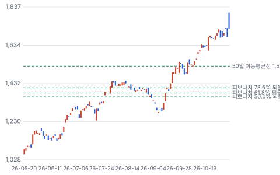

**주봉**

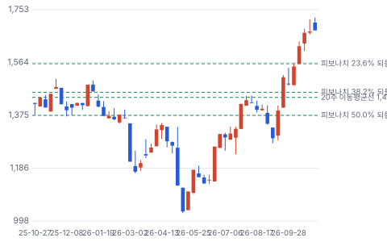

**월봉**

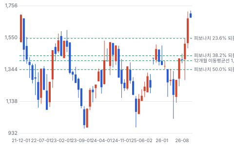

**분기 매출·EPS 실적과 컨센서스**

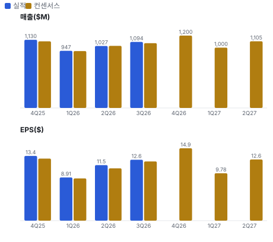

**최근 4개 분기 주가 변화 분석**

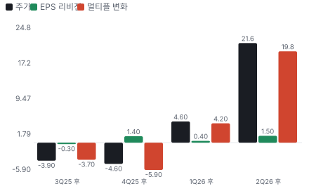

**EPS 리비전**

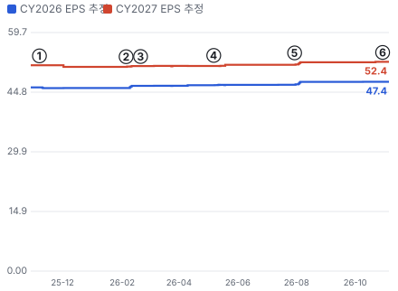

① 25-11-07 3Q25 실적 · EPS 리비전 -0%
② 26-02-05 4Q25 실적 · EPS 리비전 +0%
③ 26-02-20 IEEPA 관세 무효 판결 · EPS 리비전 +0%
④ 26-05-07 1Q26 실적·관세 환급 · EPS 리비전 +1%
⑤ 26-07-30 2Q26·연간 가이던스 상향 · EPS 리비전 +1%
⑥ 26-11-05 3Q26·2027 첫 가이던스 · EPS 리비전 +0%

**밸류에이션 주가 시나리오**

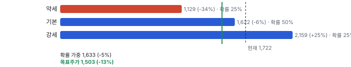

**주가별 업사이드**

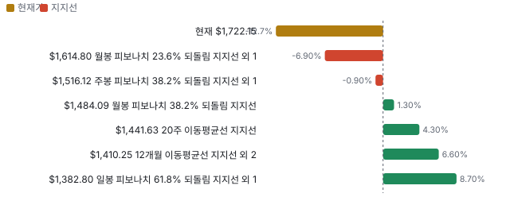

**제품·서비스 포트폴리오**

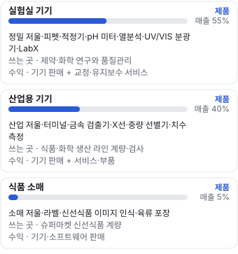

**고객 믹스(FY2025, 매출 대비)**

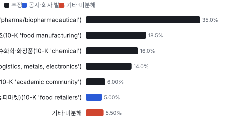

**공급 병목(10점, 낮을수록 병목)**

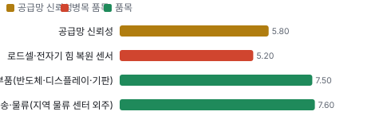

**CAPEX의 매출 대비 비중**

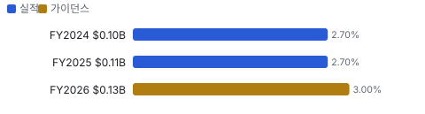

**어닝콜 변화별 주주가치 영향**

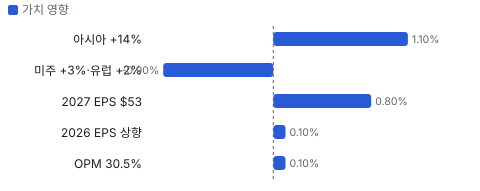

**멀티플 프리미엄(Fwd 1Y P/E, 최근 4개 분기말)**

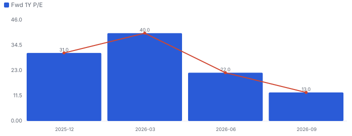

**합리적 멀티플**

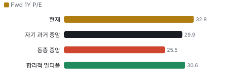

**일별 거래량 분해**

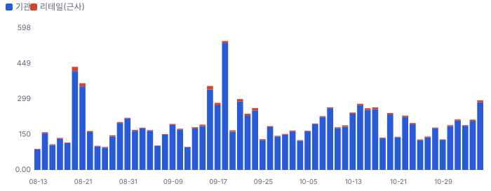

**기관 자금 흐름**

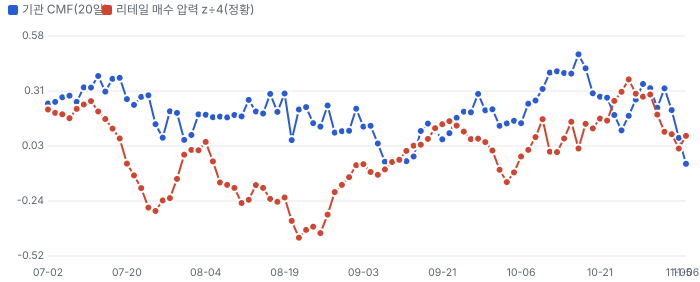

**몬테카를로**

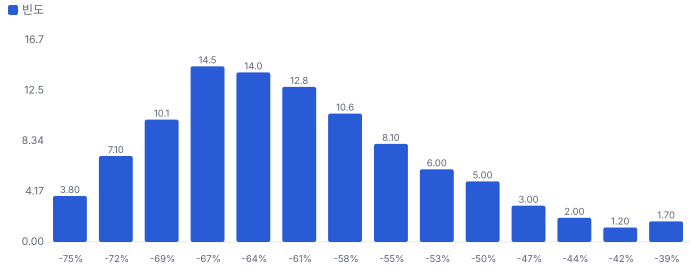

해석: 3,000번 중 0번(0%)에서 가치가 지금 주가 이상이었다. 가정을 흔들어도 지금 주가를 뒷받침하지 못하는 경우가 더 많다. 가운데 값은 0.38배이고, 열 번 중 여덟 번은 0.29~0.50배 사이에 든다.

## 내러티브

> **기업가치를 결정하는 이야기:** Fwd 1Y P/E 32.8배로 동종 중앙값 25.5배보다 29% 높다. 다음 4개 분기 EPS 컨센서스 \$51.18은 TTM 조정 EPS \$46.30(13.36+8.91+11.46+12.57)보다 10.5% 많다. 가치는 매출 +5%에서 EPS +10~12%를 만드는 기계가 몇 년 더 도느냐, 그리고 시장이 그 꾸준함에 30배 넘게 계속 주느냐에 달렸다

> **멀티플·EPS 프리미엄**
> **멀티플:** Fwd 1Y P/E 32.8배, 동종 중앙값 25.5배(DHR 23.8·BRKR 24.7·TMO 25.2·RVTY 25.5·A 26.3·WAT 28.7) — 11/5 기준
> **EPS:** 3Q 조정 EPS \$12.57은 발표 직전 추정 \$12.22의 103%. EPS 서프라이즈 8분기 연속(2.3~5.9%). 2Q 콜 뒤 2026 EPS 추정은 \$47.18에서 \$47.80으로 +1.3%

### 투자자들은 왜 열광했나

5/8 1Q 실적 다음 날 −14.8%(종가 \$1,124)로 무너진 뒤 5/13 \$1,026에서 11/4 \$1,723까지 +68% 올랐다. 2Q·3Q 연속 상회와 가이던스 상향, IEEPA 관세 무효 뒤 환급, 아시아 +14%가 이유다. 다만 같은 기간 2027 EPS 추정은 \$51.3에서 \$52.8로 +3% — 오름폭 대부분은 Fwd 1Y P/E가 24.8배(5/29)에서 33배(10/30)로 오른 배수 회복이다

### 무엇이 기업가치를 바꾸나

> **구조적 체질 변화**
> **변화:** 구조 변화는 작다 — 실험실 55%·산업 40%·소매 5%, 서비스 25% 구성이 10년째 비슷하다. 변화는 생산지 재배치(관세 대응)와 신흥시장 비중(중국 외 약 18%)
> **증거:** 10-K·2Q 콜
> **반증:** 서비스 비중이 25% 아래로

> **고부가 믹스 확장**
> **변화:** 조정 영업이익률 30.1%(3Q25) → 30.5%(3Q26). 가격 실현과 SternDrive(공급망·생산·후선 업무 원가를 줄이는 회사의 운영 개선 프로그램) 생산성이 운송비·환율을 넘었다
> **증거:** 보도자료·2Q 콜
> **반증:** 2027년 조정 영업이익률 30% 아래

> **기술 혁신**
> **변화:** LabX(실험실 기기 데이터를 모아 관리·자동화하는 회사 소프트웨어) 소프트웨어로 기기 데이터를 묶고 실험실 자동화로 확장, 신선식품 AI 이미지 인식(소매). R&D 매출 4.9%로 동종보다 낮다
> **증거:** 10-K
> **반증:** 동종의 실험실 자동화 플랫폼이 저울·적정 기기를 묶어 판다

> **실행 속도**
> **변화:** 해당 없음(잴 수 없음) — 기기는 재고 생산·짧은 리드타임으로 주문 뒤 바로 출하하고 수주잔고를 공시하지 않는다. 회사·동종(WAT·A) 모두 납기 숫자를 공시하지 않아 피어 대비를 잴 수 없다(미확인)
> **증거:** 10-K(수주잔고 공시 없음)

> **M&A**
> **변화:** 대형 인수 없이 소규모 유통·생명과학 장비 인수만(2025년 초기 지급 \$93.8M). 현금은 자사주 매입에 쓴다(2025 \$800M, 2026 \$825~875M)
> **증거:** 10-K
> **반증:** \$1B 넘는 인수 발표

> **정책·입법 연관성**
> **재정정책:** 해당 없음(재정 지원 사업 아님). 중국 쉬후이구 지방 보조금 약 \$31M은 지방정부 협약 보도자료 반증: 해당 없음 의회 동의 2/10 — 하원 1/5(관련 연방 세출 논의 없음) · 상원 1/5(같음).
> **행정명령:** 관세: IEEPA 관세는 2026-02 대법원 판결로 무효, 환급 \$52.4M 수령. 대체 Section 122(미국 무역법 122조 — 국제수지 이유로 150일까지 임시 관세를 매기는 조항) 임시 관세 10%는 7월 말 만료, Section 232(미국 무역확장법 232조 — 국가 안보 이유의 품목 관세) 정의 변경은 영향 작다(10-Q) 2Q26 10-Q 반증: 새 행정 관세(232 확대)가 스위스·중국 수입품에 붙는다 의회 동의 0/10 — 하원 0/5(행정부 단독 조치) · 상원 0/5(같음).
> **연관입법:** 관세를 법으로 고정하는 입법은 진행 기록 없음. 로비 공시는 키가 없어 미확인 lobby_watch(LDA(미국 로비 공개법 — 로비 활동 신고 제도) 키 없음) 반증: 관세 입법 법안이 소관 위원회를 통과

> **CAPEX 낙수효과**
> **변화:** 제약·바이오공정·배터리·반도체 공장 투자 → 품질관리 실험실·생산 라인 계량 수요. 고객 투자 발표를 이 회사 매출로 바로 옮기지 않는다 — 확인된 것은 아시아 +14%와 실험실 재가속(2Q 유기적 +4%)
> **증거:** 보도자료·2Q 콜
> **반증:** 2027년 제약 설비투자 가이던스가 줄어든다

### 내러티브 근거

> '경기와 상관없이 매년 EPS를 두 자릿수로 키우는 정밀 계량 독점 복리 기계' 이야기다. 매출은 한 자릿수(현지 통화 +5%)만 자라도 가격 인상·생산성·자사주 매입(연 \$0.85B, 시가총액의 2.5%)으로 조정 EPS가 +10~12% 자란다. 2026년 5월 1Q 실적 뒤 −15%로 \$1,026까지 내렸다가 11/4 \$1,723까지 68% 올랐다 — 같은 기간 다음 4개 분기 EPS 추정은 몇 % 오르는 데 그쳐 오름폭 대부분이 배수 회복이다. 동종 대비 멀티플 차이 +29% 중 회사 고유 몫은 +7%다. 단계는 컨센서스, 쏠림은 중간이다.

> **EPS 복리(가격·생산성·자사주)** · 강화
> **논리:** 매출 +5%에도 EPS +10~12%가 매년 나온다
> **숫자:** 2027 EPS \$52.50~53.50(+10~12%), 3Q 조정 EPS +13%·조정 영업이익 +8%
> **반증:** 2027년 조정 EPS 성장 8% 아래

> **아시아·신흥시장 재가속** · 강화
> **논리:** 중국·신흥시장이 바이오공정·배터리·반도체 투자로 다시 자란다
> **숫자:** 3Q 아시아·기타 현지 통화 +14%(유기적 +13%), 2Q 중국 +9%
> **반증:** 4Q26 아시아·기타 성장이 한 자릿수 초반으로

> **제약 실험실 투자 회복** · 유지
> **논리:** 제약·바이오 설비투자 회복과 GLP-1(비만·당뇨 치료제 계열(체중 감량 주사제))·바이오공정이 실험실 기기를 끌어올린다
> **숫자:** 2Q 실험실 유기적 +4%(재가속), 3Q 실험실 매출 +6.2% YoY(제품군)
> **반증:** 실험실 매출이 2개 분기 연속 YoY 감소

> **서비스 반복 매출** · 유지
> **논리:** 서비스 25%가 경기 하강에도 이익을 받친다
> **숫자:** 서비스 FY25 +8%(USD), 2Q26 +9%
> **반증:** 서비스 성장이 제품 성장 아래로

> **반대: 배수가 이미 꼭대기** · 강화
> **논리:** Fwd 1Y P/E 32.8배는 3년 레인지 상단 쪽이고 동종 중앙 25.5배보다 29% 비싸다 — 매출 +5%짜리에 이 배수는 더 오르기 어렵다
> **숫자:** Fwd 1Y P/E 5/29 24.8배 → 10/30 33.0배, 3년 최고 35.6배(2024-07)
> **반증:** EPS 상향으로 배수가 30배 아래로 내려오는데 주가는 유지

> **반대: 미주·유럽 둔화** · 정황
> **논리:** 성장의 대부분이 아시아 몫이고 미주 +3%·유럽 +2%라 미국·유럽 제약 투자가 꺾이면 +5%도 어렵다
> **숫자:** 3Q 현지 통화 미주 +3%·유럽 +2%·아시아 +14%
> **반증:** 4Q26 미주·유럽이 둘 다 +4% 이상

## 포트폴리오

| 제품·서비스 | 구분 | 무엇 | 쓰는 곳 | 돈 버는 방식 | Mix | Mix 변화(전년 대비) |
|---|---|---|---|---|---|---|
| 실험실 기기 | 제품 | 정밀 저울·피펫·적정기·pH 미터·열분석·UV/VIS 분광기·LabX | 제약·화학 연구와 품질관리 | 기기 판매 + 교정·유지보수 서비스 | 55% | -0.1%p |
| 산업용 기기 | 제품 | 산업 저울·터미널·금속 검출기·X선·중량 선별기·치수 측정 | 식품·화학 생산 라인 계량·검사 | 기기 판매 + 서비스·부품 | 40% | +0.4%p |
| 식품 소매 | 제품 | 소매 저울·라벨·신선식품 이미지 인식·육류 포장 | 슈퍼마켓 신선식품 계량 | 기기·소프트웨어 판매 | 5% | -0.4%p |

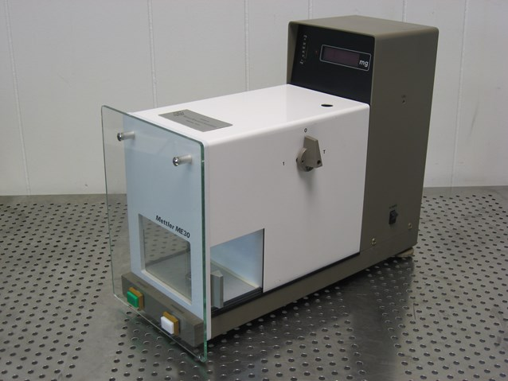
**실험실 기기** — Mettler Toledo ME30 미량 저울 — 실험실 정밀 저울
_사진: Kitmondo Marketplace · CC BY 2.0 · Wikimedia Commons_

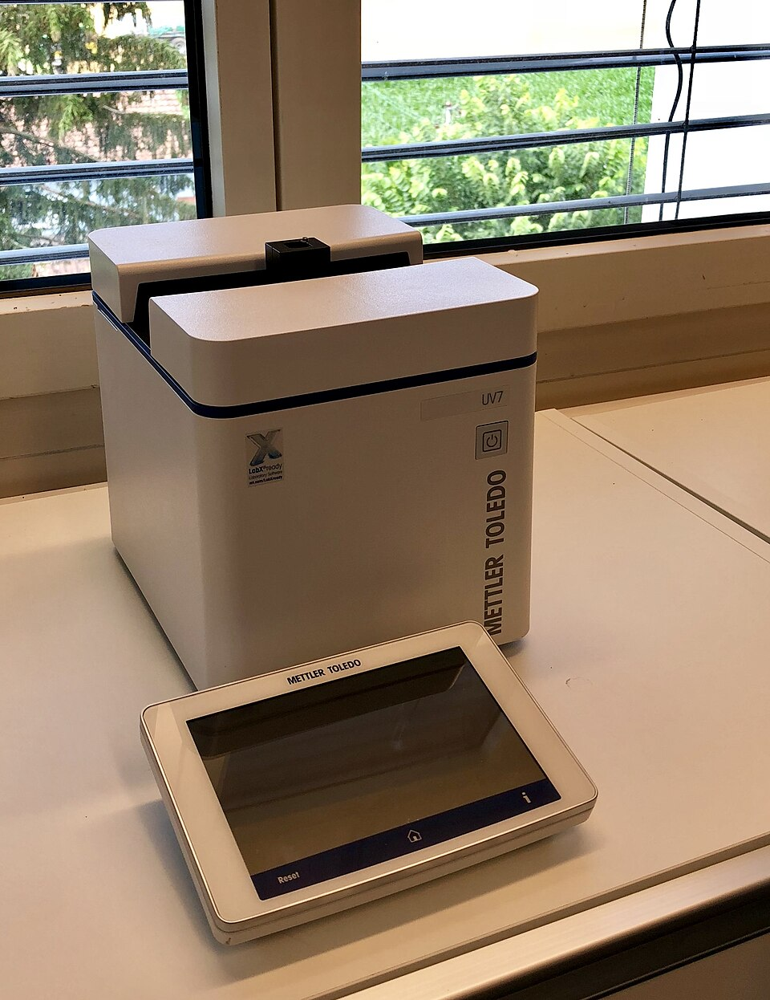
**실험실 기기** — Mettler Toledo UV7 UV/VIS 분광광도계
_사진: Lab.uvvis · CC BY-SA 4.0 · Wikimedia Commons_

**Mix 변화가 가장 큰 쪽은 산업용 기기(+0.4%p, 전년 대비).** 계절성 판정: 분기 매출 계절 지수 기준 있음 → 전년 같은 분기와 비교.

## 고객

> **FY2025 최대 고객 제약·바이오텍(연구·품질관리·바이오공정)(10-K 'pharma/biopharmaceutical') 35%, 상위 3곳 70%, 집중도 보통.** 공시·회사 발표로 확인한 몫은 매출의 5%이고, 나머지 고객 몫은 추정이거나 미분해다. 10-K는 어떤 최종 고객도 순매출의 1%를 넘지 않는다고 적는다 — 고객 집중이 없다. 대신 고객 업종으로 나뉜다: 제약·바이오(실험실 기기의 큰 몫), 식품 제조(제품 검사·산업 계량), 화학·특수화학, 물류·금속·전자(산업), 식품 소매(소매 5%), 학계·시험기관. 업종별 몫은 회사가 숫자로 공시하지 않아 범위 추정이다

**고객별 매출 몫(FY2025)**
| 고객 | 몫 | 변화 | 근거 |
|---|---|---|---|
| 제약·바이오텍(연구·품질관리·바이오공정)(10-K 'pharma/biopharmaceutical') | 30~40% | 미확인 | 추정 |
| 식품 제조(10-K 'food manufacturing') | 15~22% | 미확인 | 추정 |
| 화학·특수화학·화장품(10-K 'chemical') | 12~20% | 미확인 | 추정 |
| 물류·금속·전자·기타 산업(10-K 'transportation and logistics, metals, electronics') | 10~18% | 미확인 | 추정 |
| 학계·정부·시험기관(10-K 'academic community') | 4~8% | 미확인 | 추정 |
| 식품 소매(슈퍼마켓)(10-K 'food retailers') | 5% | +0%p | 공시 |
| 기타·미분해 | 6% | - | - |

> **제약·바이오텍(연구·품질관리·바이오공정)(10-K 'pharma/biopharmaceutical')** · 추정
> **사는 것:** 분석 저울·피펫·적정기·공정 분석 센서·LabX
> **추정 근거:** 실험실이 매출 56%이고 10-K가 제약·바이오를 주 고객으로 든다 — 몫은 추정

> **식품 제조(10-K 'food manufacturing')** · 추정
> **사는 것:** 금속 검출기·X선 검사기·중량 선별기·산업 저울
> **추정 근거:** 제품 검사·산업 계량의 주 고객 — 몫은 추정

> **화학·특수화학·화장품(10-K 'chemical')** · 추정
> **사는 것:** 실험실 기기·산업 저울·공정 분석
> **추정 근거:** 2Q 콜 Nephron 질문(화학 업종) — 몫은 추정

> **물류·금속·전자·기타 산업(10-K 'transportation and logistics, metals, electronics')** · 추정
> **사는 것:** 차량용 계근대·치수 측정·산업 터미널
> **추정 근거:** 산업 39%에서 식품·화학을 뺀 나머지 — 몫은 추정

> **학계·정부·시험기관(10-K 'academic community')** · 추정
> **사는 것:** 실험실 기기
> **추정 근거:** 2Q 콜 JPMorgan 질문(미주 학계·정부) — 몫은 추정

> **식품 소매(슈퍼마켓)(10-K 'food retailers')** · 공시
> **사는 것:** 소매 저울·라벨·포장 자동화
> **추정 근거:** 소매 제품군 FY25 매출 \$205.9M(5%) — 공시

## 마진 구조

> **GPM 59.8%, OPM 28.7%.** 3Q25 대비 GPM +0.6%p, OPM +0.5%p. 변동비는 매출의 39%이고, 매출이 10% 늘면 OPM은 +2.9%p 움직인다. 3Q26 GAAP 매출총이익률 59.8%(1년 전 59.2%), 연구개발 4.9%·판관비 24.4%·상각 1.8%로 조정 영업이익률 30.5%. 회사는 가격 실현·전년보다 낮은 관세율·물량·생산성(SternDrive)을 이익률 개선 이유로 들었고 운송비가 일부 상쇄했다(2Q 콜). 판관비가 매출의 4분의 1로 가장 큰 비용이다 — 직판·서비스 인력 9,300명(10-K)

> **매출 100 중 매출원가 39.6, 매출총이익 60.4(최근 4분기, 공시).** 매출원가 요인 중 부품·소재(로드셀·전자·센서·기구)이 매출의 20.0%로 가장 무겁고, 단가가 +10% 오르면 GPM이 -2.00%p 움직인다. 분기 회귀로 매출 1이 늘 때 매출원가는 0.36 늘고, 매출원가의 고정비 몫은 13%다.

**비용 요인 강도 — 비중·추세·충격(+10%)·탄력**
| 비용 | 구분 | 매출 대비 | 1년 변화 | 마진 기여 | 충격 시 마진 | 매출 탄력 | 고정비 몫 |
|---|---|---|---|---|---|---|---|
| 부품·소재(로드셀·전자·센서·기구) | 매출원가 요인 | 20.0% | 미확인 | 미확인 | -2.00%p | 미확인 | 0% |
| 제조 인건비·간접비(스위스·중국·미국 공장) | 매출원가 요인 | 9.0% | 미확인 | 미확인 | -0.90%p | 미확인 | 60% |
| 서비스 원가(현장 기술자·부품) | 매출원가 요인 | 8.0% | 미확인 | 미확인 | -0.80%p | 미확인 | 50% |
| 운송·관세·기타 | 매출원가 요인 | 3.2% | 미확인 | 미확인 | -0.32%p | 미확인 | 0% |
| 매출원가 | 공시 항목 | 39.6% | -0.7%p | +0.7%p | -3.96%p | 0.36 | 13% |
| 판관비 | 공시 항목 | 25.0% | +0.2%p | -0.2%p | 미확인 | 0.14 | 45% |
| 연구개발 | 공시 항목 | 5.0% | +0.0%p | -0.0%p | 미확인 | 0.04 | 6% |
| 감가상각 | 공시 항목 | 1.9% | +0.0%p | -0.0%p | 미확인 | 0.02 | -21% |
| 기타 영업비용 | 공시 항목 | 0.1% | -0.1%p | +0.1%p | 미확인 | 0.00 | 20% |

매출 탄력 = 분기 비용을 매출에 회귀한 기울기(매출 1당 변동비), 고정비 몫 = 절편 ÷ 평균 비용. 표본이 8분기 미만이면 미확인. 매출원가 요인 비중은 margin 재료의 추정이 섞여 있고, 공시 매출원가와의 차이는 '기타 매출원가'로 둔다.

**GPM에서 OPM까지(GAAP)**
| 기간 | GPM | 연구개발 | 판관비 | 기타 | OPM |
|---|---|---|---|---|---|
| 3Q25 | 59.2% | 5.0% | 24.1% | 1.9% | 28.2% |
| 3Q26 | 59.8% | 4.9% | 24.4% | 1.8% | 28.7% |

**GPM·OPM 최근 4개 분기**
| 분기 | GPM | OPM |
|---|---|---|
| 2025-12 | 59.8% | 30.7% |
| 2026-03 | 58.7% | 23.9% |
| 2026-06 | 63.3% | 29.8% |
| 2026-09 | 59.8% | 28.9% |

**마진을 결정하는 비용 요인 — 비용 +10% 시 OPM**
| 비용 | 매출 대비 | 변화 | 고정비 | OPM |
|---|---|---|---|---|
| 판매·관리비(직판·서비스 9,300명 포함) | 24.4% | +0.3%p | 70% | -2.44%p |
| 부품·소재(로드셀·전자·센서·기구) | 20.0% | 미확인 | 0% | -2.00%p |
| 제조 인건비·간접비(스위스·중국·미국 공장) | 9.0% | 미확인 | 60% | -0.90%p |
| 서비스 원가(현장 기술자·부품) | 8.0% | 미확인 | 50% | -0.80%p |
| 연구개발 | 4.9% | -0.1%p | 80% | -0.49%p |
| 운송·관세·기타 | 3.2% | 미확인 | 0% | -0.32%p |
| 무형자산 상각 | 1.8% | -0.2%p | 100% | -0.18%p |

**비용을 움직이는 요인**
| 비용 | 요인 |
|---|---|
| 판매·관리비(직판·서비스 9,300명 포함)(판관비) | 영업 인력·Spinnaker(고객 데이터로 영업·마케팅 대상을 고르는 회사의 판매 프로그램) · 근거 공시 |
| 부품·소재(로드셀·전자·센서·기구)(매출원가) | 부품 단가·관세 · 근거 추정 |
| 제조 인건비·간접비(스위스·중국·미국 공장)(매출원가) | 가동률·임금 · 근거 추정 |
| 서비스 원가(현장 기술자·부품)(매출원가) | 서비스 인력 · 근거 추정 |
| 연구개발(연구개발) | 소프트웨어 비중 큼(10-K) · 근거 공시 |
| 운송·관세·기타(매출원가) | 운송비·관세율 · 근거 추정 |
| 무형자산 상각(기타) | 인수 무형자산 · 근거 공시 |

**실험실 기기 BOM — 매출의 55%, GPM 63%(추정 — 제품군별 이익률 미공시. 정밀 저울·분석 기기와 서비스 비중이 커 회사 평균 59.8%보다 높다고 본다), 항목 가격 +10% 시**
| 항목 | 원가 몫 | 전가 | 제품 GPM | OPM |
|---|---|---|---|---|
| 로드셀·전자기 힘 복원 센서 | 20~35% | 미확인 | -1.0%p | -0.56%p |
| 전자 부품(반도체·디스플레이·기판) | 20~30% | 미확인 | -0.9%p | -0.51%p |
| 기구·하우징·유리(금속·플라스틱 가공품) | 15~25% | 미확인 | -0.7%p | -0.41%p |
| 미분해 | 27% | - | - | - |

**산업용 기기 BOM — 매출의 40%, GPM 56%(추정), 항목 가격 +10% 시**
| 항목 | 원가 몫 | 전가 | 제품 GPM | OPM |
|---|---|---|---|---|
| 스테인리스 구조물·컨베이어 | 20~30% | 미확인 | -1.1%p | -0.44%p |
| 로드셀·계량 모듈 | 15~30% | 미확인 | -1.0%p | -0.40%p |
| X선 발생기·검출기·금속 검출 코일 | 15~30% | 미확인 | -1.0%p | -0.40%p |
| 미분해 | 30% | - | - | - |

**식품 소매 BOM — 매출의 5%, GPM 45%(추정), 항목 가격 +10% 시**
| 항목 | 원가 몫 | 전가 | 제품 GPM | OPM |
|---|---|---|---|---|
| 터치스크린·프린터·카메라 | 30~45% | 미확인 | -2.1%p | -0.11%p |
| 하우징·조립 | 15~25% | 미확인 | -1.1%p | -0.06%p |
| 로드셀 | 10~20% | 미확인 | -0.8%p | -0.04%p |
| 미분해 | 27% | - | - | - |

로드셀·전자기 힘 복원 센서 가격이 +10% 오르면 영업이익은 -1.9% 움직인다. 판매가 전가를 모르는 항목은 전가 0%로 계산했다.

**BOM 항목 가격을 움직이는 것**
| 항목 | 요인 |
|---|---|
| 로드셀·전자기 힘 복원 센서 | 정밀 저울의 핵심 — 자체 설계·스위스 생산(10-K: 많은 제품이 한 곳에서 개발·생산) · 근거 추정 |
| 전자 부품(반도체·디스플레이·기판) | 10-K: 일부 품목은 제한·단일 공급원 · 근거 추정 |
| 기구·하우징·유리(금속·플라스틱 가공품) | 외주 가공 · 근거 추정 |
| 로드셀·계량 모듈 | 산업 저울·중량 선별기 · 근거 추정 |
| X선 발생기·검출기·금속 검출 코일 | 제품 검사 장비 · 근거 추정 |
| 스테인리스 구조물·컨베이어 | 식품 라인 위생 설계 · 근거 추정 |
| 로드셀 | 소매 저울 · 근거 추정 |
| 터치스크린·프린터·카메라 | 라벨·이미지 인식 · 근거 추정 |
| 하우징·조립 | 외주 조립 · 근거 추정 |

## 공급망 병목

> **공급망 신뢰성 5.8/10, 병목 주의.** 가장 약한 고리는 로드셀·전자기 힘 복원 센서 5.2점이고, 품목 평균은 6.7점이다. 근거가 부족한 1건(X선 발생기·검출기·금속 검출 코일)은 점수에서 뺐다. 10-K는 대부분의 원재료·부품을 여러 공급사에서 사지만 일부 품목은 제한·단일 공급원이라고 적는다. 더 큰 병목은 공급사가 아니라 자기 공장이다 — 많은 제품이 한 곳에서 개발·생산되고 대체 시설이 제한적이다(10-K). 공급사 이름·구매 약정 금액은 공시하지 않는다

**병목과 마진 — 품목 가격 +10% 시 OPM**
| 품목 | 점수 | 판정 | 구분 | OPM |
|---|---|---|---|---|
| 로드셀·전자기 힘 복원 센서(필수) | 5.2 | 병목 주의 | 핵심 통제 품목 | -0.56%p |
| 전자 부품(반도체·디스플레이·기판)(필수) | 7.5 | 관리 가능 | 가격 위험 | -0.51%p |
| 운송·물류(지역 물류 센터 외주) | 7.6 | 관리 가능 | 일반 | 미확인 |

> **로드셀·전자기 힘 복원 센서** · 5.2/10
> **왜:** 정밀 저울 성능을 정하는 부품 — 한 공장 의존
> **병목 요인:** 인증 공급사 1곳 · 캐파 균형 · 리드타임 미확인 · 재인증 12개월 · 1위 점유율 미확인 · 지역 집중 미확인 · 물량 확보 내재화
> **풀리는 조건:** 미확인

> **전자 부품(반도체·디스플레이·기판)** · 7.5/10
> **왜:** 10-K: 일부 품목 단일 공급원
> **병목 요인:** 인증 공급사 2곳 · 캐파 여유 · 리드타임 미확인 · 재인증 6개월 · 1위 점유율 미확인 · 지역 집중 미확인 · 물량 확보 복수구매
> **풀리는 조건:** 미확인

> **운송·물류(지역 물류 센터 외주)** · 7.6/10
> **왜:** 10-K: 물류 일부 외주
> **병목 요인:** 인증 공급사 2곳 · 캐파 여유 · 리드타임 미확인 · 재인증 3개월 · 1위 점유율 미확인 · 지역 집중 미확인 · 물량 확보 복수구매
> **풀리는 조건:** 미확인

**공급사**
| 품목 | 공급사 | 몫 | 근거 |
|---|---|---|---|
| 전자 부품(반도체·디스플레이·기판) | 미공시(복수 공급사)(저울·터미널 전자) | 미확인 | 공시 |
| 로드셀·전자기 힘 복원 센서 | 자체 생산(스위스 그라이펜제 등)(핵심 센서) | 미확인 | 회사 발표 |
| X선 발생기·검출기·금속 검출 코일 | 미공시(제품 검사 장비 핵심) | 미확인 | 추정 |
| 운송·물류(지역 물류 센터 외주) | 미공시(제3자 물류)(지역 물류 센터 일부 외주) | 미확인 | 공시 |

## 생산능력

> **현재 명목 캐파 미확인, 가동률 미확인.** 착공 이상 증설은 0 회사는 생산 캐파를 공시하지 않는다 — 시설 목록(소유·임차)만, 발표까지 합치면 0 회사는 생산 캐파를 공시하지 않는다 — 시설 목록(소유·임차)만이다. FY2025 CAPEX는 \$0.11B로 매출의 2.7%다. 주요 생산 시설은 스위스 그라이펜제·우르도르프, 독일 알브슈타트·기센, 영국 로이스턴, 미국 오하이오 워딩턴·캘리포니아 오클랜드·매사추세츠 빌레리카, 멕시코 티후아나, 중국 상하이·창저우·청두, 인도 뭄바이, 말레이시아다(10-K). 2026년 CAPEX 약 \$130M(매출의 3%)은 IT(정보기술)·장비·시설 확장에 쓰고 대형 신규 공장 계획은 공시하지 않았다. 중국 쉬후이구 정부와 생산 자동화·캐파 협약(약 \$31M 지원)이 있다

**생산능력 확충 계획**
| 계획 | 단계 | 증설 | 가동 시점 | CAPEX |
|---|---|---|---|---|
| 중국 쉬후이구 생산 자동화·캐파·물류 개선 | 발표 | 미확인 | 미확인 | \$0.02B |
| 공급망 재배치(관세 대응 — 생산지 조정) | 발표 | 미확인 | 미확인 | 미확인 |

남은 계획의 CAPEX 합계는 \$0.02B(금액 미확인 1건 제외)다. 합계는 FY2026 매출의 0%다.

**증설 방해 요인**
| 계획 | 방해 요인 |
|---|---|
| 중국 쉬후이구 생산 자동화·캐파·물류 개선 | 미확인 |
| 공급망 재배치(관세 대응 — 생산지 조정) | 관세 정책 |

**CAPEX와 매출 대비**
| 기간 | CAPEX | 매출 | 매출 대비 | 구분 |
|---|---|---|---|---|
| FY2024 | \$0.10B | \$3.87B | 2.7% | 실적 |
| FY2025 | \$0.11B | \$4.03B | 2.7% | 실적 |
| FY2026 | \$0.13B | \$4.27B | 3.0% | 가이던스 |

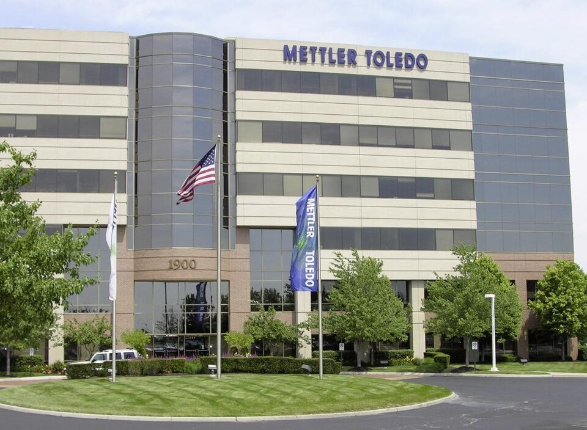
**미국 오하이오 본사** — Mettler Toledo 오하이오 사무소
_사진: Melissa Wirrig · CC BY-SA 3.0 · Wikimedia Commons_

## 해자

> 해자는 정밀 계량 세계 1위의 설치 기반과 그 위의 교정·규제 준수 서비스(서비스 매출 25%), 9,300명 직판·서비스망과 고객 데이터로 영업 대상을 고르는 Spinnaker, 그리고 제약 규제(USP·GMP(의약품 제조·품질관리 기준))가 바꾸기 어렵게 만드는 전환 비용이다. 분석 기기 상위(크로마토그래피·질량분석)는 Waters·Agilent·Thermo가 강하고 MTD는 그 주변의 저울·적정·공정 분석에 집중한다

> **정밀 계량 1위 설치 기반** · 강함
> **해자:** 대부분 사업에서 세계 1위라고 회사가 밝힌다 — 깔린 저울·기기가 교정·부품 수요를 만든다
> **근거:** 10-K·보도자료
> **숫자:** 서비스(부품 포함) FY25 \$1,018.6M = 매출 25.3%, +8%(USD)
> **깨지는 조건:** 서비스 성장이 2년 연속 제품 성장보다 낮아진다

> **규제 준수 전환 비용** · 강함
> **해자:** 제약 고객은 검증된 기기·교정 절차를 바꾸면 재검증 비용이 든다 — 규제 준수 서비스가 묶는다
> **근거:** 10-K 서비스 설명(규제 준수 검증·교정·인증)
> **숫자:** 기간 인식 서비스 계약 FY25 \$286.4M(+11%)
> **깨지는 조건:** USP 규정 변경 뒤 저가 저울이 제약 품질관리에 채택된다

> **직판·서비스망과 Spinnaker** · 보통
> **해자:** 40개국 직판·서비스 9,300명과 고객 데이터 기반 영업으로 신흥시장 고성장 분야를 빨리 잡는다
> **근거:** 10-K·2Q 콜
> **숫자:** 중국 외 신흥시장 매출 약 18%, 5년 평균 한 자릿수 후반 성장(2Q 콜)
> **깨지는 조건:** 신흥시장 성장이 회사 평균 아래로 내려간다

> **가격 결정력** · 보통
> **해자:** 관세 비용(2025년 약 \$50M)을 2026년에 가격·조치로 전부 상쇄했다
> **근거:** 2Q26 10-Q
> **숫자:** 2Q 가격 약 2.5% 가이던스, 조정 매출총이익률 +30bp
> **깨지는 조건:** 가격 실현이 1% 아래로 떨어진다

## 경영진·네트워크

> Patrick Kaltenbach(62)가 2021년 4월부터 CEO다 — Agilent(1991~2018)와 BD(Becton Dickinson — 미국 의료기기·생명과학 회사) 생명과학 부문 대표를 거쳤다. CFO Shawn Vadala(57)는 1997년 입사, 2014년부터 CFO이고 2008년부터 가격 프로그램을 맡았다. 5% 주주는 Vanguard 11.6%·BlackRock 8.0%·Capital International 5.0%다(위임장 2026-03). 창업 가문·지배 주주는 없다

> **Patrick Kaltenbach** · 사장·CEO · 2021
> **프로필:** 2021-01 입사, 2021-04 CEO. 그 전 BD 생명과학 부문 대표(2018~), Agilent 생명과학·응용시장 그룹 대표(2014~2018), HP(Hewlett-Packard — Agilent의 모회사였던 미국 전자 회사)·Agilent 1991년부터
> **비즈니스:** Agilent·BD 출신 — 분석 기기 업계 경력
> **정계:** 미확인
> **동문:** 미확인
> **사모임:** 미확인

> **Shawn P. Vadala** · CFO · 2014
> **프로필:** 1997 입사, 2014-01부터 CFO, 2008년부터 가격 프로그램 책임, 그 전 PwC(PricewaterhouseCoopers — 회계법인) 보스턴·취리히
> **비즈니스:** 미확인
> **정계:** 미확인
> **동문:** 미확인
> **사모임:** 미확인

**네트워크 정량화**
| 연결 | 강도 | 닿는 매출 | 가중 노출 | 매출 대비 | 근거 |
|---|---|---|---|---|---|
| 비즈니스: CEO의 Agilent·BD 경력 — 경쟁사 출신 경영진 | 1/5 | \$0.00B | \$0.00B | 0% | 경력이며 매출 연결 근거 없음 https://www.sec.gov/Archives/edgar/data/1037646/000103764626000011/mtd-20251231.htm |

가중 노출은 연결이 닿는 매출의 크기다. 연결이 그 매출을 만들었다는 뜻이 아니며, 인과는 공개 자료로 입증하지 못한다.

## 약세 논리 및 셀온 조건

| 약세 논리 | 근거 | 반박 | 가를 자료 |
|---|---|---|---|
| 배수가 이미 레인지 상단 | Fwd 1Y P/E 32.8배, 3년 월말 24.2~35.6배, 동종 중앙 25.5배 | 10년 넘게 동종 위에서 거래 — 해자·서비스 25%가 웃돈을 받친다 | 3Q 콜 뒤 다음 4개 분기 EPS 추정 변화(2026-11 중순) |
| 미주·유럽 둔화 | 3Q 현지 통화 미주 +3%·유럽 +2%, 성장의 대부분이 아시아 +14% | 2Q 실험실 유기적 +4%로 재가속, 제약 투자 회복 초기 | 4Q26 지역별 성장(2027-02 초) |
| 한 번짜리 순풍 | IEEPA 관세 환급 \$52.4M(2Q), 관세율 하락으로 이익률 개선 | 회사 조정 실적은 환급을 뺐다 — 3Q 조정 영업이익률 30.5%는 환급 없는 값 | 2027 조정 영업이익률(컨센서스 30.3%) 실적 |
| 차입 자사주 매입 | 차입 \$2.02B·현금 \$52M·자기자본 \$78M | 9개월 자사주 \$638.7M ≈ 조정 FCF \$651.9M, 차입은 9개월 −\$88.7M | 2027 자사주 계획과 FCF 가이던스(2027-02) |
| 손익비 1 아래 | 약세 \$1,128(−33%) vs 강세 \$2,158(+29%), 목표 \$1,503(−10%) | 약세 배수 23.8배는 2025-04 바닥 근처 — 그 아래는 기록이 드물다 | 4Q26 실적 뒤 배수 위치 |

## 어닝콜 변화

**직전 콜 대비 새로 나오거나 바뀐 내용 → 가치 영향**
| 항목 | 내용 | 직전 콜 | 최신 콜 | 모델 동인 이동 | 확신도 | 가치 영향 |
|---|---|---|---|---|---|---|
| 신규 | 2027 가이던스 | 가이던스 없음(발표 전 컨센서스 \$52.37) | 현지 통화 +5%, 조정 EPS \$52.50~53.50 | 1년차 성장률 +0.30% | 0.8 | +0.8% |
| 업데이트 | 2026 EPS 가이던스 | \$47.15~47.50(2Q) | \$47.70~47.90 | 기준연도 매출 +\$0.00B | 0.8 | +0.1% |
| 업데이트 | 아시아 성장 | 2Q 중국 +9% | 3Q 아시아·기타 현지 통화 +14%(유기적 +13%) | 1년차 성장률 +0.40% | 1.0 | +1.1% |
| 업데이트 | 조정 영업이익률 | 2Q 29.3% | 3Q 30.5%(+40bp YoY) | 출발 이익률 +0.30% | 1.0 | +0.1% |
| 부정 | 미주·유럽 성장 | 2Q 미주 +1%·유럽 +4%(유기적) | 3Q 미주 +3%·유럽 +2%(현지 통화) | 장기 성장 수렴값 -0.20% | 1.0 | -0.9% |
| 반복 | 자사주 매입 | 2026 \$825~875M 계획 | 9개월 \$638.7M 집행, 3Q \$226.2M | 순차입 — | 1.0 | +0.0% |
| **합계** | 단독 합 |  |  | 동시 적용 +1.3% |  | **+1.3%** |

**사건별 EPS 리비전**
| # | 날짜 | 구분 | 사건 | CY2026 EPS 전→후 | CY2027 EPS 전→후 | 리비전 | 주가 반응 |
|---|---|---|---|---|---|---|---|
| ① | 25-11-07 | 실적 | 3Q25 실적 | \$45.98 → \$45.80 | \$51.52 → \$51.51 | -0.0% | -0.5% |
| ② | 26-02-05 | 실적 | 4Q25 실적 | \$45.81 → \$46.35 | \$51.10 → \$51.31 | +0.4% | -0.7% |
| ③ | 26-02-20 | 내러티브 | IEEPA 관세 무효 판결 | \$46.35 → \$46.39 | \$51.31 → \$51.36 | +0.1% | +0.1% |
| ④ | 26-05-07 | 실적 | 1Q26 실적·관세 환급 | \$46.51 → \$46.60 | \$51.33 → \$51.63 | +0.6% | -14.8% |
| ⑤ | 26-07-30 | 실적 | 2Q26·연간 가이던스 상향 | \$46.63 → \$47.35 | \$51.63 → \$52.27 | +1.2% | +2.6% |
| ⑥ | 26-11-05 | 실적 | 3Q26·2027 첫 가이던스 | \$47.38 → \$47.38 | \$52.37 → \$52.37 | +0.0% | - |

**해석:** 4개 구간 누적 주가 +17% = EPS 리비전 +3% × 멀티플 +13%. 더 크게 움직인 쪽은 **멀티플**이다.

## 밸류에이션

> **목표주가 \$1,503, 업사이드 -10%.** 자리는 약세와 기본 사이(약세 쪽 24%)이고 도달 확률은 약 59%다. 기본 \$1,621, 강세 \$2,158(+29%), 약세 \$1,128(-33%). DCF 기준 업사이드는 기본 -62%, 강세 -56%, 약세 -67%다(WACC 9.5%).

배수 기준 기본 \$1,621(−3%)과 DCF 기본 업사이드 −62%는 방향이 같고 폭이 크게 다르다. 배수는 다음 4개 분기 EPS \$51.18에 엔진이 고른 31.7배(동종 중앙 25.5배 + 펀더멘털 +10% + 해자 +11% + 반복 매출 +3%)를 곱한다 — 이 회사가 동종보다 비싸게 거래돼 온 이유를 대부분 인정한다. DCF는 매출 CAGR 4.9%·장기 영업이익률 28~31%를 WACC 9.5%로 할인한다 — 같은 가정이면 이 회사는 지난 10년 내내 고평가로 나온다. 목표 \$1,503은 약세와 기본 사이(약세 쪽 24%)로, 배수를 거의 지켜 줘도 지금보다 낮다는 뜻이다. 토론은 DCF 몫이 목표를 끌어내렸고 배수 기준 기본은 제자리라는 반박을 받아 규칙 등급 Sell을 Neutral로 한 단계 올렸다.

> **약세 \$1,128 (-33%)** · 확률 25%
> **가정:** 23.8배 × EPS \$47.50
> **근거:** 미주·유럽이 +1~2%에 머물고 아시아 반등이 식어 2027 현지 통화 +3%, 가격 1.5%만 남아 다음 4개 분기 EPS가 \$47.5(2027 컨센서스 하단 \$50.2보다 낮다). 배수는 동종 하단으로

> **기본 \$1,621 (-3%)** · 확률 50%
> **가정:** 31.7배 × EPS \$51.18
> **근거:** 2027 현지 통화 +5%(회사 가이던스)·조정 영업이익률 30% 안팎·자사주 연 \$0.85B로 다음 4개 분기 EPS 컨센서스 \$51.18

> **강세 \$2,158 (+29%)** · 확률 25%
> **가정:** 39.6배 × EPS \$54.50
> **근거:** 제약 실험실 투자 회복과 아시아 두 자릿수가 이어져 2027 현지 통화 +7%, 영업이익률 31% — 2027 EPS 추정 상단 \$55 쪽

**멀티플 선정 — Fwd 1Y P/E**
| 단계 | 조정 | 근거 |
|---|---|---|
| 동종 중앙값 | 25.5배 | 범위 23.8~28.7배, 5곳 |
| 펀더멘털 | +10% | 성장·이익률·ROIC로 본 합리적 멀티플 30.6배와의 차이의 일부만 인정 |
| 해자 | +11% | 정밀 계량 1위 설치 기반 강함 · 규제 준수 전환 비용 강함 · 직판·서비스망과 Spinnaker 보통 · 가격 결정력 보통 |
| 반복 매출 | +3% | 반복 매출 25%(동종 20%) · 서비스·유지보수 · 이미 반복 단계 · 기반 설치 대수 미공시 — 대부분 사업 세계 1위(회사) |
| 수주 전환·가시성 | +0% | 재료 없음 |
| 내러티브 | +0% | 단계 컨센서스 |
| 사이클·실행 판단 | +0% | Fwd 1Y P/E 32.8배로 동종 중앙값 25.5배보다 29% 높다. 10년 넘게 동종보다 비싸게 거래된 회사라 웃돈 자체는 판단 조정 없이 엔진의 해자·반복 매출 요인에 맡긴다. 다만 지금 배수는 3년 월말 레인지(24.2~35.6배) 상단 쪽이라 위로 더하지 않는다 |
| **선정** | **31.7배** | 지금 32.8배 |

**동종 레인지**
| 회사 | Fwd 1Y P/E | Fwd 2Y P/E | Fwd 3Y P/E | 성장 | 영업이익률 | ROIC |
|---|---|---|---|---|---|---|
| WAT | 28.7 | 23.5 | 22.4 | 26% | 29% | 7% |
| A | 26.3 | 23.5 | 21.8 | 7% | 27% | 17% |
| RVTY | 25.5 | 22.3 | 20.6 | 4% | 29% | 8% |
| TMO | 25.2 | 22.9 | 20.9 | 5% | 24% | 10% |
| DHR | 23.8 | 22.1 | 20.1 | 14% | 29% | 8% |
| **Mettler-Toledo** | 32.8 | 29.3 | 27.1 |  |  |  |

몬테카를로 중앙값 업사이드 -62%.

> 의사결정 보조(투자자문 아님): ① 매수 매력: 연 기대수익 -9.9% (자기자본비용 9.7% 대비 -19.6%p) · 자본비용 초과 확률 0% · 안전마진 0.29 → 정량 신호 약함 / ② 위험 예산 지표(이론): 0% — 기대수익이 자기자본비용에 못 미침(무위험 대비 켈리 0%는 참고) · 5년 하위10% -55% · 30%+ 손실 확률 81% / ③ 상방(5년): 기대 0.60배 · 2배 0% · 3배 0% · 10배 0% · 상위10% 0.77배

## 매수 위치(일봉)

> **현재가 \$1,679는 '지지 근접'(가장 가까운 일봉 지지 \$1,655에서 ATR 1.0배 위).** 이 자리에서 목표주가까지 -10.5%, 첫 일봉 저항까지 미확인, 다음 지지까지 하방 -1.4%, 손익비 -7.3배. 손익비는 지지 3 \$1,518에서 -0.6배로 가장 높다(목표주가까지 -1.0%).

**가격대별 업사이드(일봉 기준)**
| 가격대 | 가격 | 목표주가까지 | 첫 저항까지 | 다음 지지까지 | 손익비 | 근거 기법(강도) |
|---|---|---|---|---|---|---|
| 현재가 | \$1,679 | -10.5% | 미확인 | -1.4% | -7.3 | - |
| 지지 1 | \$1,655 | -9.2% | 미확인 | -6.2% | -1.5 | 20일선(0.5) |
| 지지 2 | \$1,552 | -3.1% | +6.7% | -2.2% | -1.4 | 피보 확장 161.8%(0.8) |
| 지지 3 | \$1,518 | -1.0% | +2.2% | -1.7% | -0.6 | 50일선(1.0) |
| 지지 4 | \$1,493 | +0.7% | +1.7% | 미확인 | 미확인 | 피보 확장 127.2%(0.8) |

일봉만 쓴다(주봉·월봉 제외). 손익비 = 목표주가까지 업사이드 ÷ 다음 지지까지 하방. 가격대별 기대값 참고표이며 매수·매도 시점 지시가 아니다.

## 애널리스트 토론

> **토론 결론 Neutral(규칙 등급 Sell).** 규칙 등급은 Sell(목표 \$1,503, −10%, DCF 기본 −62%)이다. 그러나 목표주가를 끌어내린 큰 몫은 WACC 9.5% DCF이고, 같은 할인율이면 이 회사는 10년 내내 고평가로 나온다 — 배수 기준 기본은 \$1,621(−3%)로 거의 제자리라는 반박이 살아남았다. 자사주 매입이 차입이 아니라 FCF로 나온다는 반박(9개월 FCF \$651.9M vs 매입 \$638.7M, 차입 −\$88.7M)도 Strong Sell의 논리를 약하게 했다. 반대로 손익비 0.9와 셀사이드 평균 \$1,546이 현재가 아래라 Buy까지는 못 갔다. 한 단계 올려 Neutral

**패널(가상 애널리스트)**
| 자리 | 애널리스트 | 핵심 논리 | 틀리는 조건 | 최종 투표 |
|---|---|---|---|---|
| Strong Buy | 한지원(가상 리서치 하우스 청람증권) | 8분기 연속 EPS 상회에 2027 가이던스까지 컨센서스 위로 냈다 — 이익이 계속 위로 고쳐지는 회사의 배수는 동종으로 내려가지 않는다 | 4Q26 조정 EPS가 가이던스 하단 \$14.84 아래 | Buy |
| Buy | 오세린(가상 리서치 하우스 해온리서치) | 아시아 +14%와 서비스 25%가 성장과 하방을 같이 받친다 — 엔진 기본(배수) −3%는 사실상 제자리다 | 4Q26 아시아·기타 성장이 한 자릿수 초반 | Neutral |
| Neutral | 백도현(가상 리서치 하우스 한길자산) | 이익 경로는 확실하지만 주가가 이미 그 경로를 앞서 갔다 — 7/30 이후 +22% 중 대부분이 배수다 | 3Q 콜에서 2027 가격·물량 구성이 +5%를 넘는 근거로 나온다 | Neutral |
| Sell | 남궁윤(가상 리서치 하우스 다솜증권) | 규칙 등급 Sell이 맞다 — 목표주가 \$1,503(−10%), DCF 기본 −62%, 손익비 0.9로 내려갈 길이 올라갈 길보다 길다 | 2027 가이던스가 현지 통화 +6% 이상으로 올라간다 | Sell |
| Strong Sell | 탁민서(가상 리서치 하우스 곧은리서치) | 매출 +5% 회사에 33배는 미주·유럽이 +2~3%인 지금 받칠 근거가 없다 — 차입으로 하는 자사주 매입이 EPS를 만든다 | 4Q26 미주·유럽이 둘 다 +4% 이상 | Sell |

**투표**
| Strong Buy | Buy | Neutral | Sell | Strong Sell |
|---|---|---|---|---|
| 0 | 1 | 2 | 2 | 0 |

> **개회 · Strong Buy**
> **발언:** 3Q는 매출·EPS·영업이익 모두 추정을 넘었고 2027을 컨센서스 위로 처음 냈다. 8분기 연속이다

> **개회 · Buy**
> **발언:** 아시아 +14%가 새로 붙었다. 서비스 25%는 경기가 꺾여도 남는 매출이다

> **개회 · Neutral**
> **발언:** 주가는 7/30 \$1,381에서 11/5 \$1,679로 +22%다. 엔진 분해로 4개 구간 +17% 중 EPS 리비전은 +3%뿐이고 멀티플이 +13%다

> **개회 · Sell**
> **발언:** 엔진 목표 \$1,503은 지금보다 10% 낮고, 손익비 0.9다. 약세 −33%가 강세 +29%보다 크다

> **개회 · Strong Sell**
> **발언:** 미주 +3%·유럽 +2%다. 성장의 대부분이 아시아고, EPS 성장의 큰 몫이 차입 자사주 매입이다

> **반박1 · Neutral → Strong Buy**
> **발언:** 상회 폭은 2.9%였고 4Q EPS 가이던스 중간 \$14.94는 발표 전 컨센서스 \$14.885와 거의 같다 — 상향은 2027 숫자 1.2%뿐이다

> **반박1 · Strong Buy → Sell**
> **발언:** DCF −62%는 WACC 9.5%면 이 회사가 10년 내내 고평가로 나온다는 뜻이다. 엔진 기본(배수) −3%가 더 현실적인 출발점이다

> **반박1 · Sell → Buy**
> **발언:** 기본이 −3%라도 목표주가가 기본보다 낮은 건 DCF·차트 요인까지 아래를 가리키기 때문이다. 셀사이드 평균 \$1,546도 현재가 아래다

> **반박1 · Strong Sell → Buy**
> **발언:** 서비스 25%가 받친다면 2025년 4월 −20%대 하락은 왜 나왔나. 월봉 기록에서 이 주식은 배수가 24배까지 내려간 적이 있다

> **반박2 · Buy → Strong Sell**
> **발언:** 자사주는 차입이 아니라 조정 FCF로 대부분 낸다 — 9개월 FCF \$651.9M vs 매입 \$638.7M. 차입은 9개월 동안 오히려 \$88.7M 줄었다

> **반박2 · Strong Sell → Strong Buy**
> **발언:** 8분기 연속 상회는 이미 33배에 들어 있다. 상회 폭이 줄면(3Q 2.9%) 배수가 먼저 반응한다

> **반박2 · Neutral → Sell**
> **발언:** 목표 −10%의 큰 몫은 DCF 요인이다. 배수 기본만 보면 −3%라 Sell보다 Neutral이 숫자에 가깝다

> **반박2 · Sell → Neutral**
> **발언:** 그래도 손익비 0.9는 1 아래다. 3년 레인지 상단에서 기대값은 아래쪽에 있다

> **최종 · Strong Buy** · Buy
> **발언:** 이익 상향이 이어지는 한 배수는 버틴다

> **최종 · Buy** · Neutral
> **발언:** 기본 −3%면 제자리다 — 3Q 콜의 2027 구성을 보고 정한다

> **최종 · Neutral**
> **발언:** 이익은 맞고 값은 앞서 있다. 기다린다

> **최종 · Sell**
> **발언:** 손익비 1 아래에서 등급을 올릴 근거는 약하다

> **최종 · Strong Sell** · Sell
> **발언:** 자사주가 FCF로 나온다는 반박은 받는다. 그래도 미주·유럽 둔화는 남는다

남은 반대 의견: Sell 자리: 손익비 0.9(약세 −33% vs 강세 +29%)와 3년 배수 레인지 상단은 이익과 별개로 기대값이 아래쪽이라는 숫자다

패널은 가상 인물이고 실존 IB의 의견이 아니다.

## 시장 평가

> **셀사이드(IB 애널리스트)**
> **한 줄:** 의견은 매수와 보유가 갈린다. 주가가 이미 목표가 평균 위에 있다 — 셀사이드가 숫자보다 주가를 쫓아 목표가를 올리는 국면이다
> **의견 분포:** Strong Buy 5·Hold 7·Strong Sell 1 — 13명
> **목표가:** \$1,545.62(범위 \$1,200~1,700) — 현재가 대비 −8%
> **의견 변경:** Barclays \$1,575→\$1,700, Morgan Stanley \$1,450→\$1,575, JPMorgan \$1,400→\$1,550 상향 / UBS(유니온 뱅크 오브 스위츠랜드) Buy→Neutral·\$1,650→\$1,460, Evercore \$1,550→\$1,500 — 상향 다수·하향 2건

> **바이사이드(기관 투자자)**
> **한 줄:** 패시브(Vanguard·BlackRock)와 장기 성장주 운용사(Capital)가 받친다. 지배 주주가 없고 기관이 거의 전부 들고 있다
> **5% 주주:** Vanguard 11.6%·BlackRock 8.0%·Capital International 5.0%
> **기관 보유:** 약 100% — 내부자 0.4%

> **언론·업계**
> **한 줄:** 언론은 가이던스 상회와 52주 신고가를 다룬다. 'AI가 제약 R&D 생산성을 올려 실험실 기기 수요를 키운다'는 새 각도가 보인다 — 아직 숫자 근거는 없다
> **보도 초점:** 3Q 상회·2027 가이던스, AI 기반 제약 연구 생산성 — Yahoo·TradingView·MarketBeat

## 체크리스트

| 시점 | 무엇 | 의미 |
|---|---|---|
| 2026-11-06 22:30 KST | 3Q 어닝콜: 2027 +5%의 가격·물량 구성, 미주·유럽 수요, 중국·바이오공정 | 쟁점에 대한 첫 회사 답변 — 전문이 나오면 재발행 |
| 2026-11 초~중순 | 3Q26 10-Q: 지역·제품군·서비스 매출, 관세 비용 | 보도자료에 없는 서비스 성장과 관세 설명 |
| 2026-11 | 동종(Waters·Agilent) 실적의 실험실 수요 발언 | 제약 실험실 투자 회복이 업종 전체인지 |
| 2027-02 초(예상) | 4Q26 실적: EPS \$14.84~15.04, 미주·유럽 성장, 2027 가이던스 유지 | 경쟁 가설 ②(한 번짜리 순풍)를 가른다 |
| 2027-02 | FY26 10-K: 서비스 비중·구매 약정·시설 | 반복 매출 25%가 유지되는지 |

## 출처
- 2Q26 어닝콜(2026-07-31) 요지
- https://www.sec.gov/Archives/edgar/data/1037646/000103764626000011/mtd-20251231.htm
- https://www.sec.gov/Archives/edgar/data/1037646/000103764626000051/mtd-20260630.htm
- https://www.sec.gov/Archives/edgar/data/1037646/000103764626000072/ex-991mtd8xkq32026.htm

_구매 등급·목표주가 모두 규칙이 계산한 모델 값으로, 개인의 보유 종목·자금 사정을 반영하지 않는다 · 공개 자료 기반 분석이며 투자 권유가 아님 · 1차 판정, 미검증 · Chiip ten-bagger_