# 텐배거 리포트 2026-11-06 — MACOM — 가이던스는 컨센서스를 넘었는데 주가는 업종과 함께 18% 빠졌다, 그래도 값은 아직 이익보다 앞서 있다

> 2026-11-06 · MACOM Technology Solutions(MTSI) · 기업: 데이터센터 광연결 아날로그 칩·InP 광소자와 방산·위성·통신용 GaN·GaAs RF 칩을 자체 팹과 외부 파운드리로 만드는 미국 반도체 회사

## Chiip View

주가는 5/26 종가 고점 \$409.68에서 11/5 \$190.35까지 54% 빠졌고, 실적 발표 당일에만 −18.4%였다. 시가총액은 \$14.78B(완전 희석 기준, 기본 주식 기준 \$14.54B), EV \$14.40B다. 4Q FY26 매출 \$424.8M(+63%)·조정 EPS \$2.09는 발표 직전 추정을 넘었고, 1Q FY27 가이던스 매출 \$450~460M·EPS \$2.21~2.29는 발표 전 컨센서스 \$431M·\$2.02보다 5.5%·11% 높았다. 같은 날 Lumentum −19%·Credo −18%·Astera Labs −19%·Coherent −13%로, 하락은 이 회사 실적이 아니라 AI 광 업종 전체에서 나왔다. 엔진 목표주가는 \$165(−13%), 규칙 등급은 Sell이고 애널리스트 토론이 한 단계 올려 Neutral이다. **우리가 다르게 보는 곳은 '가이던스 상회 뒤 −18%면 과매도'라는 읽기다.** 3Q 콜 뒤 다음 4개 분기 EPS 추정은 35~40% 올랐지만 Fwd 1Y P/E는 66배(6/30)에서 21.3배로 내려왔다 — 그래도 동종 6곳 중앙 15.9배보다 34% 높고, DCF로 거꾸로 풀면 지금 값은 5년 매출 CAGR 34%를 요구하는데 기본 시나리오는 20%다. 이익은 맞게 가고 있고 값이 그보다 앞서 있다. 경쟁 가설 ① 하락은 업종 배수 재평가일 뿐이다(가를 자료: 하이퍼스케일러 4Q 실적·2027 CAPEX 가이던스, 2027-01 하순~02) ② 하락에는 청구지 중국 39%·고객 A 23% 집중 할인이 섞였다(가를 자료: FY26 10-K 고객·지역 매출, 2026-11 중순). 회사는 2028년 데이터센터 투자 질문에 CEO 개인 견해로만 답했고 고객의 2028년 숫자는 내지 않았다(회사 답변 없음). 중간선거 영향 −0.6/10 — 가장 큰 채널은 CHIPS(미국 반도체지원법) 보조금·세액공제(민주 의회에서 폐지 위험이 내려감, 노출 0.8, +1.6) · 업종 반응은 반도체 ETF(SMH(반도체 업종 ETF(VanEck Semiconductor))) 선거 뒤 CAR(누적 비정상 수익률 — 기준 대비 초과 등락의 합) −5.4%(t −2.33)로 정책 기여를 웃돈다. 정책 0단계(선거 결과) 가설이고 하원 결과는 미확정이다.

## 대시보드
| 항목 | 값 | 설명 |
|---|---|---|
| 주가 | \$190.35 | 고점 대비 -54% · 1년 +27% |
| 시가총액 | \$14.78B | 완전 희석 기준 · EV \$14.40B |
| 업사이드 | -13% | 목표주가 \$165 · 다운사이드 -55% · 손익비(강세÷약세) 0.3 |
| 구매등급 | Neutral | 애널리스트 16명: Strong Buy 12 · Buy 2 · Neutral 2 · Sell 0 · Strong Sell 0 |
| 멀티플 | Fwd 1Y P/E 21.3배 | 동종 중앙값 15.9배 |
| 가이던스 4Q26 | \$455M | 컨센서스 \$431M |
| 알파 | 5.6/10 | 텐배거 가능성 점수 |
| 이벤트 | 1Q FY27 실적(예상, 회사 확정 전) — 매출 \$450~460M·데이터센터 +15% QoQ·조정 매출총이익률 62~63% 확인. 그 전에 FY26 10-K(11월 중순)의 고객 집중·구매 약정과 CHIPS 최종 협약(DFA) 공시가 먼저 나올 수 있다 | 2027-02-04 |

## 한 장 요약
- **기업가치를 결정하는 내러티브** MACOM(MACOM Technology Solutions — 이 리포트의 회사) Technology Solutions(MTSI)는 데이터센터 광연결용 아날로그 칩(드라이버·TIA(트랜스임피던스 증폭기 — 광검출기가 낸 약한 전류를 전압 신호로 키우는 수신 칩)·광검출기·레이저)과 방산·위성·통신용 GaN(질화갈륨 — 고출력·고주파 RF 증폭기 소재)·GaAs(갈륨비소 — RF·마이크로파 칩 소재) RF(무선 주파수) 칩을 자체 팹과 외부 파운드리로 만드는 회사다. 4Q FY26 매출 \$424.8M(+63%), 조정 EPS \$2.09(추정 \$2.04 상회), 조정 매출총이익률 61.3%. 1Q FY27 가이던스 \$450~460M은 발표 전 컨센서스 \$431M보다 높았다. 그런데 주가는 실적 당일 −18.4%였다 — 같은 날 AI 광 업종이 함께 빠졌다
- **밸류에이션 모델로 본 주가 상방은 어디까지인가?** **목표주가 \$165(-13%), 기본과 강세 사이(강세 쪽 23%)다.** 강세 \$220(+16%)는 Fwd 1Y P/E 20.4배를 강세 EPS에 적용한 값이다. 기본 \$148, 약세 \$86. 손익비 0.3, DCF 기준 업사이드 -39%.
- **수주는 어디까지 왔나?** FY26 순증 수주잔고(전 시장) 미확인, 100% 매출 \$0.66B · 방산 후속 주문(함정 레이더·공대공 미사일) 미확인, 100% 매출 미확인 · LEO(저궤도 위성) 신규 위성군(고객 수주) 미확인, 100% 매출 \$0.02B. 회사는 수주잔고 금액을 공시하지 않는다. 확인되는 것은 FY26 book-to-bill 1.5·4Q 1.4, 사상 최대 잔고, 4Q 매출 중 같은 분기 주문 출하 7%다. 매출 \$1.33B × (1.5 − 1) ≈ \$0.66B가 FY26에 잔고로 늘었다고 추정한다
- **누가 사 주나?** 최대 고객 미국·유럽 방산 체계 업체(다수)(콜 '대형·신규 방산업체') 30%, 상위 3곳 69%. 공시·회사 발표로 확인한 몫은 36%다.
- **마진과 공급망은 어디가 약한가?** GPM 59.9%, OPM 31.6%. OPM을 가장 흔드는 BOM(제품 원가를 이루는 부품·재료 명세) 항목은 조립·테스트·패키지이고 가격 +10%에 -1.20%p다. 공급망 신뢰성은 5.3/10(병목 주의)이고 가장 약한 고리는 InP(인화인듐 — 광통신 레이저·광검출기 소재) 에피 웨이퍼다.
- **생산능력은 얼마나 늘어나나?** 현재 명목 캐파 미확인, 착공 이상 증설 0 팹 면적(제곱피트)·웨이퍼 — 회사는 웨이퍼 캐파를 공시하지 않는다. FY2027 CAPEX는 매출의 5.6%다.
- **지금 가격은 무엇을 가정하나?** Fwd 1Y P/E 21.3배(다음 4개 분기 EPS 컨센서스 \$9.05)로 동종 6곳(QRVO 14.5·COHR 14.9·SWKS 15.8·LITE 16.1·SMTC 18.4·ADI 21.5배) 중앙 15.9배보다 34% 높다. Fwd 2Y는 16.2배다. 이 배수는 이 회사 3년 월말 기록에서 가장 낮다(직전 최저 10/30 27.5배). DCF로 거꾸로 풀면 지금 주가는 5년 매출 CAGR 34%를 요구하고 기본 시나리오는 20%다(FY27 +41%·FY28 +26% 뒤 감속, 장기 GAAP 영업이익률 36%, WACC 11.7%). 동종 중앙에는 최근 4개 분기 매출 성장이 0%·−3%인 QRVO·SWKS가 들어 있어, 배수 비교는 이 회사에 불리하게 기운다.
- **왜 움직였나?** 2025-11-04 \$144.13에서 2026-05-26 \$409.68까지 2.8배 올랐다 — 데이터센터 매출이 1Q FY26 \$85.8M에서 4Q \$188.1M으로 두 배가 됐고, EPS는 8분기 연속 추정을 넘었다. 5월 말 이후 −54%는 이익이 아니라 배수에서 나왔다: 3Q 발표 전날(8/5) \$263.46 → 11/5 \$190.35는 −28%인데 같은 기간 다음 4개 분기 EPS 추정은 \$6.67에서 \$9.02로 +35%다. 11/5 −18.4%는 1Q 가이던스가 컨센서스를 넘은 날이고, 같은 날 AI 광 업종이 함께 빠졌다(Lumentum −19%·Credo −18%·Astera Labs −19%). 업종 하락의 원인은 확인하지 못했다(원인 미확인 — 중간선거 다음 날, Marvell-Lumentum 거래 발표 사흘 뒤).
- **4Q 실적에서 무엇이 바뀌었나?** 매출 \$424.8M(+63%): 데이터센터 \$188.1M(+37% QoQ)·산업·방산 \$164.6M(+23%)·통신 \$72.1M(+1%). 조정 매출총이익률 61.3%(+160bp), 조정 영업이익률 38.2%, 조정 EPS \$2.09, 영업현금흐름 \$155.5M. FY26 book-to-bill 1.5·4Q 1.4, 같은 분기 주문 출하 7%. 1Q FY27 가이던스 \$450~460M(데이터센터 +15%, 산업·방산 한 자릿수 증가, 통신 보합~소폭 감소). 새로 나온 것은 FY27 데이터센터 기본 +80%·산업·방산 30% 이상·통신 \$300M 초과 목표, CAPEX \$100~110M(FY26 \$64.4M), 매출 \$2B·EPS \$10 '가정'과 2030년 \$5B 목표다. 사라진 것은 CW 레이저(연속파 레이저 — 실리콘 포토닉스 변조기에 빛을 공급하는 광원(Continuous Wave)) '2027년 말 생산 시작' — 이번엔 2028년을 시장 진입 시점으로 말했다.
- **회사는 쟁점에 뭐라고 답했나?** 쟁점은 2028년에도 데이터센터가 자라는가다. BMO(BMO Capital Markets — 캐나다계 증권사) 질문에 CEO는 '선거가 앞으로 5년의 작업을 멈추지는 않을 것'이라는 개인 견해만 말했고 고객의 2028년 계획 숫자는 내지 않았다(회사 답변 없음). NPO(근접 패키지 광학 — 광 엔진을 스위치·가속기 패키지 바로 옆에 붙이는 구조(Near-Packaged Optics)) 수주 시점은 '카드를 가슴에 붙인다'며 답하지 않았다(Jefferies, 회사 답변 없음). FY27 \$2B는 가이던스가 아니라 목표이고 하반기가 상반기보다 강하다고 답했다(Stifel). 매출총이익률은 FY27 분기당 25~50bp로 FY26보다 느리다고 CFO가 확인했다(Needham). 중국 매출 비중 질문은 나오지 않았다.
- **무엇이 바뀌면 판단이 달라지나?** 위로는 FY26 10-K에서 중국 비중이 30% 아래·고객 A가 20% 아래로 나오고, 1Q FY27 데이터센터 +15% QoQ와 조정 매출총이익률 62% 이상을 지키며, 하이퍼스케일러 2027 CAPEX가 늘어 업종 배수가 멈추면 강세 \$220(+16%) 쪽이다. 아래로는 1Q 데이터센터가 +5% QoQ에 못 미치거나, 광모듈용 아날로그 칩이 대중 수출 통제에 들어가거나, 고객 A 몫이 급락하면 약세 \$86(−55%) 쪽이다.

## 한눈에 보기

**일봉**

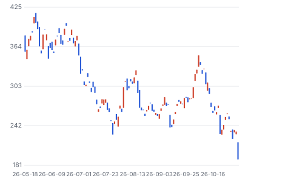

**주봉**

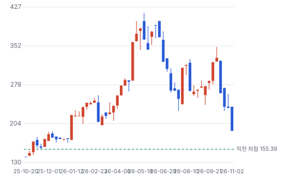

**월봉**

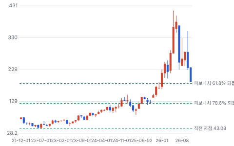

**분기 매출·EPS 실적과 컨센서스**

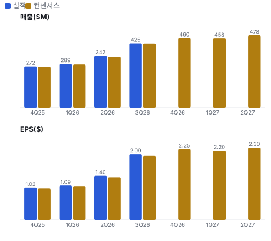

**최근 4개 분기 주가 변화 분석**

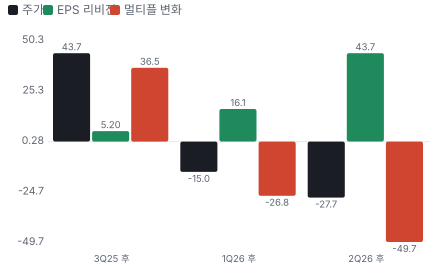

**EPS 리비전**

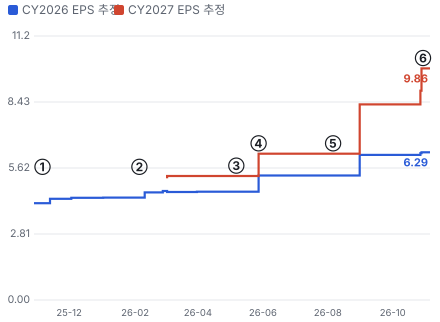

① 25-11-06 4Q FY25 실적 · EPS 리비전 -
② 26-02-05 1Q FY26 실적 · EPS 리비전 -
③ 26-05-07 2Q FY26 실적 · EPS 리비전 +0%
④ 26-05-28 IQE 지분·공급 계약 · EPS 리비전 +18%
⑤ 26-08-06 3Q FY26·DC +40% QoQ · EPS 리비전 +0%
⑥ 26-11-05 4Q FY26·1Q 가이던스 상회 · EPS 리비전 +0%

**밸류에이션 주가 시나리오**

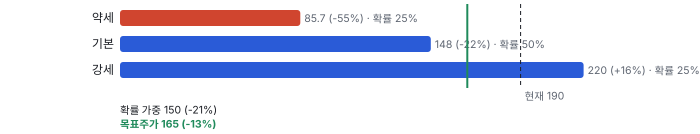

**주가별 업사이드**

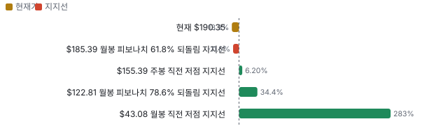

**제품·서비스 포트폴리오**

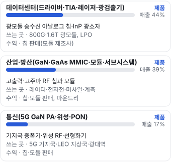

**고객 믹스(3Q FY26·9개월, 매출 대비)**

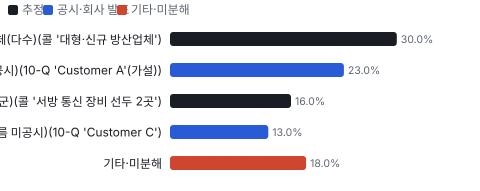

**공급 병목(10점, 낮을수록 병목)**

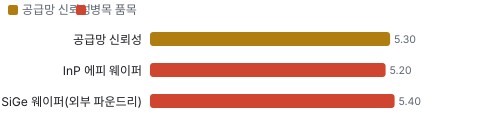

**CAPEX의 매출 대비 비중**

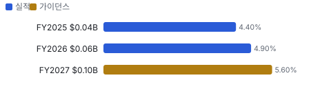

**어닝콜 변화별 주주가치 영향**

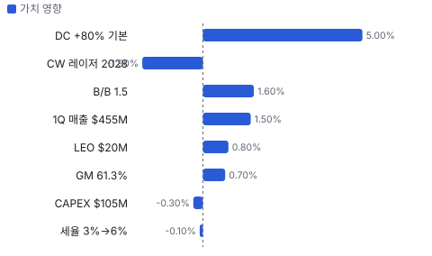

**멀티플 프리미엄**

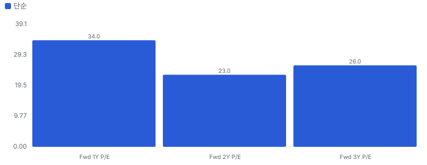

**합리적 멀티플**

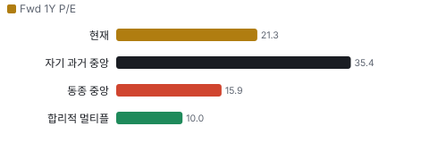

**일별 거래량 분해**

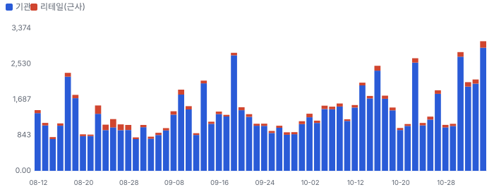

**기관 자금 흐름**

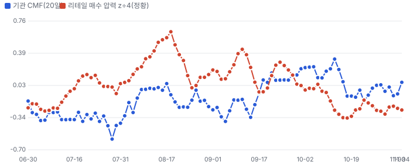

**몬테카를로**

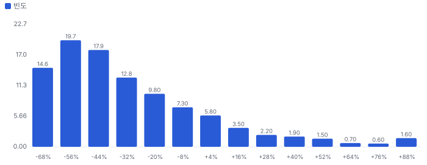

해석: 3,000번 중 493번(16%)에서 가치가 지금 주가 이상이었다. 가정을 흔들어도 지금 주가를 뒷받침하지 못하는 경우가 더 많다. 가운데 값은 0.60배이고, 열 번 중 여덟 번은 0.35~1.17배 사이에 든다.

## 내러티브

> **기업가치를 결정하는 이야기:** Fwd 1Y P/E 21.3배로 동종 6곳 중앙값 15.9배보다 34% 높다 — 3년 월말 기록에서 가장 낮은 배수다. 다음 4개 분기 EPS 컨센서스 \$9.05는 FY26 조정 EPS \$5.60의 1.6배다. 가치는 FY27 매출 \$1.9~2.0B·조정 영업이익률 40%가 지켜지는가, 그리고 2028년에도 데이터센터가 자라는가에 달렸다

> **멀티플·EPS 프리미엄**
> **멀티플:** Fwd 1Y P/E 21.3배, 동종 6곳 중앙값 15.9배(QRVO 14.5·COHR 14.9·SWKS 15.8·LITE 16.1·SMTC 18.4·ADI 21.5) — 11/5 업종 급락 뒤 값
> **EPS:** 4Q EPS \$2.09는 발표 직전 추정 \$2.04의 102%. 3Q 콜 뒤 1Q~3Q FY27 분기 EPS 추정은 \$1.61·1.60·1.70에서 \$2.25·2.20·2.30으로 35~40% 올랐다

### 투자자들은 왜 열광했나

2025-11-04 \$144.13에서 2026-05-26 \$409.68까지 2.8배 올랐다 — 데이터센터 매출이 1Q FY26 \$85.8M에서 4Q \$188.1M으로 두 배가 됐고, 분기마다 가이던스가 컨센서스를 넘었다(EPS 서프라이즈 8분기 연속). 5월 말 이후 −54%는 이익 추정이 오르는 동안 Fwd 1Y P/E가 66배(6/30)에서 21.3배로 내려간 결과다 — 이익이 아니라 배수가 빠졌다

### 무엇이 기업가치를 바꾸나

> **구조적 체질 변화**
> **변화:** 통신 중심 RF 회사에서 데이터센터 38%·산업·방산 40%·통신 21%로 세 시장이 고르게 큰 회사로 — 4Q는 데이터센터 44%
> **증거:** 콜·10-Q
> **반증:** 데이터센터가 둔화하며 다시 한 시장 의존이 커진다

> **고부가 믹스 확장**
> **변화:** 조정 매출총이익률 FY26 56%대 → 4Q 61.3% → 1Q 62~63%, CEO는 60%대 중반 경로
> **증거:** 보도자료·콜
> **반증:** 2Q FY27 조정 GM(매출총이익률) 62% 아래

> **기술 혁신**
> **변화:** 200G/레인 드라이버·TIA, 3.2T(3.2테라비트/초 광모듈 세대(레인당 400G × 8)) 칩셋, CW 레이저 단면 개선, 선형 이퀄라이저·PCIe(서버 내부 칩 간 고속 연결 규격)
> **증거:** 4Q FY26 어닝콜(2026-11-05) 요지
> **반증:** CW 레이저 2028년 고객 인증 실패

> **실행 속도**
> **변화:** 4Q 매출 중 같은 분기 주문 출하가 7% — 잔고 기반이고 일부 제품은 제조 리드타임이 길다. 피어 납기는 공시가 없다 **납품 리드타임 3~9개월.** 피어 비교 미확인. 이전 대비 미확인.
> **증거:** 4Q FY26 어닝콜(2026-11-05) 요지

> **M&A**
> **변화:** 인수 대신 IQE(영국 화합물 반도체 에피 웨이퍼 회사 — 이 회사가 지분 약 12%를 산 공급사) 지분 12%·장기 공급 계약(2026-05)으로 에피 공급을 묶었다. 업종에서는 Marvell-Lumentum 거래(11/2)가 경쟁 구도를 바꾼다
> **증거:** 10-Q·업종 보도
> **반증:** 통합형 경쟁사가 모듈 칩을 자체 조달로 돌린다

> **정책·입법 연관성**
> **재정정책:** CHIPS: 로웰·RTP(노스캐롤라이나 리서치 트라이앵글 파크 — 이 회사 GaN-on-SiC 팹 위치) 예비 조건 합의(PMT(CHIPS 예비 조건 합의서(Preliminary Memorandum of Terms)), 2025-01), 최종 협약(DFA(CHIPS 최종 지원 협약(Direct Funding Agreement))) 1~2개 분기 안 가능(금액 미공시). 투자세액공제 25%→35% 10-Q·콜 반증: DFA가 2027년 중반까지 체결되지 않는다 의회 동의 10/10 — 하원 5/5(CHIPS법(2022) 본회의 통과·세출 반영, 세액공제 35%는 2025-07 법 통과) · 상원 5/5(같음).
> **행정명령:** 수출 통제: 청구지 중국 매출 39% — 광모듈 칩이 통제 대상으로 들어가면 바로 닿는다. 현재 통제 대상이라는 공시는 없다 10-Q 지역 매출 반증: BIS(미국 상무부 산업안보국 — 수출 통제 담당)가 광모듈용 아날로그 칩을 대중 통제 품목에 넣는다 의회 동의 0/10 — 하원 0/5(행정부 단독 조치(BIS)) · 상원 0/5(같음).
> **연관입법:** 국방 세출(레이더·미사일·전자전)과 미국산 통신 부품 요건이 산업·방산·통신을 받친다. 로비 공시는 키가 없어 미확인 콜 반증: 2027 회계연도 국방 세출 감액 의결

> **CAPEX 낙수효과**
> **변화:** 하이퍼스케일러 AI 투자 → 광모듈 → 이 회사 칩. 고객 투자 발표를 이 회사 매출로 바로 옮기지 않는다 — 확인된 것은 B/B 1.5·데이터센터 매출·고객 A 23%
> **증거:** 콜·10-Q
> **반증:** 2027년 하이퍼스케일러 CAPEX 가이던스가 줄어든다

### 내러티브 근거

> AI 클러스터가 구리에서 광으로 넘어가면서 1.6T(1.6테라비트/초 광모듈 세대(레인당 200G × 8)) 광모듈마다 들어가는 드라이버·TIA·광검출기 콘텐츠가 늘고, 여기에 방산·위성 GaN이 겹친 '분산된 고성장 아날로그 IDM(설계부터 제조까지 직접 하는 반도체 회사)' 이야기다. 데이터센터는 FY26 +74%, FY27 기본 +80%다. 그러나 주가는 이 이야기보다 AI 광 업종 전체의 배수를 따라간다 — 5/26 종가 고점 \$409.68에서 11/5 \$190.35까지 −54%, 실적 발표일 −18%는 같은 날 Lumentum −19%·Credo −18%와 같은 길이었다. 동종 대비 멀티플 차이 +34% 중 회사 고유 몫은 +113%다. 단계는 확산, 쏠림은 높음이다.

> **1.6T·200G/레인 콘텐츠** · 강화
> **논리:** 1.6T 물량과 모듈당 칩 콘텐츠가 함께 늘어 데이터센터가 FY27 +80%
> **숫자:** 데이터센터 4Q \$188.1M(+37% QoQ·+136% YoY), 1Q +15% 가이던스
> **반증:** 2Q FY27 데이터센터 매출이 QoQ 감소

> **방산·위성 GaN 두 번째 엔진** · 강화
> **논리:** 미국·유럽 국방 예산과 LEO 지상국이 산업·방산 30%+ 성장을 만든다
> **숫자:** 산업·방산 FY26 +27.8%, 4Q +23% QoQ 사상 최대
> **반증:** FY27 산업·방산 성장 20% 아래

> **마진 레버리지** · 강화
> **논리:** 매출총이익률 60%대 중반·조정 영업이익률 40% 초과로 EPS가 매출보다 빨리 는다
> **숫자:** 4Q 조정 GM 61.3%·OPM 38.2%, 1Q GM 62~63%·OPM 약 40%
> **반증:** 2Q FY27 조정 GM 62% 아래

> **NPO·CW 레이저 옵션** · 약화
> **논리:** NPO·CW 레이저로 2028년 이후 시장이 수십억 달러 넓어진다
> **숫자:** 수주·매출 0, CW 레이저 2028년 시장 진입
> **반증:** 2027년 안에 NPO 대량 수주 공시

> **반대: AI 광 업종 배수 재평가** · 강화
> **논리:** AI 데이터센터 투자 2028년 불확실성으로 업종 전체 배수가 내려간다
> **숫자:** Fwd 1Y P/E 6/30 66배 → 10/30 27.5배 → 11/5 21.3배, 11/5 업종 −13~−19%
> **반증:** 업종 Fwd 1Y P/E가 30배 위로 복귀

> **반대: 중국·고객 집중** · 강화
> **논리:** 청구지 중국 39%·고객 A 23%라 수출 통제나 한 고객의 재고 조정이 바로 매출에 닿는다
> **숫자:** 중국 3Q \$133.8M(1년 전 28% → 39%), 고객 A 13% → 23%
> **반증:** FY26 10-K에서 중국 비중 30% 아래·고객 A 20% 아래

## 포트폴리오

| 제품·서비스 | 구분 | 무엇 | 쓰는 곳 | 돈 버는 방식 | Mix | Mix 변화(전 분기 대비) |
|---|---|---|---|---|---|---|
| 데이터센터(드라이버·TIA·레이저·광검출기) | 제품 | 광모듈 송수신 아날로그 칩·InP 광소자 | 800G·1.6T 광모듈, LPO(선형 구동 광모듈 — DSP 없이 아날로그 드라이버·TIA로 신호를 보내는 저전력 광모듈(Linear Pluggable Optics)) | 칩 판매(모듈 제조사) | 미확인 | 미확인 |
| 산업·방산(GaN·GaAs MMIC(단일 칩 마이크로파 집적회로)·모듈·서브시스템(장비 안에 들어가는 모듈 조립품)) | 제품 | 고출력·고주파 RF 칩과 모듈 | 레이더·전자전·미사일·계측 | 칩·모듈 판매, 파운드리 | 미확인 | 미확인 |
| 통신(5G GaN PA(전력 증폭기)·위성·PON(수동 광네트워크 — 가정·건물용 광통신망)) | 제품 | 기지국 증폭기·위성 RF·선형화기 | 5G 기지국·LEO 지상국·광대역 | 칩·모듈 판매 | 미확인 | 미확인 |

**Mix 변화가 가장 큰 쪽은 데이터센터(+4.1%p, 전 분기 대비).** 계절성 판정: 분기 매출 계절 지수 기준 없음 → 직전 분기와 비교.

## 고객

> **3Q FY26·9개월 최대 고객 미국·유럽 방산 체계 업체(다수)(콜 '대형·신규 방산업체') 30%, 상위 3곳 69%, 집중도 보통.** 공시·회사 발표로 확인한 몫은 매출의 36%이고, 나머지 고객 몫은 추정이거나 미분해다. 10-Q는 3Q 매출의 23%를 고객 A, 13%를 고객 C가 냈다고 적는다(1년 전 A 13%, C 10% 미만). 상위 10곳이 60%다. 이름은 공시하지 않는다. 데이터센터가 FY26 매출의 38%이고 3Q 청구지 중국이 39%라, 큰 고객은 중국·동남아에서 1.6T·800G 광모듈을 조립하는 모듈 제조사일 가능성이 높다 — 이름 연결은 가설

**고객별 매출 몫(3Q FY26·9개월)**
| 고객 | 몫 | 변화 | 근거 |
|---|---|---|---|
| 미국·유럽 방산 체계 업체(다수)(콜 '대형·신규 방산업체') | 25~35% | 미확인 | 추정 |
| 광모듈 제조사 1곳(이름 미공시)(10-Q 'Customer A'(가설)) | 23% | +10%p | 공시 |
| 통신 장비·위성 업체(서방 통신 장비 2곳·LEO 위성군)(콜 '서방 통신 장비 선두 2곳') | 12~20% | 미확인 | 추정 |
| 고객 C(이름 미공시)(10-Q 'Customer C') | 13% | 미확인 | 공시 |
| 기타·미분해 | 18% | - | - |

> **미국·유럽 방산 체계 업체(다수)(콜 '대형·신규 방산업체')** · 추정
> **사는 것:** GaN·GaAs MMIC·모듈·서브시스템(레이더·전자전·미사일)
> **추정 근거:** 산업·방산이 FY26 매출 40%이고 그 대부분이 방산이라는 회사 설명 — 몫은 추정

> **광모듈 제조사 1곳(이름 미공시)(10-Q 'Customer A'(가설))** · 공시
> **사는 것:** 200G/레인 드라이버·TIA, 광검출기
> **추정 근거:** 고객 A 몫은 공시. 데이터센터 매출 급증(3Q +40% QoQ)과 같은 시기에 13% → 23% — 모듈 제조사라는 것은 가설

> **통신 장비·위성 업체(서방 통신 장비 2곳·LEO 위성군)(콜 '서방 통신 장비 선두 2곳')** · 추정
> **사는 것:** 5G GaN PA·위성 RF·선형화기
> **추정 근거:** 통신 FY26 매출 \$281.6M(21%) 기준 범위 — 업체 몫은 미공시

> **고객 C(이름 미공시)(10-Q 'Customer C')** · 공시
> **사는 것:** 미확인
> **추정 근거:** 몫만 공시, 시장·이름 미공시. 1년 전 3Q는 10% 미만이라 숫자가 없다

## 수주·파이프라인

> **2026-11-05 기준 5건.** 확정 \$0.66B, 미확정 \$0.02B.

**실행 속도와 방해 요인**
| 항목 | 상태 | 실행 속도 | 방해 요인 |
|---|---|---|---|
| FY26 순증 수주잔고(전 시장) | 확정 | 같은 분기 주문 출하 7% — 잔고 기반 출하 | SiGe(실리콘게르마늄 — 고속 아날로그(드라이버·TIA) 칩 공정, 외부 파운드리에 맡긴다) 웨이퍼·후공정 캐파 · 고객 재고 조정 |
| 방산 후속 주문(함정 레이더·공대공 미사일) | 확정 | 미확인 | 국방 세출 |
| LEO 신규 위성군(고객 수주) | 파이프라인 | 미확인 | 고객 위성군 일정 |
| NPO 하이퍼스케일러 대량 기회 | 파이프라인 | 미확인 | 통합 CMOS(상보형 금속산화물 반도체 — 일반 실리콘 칩 공정) 경쟁 · 고객 구조 미정 |
| CHIPS 지원(로웰·RTP) | 협상 | 미확인 | 상무부 협상 |

## 마진 구조

> **GPM 59.9%, OPM 31.6%.** 4Q FY25 대비 GPM +5.5%p, OPM +16.4%p. 변동비는 매출의 32%이고, 매출이 10% 늘면 OPM은 +3.3%p 움직인다. 4Q FY26 GAAP 매출총이익률 59.9%(1년 전 54.5%), 조정 61.3%. 회사는 매출 증가에 따른 팹 가동률, 높은 이익률의 신제품, 수율·폐기 개선, 믹스를 이유로 들었다. 연구개발 17.9%·판관비 10.4%로 GAAP 영업이익률 31.6%, 조정 38.2%

> **매출 100 중 매출원가 42.0, 매출총이익 58.0(최근 4분기, 공시).** 매출원가 요인 중 웨이퍼 원가(자체 팹 감가·소재 + 외부 SiGe 파운드리)이 매출의 17.0%로 가장 무겁고, 단가가 +10% 오르면 GPM이 -1.70%p 움직인다. 분기 회귀로 매출 1이 늘 때 매출원가는 0.37 늘고, 매출원가의 고정비 몫은 21%다.

**비용 요인 강도 — 비중·추세·충격(+10%)·탄력**
| 비용 | 구분 | 매출 대비 | 1년 변화 | 마진 기여 | 충격 시 마진 | 매출 탄력 | 고정비 몫 |
|---|---|---|---|---|---|---|---|
| 웨이퍼 원가(자체 팹 감가·소재 + 외부 SiGe 파운드리) | 매출원가 요인 | 17.0% | 미확인 | 미확인 | -1.70%p | 미확인 | 50% |
| 조립·테스트(해외 외주 포함)·패키지 | 매출원가 요인 | 10.0% | 미확인 | 미확인 | -1.00%p | 미확인 | 20% |
| 제조 인건비·간접비·재고 충당 | 매출원가 요인 | 7.1% | 미확인 | 미확인 | -0.71%p | 미확인 | 60% |
| 에피·기판(InP·GaAs·GaN-on-SiC(실리콘카바이드 기판 위에 키운 질화갈륨 — 방산 레이더·기지국 고출력 증폭기 공정)) | 매출원가 요인 | 6.0% | 미확인 | 미확인 | -0.60%p | 미확인 | 0% |
| 매출원가 | 공시 항목 | 42.0% | -3.3%p | +3.3%p | -4.20%p | 0.37 | 21% |
| 연구개발 | 공시 항목 | 21.5% | -3.7%p | +3.7%p | 미확인 | 0.18 | 27% |
| 판관비 | 공시 항목 | 13.5% | -2.5%p | +2.5%p | 미확인 | 0.04 | 79% |

매출 탄력 = 분기 비용을 매출에 회귀한 기울기(매출 1당 변동비), 고정비 몫 = 절편 ÷ 평균 비용. 표본이 8분기 미만이면 미확인. 매출원가 요인 비중은 margin 재료의 추정이 섞여 있고, 공시 매출원가와의 차이는 '기타 매출원가'로 둔다.

**GPM에서 OPM까지(GAAP)**
| 기간 | GPM | 연구개발 | 판관비 | 기타 | OPM |
|---|---|---|---|---|---|
| 4Q FY25 | 54.5% | 24.1% | 15.2% | 0.0% | 15.2% |
| 4Q FY26 | 59.9% | 17.9% | 10.4% | 0.0% | 31.6% |

**GPM·OPM 최근 4개 분기**
| 분기 | GPM | OPM |
|---|---|---|
| 2026-01 | 55.9% | 15.9% |
| 2026-04 | 56.9% | 17.6% |
| 2026-07 | 58.3% | 22.5% |
| 2026-10 | 59.9% | 31.6% |

**마진을 결정하는 비용 요인 — 비용 +10% 시 OPM**
| 비용 | 매출 대비 | 변화 | 고정비 | OPM |
|---|---|---|---|---|
| 연구개발 | 17.9% | -6.2%p | 80% | -1.79%p |
| 웨이퍼 원가(자체 팹 감가·소재 + 외부 SiGe 파운드리) | 17.0% | 미확인 | 50% | -1.70%p |
| 판매·관리비 | 10.4% | -4.8%p | 70% | -1.04%p |
| 조립·테스트(해외 외주 포함)·패키지 | 10.0% | 미확인 | 20% | -1.00%p |
| 제조 인건비·간접비·재고 충당 | 7.1% | 미확인 | 60% | -0.71%p |
| 에피·기판(InP·GaAs·GaN-on-SiC) | 6.0% | 미확인 | 0% | -0.60%p |

**비용을 움직이는 요인**
| 비용 | 요인 |
|---|---|
| 연구개발(연구개발) | FY27 약 \$300M(CEO), 연 약 20% 증가 · 근거 공시 |
| 웨이퍼 원가(자체 팹 감가·소재 + 외부 SiGe 파운드리)(매출원가) | 팹 가동률·파운드리 웨이퍼 단가 · 근거 추정 |
| 판매·관리비(판관비) | 인력·주식 보상 · 근거 공시 |
| 조립·테스트(해외 외주 포함)·패키지(매출원가) | 물량·패키지 단일 공급원 · 근거 추정 |
| 제조 인건비·간접비·재고 충당(매출원가) | 가동률 · 근거 추정 |
| 에피·기판(InP·GaAs·GaN-on-SiC)(매출원가) | IQE 등 에피 공급 단가 · 근거 추정 |

**데이터센터(드라이버·TIA·레이저·광검출기) BOM — 매출의 44%, GPM 62%(추정 — 시장별 이익률 미공시(CFO: 시장별 이익률은 종 모양 분포 안). 회사 조정 61.3% 근처), 항목 가격 +10% 시**
| 항목 | 원가 몫 | 전가 | 제품 GPM | OPM |
|---|---|---|---|---|
| SiGe 웨이퍼(외부 파운드리) | 25~40% | 미확인 | -1.2%p | -0.55%p |
| 조립·테스트·패키지 | 20~35% | 미확인 | -1.0%p | -0.46%p |
| InP 에피 웨이퍼 | 10~25% | 미확인 | -0.7%p | -0.29%p |
| 미분해 | 22% | - | - | - |

**산업·방산(GaN·GaAs MMIC·모듈·서브시스템) BOM — 매출의 39%, GPM 60%(추정), 항목 가격 +10% 시**
| 항목 | 원가 몫 | 전가 | 제품 GPM | OPM |
|---|---|---|---|---|
| 조립·테스트·패키지 | 25~40% | 미확인 | -1.3%p | -0.50%p |
| 팹 감가·인건비 | 25~40% | 미확인 | -1.3%p | -0.50%p |
| GaN-on-SiC 기판·에피 | 15~30% | 미확인 | -0.9%p | -0.35%p |
| 미분해 | 12% | - | - | - |

**통신(5G GaN PA·위성·PON) BOM — 매출의 17%, GPM 57%(추정), 항목 가격 +10% 시**
| 항목 | 원가 몫 | 전가 | 제품 GPM | OPM |
|---|---|---|---|---|
| 조립·테스트·패키지 | 25~40% | 미확인 | -1.4%p | -0.24%p |
| GaN-on-SiC 기판·에피 | 15~30% | 미확인 | -1.0%p | -0.16%p |
| GaAs 웨이퍼 | 10~25% | 미확인 | -0.8%p | -0.13%p |
| 미분해 | 28% | - | - | - |

조립·테스트·패키지 가격이 +10% 오르면 영업이익은 -3.8% 움직인다. 판매가 전가를 모르는 항목은 전가 0%로 계산했다.

**BOM 항목 가격을 움직이는 것**
| 항목 | 요인 |
|---|---|
| SiGe 웨이퍼(외부 파운드리) | 드라이버·TIA는 외부 SiGe 파운드리 생산(Needham 질문·CEO 답변) · 근거 추정 |
| InP 에피 웨이퍼 | 레이저·광검출기 — IQE 장기 공급 계약 · 근거 추정 |
| 조립·테스트·패키지 | 베어 다이·플립칩, 해외 조립 테스트 · 근거 추정 |
| GaN-on-SiC 기판·에피 | RTP 팹 GaN 공정 · 근거 추정 |
| 조립·테스트·패키지 | 다기능 모듈·LGA(랜드 그리드 어레이 — 바닥 패드로 붙이는 칩 패키지) 패키지 · 근거 추정 |
| 팹 감가·인건비 | 자체 팹(RTP·로웰·프랑스) · 근거 추정 |
| GaN-on-SiC 기판·에피 | 기지국 PA · 근거 추정 |
| GaAs 웨이퍼 | 위성·마이크로파 칩 · 근거 추정 |
| 조립·테스트·패키지 | 모듈 조립 · 근거 추정 |

## 공급망 병목

> **공급망 신뢰성 5.3/10, 병목 주의.** 가장 약한 고리는 InP 에피 웨이퍼 5.2점이고, 품목 평균은 5.4점이다. 근거가 부족한 2건(GaN-on-SiC 기판·에피 · 조립·테스트·패키지)은 점수에서 뺐다. 10-K는 일부 패키지·소재와 특정 공정을 단일 공급원에 의존한다고 적는다. 고속 아날로그(드라이버·TIA)는 외부 SiGe 파운드리에서 만든다 — CEO는 여러 회사가 GlobalFoundries·ST(STMicroelectronics — 유럽 반도체 회사)·Tower·TSMC(타이완 세미컨덕터 매뉴팩처링)와 장기 공급 계약을 발표했지만 이 회사는 비공개로 확정 약정을 맺는다고 했다. InP·GaAs 에피는 2026-05 IQE 지분 12%와 장기 공급 계약으로 묶었다. 구매 약정 금액은 공시를 찾지 못했다

**병목과 마진 — 품목 가격 +10% 시 OPM**
| 품목 | 점수 | 판정 | 구분 | OPM |
|---|---|---|---|---|
| InP 에피 웨이퍼(필수) | 5.2 | 병목 주의 | 출하 차질 위험 | -0.29%p |
| SiGe 웨이퍼(외부 파운드리)(필수) | 5.4 | 병목 주의 | 핵심 통제 품목 | -0.55%p |

> **InP 에피 웨이퍼** · 5.2/10
> **왜:** 레이저·광검출기 출하를 정한다
> **병목 요인:** 인증 공급사 2곳 · 캐파 빠듯 · 리드타임 미확인 · 재인증 12개월 · 1위 점유율 미확인 · 지역 집중 미확인 · 물량 확보 장기계약
> **풀리는 조건:** 미확인

> **SiGe 웨이퍼(외부 파운드리)** · 5.4/10
> **왜:** 데이터센터 매출의 핵심 칩 — 파운드리 재인증 9개월은 업계 통상 범위(추정)
> **병목 요인:** 인증 공급사 2곳 · 캐파 빠듯 · 리드타임 미확인 · 재인증 9개월 · 1위 점유율 미확인 · 지역 집중 미확인 · 물량 확보 장기계약
> **풀리는 조건:** 미확인

**공급사**
| 품목 | 공급사 | 몫 | 근거 |
|---|---|---|---|
| SiGe 웨이퍼(외부 파운드리) | 미공시(경영진이 Tower·ST·GlobalFoundries 공정 경험을 언급)(고속 아날로그 칩 웨이퍼) | 미확인 | 추정 |
| InP 에피 웨이퍼 | IQE plc(에피 웨이퍼 — 지분 약 12%·장기 공급 계약) | 미확인 | 공시 |
| InP 에피 웨이퍼 | 자체(앤아버 MBE(분자선 에피택시 — 원자층 단위로 결정을 키우는 장비))(저·중 물량 에피) | 미확인 | 회사 발표 |
| GaN-on-SiC 기판·에피 | 미공시(SiC(실리콘카바이드 — 고출력 반도체 기판 소재) 기판) | 미확인 | 추정 |
| 조립·테스트·패키지 | 미공시(해외 외주)(조립·테스트, 일부 패키지 단일 공급원) | 미확인 | 공시 |

## 생산능력

> **현재 명목 캐파 미확인, 가동률 미확인.** 착공 이상 증설은 0 팹 면적(제곱피트)·웨이퍼 — 회사는 웨이퍼 캐파를 공시하지 않는다, 발표까지 합치면 0 팹 면적(제곱피트)·웨이퍼 — 회사는 웨이퍼 캐파를 공시하지 않는다이다. FY2026 CAPEX는 \$0.06B로 매출의 4.9%다. 주요 시설은 로웰(본사·팹, 281,700제곱피트, 임차 2043년까지)·RTP(GaN-on-SiC 팹, 177,785제곱피트, 2037년까지)·프랑스 리메이브레반(MESC(프랑스 리메이브레반 GaN·GaAs 팹 자회사))·앤아버(InP 연구·MBE)다(10-K). FY27 CAPEX \$100~110M의 약 60%가 세 팹(로웰·RTP·프랑스)에 들어가고, 모두 새 건물 없이 기존 건물 안에 장비를 넣는다

**생산능력 확충 계획**
| 계획 | 단계 | 증설 | 가동 시점 | CAPEX |
|---|---|---|---|---|
| 로웰 1단계(데이터센터 FY27 램프용 장비·공간) | 장비 반입 | 미확인 | 2027-06 | 미확인 |
| 로웰 2단계(CW 레이저) | 발표 | 미확인 | 2028-01 | 미확인 |
| RTP GaN 장비 추가(캐파 30% 증설 계획, 3Q 콜) | 장비 반입 | 미확인 | 2027-03 | 미확인 |
| 프랑스 3인치 → 6인치 전환·G10 반응로 설치 | 장비 반입 | 미확인 | 2027-06 | 미확인 |

남은 계획의 CAPEX 합계는 \$0.00B(금액 미확인 4건 제외)다. 합계는 FY2027 매출의 0%다.

**증설 방해 요인**
| 계획 | 방해 요인 |
|---|---|
| 로웰 1단계(데이터센터 FY27 램프용 장비·공간) | 장비 리드타임 |
| 로웰 2단계(CW 레이저) | CW 레이저 신뢰성(단면 품질) 확인 |
| RTP GaN 장비 추가(캐파 30% 증설 계획, 3Q 콜) | 미확인 |
| 프랑스 3인치 → 6인치 전환·G10 반응로 설치 | 공정 이전 수율 |

**CAPEX와 매출 대비**
| 기간 | CAPEX | 매출 | 매출 대비 | 구분 |
|---|---|---|---|---|
| FY2025 | \$0.04B | \$0.97B | 4.4% | 실적 |
| FY2026 | \$0.06B | \$1.33B | 4.9% | 실적 |
| FY2027 | \$0.10B | \$1.87B | 5.6% | 가이던스 |

## 해자

> 해자는 화합물 반도체 팹 네 곳(InP·GaAs·GaN-on-SiC)을 가진 IDM이라는 점과, 미국 안에서 대체가 어려운 RF 부품(5G GaN PA·V-band(40~75GHz 대역 — 위성 지상국 업·다운링크에 쓰는 고주파) 선형화기) 지위, 방산 장기 프로그램 인증이다. 데이터센터 아날로그(드라이버·TIA)는 Semtech·Marvell·Broadcom·Astera와 경쟁이 세다

> **화합물 반도체 IDM** · 강함
> **해자:** InP 레이저·광검출기, GaN-on-SiC, GaAs를 자체 팹에서 만든다 — 설계와 공정을 같이 바꿀 수 있다
> **근거:** 10-K 설비·콜
> **숫자:** 자체 팹 4곳, InP 200G 광검출기 양산
> **깨지는 조건:** CW 레이저가 2028년에도 고객 신뢰성 인증을 못 받는다

> **미국 내 유일 공급(국산 요건)** · 보통
> **해자:** 미국 내 유일한 5G 전력 증폭기 공급사, 미국 내 유일 V-band 선형화기 생산사(CEO)
> **근거:** 4Q FY26 어닝콜(2026-11-05) 요지
> **숫자:** 통신 FY26 \$281.6M
> **깨지는 조건:** 국산 부품 요건 없는 RAN(무선 접속망 — 기지국 장비) 입찰에서 아시아 PA가 채택된다

> **방산 프로그램 인증** · 강함
> **해자:** 레이더·미사일·전자전 체계에 들어간 부품은 체계 수명 동안 바꾸기 어렵다
> **근거:** 4Q FY26 어닝콜(2026-11-05) 요지
> **숫자:** 산업·방산 FY26 +27.8%·\$536M, 후속 생산 주문
> **깨지는 조건:** 미국 국방 세출이 2027년 감액 의결

> **200G/레인 아날로그 설계** · 약함
> **해자:** 1.6T 드라이버·TIA를 하이퍼스케일러 공급망에 넣었지만 경쟁사가 많다
> **근거:** 4Q FY26 어닝콜(2026-11-05) 요지
> **숫자:** 데이터센터 FY26 +74%, 4Q \$188.1M
> **깨지는 조건:** NPO에서 통합 CMOS 솔루션이 표준이 된다(CEO: 이 회사 영역 아님)

## 경영진·네트워크

> Stephen Daly(60)가 CEO, John Kober(56)가 2019년부터 CFO다. 공동 창업 가문인 Susan Ocampo와 관계사가 10.7%를 가진 최대 주주다(위임장 2026-01). 그 밖 5% 주주는 BlackRock 9.0%·Vanguard 8.7%·FMR(Fidelity(FMR LLC) — 미국 운용사) 7.5%·T. Rowe Price 7.3%다

> **Stephen Daly** · 사장·CEO·이사 · 미확인
> **프로필:** 위임장 기준 60세. 콜에서 FY27 \$2B·2030년 \$5B 목표와 자본 배분(배당·자사주 없음)을 직접 말했다
> **비즈니스:** 미확인
> **정계:** 미확인
> **동문:** 미확인
> **사모임:** 미확인

> **John Kober** · SVP·CFO · 2019
> **프로필:** 2015년 재무 부사장·회계 책임자로 입사, 그 전 CIRCOR(CIRCOR International — 산업·방산 유체 부품 회사) International 회계 책임자·재무 담당
> **비즈니스:** CIRCOR International(산업·방산 부품) 출신
> **정계:** 미확인
> **동문:** 미확인
> **사모임:** 미확인

> **Susan Ocampo** · 이사·최대 주주(관계사 포함 10.7%) · 미확인
> **프로필:** 관계사 포함 7,994,228주(10.7%)
> **비즈니스:** 통신 반도체 투자 펀드 GaAs Labs 관련(위임장, 이사 Rosenband 경력 기재)
> **정계:** 미확인
> **동문:** 미확인
> **사모임:** 미확인

**네트워크 정량화**
| 연결 | 강도 | 닿는 매출 | 가중 노출 | 매출 대비 | 근거 |
|---|---|---|---|---|---|
| 비즈니스: 최대 주주 가문(10.7%) — 장기 보유로 경영 안정 | 2/5 | \$0.00B | \$0.00B | 0% | 지분 구조이며 매출 연결 근거 없음 https://www.sec.gov/Archives/edgar/data/1493594/000149359426000007/mtsi-20260116.htm |

가중 노출은 연결이 닿는 매출의 크기다. 연결이 그 매출을 만들었다는 뜻이 아니며, 인과는 공개 자료로 입증하지 못한다.

## 약세 논리 및 셀온 조건

| 약세 논리 | 근거 | 반박 | 가를 자료 |
|---|---|---|---|
| 업종 배수가 더 내려간다 | Fwd 1Y P/E 66배(6/30) → 21.3배(11/5), 11/5 LITE −19%·CRDO(Credo Technology — 데이터센터 연결 칩 회사(티커)) −18%·ALAB(Astera Labs — 데이터센터 연결 칩 회사(티커)) −19% | 이익 추정은 같은 기간 35~40% 올랐다 — 하락은 배수에서 나왔다 | 하이퍼스케일러 4Q 실적·2027 CAPEX 가이던스(2027-01 하순~02) |
| 중국·고객 집중 | 청구지 중국 39%(1년 전 28%), 고객 A 23%·C 13%, 상위 10곳 60% | 청구지는 모듈 조립사 위치 — 최종 수요는 미국 하이퍼스케일러(가설) | FY26 10-K 고객·지역 매출(2026-11 중순), BIS 광모듈 칩 통제 여부 |
| 2028년 데이터센터 공백 | CEO는 고객의 2028년 숫자를 내지 않았다(BMO 질문) | FY27 기본에 NPO·CW 레이저 매출은 0, 잔고 기반 출하(같은 분기 주문 7%) | 2Q FY27 실적의 FY27 하반기 데이터센터 발언(2027-05) |
| 옵션 일정이 밀린다 | CW 레이저 2027년 말 → 2028년, NPO 수주 시점 미공시, Stifel 목표가 하향 | 단면 품질 개선 — 75mW·100mW로 넓힌다(CEO) | CW 레이저 고객 인증 공시, 로웰 2단계 착수(FY27 중반) |
| 외부 파운드리 병목 | SiGe 파운드리가 확정 약정을 요구, 후공정 확장 필요, 공급망 신뢰성 5.3/10 | CEO: 약정을 주저하지 않는다, CAPEX \$100~110M, IQE 장기 공급 계약 | FY26 10-K 구매 약정·공급 계약 공시 |

## 어닝콜 변화

**직전 콜 대비 새로 나오거나 바뀐 내용 → 가치 영향**
| 항목 | 내용 | 직전 콜 | 최신 콜 | 모델 동인 이동 | 확신도 | 가치 영향 |
|---|---|---|---|---|---|---|
| 신규 | 1Q FY27 가이던스 | 발표 전 컨센서스 \$431M | \$450~460M·EPS \$2.21~2.29 | 기준연도 매출 +\$0.02B | 0.8 | +1.5% |
| 업데이트 | FY27 데이터센터 성장 | 8/6 수치 없음('강한 성장') | FY26 74% 초과, 기본 80% | 1년차 성장률 +3.0% | 0.5 | +5.0% |
| 업데이트 | 매출총이익률 궤도 | 3Q 59.7% | 4Q 61.3%, 1Q 62~63%, 이후 분기 +25~50bp | 목표 이익률 +1.0% | 0.8 | +0.7% |
| 부정 | CW 레이저 일정 | 2027년 말 생산 시작 가능 | 2028년 시장 진입, 2단계 증설 FY27 중반 착수 | 장기 성장 수렴값 -0.50% | 0.5 | -1.9% |
| 신규 | CAPEX 확대 | FY26 \$64.4M | FY27 \$100~110M(60% 팹) | 매출÷투하자본 -10.0% | 0.8 | -0.3% |
| 신규 | LEO 신규 계약 | 언급 없음 | 2028년 초부터 약 \$20M 신규 사업 | 장기 성장 수렴값 +0.20% | 0.5 | +0.8% |
| 업데이트 | 수주 | 3Q 콜 '수주 강함' | FY26 B/B 1.5·4Q 1.4·사상 최대 잔고, 같은 분기 출하 주문 7% | 1년차 성장률 +1.0% | 1.0 | +1.6% |
| 부정 | 세율 | 조정 세율 3% | FY27 약 6%(이연법인세자산 소진) | 출발 이익률 -0.30% | 0.8 | -0.1% |
| **합계** | 단독 합 |  |  | 동시 적용 +7.3% |  | **+7.2%** |

**사건별 EPS 리비전**
| # | 날짜 | 구분 | 사건 | CY2026 EPS 전→후 | CY2027 EPS 전→후 | 리비전 | 주가 반응 |
|---|---|---|---|---|---|---|---|
| ① | 25-11-06 | 실적 | 4Q FY25 실적 | \$4.12 → \$4.31 | - → - | - | +11.5% |
| ② | 26-02-05 | 실적 | 1Q FY26 실적 | \$4.36 → \$4.58 | - → - | - | +5.9% |
| ③ | 26-05-07 | 실적 | 2Q FY26 실적 | \$4.61 → \$4.61 | \$5.28 → \$5.28 | +0.0% | +11.2% |
| ④ | 26-05-28 | 내러티브 | IQE 지분·공급 계약 | \$4.61 → \$5.30 | \$5.28 → \$6.23 | +18.0% | -2.4% |
| ⑤ | 26-08-06 | 실적 | 3Q FY26·DC(데이터센터) +40% QoQ | \$5.30 → \$5.30 | \$6.23 → \$6.23 | +0.0% | +14.5% |
| ⑥ | 26-11-05 | 실적 | 4Q FY26·1Q 가이던스 상회 | \$6.29 → \$6.29 | \$9.86 → \$9.86 | +0.0% | -18.4% |

**해석:** 3개 구간 누적 주가 -12% = EPS 리비전 +76% × 멀티플 -50%. 더 크게 움직인 쪽은 **EPS 리비전**이다.

## P·Q 사이클

> **10년 위치: Q형 기업(매출 갭 분산의 0%가 가격) — 가격은 추세 대비 -1.1%(회복, 10년 분위 28%), 물량은 +21.6%(확장, 분위 100%). P 프리미엄 -3%, Q 프리미엄 +24%(매출총이익이 정상(추세) 수준보다 요인별로 이만큼 높거나 낮다).** AR(2) 전망으로 P 프리미엄은 4분기 뒤 -2%·8분기 뒤 0%(비슷하게 유지), Q 프리미엄은 +15%·-12%(−로 반전). 이익이 사이클 덕에 정상보다 높다 — 지금 이익에 높은 멀티플을 함께 주면 사이클을 두 번 세는 셈이다(IB는 정상 이익에 멀티플을 건다).

**10년 P·Q 사이클 위치·프리미엄**
| 항목 | 가격(P) | 물량(Q) |
|---|---|---|
| 추세 대비 갭(현재) | -1.1% | +21.6% |
| 사이클 시계 | 회복 | 확장 |
| 10년 분위 | 28% | 100% |
| 프리미엄(현재) | -3% | +24% |
| 프리미엄 4분기 뒤 | -2% | +15% |
| 프리미엄 8분기 뒤 | 0% | -12% |
| 갭 반감기 | 6분기 | 5분기 |

방법: P = 가격 지수 4분기 평균(미국 PPI(생산자물가지수) 반도체·관련 소자 대용 — 회사 판매가가 아니라 업종 가격), Q = TTM 매출 ÷ P. 추세는 로그 레벨의 HP(호드릭-프레스콧 — 추세와 순환을 나누는 통계 필터) 필터(λ 1600)로 정상(mid-cycle) 수준을 잡는다. 프리미엄 = 요인별 매출총이익 증분 ÷ 정상 매출총이익(정상 GPM 54.1% = 10년 중앙값, 물량 증분 마진 61.2% = 전년 대비 ΔGP(매출총이익)÷ΔRev 회귀, 가격은 전액 이익 반영). 표본 40개 TTM 분기. 전망은 갭의 AR(2) 통계 외삽이며 가이던스·컨센서스가 아니다. HP 필터는 끝점에서 추세가 최근 값 쪽으로 끌려 현재 갭을 작게 볼 수 있다.

> **Q 사이클 — 최근 4분기 평균 가격 기여 -1.5%, 물량 기여 +31.9%(전년 대비 로그 증가율).** P 강도 5.4/10, Q 강도 7.0/10, 최근 8분기 중 100%가 같은 요인 우세(구조적). AR(2) 투영으로는 8분기 안에 전환 신호가 없다.

**P·Q 사이클 정량**
| 항목 | 가격(P) | 물량(Q) |
|---|---|---|
| 최근 4분기 평균 기여 | -1.5% | +31.9% |
| 강도(0~10, 자기 이력 z) | 5.4 | 7.0 |
| AR(2) 고유 주기 | 미확인 | 11.4분기 |
| 다음 4분기 투영 평균 | -3.1% | +33.0% |

가격 근거: 미국 PPI 반도체·관련 소자 대용 — 회사 판매가가 아니라 업종 가격. PPI를 쓰면 회사 판매가가 아니라 업종 가격 대용이다. 로그 증가율이라 가격·물량 기여의 합이 매출 증가율이다. 투영은 통계 외삽이며 가이던스·컨센서스가 아니다. 회사 판매가로 잴 수 없는 이유: 회사는 출하량·평균 판매 단가를 공시하지 않는다. 매출 증가는 1.6T 물량과 칩당 콘텐츠 증가가 함께 만든다(CEO) — 가격·물량을 나눌 자료가 없다

## 밸류에이션

> **목표주가 \$165, 업사이드 -13%.** 자리는 기본과 강세 사이(강세 쪽 23%)이고 도달 확률은 약 41%다. 기본 \$148, 강세 \$220(+16%), 약세 \$86(-55%). DCF 기준 업사이드는 기본 -39%, 강세 +2%, 약세 -60%다(WACC 11.7%).

배수 기준 기본 \$148(−22%)과 DCF 기본 업사이드 −39%는 방향이 같고 폭이 다르다. 배수는 다음 4개 분기 EPS \$9.05에 엔진이 고른 16.3배(동종 중앙 15.9배에서 출발)를 곱한다 — 이익 추정은 그대로 믿고 배수만 동종 수준으로 내린다. DCF는 FY27 +41%·FY28 +26% 뒤 성장을 영구성장으로 줄이고, 장기 GAAP 영업이익률을 36%(조정 컨센서스 FY29 42.7%에서 주식 보상 6.5% 차감)로 두며 WACC 11.7%로 할인한다 — 매출 성장이 5년 동안 연 34%를 유지해야 지금 값이 나온다. 목표 \$165는 기본과 강세 사이(강세 쪽 23%)에 있고, 이익이 컨센서스대로 가도 배수가 동종에 붙으면 지금보다 낮다는 뜻이다. 토론은 동종 중앙에 성장 0%대 RF 회사가 섞였고 이익 하향 근거가 없다는 반박을 받아 규칙 등급 Sell을 Neutral로 한 단계 올렸다.

> **약세 \$86 (-55%)** · 확률 25%
> **가정:** 12.2배 × EPS \$7.00
> **근거:** AI 데이터센터 투자 2028년 불확실성으로 모듈 제조사가 재고를 줄여 데이터센터가 FY27 하반기 QoQ 감소, FY27 매출 \$1.65B·EPS 추정 하단 \$6.9 쪽. 청구지 중국 39%에 수출 통제가 겹치면 더 낮다

> **기본 \$148 (-22%)** · 확률 50%
> **가정:** 16.3배 × EPS \$9.05
> **근거:** 데이터센터 +70~80%·산업·방산 +30%·통신 \$300M으로 FY27 매출 \$1.87B, 조정 영업이익률 40% 안팎. 다음 4개 분기 EPS 컨센서스 \$9.05와 같은 높이

> **강세 \$220 (+16%)** · 확률 25%
> **가정:** 20.4배 × EPS \$10.80
> **근거:** 회사 '가정' \$2B·EPS \$10을 넘어 하반기 캐파 추가·이퀄라이저·초기 NPO가 겹치고 매출총이익률 64%. FY27 EPS 추정 상단 \$11.3 쪽

**멀티플 선정 — Fwd 1Y P/E**
| 단계 | 조정 | 근거 |
|---|---|---|
| 동종 중앙값 | 15.9배 | 범위 14.5~21.5배, 6곳 |
| 펀더멘털 | -19% | 성장·이익률·ROIC로 본 합리적 멀티플 10.0배와의 차이의 일부만 인정 |
| 해자 | +8% | 화합물 반도체 IDM 강함 · 미국 내 유일 공급(국산 요건) 보통 · 방산 프로그램 인증 강함 · 200G/레인 아날로그 설계 약함 |
| 반복 매출 | +0% | 재료 없음 |
| 수주 전환·가시성 | +8% | book-to-bill 1.00 → 가시성 1.00 |
| 내러티브 | +5% | 단계 확산 |
| 사이클·실행 판단 | +0% | 11/5 업종 동반 급락(LITE −19%·CRDO −18%·ALAB −19%·COHR −13%)은 동종 중앙값(11/5 종가)에 이미 들어 있어 따로 빼지 않는다. 산업·방산 40%로 이익 변동이 광 동종보다 작다는 점과, 청구지 중국 39%·고객 A 23% 집중이 서로 상쇄한다고 보고 조정하지 않는다 |
| **선정** | **16.3배** | 지금 21.3배 |

**동종 레인지**
| 회사 | Fwd 1Y P/E | Fwd 2Y P/E | Fwd 3Y P/E | 성장 | 영업이익률 | ROIC |
|---|---|---|---|---|---|---|
| QRVO | 14.5 | 14.3 | 12.5 | 0% | 23% | 22% |
| COHR | 14.9 | 12.3 | 10.9 | 50% | 25% | 14% |
| SMTC | 18.4 | 13.9 | 11.1 | 49% | 35% | 43% |
| ADI | 21.5 | 19.0 | 16.8 | 32% | 53% | 18% |
| LITE | 16.1 | 11.8 | 9.4 | 113% | 48% | 65% |
| SWKS | 15.8 | 12.4 | 10.2 | 84% | 22% | 14% |
| **MACOM Technology Solutions** | 21.3 | 16.2 | 13.9 |  |  |  |

지금 주가가 요구하는 5년 매출 CAGR 34%, 기본 시나리오 20%. 몬테카를로 중앙값 업사이드 -40%.

> 의사결정 보조(투자자문 아님): ① 매수 매력: 연 기대수익 +2.9% (자기자본비용 11.7% 대비 -8.8%p) · 자본비용 초과 확률 15% · 안전마진 0.35 → 정량 신호 약함 / ② 위험 예산 지표(이론): 0% — 기대수익이 자기자본비용에 못 미침(무위험 대비 켈리 0%는 참고) · 5년 하위10% -44% · 30%+ 손실 확률 24% / ③ 상방(5년): 기대 1.15배 · 2배 9% · 3배 2% · 10배 0% · 상위10% 1.94배

## 매수 위치(일봉)

> **현재가 \$190는 '지지선 미확인'.** 이 자리에서 목표주가까지 -13.3%, 첫 일봉 저항까지 +20.2%, 다음 지지까지 하방 미확인.

**가격대별 업사이드(일봉 기준)**
| 가격대 | 가격 | 목표주가까지 | 첫 저항까지 | 다음 지지까지 | 손익비 | 근거 기법(강도) |
|---|---|---|---|---|---|---|
| 현재가 | \$190 | -13.3% | +20.2% | 미확인 | 미확인 | - |

**일봉 저항**
| 저항 | 가격 | 현재가 대비 | 근거 기법(강도) |
|---|---|---|---|
| 저항 1 | \$229 | +20.2% | 120일 지그재그 저점(0.8) |
| 저항 2 | \$240 | +25.9% | 120일 지그재그 저점 · 스윙 저점(1.8) |
| 저항 3 | \$258 | +35.7% | 20일선(0.5) |

일봉만 쓴다(주봉·월봉 제외). 손익비 = 목표주가까지 업사이드 ÷ 다음 지지까지 하방. 가격대별 기대값 참고표이며 매수·매도 시점 지시가 아니다.

## 애널리스트 토론

> **토론 결론 Neutral(규칙 등급 Sell).** 규칙 등급은 Sell(목표 \$165, −13%, DCF 기본 −39%)이다. 그러나 목표가 쓰는 동종 중앙 15.9배에는 최근 4개 분기 매출 성장이 0%·−3%인 QRVO·SWKS가 들어 있고, 3Q 콜 뒤 같은 4개 분기 EPS 추정은 35~40% 올랐으며 1Q 가이던스가 컨센서스를 넘었다 — 이익 쪽 하향 근거가 없다는 반박이 살아남았다. 반대로 Strong Buy 자리의 '가장 싼 구간'은 2028년 가시성 없이는 받칠 수 없어 Buy까지는 못 갔다. 한 단계 올려 Neutral

**패널(가상 애널리스트)**
| 자리 | 애널리스트 | 핵심 논리 | 틀리는 조건 | 최종 투표 |
|---|---|---|---|---|
| Strong Buy | 서도윤(가상 리서치 하우스 한빛증권) | 1Q 가이던스가 발표 전 컨센서스보다 매출 5.5%·EPS 11% 높은데 주가는 업종과 함께 18% 빠졌다 — 이익은 오르고 배수만 내려갔다 | 2Q FY27 데이터센터 매출 QoQ 감소 | Buy |
| Buy | 이하준(가상 리서치 하우스 다올리서치) | 세 시장이 따로 자라는 구조라 데이터센터가 식어도 방산·위성이 받친다 | FY27 산업·방산 성장 20% 아래 | Neutral |
| Neutral | 정수아(가상 리서치 하우스 누리자산) | 이익 경로는 맞지만 값은 업종 배수가 정한다 — AI 광 업종 배수가 바닥을 확인하기 전에는 이 회사 이익만으로 방향을 정할 수 없다 | 업종 동반 하락 없이 MTSI만 이익 하향으로 빠진다 | Neutral |
| Sell | 문태경(가상 리서치 하우스 한결증권) | 규칙 등급 Sell이 맞다 — 목표주가 \$165(−13%), DCF 기본 −39%, 지금 값은 5년 매출 CAGR 34%를 요구하는데 기본은 20%다. 그 위에 청구지 중국 39%·고객 A 23% 집중이 있다 | FY26 10-K에서 중국 30% 아래·고객 A 20% 아래 | Sell |
| Strong Sell | 길하람(가상 리서치 하우스 바른리서치) | 2028년 데이터센터 투자가 꺾이면 FY28 EPS \$11.9 추정이 먼저 무너진다 — 옵션(NPO·CW 레이저)은 일정이 밀렸다 | 2027년 안에 NPO 대량 수주 공시 | Neutral |

**투표**
| Strong Buy | Buy | Neutral | Sell | Strong Sell |
|---|---|---|---|---|
| 0 | 1 | 3 | 1 | 0 |

> **개회 · Strong Buy**
> **발언:** 가이던스 상회에 주가 −18%는 이 회사 뉴스가 아니라 업종 뉴스다. 같은 날 Lumentum −19%, Credo −18%였다

> **개회 · Buy**
> **발언:** FY26 매출의 40%가 산업·방산이다. 데이터센터 하나에 묶인 광 업종 동종보다 덜 흔들려야 한다

> **개회 · Neutral**
> **발언:** Fwd 1Y P/E가 6월 66배에서 지금 21.3배다. 이익이 오르는데 값이 빠지는 국면은 업종 배수가 멈출 때까지 이어진다

> **개회 · Sell**
> **발언:** 엔진 목표 \$165는 지금보다 13% 낮고 DCF 기본은 −39%다. 3Q 청구지 중국 39%, 고객 A 23%로 1년 사이 집중도 커졌다

> **개회 · Strong Sell**
> **발언:** CW 레이저는 한 분기 사이 2027년 말에서 2028년으로 밀렸고, Stifel이 그 이유로 목표가를 내렸다

> **반박1 · Neutral → Strong Buy**
> **발언:** 업종 뉴스라는 건 맞다. 그래서 이 회사 이익만으로 값을 되돌릴 수 없다 — 업종 배수가 안정돼야 한다

> **반박1 · Buy → Sell**
> **발언:** 중국 몫은 청구지다. 모듈 조립사가 중국·동남아에 있을 뿐 최종 수요는 미국 하이퍼스케일러다

> **반박1 · Strong Buy → Strong Sell**
> **발언:** FY27 기본 숫자에 NPO·CW 레이저 매출은 0이다. 옵션이 밀려도 FY27 EPS 컨센서스 \$9.05는 그대로다

> **반박1 · Sell → Buy**
> **발언:** 청구지라도 수출 통제는 청구지와 출하지를 본다. 모듈 조립사가 중국에 있으면 통제가 바로 닿는다

> **반박1 · Strong Sell → Neutral**
> **발언:** 배수가 멈추는 조건은 2028년 투자 가시성인데, 회사는 고객의 2028년 숫자를 내지 않았다

> **반박2 · Strong Buy → Sell**
> **발언:** 같은 분기 주문 출하가 7%뿐이다 — 매출은 이미 잡힌 잔고에서 나온다. 고객 한 곳이 주문을 줄여도 1~2분기는 잔고가 받친다

> **반박2 · Neutral → Buy**
> **발언:** 산업·방산이 받친다면 동종보다 덜 빠졌어야 하는데 11/5 하락 폭은 광 업종과 같았다 — 시장은 아직 이 회사를 광 업종으로 값 매긴다. 다만 동종 중앙 15.9배에는 최근 4개 분기 매출 성장 0%·−3%인 QRVO·SWKS가 들어 있다 — 매출 성장 41%의 회사에 같은 배수를 매기는 것도 과하다

> **반박2 · Sell → Strong Buy**
> **발언:** 잔고 금액은 공시가 없다. B/B 1.5로 추정한 \$0.66B는 우리 추정이다

> **반박2 · Buy → Strong Sell**
> **발언:** 2028년 FY 추정 \$11.9는 표본이 얇다. 그래도 FY27만으로도 지금 값은 Fwd 1Y 21배다

> **반박2 · Strong Sell → Strong Buy**
> **발언:** 21.3배는 동종 중앙 15.9배보다 34% 비싸다. 업종이 더 빠지면 그 웃돈부터 줄어든다

> **최종 · Strong Buy**
> **발언:** 이익 상향과 배수 하락이 겹친 지금이 이익 대비 가장 싼 구간이다

> **최종 · Buy**
> **발언:** 세 시장 분산이 하방을 줄인다

> **최종 · Neutral**
> **발언:** 업종 배수가 멈추는지 먼저 본다

> **최종 · Sell**
> **발언:** 10-K의 고객·중국 집중을 먼저 본다

> **최종 · Strong Sell**
> **발언:** 2028년 가시성이 없으면 웃돈은 정당화되지 않는다

남은 반대 의견: Sell 자리: DCF 기본 −39%와 요구 CAGR 34%(기본 20%)는 배수 논쟁과 별개로 지금 값이 이익보다 앞서 있다는 숫자다

패널은 가상 인물이고 실존 IB의 의견이 아니다.

## 시장 평가

> **셀사이드(IB 애널리스트)**
> **한 줄:** 의견은 거의 전원 매수이고 목표가 평균은 실적 전 값이다. 실적 다음 날 목표가 하향 두 건(Needham·Stifel)이 나왔다 — 이익 추정이 아니라 배수를 내리는 하향이다
> **의견 분포:** Strong Buy 12·Buy 2·Hold 2 — 16명
> **목표가:** \$386.44(범위 \$300~475) — 현재가 대비 +103%
> **의견 변경:** BMO·Raymond James 상향(9~10월), 11/5 Needham \$410→\$300·Stifel 하향 — 실적 뒤 목표가 하향

> **바이사이드(기관 투자자)**
> **한 줄:** 기관 비중이 98%로 이미 꽉 찼다. 장기 롱온리(FMR·T. Rowe)가 크게 들고 있어 업종 배수가 내려갈 때 매도 압력이 한꺼번에 나온다
> **13F 기관(3Q26 제출분):** 226곳 집계 — BNY(BNY Mellon — 미국 수탁 은행) Mellon +112만 주(3배) 등
> **5% 주주:** Ocampo 관계사 10.7%·BlackRock 9.0%·Vanguard 8.7%·FMR 7.5%·T. Rowe 7.3%
> **기관 보유:** 98%

> **언론·업계**
> **한 줄:** 커뮤니티 매체는 가이던스 상회를 다루고 주가 급락 원인은 업종 쪽으로 본다 — 중국 매출 39%는 거의 다루지 않는다
> **보도 초점:** 1Q 가이던스·데이터센터 74% 초과·NPO·Marvell-Lumentum 거래 — Seeking Alpha·Motley Fool·IBD(인베스터스 비즈니스 데일리)

## 체크리스트

| 시점 | 무엇 | 의미 |
|---|---|---|
| 2026-11 중순 | FY26 10-K: 고객 집중·지역 매출·구매 약정 | 중국 39%·고객 A 23%가 연간으로 어떤지, 공급 약정 규모 |
| 2026-12~2027-03 | CHIPS 최종 협약(DFA) 공시 | 로웰·RTP 증설 지원 금액이 처음 나온다 |
| 2027-01 하순~02 | 하이퍼스케일러 4Q 실적·2027 CAPEX 가이던스 | 업종 배수를 정하는 2028년 가시성 |
| 2027-02 초(예상) | 1Q FY27 실적: 매출 \$450~460M·데이터센터 +15% QoQ·조정 GM 62~63% | FY27 \$1.9~2.0B 경로의 첫 확인 |
| FY27 중반 | 로웰 2단계(CW 레이저) 착수 | CW 레이저 2028년 진입이 실제로 진행되는지 |

## 출처
- 4Q FY26 어닝콜(2026-11-05) 요지
- https://www.sec.gov/Archives/edgar/data/1493594/000149359426000038/mtsi-20260703.htm
- https://www.sec.gov/Archives/edgar/data/1493594/000149359425000054/mtsi-20251003.htm
- https://www.sec.gov/Archives/edgar/data/1493594/000149359426000041/ex99_1earningsreleaseq4fy26.htm
- 3Q FY26 어닝콜(2026-08-06) 요지

_구매 등급·목표주가 모두 규칙이 계산한 모델 값으로, 개인의 보유 종목·자금 사정을 반영하지 않는다 · 공개 자료 기반 분석이며 투자 권유가 아님 · 1차 판정, 미검증 · Chiip ten-bagger_