# 텐배거 리포트 2026-11-06 — Riot Platforms — 계약 \$38B를 쥔 전력 부지 회사, 남은 투자를 넣으면 완공 NOI의 6배

> 2026-11-06 · Riot Platforms(RIOT) · 기업: 텍사스·켄터키에서 비트코인을 채굴하고, 그 전력 부지를 AI 연구소·반도체 회사에 15~20년 데이터센터로 임대하며, 배전 장비를 직접 만드는 미국 회사

## Chiip View

주가는 6/30 \$27.38에서 11/2 \$11.84까지 57% 빠졌다가 Corsicana(Riot의 텍사스 코르시카나 캠퍼스 — 완공 시 약 1GW, 910MW 전체를 Frontier AI Lab에 15년 임대) 910MW 발표로 11/5 \$14.76이 됐다. 시가총액은 \$5.54B(기본 주식 기준, 완전 희석 기준 \$5.56B)다. 3Q26 매출 \$181.4M은 컨센서스를 약 11~13% 웃돌았고, 같은 날 Corsicana 전체를 한 AI 연구소(10-Q가 Anthropic(미국 AI 연구 회사 Anthropic PBC — Claude 모델 개발사) PBC(공익법인(Public Benefit Corporation))로 명시)에 15년 트리플넷(임차인이 세금·보험·운영비·전기료를 모두 내는 임대 구조(triple-net))으로 빌려 계약이 1,151MW·약 \$38B가 됐다. 엔진 규칙 등급은 Neutral(목표주가 \$27, +83%)이고 애널리스트 토론도 Neutral을 유지했다. **우리가 다르게 보는 곳은 '완공 NOI(순영업이익 — 임대 매출에서 시설 운영비를 뺀 값(Net Operating Income))의 2.5배'라는 읽기다.** 지금 기업가치 \$5.4B에 남은 프로젝트 자본 약 \$7.7B를 더하면 약 \$13.1B, 완공 NOI \$2.2B의 6배(세전 자본화율 약 17%)다. 싼 것은 맞지만 그 할인은 2028년까지 쓸 돈과 한 임차인·텍사스 정책 위험의 값이다. 엔진 시나리오 주가는 지금 순부채만 빼서, 2027년 말까지 늘 프로젝트 부채 약 \$2.5B(추정)를 빼면 기본 \$33이 약 \$26, 약세 \$16이 약 \$9.5가 된다. 남은 투자를 모두 빼는 DCF는 기본 −1%다. 경쟁 가설 ① 할인은 조달 위험이다 — 가를 자료: Rockdale(Riot의 텍사스 록데일 캠퍼스 — 개발 전력 약 700MW, AMD·Frontier AI Lab 임대)·Corsicana 프로젝트 금융 신용보강·LTC(총사업비 대비 대출 비율(Loan-to-Cost))·금리(회사 '마무리 중', 2027 상반기 전) ② 할인은 텍사스 정책 위험이다 — 가를 자료: 새 주지사 취임 뒤 첫 데이터센터 정책과 2027년 텍사스 의회 회기 법안(2027-01~05). 중간선거 영향 −0.7/10 — 가장 큰 채널은 전력망·인프라(+0.5, 양당 지지) · 업종 반응(GRID(전력망 인프라 상장지수펀드(First Trust NASDAQ Clean Edge Smart Grid Infrastructure)) ETF CAR(누적 초과수익률 — 사건 뒤 시장 대비 더 오르거나 내린 폭) −3.2%, t −1.69). 정책 0단계(선거 결과) 가설이고 하원 결과는 미확정이다. 연방 표에 없는 텍사스 주지사 교체가 더 큰 변수다.

## 대시보드
| 항목 | 값 | 설명 |
|---|---|---|
| 주가 | \$14.76 | 고점 대비 -49% · 1년 -32% |
| 시가총액 | \$5.56B | 완전 희석 기준 · EV \$5.38B |
| 업사이드 | +83% | 목표주가 \$27 · 다운사이드 +9% · 손익비(강세÷약세) 0.0 |
| 구매등급 | Neutral | 애널리스트 21명: Strong Buy 16 · Buy 3 · Neutral 2 · Sell 0 · Strong Sell 0 |
| 멀티플 | Fwd 1Y EV/EBITDA 53.0배 | 동종 중앙값 18.2배 |
| 가이던스 4Q26 |  | 컨센서스 \$177M |
| 알파 | 6.5/10 | 텐배거 가능성 점수 |
| 이벤트 | AMD 확장 첫 10MW 인도(회사 예상 11월) — 이어서 Rockdale·Corsicana 프로젝트 금융 신용보강 계약 체결(회사 '마무리 중', 날짜 미공개). 4Q26 실적은 2027년 3월 초(작년 3/2) | 2026-11-30 |

## 한 장 요약
- **기업가치를 결정하는 내러티브** Riot Platforms(RIOT)는 텍사스 채굴장의 전력과 부지를 AI 연구소·반도체 회사에 장기로 빌려주는 회사로 바뀌는 중이다. 11/4 Corsicana 910MW를 15년 트리플넷으로 임대(계약 매출 약 \$28B)해 누적 계약이 1,151MW·약 \$38B가 됐다. 지금 매출 \$181M(3Q)의 64%는 아직 채굴이고, 계약 매출이 들어오기 시작하는 건 2027년 6월부터다
- **밸류에이션 모델로 본 주가 상방은 어디까지인가?** **목표주가 \$27(+83%), 약세와 기본 사이(약세 쪽 34%)다.** 강세 \$56(+276%)는 Fwd 1Y EV/EBITDA 21.8배를 강세 EBITDA에 적용한 값이다. 기본 \$33, 약세 \$16. 손익비 0.0, DCF 기준 업사이드 -1%.
- **수주는 어디까지 왔나?** Corsicana(Frontier AI Lab(보도자료의 임차인 표기 — 10-Q는 Anthropic PBC로 명시), 15년 트리플넷) 0%, 100% 매출 \$28.00B · Rockdale(Frontier AI Lab, 20년) 0%, 100% 매출 \$9.10B · AMD(10년 + 연장 3회) 50%, 100% 매출 미확인. 계약 1,151MW·계약 매출 약 \$38B. 지금 매출이 나는 것은 AMD(미국 반도체 회사 Advanced Micro Devices) 25MW뿐이다(지금 인도 25MW = 계약의 2%)
- **누가 사 주나?** 최대 고객 비트코인 네트워크(채굴 풀 보상)(채굴 풀) 64%, 상위 3곳 100%. 공시·회사 발표로 확인한 몫은 100%다.
- **마진과 공급망은 어디가 약한가?** GPM 22.8%, OPM 0.7%. OPM을 가장 흔드는 BOM(제품 원가를 이루는 부품·재료 명세) 항목은 전력(고정가 PPA(전력 구매 계약(Power Purchase Agreement))·ERCOT(텍사스 전력망 운영 기관(Electric Reliability Council of Texas)))이고 가격 +10%에 -2.39%p다. 공급망 신뢰성은 4.9/10(병목 주의)이고 가장 약한 고리는 계통 전력(ERCOT 연계)이다.
- **생산능력은 얼마나 늘어나나?** 현재 명목 캐파 1,332 MW(전력 개발 용량, 데이터센터는 IT MW(서버에 실제로 공급되는 전력 용량(냉각·손실 제외))), 착공 이상 증설 1,126 MW(전력 개발 용량, 데이터센터는 IT MW). FY2028 CAPEX는 매출의 180.0%다.
- **지금 가격은 무엇을 가정하나?** 지금 기업가치 약 \$5.4B(시총 \$5.54B + 차입·리스 \$0.69B − 현금·비트코인 \$0.87B)는 완공 NOI \$2.2B의 2.5배로 보이지만, 남은 프로젝트 자본 약 \$7.7B를 더하면 약 \$13.1B로 6배(세전 자본화율 약 17%)다. Fwd 1Y EV/EBITDA 53배는 채굴 이익이 바닥이라 의미가 작고, Fwd 2Y(4Q27~3Q28 EBITDA 컨센서스 \$603M)는 9.2배로 동종 중앙값 18.2배(Fwd 1Y)의 절반이다. 엔진 DCF(WACC 8.2%)는 기본 업사이드 −1%다 — 감가·세금·남은 투자를 다 빼고 주식 위험으로 할인하면 지금 가격이 공정가라는 뜻이다. 가격은 계약 임대료를 주식처럼 할인하고, AMD 옵션 150MW와 Rockdale 잔여 200~250MW에는 값을 거의 주지 않는다.
- **왜 움직였나?** 6/30 \$27.38에서 11/2 \$11.84까지 −57%였다. 7월 초 이틀 −19%(원인 미확인), 8/10 2Q 실적·Rockdale 191MW 임대 다음 날 거래량 75.9M주에 +4.3%였다가 사흘 만에 되돌렸고, 10월 한 달 −36%는 업종 전체의 AI 인프라 신용 재가격과 겹쳤다(정황). 11/3 중간선거 당일 +18.4%, 11/4 3Q·Corsicana 발표 +9.6%(거래량 83.5M주, 평균의 4.2배)로 이틀 새 +30%다. 11/5에는 목표가 일괄 상향(Cantor \$24→\$37, Bernstein \$18→\$30 등)에도 −4.0% — 같은 날 텍사스 민주당 주지사 당선이 확정됐다(정황).
- **3Q 실적에서 무엇이 바뀌었나?** 매출 \$181.4M: 채굴 \$116.0M(64%)·엔지니어링 \$47.0M(26%, 1년 새 2.5배)·데이터센터 \$18.4M(10%, 전부 AMD). GAAP EPS \$0.01(컨센서스 −\$0.34)과 조정 EBITDA \$191.3M은 비트코인 평가이익 \$171.9M 덕이다. 비트코인 1,637개를 캤고 감가 제외 채굴 원가는 개당 \$39,265, 감가 포함 \$78,805로 생산 단가 \$70,855보다 높다. 올해 비트코인 20,264개를 약 \$1.5B에 팔아 Coinbase(미국 가상자산 거래소 — Riot에 \$200M 담보 대출(9월 상환)) \$200M 대출을 갚았고 증자는 없었다. 9/30 현금 \$669M(제한 현금 별도 \$79M)·비트코인 2,418개 \$202M, 차입 원금 \$674.5M이다. 핵심은 Corsicana다 — 910MW, 기본 임대료 kW당 월 \$130(연 3% 인상), 2027-06 첫 블록부터 2028-07 전량, 회사는 전력·패드만 짓고 임차인이 컴퓨팅 설비와 운영비·전기료를 낸다.
- **회사는 쟁점에 뭐라고 답했나?** 쟁점은 '텍사스 정치와 조달이 일정을 흔드느냐'다. 선거 위험에 CEO는 Rockdale 700MW·Corsicana 1GW의 계통연계가 이미 승인돼 수년째 수백 MW를 쓰고 있어 자신 있다고 답했다(JPMorgan(미국 투자은행 JP모건)). 새 주지사의 인허가 정책에 대한 직접 답은 없었다(회사 답변 없음). 조달에 CFO는 프로젝트 부채(비소구·임대료 기준), 조달 실패 시 연 12% 임대료 차감, 회사 유동성 약 \$1.2B와 임대료 유입 약 \$0.9B를 들어 증자 없이 간다고 했다. 비용에는 설계를 먼저 끝내고 최대보장가격(GMP(최대보장가격 계약 — 시공사가 상한 가격을 보장하는 건설 계약(Guaranteed Maximum Price))) 계약으로 단계별로 잠그며 Rockdale MW당 \$11~12M을 유지한다고 답했다(Northland).
- **무엇이 바뀌면 판단이 달라지나?** 위로는 ① Rockdale·Corsicana 프로젝트 금융이 LTC 85% 이상·낮은 금리로 체결되거나 ② AMD가 옵션 150MW를 행사하거나 ③ 텍사스 새 행정부가 기존 연계 부지를 규제 대상에서 빼면, 배수와 DCF의 간격이 배수 쪽으로 닫혀 기본 \$33(부채 반영 약 \$26) 쪽이다. 아래로는 ① 프로젝트 금융이 늦어 회사 현금으로 먼저 짓거나 회사 차원 증자·전환사채가 나오거나 ② Corsicana 첫 블록이 2027년 3분기를 넘기거나 ③ 텍사스가 기존 부지에 사용 제한·추가 부담을 걸면 약세 \$16(부채 반영 약 \$9.5) 쪽이다.

## 한눈에 보기

**일봉**

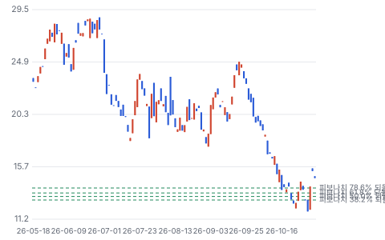

**주봉**

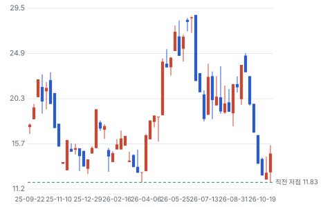

**월봉**

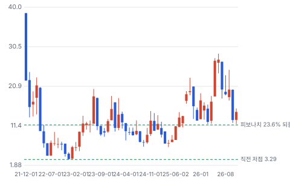

**분기 매출·EPS 실적과 컨센서스**

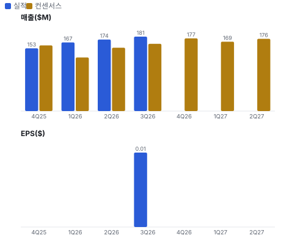

**EPS 리비전**

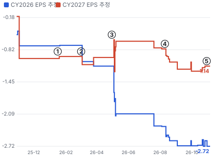

① 26-01-16 AMD 25MW 임대 · EPS 리비전 -4%
② 26-03-02 4Q25 실적 · EPS 리비전 +17%
③ 26-04-30 1Q26 실적 · EPS 리비전 -33%
④ 26-08-10 2Q26·Rockdale 191MW · EPS 리비전 +34%
⑤ 26-11-04 3Q26·Corsicana 910MW · EPS 리비전 +0%

**밸류에이션 주가 시나리오**

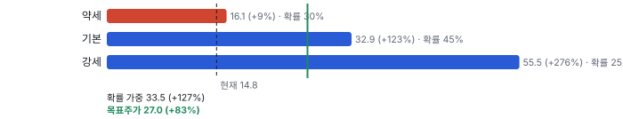

**주가별 업사이드**

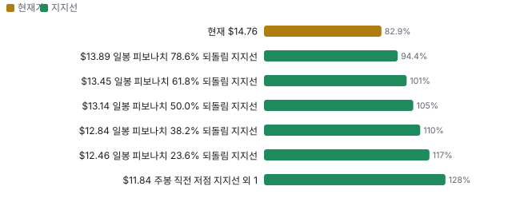

**제품·서비스 포트폴리오**

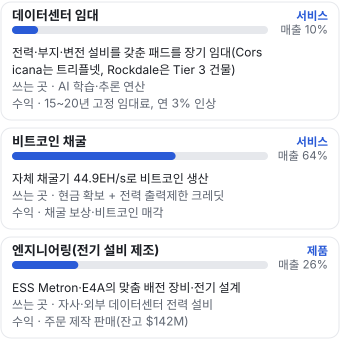

**고객 믹스(3Q26, 매출 대비)**

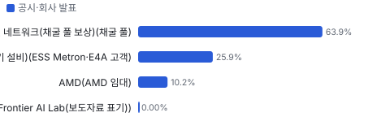

**공급 병목(10점, 낮을수록 병목)**

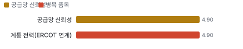

**생산능력 현재와 확충 계획(MW(전력 개발 용량, 데이터센터는 IT MW))**

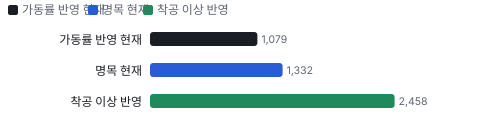

**CAPEX의 매출 대비 비중**

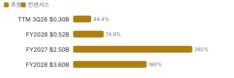

**어닝콜 변화별 주주가치 영향**

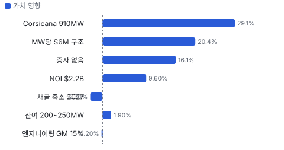

**멀티플 프리미엄(Fwd 1Y EV/EBITDA, 최근 4개 분기말)**

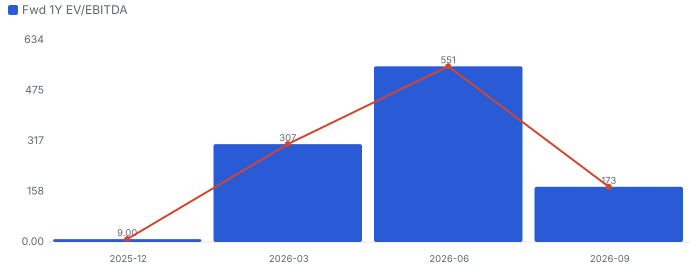

**합리적 멀티플**

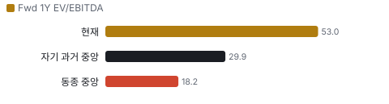

**일별 거래량 분해**

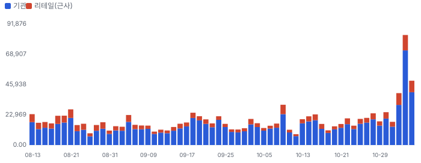

**기관 자금 흐름**

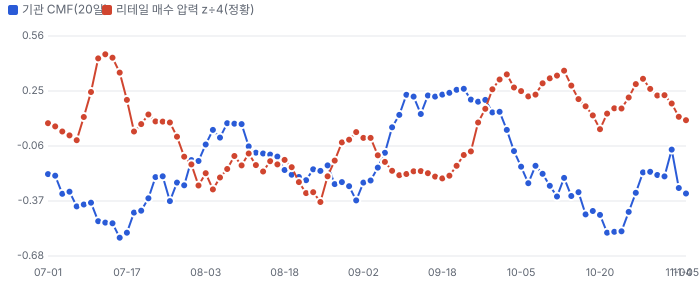

**몬테카를로**

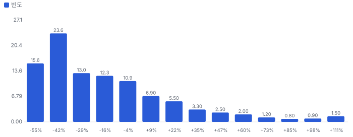

해석: 3,000번 중 799번(27%)에서 가치가 지금 주가 이상이었다. 가정을 흔들어도 지금 주가를 뒷받침하지 못하는 경우가 더 많다. 가운데 값은 0.75배이고, 열 번 중 여덟 번은 0.49~1.36배 사이에 든다.

## 내러티브

> **기업가치를 결정하는 이야기:** 기업가치는 2028년 완공 뒤 평균 연 NOI 약 \$2.2B를 시장이 몇 퍼센트로 자본화하느냐, 그리고 그 사이 프로젝트 자본 \$7.6~7.8B를 지분 희석 없이 조달하느냐로 정해진다. 지금 기업가치 약 \$5.4B(시총 \$5.54B + 차입·리스 \$0.69B − 현금·비트코인 \$0.87B)에 남은 투자 약 \$7.7B를 더한 약 \$13.1B가 완공 NOI의 약 6배, 세전 자본화율 약 17%다. 리츠형 장기 임대의 자본화율(6~8%)과 이 숫자 사이의 간격이 건설·조달·한 임차인·텍사스 정책 위험의 값이다

> **멀티플·EPS 프리미엄**
> **멀티플:** Fwd 1Y EV/EBITDA 53배는 채굴 이익이 바닥이라 의미가 작다. Fwd 2Y(4Q27~3Q28 EBITDA \$603M)는 약 9.2배, Fwd 3Y는 약 3.5배로 동종(IREN(호주계 채굴·AI 클라우드 회사 IREN) 10배·CORZ(미국 채굴·HPC 임대 회사 Core Scientific) 14배·MARA(미국 채굴 회사 MARA Holdings) 15배, Fwd 1Y)보다 낮다
> **EPS:** 3Q GAAP EPS \$0.01은 비트코인 평가이익 \$171.9M 덕이다(컨센서스 −\$0.34). 조정 EBITDA \$191.3M에도 같은 평가이익이 들어 있다

### 투자자들은 왜 열광했나

1월 AMD 25MW, 8월 Rockdale 191MW에 이어 11/4 Corsicana 910MW로 계약이 46배로 커졌다. 회사 몫 자본이 MW당 \$2M뿐인 구조라 '증자 없이 짓는다'는 말이 붙었다. 식는 이유는 둘 — 같은 날 텍사스에서 데이터센터 규제를 말해 온 민주당 주지사가 당선됐고, 매출이 들어오기까지 아직 7개월 이상 남았다

### 무엇이 기업가치를 바꾸나

> **구조적 체질 변화**
> **변화:** 채굴 89%(3Q25) → 64%(3Q26), 2028년 매출 대부분이 임대료로
> **증거:** 10-Q 세그먼트, 보도자료 임대 일정
> **반증:** Corsicana 첫 블록이 2027년 3분기를 넘긴다

> **고부가 믹스 확장**
> **변화:** 트리플넷 NOI 마진 약 99% vs 채굴 감가 포함 원가가 생산 단가의 111%
> **증거:** 보도자료
> **반증:** 임차인 환급 상각이 회사 설명보다 매출을 크게 깎는다

> **기술 혁신**
> **변화:** 해당 없음 — 임차인이 모듈형 컴퓨팅을 직접 깐다. Riot은 전력·부지만 낸다
> **증거:** 콜
> **반증:** 해당 없음

> **실행 속도**
> **변화:** AMD는 계약 4개월 만에 25MW 인도, Corsicana는 계약 8개월 뒤 첫 블록 목표 **납품 리드타임 8개월.** 피어 중앙값 13개월보다 38% 짧다(CIFR(Barber Lake) 13개월). 2026-01(AMD) 4개월보다 100% 길다.
> **증거:** 10-Q
> **반증:** AMD 확장 10MW가 11월을 넘긴다

> **M&A**
> **변화:** 부지 매입(Rockdale 토지 2026-01)과 전기 설비 회사(E4A(Riot 자회사 E4A Solutions — 텍사스 전기 설계 회사)) 인수 — 수직 계열화
> **증거:** 콜
> **반증:** 해당 없음

> **정책·입법 연관성**
> **재정정책:** 해당 없음 — 연방 보조금 공시가 없다 10-Q 검색 반증: 해당 없음 의회 동의 2/10 — 하원 1/5(데이터센터 직접 지원 세출 없음) · 상원 1/5(같음).
> **행정명령:** AI 인프라·전력 인허가 가속 행정명령은 업종 우호, 직접 수혜 공시 없음 콜 반증: 데이터센터 전력 사용 제한 조치 의회 동의 0/10 — 하원 0/5(행정부 단독 조치) · 상원 0/5(같음).
> **연관입법:** 텍사스 주 정책 — 2027년 1월 새 주지사 취임, 대형 부하 연결·인허가 규정이 바뀔 수 있다. 주 규정이라 연방 의회 단계가 없다 선거 결과(Texas Tribune), 콜(JPMorgan 질문) 반증: 2027년 텍사스 의회 회기에서 기존 연계 부지 예외 규정

> **CAPEX 낙수효과**
> **변화:** AI 연구소의 컴퓨팅 확보 경쟁이 GW(기가와트(1,000MW))급 단일 임대를 만들었다 — 다만 고객 투자 발표를 이 회사 매출로 바로 옮기지 않는다
> **증거:** 10-Q 임대 조건
> **반증:** 임차인의 다른 데이터센터 계약 축소 보도

### 내러티브 근거

> 6/30 \$27.38에서 11/2 \$11.84까지 −57%였다가 Corsicana 910MW 발표로 이틀 새 +30%. '비트코인 채굴 회사'에서 '전력 부지를 AI 연구소에 빌려주는 부동산형 회사'로 이야기가 바뀌는 중이다. 단계는 확산, 쏠림은 중간이다.

> **계약 임대료의 채권화** · 강화
> **논리:** 15~20년 take-or-pay 임대료 \$38B가 리츠처럼 NOI 배수로 평가받는다
> **숫자:** 자본화율이 판단을 가른다. 완공 NOI \$2.2B를 세전 8%로 자본화하면 \$27.5B — 프로젝트 부채 약 \$6.5B(LTC 85%, 추정)와 회사 몫 현금을 빼면 지분 약 \$19B(2028년, 할인 전). 세후 WACC 8.2%로 감가·세금·남은 투자 \$7.7B를 다 빼는 DCF로는 지금 가격 근처다
> **반증:** 프로젝트 부채가 시장 조건으로 조달되지 않는다

> **단일 임차인 집중** · 강화
> **논리:** 계약 매출 약 98%가 한 AI 연구소에서 나온다 — 그 회사의 자금 사정이 곧 Riot의 신용이다
> **숫자:** 상위 고객 몫 0.98
> **반증:** AMD 옵션 150MW 행사나 제3 임차인 계약

> **텍사스 정치 위험** · 태동
> **논리:** 2027년 1월 취임하는 민주당 주지사가 데이터센터 인허가를 멈출 수 있다
> **숫자:** 11/5 −4.0%(목표가 상향과 같은 날)
> **반증:** 새 행정부가 기존 연계 승인 부지는 대상이 아니라고 밝힌다

> **비트코인 가격** · 정체
> **논리:** 2027년까지 매출의 60%가 채굴이라 단기 이익은 비트코인이 정한다
> **숫자:** 비트코인 ±10% = 분기 채굴 매출 ±\$11.6M
> **반증:** Corsicana 채굴 축소(2027년 여름) 뒤 민감도가 줄어든다

> **반대 내러티브: 2028년까지 현금은 나간다** · 태동
> **논리:** 계약은 좋지만 2027~2028년 \$7.6~7.8B를 먼저 써야 하고, 그 사이 신용시장이 닫히면 지분이 메운다
> **숫자:** LTC 80%면 회사 현금 필요 \$1.5B > 현금·비트코인 \$0.95B(9/30)
> **반증:** Rockdale·Corsicana 프로젝트 금융이 LTC 85% 이상으로 체결된다

## 포트폴리오

| 제품·서비스 | 구분 | 무엇 | 쓰는 곳 | 돈 버는 방식 | Mix | Mix 변화(전년 대비) |
|---|---|---|---|---|---|---|
| 데이터센터 임대 | 서비스 | 전력·부지·변전 설비를 갖춘 패드를 장기 임대(Corsicana는 트리플넷, Rockdale은 Tier 3(이중화 전력·냉각으로 가동 중 정비가 가능한 데이터센터 등급) 건물) | AI 학습·추론 연산 | 15~20년 고정 임대료, 연 3% 인상 | 10% | 미확인 |
| 비트코인 채굴 | 서비스 | 자체 채굴기 44.9EH/s로 비트코인 생산 | 현금 확보 + 전력 출력제한 크레딧 | 채굴 보상·비트코인 매각 | 64% | -25.5%p |
| 엔지니어링(전기 설비 제조) | 제품 | ESS Metron(Riot 자회사 — 맞춤 전력 배전 장비 제조(덴버))·E4A의 맞춤 배전 장비·전기 설계 | 자사·외부 데이터센터 전력 설비 | 주문 제작 판매(잔고 \$142M) | 26% | +15.3%p |

**Mix 변화가 가장 큰 쪽은 비트코인 채굴(-25.5%p, 전년 대비).** 계절성 판정: 분기 매출 계절 지수 기준 있음 → 전년 같은 분기와 비교.

## 고객

> **3Q26 최대 고객 비트코인 네트워크(채굴 풀 보상)(채굴 풀) 64%, 상위 3곳 100%, 집중도 집중.** 공시·회사 발표로 확인한 몫은 매출의 100%이고, 나머지 고객 몫은 추정이거나 미분해다. 3Q 매출 \$181.4M 중 채굴 \$116.0M(64%)·엔지니어링 외부 고객 \$47.0M(26%)·데이터센터 \$18.4M(10%, 전부 AMD)이다. 10-Q는 채굴 풀과 AMD 임대를 10% 초과 고객으로 적었다. 계약 매출 \$38B 중 약 \$37.1B(Corsicana \$28B + Rockdale \$9.1B)가 10-Q가 Anthropic PBC로 이름을 밝힌 한 임차인이라 2028년부터 매출의 대부분이 이 한 곳에서 나온다

**고객별 매출 몫(3Q26)**
| 고객 | 몫 | 변화 | 근거 |
|---|---|---|---|
| 비트코인 네트워크(채굴 풀 보상)(채굴 풀) | 64% | -25%p | 공시 |
| 엔지니어링 외부 고객(데이터센터 전기 설비)(ESS Metron·E4A 고객) | 26% | +15%p | 공시 |
| AMD(AMD 임대) | 10% | +10%p | 공시 |
| Anthropic(Frontier AI Lab(보도자료 표기)) | 0% | +0%p | 공시 |

> **비트코인 네트워크(채굴 풀 보상)(채굴 풀)** · 공시
> **사는 것:** 채굴 연산(해시레이트)
> **추정 근거:** 3Q 채굴 \$116.0M ÷ \$181.4M · prior = 3Q25 \$160.8M ÷ \$180.2M

> **엔지니어링 외부 고객(데이터센터 전기 설비)(ESS Metron·E4A 고객)** · 공시
> **사는 것:** 맞춤 전력 배전 장비·케이블
> **추정 근거:** 3Q 엔지니어링 \$47.0M ÷ \$181.4M, 잔고 \$142M의 90% 이상이 데이터센터 일(CFO)

> **AMD(AMD 임대)** · 공시
> **사는 것:** Rockdale 25MW 데이터센터 임대 + 임차인 시설 구축 환급
> **추정 근거:** 3Q 데이터센터 \$18.4M(기본 임대료 \$7.7M·변동 \$0.5M·시설 구축 환급 \$10.2M) — 10-Q 10% 초과 고객

> **Anthropic(Frontier AI Lab(보도자료 표기))** · 공시
> **사는 것:** Rockdale 191MW(20년, 약 \$9.1B) + Corsicana 910MW(15년, 약 \$28B)
> **추정 근거:** 매출 시작은 Corsicana 2027-06 첫 블록, Rockdale 2027-12. 10-Q 1·3번 주석이 임차인을 Anthropic PBC로 명시

## 수주·파이프라인

> **2026-11-04 기준 4건.** 확정 \$37.10B.

**실행 속도와 방해 요인**
| 항목 | 상태 | 실행 속도 | 방해 요인 |
|---|---|---|---|
| Corsicana(Frontier AI Lab, 15년 트리플넷) | 확정 | 계약(2026-10-28) → 첫 블록 약 8개월, 전량 약 21개월 | 프로젝트 부채 조달 · 변전소 확장 · 텍사스 정책 |
| Rockdale(Frontier AI Lab, 20년) | 확정 | 계약(2026-08) → 첫 인도 약 16개월 | Tier 3 시공 비용 · 신용보강 계약 |
| AMD(10년 + 연장 3회) | 확정 | 지연(계획 62%, -12%p), 이대로면 2027-09 완료, 4개월 지연 | 특이 사항 없음(CEO: 일정·예산 내) |
| AMD 옵션 150MW·Rockdale 잔여 200~250MW | 파이프라인 | 미확인 | 임차인 결정 |

## 마진 구조

> **GPM 22.8%, OPM 0.7%.** 3Q25 대비 GPM -16.5%p, OPM -42.2%p. 변동비는 매출의 -22%이고, 매출이 10% 늘면 OPM은 +11.1%p 움직인다. 3Q 매출원가(감가 제외) \$140.1M = 매출의 77%. 채굴 전력 \$74.8M이 가장 크고 엔지니어링 원가 \$40.0M이 1년 새 세 배가 됐다. 감가상각 \$123.9M(매출의 68%)이 영업이익을 지우고, 비트코인 평가이익 \$171.9M과 전력 크레딧 \$24.7M이 되살려 GAAP 영업이익 \$1.2M이다. 2028년 트리플넷 임대료가 들어오면 원가가 거의 없는 매출이 대부분이 된다

> **매출 100 중 매출원가 76.1, 매출총이익 23.9(최근 4분기, 공시).** 매출원가 요인 중 채굴 전력이 매출의 41.3%로 가장 무겁고, 단가가 +10% 오르면 GPM이 -4.13%p 움직인다. 분기 회귀로 매출 1이 늘 때 매출원가는 0.69 늘고, 매출원가의 고정비 몫은 1%다.

**비용 요인 강도 — 비중·추세·충격(+10%)·탄력**
| 비용 | 구분 | 매출 대비 | 1년 변화 | 마진 기여 | 충격 시 마진 | 매출 탄력 | 고정비 몫 |
|---|---|---|---|---|---|---|---|
| 채굴 전력 | 매출원가 요인 | 41.3% | -4.4%p | +4.4%p | -4.13%p | 미확인 | 30% |
| 엔지니어링 원가 | 매출원가 요인 | 22.0% | +14.4%p | -14.4%p | -2.20%p | 미확인 | 20% |
| 채굴 기타 직접비(인건비·보험·수리·토지 임차) | 매출원가 요인 | 7.8% | +0.3%p | -0.3%p | -0.78%p | 미확인 | 70% |
| 데이터센터 원가(시설 구축·전력 전가) | 매출원가 요인 | 6.2% | +6.2%p | -6.2%p | -0.62%p | 미확인 | 20% |
| 기타 영업비용 | 공시 항목 | 123.4% | +221.3%p | -221.3%p | 미확인 | 0.11 | -31% |
| 매출원가 | 공시 항목 | 76.1% | +15.7%p | -15.7%p | -7.61%p | 0.69 | 1% |
| 감가상각 | 공시 항목 | 62.5% | +11.2%p | -11.2%p | 미확인 | 0.56 | 0% |
| 판관비 | 공시 항목 | 45.6% | -1.7%p | +1.7%p | 미확인 | 0.45 | 8% |

매출 탄력 = 분기 비용을 매출에 회귀한 기울기(매출 1당 변동비), 고정비 몫 = 절편 ÷ 평균 비용. 표본이 8분기 미만이면 미확인. 매출원가 요인 비중은 margin 재료의 추정이 섞여 있고, 공시 매출원가와의 차이는 '기타 매출원가'로 둔다.

**GPM에서 OPM까지(GAAP)**
| 기간 | GPM | 연구개발 | 판관비 | 기타 | OPM |
|---|---|---|---|---|---|
| 3Q25 | 39.3% | 0.0% | 38.7% | -42.4% | 42.9% |
| 3Q26 | 22.8% | 0.0% | 37.5% | -15.4% | 0.7% |

**GPM·OPM 최근 4개 분기**
| 분기 | GPM | OPM |
|---|---|---|
| 2025-12 | 30.8% | -447.9% |
| 2026-03 | 18.9% | -298.9% |
| 2026-06 | 23.7% | -137.4% |
| 2026-09 | 22.8% | 0.7% |

**마진을 결정하는 비용 요인 — 비용 +10% 시 OPM**
| 비용 | 매출 대비 | 변화 | 고정비 | OPM |
|---|---|---|---|---|
| 감가상각 | 68.3% | +22.3%p | 100% | -6.83%p |
| 채굴 전력 | 41.3% | -4.4%p | 30% | -4.13%p |
| 판관비(주식 보상 포함) | 37.5% | -1.3%p | 80% | -3.75%p |
| 엔지니어링 원가 | 22.0% | +14.4%p | 20% | -2.20%p |
| 채굴 기타 직접비(인건비·보험·수리·토지 임차) | 7.8% | +0.3%p | 70% | -0.78%p |
| 데이터센터 원가(시설 구축·전력 전가) | 6.2% | +6.2%p | 20% | -0.62%p |
| 비트코인 평가이익·파생·전력 크레딧·손상 등(순) | -83.7% | +4.7%p | 0% | +8.37%p |

**비용을 움직이는 요인**
| 비용 | 요인 |
|---|---|
| 감가상각(기타) | 채굴기 3년 상각 \$64.7M + 시설 · 근거 공시 |
| 채굴 전력(매출원가) | 고정가 PPA·ERCOT 단가, 가동률(여름 출력제한) · 근거 공시 |
| 판관비(주식 보상 포함)(판관비) | 인력·주식 보상 \$21.4M · 근거 공시 |
| 엔지니어링 원가(매출원가) | 케이블·개폐기 원자재·제조 인건비 · 근거 공시 |
| 채굴 기타 직접비(인건비·보험·수리·토지 임차)(매출원가) | 운영 인력·시설 · 근거 공시 |
| 데이터센터 원가(시설 구축·전력 전가)(매출원가) | AMD 시설 구축 환급 공사 · 근거 공시 |
| 비트코인 평가이익·파생·전력 크레딧·손상 등(순)(기타) | 비트코인 가격·전력 선도계약 평가 · 근거 공시 |

**비트코인 채굴 BOM — 매출의 64%, GPM 23%(공시 — 3Q 채굴 원가(감가 제외) \$88.9M), 항목 가격 +10% 시**
| 항목 | 원가 몫 | 전가 | 제품 GPM | OPM |
|---|---|---|---|---|
| 전력(고정가 PPA·ERCOT) | 49% | 0% | -3.7%p | -2.39%p |
| 채굴기 감가상각 | 42% | 0% | -3.2%p | -2.06%p |
| 운영 인력·보험·수리·토지 임차 | 9% | 0% | -0.7%p | -0.45%p |

**데이터센터 임대 BOM — 매출의 10%, GPM 39%(공시 — 3Q 원가 \$11.2M(대부분 시설 구축 환급 공사)), 항목 가격 +10% 시**
| 항목 | 원가 몫 | 전가 | 제품 GPM | OPM |
|---|---|---|---|---|
| 임차인 시설 구축 공사(원가 + 마진 환급) | 80~90% | 100% | -1.9%p | -0.00%p |
| 시설 운영·유지 | 5~12% | 0% | -0.5%p | -0.05%p |
| 전력(전가 요금) | 3~8% | 100% | -0.1%p | -0.00%p |

**엔지니어링(전기 설비 제조) BOM — 매출의 26%, GPM 15%(공시 — 3Q 원가 \$40.0M, CFO: 저마진 케이블 조달 건), 항목 가격 +10% 시**
| 항목 | 원가 몫 | 전가 | 제품 GPM | OPM |
|---|---|---|---|---|
| 케이블·구리 | 40~60% | 50% | -2.4%p | -0.55%p |
| 변압기·개폐기 부품(전기강판·철강) | 20~35% | 50% | -1.3%p | -0.30%p |
| 제조 인건비 | 10~20% | 0% | -1.3%p | -0.33%p |
| 미분해 | 7% | - | - | - |

전력(고정가 PPA·ERCOT) 가격이 +10% 오르면 영업이익은 -363.3% 움직인다.

**BOM 항목 가격을 움직이는 것**
| 항목 | 요인 |
|---|---|
| 전력(고정가 PPA·ERCOT) | 채굴 원가 + 채굴기 감가 \$153.7M 중 전력 \$74.8M · 근거 공시 |
| 채굴기 감가상각 | 3Q 채굴기 감가 \$64.7M, 남은 감가 \$419M(2029년까지) · 근거 공시 |
| 운영 인력·보험·수리·토지 임차 | 기타 직접비 \$14.1M · 근거 공시 |
| 임차인 시설 구축 공사(원가 + 마진 환급) | AMD가 원가에 마진을 얹어 환급(10-Q) · 근거 추정 |
| 전력(전가 요금) | 전력은 전가 요금으로 변동 임대료에 잡힌다 · 근거 추정 |
| 시설 운영·유지 | AMD 임대는 운영 서비스 포함 — 트리플넷인 Corsicana와 다르다 · 근거 추정 |
| 케이블·구리 | 3Q E4A의 대형 케이블 조달 건이 마진을 낮췄다(CFO) · 근거 추정 |
| 변압기·개폐기 부품(전기강판·철강) | ESS Metron 배전 장비 제조 · 근거 추정 |
| 제조 인건비 | 덴버·휴스턴 공장 · 근거 추정 |

**BOM 투입 물가 — PPI 전년비, 2026-11-06 수집**
| 항목 | 미국 | 일본 | 한국 | 대만 |
|---|---|---|---|---|
| 케이블·구리 | +30.0% | +54.2% | +25.8% | +40.1% |
| 변압기·개폐기 부품(전기강판·철강) | +7.8% | +0.7% | +16.0% | +10.6%* |

별표는 품목보다 넓은 업종 지수다. 지난 1년 투입 물가를 판매가 전가 뒤 원가에 그대로 넣으면 OPM은 -2.30%p 움직인다(매출원가의 22% 기준).

## 공급망 병목

> **공급망 신뢰성 4.9/10, 병목 주의.** 가장 약한 고리는 계통 전력(ERCOT 연계) 4.9점이고, 품목 평균은 4.9점이다. 근거가 부족한 3건(고압·중압 전기 설비(변압기·개폐기·배전) · 시공(종합건설·전기 공사) · 채굴기)은 점수에서 뺐다. 병목은 계통 전력이 아니라 건설과 전기 장비다. Rockdale 700MW·Corsicana 1GW는 계통연계 승인이 끝나 수년째 운영 중이고(CEO), 변전소 확장이 진행 중이다. Rockdale 고객 장비(OFCI(고객이 사서 공급하고 시공사가 설치하는 장비(Owner-Furnished, Contractor-Installed)))는 11월에 발주를 끝내고, 나머지는 최대보장가격(GMP) 계약으로 잠근다. 배전 장비는 자회사 ESS Metron이 만든다. Corsicana는 임차인이 모듈형 컴퓨팅을 직접 조달한다

**병목과 마진 — 품목 가격 +10% 시 OPM**
| 품목 | 점수 | 판정 | 구분 | OPM |
|---|---|---|---|---|
| 계통 전력(ERCOT 연계)(필수) | 4.9 | 병목 주의 | 출하 차질 위험 | 미확인 |

> **계통 전력(ERCOT 연계)** · 4.9/10
> **왜:** 다른 부지는 연계 대기열에 묶인다 — 이 회사 부지 가치의 근원
> **병목 요인:** 인증 공급사 1곳 · 캐파 여유 · 리드타임 미확인 · 재인증 미확인 · 1위 점유율 100% · 텍사스 집중 100% · 물량 확보 장기계약
> **풀리는 조건:** 미확인

**공급사**
| 품목 | 공급사 | 몫 | 근거 |
|---|---|---|---|
| 계통 전력(ERCOT 연계) | TXU(텍사스 전력 소매 회사 TXU Energy — Rockdale 전력 공급 계약 상대) Energy(Rockdale 전력 공급 계약)(전력 공급) | 미확인 | 공시 |
| 계통 전력(ERCOT 연계) | ERCOT·지역 송전 사업자(Corsicana)(계통연계) | 미확인 | 회사 발표 |
| 고압·중압 전기 설비(변압기·개폐기·배전) | ESS Metron(자회사)(배전 장비 제조) | 미확인 | 공시 |
| 고압·중압 전기 설비(변압기·개폐기·배전) | E4A Solutions(자회사)(전기 설계·케이블 조달) | 미확인 | 공시 |
| 고압·중압 전기 설비(변압기·개폐기·배전) | 외부 변압기 제조사(미공시)(대형 변압기) | 미확인 | 추정 |
| 시공(종합건설·전기 공사) | 종합건설사(이름 미공시)(Rockdale Tier 3 시공) | 미확인 | 회사 발표 |
| 채굴기 | MicroBT(채굴기 공급(마스터 계약)) | 미확인 | 공시 |

**무역 통계로 본 공급 지역**
| 품목 | EU 수입처 | 일본 수입처 | EU 1위 전년비 |
|---|---|---|---|
| 고압·중압 전기 설비(변압기·개폐기·배전) | CN(중국) 82% · KR(한국) 11% · VN(베트남) 4% | 中華人民共和国 65% · 大韓民国 19% | +18.1% |

## 생산능력

> **현재 명목 캐파 1,332 MW(전력 개발 용량, 데이터센터는 IT MW), 가동률 81%.** 착공 이상 증설은 1,126 MW(전력 개발 용량, 데이터센터는 IT MW), 발표까지 합치면 1,126 MW(전력 개발 용량, 데이터센터는 IT MW)이다. 다 가동하면 지금보다 +85%, 착공 이상만이면 +85%다. FY2028 CAPEX는 \$3.60B로 매출의 180.0%다. 개발 전력 용량 약 1,332MW(Rockdale 700·Corsicana 400·Kentucky 232, 10-Q). Corsicana는 완공 시 약 1GW. 배치 해시레이트 44.9EH/s, 3Q 평균 가동 36.2EH/s. 데이터센터는 AMD 25MW 인도, 계약 1,151MW 중 2027년 말 546MW·2028년 중반 전량 인도 예정

**생산능력 확충 계획**
| 계획 | 단계 | 증설 | 가동 시점 | CAPEX |
|---|---|---|---|---|
| AMD 확장 25MW(Rockdale) | 착공 | 25 MW(전력 개발 용량, 데이터센터는 IT MW) | 2027-05 | 미확인 |
| Rockdale Frontier AI Lab 191MW(Tier 3) | 착공 | 191 MW(전력 개발 용량, 데이터센터는 IT MW) | 2028-06 | \$2.20B |
| Corsicana 910MW(트리플넷 전력 부지) | 착공 | 910 MW(전력 개발 용량, 데이터센터는 IT MW) | 2028-07 | \$5.50B |

남은 계획의 CAPEX 합계는 \$7.70B(금액 미확인 1건 제외)다. 금액을 아는 계획의 단위당 CAPEX는 \$0.01B/MW(전력 개발 용량, 데이터센터는 IT MW)이다. 합계는 FY2028 매출의 385%다.

**증설 방해 요인**
| 계획 | 방해 요인 |
|---|---|
| AMD 확장 25MW(Rockdale) | 없음 — 일정·예산 내(CEO), 첫 10MW 2026-11 |
| Rockdale Frontier AI Lab 191MW(Tier 3) | 프로젝트 금융 신용보강 미체결, 시공 비용 |
| Corsicana 910MW(트리플넷 전력 부지) | 변전소 확장·프로젝트 부채 조달(2027 개시)·텍사스 정책 |

**CAPEX와 매출 대비**
| 기간 | CAPEX | 매출 | 매출 대비 | 구분 |
|---|---|---|---|---|
| TTM 3Q26 | \$0.30B | \$0.68B | 44.4% | 추정 |
| FY2026 | \$0.52B | \$0.70B | 74.9% | 컨센서스 |
| FY2027 | \$2.50B | \$0.85B | 292.4% | 컨센서스 |
| FY2028 | \$3.60B | \$2.00B | 180.0% | 컨센서스 |

## 해자

> 해자는 계통연계 승인을 받아 이미 수백 MW를 쓰고 있는 텍사스 GW급 부지와, 그 부지를 장비까지 직접 만드는 수직 계열화다. 기술 해자는 없다 — 차이는 전력 확보 시점과 자본 효율에서 난다

> **운영 중인 연계 전력 부지** · 강함
> **해자:** Rockdale 700MW·Corsicana 1GW는 연계 승인이 끝나고 수년째 운영 중이다
> **근거:** 10-Q 시설 설명, 3Q 콜(JPMorgan 답변)
> **숫자:** 개발 전력 1,332MW, 계약 1,151MW
> **깨지는 조건:** 텍사스 새 행정부·의회가 기존 연계 부지에도 사용 제한을 건다

> **자본 효율 구조** · 중간
> **해자:** Corsicana는 MW당 \$6M으로 Tier 3의 절반이고 운영·설비 위험을 임차인이 진다
> **근거:** 보도자료·콜
> **숫자:** 무차입 원가 대비 수익률 약 33%(회사), 포트폴리오 약 28%
> **깨지는 조건:** 프로젝트 부채가 시장 조건으로 조달되지 않아 임대료 차감(연 12%)으로 넘어간다

> **전기 장비 내재화** · 중간
> **해자:** ESS Metron·E4A가 배전 장비·설계를 공급해 납기·비용을 통제한다
> **근거:** 콜(CFO), 10-Q 세그먼트
> **숫자:** 엔지니어링 3Q 매출 \$47.0M, 잔고 \$142M
> **깨지는 조건:** Rockdale 비용이 MW당 \$12M을 넘는다

## 경영진·네트워크

> Jason Les CEO와 Jason Chung CFO가 3Q 콜을 이끌었다. 공개 자료로 확인한 범위에서 경영진의 정계·동문 연결이 매출로 이어진 근거는 없다

> **Jason Les** · CEO · 미확인
> **프로필:** 3Q 콜 진행·계약 구조 설명
> **비즈니스:** 미확인
> **정계:** 미확인
> **동문:** 미확인
> **사모임:** 미확인

> **Jason Chung** · CFO · 미확인
> **프로필:** 조달 원칙·자금 원천 설명, 8-K 서명
> **비즈니스:** 미확인
> **정계:** 미확인
> **동문:** 미확인
> **사모임:** 미확인

**네트워크 정량화**
| 연결 | 강도 | 닿는 매출 | 가중 노출 | 매출 대비 | 근거 |
|---|---|---|---|---|---|
| 비즈니스: AMD·Anthropic 임대는 회사 대 회사 계약이다 — 경영진 개인 연결이 계약을 만들었다는 공개 근거는 없다 | 1/5 | \$0.00B | \$0.00B | 0% | 매출 연결 근거 없음 https://www.sec.gov/Archives/edgar/data/1167419/000110465926122417/riot-20260930x10q.htm |
| 정계: CEO는 지역 공무원·주민과 정기적으로 만난다고 했다(JPMorgan 답변). 로비 공시 원문은 이 회차에서 확인하지 못했다(미확인) | 1/5 | \$0.00B | \$0.00B | 0% | 매출 연결 근거 없음 3Q26 어닝콜(2026-11-04) 요지 |

가중 노출은 연결이 닿는 매출의 크기다. 연결이 그 매출을 만들었다는 뜻이 아니며, 인과는 공개 자료로 입증하지 못한다.

## 약세 논리 및 셀온 조건

| 약세 논리 | 근거 | 반박 | 가를 자료 |
|---|---|---|---|
| 한 임차인에 다 걸었다 | 계약 매출 \$38B 중 약 \$37.1B(98%)가 한 AI 연구소(10-Q가 Anthropic PBC로 명시) | 임대료는 사용량과 무관하게 910MW 전체에 붙는 take-or-pay이고, 프로젝트 부채 신용보강을 고신용 상대방과 마무리 중(CEO) | 프로젝트 금융 신용보강 계약·조건 공시(회사 '마무리 중', 날짜 미공개) |
| 텍사스 정치가 바뀌었다 | 11/3 민주당 Gina Hinojosa 주지사 당선, 2027년 1월 취임. 데이터센터 인허가 중단 주장은 업종 노트 요지로만 확인(1차 확인 전) | Rockdale 700MW·Corsicana 1GW는 연계 승인이 끝나 수년째 운영 중(CEO) | 새 행정부 첫 정책 발표·2027년 텍사스 의회 회기 법안(2027-01~05) |
| 돈이 먼저 나간다 | 2027~2028 프로젝트 자본 \$7.6~7.8B, LTC 80%면 회사 현금 필요 \$1.5B vs 현금·비트코인 \$0.95B(9/30) | 임대료 유입 약 \$0.9B를 더하면 원천 약 \$2.1B(CFO), 임차인 환급은 조달 실패 시 임대료 차감(연 12%)으로 대체 | Rockdale·Corsicana 프로젝트 금융 LTC·금리(2027 상반기) |
| 채굴이 아직 매출의 64%다 | 3Q 감가 포함 채굴 원가 \$78,805 > 생산 단가 \$70,855(111%) | Corsicana 채굴은 2027년 여름부터 축소, 2028년 매출 대부분이 임대료 | 4Q26 비트코인 생산 단가와 채굴기 손상 여부(2027-03 초) |
| 2030 전환사채 희석 | \$594.4M, 전환가 약 \$14.86, 4Q26 보유자 전환 가능 — 40.0M주(+10.7%) | 주가가 전환가를 넘으면 차입 \$0.59B가 사라져 주당 가치 손실은 일부만 | 4Q26 전환 청구 규모(10-K, 2027-03) |
| 데이터 공백 — 검증 미통과 1건 | 회사가 매출 가이던스를 내지 않는다. 연간 컨센서스는 대부분 10/30 이전 값이라 Corsicana가 덜 반영됐다 | 계약 매출 \$38B·평균 NOI \$2.2B·임대 일정이 가이던스 역할을 한다 | 4Q26 실적 때 첫 연간 전망 여부(2027-03 초) |

## 어닝콜 변화

**직전 콜 대비 새로 나오거나 바뀐 내용 → 가치 영향**
| 항목 | 내용 | 직전 콜 | 최신 콜 | 모델 동인 이동 | 확신도 | 가치 영향 |
|---|---|---|---|---|---|---|
| 신규 | Corsicana 910MW 임대 | LOI(의향서 — 본계약 전 조건 합의 문서(Letter of Intent)) 756MW(2Q 콜) | 15년 910MW, 계약 매출 약 \$28B, 연 임대료 약 \$1.8B | 1년차 성장률 +40.0% | 1.0 | +29.1% |
| 신규 | 트리플넷 자본 구조 | Tier 3 직접 건설 MW당 \$11~12M(Rockdale) | 회사 몫 \$2M + 환급 \$4M = \$6M/MW — 전체 프로그램(\$7.7B) 기준 자본 효율 개선분만 반영 | 매출÷투하자본 +3.0% | 0.8 | +20.4% |
| 업데이트 | 포트폴리오 NOI | 연초 범위 \$1.6~2.1B | 계약분만 평균 연 약 \$2.2B | 목표 이익률 +3.0% | 0.8 | +9.6% |
| 신규 | 증자 없는 조달 | 조달 방식 미정 | 비소구 프로젝트 부채·임대료 차감·자체 유동성 3단 | 할인율(WACC) -0.50% | 0.5 | +16.1% |
| 부정 | 엔지니어링 마진 | GM(매출총이익률(Gross Margin)) 약 28%(3Q25 \$5.4M ÷ \$19.1M) | GM 15% — 저마진 케이블 조달 건 | 출발 이익률 -1.0% | 1.0 | -0.2% |
| 부정 | Corsicana 채굴 축소 | 채굴 400MW 운영 | 2027년 여름부터 축소 | 기준연도 매출 -\$0.02B | 0.8 | -2.7% |
| 신규 | Rockdale 잔여 용량 | 언급 없음 | AMD 옵션 150MW + 잔여 200~250MW | 장기 성장 수렴값 +0.50% | 0.3 | +1.9% |
| 반복 | Rockdale 건설비 | MW당 \$11~12M | MW당 \$11~12M 유지, 장비 발주 11월 완료 | 매출÷투하자본 — | 0.8 | +0.0% |
| **합계** | 단독 합 |  |  | 동시 적용 +75.9% |  | **+74.3%** |

**사건별 EPS 리비전**
| # | 날짜 | 구분 | 사건 | CY2026 EPS 전→후 | CY2027 EPS 전→후 | 리비전 | 주가 반응 |
|---|---|---|---|---|---|---|---|
| ① | 26-01-16 | 내러티브 | AMD 25MW 임대 | \$-0.74 → \$-0.73 | \$-0.99 → \$-0.95 | -4.0% | +16.1% |
| ② | 26-03-02 | 실적 | 4Q25 실적 | \$-0.73 → \$-1.05 | \$-0.95 → \$-1.11 | +17.4% | +0.9% |
| ③ | 26-04-30 | 실적 | 1Q26 실적 | \$-1.14 → \$-2.08 | \$-0.97 → \$-0.65 | -33.0% | +7.9% |
| ④ | 26-08-10 | 실적 | 2Q26·Rockdale 191MW | \$-2.33 → \$-2.61 | \$-0.80 → \$-1.06 | +33.5% | +4.3% |
| ⑤ | 26-11-04 | 실적 | 3Q26·Corsicana 910MW | \$-2.72 → \$-2.72 | \$-1.14 → \$-1.14 | +0.0% | +9.6% |

## 밸류에이션

> **목표주가 \$27, 업사이드 +83%.** 자리는 약세와 기본 사이(약세 쪽 34%)이고 도달 확률은 약 61%다. 기본 \$33, 강세 \$56(+276%), 약세 \$16(+9%). DCF 기준 업사이드는 기본 -1%, 강세 -10%, 약세 -47%다(WACC 8.2%).

배수 기준 기본 \$33(+123%)와 DCF 기본 −1%는 방향이 다르다. 차이는 두 가지에서 난다. ① 배수 주가는 4Q27~3Q28 EBITDA \$0.70B에 엔진이 고른 Fwd 1Y EV/EBITDA 17.4배를 곱하고 지금 순부채(약 −\$0.18B, 현금·비트코인이 차입보다 많다)를 뺀다. 그때까지 늘 프로젝트 부채 약 \$2.5B(4Q26~FY27 CAPEX 컨센서스 약 \$2.75B의 대부분, 추정)를 빼면 주당 약 \$6.6이 줄어 기본 약 \$26·약세 약 \$9.5·강세 약 \$49다. ② DCF는 남은 투자 \$7.6~7.8B를 모두 비용으로 빼고 완공 NOI를 세후 WACC 8.2%로 할인한다 — 계약 임대료를 주식 위험으로 보는 셈이다. 고신용 상대방의 신용보강으로 할인율이 부채 금리 쪽으로 내려가면 DCF가 배수 쪽으로 오른다. 그래서 판단은 '계약이 있느냐'가 아니라 '조달 조건이 무엇이냐'에 달렸다. 약세 \$16이 현재가보다 높게 나온 것도 ①의 부채 차감이 빠졌기 때문이며, 손익비 0.0은 그 결과다.

> **약세 \$16 (+9%)** · 확률 30%
> **가정:** 13.1배 × EBITDA \$0.45B
> **근거:** Corsicana 1단계가 1~2분기 늦고 Rockdale 96MW가 2028년으로 밀린다. 비트코인이 \$70,000 아래에 머물러 채굴 이익이 0 근처다 — EBITDA \$0.45B

> **기본 \$33 (+123%)** · 확률 45%
> **가정:** 17.4배 × EBITDA \$0.70B
> **근거:** Corsicana 400MW(2027-09)·200MW(2028-01), Rockdale 96MW(2027-12), AMD 50MW가 일정대로 임대료를 낸다. 4Q27~3Q28 EBITDA는 컨센서스 \$603M과 일정 기준 상향식 계산 약 \$0.85B(임대 NOI 약 \$0.9B + 채굴·엔지니어링 − 판관비) 사이 \$0.7B

> **강세 \$56 (+276%)** · 확률 25%
> **가정:** 21.8배 × EBITDA \$0.95B
> **근거:** 인도가 일정대로 끝나고 AMD가 옵션 150MW 중 일부를 행사한다. 비트코인 강세로 채굴 이익이 더해진다 — EBITDA \$0.95B

**멀티플 선정 — Fwd 1Y EV/EBITDA**
| 단계 | 조정 | 근거 |
|---|---|---|
| 동종 중앙값 | 18.2배 | 범위 10.1~56.6배, 6곳 |
| 펀더멘털 | +0% | 재료 없음 |
| 해자 | +4% | 운영 중인 연계 전력 부지 강함 · 자본 효율 구조 중간 · 전기 장비 내재화 중간 |
| 반복 매출 | -3% | 반복 매출 4%(동종 20%) · 장기 임대료 · 반복 단계까지 2년(할인 ×0.63) · 기반 계약 1,151MW(AMD 50·Rockdale 191·Corsicana 910) |
| 수주 전환·가시성 | -5% | 가시성 재료 없음 |
| 내러티브 | +5% | 단계 확산 |
| 사이클·실행 판단 | -5% | 계약 1,151MW·\$38B는 동종 최대급이지만 계약 매출의 약 98%가 한 임차인에게 몰려 있고, 2027년 1월 취임하는 텍사스 새 주지사가 데이터센터 인허가 중단을 주장해 왔다는 보도가 있다(1차 확인 전) — 동종 대비 소폭 할인 |
| **선정** | **17.4배** | 지금 53.0배 |

**동종 레인지**
| 회사 | Fwd 1Y EV/EBITDA | Fwd 2Y EV/EBITDA | Fwd 3Y EV/EBITDA | 성장 | 영업이익률 | ROIC |
|---|---|---|---|---|---|---|
| MARA | 15.3 | 62.7 | 115.3 | 1% | -366% | -63% |
| CLSK(미국 채굴 회사 CleanSpark) | 21.0 | 5.4 | 3.1 | 7% | -107% | -24% |
| CIFR | 38.6 | 9.4 | 6.4 | 367% | 16% | 0% |
| IREN | 10.1 | 4.2 | 2.8 | 452% | 0% | 0% |
| CORZ | 14.2 | 6.6 | 4.4 | 77% | -73% | -5% |
| HUT(미국·캐나다 채굴·데이터센터 회사 Hut 8) | 56.6 | 9.2 | 5.8 | 71% | -227% | -6% |
| **Riot Platforms** | 53.0 | 9.2 | 3.5 |  |  |  |

지금 주가가 요구하는 5년 매출 CAGR 31%, 기본 시나리오 31%. 몬테카를로 중앙값 업사이드 -25%.

> 의사결정 보조(투자자문 아님): ① 매수 매력: 연 기대수익 +5.0% (자기자본비용 8.2% 대비 -3.2%p) · 자본비용 초과 확률 28% · 안전마진 0.49 → 정량 신호 약함 / ② 위험 예산 지표(이론): 0% — 기대수익이 자기자본비용에 못 미침(무위험 대비 켈리 1%는 참고) · 5년 하위10% -27% · 30%+ 손실 확률 6% / ③ 상방(5년): 기대 1.28배 · 2배 11% · 3배 2% · 10배 0% · 상위10% 2.04배

투입 물가 점검: 지난 1년 PPI(생산자물가지수)를 BOM에 넣으면 OPM -2.30%p다(매출원가의 22% 기준).

## 매수 위치(일봉)

> **현재가 \$14.76는 '지지 근접'(가장 가까운 일봉 지지 \$14.45에서 ATR 0.4배 위).** 이 자리에서 목표주가까지 +82.9%, 첫 일봉 저항까지 +2.7%, 다음 지지까지 하방 -2.1%, 손익비 39.5배. 손익비는 지지 1 \$14.45에서 58.0배로 가장 높다(목표주가까지 +86.9%).

**가격대별 업사이드(일봉 기준)**
| 가격대 | 가격 | 목표주가까지 | 첫 저항까지 | 다음 지지까지 | 손익비 | 근거 기법(강도) |
|---|---|---|---|---|---|---|
| 현재가 | \$14.76 | +82.9% | +2.7% | -2.1% | 39.5 | - |
| 지지 1 | \$14.45 | +86.9% | +4.9% | -1.5% | 58.0 | 120일 지그재그 고점 · 스윙 고점(1.8) |
| 지지 2 | \$14.23 | +89.7% | +1.5% | -2.4% | 37.3 | 20일선(0.5) |
| 지지 3 | \$13.89 | +94.4% | +2.5% | -3.2% | 29.9 | 피보 78.6%(1.0) |
| 지지 4 | \$13.45 | +100.7% | +3.3% | 미확인 | 미확인 | 피보 61.8%(1.0) |

**일봉 저항**
| 저항 | 가격 | 현재가 대비 | 근거 기법(강도) |
|---|---|---|---|
| 저항 1 | \$15.16 | +2.7% | 피보 확장 127.2%(0.8) |
| 저항 2 | \$16.06 | +8.8% | 피보 확장 161.8%(0.8) |
| 저항 3 | \$17.51 | +18.6% | 120일 지그재그 저점(0.8) |

일봉만 쓴다(주봉·월봉 제외). 손익비 = 목표주가까지 업사이드 ÷ 다음 지지까지 하방. 가격대별 기대값 참고표이며 매수·매도 시점 지시가 아니다.

## 애널리스트 토론

> **토론 결론 Neutral(규칙 등급 Neutral).** 규칙 등급은 Neutral(목표 \$27, +83%)이고 그대로 둔다. 손익비 0.0은 약세 값이 현재가보다 높아 생긴 계산 결과라 등급을 낮출 근거가 아니다. 대신 Neutral 반박이 살아남았다 — 시나리오 주가는 지금 순부채만 빼서 2027년 말까지 늘 프로젝트 부채 약 \$2.5B(추정)를 빼면 기본 약 \$26·약세 약 \$9.5이고, 남은 투자를 다 빼는 DCF는 기본 −1%다. 배수와 DCF가 갈리는 지점은 조달 조건과 할인율이며, 이를 가를 프로젝트 금융 신용보강 계약이 아직 없다

**패널(가상 애널리스트)**
| 자리 | 애널리스트 | 핵심 논리 | 틀리는 조건 | 최종 투표 |
|---|---|---|---|---|
| Strong Buy | 한서윤(가상 리서치 하우스 새벽증권) | 완공 NOI \$2.2B에 세전 자본화율 17%는 인프라 자산으로 너무 싸다 | 프로젝트 부채가 LTC 80% 아래로 조달된다 | Buy |
| Buy | 정우진(가상 리서치 하우스 바른리서치) | 증자 없이 짓는 구조라 주당 가치가 지켜진다 | 2027년 상반기 회사 차원 증자·전환사채 | Buy |
| Neutral | 서하린(가상 리서치 하우스 온결투자) | DCF로는 지금 가격이 공정하다 — 할인을 풀 사건이 아직 안 왔다 | 프로젝트 금융이 LTC 85% 이상·SOFR(미국 담보부 익일물 금리(Secured Overnight Financing Rate)) + 2%대로 체결 | Neutral |
| Sell | 남궁태(가상 리서치 하우스 해오름증권) | 계약 98%가 한 임차인이고 텍사스 정권이 바뀌었다 | AMD 옵션 행사 또는 제3 임차인 계약 | Neutral |
| Strong Sell | 류지호(가상 리서치 하우스 다올리서치) | 2028년까지 돈만 나가고 채굴은 적자다 | Rockdale 프로젝트 금융 체결과 비트코인 \$90,000 이상 | Sell |

**투표**
| Strong Buy | Buy | Neutral | Sell | Strong Sell |
|---|---|---|---|---|
| 0 | 2 | 2 | 1 | 0 |

> **개회 · Strong Buy**
> **발언:** 지금 기업가치 \$5.4B에 남은 투자 \$7.7B를 더해도 \$13.1B, 완공 NOI \$2.2B의 6배(세전 자본화율 약 17%)다. 장기 임대 자산의 통상 자본화율 6~8%(추정)와 비교하면 간격이 너무 크다

> **개회 · Buy**
> **발언:** Corsicana는 MW당 \$6M 중 \$4M을 임차인 몫 부채나 임대료 차감으로 넘긴다. 회사 현금 필요는 \$0.5~1.1B, 유동성 약 \$1.2B로 덮인다

> **개회 · Neutral**
> **발언:** 엔진 DCF는 기본 −1%다. 감가·세금·남은 투자를 다 빼면 할인율 8.2%에서 지금 가격이 맞다는 뜻이다

> **개회 · Sell**
> **발언:** 계약 \$38B 중 \$37.1B가 한 회사다. 그 회사의 자금 사정이 Riot의 신용 전부다

> **개회 · Strong Sell**
> **발언:** 3Q 채굴은 감가를 넣으면 생산 단가의 111%다. 2027년까지 매출의 60%가 적자 사업이다

> **반박1 · Strong Buy → Neutral**
> **발언:** DCF 8.2%는 take-or-pay 임대료를 주식 위험으로 할인한 것이다. 고신용 상대방이 프로젝트 부채 신용보강을 하면 할인율은 부채 금리 쪽이다

> **반박1 · Buy → Sell**
> **발언:** 임대료는 사용량과 무관하게 910MW 전체에 붙는다. 집중은 위험이지만 매출 변동 위험은 아니다

> **반박1 · Neutral → Strong Buy**
> **발언:** 엔진 기본 \$33은 지금 순부채(사실상 0)를 뺀 값이다. 2027년 말까지 늘 프로젝트 부채 약 \$2.5B(추정)를 빼면 약 \$26이고 약세는 \$16이 아니라 약 \$9.5다

> **반박1 · Sell → Buy**
> **발언:** 신용보강 계약은 아직 '마무리 중'이다. 날짜도 상대방도 없다

> **반박1 · Strong Sell → Buy**
> **발언:** LTC 80%면 회사 현금 필요가 \$1.5B다. 9/30 현금·비트코인 \$0.95B로는 모자란다

> **반박2 · Strong Buy → Strong Sell**
> **발언:** CFO는 임대료 유입 약 \$0.9B를 더해 원천 약 \$2.1B를 제시했다. LTC 80%에서도 남는다

> **반박2 · Buy → Neutral**
> **발언:** 부채를 빼도 기본 약 \$26은 +79%다. 손익비 0.0은 약세 값이 현재가보다 높아 계산이 정의되지 않은 결과일 뿐이다

> **반박2 · Neutral → Buy**
> **발언:** 그 +79%는 배수 방법이고 DCF와 몬테카를로는 그렇지 않다. 두 방법이 갈리면 조달 조건이라는 가를 자료를 보고 정한다

> **반박2 · Sell → Strong Buy**
> **발언:** 새 주지사가 2027년 1월에 취임한다. 기존 연계 부지에도 비용을 얹는 규정이 나오면 리츠 비교는 의미가 없다

> **반박2 · Strong Sell → Strong Buy**
> **발언:** 2030 전환사채가 4Q26에 전환되면 40.0M주, 주식 수가 10.7% 늘어난다

> **최종 · Strong Buy** · Buy
> **발언:** 할인이 너무 크다 — 유지

> **최종 · Buy**
> **발언:** 조달 구조가 핵심이고 회사 설명이 구체적이다 — 유지

> **최종 · Neutral**
> **발언:** 프로젝트 금융 조건이 나오면 다시 판단한다 — 유지

> **최종 · Sell** · Neutral
> **발언:** 텍사스 첫 정책을 보기 전에는 할인이 맞다

> **최종 · Strong Sell** · Sell
> **발언:** 조달이 확인되면 철회 — 지금은 Sell

남은 반대 의견: Buy 자리: 고신용 상대방의 신용보강이 붙으면 take-or-pay 임대료의 할인율은 주식이 아니라 부채 금리 쪽이고, 그때 기본 약 \$26도 낮다

패널은 가상 인물이고 실존 IB의 의견이 아니다.

## 시장 평가

> **셀사이드(IB 애널리스트)**
> **한 줄:** 의견은 원래 매수 일색이었고, 이번엔 목표가가 함께 올랐다. 다만 연간 매출·EPS 컨센서스 대부분은 10/30 이전 값이라 Corsicana가 아직 숫자에 덜 들어갔다
> **의견 분포:** Strong Buy 16·Buy 3·Hold 2·Sell 0(21명)
> **목표가:** 평균 \$28.29, 중앙 \$29, \$13~42
> **11/4~11/5 상향:** Cantor \$24→\$37, Bernstein \$18→\$30, H.C. Wainwright \$30→\$35, B. Riley \$28→\$33, Chardan \$27.5→\$32, Needham \$30→\$31, BTIG(미국 증권사 BTIG) \$40 유지, Jones Trading 매수 개시

> **바이사이드(기관 투자자)**
> **한 줄:** 주가가 전환가 바로 위아래에 있다 — 전환사채 차익거래 헤지가 \$15 근처 매물이 될 수 있다(정황)
> **기관 보유:** 86.9%(yfinance)
> **내부자 보유:** 6.8%(yfinance)
> **2030 전환사채:** \$594.4M, 전환가 약 \$14.86 — 4Q26 전환 가능

> **언론·업계**
> **한 줄:** 매체는 계약 규모를 다루고, 업종 노트는 텍사스 정치 위험을 꺼냈다
> **보도 초점:** 역대 최대 임대·Q3 서프라이즈, 중간선거 뒤 AI 매도에도 상승
> **업종 노트:** Cantor '애벗 이후의 텍사스' — 새 주지사의 데이터센터 인허가 정책

## 체크리스트

| 시점 | 무엇 | 의미 |
|---|---|---|
| 2026-11 | AMD 확장 첫 10MW 인도 | 실행 속도 확인 — 계약 일정 신뢰도 |
| 미정(회사 '마무리 중') | Rockdale·Corsicana 프로젝트 부채 신용보강 계약 | 증자 없는 조달의 첫 관문 |
| 2027-01 | 텍사스 새 주지사 취임·첫 데이터센터 정책 | 정치 위험이 숫자로 바뀌는지 |
| 2027-03 초 | 4Q26 실적·10-K | 전환사채 전환 규모, 채굴기 손상, 2027 자본 계획 |
| 2027-06-28 | Corsicana 첫 블록 임대 개시 목표 | 계약 매출이 실제 매출로 바뀌는 첫 날 |

## 출처
- https://www.sec.gov/Archives/edgar/data/1167419/000110465926122417/riot-20260930x10q.htm
- 3Q26 어닝콜(2026-11-04) 요지
- https://www.sec.gov/Archives/edgar/data/1167419/000110465926122368/riot-ex99d1.htm

_구매 등급·목표주가 모두 규칙이 계산한 모델 값으로, 개인의 보유 종목·자금 사정을 반영하지 않는다 · 공개 자료 기반 분석이며 투자 권유가 아님 · 1차 판정, 미검증 · Chiip ten-bagger_