# 텐배거 리포트 2026-11-07 — Broadcom — 추정은 올랐고 배수는 매출의 질을 묻는다

> 2026-11-07 · Broadcom Inc.(AVGO) · 기업: AI 맞춤형 가속기(XPU)·이더넷 스위치·광 부품 반도체와 VMware 인프라 소프트웨어 회사

## Chiip View

FQ3 AI 반도체 \$16.7B(+221%)에 FY27 약 \$115B·FY28 약 \$230B 전망이 나왔고, 9/4 이후 다음 4개 분기 EPS 추정은 1~6% 올랐다. 같은 기간 주가는 −20%, 6월 고점 대비 −39%다. **시장은 수요가 아니라 매출의 질을 묻는다.** Anthropic 첫 트랜치에 최대 \$29B 잔존가치 보증(10-Q), 유통사 1곳이 직접 매출의 50%, 구매 약정 \$126.8B다. **구매 등급은 Buy, 목표주가 \$462(+57%)다.** 규칙 등급은 Strong Buy였고 애널리스트 토론이 한 단계 낮췄다 — 선정 멀티플 26.3배는 지금 16.9배보다 높고, 몬테카를로 중앙값은 −38%로 DCF 기본(+89%)과 크게 갈린다. 상승 여력의 대부분은 배수 확장이다. 가를 자료는 12월 FQ4 실적의 AI 매출 \$21.7B·OPM 66%와 다음 XPV(Broadcom AI 인프라 금융 플랫폼) 트랜치가 보증 없이 마감되는지다.

## 대시보드
| 항목 | 값 | 설명 |
|---|---|---|
| 주가 | \$293.69 | 고점 대비 -39% · 1년 -17% |
| 시가총액 | \$1,437.50B | 완전 희석 기준 · EV \$1,472.95B |
| 업사이드 | +57% | 목표주가 \$462 · 다운사이드 -3% · 손익비(강세÷약세) 44.7 |
| 구매등급 | Buy | 애널리스트 55명: Strong Buy 0 · Buy 53 · Neutral 2 · Sell 0 · Strong Sell 0 |
| 멀티플 | Fwd 1Y P/E 16.9배 | 동종 중앙값 20.6배 |
| 가이던스 FQ4 FY26(8~10월) | \$34,800M | 컨센서스 \$35,120M |
| 알파 | 7.0/10 | 텐배거 가능성 점수 |
| 이벤트 | FQ4 FY26 실적(날짜 미발표 — 전년 12/11 기준 추정) | 2026-12-10 |

## 한 장 요약
- **기업가치를 결정하는 내러티브** **시장이 산 이야기는 '프런티어 AI 연구소가 GPU 대신 Broadcom과 함께 만든 칩을 쓴다'는 것이다.** 숫자도 컸다. FQ3 AI 반도체 \$16.7B(+221%), FQ4 가이던스 \$21.7B, FY27 약 \$115B·FY28 약 \$230B, FY28 EPS \$30 초과 궤도다. 그런데 주가는 6월 장중 고점 \$495에서 \$294로 −41%다. 쟁점은 수요가 아니라 ①고객 2곳(Anthropic·OpenAI)의 자금을 Broadcom 금융 구조가 받친다는 점 ②유통사 1곳 50%·상위 5개 고객 55%의 집중 ③XPU(고객 맞춤형 AI 가속기) 믹스에 따른 GM 하락이다.
- **밸류에이션 모델로 본 주가 상방은 어디까지인가?** **목표주가 \$462(+57%), 기본 시나리오다.** 강세 \$656(+124%)는 Fwd 1Y P/E 32.8배를 강세 EPS에 적용한 값이다. 기본 \$457, 약세 \$286. 손익비 44.7, DCF 기준 업사이드 +89%.
- **수주는 어디까지 왔나?** Google 차세대 TPU(Google의 AI 가속기) 장기 계약 미확인, 100% 매출 미확인 · Anthropic 2026~28 배치(1·5·10GW) 미확인, 100% 매출 미확인 · OpenAI Jalapeño(2027 1.3GW·2028 5GW 이상) 미확인, 100% 매출 미확인. 회사는 고객별 GW 가시성을 밝혔지만 금액·계약 형태는 공시하지 않는다. 금지표대로 가시성은 확정 수주가 아니다. 구매 약정 \$126.8B(10-Q)는 회사가 공급사에 진 의무다
- **누가 사 주나?** 최대 고객 상위 5개 최종 고객 합계 55%, 상위 3곳 55%. 공시·회사 발표로 확인한 몫은 55%다.
- **마진과 공급망은 어디가 약한가?** GPM 68.8%, OPM 48.0%. OPM을 가장 흔드는 BOM(제품 원가를 이루는 부품·재료 명세) 항목은 선단 웨이퍼(TSMC)이고 가격 +10%에 -0.69%p다. 공급망 신뢰성은 3.6/10(병목 심각)이고 가장 약한 고리는 선단 웨이퍼(TSMC)다.
- **지금 가격은 무엇을 가정하나?** 완전 희석 시가총액 약 \$1.44T, 순차입 약 \$35B다. Fwd 1Y P/E 16.9배는 다음 4개 분기 EPS \$17.4에 Nvidia 15.0배보다 조금 높고 동종 중앙 20.6배보다 낮은 배수를 준다. Fwd 2Y는 10.6배다. 즉 지금 가격은 FY27 이익은 받아들이되 FY28 \$30 이상(회사 궤도)에는 거의 값을 주지 않는다. 그 할인의 이유가 고객 2곳의 자금 구조와 집중이다.
- **왜 움직였나?** 6/2 종가 고점 \$482(장중 고점 6/3 \$495)에서 11/6 \$294로 −39%다. 계단은 이렇다. 6/4 FQ2 실적 다음 날 −12.6%, 8/14 Marvell-Google 협력 보도 −4.9%, 9/3 FQ4 가이던스(\$34.8B)가 컨센서스 약 \$35.0B에 소폭 못 미친 뒤 약세, 10/26~29 \$63B Anthropic 금융 SPV(특수목적법인)와 잔존가치 지원 구조 공개(−2.7%), 10/30 William Blair 하향(−5.5%), 11/5 AI 인프라주 동반 매도(−10.4%)다. 11/5의 직접 원인은 1차 자료로 확인되지 않았다 — 같은 날 데이터센터 정치 발언 보도가 있었다. 이 기간 회사 가이던스는 바뀌지 않았다.
- **FQ3 콜에서 무엇이 바뀌었나?** FY26 AI 매출 가이던스가 \$56B에서 \$58B로 올랐고, FY27 약 \$115B·FY28 약 \$230B·FY28 EPS \$30 초과 궤도가 처음 나왔다. 고객별로 Anthropic 2028년 10GW, OpenAI 5GW 이상, Meta 3GW 가시성을 밝혔다. 나빠진 것은 GM(FQ4 약 73%)과 금융 구조다 — AI XPV 첫 트랜치 \$35B에 백스톱 최대 \$29B(10-Q)가 붙었다.

쟁점인 금융 노출에 회사가 답했다. Melius 질문에 CFO는 새로 발표할 보증은 없고 앞으로 거래별로 본다며 상한을 주지 않았다. CEO는 6개 고객 중 금융 구조가 필요한 곳은 2곳뿐이라고 했다.
- **무엇이 바뀌면 판단이 달라지나?** 위로는 12월 FQ4에서 AI 매출 \$21.7B 이상·OPM 66% 유지가 나오고, 다음 XPV 트랜치가 보증 없이 마감되거나 Anthropic 상장으로 자체 조달이 열릴 때다.

아래로는 백스톱이 늘거나, 고객 배치가 부지·전력으로 지연되거나, 고객 1곳이 다음 세대 설계를 다른 회사로 옮길 때다.

## 한눈에 보기

**일봉**

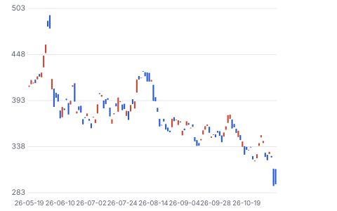

**주봉**

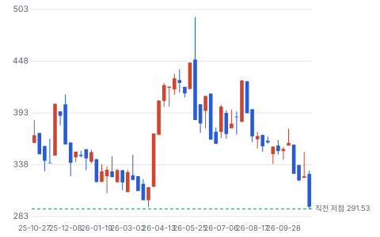

**월봉**

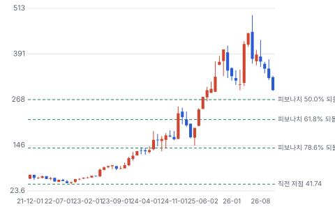

**분기 매출·EPS 실적과 컨센서스**

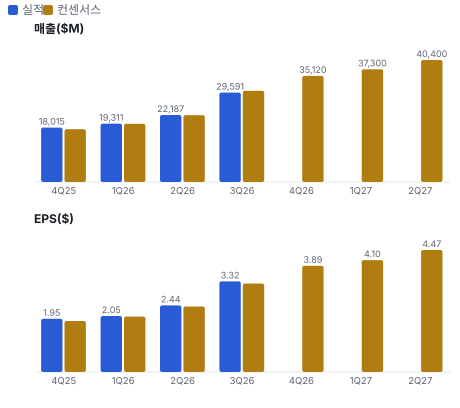

**최근 4개 분기 주가 변화 분석**

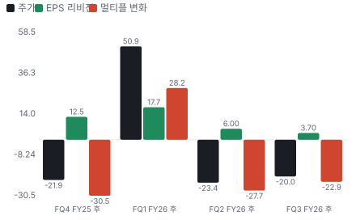

**EPS 리비전**

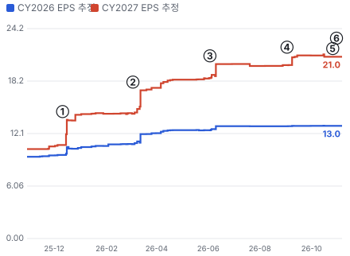

① 25-12-11 FQ4 FY25 실적 · EPS 리비전 +26%
② 26-03-04 FQ1 FY26 실적 · EPS 리비전 +19%
③ 26-06-03 FQ2 FY26 실적 · EPS 리비전 +9%
④ 26-09-02 FQ3 실적, FY28 AI \$230B · EPS 리비전 +6%
⑤ 26-10-26 \$63B Anthropic 금융 SPV · EPS 리비전 +0%
⑥ 26-11-05 AI 인프라주 동반 매도 · EPS 리비전 +0%

**밸류에이션 주가 시나리오**

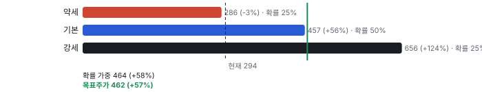

**주가별 업사이드**

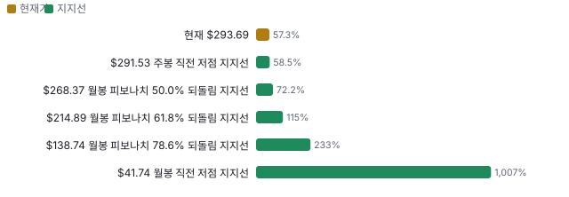

**제품·서비스 포트폴리오**

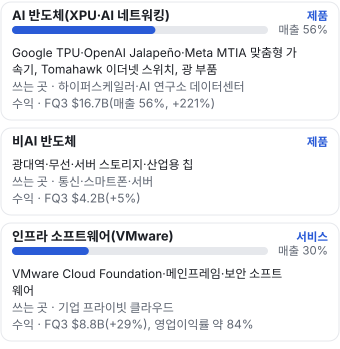

**고객 믹스(FQ3 FY26, 매출 대비)**

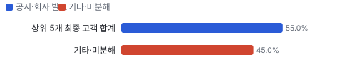

**공급 병목(10점, 낮을수록 병목)**

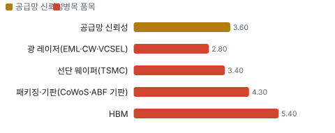

**어닝콜 변화별 주주가치 영향**

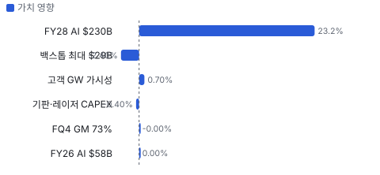

**멀티플 프리미엄(Fwd 1Y P/E, 최근 4개 분기말)**

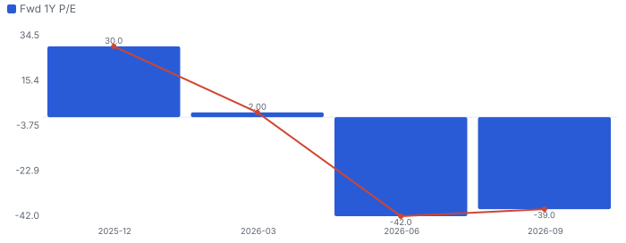

**합리적 멀티플**

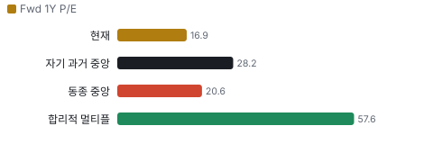

**수주·파이프라인 확실성 사다리**

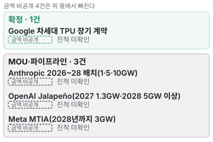

**매출 → 매출총이익 → 영업이익(매출 = 100, 최근 4분기)**

**1년 전 대비 마진 기여(비용 비중 변화의 반대)**

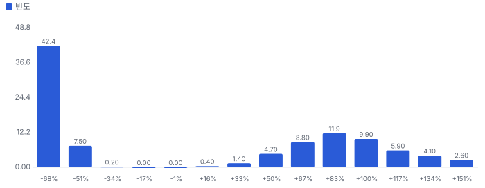

**분기 비용 비중 추이(매출 대비, 공시)**

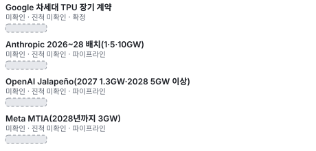

**비용 요인별 매출 대비 비중과 1년 변화**

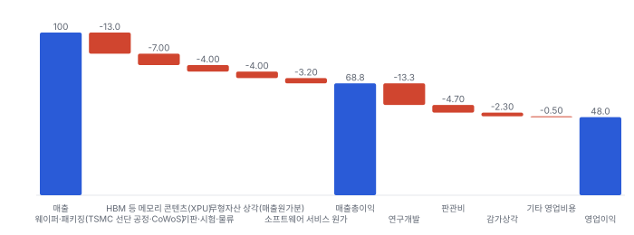

**BOM 항목 가격 +10% 시 OPM 변화**

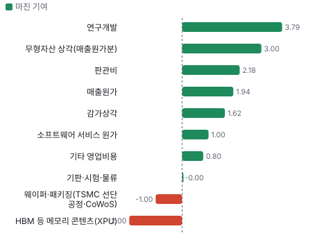

**AI 반도체(XPU·AI 네트워킹) BOM 원가 몫과 가격 +10% 시 OPM**

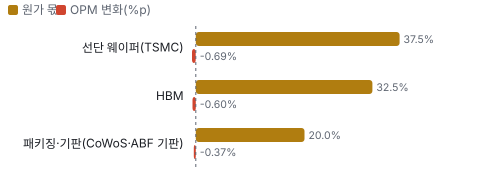

**인프라 소프트웨어(VMware) BOM 원가 몫과 가격 +10% 시 OPM**

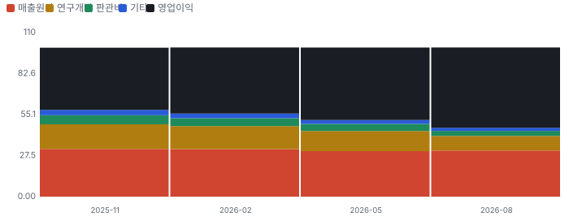

**매출·PPI·수출입 — 최근 16개 분기 같은 축(4Q22 = 100)**

**매출과 EU 네트워크 장비 수입 증가율(전년 대비, 최근 16개 분기)**

**4Q26 매출 — 지표 추세 vs 가이던스·컨센서스**

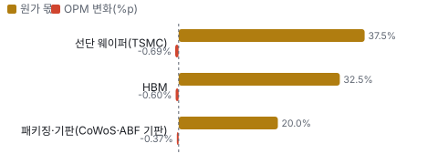

**10년 P·Q 사이클 — 추세(HP 필터) 대비 갭과 8분기 전망**

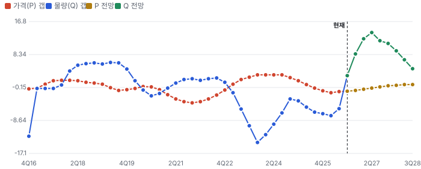

**매출 증가율의 가격·물량 분해와 8분기 전망(전년 대비)**

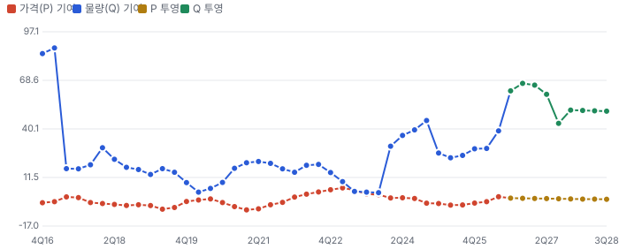

**분기별 매출 증가율 분해**

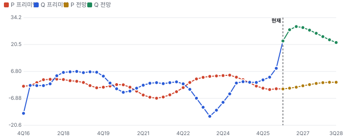

**목표주가 산정 — 기본 시나리오, 도달 확률 약 49%**

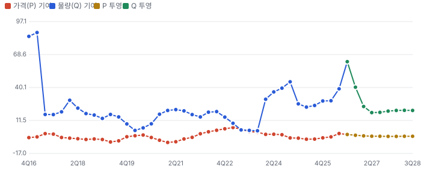

**PEG — 성장 대비 멀티플(낮을수록 성장 대비 쌈)**

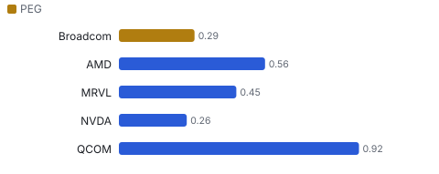

**일봉 지지·저항과 목표주가**

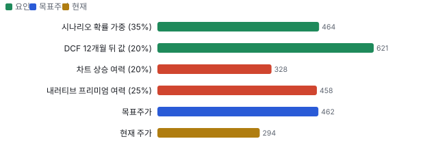

**커뮤니티 언급 수(최근 30일, 채널별)**

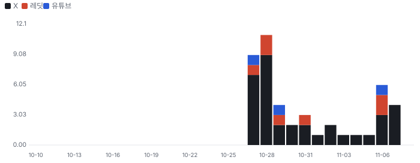

**커뮤니티 게시 수(월, 최근 12개월 — 이번 달은 진행 중)**

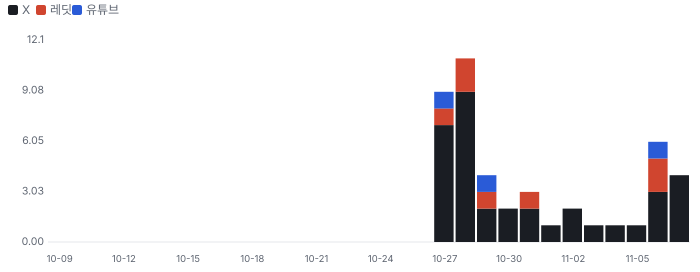

**일별 거래량 분해**

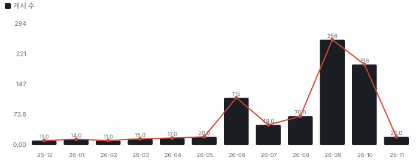

**기관 자금 흐름**

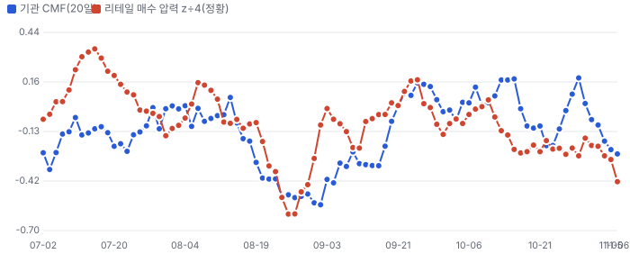

**몬테카를로**

해석: 3,000번 중 1,495번(50%)에서 가치가 지금 주가 이상이었다. 지금 주가를 뒷받침하는 경우와 그렇지 않은 경우가 반반에 가깝다. 가운데 값은 0.62배이고, 열 번 중 여덟 번은 0.29~2.14배 사이에 든다.

## 내러티브

> **기업가치를 결정하는 이야기:** 값은 고객별 GW × GW당 반도체 콘텐츠 \$20~30B다. 2027년은 약 \$115B, 2028년은 약 \$230B다. 이익률은 GM이 내려가도 영업이익률 약 66%를 지킨다는 게 회사 논리다. 값을 가르는 것은 GW가 실제 배치되는 속도(부지·전력)와 그 자금이 어디서 오는지다.

> **멀티플·EPS 프리미엄**
> **멀티플:** Fwd 1Y P/E 16.9배로 Nvidia 15.0배보다 조금 높고 Qualcomm 17.1배·Marvell 24.2배·AMD 34.6배보다 낮다(11/6 종가). Fwd 2Y는 10.6배다. 6월 고점 뒤 배수만 줄었다.
> **EPS:** FQ3 실적 직후(9/4) 대비 FQ4 FY26 EPS 추정은 \$3.66 → \$3.89(+6%), FQ3 FY27은 \$4.89 → \$4.94(+1%)다. 같은 기간 주가는 −20%다.

### 투자자들은 왜 열광했나

2024년 12월 AI 시장 규모 \$60~90B 발언으로 처음 급등했고, 2026년 6월 FQ2 전 장중 \$495까지 올랐다. 식은 순서는 6/4 FQ2 뒤 −12.6%, 8/14 Marvell-Google 보도 −4.9%, 9/3 FQ4 가이던스 소폭 미달, 10/26~29 Anthropic 금융 구조·잔존가치 보증 공개, 10/30 William Blair 하향, 11/5 AI 인프라주 동반 매도(−10.4%)다.

### 무엇이 기업가치를 바꾸나

> **구조적 체질 변화**
> **변화:** AI가 매출의 56%가 됐다
> **증거:** FQ2 49% → FQ3 56%
> **반증:** AI 비중 하락

> **고부가 믹스 확장**
> **변화:** XPU가 늘수록 GM은 내려가고 영업이익률은 지킨다
> **증거:** GM 75% → 73% 가이던스, OPM 약 66% 유지
> **반증:** OPM 65% 미만

> **기술 혁신**
> **변화:** Tomahawk(Broadcom 이더넷 스위치 칩 계열) 7(200Tbps) 테이프아웃, 이더넷 스케일업
> **증거:** FQ3 콜
> **반증:** 스케일업 표준 경쟁 패배

> **실행 속도**
> **변화:** 해당 없음(주문→출하 기간을 회사·동종이 공시하지 않고, 배치 속도는 고객의 부지·전력이 정한다고 회사가 밝혔다)
> **증거:** FQ3 콜 Truist 질의
> **반증:** 고객 배치 지연 공시

> **M&A**
> **변화:** VMware 이후 대형 인수 없음. 파워텍과 싱가포르 기판 합작(\$400M)
> **증거:** 10/29 보도
> **반증:** 대형 인수 발표

> **정책·입법 연관성**
> **재정정책:** 해당 없음(보조금·세액공제에 기대는 사업이 아니다, 10-Q에 CHIPS(미국 반도체지원법) 지원 없음)
> **행정명령:** 대중 수출 통제·관세가 일부 반도체 매출을 건드린다 10-Q 위험요인 반증: 대중 매출 제한 확대 의회 동의 2/10 — 하원 1/5(행정부 조치로 관련 표결을 찾지 못했다) · 상원 1/5(같음).
> **연관입법:** 선거 뒤 데이터센터 건설 제한 논의(발언 단계) 11/5 보도 — 법안 번호 없음 반증: 법안 발의·위원회 통과

> **CAPEX 낙수효과**
> **변화:** 하이퍼스케일러·AI 연구소 CAPEX가 XPU로 온다. 고객 투자 발표를 Broadcom 매출로 바로 옮기지 않는다
> **증거:** 유통사 50%·상위 5개 55%
> **반증:** 하이퍼스케일러 CAPEX 가이던스 하향

### 내러티브 근거

> '맞춤형 가속기가 GPU를 대신한다'가 FY28 EPS \$30 이상을 만들었지만 주가는 6월 고점 대비 −41%다. 시장은 매출 질(유통사 50%·고객 2곳의 자금)과 장부 밖 보증에 할인을 건다. 동종 대비 멀티플 차이 -18% 중 회사 고유 몫은 -71%다. 단계는 컨센서스, 쏠림은 높음이다.

> **맞춤형 가속기(XPU) 대체** · 유지
> **논리:** 프런티어 연구소가 GPU 대신 자기 칩을 쓴다
> **숫자:** FY27 AI \$115B, FY28 \$230B(회사 전망)
> **반증:** FQ4 AI 매출 \$21.7B 미달(2026-12)

> **AI 네트워킹 표준** · 유지
> **논리:** 이더넷이 스케일업까지 가져간다
> **숫자:** AI 네트워킹 +150% 이상
> **반증:** NVLink(Nvidia 칩 간 연결 기술) 외부 판매 확대

> **장부 밖 금융 보증(약세)** · 강화
> **논리:** 고객의 칩 구매를 Broadcom이 사실상 받쳐 준다
> **숫자:** 백스톱 최대 \$29B, 첫 트랜치 \$35B
> **반증:** 다음 트랜치를 보증 없이 마감

> **GM 하락·고객 집중(약세)** · 강화
> **논리:** XPU 믹스로 GM이 내려가고 유통사 한 곳이 절반이다
> **숫자:** GM 77% → 75% → 73%(가이던스), 유통사 50%
> **반증:** FQ4 OPM 66% 유지

## 포트폴리오

| 제품·서비스 | 구분 | 무엇 | 쓰는 곳 | 돈 버는 방식 | Mix | Mix 변화(전 분기 대비) |
|---|---|---|---|---|---|---|
| AI 반도체(XPU·AI 네트워킹) | 제품 | Google TPU·OpenAI Jalapeño(OpenAI용 1세대 맞춤형 가속기)·Meta MTIA(Meta의 AI 가속기) 맞춤형 가속기, Tomahawk 이더넷 스위치, 광 부품 | 하이퍼스케일러·AI 연구소 데이터센터 | FQ3 \$16.7B(매출 56%, +221%) | 미확인 | 미확인 |
| 비AI 반도체 | 제품 | 광대역·무선·서버 스토리지·산업용 칩 | 통신·스마트폰·서버 | FQ3 \$4.2B(+5%) | 미확인 | 미확인 |
| 인프라 소프트웨어(VMware) | 서비스 | VMware Cloud Foundation·메인프레임·보안 소프트웨어 | 기업 프라이빗 클라우드 | FQ3 \$8.8B(+29%), 영업이익률 약 84% | 30% | -2.8%p |

**Mix 변화가 가장 큰 쪽은 반도체 솔루션(XPU·네트워킹 포함, +2.8%p, 전 분기 대비).** 계절성 판정: 분기 매출 계절 지수 기준 없음 → 직전 분기와 비교.

## 고객

> **FQ3 FY26 최대 고객 상위 5개 최종 고객 합계 55%, 상위 3곳 55%, 집중도 집중.** 공시·회사 발표로 확인한 몫은 매출의 55%이고, 나머지 고객 몫은 추정이거나 미분해다. 유통사 1곳이 직접 매출의 50%(전년 32%)다. 회사는 모든 경로를 합친 상위 5개 최종 고객이 매출의 약 55%라고 추정했다. 이름을 밝힌 XPU 고객은 Google·Anthropic·OpenAI·Meta다

**고객별 매출 몫(FQ3 FY26)**
| 고객 | 몫 | 변화 | 근거 |
|---|---|---|---|
| 상위 5개 최종 고객 합계 | 55% | 미확인 | 공시 |
| 유통사 1곳(이름 미공시, 직접 매출 50%) | 미확인 | 미확인 | 공시 |
| Google | 미확인 | 미확인 | 회사 발표 |
| Anthropic | 미확인 | 미확인 | 회사 발표 |
| 기타·미분해 | 45% | - | - |

> **상위 5개 최종 고객 합계** · 공시
> **사는 것:** XPU·네트워킹·소프트웨어
> **추정 근거:** 회사가 '약'으로 밝힌 값

> **유통사 1곳(이름 미공시, 직접 매출 50%)** · 공시
> **사는 것:** 반도체(최종 고객 전달)
> **추정 근거:** 유통 경로라 최종 고객은 그 뒤에 있다 — 아래 상위 5개 최종 고객과 겹친다. 몫은 본문 요약에만 적는다

> **Google** · 회사 발표
> **사는 것:** TPU·네트워킹
> **추정 근거:** 고객별 몫은 미공시

> **Anthropic** · 회사 발표
> **사는 것:** TPU(Ironwood(Google TPU 7세대)·v8i)
> **추정 근거:** 2027년 최대 XPU 고객 예상

## 수주·파이프라인

> **2026-09-02 기준 4건.** 확정 \$0.00B. 서로 겹치는 항목은 합계에서 뺐다.

**실행 속도와 방해 요인**
| 항목 | 상태 | 실행 속도 | 방해 요인 |
|---|---|---|---|
| Google 차세대 TPU 장기 계약 | 확정 | Ironwood 대량 공급, TPU v8i 출하 시작 · 매년 수백억 달러(회사 표현) | 선단 웨이퍼 · 기판 |
| Anthropic 2026~28 배치(1·5·10GW) | 파이프라인 | 2026년 1GW 배치 중(XPV \$35B 트랜치) · 2027 5GW, 2028 10GW 가시성 | 자금 조달 · 부지·전력 |
| OpenAI Jalapeño(2027 1.3GW·2028 5GW 이상) | 파이프라인 | FQ3 1세대 출하 · 후속 세대 테이프아웃 임박 | 자금 조달 · 데이터센터 준비 |
| Meta MTIA(2028년까지 3GW) | 파이프라인 | FQ4 생산 출하 시작 예정 · 3세대 2027년 말 | 공급 |

## 마진 구조

> **GPM 68.8%, OPM 48.0%.** FY2025 대비 GPM +1.0%p, OPM +8.2%p. 변동비는 매출의 26%이고, 매출이 10% 늘면 OPM은 +2.3%p 움직인다. TTM 매출원가는 매출의 31.2%로 FY2025 32.2%보다 1.0%p 낮다. 그러나 FQ3 한 분기는 30.9%이고 회사는 XPU의 메모리 콘텐츠 때문에 GM이 FQ4 73%로 내려간다고 했다. 연구개발비는 매출 증가로 17.2% → 13.3%, 무형자산 상각을 포함한 기타는 4.1% → 2.8%다

> **매출 100 중 매출원가 31.2, 매출총이익 68.8(최근 4분기, 공시).** 매출원가 요인 중 웨이퍼·패키징(TSMC 선단 공정·CoWoS(TSMC 2.5D 첨단 패키징))이 매출의 13.0%로 가장 무겁고, 단가가 +10% 오르면 GPM이 -1.30%p 움직인다. 분기 회귀로 매출 1이 늘 때 매출원가는 0.27 늘고, 매출원가의 고정비 몫은 26%다.

**비용 요인 강도 — 비중·추세·충격(+10%)·탄력**
| 비용 | 구분 | 매출 대비 | 1년 변화 | 마진 기여 | 충격 시 마진 | 매출 탄력 | 고정비 몫 |
|---|---|---|---|---|---|---|---|
| 웨이퍼·패키징(TSMC 선단 공정·CoWoS) | 매출원가 요인 | 13.0% | +1.0%p | -1.0%p | -1.30%p | 미확인 | 0% |
| HBM(고대역폭 메모리) 등 메모리 콘텐츠(XPU) | 매출원가 요인 | 7.0% | +2.0%p | -2.0%p | -0.70%p | 미확인 | 0% |
| 기판·시험·물류 | 매출원가 요인 | 4.0% | +0.0%p | -0.0%p | -0.40%p | 미확인 | 20% |
| 무형자산 상각(매출원가분) | 매출원가 요인 | 4.0% | -3.0%p | +3.0%p | -0.40%p | 미확인 | 100% |
| 소프트웨어 서비스 원가 | 매출원가 요인 | 3.2% | -1.0%p | +1.0%p | -0.32%p | 미확인 | 70% |
| 매출원가 | 공시 항목 | 31.2% | -1.9%p | +1.9%p | -3.12%p | 0.27 | 26% |
| 연구개발 | 공시 항목 | 13.3% | -3.8%p | +3.8%p | 미확인 | 0.12 | 26% |
| 판관비 | 공시 항목 | 4.7% | -2.2%p | +2.2%p | 미확인 | 0.05 | 14% |
| 감가상각 | 공시 항목 | 2.3% | -1.6%p | +1.6%p | 미확인 | 0.01 | 79% |
| 기타 영업비용 | 공시 항목 | 0.5% | -0.8%p | +0.8%p | 미확인 | 0.00 | 76% |

매출 탄력 = 분기 비용을 매출에 회귀한 기울기(매출 1당 변동비), 고정비 몫 = 절편 ÷ 평균 비용. 표본이 8분기 미만이면 미확인. 매출원가 요인 비중은 margin 재료의 추정이 섞여 있고, 공시 매출원가와의 차이는 '기타 매출원가'로 둔다.

**GPM에서 OPM까지(GAAP)**
| 기간 | GPM | 연구개발 | 판관비 | 기타 | OPM |
|---|---|---|---|---|---|
| FY2025 | 67.8% | 17.2% | 6.6% | 4.1% | 39.9% |
| TTM FQ3 FY26 | 68.8% | 13.3% | 4.7% | 2.7% | 48.0% |

**GPM·OPM 최근 4개 분기**
| 분기 | GPM | OPM |
|---|---|---|
| 2025-11 | 68.0% | 41.7% |
| 2026-02 | 68.1% | 44.3% |
| 2026-05 | 69.5% | 48.6% |
| 2026-08 | 69.1% | 53.9% |

**마진을 결정하는 비용 요인 — 비용 +10% 시 OPM**
| 비용 | 매출 대비 | 변화 | 고정비 | OPM |
|---|---|---|---|---|
| 연구개발비 | 13.3% | -3.9%p | 90% | -1.33%p |
| 웨이퍼·패키징(TSMC 선단 공정·CoWoS) | 13.0% | +1.0%p | 0% | -1.30%p |
| HBM 등 메모리 콘텐츠(XPU) | 7.0% | +2.0%p | 0% | -0.70%p |
| 판관비 | 4.7% | -1.9%p | 80% | -0.47%p |
| 기판·시험·물류 | 4.0% | +0.0%p | 20% | -0.40%p |
| 무형자산 상각(매출원가분) | 4.0% | -3.0%p | 100% | -0.40%p |
| 소프트웨어 서비스 원가 | 3.2% | -1.0%p | 70% | -0.32%p |
| 기타 영업비용(무형자산 상각·구조조정) | 2.8% | -1.4%p | 100% | -0.28%p |

**비용을 움직이는 요인**
| 비용 | 요인 |
|---|---|
| 연구개발비(연구개발) | XPU·스위치 설계 · 근거 공시 |
| 웨이퍼·패키징(TSMC 선단 공정·CoWoS, 매출원가) | XPU 출하 · 근거 추정 |
| HBM 등 메모리 콘텐츠(XPU, 매출원가) | XPU 믹스 · 근거 추정 |
| 판관비(판관비) | 인건비 · 근거 공시 |
| 기판·시험·물류(매출원가) | 출하 · 근거 추정 |
| 무형자산 상각(매출원가분, 매출원가) | VMware 인수 상각 감소 · 근거 추정 |
| 소프트웨어 서비스 원가(매출원가) | VMware 지원 인력 · 근거 추정 |
| 기타 영업비용(무형자산 상각·구조조정, 기타) | VMware 상각 감소 · 근거 공시 |

**AI 반도체(XPU·AI 네트워킹) BOM — 매출의 56%, GPM 67%(반도체 솔루션 부문 GM 약 67%(FQ3 콜 CFO 정정) — AI만의 GM은 미공시라 부문 값을 쓴다), 항목 가격 +10% 시**
| 항목 | 원가 몫 | 전가 | 제품 GPM | OPM |
|---|---|---|---|---|
| 선단 웨이퍼(TSMC) | 30~45% | 미확인 | -1.2%p | -0.69%p |
| HBM | 25~40% | 미확인 | -1.1%p | -0.60%p |
| 패키징·기판(CoWoS·ABF(반도체 패키지 기판용 절연 필름) 기판) | 15~25% | 미확인 | -0.7%p | -0.37%p |
| 미분해 | 10% | - | - | - |

**인프라 소프트웨어(VMware) BOM — 매출의 30%, GPM 91%(추정 — 소프트웨어 영업이익률 약 84%(FQ3 콜)에 영업비용 몫을 더한 근사, GM 미공시), 항목 가격 +10% 시**
| 항목 | 원가 몫 | 전가 | 제품 GPM | OPM |
|---|---|---|---|---|
| 지원·클라우드 운영 인력 | 50~70% | 미확인 | -0.5%p | -0.16%p |
| 인수 무형자산 상각 | 20~40% | 미확인 | -0.3%p | -0.08%p |
| 호스팅·라이선스 | 5~15% | 미확인 | -0.1%p | -0.03%p |

선단 웨이퍼(TSMC) 가격이 +10% 오르면 영업이익은 -1.4% 움직인다. 판매가 전가를 모르는 항목은 전가 0%로 계산했다.

**BOM 항목 가격을 움직이는 것**
| 항목 | 요인 |
|---|---|
| 선단 웨이퍼(TSMC) | XPU 원가의 중심 · 근거 추정 |
| HBM | 믹스가 GM을 낮춘다 · 근거 추정 |
| 패키징·기판(CoWoS·ABF 기판) | 공급 병목 · 근거 추정 |
| 지원·클라우드 운영 인력 | 서비스 원가 · 근거 추정 |
| 인수 무형자산 상각 | 비현금 · 근거 추정 |
| 호스팅·라이선스 | 부수 원가 · 근거 추정 |

**BOM 투입 물가 — PPI 전년비, 2026-11-08 수집**
| 항목 | 미국 | 일본 | 한국 | 대만 |
|---|---|---|---|---|
| 선단 웨이퍼(TSMC) | -2.2% | +3.9% | -24.2%* | +22.9%* |
| HBM | -2.2%* | +3.9%* | -24.2% | +22.9%* |

별표는 품목보다 넓은 업종 지수다. 지난 1년 투입 물가를 판매가 전가 뒤 원가에 그대로 넣으면 OPM은 +1.39%p 움직인다(매출원가의 41% 기준).

## 공급망 병목

> **공급망 신뢰성 3.6/10, 병목 심각.** 가장 약한 고리는 선단 웨이퍼(TSMC) 3.4점이고, 품목 평균은 3.9점이다. 병목은 선단 웨이퍼·기판·HBM·광 레이저다(FQ3 콜). 회사는 기판(싱가포르, FY27)과 InP(인듐 인화물, 레이저 소재) 레이저를 직접 늘린다. 공급사 이름·몫은 10-Q에 없다. 구매 약정이 \$126.8B로 커졌다

**병목과 마진 — 품목 가격 +10% 시 OPM**
| 품목 | 점수 | 판정 | 구분 | OPM |
|---|---|---|---|---|
| 광 레이저(EML(광통신용 전계흡수 변조 레이저)·CW(연속파)·VCSEL(면발광 레이저)) | 2.8 | 병목 심각 | 출하 차질 위험 | 미확인 |
| 선단 웨이퍼(TSMC, 필수) | 3.4 | 병목 심각 | 핵심 통제 품목 | -0.69%p |
| 패키징·기판(CoWoS·ABF 기판, 필수) | 4.3 | 병목 주의 | 출하 차질 위험 | -0.37%p |
| HBM(필수) | 5.4 | 병목 주의 | 핵심 통제 품목 | -0.60%p |

> **광 레이저(EML·CW·VCSEL)** · 2.8/10
> **왜:** 광 모듈 출하
> **병목 요인:** 인증 공급사 1곳 · 캐파 부족 · 리드타임 미확인 · 재인증 미확인 · 1위 점유율 미확인 · 미국·싱가포르 집중 60% · 물량 확보 내재화
> **풀리는 조건:** 캐파 3배 확대 — 추가 증설 진행 중

> **선단 웨이퍼(TSMC)** · 3.4/10
> **왜:** 대체 공급사가 사실상 없다
> **병목 요인:** 인증 공급사 1곳 · 캐파 빠듯 · 리드타임 미확인 · 재인증 12개월 · 1위 점유율 90% · 대만 집중 90% · 물량 확보 장기계약
> **풀리는 조건:** 미확인

> **패키징·기판(CoWoS·ABF 기판)** · 4.3/10
> **왜:** XPU 출하 속도를 정한다
> **병목 요인:** 인증 공급사 2곳 · 캐파 부족 · 리드타임 미확인 · 재인증 미확인 · 1위 점유율 60% · 대만·싱가포르 집중 80% · 물량 확보 내재화
> **풀리는 조건:** 싱가포르 기판 공장 FY27 가동 예정 — 가동·수율 확인 전

> **HBM** · 5.4/10
> **왜:** 배치 일정을 정한다
> **병목 요인:** 인증 공급사 3곳 · 캐파 부족 · 리드타임 미확인 · 재인증 6개월 · 1위 점유율 50% · 한국 집중 70% · 물량 확보 미확인
> **풀리는 조건:** 미확인

**공급사**
| 품목 | 공급사 | 몫 | 근거 |
|---|---|---|---|
| 선단 웨이퍼(TSMC) | TSMC(N3·N2 웨이퍼) | 미확인 | 보도 |
| 패키징·기판(CoWoS·ABF 기판) | TSMC(CoWoS, 2.5D 패키징) | 미확인 | 보도 |
| 패키징·기판(CoWoS·ABF 기판) | 자체 싱가포르 기판 공장(파워텍 합작 XCIP, 기판) | 미확인 | 회사 발표 |
| HBM | 메모리 3사(추정, HBM) | 미확인 | 추정 |
| 광 레이저(EML·CW·VCSEL) | 자체 InP 공장(미국·싱가포르, 레이저) | 미확인 | 회사 발표 |

**무역 통계로 본 공급 지역**
| 품목 | EU 수입처 | 일본 수입처 | EU 1위 전년비 |
|---|---|---|---|
| 선단 웨이퍼(TSMC) | TW(대만) 32% · MY(말레이시아) 19% · CN(중국) 15% | 台湾 60% · 中華人民共和国 8% | +136.5% |
| HBM | TW 45% · KR(한국) 21% · CN 16% | 台湾 52% · 大韓民国 28% | +365.5% |

## 해자

> 해자는 고객과 함께 설계하는 맞춤형 가속기(XPU) 역량과 이더넷 스위칭 표준 지위다. 소프트웨어는 설치 기반 해자다.

> **맞춤형 가속기 공동 설계** · 강함
> **해자:** Google TPU를 10년 넘게 함께 만들었고 6개 고객의 차세대를 설계 중이다
> **근거:** FQ3 콜: Google 장기 계약, OpenAI 3세대·Meta 3세대 개발. XPU 매출 3배 이상
> **숫자:** AI 반도체 매출 FQ3 \$16.7B(+221%), XPU가 AI의 73%
> **깨지는 조건:** 고객 1곳이 다음 세대를 다른 설계사(Marvell·MediaTek)나 자체 팀으로 옮긴다

> **이더넷 스위칭·SerDes(칩 사이 고속 직렬 신호 회로)** · 강함
> **해자:** Tomahawk 6이 대부분의 AI 하이퍼스케일러에 들어간다
> **근거:** FQ3 콜: Broadcom XPU를 쓰지 않는 고객도 Tomahawk 6 사용, Tomahawk 7(200Tbps) 테이프아웃
> **숫자:** AI 네트워킹 매출 +150% 이상
> **깨지는 조건:** NVIDIA 스펙트럼·NVLink가 스케일업·스케일아웃 점유를 가져간다

> **VMware 설치 기반** · 보통
> **해자:** 기업 데이터센터의 가상화 표준이다
> **근거:** 소프트웨어 매출 \$8.8B(+29%), ARR(연간 반복 매출) +15%, 영업이익률 약 84%
> **숫자:** 소프트웨어가 매출의 30%
> **깨지는 조건:** ARR 성장 한 자릿수로 둔화, 대형 고객 이탈

## 경영진·네트워크

> Hock Tan이 2006년부터 CEO다(Avago 시절부터 인수 합병으로 회사를 키웠다). 반도체 사장 Charlie Kawwas가 함께 콜을 이끈다. 정치 연결은 공개 행동만 — 2017년 백악관에서 본사 미국 이전을 발표했다

> **Hock Tan** · CEO·이사 · 2006
> **프로필:** Avago CEO로 Broadcom·CA·Symantec 기업 사업·VMware를 인수
> **비즈니스:** 반도체·소프트웨어 대형 인수 경력
> **정계:** 2017-11 백악관에서 본사 미국 이전 발표(공개 행사)
> **동문:** MIT·하버드 MBA
> **사모임:** 미확인

> **Charlie Kawwas** · 반도체 솔루션 사장 · 미확인
> **프로필:** 반도체 사업 총괄
> **비즈니스:** 미확인
> **정계:** 미확인
> **동문:** 미확인
> **사모임:** 미확인

**네트워크 정량화**
| 연결 | 강도 | 닿는 매출 | 가중 노출 | 매출 대비 | 근거 |
|---|---|---|---|---|---|
| 정계: 2017 백악관 본사 이전 발표 | 1/5 | 미확인 | 미확인 | 미확인 | 공개 행사 1건, 매출 연결 공시 없음 2017 보도 |

가중 노출은 연결이 닿는 매출의 크기다. 연결이 그 매출을 만들었다는 뜻이 아니며, 인과는 공개 자료로 입증하지 못한다.

## 약세 논리 및 셀온 조건

| 약세 논리 | 근거 | 반박 | 가를 자료 |
|---|---|---|---|
| 고객의 칩 대금을 금융 구조가 받친다 | AI XPV 첫 트랜치 \$35B, 백스톱 최대 \$29B(10-Q). Anthropic 장비 리스 \$161.2B 보도 | 6개 고객 중 금융이 필요한 곳은 2곳(콜). 지급된 금액은 없다(10-Q) | 다음 트랜치 공시와 보증 유무(2027 상반기), Anthropic 상장 |
| 매출이 몇 곳에 몰렸다 | 유통사 1곳이 직접 매출의 50%(전년 32%), 상위 5개 최종 고객 약 55%(10-Q) | 유통사는 경로이고, XPU 고객은 Google·Meta처럼 자체 조달이 되는 곳이 다수다 | FY26 10-K 고객 집중(2026-12) |
| 구매 약정이 수요 꺾임을 키운다 | 구매 약정 \$126.8B, 2027 \$52.7B·2028 \$73.0B(10-Q) | 공급 확보 증거이기도 하다 — 기판·HBM 부족 속 물량을 묶었다 | FQ4 재고·약정 변화(2026-12) |
| GM이 계속 내려간다 | GM 77% → 75% → 73%(FQ4 가이던스) | OPM은 약 66% 유지 가이던스. 영업비용 증가가 매출 증가보다 훨씬 작다 | FQ4 OPM(2026-12) |
| 고객이 설계를 옮긴다 | 8/14 Marvell-Google 협력 보도 뒤 −4.9% | Google과 차세대 TPU 장기 계약을 맺었다(콜) | Google 차세대 TPU 설계사 발표 |
| 부지·전력이 GW를 못 따라간다 | 회사가 직접 부지·전력을 전망에 반영했다고 밝혔다 | 그래서 FY27 \$115B는 수요보다 보수적이라고 했다 | 하이퍼스케일러 4Q 콜 CAPEX·전력 확보(2027-01~02) |

**추가 원천(11/8 보강).** 중간선거 영향 +0.1/10 — 가장 큰 채널은 CHIPS 보조금(폐지 입법 위험 하락)이고, 업종 반응은 SMH 선거 뒤 CAR(사건 뒤 시장 대비 초과 누적 수익률) −2.7%(t −0.84)다. 정책 0단계(선거 결과) 가설이다. 레딧 언급 순위(ApeWisdom)는 37위로 하루 전 48위보다 올랐지만 언급 수는 23건에서 6건으로 줄었다. 딘스티커 8/21 글이 PE(사모펀드) 특수목적법인을 통한 \$100B 이상 조달을 다뤘다 — SPV 조달 자체는 8월부터 알려진 재료였고, 10월 말 새로 나온 것은 잔존가치 보증 규모다. 무역 지표는 단서다: 미국 메모리 반도체(HS(국제 통일 상품 분류 코드) 854232) 9월 수입이 전년비 +617%로 HBM 원가 압력 쪽을 가리킨다.

> **셀온 조건**
> **조건 1:** FQ4 AI 매출이 가이던스 \$21.7B 아래다
> **조건 2:** OPM이 2분기 연속 65% 아래다
> **조건 3:** XPV 백스톱이 새 트랜치에서 늘어난다
> **조건 4:** 6개 XPU 고객 중 1곳이 다음 세대를 다른 설계사로 옮긴다
> **조건 5:** FY27 AI 전망 \$115B를 낮춘다

## 어닝콜 변화

**직전 콜 대비 새로 나오거나 바뀐 내용 → 가치 영향**
| 항목 | 내용 | 직전 콜 | 최신 콜 | 모델 동인 이동 | 확신도 | 가치 영향 |
|---|---|---|---|---|---|---|
| 업데이트 | FY26 AI 매출 가이던스 |  |  | 기준연도 매출 +\$0.02B | 0.8 | +0.0% |
| 신규 | FY27·FY28 AI 매출 |  |  | 1년차 성장률 +8.0% | 0.5 | +23.2% |
| 신규 | 고객별 GW 가시성 |  |  | 장기 성장 수렴값 +1.0% | 0.3 | +0.7% |
| 부정 | 매출총이익률 |  |  | 출발 이익률 -1.0% | 0.8 | -0.0% |
| 부정 | XPV 잔존가치 보증 |  |  | 할인율(WACC) +0.20% | 0.3 | -2.4% |
| 신규 | 자체 생산 투자 |  |  | 매출÷투하자본 -10.0% | 0.8 | -0.4% |
| **합계** | 단독 합 |  |  | 동시 적용 +20.6% |  | **+21.0%** |

**사건별 EPS 리비전**
| # | 날짜 | 구분 | 사건 | CY2026 EPS 전→후 | CY2027 EPS 전→후 | 리비전 | 주가 반응 |
|---|---|---|---|---|---|---|---|
| ① | 25-12-11 | 실적 | FQ4 FY25 실적 | \$9.64 → \$10.36 | \$10.79 → \$13.62 | +26.3% | -11.4% |
| ② | 26-03-04 | 실적 | FQ1 FY26 실적 | \$10.88 → \$12.05 | \$14.40 → \$17.10 | +18.8% | +4.8% |
| ③ | 26-06-03 | 실적 | FQ2 FY26 실적 | \$12.50 → \$12.97 | \$18.53 → \$20.13 | +8.6% | -12.6% |
| ④ | 26-09-02 | 실적 | FQ3 실적, FY28 AI \$230B | \$12.96 → \$12.99 | \$20.01 → \$21.13 | +5.6% | -2.7% |
| ⑤ | 26-10-26 | 내러티브 | \$63B Anthropic 금융 SPV | \$13.00 → \$13.00 | \$20.98 → \$20.98 | +0.0% | +2.3% |
| ⑥ | 26-11-05 | 내러티브 | AI 인프라주 동반 매도 | \$13.00 → \$13.00 | \$20.98 → \$20.98 | +0.0% | -10.4% |

**해석:** 4개 구간 누적 주가 -28% = EPS 리비전 +46% × 멀티플 -50%. 더 크게 움직인 쪽은 **멀티플**이다.

## 거시 지표 싱크로율

> **EU(유럽연합) 네트워크 장비 수입과 전사 매출 싱크로율 -41%(4분기 = 약 12개월 선행, 전년 대비, 표본 31개·t -2.4·유의·신뢰 보통).** 이 지표가 내포하는 4Q26 매출은 20.82B(±1σ 17.78B~23.85B)다. 가이던스는 이보다 +67.2%(범위 위), 컨센서스는 +68.7%(범위 위)다. 맞춤형 가속기·네트워크 칩은 프로세서(HS 854231)·네트워크 장비(HS 851762) 교역에 실린다 — 업황 대용

**지표별 싱크로율(상관계수 × 100)**
| 지표 | 비교 대상 | 증가율 기준 | 지표 선행 | 매출(t값) | 영업이익 | 방향 일치 | 표본·신뢰 | 4Q26 내포 매출 |
|---|---|---|---|---|---|---|---|---|
| EU 프로세서 수입 | 전사 매출 | 전년 대비 | 1분기(3개월) | -34%(t -2.0) | -5%(1분기) | 68% | 34·보통 | +16.4% → 20.97B(확정) |
| EU 네트워크 장비 수입 | 전사 매출 | 전년 대비 | 4분기(12개월) | -41%(t -2.4) | -40%(4분기) | 65% | 31·보통 | +15.5% → 20.82B(확정) |
| 미국 로직 반도체 PPI(생산자물가지수) | 전사 매출 | 전년 대비 | 2분기(6개월) | -7%(t -0.4) | -23%(0분기) | 22% | 40·보통 | +24.8% → 22.49B(확정) |

**선행 지표로 본 향후 분기 매출 전망(이미 나온 지표 값 기준, ±1σ)**
| 지표 | 대상 | 분기 | 지표 증가율 | 내포 매출 증가율 | 내포 매출 |
|---|---|---|---|---|---|
| EU 프로세서 수입 | 전사 매출 | 4Q26 | +33.1% | +16.4% | 20.97B(17.97B~23.97B) |
| EU 네트워크 장비 수입 | 전사 매출 | 4Q26 | +14.7% | +15.5% | 20.82B(17.78B~23.85B) |
| EU 네트워크 장비 수입 | 전사 매출 | 1Q27 | +14.1% | +15.9% | 22.38B(19.13B~25.64B) |
| EU 네트워크 장비 수입 | 전사 매출 | 2Q27 | +21.3% | +11.4% | 24.72B(20.98B~28.46B) |
| EU 네트워크 장비 수입 | 전사 매출 | 3Q27 | +13.9% | +16.0% | 34.33B(29.34B~39.32B) |
| 미국 로직 반도체 PPI | 전사 매출 | 4Q26 | +0.2% | +24.8% | 22.49B(17.24B~27.74B) |
| 미국 로직 반도체 PPI | 전사 매출 | 1Q27 | -0.6% | +25.3% | 24.20B(18.57B~29.83B) |

지표가 k분기 앞서면 이미 발표된 지표로 k분기 뒤까지의 매출 증가율을 회귀식으로 읽는다. 표본이 작거나 t값이 2 미만이면 전망은 참고용이다.

**지표를 고른 이유**
| 지표 | 이유 |
|---|---|
| EU 프로세서 수입 | XPU·네트워크 칩이 속한 품목 |
| EU 네트워크 장비 수입 | Tomahawk 스위치가 들어가는 장비 |
| 미국 로직 반도체 PPI | 제품 가격 사이클 |

싱크로율은 증가율의 상관계수이며 인과가 아니다. 지표 단위·통화는 원자료 그대로이고 나라끼리 더하지 않는다(EU 수입만 상대국 합계). ±1σ는 회귀 잔차 표준편차다.

## P·Q 사이클

> **10년 위치: Q형 기업(매출 갭 분산의 0%가 가격) — 가격은 추세 대비 -1.1%(회복, 10년 분위 25%), 물량은 +2.9%(확장, 분위 80%). P 프리미엄 -2%, Q 프리미엄 +3%(매출총이익이 정상(추세) 수준보다 요인별로 이만큼 높거나 낮다).** 전망으로 가격 갭은 4분기 뒤 -0.0%·8분기 뒤 +0.6%, 물량 갭은 +11.9%·+4.7%(물량은 컨센서스 몫 56%를 섞었다).

**10년 P·Q 사이클 위치·프리미엄**
| 항목 | 가격(P) | 물량(Q) |
|---|---|---|
| 추세 대비 갭(현재) | -1.1% | +2.9% |
| 사이클 시계 | 회복 | 확장 |
| 10년 분위 | 25% | 80% |
| 프리미엄(현재) | -2% | +3% |
| 프리미엄 4분기 뒤 | 0% | +14% |
| 프리미엄 8분기 뒤 | +1% | +6% |
| 갭 반감기 | 3분기 | 미확인 |
| 갭 4분기 뒤(80% 범위) | -0.0% (-1.6%~+1.6%) | +11.9% (+6.5%~+17.6%) |
| 갭 8분기 뒤(80% 범위) | +0.6% (-1.5%~+2.7%) | +4.7% (-1.6%~+11.5%) |
| 전망 모형 | AR(2) | AR(3) 정상성 보정 + 컨센서스(분기 컨센서스 4개 + 연간 컨센서스 성장률 FY2027→FY2028 +65%, 4분기 뒤 몫 56%) |

방법: P = 가격 지수 4분기 평균(미국 PPI 반도체·관련 소자 대용 — 회사 판매가가 아니라 업종 가격), Q = TTM 매출 ÷ P. 추세는 로그 레벨의 HP(추세 분리 필터) 필터(λ 1600)로 정상(mid-cycle) 수준을 잡는다. 프리미엄 = 요인별 매출총이익 증분 ÷ 정상 매출총이익(정상 GPM 60.8% = 10년 중앙값, 물량 증분 마진 70.9% = 전년 대비 ΔGP÷ΔRev 회귀, 가격은 전액 이익 반영). 표본 40개 TTM 분기. 전망: 가격 갭은 BIC(모형 차수를 고르는 정보 기준)로 차수를 고른 AR(정상성 보정), 물량은 통계 갭 AR과 컨센서스 매출 ÷ 가격 전망(매출 = P × Q)을 분산 역수로 섞는다(Bates·Granger 1969). 끝점 편향을 줄이려고 전망 경로를 이어 붙인 뒤 HP 필터를 다시 건다(Kaiser·Maravall 1999). 80% 범위는 AR 예측 오차와 애널리스트 범위에서 낸다. 모형 산출이며 가이던스가 아니다.

> **Q 사이클 — 최근 4분기 평균 가격 기여 -1.7%, 물량 기여 +39.6%(전년 대비 로그 증가율).** P 강도 5.3/10, Q 강도 6.7/10, 최근 8분기 중 100%가 같은 요인 우세(구조적). 전망으로는 8분기 안에 전환 신호가 없다(물량은 컨센서스를 섞었다).

**P·Q 사이클 정량**
| 항목 | 가격(P) | 물량(Q) |
|---|---|---|
| 최근 4분기 평균 기여 | -1.7% | +39.6% |
| 강도(0~10, 자기 이력 z) | 5.3 | 6.7 |
| AR 고유 주기(AR(2)일 때) | 미확인 | 미확인 |
| 다음 4분기 투영 평균 | -0.9% | +59.1% |

가격 근거: 미국 PPI 반도체·관련 소자 대용 — 회사 판매가가 아니라 업종 가격. PPI를 쓰면 회사 판매가가 아니라 업종 가격 대용이다. 로그 증가율이라 가격·물량 기여의 합이 매출 증가율이다. 전망: 가격은 BIC로 차수를 고른 AR, 물량은 AR과 '컨센서스 매출 증가율 − 가격 전망'을 분산 역수로 섞는다. 모형 산출이며 가이던스가 아니다. 회사 판매가로 잴 수 없는 이유: 회사가 XPU 출하량·단가를 공시하지 않는다(출하 3.5배 이상만 언급) — 업종 PPI로 대신한다

## 밸류에이션

> **목표주가 \$462, 업사이드 +57%.** 자리는 기본 시나리오이고 도달 확률은 약 49%다. 기본 \$457, 강세 \$656(+124%), 약세 \$286(-3%). DCF 기준 업사이드는 기본 +89%, 강세 -63%, 약세 -69%다(WACC 11.6%).

기준 멀티플이 Fwd 1Y P/E라 EPS도 다음 4개 분기 조정 EPS를 쓴다. 배수는 동종 중앙값에서 출발해 정한다.

> **약세 \$286 (-3%)** · 확률 25%
> **가정:** 19.7배 × EPS \$14.50
> **근거:** 부지·전력·기판 병목으로 배치가 늦고 GM이 70% 아래로 내려간다. 다음 4개 분기 EPS 컨센서스 \$17.4보다 약 17% 낮다

> **기본 \$457 (+56%)** · 확률 50%
> **가정:** 26.3배 × EPS \$17.40
> **근거:** 다음 4개 분기 EPS 컨센서스 \$17.4대로 간다. FQ4 가이던스가 첫 분기다

> **강세 \$656 (+124%)** · 확률 25%
> **가정:** 32.8배 × EPS \$20.00
> **근거:** 공급 확보가 빨라져 FY27 AI \$115B를 넘는다(회사는 수요가 이 전망을 넘는다고 했다)

**멀티플 선정 — Fwd 1Y P/E**
| 단계 | 조정 | 근거 |
|---|---|---|
| 동종 중앙값 | 20.6배 | 범위 15.0~34.6배, 4곳 |
| 펀더멘털 | +20% | 성장·이익률·ROIC로 본 합리적 멀티플 57.6배와의 차이의 일부만 인정 |
| 해자 | +10% | 맞춤형 가속기 공동 설계 강함 · 이더넷 스위칭·SerDes 강함 · VMware 설치 기반 보통 |
| 반복 매출 | +3% | 반복 매출 30%(동종 20%) · VMware 구독·유지보수(인프라 소프트웨어) · 이미 반복 단계 |
| 수주 전환·가시성 | +0% | 가시성 재료 없음 |
| 내러티브 | +0% | 단계 컨센서스 |
| 사이클·실행 판단 | -5% | 유통사 1곳이 매출의 50%, 상위 5개 최종 고객이 55%이고, 장부 밖 잔존가치 보증(최대 \$29B)이 생겨 동종 배수를 다 주지 않는다 |
| **선정** | **26.3배** | 지금 16.9배 |

**동종 레인지**
| 회사 | Fwd 1Y P/E | Fwd 2Y P/E | Fwd 3Y P/E | 성장 | 영업이익률 | ROIC |
|---|---|---|---|---|---|---|
| AMD | 34.6 | 21.4 | 15.1 | 81% | 30% | 18% |
| MRVL | 24.2 | 15.7 | 11.2 | 70% | 39% | 15% |
| NVDA | 15.0 | 9.4 | 7.3 | 89% | 64% | 93% |
| QCOM | 17.1 | 14.4 | 11.9 | 8% | 26% | 24% |
| **Broadcom** | 16.9 | 10.6 | 6.9 |  |  |  |

> **PEG 0.29** — Fwd 1Y P/E 16.9배를 다음 해 EPS 성장 59%로 나눈 값, 동종 중앙 0.50(성장 대비 싸다). 성장률은 Fwd 1Y·2Y P/E에서 역산한 컨센서스라 다음 해 한 해 성장만 반영하고, 성장 지속 기간은 담지 않는다.

**PEG — Fwd 1Y P/E ÷ 다음 해 EPS 성장률**
| 회사 | Fwd 1Y P/E | 다음 해 EPS 성장 | PEG |
|---|---|---|---|
| **Broadcom** | 16.9 | +59% | 0.29 |
| AMD | 34.6 | +62% | 0.56 |
| MRVL | 24.2 | +54% | 0.45 |
| NVDA | 15.0 | +59% | 0.26 |
| QCOM | 17.1 | +19% | 0.92 |

지금 주가가 요구하는 5년 매출 CAGR 28%, 기본 시나리오 45%. 몬테카를로 중앙값 업사이드 -38%.

> 의사결정 보조(투자자문 아님): ① 매수 매력: 연 기대수익 +13.6% (자기자본비용 11.8% 대비 +1.8%p) · 자본비용 초과 확률 50% · 안전마진 0.29 → 정량 신호 약함 / ② 위험 예산 지표(이론): 1/4 켈리 10.0% (상한 10%) · 5년 하위10% -52% · 30%+ 손실 확률 45% / ③ 상방(5년): 기대 1.89배 · 2배 50% · 3배 33% · 10배 0% · 상위10% 3.62배

투입 물가 점검: 지난 1년 PPI를 BOM에 넣으면 OPM +1.39%p다(매출원가의 41% 기준).

## 매수 위치(일봉)

> **현재가 \$294는 '지지선 미확인'.** 이 자리에서 목표주가까지 +57.3%, 첫 일봉 저항까지 +9.3%, 다음 지지까지 하방 미확인.

**가격대별 업사이드(일봉 기준)**
| 가격대 | 가격 | 목표주가까지 | 첫 저항까지 | 다음 지지까지 | 손익비 | 근거 기법(강도) |
|---|---|---|---|---|---|---|
| 현재가 | \$294 | +57.3% | +9.3% | 미확인 | 미확인 | - |

**일봉 저항**
| 저항 | 가격 | 현재가 대비 | 근거 기법(강도) |
|---|---|---|---|
| 저항 1 | \$321 | +9.3% | 120일 지그재그 저점 · 스윙 저점(1.8) |
| 저항 2 | \$328 | +11.5% | 피보 78.6%(1.0) |
| 저항 3 | \$332 | +13.2% | 20일선 · 피보 61.8%(1.5) |

일봉만 쓴다(주봉·월봉 제외). 손익비 = 목표주가까지 업사이드 ÷ 다음 지지까지 하방. 가격대별 기대값 참고표이며 매수·매도 시점 지시가 아니다.

## 애널리스트 토론

> **토론 결론 Buy(규칙 등급 Strong Buy).** 규칙 등급 Strong Buy는 선정 멀티플 26.3배(동종 중앙 20.6배 + 펀더멘털·해자 프리미엄)에 기댄다. 몬테카를로 중앙값이 −38%로 DCF 기본(+89%)과 크게 갈리고 매출의 질(유통사 50%·백스톱 \$29B)을 가를 자료가 12월 전에는 없어 한 단계 낮춘 Buy로 조율한다

**패널 — 등급별 자리**
| 자리 | 핵심 논리 | 틀리는 조건 | 최종 투표 |
|---|---|---|---|
| Strong Buy | FY28 EPS \$30 궤도에 지금 Fwd 2Y P/E 10.6배다 | FQ4 AI 매출이 \$21.7B 아래 | Buy |
| Buy | 이익 추정은 오르는데 배수만 내렸다 | FY27 EPS 추정 하향 | Buy |
| Neutral | 매출 질을 가를 자료가 아직 없다 | 다음 트랜치를 보증 없이 마감 | Neutral |
| Sell | 고객의 칩 대금을 금융 구조가 받친다 — 수요의 질이 낮다 | Anthropic 상장으로 자체 조달 | Neutral |
| Strong Sell | 부지·전력이 GW를 못 따라가면 2028 숫자는 공급 약정만 남는다 | FY27 가이던스 상향 | Neutral |

**투표**
| Strong Buy | Buy | Neutral | Sell | Strong Sell |
|---|---|---|---|---|
| 0 | 2 | 3 | 0 | 0 |

> **개회 · Strong Buy**
> **발언:** FY28 EPS \$30을 10배로 사는 셈이다

> **개회 · Buy**
> **발언:** 9월 이후 추정은 올랐고 주가는 20% 내렸다

> **개회 · Neutral**
> **발언:** 유통사 50%와 보증 \$29B를 가를 자료가 없다

> **개회 · Sell**
> **발언:** 고객이 돈이 없어 Broadcom이 금융을 짠다

> **개회 · Strong Sell**
> **발언:** 구매 약정 \$126.8B는 수요가 꺾이면 Broadcom이 진다

> **반박1 · Buy → Sell**
> **발언:** 6개 고객 중 금융 구조는 2곳뿐이고 나머지 4곳은 자체 조달이다(콜)

> **반박1 · Sell → Strong Buy**
> **발언:** FY28 숫자는 회사 전망이지 수주가 아니다

> **반박1 · Neutral → Buy**
> **발언:** 추정 상향폭은 1~6%로 작다

> **반박2 · Strong Buy → Strong Sell**
> **발언:** 구매 약정은 공급 확보 증거이기도 하다. 경쟁사가 못 얻는 물량이다

> **반박2 · Strong Sell → Buy**
> **발언:** 배수가 내린 이유가 바로 매출 질이다

> **반박2 · Neutral → Sell**
> **발언:** Anthropic 상장이 자금 문제를 풀 수 있다. 가를 자료는 12월 FQ4와 다음 트랜치다

> **최종 · Strong Buy** · Buy
> **발언:** Buy로 물러선다

> **최종 · Buy**
> **발언:** Buy를 유지한다

> **최종 · Neutral**
> **발언:** 규칙 등급을 지지한다

> **최종 · Sell** · Neutral
> **발언:** Neutral로 물러선다

> **최종 · Strong Sell** · Neutral
> **발언:** Neutral로 물러선다

남은 반대 의견: Neutral 세 자리 — 상승 여력이 배수 확장(16.9 → 26.3배)에 걸려 있다

패널은 등급별 논리를 대표하는 자리이고 실존 IB의 의견이 아니다.

## 커뮤니티 내러티브

> **커뮤니티는 '맞춤형 칩이 GPU보다 싸다'는 강세론과 'Anthropic 금융 보증은 위험'이라는 우려로 갈렸다. 11월 52주 신저가에서 저평가론이 늘었다** 관심 급증 1.3/10(결합 Z +0.3), 최근 7일 신뢰 가중 감성 +0.24(관측 전체 +0.34).

**채널별 내러티브와 기대 소화**
| 채널 | 주된 이야기 | 기대 | 1차 자료 대조 | 비중 |
|---|---|---|---|---|
| X | Google·OpenAI 맞춤형 칩 사업에 비해 지금 값이 싸다 | 상향 | 부분 확인 — FY28 AI \$230B는 회사 전망(공급 확보 기준), 확정 수주 아님 | 40% |
| X | Anthropic \$42~63B 금융 보증은 위험하다 | 하향 | 확인 — 10-Q 백스톱 최대 \$29B(첫 트랜치), 지급 없음 | 30% |
| X | 전력·전력망 제약 경고가 기대를 누른다 | 하향 | 확인 — FQ3 콜이 부지·전력을 전망에 반영했다고 밝힘 | 30% |
| 레딧 | FQ4 가이던스가 컨센서스 소폭 미달 — 저점 매수 논쟁 | 혼재 | 확인 — FQ4 가이던스 \$34.8B vs 컨센서스 약 \$35.0B | 100% |

**채널별 급증 측정(음이항 Z·CUSUM, 사건형은 포아송 꼬리확률)**
| 채널 | 최근 | 평소 | 급증 | 지속 |
|---|---|---|---|---|
| X | 3일 7건 | 하루 2.4건 | Z -0.3 | - |
| 레딧 | 3일 2건 | 하루 0.5건 | Z +0.4 | - |
| 유튜브 | 3일 1건 | 하루 0.2건 | Z +0.7 | - |

**기대가 바뀐 시점:** 7월 Apple 2031 연장·Samsung 2nm(75) → 8월 금융 부채·Marvell-Google 우려(45) → 9월 FQ3 FY28 AI \$230B(77) → 10월 Anthropic 금융 위험(69, 196건) → 11월 52주 신저가 저평가론(72)

원천: Quantral(X·레딧·유튜브·서브스택 언급 집계, 작성자 적중률로 신뢰 가중). 커뮤니티 의견은 시장 기대의 증거이지 사실이 아니며, 관심 급증은 주가·펀더멘털 변화가 아니다.

## 시장 평가

> **셀사이드(IB 애널리스트)**
> **한 줄:** 추정은 소폭 오르고 목표가는 유지된다 — 하락은 배수에서 왔다
> **애널리스트 의견:** 44명 — 강력 매수 34·매수 4·보유 6·매도 0 — 10월 William Blair 하향, D.A. Davidson 상향
> **목표가 평균·범위:** \$526 (\$380~\$660) — 현재가 대비 +79% — 기대의 증거일 뿐 Chiip 목표가 아니다
> **FQ3 콜 질문 증권사:** Morgan Stanley·Jefferies·JPMorgan·Bernstein·Melius·Bank of America·Barclays·Truist·TD Cowen·Goldman Sachs·Mizuho — 초점: 공급 병목·GW당 콘텐츠·백스톱

> **바이사이드(기관 투자자)**
> **한 줄:** 공매도 없이 롱이 배수를 낮췄다
> **기관 보유 비중:** 80% — 대형 기관 중심
> **공매도 비중:** 유통의 1.1% — 매우 낮다
> **내부자 보유:** 1.9% — 경영진 장기 보유

> **언론·업계**
> **한 줄:** 언론은 기술보다 금융 구조를 본다
> **주요 보도:** \$63B 금융 SPV·Anthropic 리스 \$161.2B — 금융 구조가 주제

## 체크리스트

| 시점 | 무엇 | 의미 |
|---|---|---|
| 2026년 11월 중순 | 9월 말 13F | 6~10월 하락기 기관 포지션 |
| 2026년 12월 중순(예상) | FQ4 FY26 실적·FY27 첫 가이던스 | AI \$21.7B, GM 73%, OPM 66%, 고객 집중 10-K |
| 2027년 1~2월 | 하이퍼스케일러 4Q 콜 | 2027 CAPEX·전력 확보 |
| 2027년 상반기 | 다음 XPV 트랜치·Anthropic 상장 | 보증 없이 자금이 오는지 |
| FY2027(2026-11~2027-10) | 싱가포르 기판 공장 가동 | 기판 병목 해소 — 가동·수율 확인 전 |

## 정정 기록 — Chiip Proviser 23:55

당일 리포트 점검에서 고친 것만 적는다. 판단·목표주가·등급·시나리오 숫자는 바꾸지 않았다. FQ3 AI 반도체 \$16.7B(+221%), FQ4 가이던스 매출 \$34.8B·AI \$21.7B·OPM 약 66%, 6/4 −12.6%, 11/5 −10.4%는 8-K EX-99.1·일봉과 일치했다.

| 무엇을(전 → 후) | 왜 | 근거 |
|---|---|---|
| '6/3 종가 고점 \$479(장중 \$495)' → '6/2 종가 고점 \$482(장중 고점 6/3 \$495)' | 종가 고점은 6/2 \$481.57이고 6/3 종가 \$479.23은 그보다 낮다. 낙폭 −39%는 그대로다(293.69 ÷ 481.57 − 1 = −39.0%) | TradingView NASDAQ:AVGO 일봉 2026-06-01~05 |
| '6월 고점 \$495' 2곳 → '6월 장중 고점 \$495' | 같은 리포트 안에서 종가 고점(−39%)과 장중 고점(−41%)을 기준 표시 없이 함께 썼다 | TradingView 일봉 6/3 고가 \$495.00 |

## 출처
- Broadcom FQ3 FY26 10-Q https://www.sec.gov/Archives/edgar/data/1730168/000173016826000080/avgo-20260802.htm
- Broadcom FQ3 FY26 실적 8-K(2026-09-02)
- \$63B 금융 SPV 보도 https://www.morningstar.com/news/dow-jones/202610269207/banks-blackstone-form-63-billion-financing-vehicle-for-broadcom-ai-tech
- 라이선스 자료 요지 포함 — 외부 공유 금지
- 마스터 노션 자료: MS MS_-_Following_AIs_1.6_trillion_Money_Trail_-_Mapping_the_Revenue_Generated_by_the_Capex_Boom(1).pdf (요지만, 외부 공유 금지)
- 마스터 노션 자료: 미확인 JP Morgan SemiconductorsSemi Cap Equipment 3Q26 Sector Preview.pdf (요지만, 외부 공유 금지)
- FQ3 10-Q 고객 집중
- FQ3 10-Q(회사 추정)
- FQ3 콜
- FQ3 콜·10-Q
- 10-Q
- 10-Q 매출원가 총액 × 업계 원가 구조 — 회사 미공시
- FQ3 콜(메모리 콘텐츠) — 몫 미공시
- FQ3 콜(메모리 콘텐츠로 GM 하락) — 몫 미공시
- 무형자산 \$32.3B → \$26.3B(10-Q), 매출원가·영업비용 배분은 미확인
- 업계 일반
- 업계 일반 — 미공시
- 총액과의 차이
- FQ3 콜·10/29 보도
- 업계 보도
- 업계 보도 — 10-Q는 공급사명 미기재

_구매 등급·목표주가 모두 규칙이 계산한 모델 값으로, 개인의 보유 종목·자금 사정을 반영하지 않는다 · 공개 자료 기반 분석이며 투자 권유가 아님 · 1차 판정, 미검증 · Chiip ten-bagger_