# 텐배거 리포트 2026-11-07 — CACI International — 선거 뒤 −10%, 숫자는 그대로이고 증명은 여전히 하반기다

> 2026-11-07 · CACI International(CACI) · 기업: 미국 국방·정보기관에 전자전·대드론·우주 광학·임무 소프트웨어를 공급하는 국방 기술·서비스 회사

## Chiip View

11/3 \$680에서 11/6 \$611로 −10%가 났다. 회사 발표는 공군 \$108M 수주 하나였고 가이던스·컨센서스·등급은 그대로다. 11/4 하루 L3Harris도 −6.5%였고 11/3~11/6 KBR −6.5%로 방산 업종이 함께 내렸으며 시점은 중간선거 결과(상원 민주당 확정, AP)와 겹친다 — 원인은 정황이다. 그래서 이번 하락은 EPS가 아니라 멀티플이다. Fwd 1Y P/E는 19.2배에서 17.3배로 내려와 동종 중앙 13.4배와 L3Harris 21.2배의 사이에 있다. 18.8배를 골라 **목표주가 \$732, 업사이드 +20%, 약세 \$515(−16%), 손익비 4.4로 Buy**를 냈다(11/2 판도 Buy, 목표 \$800).

**다만 DCF는 아직 현재가를 받치지 않는다.** 기본 DCF는 −5%, 몬테카를로 중앙값은 −3%다. Buy는 시장 멀티플과 내러티브 프리미엄 요인에서 나온다. 중간선거 영향은 −0.9/10으로 작다 — 국방 예산 증가 속도 둔화 가설(노출 1.0, −1.0)이 가장 크고, 업종 ETF(ITA(미국 항공우주·방산 업종 ETF)) 선거 뒤 초과수익은 −1.0%(t −0.46)로 유의하지 않다(정책 0단계 가설). 가를 자료는 2027년 2월 12월 분기 실적의 유기적 성장(회사가 합당하다고 한 약 7%)과 12/11 임시 예산 처리다. 10배 경로는 없고 재평가 후보로 본다.

## 대시보드
| 항목 | 값 | 설명 |
|---|---|---|
| 주가 | \$611.16 | 고점 대비 -10% · 1년 +4% |
| 시가총액 | \$13.64B | 완전 희석 기준 · EV \$18.69B |
| 업사이드 | +20% | 목표주가 \$732 · 다운사이드 -16% · 손익비(강세÷약세) 4.4 |
| 구매등급 | Buy | 애널리스트 17명: Strong Buy 13 · Buy 0 · Neutral 3 · Sell 0 · Strong Sell 1 |
| 멀티플 | Fwd 1Y P/E 17.3배 | 동종 중앙값 13.4배 |
| 가이던스 FY27 | \$10,800M · \$33.63 | 컨센서스 \$10,810M · \$33.50 |
| 알파 | 3.4/10 | 텐배거 가능성 점수 |
| 이벤트 | 12월 분기 실적·새 회계연도 가이던스(2월 예정, 날짜 미정) | 2027-02-03 |

## 한 장 요약
- **기업가치를 결정하는 내러티브** CACI는 미국 국방·정보기관에 전자전 장비, 대드론, 우주 광학, 임무 소프트웨어를 공급한다. 시장은 오래 이 회사를 인력 파견형 정부 서비스로 봤다. 8월 FY27 가이던스 뒤 주가가 하루 +21% 뛰며 그 분류가 흔들렸다. 지금 쟁점은 하반기 성장이 말대로 나오느냐다.
- **밸류에이션 모델로 본 주가 상방은 어디까지인가?** **목표주가 \$732(+20%), 약세와 기본 사이(약세 쪽 9%)다.** 강세 \$1,035(+69%)는 Fwd 1Y P/E 23.5배를 강세 EPS에 적용한 값이다. 기본 \$753, 약세 \$515. 손익비 4.4, DCF 기준 업사이드 -5%.
- **수주는 어디까지 왔나?** 잔여 이행의무(RPO(잔여 이행의무, 확정 주문 잔액)) 미확인, 100% 매출 \$14.30B · 행사 전 옵션(잔고 − RPO) 미확인, 100% 매출 \$19.70B · SOFETOPS(미 육군 특수전사령부 임무 지원 계약) II(미 육군 특수전) 미확인, 100% 매출 \$1.60B. 총 잔고 \$34.0B 중 확정 RPO는 \$14.3B다. 나머지 약 \$19.7B는 행사되지 않은 옵션이라 금지표대로 확정이 아니다. 건별 계약은 잔고와 겹쳐 합계에서 뺐다.
- **누가 사 주나?** 최대 고객 미 전쟁부(옛 국방부) 55%, 상위 3곳 95%. 공시·회사 발표로 확인한 몫은 100%다.
- **마진과 공급망은 어디가 약한가?** GPM 34.0%, OPM 9.8%. OPM을 가장 흔드는 BOM(제품 원가를 이루는 부품·재료 명세) 항목은 보안 인가 인력이고 가격 +10%에 -0.95%p다. 공급망 신뢰성은 3.7/10(병목 심각)이고 가장 약한 고리는 보안 인가 인력이다.
- **생산능력은 얼마나 늘어나나?** 현재 명목 캐파 27,000 명(직원), 착공 이상 증설 0 명(직원). FY2028 CAPEX는 매출의 1.1%다.
- **지금 가격은 무엇을 가정하나?** 다음 4개 분기 조정 EPS \$35.27에 17.3배다(11/6 종가 \$611.16). FY27 GAAP EPS 가이던스 중간 \$26.41로는 23.1배다. 조정 EPS가 GAAP보다 약 31% 높은 것은 인수 무형자산 상각을 더하기 때문이다.

동종 중앙 13.4배보다 29% 비싸다. 시장은 여전히 CACI를 인력 서비스보다 기술 회사 쪽에 둔다. 기본 시나리오의 DCF는 현재가보다 5% 낮아, 11/2(−21%)보다 간격이 크게 줄었다.
- **왜 움직였나?** 10/30 \$675.62에서 11/3 \$680.10까지 오른 뒤 11/4 −7.0%, 11/5 −4.4%, 11/6 +1.1%로 \$611.16이 됐다. 회사 쪽 사건은 11/3 공군 DEAMS(미 공군·국방 회계 관리 시스템) 5년 \$108M 수주 발표와 11/3 이사 1명의 \$142K 매도(Form 4)뿐이다.

같은 기간 L3Harris −6.4%(11/3 → 11/6), Booz Allen −1.9%, KBR −6.5%가 함께 내렸다. 시점은 11/3 중간선거와 11/4 상원 민주당 확정 보도(AP)와 겹친다. 원인을 밝힌 1차 자료는 없어 '정황'으로 둔다. 10/30 이후 EPS 컨센서스는 바뀌지 않았으니 하락 −9.5%는 전부 멀티플이다(19.2배 → 17.3배, 같은 기간).
- **1Q 콜에서 무엇이 바뀌었나?** 좋아진 것: FY27 매출 \$10.7~10.9B, 조정 EPS \$33.18~34.08로 상향. 수주/매출 2배. 기존 프로그램 비중 83% → 94%. 레버리지 3배 초반 복귀를 2027년 3월로 앞당겼다.

새로 나온 것: 2027-01-01 달력 회계연도 전환, 2027년 초 Investor Day의 새 3년 목표, ARKA의 잔고 밖 약 \$2B, Vantor 탑재체 수주.

아쉬운 것: 평가 중 입찰은 \$11B에서 \$4.7B로, 2분기 제출 예정은 \$22B에서 \$14.7B로 줄었다. 일부는 수주로 전환된 몫이다. CEO는 의사결정이 아직 더디다고 했다. 고정가 비중은 27%에서 33%로 올랐고 절반은 ARKA 몫이다.
- **무엇이 바뀌면 판단이 달라지나?** 위로는 12월 분기 유기적 성장이 약 7% 나오고 2027년 초 Investor Day의 3년 목표가 기술 매출·이익률을 숫자로 내놓을 때다. 그러면 기본 \$753 위로, 강세 \$1,035(23.5배 × 강세 EPS \$44)로 간다.

아래로는 12/11 임시 예산 뒤 하반기 램프가 밀리거나 EBITDA 이익률이 12% 아래로 갈 때다. 약세는 \$515(−16%)다. 민주당 의회의 FY27 국방 세출이 대드론·우주 항목을 깎으면 프리미엄의 근거가 약해진다. Chiip View의 쟁점(유기적 성장 하반기 쏠림)에 대한 회사 답: CEO는 1Q 콜에서 하반기 두 자릿수 유기적 성장의 근거로 이미 따낸 수주의 램프를 들었고, 의사결정은 아직 더디다고 했다.

## 한눈에 보기

**일봉**

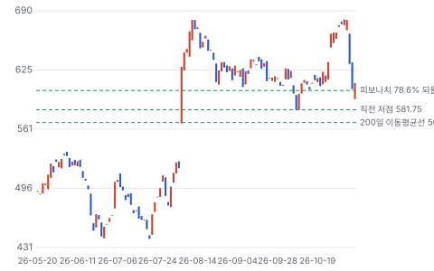

**주봉**

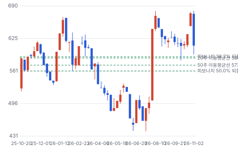

**월봉**

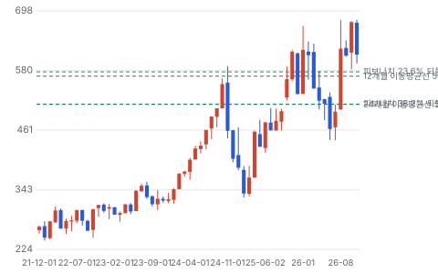

**분기 매출·EPS 실적과 컨센서스**

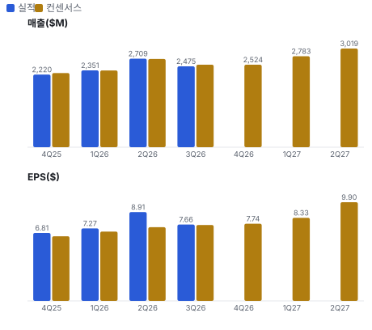

**최근 4개 분기 주가 변화 분석**

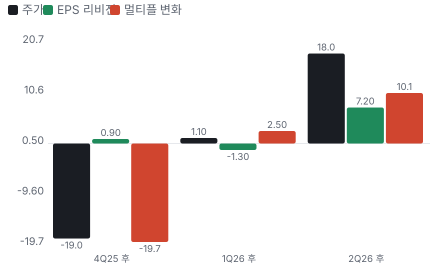

**EPS 리비전**

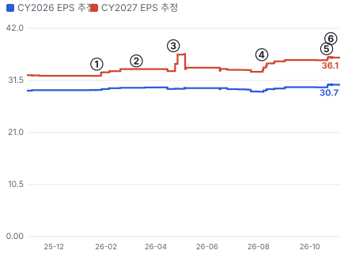

① 26-01-21 4Q25 실적 · EPS 리비전 +2%
② 26-03-09 ARKA 인수 완료, 차입 \$2.6B 부담 · EPS 리비전 +0%
③ 26-04-22 1Q26 실적, 인수 반영 FY26 EPS 가이던스 하향 · EPS 리비전 +1%
④ 26-08-05 2Q26 실적, FY27 가이던스 EPS \$33.41 · EPS 리비전 +5%
⑤ 26-10-21 3Q26 실적, 가이던스 상향 · EPS 리비전 +2%
⑥ 26-10-26 Jefferies Buy 상향 · 실적 창과 겹침

**밸류에이션 주가 시나리오**

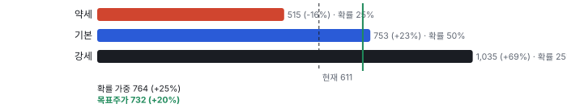

**주가별 업사이드**

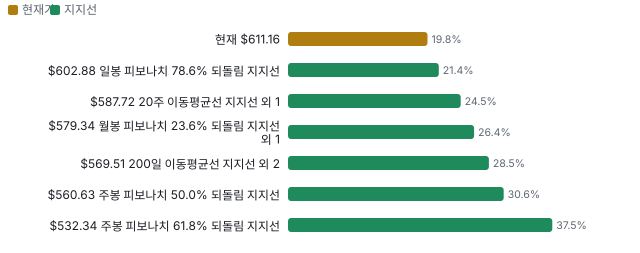

**제품·서비스 포트폴리오**

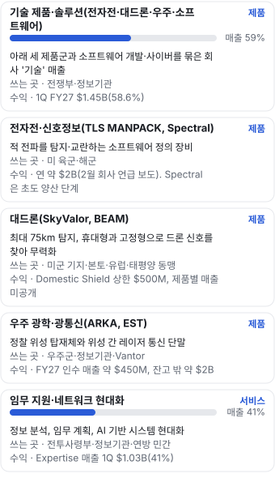

**고객 믹스(1Q FY27, 매출 대비)**

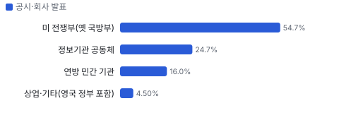

**공급 병목(10점, 낮을수록 병목)**

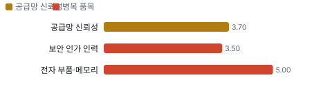

**생산능력 현재와 확충 계획(명(직원))**

**CAPEX의 매출 대비 비중**

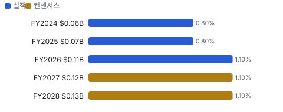

**어닝콜 변화별 주주가치 영향**

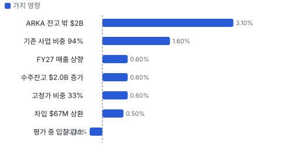

**멀티플 프리미엄(현재값 — 최근 4개 분기 추이 재료 없음)**

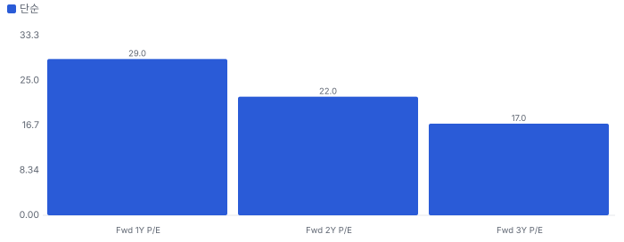

**합리적 멀티플**

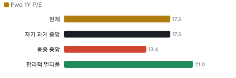

**일별 거래량 분해**

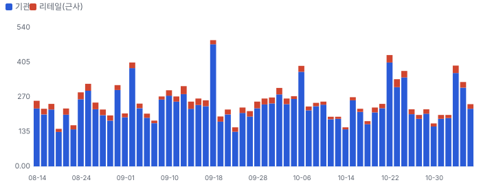

**기관 자금 흐름**

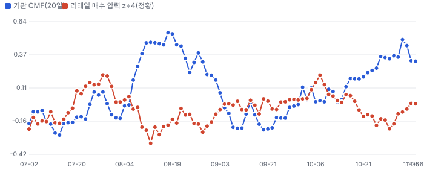

**몬테카를로**

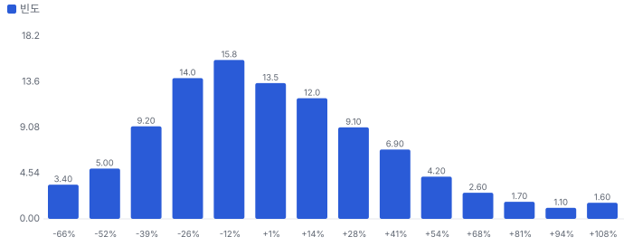

해석: 3,000번 중 1,405번(47%)에서 가치가 지금 주가 이상이었다. 지금 주가를 뒷받침하는 경우와 그렇지 않은 경우가 반반에 가깝다. 가운데 값은 0.97배이고, 열 번 중 여덟 번은 0.58~1.51배 사이에 든다.

**규모·마진·진척도**

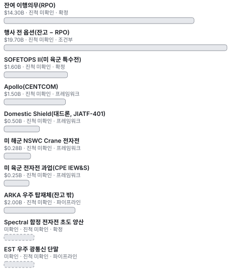

**매출 → 매출총이익 → 영업이익(매출 = 100, 최근 4분기)**

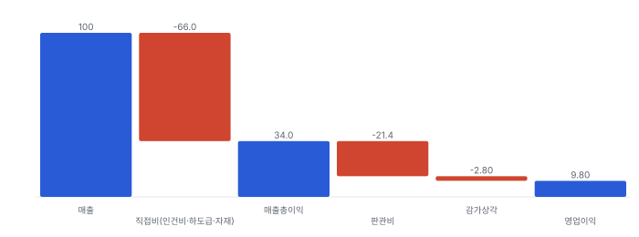

**1년 전 대비 마진 기여(비용 비중 변화의 반대)**

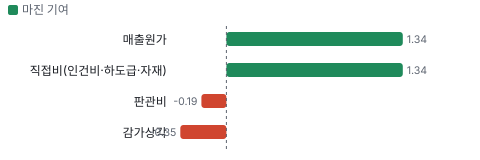

**분기 비용 비중 추이(매출 대비, 공시)**

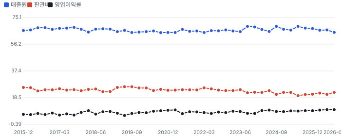

**비용 요인별 매출 대비 비중과 1년 변화**

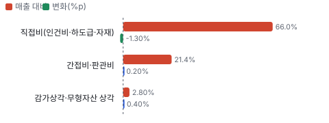

**BOM 항목 가격 +10% 시 OPM 변화**

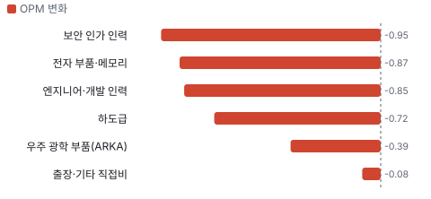

**기술 제품·솔루션(전자전·대드론·우주·소프트웨어) BOM 원가 몫과 가격 +10% 시 OPM**

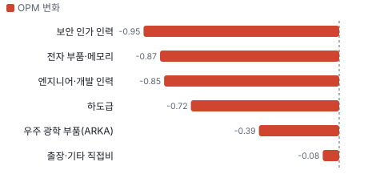

**임무 지원·네트워크 현대화 BOM 원가 몫과 가격 +10% 시 OPM**

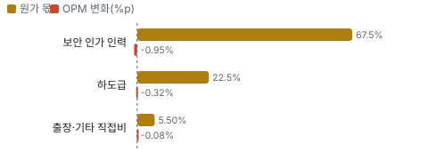

**목표주가 산정 — 약세와 기본 사이(약세 쪽 9%), 도달 확률 약 53%**

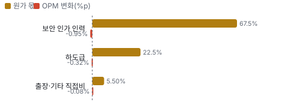

**일봉 지지·저항과 목표주가**

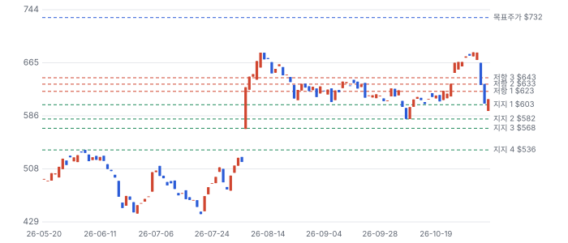

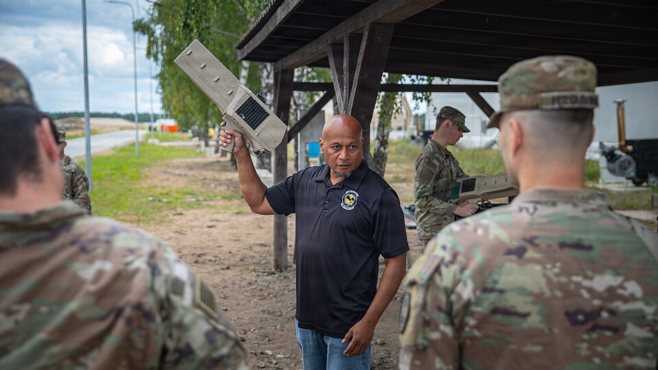
**대드론(SkyValor, BEAM)** — 미 육군 병사의 대드론 장비 사격 훈련 — 같은 종류 예시(CACI 제품 아님)
_사진: U.S. Army photo by Sgt. Max Elliott · Public domain · Wikimedia Commons_

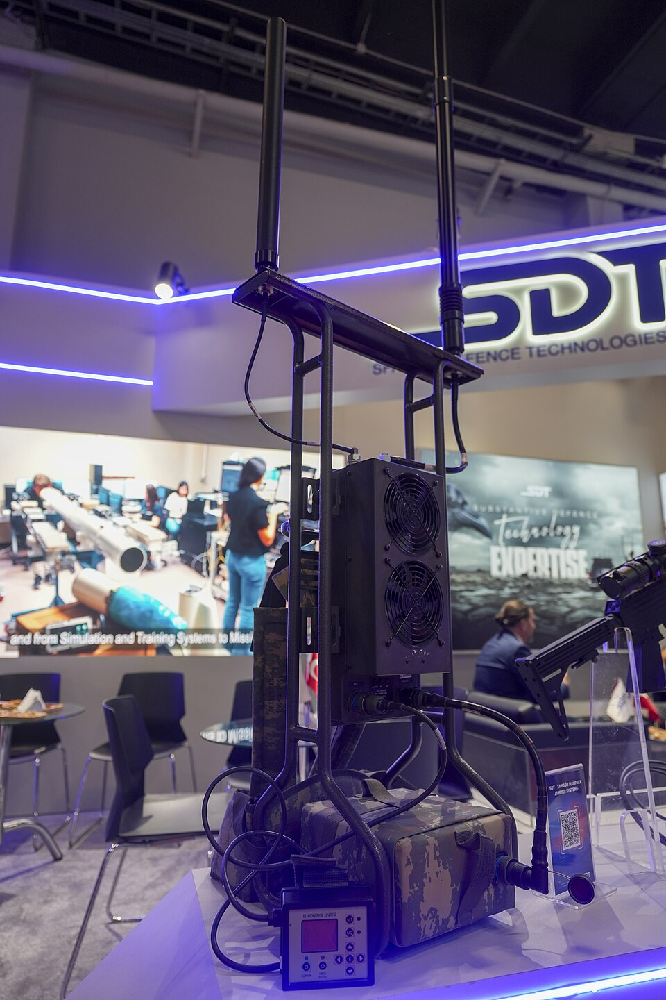
**전자전·신호정보(TLS MANPACK, Spectral)** — 휴대형 전파 교란 장비 전시 — 같은 종류 예시(CACI 제품 아님)
_사진: Krzysztof Popławski · CC BY 4.0 · Wikimedia Commons_

## 내러티브

> **기업가치를 결정하는 이야기:** 주가는 EPS와 멀티플 둘로 움직인다. EPS는 기술 비중과 이익률이 올리고, 멀티플은 이 회사를 서비스로 보느냐 제품으로 보느냐가 정한다. 지금 Fwd 1Y P/E 19.2배는 서비스 동종 약 14배와 제품 동종 L3Harris 22.7배의 사이다.

> **멀티플·EPS 프리미엄**
> **멀티플:** Fwd 1Y P/E 19.2배는 동종 중앙값 약 13.9배보다 약 38% 높고 자기 36개월 범위 13~23배의 위쪽이다. 6월 말 14.8배에서 넉 달 만에 올랐다. Fwd 2Y는 16.1배다.
> **EPS:** 지난 네 분기 EPS가 모두 컨센서스를 넘었다. 8/5 이후 FY27 EPS 컨센서스는 \$30.49에서 \$33.50으로 9.9% 올랐다.

### 투자자들은 왜 열광했나

8월에 세 가지가 함께 나왔다. FY27 EPS 가이던스 중간 \$33.41이 당시 컨센서스 \$30.49를 9.6% 넘었고, FY26 FCF가 \$735M으로 나왔고, Domestic Shield(미국 내 시설 대드론 방어 사업) \$500M이 붙었다. 앞선 석 달간 시장은 ARKA 차입과 이자를 걱정했고 주가는 7/21 \$441까지 밀려 있었다. 낮은 기대에 큰 숫자가 나온 것이다. 10월에는 Jefferies가 Buy로 올렸고 아부그라이브 소송이 기각되며 또 하나의 부담이 사라졌다.

### 무엇이 기업가치를 바꾸나

> **구조적 체질 변화**
> **변화:** 기술 매출 비중이 FY24 53.6% → FY26 58.4% → 1Q FY27 58.6%다
> **증거:** 10-K, 10-Q Note 5
> **반증:** 기술 비중이 2개 분기 연속 내려간다

> **고부가 믹스 확장**
> **변화:** 프로그램 이익률이 한 자릿수에서 30%대 초반까지 벌어져 믹스가 곧 이익률이다. 1Q EBITDA 이익률 13.3%
> **증거:** 1Q 콜 CFO, 10-Q
> **반증:** EBITDA 이익률이 12% 아래로

> **기술 혁신**
> **변화:** 소프트웨어로 위협 변화에 맞추는 제품, ARKA의 소형 광학. 공급 제약은 메모리·희토류다
> **증거:** 1Q 콜
> **반증:** 공급 제약이 가이던스 하단을 건드린다

> **실행 속도**
> **변화:** SkyValor(CACI의 대드론 탐지·무력화 시스템)는 콘셉트에서 배치까지 12개월(회사 말). 다른 제품과 피어의 납기는 공개되지 않아 미확인 **납품 리드타임 12개월.** 피어 비교 미확인. 이전 대비 미확인.
> **증거:** 4Q 콜
> **반증:** Spectral(미 해군 함정용 전자전 체계)·Domestic Shield 납기 지연

> **M&A**
> **변화:** ARKA \$2.64B를 차입으로 샀다. 레버리지 3.5배, 3배 초반 복귀 목표를 2027년 3월로 앞당겼다. 회사는 다시 인수 여력을 말한다
> **증거:** 10-Q, 1Q 콜
> **반증:** 복귀 전 대형 인수로 레버리지가 다시 오른다

> **정책·입법 연관성**
> **재정정책:** OBBBA(2025년 7월 제정 재정조정법)가 국방 약 \$156B(Golden Dome(미국 본토 미사일 방어 구상) \$25B 포함)를 예산 절차와 별도로 풀었다. FY27 예산 요구는 재량 \$1.15T + 의무 \$350B이고 \$350B는 별도 재정조정법이 필요하다 10-Q 시장 환경 반증: FY27 재정조정법 무산 의회 동의 10/10 — 하원 5/5(OBBBA 본회의 통과. FY27 \$350B는 미통과) · 상원 5/5(OBBBA 본회의 통과. FY27 \$350B는 미통과).
> **행정명령:** 행정명령 14372(2026-01-07)는 저성과 방산업체의 자사주·배당을 막는다. CACI는 FY26 프로그램 자사주가 없었고 지정 대상 여부는 미확인이다 백악관 팩트시트, 10-K 반증: CACI가 저성과 업체로 지정된다 의회 동의 2/10 — 하원 1/5(이 명령을 입법한 법안 확인 안 됨) · 상원 1/5(이 명령을 입법한 법안 확인 안 됨).
> **연관입법:** FY27 NDAA(미국 국방수권법)는 7/22 하원 통과, 상원 본회의 미처리(9/1 CRS(미국 의회조사국) 기준). 임시 예산이 12/11까지다. 6월 재정조정법 2.0은 ICE(미 이민세관단속국)·CBP(미 세관국경보호청)에 \$70B를 2029년까지 준다 10-Q, 미국 의회조사국 보고서 반증: 12/11 뒤 셧다운이 길어진다

> **CAPEX 낙수효과**
> **변화:** AI 데이터센터와 직접 연결은 없다. 낙수는 정부의 드론·우주 예산에서 온다. 자체 CAPEX는 FY24 \$64M → FY26 \$107M으로 늘었다
> **증거:** 10-K
> **반증:** 제조 센터 투자에도 납기 개선이 없다

### 내러티브 근거

> 인력 서비스 회사에서 미리 만든 국방 기술 회사로 바뀐다는 이야기다. 8월 뒤 시장이 이를 가격에 넣기 시작했다. 동종 대비 멀티플 차이 +29% 중 회사 고유 몫은 -17%다. 단계는 확산, 쏠림은 낮음~보통 — 셀사이드는 강세가 많지만 리테일 관심은 거의 없다이다.

> **인력 회사에서 기술 회사로** · 강화
> **논리:** 매출 59%가 기술이고 프로그램별 EBIT 이익률이 한 자릿수에서 30%대 초반까지 벌어진다. 기술이 늘면 평균이 오른다
> **숫자:** EBITDA 이익률 1Q 13.3%, 전년 11.7%, 5년간 약 250bp 상승(회사)
> **반증:** 하반기 이익률이 12% 아래로 내려온다

> **대드론·전자전 수요** · 강화
> **논리:** 드론 위협이 미군 기지와 본토로 옮겨 오며 비살상 대응이 예산을 얻는다
> **숫자:** Domestic Shield \$500M 상한, 해군 \$281M, 육군 \$250M. 모두 상한이고 일부만 자금 배정
> **반증:** 개별 발주가 상한의 일부에 그치거나 경쟁사가 Domestic Shield 물량을 가져간다

> **우주 상인 공급자** · 유지
> **논리:** ARKA로 탑재체·광통신을 여러 원청에 파는 위치에 선다
> **숫자:** 인수가 \$2.64B, 잔고 밖 약 \$2B, FY27 인수 매출 약 \$450M
> **반증:** EST(우주군 차세대 광통신 단말 사업) 탈락, SDA(미 우주개발국) 2차분 지연

> **현금흐름 복리** · 유지
> **논리:** 회사는 주당 FCF를 최종 지표로 삼는다. 레버리지가 내려가면 인수·자사주 여력이 다시 열린다
> **숫자:** FY27 FCF 최소 \$900M, 시가총액 대비 약 6%. 일회성 약 \$155M 포함
> **반증:** FY28 FCF가 일회성 소멸분만큼 줄어든다

> **반대: 인력 회사 프리미엄은 오래 못 간다** · 유지
> **논리:** 1Q 유기적 성장은 2.1%, 총 잔고는 전년과 같고 RPO는 잔고의 42%다. AI가 인력 단가를 낮추면 서비스 몫이 줄 수 있다
> **숫자:** Fwd 1Y P/E 19.2배, 동종 중앙값 약 13.9배, 자기 36개월 13~23배
> **반증:** 하반기 유기적 성장이 두 자릿수로 나온다

> **반대: 차입 인수의 대가** · 약화
> **논리:** 영업권·무형자산이 자기자본의 1.8배이고 이자 비용이 분기 \$73M로 늘었다
> **숫자:** 차입 원금 \$4.86B, 레버리지 3.5배, 1Q 이자 등 \$73M vs 전년 \$46M
> **반증:** 2027년 3월까지 3배 초반에 못 닿는다

## 포트폴리오

| 제품·서비스 | 구분 | 무엇 | 쓰는 곳 | 돈 버는 방식 | Mix | Mix 변화(전 분기 대비) |
|---|---|---|---|---|---|---|
| 기술 제품·솔루션(전자전·대드론·우주·소프트웨어) | 제품 | 아래 세 제품군과 소프트웨어 개발·사이버를 묶은 회사 '기술' 매출 | 전쟁부·정보기관 | 1Q FY27 \$1.45B(58.6%) | 59% | -2.7%p |
| 전자전·신호정보(TLS MANPACK(미 육군 휴대형 전자전·신호정보 장비), Spectral) | 제품 | 적 전파를 탐지·교란하는 소프트웨어 정의 장비 | 미 육군·해군 | 연 약 \$2B(2월 회사 언급 보도). Spectral은 초도 양산 단계 | 미확인 | 미확인 |
| 대드론(SkyValor, BEAM(CACI의 휴대형 대드론 시스템)) | 제품 | 최대 75km 탐지, 휴대형과 고정형으로 드론 신호를 찾아 무력화 | 미군 기지·본토·유럽·태평양 동맹 | Domestic Shield 상한 \$500M, 제품별 매출 미공개 | 미확인 | 미확인 |
| 우주 광학·광통신(ARKA, EST) | 제품 | 정찰 위성 탑재체와 위성 간 레이저 통신 단말 | 우주군·정보기관·Vantor | FY27 인수 매출 약 \$450M, 잔고 밖 약 \$2B | 미확인 | 미확인 |
| 임무 지원·네트워크 현대화 | 서비스 | 정보 분석, 임무 계획, AI 기반 시스템 현대화 | 전투사령부·정보기관·연방 민간 | Expertise 매출 1Q \$1.03B(41%) | 41% | +2.7%p |

**Mix 변화가 가장 큰 쪽은 기술 제품·솔루션(전자전·대드론·우주·소프트웨어, -2.7%p, 전 분기 대비).** 계절성 판정: 분기 매출 계절 지수 기준 없음 → 직전 분기와 비교.

## 고객

> **1Q FY27 최대 고객 미 전쟁부(옛 국방부) 55%, 상위 3곳 95%, 집중도 집중.** 공시·회사 발표로 확인한 몫은 매출의 100%이고, 나머지 고객 몫은 추정이거나 미분해다. 매출의 95.6%가 미국 연방정부다(FY26 10-K). 기관별로는 전쟁부 54.7%·정보기관 24.7%·연방 민간 16.0%로, 1년 전보다 전쟁부 몫이 3.1%p 늘고 연방 민간이 2.0%p 줄었다. 상위 10개 계약은 매출의 22.5%다

**고객별 매출 몫(1Q FY27)**
| 고객 | 몫 | 변화 | 근거 |
|---|---|---|---|
| 미 전쟁부(옛 국방부) | 55% | +3%p | 공시 |
| 정보기관 공동체 | 25% | -1%p | 공시 |
| 연방 민간 기관 | 16% | -2%p | 공시 |
| 상업·기타(영국 정부 포함) | 4% | +0%p | 공시 |

> **미 전쟁부(옛 국방부)** · 공시
> **사는 것:** 전자전·대드론·임무 지원·네트워크
> **추정 근거:** 1Q FY27 \$1,354M ÷ \$2,475M, 1년 전 \$1,180M ÷ \$2,288M

> **정보기관 공동체** · 공시
> **사는 것:** 신호정보·분석·우주 탑재체
> **추정 근거:** \$612M ÷ \$2,475M

> **연방 민간 기관** · 공시
> **사는 것:** IT(정보기술) 현대화(국무부·법무부·NASA(미 항공우주국) 등)
> **추정 근거:** \$396M ÷ \$2,475M — 정부 효율화 감축 영향

> **상업·기타(영국 정부 포함)** · 공시
> **사는 것:** IT 서비스·데이터 제품
> **추정 근거:** \$112M ÷ \$2,475M

## 수주·파이프라인

> **2026-09-30 기준 10건.** 확정 \$14.30B, 미확정 \$19.70B. 공시 총 수주잔고 \$34.00B. 서로 겹치는 항목은 합계에서 뺐다.

**실행 속도와 방해 요인**
| 항목 | 상태 | 실행 속도 | 방해 요인 |
|---|---|---|---|
| 잔여 이행의무(RPO) | 확정 | 43%가 12개월 안, 62%가 24개월 안에 매출 | 임시 예산 · 자금 집행 지연 |
| 행사 전 옵션(잔고 − RPO) | 조건부 | 정부가 옵션을 행사할 때만 매출 | 옵션 미행사 · 예산 변화 |
| SOFETOPS II(미 육군 특수전) | 확정 | 5년, 1Q에 \$1.2B만 잔고 인식 | 요구량 변화 |
| Apollo(CENTCOM(미 중부사령부)) | 프레임워크 | 1년 + 옵션 4회, 잔고 예상 \$1.2B | 옵션 행사 · 수년 뒤 성장 정체(회사 언급) |
| Domestic Shield(대드론, JIATF-401(미 국방부 대드론 합동 태스크포스)) | 프레임워크 | 초기 과업 지시 포함, 나머지는 발주 시 | 개별 발주 규모 |
| 미 해군 NSWC(미 해군 수상전센터) Crane 전자전 | 프레임워크 | 5년 상한 | 개별 발주 |
| 미 육군 전자전 과업(CPE(미 육군 프로그램 관리 조직) IEW(정보·전자전)&S) | 프레임워크 | 5년 상한 | 개별 발주 |
| ARKA 우주 탑재체(잔고 밖) | 파이프라인 | 3~5년, 기본 예산 사업이나 잔고 미반영 | 수주 전환 · 양산성 |
| Spectral 함정 전자전 초도 양산 | 확정 | Milestone C 통과, 2H FY27 배치 시작 | 초도 양산이 곧 전력화 양산은 아니다 |
| EST 우주 광통신 단말 | 파이프라인 | 3단계 진출 3사 중 하나 | 경쟁 탈락 · SDN(우주군 우주 데이터망) 일정 |

## 마진 구조

> **GPM 34.0%, OPM 9.8%.** TTM 1Q FY26 대비 GPM +1.3%p, OPM +0.8%p. TTM 직접비(인건비·하도급·자재)가 매출의 66.0%로 1년 전 67.4%에서 1.4%p 내려 매출총이익률이 34.0%가 됐다. 간접비·판관비 21.4%와 상각 2.8%(ARKA 무형자산으로 +0.4%p)를 빼면 GAAP 영업이익률 9.8%다. 고정가 계약이 26.7%에서 33.2%로 늘어 원가를 떠안는 몫도 커졌다

> **매출 100 중 매출원가 66.0, 매출총이익 34.0(최근 4분기, 공시).** 매출원가 요인 중 직접비(인건비·하도급·자재)이 매출의 66.0%로 가장 무겁고, 단가가 +10% 오르면 GPM이 -6.60%p 움직인다. 분기 회귀로 매출 1이 늘 때 매출원가는 0.67 늘고, 매출원가의 고정비 몫은 -1%다.

**비용 요인 강도 — 비중·추세·충격(+10%)·탄력**
| 비용 | 구분 | 매출 대비 | 1년 변화 | 마진 기여 | 충격 시 마진 | 매출 탄력 | 고정비 몫 |
|---|---|---|---|---|---|---|---|
| 직접비(인건비·하도급·자재) | 매출원가 요인 | 66.0% | -1.3%p | +1.3%p | -6.60%p | 미확인 | 미확인 |
| 매출원가 | 공시 항목 | 66.0% | -1.3%p | +1.3%p | -6.60%p | 0.67 | -1% |
| 판관비 | 공시 항목 | 21.4% | +0.2%p | -0.2%p | 미확인 | 0.19 | 20% |
| 감가상각 | 공시 항목 | 2.8% | +0.4%p | -0.4%p | 미확인 | 0.03 | -55% |

매출 탄력 = 분기 비용을 매출에 회귀한 기울기(매출 1당 변동비), 고정비 몫 = 절편 ÷ 평균 비용. 표본이 8분기 미만이면 미확인. 매출원가 요인 비중은 margin 재료의 추정이 섞여 있고, 공시 매출원가와의 차이는 '기타 매출원가'로 둔다.

**GPM에서 OPM까지(GAAP)**
| 기간 | GPM | 연구개발 | 판관비 | 기타 | OPM |
|---|---|---|---|---|---|
| TTM 1Q FY26 | 32.6% | 0.0% | 21.2% | 2.4% | 9.0% |
| TTM 1Q FY27 | 34.0% | 0.0% | 21.4% | 2.8% | 9.8% |

**GPM·OPM 최근 4개 분기**
| 분기 | GPM | OPM |
|---|---|---|
| 2025-12 | 32.7% | 9.3% |
| 2026-03 | 33.9% | 9.7% |
| 2026-06 | 33.7% | 10.0% |
| 2026-09 | 35.4% | 10.0% |

**마진을 결정하는 비용 요인 — 비용 +10% 시 OPM**
| 비용 | 매출 대비 | 변화 | 고정비 | OPM |
|---|---|---|---|---|
| 직접비(인건비·하도급·자재) | 66.0% | -1.3%p | 미확인 | -6.60%p |
| 간접비·판관비 | 21.4% | +0.2%p | 60% | -2.14%p |
| 감가상각·무형자산 상각 | 2.8% | +0.4%p | 100% | -0.28%p |

**비용을 움직이는 요인**
| 비용 | 요인 |
|---|---|
| 직접비(인건비·하도급·자재, 매출원가) | 직접 인건비·하도급 비중·전자 부품 가격, 고정가 계약 원가 추정 변경(1Q 세전 +\$16M) · 근거 공시 |
| 간접비·판관비(판관비) | 자체 연구개발 선투자·입찰 비용·주식 보상(TTM \$87M) · 근거 공시 |
| 감가상각·무형자산 상각(기타) | ARKA 인수 무형자산 상각 시작(2026-03) · 근거 공시 |

**기술 제품·솔루션(전자전·대드론·우주·소프트웨어) BOM — 매출의 59%, GPM 34%(사업별 GPM 미공시 — 회사 TTM GPM 34.0%로 대신. CFO는 프로그램 이익률이 한 자릿수~30%대 초반이라 했다(1Q 콜)), 항목 가격 +10% 시**
| 항목 | 원가 몫 | 전가 | 제품 GPM | OPM |
|---|---|---|---|---|
| 엔지니어·개발 인력 | 35~50% | 53% | -1.8%p | -0.85%p |
| 전자 부품·메모리 | 15~30% | 미확인 | -1.5%p | -0.87%p |
| 하도급 | 15~25% | 53% | -0.9%p | -0.40%p |
| 우주 광학 부품(ARKA) | 5~15% | 미확인 | -0.7%p | -0.39%p |
| 미분해 | 5% | - | - | - |

**임무 지원·네트워크 현대화 BOM — 매출의 41%, GPM 34%(사업별 GPM 미공시 — 회사 GPM으로 대신(전문 인력 매출은 회사 평균보다 낮다는 게 회사 설명)), 항목 가격 +10% 시**
| 항목 | 원가 몫 | 전가 | 제품 GPM | OPM |
|---|---|---|---|---|
| 보안 인가 인력 | 60~75% | 53% | -2.8%p | -0.95%p |
| 하도급 | 15~30% | 53% | -1.0%p | -0.32%p |
| 출장·기타 직접비 | 3~8% | 53% | -0.2%p | -0.08%p |
| 미분해 | 4% | - | - | - |

보안 인가 인력 가격이 +10% 오르면 영업이익은 -9.7% 움직인다. 판매가 전가를 모르는 항목은 전가 0%로 계산했다.

**BOM 항목 가격을 움직이는 것**
| 항목 | 요인 |
|---|---|
| 엔지니어·개발 인력 | 소프트웨어 정의 장비라 인건비가 가장 크다 — 전가율 0.53은 1Q 원가보상 계약 비중 52.8%(10-Q)를 쓴 근사 · 근거 추정 |
| 전자 부품·메모리 | 전자전·대드론 하드웨어 생산이 늘며 자재 몫이 커진다 · 근거 추정 |
| 하도급 | 원청으로 따고 일부를 외부에 준다 — 전가율 0.53은 1Q 원가보상 계약 비중 52.8%(10-Q)를 쓴 근사 · 근거 추정 |
| 우주 광학 부품(ARKA) | 정찰 위성 탑재체 광학·센서 · 근거 추정 |
| 보안 인가 인력 | 현장 분석·임무 지원은 사람이 곧 원가 — 전가율 0.53은 1Q 원가보상 계약 비중 52.8%(10-Q)를 쓴 근사 · 근거 추정 |
| 하도급 | 전문 분야 인력을 외부에서 받는다 — 전가율 0.53은 1Q 원가보상 계약 비중 52.8%(10-Q)를 쓴 근사 · 근거 추정 |
| 출장·기타 직접비 | 해외 전투사령부 현장 지원 — 전가율 0.53은 1Q 원가보상 계약 비중 52.8%(10-Q)를 쓴 근사 · 근거 추정 |

**BOM 투입 물가 — PPI 전년비, 2026-11-07 수집**
| 항목 | 미국 | 일본 | 한국 | 대만 |
|---|---|---|---|---|
| 전자 부품·메모리 | -2.2%* | +3.9%* | -24.2% | +22.9%* |

별표는 품목보다 넓은 업종 지수다. 지난 1년 투입 물가를 판매가 전가 뒤 원가에 그대로 넣으면 OPM은 +2.10%p 움직인다(매출원가의 13% 기준).

## 공급망 병목

> **공급망 신뢰성 3.7/10, 병목 심각.** 가장 약한 고리는 보안 인가 인력 3.5점이고, 품목 평균은 4.0점이다. 근거가 부족한 1건(희토류 자석)은 점수에서 뺐다. 가장 큰 투입물은 보안 인가를 받은 인력이다. 하드웨어가 늘면서 메모리·희토류가 두 번째 병목으로 올라왔다고 회사가 1Q 콜에서 인정했다. 공급사 이름과 몫은 공시되지 않는다

**병목과 마진 — 품목 가격 +10% 시 OPM**
| 품목 | 점수 | 판정 | 구분 | OPM |
|---|---|---|---|---|
| 보안 인가 인력(필수) | 3.5 | 병목 심각 | 핵심 통제 품목 | -0.95%p |
| 전자 부품·메모리(필수) | 5.0 | 병목 주의 | 핵심 통제 품목 | -0.87%p |

> **보안 인가 인력** · 3.5/10
> **왜:** 인가 인력 없이는 기밀 계약을 수행할 수 없다
> **병목 요인:** 인증 공급사 1곳 · 캐파 빠듯 · 리드타임 미확인 · 재인증 미확인 · 1위 점유율 미확인 · 미국(정부 매출 95.6%, 10-K) 집중 95% · 물량 확보 내재화
> **풀리는 조건:** 미확인

> **전자 부품·메모리** · 5.0/10
> **왜:** 전자전·대드론 장비 생산 물량을 정한다
> **병목 요인:** 인증 공급사 미확인 · 캐파 빠듯 · 리드타임 미확인 · 재인증 미확인 · 1위 점유율 35% · 한국·대만(업계 메모리 생산 집중, 근사) 집중 70% · 물량 확보 현물
> **풀리는 조건:** 미확인 — 업계 증설은 장비 반입·수율 확인 전

**공급사**
| 품목 | 공급사 | 몫 | 근거 |
|---|---|---|---|
| 보안 인가 인력 | 자체 직원 약 27,000명(직접 고용) | 미확인 | 회사 발표 |
| 전자 부품·메모리 | 미공개(메모리·반도체 부품) | 미확인 | 추정 |
| 희토류 자석 | 미공개(모터·RF(무선 주파수) 부품용 자석) | 미확인 | 추정 |

**무역 통계로 본 공급 지역**
| 품목 | EU 수입처 | 일본 수입처 | EU 1위 전년비 |
|---|---|---|---|
| 전자 부품·메모리 | TW(대만) 45% · KR(한국) 21% · CN(중국) 16% | 台湾 52% · 大韓民国 28% | +365.5% |

## 생산능력

> **현재 명목 캐파 27,000 명(직원), 가동률 미확인.** 착공 이상 증설은 0 명(직원), 발표까지 합치면 0 명(직원)이다. 다 가동하면 지금보다 +0%, 착공 이상만이면 +0%다. FY2026 CAPEX는 \$0.11B로 매출의 1.1%다. 서비스·소프트웨어 매출이 크다 보니 캐파는 인력이다. 직원은 약 27,000명(콜), 가동률은 공시되지 않는다. 하드웨어 쪽은 Rochester 방산 전자 제조 센터를 열었고 우주·통합 시스템 센터를 더 짓는다고 했다. CAPEX는 매출의 1.1%로 작다

**생산능력 확충 계획**
| 계획 | 단계 | 증설 | 가동 시점 | CAPEX |
|---|---|---|---|---|
| 우주·통합 시스템 센터 | 발표 | 미확인 | 미확인 | 미확인 |

남은 계획의 CAPEX 합계는 \$0.00B(금액 미확인 1건 제외)다. 합계는 FY2028 매출의 0%다.

**증설 방해 요인**
| 계획 | 방해 요인 |
|---|---|
| 우주·통합 시스템 센터 | 위치·규모 미공시 |

**CAPEX와 매출 대비**
| 기간 | CAPEX | 매출 | 매출 대비 | 구분 |
|---|---|---|---|---|
| FY2024 | \$0.06B | \$7.66B | 0.8% | 실적 |
| FY2025 | \$0.07B | \$8.63B | 0.8% | 실적 |
| FY2026 | \$0.11B | \$9.57B | 1.1% | 실적 |
| FY2027 | \$0.12B | \$10.80B | 1.1% | 컨센서스 |
| FY2028 | \$0.13B | \$11.75B | 1.1% | 컨센서스 |

## 해자

> 해자는 현장 임무 지식과 소프트웨어 정의 제품의 결합이다. 인력 회사와 다른 점이 숫자로 일부 확인되지만 우주 쪽은 아직 경영진 말이 많다.

> **현장에 들어간 임무 지식** · 강함
> **해자:** 1,400명이 전 세계 전투사령부에 들어가 있어 요구가 공고되기 전에 무엇이 필요한지 안다.
> **근거:** 1Q 수주 \$4.8B에 신규와 재경쟁 승리가 함께 있고, FY27 매출의 94%가 이미 기존 프로그램이다.
> **숫자:** 총 잔고 \$34.0B = TTM 매출의 3.5배
> **깨지는 조건:** 재경쟁에서 대형 프로그램을 잃거나 평가 중 입찰이 2분기 연속 줄어든다

> **미리 만든 소프트웨어 정의 제품** · 강함
> **해자:** 요구가 나오기 전에 자기 돈으로 만들어 두어 제품을 바로 판다. 소프트웨어로 위협 변화에 맞춘다.
> **근거:** SkyValor는 콘셉트에서 배치까지 12개월. FY26 OTA(시제품을 빠르게 사는 비정규 계약 방식)·CSO(상용 기술을 공모로 사는 조달 방식) 수주 약 \$500M, OTA 금액이 FY24·FY25 합의 2배 이상. 기술 매출 FY24 54% → 1Q FY27 59%.
> **숫자:** EBITDA 이익률 1Q 13.3%, 전년 11.7%
> **깨지는 조건:** OTA 사업이 양산 계약으로 이어지지 않거나 기술 비중이 내려간다

> **우주 대구경 광학 제조** · 보통
> **해자:** ARKA의 대구경 광학은 공급자가 적고 소형화로 상업 시장까지 넓힌다.
> **근거:** Vantor 경쟁 평가에서 선정, EST 3단계 진출 3사 중 하나. 다만 공급자 수는 CEO 말이고 SDA 1차분은 양산성에 고전했다.
> **숫자:** 인수가 \$2.64B, FY27 인수 매출 약 \$450M
> **깨지는 조건:** EST 3단계에서 탈락하거나 2차분 납기가 밀린다

> **보안 인가 인력과 프라임 지위** · 보통
> **해자:** 인가 인력과 원청 계약은 새 경쟁자의 진입을 늦춘다.
> **근거:** 매출의 89%가 원청, 상위 10개 계약 22.5%로 분산, 프로그램 약 1,900개. 다만 대형 동종도 같은 자산을 가졌다.
> **숫자:** 원청 매출 1Q \$2.21B
> **깨지는 조건:** 소프트웨어 신생사가 CACI 임무 영역에서 프라임을 딴다

## 경영진·네트워크

> 창업자 경영 체제가 아니다. CEO는 Lockheed 27년 출신이고 이사회에 전 해군참모총장·전 국가정보국 수석 부국장·전 NSA(미 국가안보국) 간부가 있다. 연결이 매출을 만들었다는 증거는 없다.

> **John S. Mengucci** · 사장·CEO, 이사 · 2019-07
> **프로필:** 64세. Lockheed Martin 27년, 사장급까지. 2012년 CACI 합류, COO 거쳐 CEO
> **비즈니스:** AIA(미국 항공우주산업협회) 이사회, PSC(미국 정부 서비스 협회 Professional Services Council)·NVTC(북버지니아 기술 협회) 집행위원회
> **정계:** 공직 이력 없음. 선거자금·로비 기록은 확인하지 않아 미확인
> **동문:** Clarkson University 이사회 부의장
> **사모임:** 미확인

> **Lisa S. Disbrow** · 독립 이사회 의장 · 2021
> **프로필:** 63세. 공공·민간 합쳐 40년 이상 국가안보 경력
> **비즈니스:** 방산·기술 상장사 이사회 경험
> **정계:** 위임장 기준 정부 안보 경력. 세부 직책은 위임장 원문 참조
> **동문:** 미확인
> **사모임:** 미확인

**네트워크 정량화**
| 연결 | 강도 | 닿는 매출 | 가중 노출 | 매출 대비 | 근거 |
|---|---|---|---|---|---|
| 정계: 이사 Gilday 전 해군참모총장, 2026년 1월 합류. 해군 관련 수주와의 인과는 입증되지 않는다 | 2/5 | \$5.13B | \$2.05B | 21% | FY26 전쟁부 매출 \$5.13B 2026 위임장, 10-K |
| 정계: 이사 Gordon 전 국가정보국 수석 부국장, Plunkett 전 NSA 간부 | 2/5 | \$2.35B | \$0.94B | 10% | FY26 정보기관 매출 \$2.35B 2026 위임장, 10-K |
| 비즈니스: 이사 Keffer 전 Northrop Grumman CFO, CEO는 Lockheed 출신. 원청·하청 관계와 닿는다 | 2/5 | \$0.92B | \$0.37B | 4% | 하청 매출 연환산(1Q \$265M × 4 근사) 2026 위임장, 10-Q |
| 동문: CEO의 Clarkson University 이사회 부의장직 | 0/5 | \$0.00B | \$0.00B | 0% | 매출과 닿는 연결 미확인 2026 위임장 |
| 사모임: 공개 자료에서 확인되는 사모임 없음 | 0/5 | \$0.00B | \$0.00B | 0% | 미확인 2026 위임장 |

가중 노출은 연결이 닿는 매출의 크기다. 연결이 그 매출을 만들었다는 뜻이 아니며, 인과는 공개 자료로 입증하지 못한다.

## 약세 논리 및 셀온 조건

| 약세 논리 | 근거 | 반박 | 가를 자료 |
|---|---|---|---|
| 의회 세출 속도 둔화 | 상원 민주당 확정(AP, 11/4). 분점 정부면 국방 증액 속도가 느려질 수 있다는 가설. 11/4~6 방산주 동반 하락 | 중간선거 영향 −0.9/10, 업종 ETF 선거 뒤 −1.0%(t −0.46)로 유의하지 않다. 대드론·우주는 양당 지지 항목 | 12/11 임시 예산 처리 방식, FY27 국방 세출 법안의 대드론·우주 항목(2026-12~2027-01) |
| 하반기 성장 쏠림 | 1Q 유기적 +2.1%. Jefferies 계산으로 2Q +7%, 하반기는 두 자릿수 초반이 필요하다. 그 시점은 12/11 임시 예산 종료와 겹친다 | FY27 매출 94%가 기존 프로그램이고 자금 배정 잔고가 +15%다. 지난해도 같은 질문을 넘겼다 | 2월 실적의 유기적 성장, 자금 배정 잔고 |
| 분류 재평가가 되돌려진다 | Fwd 1Y P/E 19.2배 vs 동종 약 13.9배. 6월 말 14.8배였다 | 기술 매출 59%, EBITDA 이익률 13.3%로 동종과 다르다 | 하반기 이익률, 기술 비중 |
| 잔고의 질 | 총 잔고는 전년과 같고(\$33.9B → \$34.0B) RPO는 \$14.3B로 42%다. 나머지는 미행사 옵션이다 | 자금 배정 잔고는 8분기 중 7번 두 자릿수 증가 | RPO 추이, 옵션 행사율 |
| 차입과 자본 배분 | 차입 원금 \$4.86B, 레버리지 3.5배, 영업권·무형 \$8.5B는 자기자본의 1.8배. Broyhill은 자사주 중단을 매도 이유로 들었다 | 3개월에 \$67M 상환, 3배 초반 복귀를 2027년 3월로 앞당겼다 | 레버리지, 다음 인수 규모 |
| 현금흐름의 일회성 | FY27 FCF \$900M에 세금 환급 \$40M, Section 174 \$115M이 포함된다. 합치면 17%다 | 회사는 순이익 이상의 현금 전환을 2년째 말한다 | 새 회계연도 FCF 가이던스 |
| 경쟁 증설과 공급 제약 | 높은 수익은 경쟁을 부른다. 대드론·전자전에는 대형 방산과 신생사가 함께 들어와 있다. 메모리·희토류 가격도 오른다 | 회사는 납품 건마다 재가격이 가능하다고 말한다. 대부분 1~1.5년 안 | 대드론 수주 점유, 총이익률 |
| 경영진 신호 | 공시 기간 장내 매도 14건, 매수 0건 | 사전 매매 계획 여부 미확인, 금액 비중 미확인 | Form 4 각주 |

> **셀온 조건**
> **조건 1:** 12월 분기 유기적 성장이 회사가 합당하다고 한 수준(약 7%)에 크게 못 미친다
> **조건 2:** 자금 배정 잔고 증가율이 두 자릿수 아래로 내려온다
> **조건 3:** EBITDA 이익률이 12% 아래로 내려온다
> **조건 4:** 2027년 3월 레버리지가 3배 초반에 못 닿거나 그 전에 대형 인수가 나온다
> **조건 5:** 경쟁사가 Domestic Shield 발주를 가져가거나 EST 3단계에서 탈락한다
> **조건 6:** FY27 국방 세출에서 대드론·우주 항목이 요청보다 깎인다

## 어닝콜 변화

**직전 콜 대비 새로 나오거나 바뀐 내용 → 가치 영향**
| 항목 | 내용 | 직전 콜 | 최신 콜 | 모델 동인 이동 | 확신도 | 가치 영향 |
|---|---|---|---|---|---|---|
| 업데이트 | FY27 매출 가이던스 중간 +\$50M | \$10.65~10.85B | \$10.7~10.9B | 기준연도 매출 +\$0.05B | 0.8 | +0.6% |
| 업데이트 | 1Q 수주 \$4.8B, 수주/매출 2배 | \$32.0B | \$34.0B | 성장 지속(감속 계수) +2.0% | 1.0 | +0.6% |
| 업데이트 | FY27 매출 중 기존 프로그램 비중, 7년 내 이 시점 최고 | 83% | 94% | 1년차 성장률 +0.50% | 0.8 | +1.6% |
| 신규 | ARKA 우주 탑재체 약 \$2B(3~5년), 잔고 미반영 | 언급 없음 | 약 \$2B | 1년차 성장률 +1.0% | 0.5 | +3.1% |
| 업데이트 | 차입 원금 감소, 레버리지 3.7배 → 3.5배 | \$4.93B | \$4.86B | 순차입 -\$0.07B | 1.0 | +0.5% |
| 부정 | 평가 중 입찰 \$11B → \$4.7B, 향후 2분기 제출 \$22B → \$14.7B. 수주 전환분 포함 | \$11B·\$22B | \$4.7B·\$14.7B | 성장 지속(감속 계수) -1.0% | 0.3 | -0.3% |
| 업데이트 | 고정가 비중 상승, 절반은 ARKA 몫 | 1Q FY26 27% | 33% | 목표 이익률 +0.30% | 0.5 | +0.6% |
| 반복 | FY27 EBITDA 이익률 high 12%, 1Q 13.3%에도 유지 | high 12% | high 12% | 출발 이익률 — | 0.8 | +0.0% |
| **합계** | 단독 합 |  |  | 동시 적용 +6.9% |  | **+6.7%** |

**사건별 EPS 리비전**
| # | 날짜 | 구분 | 사건 | CY2026 EPS 전→후 | CY2027 EPS 전→후 | 리비전 | 주가 반응 |
|---|---|---|---|---|---|---|---|
| ① | 26-01-21 | 실적 | 4Q25 실적 | \$29.59 → \$29.90 | \$32.45 → \$33.17 | +2.2% | +3.6% |
| ② | 26-03-09 | 내러티브 | ARKA 인수 완료, 차입 \$2.6B 부담 | \$30.05 → \$30.11 | \$33.81 → \$33.81 | +0.0% | +2.8% |
| ③ | 26-04-22 | 실적 | 1Q26 실적, 인수 반영 FY26 EPS 가이던스 하향 | \$29.80 → \$29.93 | \$33.40 → \$33.84 | +1.3% | +2.8% |
| ④ | 26-08-05 | 실적 | 2Q26 실적, FY27 가이던스 EPS \$33.41 | \$29.26 → \$29.74 | \$33.28 → \$35.08 | +5.4% | +21.4% |
| ⑤ | 26-10-21 | 실적 | 3Q26 실적, 가이던스 상향 | \$30.14 → \$30.66 | \$35.61 → \$36.14 | +1.5% | -0.7% |
| ⑥ | 26-10-26 | 내러티브 | Jefferies Buy 상향 | \$30.73 → \$30.66 | \$36.27 → \$36.14 | 실적 창과 겹침 | +4.9% |

**해석:** 3개 구간 누적 주가 -3% = EPS 리비전 +7% × 멀티플 -9%. 더 크게 움직인 쪽은 **멀티플**이다.

## 밸류에이션

> **목표주가 \$732, 업사이드 +20%.** 자리는 약세와 기본 사이(약세 쪽 9%)이고 도달 확률은 약 53%다. 기본 \$753, 강세 \$1,035(+69%), 약세 \$515(-16%). DCF 기준 업사이드는 기본 -5%, 강세 +22%, 약세 -23%다(WACC 8.5%).

2027년 말 시점에 FY2028(2028년 6월 끝) 조정 EPS를 적용했다. FY2028 컨센서스는 \$36.5~\$44.5(평균 \$40.6)이다. EPS 추정은 11/2 판과 같다 — 11/2 이후 바뀐 것은 주가뿐이다. 표의 분기는 달력 기준이고 3Q26이 회사 FY27 1Q다.

시나리오는 시장 멀티플을 쓰고 DCF는 GAAP 이익과 현금을 쓴다. DCF 기본이 현재가보다 5% 낮은 이유는 EBIT 이익률이 10%대에서 출발해 12.5%로만 오르기 때문이다. 이 간격이 지금 시장이 얹은 프리미엄이고, 선거 뒤 하락으로 21%에서 5%로 줄었다.

시가총액 약 \$13.6B에서 10배는 \$136B이고 어떤 시나리오도 닿지 않는다. 애널리스트 평균 목표가 \$740은 시장 기대의 증거로만 본다.

> **약세 \$515 (-16%)** · 확률 25%
> **가정:** 14.1배 × EPS \$36.50
> **근거:** 하반기 성장이 밀리고 이익률이 12%대 중반에 머문다. FY2028 EPS 컨센서스 하단

> **기본 \$753 (+23%)** · 확률 50%
> **가정:** 18.8배 × EPS \$40.00
> **근거:** 가이던스가 지켜지고 대드론·ARKA가 쌓인다. FY2028 컨센서스 \$39.0~\$40.6 사이

> **강세 \$1,035 (+69%)** · 확률 25%
> **가정:** 23.5배 × EPS \$44.00
> **근거:** Spectral 양산과 대드론 발주가 빨라지고 이익률이 14%에 닿는다. FY2028 추정 상단 \$44.5 부근

**멀티플 선정 — Fwd 1Y P/E**
| 단계 | 조정 | 근거 |
|---|---|---|
| 동종 중앙값 | 13.4배 | 범위 9.4~21.2배, 6곳 |
| 펀더멘털 | +20% | 성장·이익률·ROIC로 본 합리적 멀티플 21.0배와의 차이의 일부만 인정 |
| 해자 | +11% | 현장에 들어간 임무 지식 강함 · 미리 만든 소프트웨어 정의 제품 강함 · 우주 대구경 광학 제조 보통 · 보안 인가 인력과 프라임 지위 보통 |
| 반복 매출 | +0% | 재료 없음 |
| 수주 전환·가시성 | -6% | 잔고 커버리지 0.39 · book-to-bill 0.42 · RPO 12개월 0.26 → 가시성 0.36 · 전환 17.6개월(동종 12) |
| 내러티브 | +5% | 단계 확산 |
| 사이클·실행 판단 | +10% | 동종 중앙값은 인력형 서비스 회사가 끌어내린다. CACI는 매출 59%가 기술이고 TTM 매출 성장 +10%(인수 포함)로 여섯 곳을 모두 웃돈다. 순차입 3.5배가 조정을 +10%로 묶는다 |
| **선정** | **18.8배** | 지금 17.3배 |

**동종 레인지**
| 회사 | Fwd 1Y P/E | Fwd 2Y P/E | Fwd 3Y P/E | 성장 | 영업이익률 | ROIC |
|---|---|---|---|---|---|---|
| LDOS | 10.9 | 9.6 | 8.9 | 4% | 12% | 15% |
| BAH | 13.2 | 11.6 | 10.8 | 6% | 9% | 13% |
| SAIC | 14.7 | 12.2 | 11.5 | -5% | 10% | 14% |
| PSN | 13.7 | 12.5 | 10.8 | 4% | 7% | 9% |
| KBR | 9.4 | 8.8 | 8.1 | 7% | 8% | 12% |
| LHX | 21.2 | 17.6 | 15.9 | 7% | 16% | 10% |
| **CACI International** | 17.3 | 14.6 | 12.6 |  |  |  |

몬테카를로 중앙값 업사이드 -3%.

> 의사결정 보조(투자자문 아님): ① 매수 매력: 연 기대수익 +8.6% (자기자본비용 9.9% 대비 -1.3%p) · 자본비용 초과 확률 39% · 안전마진 0.58 → 정량 신호 약함 / ② 위험 예산 지표(이론): 0% — 기대수익이 자기자본비용에 못 미침(무위험 대비 켈리 79%는 참고) · 5년 하위10% -14% · 30%+ 손실 확률 5% / ③ 상방(5년): 기대 1.51배 · 2배 18% · 3배 2% · 10배 0% · 상위10% 2.25배

투입 물가 점검: 지난 1년 PPI(생산자물가지수)를 BOM에 넣으면 OPM +2.10%p다(매출원가의 13% 기준).

## 매수 위치(일봉)

> **현재가 \$611는 '지지 근접'(가장 가까운 일봉 지지 \$603에서 ATR 0.5배 위).** 이 자리에서 목표주가까지 +19.8%, 첫 일봉 저항까지 +1.9%, 다음 지지까지 하방 -1.4%, 손익비 14.6배.

**가격대별 업사이드(일봉 기준)**
| 가격대 | 가격 | 목표주가까지 | 첫 저항까지 | 다음 지지까지 | 손익비 | 근거 기법(강도) |
|---|---|---|---|---|---|---|
| 현재가 | \$611 | +19.8% | +1.9% | -1.4% | 14.6 | - |
| 지지 1 | \$603 | +21.4% | +3.3% | -3.5% | 6.1 | 피보 78.6%(1.0) |
| 지지 2 | \$582 | +25.8% | +3.6% | -2.4% | 10.8 | 120일 지그재그 저점 · 스윙 저점(1.8) |
| 지지 3 | \$568 | +28.9% | +2.5% | -5.6% | 5.1 | 200일선(1.0) |
| 지지 4 | \$536 | +36.6% | +6.0% | 미확인 | 미확인 | 120일 지그재그 고점(0.8) |

**일봉 저항**
| 저항 | 가격 | 현재가 대비 | 근거 기법(강도) |
|---|---|---|---|
| 저항 1 | \$623 | +1.9% | 50일선 · 피보 61.8%(2.0) |
| 저항 2 | \$633 | +3.6% | 20일선 · 피보 50.0%(1.5) |
| 저항 3 | \$643 | +5.2% | 피보 38.2%(1.0) |

일봉만 쓴다(주봉·월봉 제외). 손익비 = 목표주가까지 업사이드 ÷ 다음 지지까지 하방. 가격대별 기대값 참고표이며 매수·매도 시점 지시가 아니다.

## 애널리스트 토론

> **토론 결론 Buy(규칙 등급 Buy).** 추정이 그대로인 채 배수만 내렸다는 점과 FY27 매출 94% 기존 프로그램이 살아남았다. DCF가 현재가를 받치지 못한다는 반박이 Strong Buy를 막았다

**패널(가상 애널리스트)**
| 자리 | 애널리스트 | 핵심 논리 | 틀리는 조건 | 최종 투표 |
|---|---|---|---|---|
| Strong Buy | 한서윤(가상 리서치 하우스 누리증권) | 추정은 하나도 안 바뀌었는데 나흘 만에 멀티플만 10% 빠졌다 — 기술 매출 59% 회사가 6월 저점 배수 근처로 돌아왔다 | 12월 분기 유기적 성장이 5% 아래 | Buy |
| Buy | 오지훈(가상 리서치 하우스 가람리서치) | 선거 영향은 정책 채널로 재면 −0.9/10으로 작다. 업종이 같이 판 것이지 CACI 숫자가 바뀐 게 아니다 | FY27 국방 세출에서 대드론·우주 항목이 깎인다 | Buy |
| Neutral | 배수아(가상 리서치 하우스 다솜증권) | 목표주가는 위에 있지만 DCF와 몬테카를로는 아직 현재가 아래다 — 하반기 성장을 확인하기 전에는 멀티플이 근거의 전부다 | 2월 실적에서 유기적 7% 이상과 FCF 가이던스 유지 | Buy |
| Sell | 남궁현(가상 리서치 하우스 한결리서치) | GAAP로 보면 23배짜리 차입 기업이다. 영업권·무형이 자기자본의 1.8배이고 FCF에 일회성이 섞여 있다 | 2027년 3월 레버리지 3배 초반 달성과 하반기 이익률 13% 유지 | Neutral |
| Strong Sell | 류태건(가상 리서치 하우스 솔뫼증권) | 하반기 쏠림이 임시 예산·분점 정부와 겹친다. 연방 민간 몫은 이미 줄고 있다 | 임시 예산이 정식 세출로 바뀌고 2분기 유기적 성장이 7%를 넘는다 | Sell |

**투표**
| Strong Buy | Buy | Neutral | Sell | Strong Sell |
|---|---|---|---|---|
| 0 | 3 | 1 | 1 | 0 |

> **개회 · Strong Buy**
> **발언:** 10/30 이후 EPS 추정은 그대로고 주가만 −9.5%다. 배수 하락이 전부다. 업사이드 +20%면 강한 매수 등급의 문턱 근처다

> **개회 · Buy**
> **발언:** 선거 영향 점수는 −0.9다. 업종 ETF는 −1.0%로 유의하지 않은데 CACI는 −10%다. 과잉 반응 쪽에 무게를 둔다

> **개회 · Neutral**
> **발언:** 엔진 목표 \$732는 시나리오와 차트·내러티브 요인이 만든다. 현금흐름은 −5%로 아직 현재가를 받치지 못한다

> **개회 · Sell**
> **발언:** 17.3배는 조정 EPS 기준이다. GAAP로는 23.1배이고 동종 중앙 13.4배보다 한참 위다

> **개회 · Strong Sell**
> **발언:** 하반기에 두 자릿수 유기적 성장이 필요한데 12/11 임시 예산과 새 의회가 그 구간에 있다

> **반박1 · Buy → Strong Sell**
> **발언:** 임시 예산은 지난해에도 있었다. FY27 매출의 94%가 이미 진행 중인 프로그램이라 신규 착수 지연의 몫은 6% 안이다

> **반박1 · Sell → Strong Buy**
> **발언:** 배수가 내렸다고 싸진 건 아니다. 6월 말 14.8배까지 갔던 회사다. 지금 17.3배는 그 저점보다 17% 높다

> **반박1 · Neutral → Buy**
> **발언:** ETF와의 차이가 과잉 반응이라는 증거는 없다. L3Harris와 KBR도 6%대 빠졌다. 업종 안에서 CACI만 튄 건 아니다

> **반박1 · Strong Buy → Sell**
> **발언:** GAAP 23배의 차이는 인수 무형 상각이다. 현금은 순이익 이상으로 들어오고 FCF \$900M은 시가총액의 6.6%다

> **반박2 · Strong Sell → Buy**
> **발언:** 94%는 매출 기준이고 성장분은 신규 착수에서 나온다. 평가 중 입찰이 \$11B에서 \$4.7B로 줄었다

> **반박2 · Buy → Neutral**
> **발언:** DCF −5%는 장기 이익률 12.5%를 보수적으로 둔 값이다. 1Q EBITDA 이익률 13.3%가 이어지면 간격은 닫힌다

> **반박2 · Sell → Strong Buy**
> **발언:** FCF 6.6% 중 세금 환급과 Section 174 몫 \$155M을 빼면 5.5%다. 레버리지 3.5배 회사의 수익률로 높지 않다

> **반박2 · Neutral → Strong Sell**
> **발언:** 입찰 감소 일부는 수주로 바뀐 몫이다. 1Q 수주/매출 2.0이 그 증거다. 입찰만 보면 과장이다

> **최종 · Strong Buy** · Buy
> **발언:** DCF가 현재가를 받치지 못한다는 반박은 인정한다. 문턱 근처라도 한 단계 아래가 맞다

> **최종 · Buy**
> **발언:** 등급 유지. 가를 자료는 2월 유기적 성장 하나다

> **최종 · Neutral** · Buy
> **발언:** 목표주가까지 +20%, 손익비 4.4면 중립보다 위다. 다만 확신은 2월 뒤에

> **최종 · Sell** · Neutral
> **발언:** GAAP 기준 비싸다는 판단은 그대로지만 하방 −16%는 상방보다 작다

> **최종 · Strong Sell** · Sell
> **발언:** 임시 예산 위험은 남는다. 그러나 94% 기존 프로그램 반박은 살아남았다

남은 반대 의견: GAAP 23배·레버리지 3.5배에 임시 예산·분점 정부가 하반기 쏠림과 겹친다(Sell 자리)

패널은 가상 인물이고 실존 IB의 의견이 아니다.

## 커뮤니티 내러티브

> **커뮤니티 대화가 거의 없다. 최근 7일 추적 언급 0건이고, 잡힌 신호는 대부분 내부자·의원 매매 공시다. 기대는 기관 안에서만 소화되고 있다** 관심 급증 0.0/10(결합 Z -0.4).

**채널별 내러티브와 기대 소화**
| 채널 | 주된 이야기 | 기대 | 1차 자료 대조 | 비중 |
|---|---|---|---|---|
| X | 다른 회사(Accenture) 연방 IT 실적을 CACI에 연결하는 해석(6월) | 상향 | 미확인 — CACI 연방 민간 매출은 1년 새 18.0% → 16.0%로 오히려 줄었다 | 100% |

**채널별 급증 측정(음이항 Z·CUSUM, 사건형은 포아송 꼬리확률)**
| 채널 | 최근 | 평소 | 급증 | 지속 |
|---|---|---|---|---|
| X | 3일 0건 | 하루 0.1건 | Z -0.4 | - |

**기대가 바뀐 시점:** 월간 요약이 없다(Quantral 기록 없음). 11/4~5 −11% 하락 뒤에도 커뮤니티 글은 잡히지 않았다

원천: Quantral(X·레딧·유튜브·서브스택 언급 집계, 작성자 적중률로 신뢰 가중). 커뮤니티 의견은 시장 기대의 증거이지 사실이 아니며, 관심 급증은 주가·펀더멘털 변화가 아니다.

## 시장 평가

> **셀사이드(IB 애널리스트)**
> **한 줄:** 방향은 합의됐고 질문은 하반기 실행으로 옮겨 갔다.
> **의견 분포:** Strong Buy 13 · Hold 3 · Strong Sell 1 — 강세 우위
> **목표가:** 평균 \$738, 범위 \$540~\$925 — 현재가 대비 평균 +9%
> **의견 변경:** 10/26 Jefferies Hold → Buy, 10/23 Stifel \$925 — 상향
> **EPS 리비전:** FY27 \$30.49 → \$33.50(8/5 → 10/27) — +9.9%
> **콜 질문:** 하반기 성장·OTA 해지·고정가 비중 — 실행 검증

> **바이사이드(기관 투자자)**
> **한 줄:** 저점에서 가치 투자자가 샀고 재평가 뒤 일부는 판다. Broyhill은 자사주 대신 부채 상환, 지표 비공개, 멀티플 상승을 매도 이유로 들었다.
> **13F(6/30, 562곳):** 증가 181 · 감소 232, 순증 약 114만 주 — 6월 저점 부근 대형 매수
> **최대 매수:** Barrow Hanley +69만 주, 지분 4.3% — 가치 운용사 유입
> **내부자:** 장내 매도 14건 · 매수 0건(공시 기간) — 매수 없음, 사전 계획 여부 미확인
> **펀드 레터:** 3Q Royal London 차익 실현, Broyhill 매도 / 2Q Touchstone Value 신규 — 재평가 뒤 일부 이탈
> **공매도:** 유동 주식의 5.2%, 커버 4.5일 — 낮지 않은 수준

> **언론·업계**
> **한 줄:** 새 소재보다 수주 뉴스 전달이 많다.
> **언론 제목:** Jefferies 상향·해군 \$281M 동반 상승, Booz Allen도 +7% — 업종 동반
> **Motley Fool·Seeking Alpha:** 1Q 요약 중심 — 중립

## 체크리스트

| 시점 | 무엇 | 의미 |
|---|---|---|
| 2026-11-16 전후 | 9월 말 13F 마감 | 재평가 구간에 누가 샀고 누가 팔았나 |
| 2026-11 중 | 하원 다수당 확정(AP) | 분점 정부 확정 여부 — 중간선거 영향 점수 재측정 |
| 2026-12-11 | 임시 예산 종료 | 새 사업 착수 지연 여부 |
| 2026년 12월 | FY27 NDAA 협상 결과 | 대드론·우주 항목 |
| 2027년 2월 | 12월 분기 실적, 새 회계연도 가이던스 | 유기적 성장 약 7%와 새 기준 EPS |
| 2027년 초 | 플로리다 멜버른 Investor Day | 새 3년 목표, 제품 사업 공시 변경 |
| 2027년 상반기 | SDA 2차분·EST 진척, Spectral 배치 | 기술 매출이 일정대로 나오나 |
| 2027년 3월 말 | 레버리지 3배 초반 | 자본 배분 재개 |

## 재발행 기록 — 양식 3 전환

| 항목 | 전(2026-11-02) | 후(2026-11-07) |
|---|---|---|
| 주가 | \$675.62(10/30 종가) | \$611.16(11/6 종가) — 11/4~5 −11.1%, 11/6 +1.1% |
| Fwd 1Y P/E · 동종 중앙 | 19.2배 · 13.9배 | 17.3배 · 13.4배(+29%) |
| 구매 등급 · 목표주가 | Buy · \$800(+18%) | Buy · \$732(+20%) — 규칙 등급과 토론 결론 같음 |
| DCF 기본 업사이드 | −21% | −5% |
| 새 재료 | 없음 | 세그먼트 분기 매출(기술·전문 인력)·마진 구조·공급망 병목·생산능력(인력)·고객 믹스·반복 매출·수주 가시성·중간선거 영향·애널리스트 토론·커뮤니티 내러티브·제품 사진(같은 종류 예시) |
| 반대 논리 | 하반기 쏠림·분류 재평가·잔고의 질·차입 | + 분점 정부의 국방 세출 속도 둔화(가설) |
| 판단 | 서비스 회사의 옷을 벗는 중, 증명은 하반기 | 같음. 하락은 멀티플 몫이고 펀더멘털 추정은 그대로 |

## 출처
- CACI 1Q FY27 10-Q https://www.sec.gov/Archives/edgar/data/16058/000162828026066827/caci-20260930.htm
- CACI 1Q FY27 보도자료 https://www.sec.gov/Archives/edgar/data/0000016058/000162828026066740/fy27-q1caci20261021ex991.htm
- CACI FY2026 10-K https://www.sec.gov/Archives/edgar/data/16058/000162828026054195/caci-20260630.htm
- CACI 2026 위임장 https://www.sec.gov/Archives/edgar/data/16058/000162828026060738/caci-20260904.htm
- 행정명령 14372 팩트시트 https://www.whitehouse.gov/fact-sheets/2026/01/fact-sheet-president-donald-j-trump-prioritizes-the-warfighter-in-defense-contracting
- FY2027 NDAA 진행 상황(CRS) https://www.everycrsreport.com/reports/IN12704.html
- Apollo 수주 보도 https://www.govconwire.com/articles/caci-uscentcom-operations-support
- CACI 공군 DEAMS 수주 발표(2026-11-03) https://www.prnewswire.com/news-releases/caci-advances-us-air-force-financial-transparency-and-mission-readiness-302926761.html
- 이사 Form 4(2026-11-03 거래) https://www.sec.gov/Archives/edgar/data/16058/000171236026000007/0001712360-26-000007-index.htm
- 1Q FY27 10-Q
- 1Q FY27 10-Q 매출 분해
- 10-Q
- 10-Q Note 5
- 1Q 8-K EX-99.1
- 1Q 콜 CEO
- 2026-01 회사 발표
- 2026-09-16 회사 발표
- 2026-10-26 회사 발표
- 4Q 콜
- 4Q·1Q 콜
- 1Q 콜 — 메모리·희토류 가격과 납기가 제약(Melius 질문)
- ARKA 인수(10-Q), 1Q 콜
- 업계 원가 구조
- 원청 매출 89.3%(10-Q) — 하도급 비용 몫은 미공시
- 직원 약 27,000명(1Q 콜), 인력 서비스 업계 원가 구조
- 직접비에 직접 인건비 포함(10-K) — 몫은 미공시
- 1Q FY27 어닝콜(2026-10-22) 요지
- 1Q 콜 Melius 질문 요지
- 1Q 콜 요지
- 1Q 콜 요지·trade_ppi memory
- 1Q 콜 요지·업계 보도
- FY26 10-K·1Q 콜 요지
- 1Q FY27 어닝콜 요지

_구매 등급·목표주가 모두 규칙이 계산한 모델 값으로, 개인의 보유 종목·자금 사정을 반영하지 않는다 · 공개 자료 기반 분석이며 투자 권유가 아님 · 1차 판정, 미검증 · Chiip ten-bagger_