# 텐배거 리포트 2026-11-07 — INNIO — 선거 이틀에 −27%, 회사 숫자는 그대로다

> 2026-11-07 · INNIO N.V.(INIO) · 기업: Jenbacher·Waukesha 가스 엔진 발전 설비 제조와 엔진 애프터서비스 — 데이터센터 자가발전 수요 포함

## Chiip View

11/3 \$18.31에서 11/5 \$13.33까지 이틀에 −27%가 났다. 중간선거 민주당 우세 뒤 데이터센터 반발 우려로 AI 전력·데이터센터주가 함께 팔린 날이다(보도, 같은 이틀 Quanta −22.5%). 10/27 이후 회사 공시·가이던스·컨센서스는 바뀌지 않았다(EDGAR 새 공시 없음, FY26 매출 추정 \$4.04B로 오히려 소폭 상향). **값은 싸졌다.** Fwd 1Y EV/EBITDA 10.8배는 동종 중앙 15.0배보다 28% 낮고, 목표주가는 \$19.7(+43%)다. **그래도 등급은 Neutral이다.** 약세 시나리오 \$15도 배수 13.1배를 가정해 현재가보다 높아 손익비를 잴 수 없었고, 지금 배수 10.8배가 그대로면 약세 EBITDA에서 주가는 약 \$12(−13%)다. 11/30 보호예수가 풀리면 유통주식의 6.2배인 6.47억 주가 매도 가능해진다 — 지금 가격이 약세 시나리오보다 낮은 이유가 이 물량과 데이터센터 반발인지는 가를 자료가 아직 없다. 가를 자료는 12월 대주주 첫 매각의 할인 폭과 2027년 2월경 4Q 수주(데이터센터 취소 여부)다. 11/2 판 목표 \$15.4보다 오른 것은 대부분 이번 양식의 멀티플 선정(반복 매출 +8%·수주 가시성 +3%)과 주가 하락 몫이다 — 실적 추정은 거의 그대로다. 중간선거 영향 +0.3/10 — 청정에너지 세액공제 축소 입법 위험 하락(노출 0.3, +0.9)이 가장 크고 전력망 투자(노출 1.0, +0.5)는 양당 사안이며, 업종 ETF(GRID) 선거 뒤 누적 초과수익 −2.1%(t −0.95)로 의미 없다. 정책 0단계(선거 결과) 가설이고 하원 결과는 미확정이다. 이 채널표는 지방 데이터센터 인허가 반발을 재지 않는다 — INNIO 하락은 그 몫이다.

## 대시보드
| 항목 | 값 | 설명 |
|---|---|---|
| 주가 | \$13.77 | 고점 대비 -67% · 상장 첫날 종가 대비 -59% |
| 시가총액 | \$10.35B | 완전 희석 기준 · EV \$11.97B |
| 업사이드 | +43% | 목표주가 \$20 · 다운사이드 +9% · 손익비(강세÷약세) 0.0 |
| 구매등급 | Neutral | 애널리스트 11명: Strong Buy 6 · Buy 2 · Neutral 3 · Sell 0 · Strong Sell 0 |
| 멀티플 | Fwd 1Y EV/EBITDA 10.8배 | 동종 중앙값 15.0배 |
| 가이던스 4Q26 | \$1,176M | 컨센서스 \$1,223M |
| 알파 | 7.0/10 | 텐배거 가능성 점수 |
| 이벤트 | IPO 보호예수 만료, 6.47억 주 매도 가능 | 2026-11-30 |

## 한 장 요약
- **기업가치를 결정하는 내러티브** **시장이 산 이야기는 '전력망을 못 기다리는 데이터센터가 가스엔진을 깐다'는 것이다.** 수요는 숫자로 나왔다. 12개월 장비 수주 \$6.8B, 장비 잔고 \$8.0B, 잔고+슬롯 약 19GW다. 그런데 주가는 종가 고점 \$41.13에서 \$13.77로 −67%이고 공모가 \$27의 절반 아래다. 11/4~5 선거 뒤 이틀에 −27%가 더해졌다. 쟁점은 수요가 아니라 ①2029년 뒤 지속 기간 ②고객 집중 ③11/30 보호예수 해제 ④선거 뒤 데이터센터 반발이다.
- **밸류에이션 모델로 본 주가 상방은 어디까지인가?** **목표주가 \$20(+43%), 약세와 기본 사이(약세 쪽 46%)다.** 강세 \$34(+149%)는 Fwd 1Y EV/EBITDA 21.9배를 강세 EBITDA에 적용한 값이다. 기본 \$24, 약세 \$15. 손익비 0.0, DCF 기준 업사이드 +4%.
- **수주는 어디까지 왔나?** 장비 수주잔고 전체 미확인, 100% 매출 \$8.00B · RPO(계약했지만 아직 매출로 잡지 않은 금액) 중 장비 잔고 밖 금액 미확인, 100% 매출 \$2.90B · VoltaGrid 2.3GW 미확인, 100% 매출 미확인. 확정 장비 잔고 \$8.0B, RPO \$10.9B다. 슬롯은 약 19GW의 일부이고 금액 미공개라 확정 합계에 넣지 않았다.
- **누가 사 주나?** 최대 고객 상위 5개 고객(합계, 이름 미공시) 54%, 상위 3곳 69%. 공시·회사 발표로 확인한 몫은 69%다.
- **마진과 공급망은 어디가 약한가?** GPM 33.1%, OPM 10.8%. OPM을 가장 흔드는 BOM(제품 원가를 이루는 부품·재료 명세) 항목은 엔진 주조·단조 부품(블록·크랭크샤프트·실린더 헤드)이고 가격 +10%에 -1.20%p다. 공급망 신뢰성은 3.4/10(병목 심각)이고 가장 약한 고리는 숙련 조립·정비 인력이다.
- **생산능력은 얼마나 늘어나나?** 현재 명목 캐파 4 GW/년(인도 기준), 착공 이상 증설 0 GW/년(인도 기준). TTM 3Q26 CAPEX는 매출의 8.3%다.
- **지금 가격은 무엇을 가정하나?** 완전 희석 시가총액 \$10.35B, EV \$11.97B다. Fwd 1Y EV/EBITDA 10.8배는 다음 4개 분기 조정 EBITDA \$1.11B에 동종 중앙 15.0배보다 28% 낮은 배수를 준다. 현금흐름으로 보면 DCF 기본값이 현재가보다 4% 높을 뿐이다 — 지금 가격은 5년 매출 CAGR 13%와 장기 이익률 17% 수렴을 거의 그대로 가정한다. 즉 시장은 이익을 깎지 않았고, 2029년 이후 주문의 지속과 수급 물량에 할인을 걸었다.
- **왜 움직였나?** 10/30 \$16.30 → 11/3 \$18.31(+11.6%, 원인 미확인) → 11/4 \$14.74(−19.5%) → 11/5 \$13.33(−9.6%) → 11/6 \$13.77(+3.3%)다. 11/4는 중간선거 민주당 우세 뒤 데이터센터 반발·지방 개발 제한 우려로 전력·데이터센터주가 함께 팔린 날이다(보도). 11/5 이틀째 하락의 직접 원인은 1차 자료로 확인되지 않았다. 같은 이틀 업종 ETF GRID는 −2.1%라 INNIO 낙폭이 훨씬 컸다. 회사 공시·가이던스 변경은 없었다. 종가 고점 6/22 \$41.13에서 −67%다.
- **3Q 콜에서 무엇이 바뀌었나?** FY26 매출 \$3.8~3.9B → \$3.9~4.0B, 조정 EBITDA \$720~740M → \$780~800M, 장비 마진 2Q 14% → 3Q 17.1%, 잔고+슬롯 15GW → 약 19GW다. 새로 나온 것은 신규 설치분 서비스 강도 MW(메가와트)당 연 \$50k 이상, 주문 대부분 take-or-pay(안 받아도 대금을 내는 계약), 네오클라우드 무배정이다. 아쉬운 것은 수주다 — 3Q \$2.2B로 2Q \$2.3B보다 줄었다.

쟁점인 수급(11/30 보호예수)과 대주주 매각 계획에 대한 회사 답변은 3Q 콜 요지에서 확인되지 않았다. 고객 집중에는 답이 있었다 — 단기 최대 고객 수주 비중 약 21% 전망, 네오클라우드 배정 없음. 선거·정책 위험에 대한 회사 답변은 없다(콜이 선거 전).
- **무엇이 바뀌면 판단이 달라지나?** 위로는 대주주 첫 매각이 작은 할인으로 소화되고, 4Q 12개월 수주/매출이 2.0 이상이며 데이터센터 취소가 없을 때다. 그러면 배수가 동종 쪽으로 돌아갈 근거가 생겨 목표 \$19.7~기본 \$24 쪽이다.

아래로는 매각 할인이 크거나, 지방 인허가 제한이 데이터센터 수주 취소·연기로 공시되거나, kW(킬로와트)당 가격이 \$600 아래로 갈 때다. 그때는 배수 10.8배가 그대로 남아 약 \$12 쪽이다.

## 한눈에 보기

**일봉**

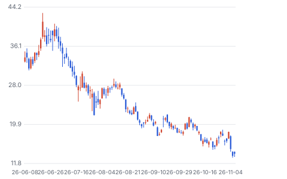

**주봉**

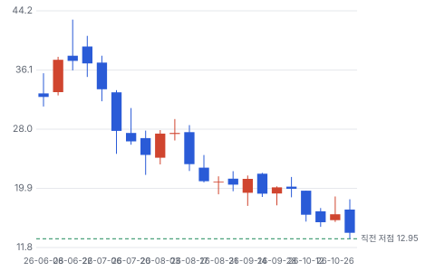

**월봉**

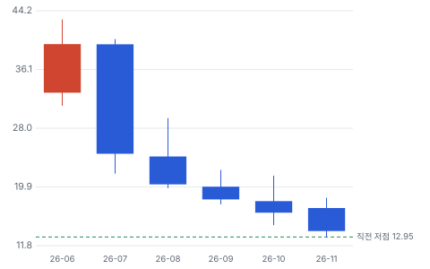

**분기 매출·EPS 실적과 컨센서스**

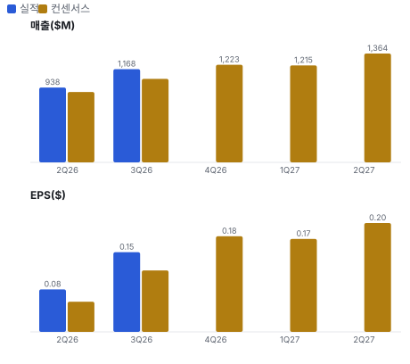

**최근 4개 분기 주가 변화 분석**

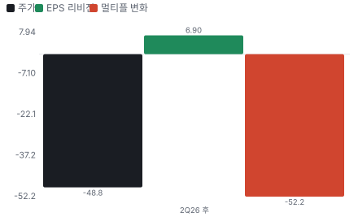

**EPS 리비전**

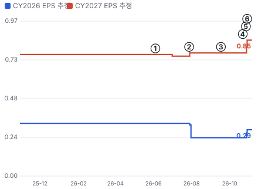

① 26-06-04 IPO \$27 · EPS 리비전 +0%
② 26-07-28 2Q26 실적, 장비 마진 14% · EPS 리비전 +2%
③ 26-09-17 Liberty 450MW 수주 · EPS 리비전 +0%
④ 26-10-22 620MW 수주, GE Vernova 급락 · EPS 리비전 +0%
⑤ 26-10-27 3Q26 실적, 가이던스 상향 · EPS 리비전 +10%
⑥ 26-10-29 Caterpillar 실적 뒤 전력주 매도 · 실적 창과 겹침

**밸류에이션 주가 시나리오**

**주가별 업사이드**

**제품·서비스 포트폴리오**

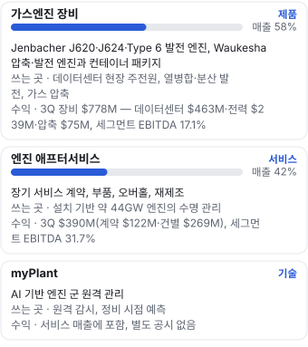

**고객 믹스(9M26, 매출 대비)**

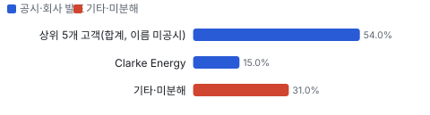

**공급 병목(10점, 낮을수록 병목)**

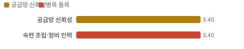

**생산능력 현재와 확충 계획(GW/년(인도 기준))**

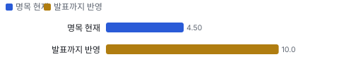

**CAPEX의 매출 대비 비중**

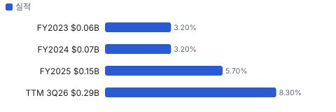

**어닝콜 변화별 주주가치 영향**

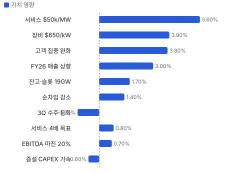

**멀티플 프리미엄(현재값 — 최근 4개 분기 추이 재료 없음)**

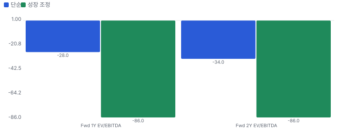

**합리적 멀티플**

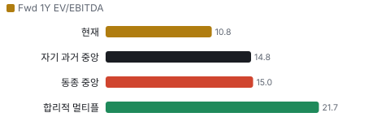

**일별 거래량 분해**

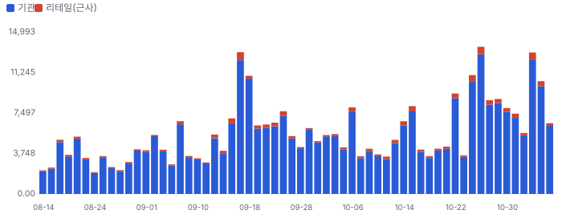

**기관 자금 흐름**

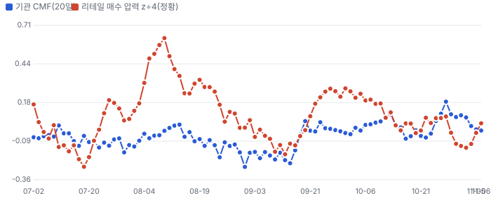

**몬테카를로**

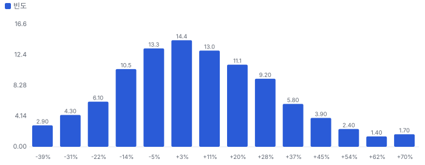

해석: 3,000번 중 1,818번(61%)에서 가치가 지금 주가 이상이었다. 가정을 흔들어도 지금 주가를 뒷받침하는 경우가 더 많다. 가운데 값은 1.06배이고, 열 번 중 여덟 번은 0.78~1.40배 사이에 든다.

**규모·마진·진척도**

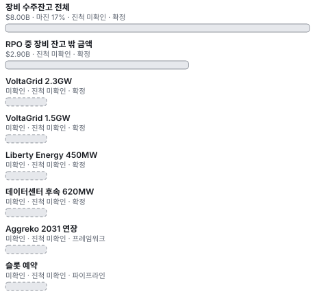

**매출 → 매출총이익 → 영업이익(매출 = 100, 최근 4분기)**

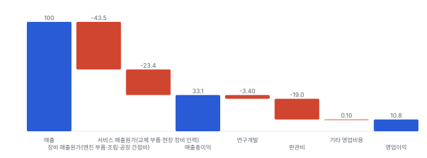

**1년 전 대비 마진 기여(비용 비중 변화의 반대)**

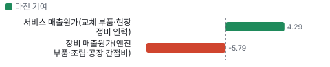

**분기 비용 비중 추이(매출 대비, 공시)**

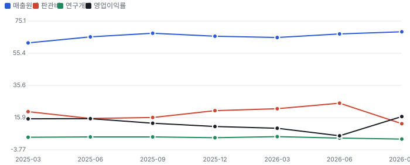

**비용 요인별 매출 대비 비중과 1년 변화**

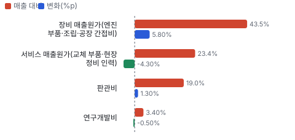

**BOM 항목 가격 +10% 시 OPM 변화**

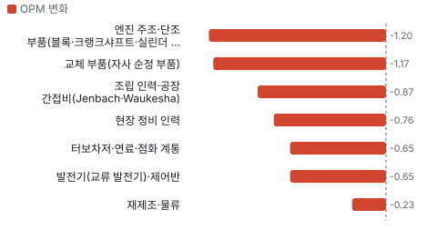

**가스엔진 장비 BOM 원가 몫과 가격 +10% 시 OPM**

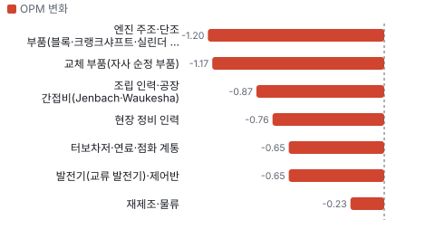

**엔진 애프터서비스 BOM 원가 몫과 가격 +10% 시 OPM**

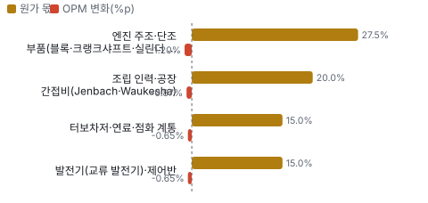

**목표주가 산정 — 약세와 기본 사이(약세 쪽 46%), 도달 확률 약 65%**

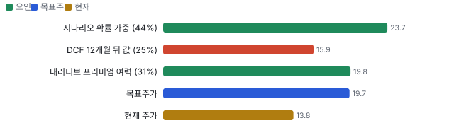

**커뮤니티 언급 수(최근 30일, 채널별)**

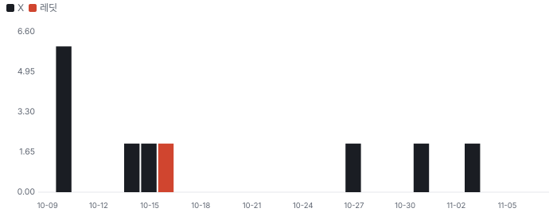

**가스엔진 장비** — Jenbacher 가스엔진(GE 소유 시절 브랜드 표기)
_사진: SteidlLu · CC BY-SA 4.0 · Wikimedia Commons_

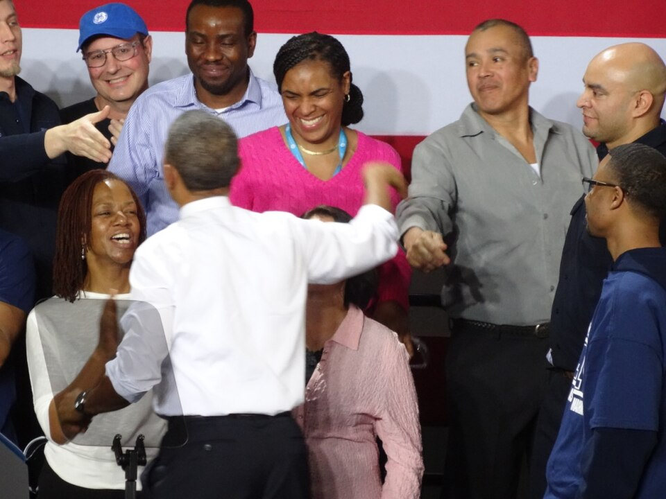
**Waukesha 공장(미국 위스콘신)** — Waukesha 가스엔진 공장 내부(2014년 방문 행사 사진)
_사진: WisPolitics.com · CC BY-SA 2.0 · Wikimedia Commons_

## 내러티브

> **기업가치를 결정하는 이야기:** 값은 두 줄이다. 장비는 GW × kW당 가격이고 3Q는 1.2GW × 약 \$650이다. 서비스는 설치 기반 × MW당 연 매출이고 44GW × \$30k에서 새 물량은 \$50k 이상으로 간다. 2028년까지 장비 이익은 잔고가 거의 정했다. 값을 가르는 것은 2029년 뒤 주문과 서비스 전환이다.

> **멀티플·EPS 프리미엄**
> **멀티플:** Fwd 1Y EV/EBITDA 10.8배로 동종 중앙값 15.0배보다 28% 낮다(11/6 종가 기준). 상장 뒤 7월 말 21배에서 10/30 12.5배, 선거 뒤 10.8배로 내려왔다. 프리미엄이 할인으로 뒤집힌 뒤 더 벌어졌다.
> **EPS:** FY2027 EPS 컨센서스는 2Q 실적 전 \$0.77에서 \$0.85로 +10%, FY2028은 \$0.99에서 \$1.10으로 +11%이고 선거 뒤 바뀌지 않았다. 제출이 2~3명뿐이라 표본이 얇다.

### 투자자들은 왜 열광했나

6월 IPO 때 \$27에 나와 3주 만에 \$42.95를 찍었다. VoltaGrid 2.3GW 수주, 전력망 접속 대기 6년 이상 숫자, 연 3.5GW → 10GW 초과 증설이 겹쳤다. 식은 순서는 이렇다. 7/28 2Q 장비 마진 14%, 9월 공매도 급증, 10/22 GE Vernova 급락, 10/29 Caterpillar 실적 뒤 동반 매도, 11/4~5 중간선거 뒤 데이터센터 반발 우려 매도다.

### 무엇이 기업가치를 바꾸나

> **구조적 체질 변화**
> **변화:** CHP(열병합 발전)·유럽 회사에서 미국 데이터센터 장비 회사로 바뀌었다
> **증거:** 데이터센터가 12개월 장비 수주의 67%. 북미 매출 비중 확대, TTM 장비 비중 58%로 +6%p
> **반증:** 데이터센터 수주가 2분기 연속 전년 대비 감소

> **고부가 믹스 확장**
> **변화:** kW당 가격과 서비스 강도가 함께 오른다. 다만 컨테이너 범위는 마진을 깎는다
> **증거:** \$/kW 3Q 약 \$650, 앞으로 \$600 이상. 장비 마진 2Q 14% → 3Q 17.1%. 서비스 강도 \$30k → \$50k 초과
> **반증:** 장비 마진 2분기 연속 15% 미만

> **기술 혁신**
> **변화:** 새 기술보다 부하 추종과 물 사용이 판매 논리다
> **증거:** Type 6(Jenbacher 6세대 엔진 계열) 물 0.1L/MWh 미만(회사 자료, 터빈 최대 200L). 회사 주장이고 독립 시험은 확인 못 했다
> **반증:** 연료전지·소형 터빈이 같은 현장에서 수주를 뺏는다

> **실행 속도**
> **변화:** 납품은 늘고 납기는 고객 대기 상태다. 3Q 1.2GW, 4Q 약 1.5GW **납품 리드타임 16~27개월.** 피어 비교 미확인. 이전 대비 미확인.
> **증거:** Liberty 450MW 2026-09 수주 → 2028 납품, VoltaGrid 1.5GW 2026-02 수주 → 2028까지. 공장 납기 월수는 회사가 공개하지 않아 수주 공시로 환산했다
> **반증:** 2027 인도 가이던스가 6GW 아래

> **M&A**
> **변화:** 규모보다 서비스 거점 인수다
> **증거:** Enerflex 아시아태평양 애프터마켓 \$61.6M, 9/30 종결. M&A 때 레버리지 2.5배 허용
> **반증:** 레버리지를 넘는 대형 인수

> **정책·입법 연관성**
> **재정정책:** 해당 없음(보조금·세액공제에 기대는 사업이 아니다. 10-Q 보조금 금액 공시 없음)
> **행정명령:** 미국 관세가 오스트리아산 엔진 원가를 건드린다. 회사는 Waukesha(INNIO의 미국 가스엔진 브랜드이자 위스콘신 공장 지역) 조립으로 현지화 중이다 10-Q 위험요인, 첫 Jenbacher(INNIO의 가스엔진 브랜드) 발전기 Waukesha 조립. 비교: Caterpillar 2026 관세 약 \$2.2B 반증: 관세 인상분을 가격에 못 넘겨 장비 마진이 내려간다 의회 동의 2/10 — 하원 1/5(행정부 조치로 관련 표결을 찾지 못했다) · 상원 1/5(같음).
> **연관입법:** 주 단위 데이터센터 규칙이 변수다. 고객 프로젝트 대부분이 텍사스다 3Q 콜 Baird 질문. 프로젝트 1건 1주 지연 뒤 해소 반증: 텍사스 인허가로 주문 지연·취소 공시

> **CAPEX 낙수효과**
> **변화:** 하이퍼스케일러 투자가 VoltaGrid·Liberty·Aggreko 같은 중간 공급자를 거쳐 온다
> **증거:** 3Q 620MW 후속, Liberty 450MW, Aggreko 2031 연장. 회사는 네오클라우드 무배정이라 밝혔다. 최종 고객명은 비공개
> **반증:** 중간 공급자의 자금 조달 실패, 하이퍼스케일러 CAPEX 가이던스 하향

### 내러티브 근거

> '데이터센터 현장 가스엔진'이 상장 프리미엄을 만들었지만 2Q 뒤 FY2027 EPS 추정 +10%에도 주가는 −39.5%다. 지금은 AI 전력주 전체의 수요 지속 의심과 11/30 보호예수 해제가 값을 누른다. 동종 대비 멀티플 차이 -28% 중 회사 고유 몫은 -50%다. 단계는 소멸, 쏠림은 낮음이다.

> **데이터센터 현장 발전(전력망 접속 대기)** · 유지
> **논리:** 전력망 접속을 기다리는 데이터센터가 현장 가스엔진으로 전력을 직접 확보한다
> **숫자:** 장비 잔고 \$8.0B, 잔고+슬롯 약 19GW, RPO \$10.9B
> **반증:** 4Q 수주 12개월 B/B 2.0 미만(2027-02)

> **2028년 이후 주문 절벽(약세)** · 강화
> **논리:** 현장 발전은 전력망이 따라잡기 전까지의 다리일 뿐이라 주문이 꺾인다
> **숫자:** 2Q 뒤 FY2027 EPS 추정 +10%, 주가 −39.5%
> **반증:** 2029~31 슬롯의 주문 전환 공시

> **설치 기반 서비스** · 유지
> **논리:** 신규 설치분이 MW당 연 \$50K 이상의 서비스 매출을 만든다
> **숫자:** 서비스 강도 MW당 연 \$50K 이상(경영진 발언, 확신도 0.5)
> **반증:** 서비스 마진 하락, 고객 자체 정비 확대

> **보호예수 해제와 지배주주 매각(약세)** · 강화
> **논리:** 11/30 뒤 Advent·ADIA(아부다비 투자청) 물량이 시장에 나온다
> **숫자:** 매도 가능 6.47억 주 = 유통주식 1.04억 주의 6.2배, 시가 \$10.5B
> **반증:** 블록 매각이 할인 5% 안에서 소화되거나 주주가 추가 보호예수를 약속

## 포트폴리오

| 제품·서비스 | 구분 | 무엇 | 쓰는 곳 | 돈 버는 방식 | Mix | Mix 변화(전년 대비) |
|---|---|---|---|---|---|---|
| 가스엔진 장비 | 제품 | Jenbacher J620(Jenbacher 20기통 가스엔진)·J624(Jenbacher 24기통 가스엔진)·Type 6 발전 엔진, Waukesha 압축·발전 엔진과 컨테이너 패키지 | 데이터센터 현장 주전원, 열병합·분산 발전, 가스 압축 | 3Q 장비 \$778M — 데이터센터 \$463M·전력 \$239M·압축 \$75M, 세그먼트 EBITDA 17.1% | 67% | +10.4%p |
| 엔진 애프터서비스 | 서비스 | 장기 서비스 계약, 부품, 오버홀, 재제조 | 설치 기반 약 44GW 엔진의 수명 관리 | 3Q \$390M(계약 \$122M·건별 \$269M), 세그먼트 EBITDA 31.7% | 33% | -10.4%p |
| myPlant(INNIO의 엔진 군 원격 관리 플랫폼) | 기술 | AI 기반 엔진 군 원격 관리 | 원격 감시, 정비 시점 예측 | 서비스 매출에 포함, 별도 공시 없음 | 미확인 | 미확인 |

**Mix 변화가 가장 큰 쪽은 가스엔진 장비(+10.4%p, 전년 대비).** 계절성 판정: 분기 매출 계절 지수 기준 있음 → 전년 같은 분기와 비교.

## 고객

> **9M26 최대 고객 상위 5개 고객(합계, 이름 미공시) 54%, 상위 3곳 69%, 집중도 집중.** 공시·회사 발표로 확인한 몫은 매출의 69%이고, 나머지 고객 몫은 추정이거나 미분해다. 상위 5개 고객이 9개월 매출의 54%다(2025년 34%, 2024년 27%). 이름은 공시되지 않는다. 유통사 Clarke Energy가 2025년 매출의 15%, VoltaGrid가 2025년 장비 수주의 41%였다

**고객별 매출 몫(9M26)**
| 고객 | 몫 | 변화 | 근거 |
|---|---|---|---|
| 상위 5개 고객(합계, 이름 미공시) | 54% | +20%p | 공시 |
| Clarke Energy | 15% | 미확인 | 공시 |
| VoltaGrid | 미확인 | 미확인 | 공시 |
| 기타·미분해 | 31% | - | - |

> **상위 5개 고객(합계, 이름 미공시)** · 공시
> **사는 것:** 데이터센터·전력용 가스엔진
> **추정 근거:** 개별 고객 몫은 공시되지 않는다

> **Clarke Energy** · 공시
> **사는 것:** Jenbacher 엔진(유통·시공, 간접 판매)
> **추정 근거:** 2025년 값이다. 유통사라 최종 고객은 그 뒤에 있다

> **VoltaGrid** · 공시
> **사는 것:** 데이터센터 현장 발전용 J620 엔진
> **추정 근거:** 수주 비중이며 매출 비중은 공시되지 않는다

## 수주·파이프라인

> **2026-09-30 기준 8건.** 확정 \$10.90B. 공시 장비 수주잔고 \$8.00B. 서로 겹치는 항목은 합계에서 뺐다.

**실행 속도와 방해 요인**
| 항목 | 상태 | 실행 속도 | 방해 요인 |
|---|---|---|---|
| 장비 수주잔고 전체 | 확정 | 3Q 1.2GW, 4Q 약 1.5GW 전망 | Jenbach 라인 증설 · 숙련 인력 · 부품 공급 |
| RPO 중 장비 잔고 밖 금액 | 확정 | RPO \$10.9B 중 71%가 24개월 안 인식, 구성은 차이로 추정 | 서비스 계약 착수 시점 |
| VoltaGrid 2.3GW | 확정 | 2025-10 수주, 잔고에 포함 | VoltaGrid 자금 조달 · 현장 인허가 |
| VoltaGrid 1.5GW | 확정 | 2026-02 수주, 2028까지 납품 | 엔진 300대 생산 슬롯 |
| Liberty Energy 450MW | 확정 | 2028 납품 | Liberty의 고객 계약 |
| 데이터센터 후속 620MW | 확정 | 3Q 전후 수주, 서비스 계약 500MW 동반 | 개발사 일정 |
| Aggreko 2031 연장 | 프레임워크 | 2027년 말까지 최소 450MW 주문·납품 | 개별 발주 |
| 슬롯 예약 | 파이프라인 | 회사 설명: 6~18개월 뒤 주문 전환, 2029~31 슬롯 서명 | 고객 프로젝트 일정 · 회사 슬롯 금액 미공개 |

## 마진 구조

> **GPM 33.1%, OPM 10.8%.** FY2025 대비 GPM -1.5%p, OPM -2.3%p. TTM 매출원가는 매출의 66.9%로 FY2025 65.4%보다 1.5%p 올랐다. 장비 비중이 커진 믹스 탓이다 — 장비 매출총이익률은 25.5%, 서비스는 43.7%다. 판관비는 17.7%에서 19.0%로 올랐는데 2Q26 판관비 \$232.2M(1Q \$143.0M, 3Q \$142.6M)이 튄 몫이 크고, 일회성 여부는 미확인이다

> **매출 100 중 매출원가 66.9, 매출총이익 33.1(최근 4분기, 공시).** 매출원가 요인 중 장비 매출원가(엔진 부품·조립·공장 간접비)이 매출의 43.5%로 가장 무겁고, 단가가 +10% 오르면 GPM이 -4.35%p 움직인다.

**비용 요인 강도 — 비중·추세·충격(+10%)·탄력**
| 비용 | 구분 | 매출 대비 | 1년 변화 | 마진 기여 | 충격 시 마진 | 매출 탄력 | 고정비 몫 |
|---|---|---|---|---|---|---|---|
| 장비 매출원가(엔진 부품·조립·공장 간접비) | 매출원가 요인 | 43.5% | +5.8%p | -5.8%p | -4.35%p | 미확인 | 미확인 |
| 서비스 매출원가(교체 부품·현장 정비 인력) | 매출원가 요인 | 23.4% | -4.3%p | +4.3%p | -2.34%p | 미확인 | 미확인 |
| 매출원가 | 공시 항목 | 66.9% | 미확인 | 미확인 | -6.69%p | 미확인 | 미확인 |
| 판관비 | 공시 항목 | 19.0% | 미확인 | 미확인 | 미확인 | 미확인 | 미확인 |
| 연구개발 | 공시 항목 | 3.4% | 미확인 | 미확인 | 미확인 | 미확인 | 미확인 |
| 기타 영업비용 | 공시 항목 | -0.1% | 미확인 | 미확인 | 미확인 | 미확인 | 미확인 |

매출 탄력 = 분기 비용을 매출에 회귀한 기울기(매출 1당 변동비), 고정비 몫 = 절편 ÷ 평균 비용. 표본이 8분기 미만이면 미확인. 매출원가 요인 비중은 margin 재료의 추정이 섞여 있고, 공시 매출원가와의 차이는 '기타 매출원가'로 둔다.

**GPM에서 OPM까지(GAAP)**
| 기간 | GPM | 연구개발 | 판관비 | 기타 | OPM |
|---|---|---|---|---|---|
| FY2025 | 34.6% | 3.9% | 17.7% | -0.2% | 13.1% |
| TTM 3Q26 | 33.1% | 3.4% | 19.0% | -0.1% | 10.8% |

**GPM·OPM 최근 4개 분기**
| 분기 | GPM | OPM |
|---|---|---|
| 2025-12 | 34.2% | 10.5% |
| 2026-03 | 35.0% | 9.4% |
| 2026-06 | 32.8% | 4.8% |
| 2026-09 | 31.5% | 16.6% |

**마진을 결정하는 비용 요인 — 비용 +10% 시 OPM**
| 비용 | 매출 대비 | 변화 | 고정비 | OPM |
|---|---|---|---|---|
| 장비 매출원가(엔진 부품·조립·공장 간접비) | 43.5% | +5.8%p | 미확인 | -4.35%p |
| 서비스 매출원가(교체 부품·현장 정비 인력) | 23.4% | -4.3%p | 미확인 | -2.34%p |
| 판관비 | 19.0% | +1.3%p | 70% | -1.90%p |
| 연구개발비 | 3.4% | -0.5%p | 90% | -0.34%p |

**비용을 움직이는 요인**
| 비용 | 요인 |
|---|---|
| 장비 매출원가(엔진 부품·조립·공장 간접비, 매출원가) | 장비 비중 확대(데이터센터)·컨테이너 패키지 범위 · 근거 공시 |
| 서비스 매출원가(교체 부품·현장 정비 인력, 매출원가) | 설치 기반 정비 물량 · 근거 공시 |
| 판관비(판관비) | 상장 회사 비용·인력 확대, 2Q26 급증분 미확인 · 근거 공시 |
| 연구개발비(연구개발) | Type 6·수소 혼소 엔진 개발 · 근거 공시 |

**가스엔진 장비 BOM — 매출의 58%, GPM 26%(TTM 장비 매출 \$2,053.0M − 장비 매출원가 \$1,529.2M(10-Q·). rev_share는 TTM 장비 ÷ 총매출), 항목 가격 +10% 시**
| 항목 | 원가 몫 | 전가 | 제품 GPM | OPM |
|---|---|---|---|---|
| 엔진 주조·단조 부품(블록·크랭크샤프트·실린더 헤드) | 20~35% | 미확인 | -2.0%p | -1.20%p |
| 조립 인력·공장 간접비(Jenbach·Waukesha) | 15~25% | 미확인 | -1.5%p | -0.87%p |
| 터보차저·연료·점화 계통 | 10~20% | 미확인 | -1.1%p | -0.65%p |
| 발전기(교류 발전기)·제어반 | 10~20% | 미확인 | -1.1%p | -0.65%p |
| 미분해 | 22% | - | - | - |

**엔진 애프터서비스 BOM — 매출의 42%, GPM 44%(TTM 서비스 매출 \$1,461.8M − 서비스 매출원가 \$822.8M(10-Q·)), 항목 가격 +10% 시**
| 항목 | 원가 몫 | 전가 | 제품 GPM | OPM |
|---|---|---|---|---|
| 교체 부품(자사 순정 부품) | 40~60% | 미확인 | -2.8%p | -1.17%p |
| 현장 정비 인력 | 25~40% | 미확인 | -1.8%p | -0.76%p |
| 재제조·물류 | 5~15% | 미확인 | -0.6%p | -0.23%p |
| 미분해 | 7% | - | - | - |

엔진 주조·단조 부품(블록·크랭크샤프트·실린더 헤드) 가격이 +10% 오르면 영업이익은 -11.1% 움직인다. 판매가 전가를 모르는 항목은 전가 0%로 계산했다.

**BOM 항목 가격을 움직이는 것**
| 항목 | 요인 |
|---|---|
| 엔진 주조·단조 부품(블록·크랭크샤프트·실린더 헤드) | 가장 무겁고 납기가 긴 부품 · 근거 추정 |
| 터보차저·연료·점화 계통 | 출력·효율을 정하는 핵심 보기류 · 근거 추정 |
| 발전기(교류 발전기)·제어반 | 발전 패키지에 들어가는 전기 부품, 구리 가격에 민감 · 근거 추정 |
| 조립 인력·공장 간접비(Jenbach·Waukesha) | 증설기에는 고정비 흡수가 마진을 좌우한다 · 근거 추정 |
| 교체 부품(자사 순정 부품) | 부품 판매가 서비스 이익의 중심 · 근거 추정 |
| 현장 정비 인력 | 장기 계약은 인력 단가 상승 위험을 회사가 진다 · 근거 추정 |
| 재제조·물류 | 오버홀 엔진 왕복 물류 · 근거 추정 |

**BOM 투입 물가 — PPI 전년비, 2026-11-07 수집**
| 항목 | 미국 | 일본 | 한국 | 대만 |
|---|---|---|---|---|
| 발전기(교류 발전기)·제어반 | +30.0% | +54.2% | -4.9% | +40.1% |

별표는 품목보다 넓은 업종 지수다. 지난 1년 투입 물가를 판매가 전가 뒤 원가에 그대로 넣으면 OPM은 -2.03%p 움직인다(매출원가의 10% 기준).

## 공급망 병목

> **공급망 신뢰성 3.4/10, 병목 심각.** 가장 약한 고리는 숙련 조립·정비 인력 3.4점이고, 품목 평균은 3.4점이다. 근거가 부족한 3건(엔진 주조·단조 부품(블록·크랭크샤프트·실린더 헤드) · 터보차저·연료·점화 계통 · 발전기(교류 발전기)·제어반)은 점수에서 뺐다. 병목은 회사 공장의 증설 속도와 대형 주조·단조 부품이다. 회사는 2026년 약 4.5GW 인도에서 2030년 10GW 초과로 캐파를 늘린다고 했고, 3Q 콜은 위험 요인으로 부품 공급을 꼽았다. 공급사 이름·몫은 10-Q에 없다 — 아래 공급사 칸은 대부분 미공시·추정이다

**병목과 마진 — 품목 가격 +10% 시 OPM**
| 품목 | 점수 | 판정 | 구분 | OPM |
|---|---|---|---|---|
| 숙련 조립·정비 인력(필수) | 3.4 | 병목 심각 | 출하 차질 위험 | 미확인 |

> **숙련 조립·정비 인력** · 3.4/10
> **왜:** 증설 캐파를 실제 인도로 바꾸는 것은 사람이다
> **병목 요인:** 인증 공급사 1곳 · 캐파 빠듯 · 리드타임 미확인 · 재인증 미확인 · 1위 점유율 100% · 지역 집중 미확인 · 물량 확보 내재화
> **풀리는 조건:** 미확인 — 채용은 의도이지 실행이 아니다

**공급사**
| 품목 | 공급사 | 몫 | 근거 |
|---|---|---|---|
| 엔진 주조·단조 부품(블록·크랭크샤프트·실린더 헤드) | 외부 주조·단조 공급사(미공시, 주요 구조 부품) | 미확인 | 추정 |
| 터보차저·연료·점화 계통 | 외부 보기류 공급사(미공시, 터보차저·점화) | 미확인 | 추정 |
| 발전기(교류 발전기)·제어반 | 외부 발전기 제조사(미공시, 발전 패키지 전기 부품) | 미확인 | 추정 |
| 숙련 조립·정비 인력 | 자체 직원 약 5,600명(조립·서비스) | 미확인 | 공시 |

**무역 통계로 본 공급 지역**
| 품목 | EU 수입처 | 일본 수입처 | EU 1위 전년비 |
|---|---|---|---|
| 발전기(교류 발전기)·제어반 | MY(말레이시아) 69% · KR(한국) 10% · US 7% | マレーシア 58% · タイ 36% | 미확인 |

## 생산능력

> **현재 명목 캐파 4 GW/년(인도 기준), 가동률 미확인.** 착공 이상 증설은 0 GW/년(인도 기준), 발표까지 합치면 6 GW/년(인도 기준)이다. 다 가동하면 지금보다 +122%, 착공 이상만이면 +0%다. TTM 3Q26 CAPEX는 \$0.29B로 매출의 8.3%다. 회사는 명목 캐파를 따로 밝히지 않는다. 2026년 인도 계획 약 4.5GW를 지금 캐파로 보고, 2030년 10GW 초과가 목표다(3Q 콜). CAPEX는 FY2024 매출의 3.2%에서 FY2025 5.7%, TTM 8.3%로 올랐다. 유형자산 약정은 \$368.7M이다(10-Q)

**생산능력 확충 계획**
| 계획 | 단계 | 증설 | 가동 시점 | CAPEX |
|---|---|---|---|---|
| Jenbach·Waukesha 증설(2030년 10GW 초과 목표) | 발표 | 6 GW/년(인도 기준) | 2030 | 미확인 |
| Waukesha 공장 확장(\$300M·500명) | 발표 | 미확인 | 미확인 | \$0.30B |

남은 계획의 CAPEX 합계는 \$0.30B(금액 미확인 1건 제외)다. 합계는 TTM 3Q26 매출의 9%다.

**증설 방해 요인**
| 계획 | 방해 요인 |
|---|---|
| Jenbach·Waukesha 증설(2030년 10GW 초과 목표) | 부품 공급·숙련 인력·공장 건설 |
| Waukesha 공장 확장(\$300M·500명) | 건설·채용 |

**CAPEX와 매출 대비**
| 기간 | CAPEX | 매출 | 매출 대비 | 구분 |
|---|---|---|---|---|
| FY2023 | \$0.06B | \$2.02B | 3.2% | 실적 |
| FY2024 | \$0.07B | \$2.16B | 3.2% | 실적 |
| FY2025 | \$0.15B | \$2.64B | 5.7% | 실적 |
| TTM 3Q26 | \$0.29B | \$3.51B | 8.3% | 실적 |

## 해자

> 해자는 설치 기반 서비스다. 슬롯은 공급 부족이 끝나면 시험받고, 기술 우위는 경쟁이 있다.

> **설치 기반 서비스** · 강함
> **해자:** 엔진을 판 뒤 수명 내내 부품과 오버홀을 맡는다
> **근거:** 3Q 콜: 설치 기반 약 44GW, TTM 서비스 \$1.5B, 엔진 1대 수명 서비스 EBITDA는 장비 EBITDA의 약 2.5배. 고객 계약 10~15년
> **숫자:** 서비스 EBITDA 마진 약 32%, 장비 17.1%
> **깨지는 조건:** 고객이 인건 범위 외 부품까지 자체 조달, 서비스 마진 하락

> **슬롯과 take-or-pay 계약** · 보통
> **해자:** 취소 불가 슬롯과 선금으로 2029~31 수요를 묶는다
> **근거:** 3Q 콜: 잔고+슬롯 약 19GW, 슬롯 취소·양도 불가, 주문 대부분 take-or-pay. 10-Q RPO \$10.9B, 71%가 24개월 안
> **숫자:** 19GW ÷ 2030 연 캐파 10GW = 약 1.9년 치, 지금 캐파 기준 약 5.4년 치
> **깨지는 조건:** 슬롯이 6~18개월 안에 주문으로 안 바뀌거나 위약금 소송이 난다

> **왕복동 가스엔진 기술** · 보통
> **해자:** 부분부하 효율, 빠른 부하 추종, 모듈 증설로 터빈·연료전지 틈을 잡는다
> **근거:** 회사 자료 기준이고 비교 시험은 미확인. 왕복동 경쟁자는 Caterpillar, Wärtsilä, Rolls-Royce, Cummins
> **숫자:** Caterpillar 3Q Power Generation 매출 +30%
> **깨지는 조건:** Caterpillar·Wärtsilä 증설 뒤 kW당 가격이 \$600 아래로

> **고객 선수금 자금 구조** · 약함
> **해자:** 증설 자금을 고객이 댄다. 수주가 꺾이면 반대로 작동한다
> **근거:** 10-Q 9개월 영업현금 \$741.5M 중 계약부채 증가가 \$797.0M
> **숫자:** 계약부채 증가를 빼면 영업현금 −\$55.5M
> **깨지는 조건:** 수주 둔화로 계약부채가 감소

## 경영진·네트워크

> 창업자 없는 사모펀드 분사 회사다. Advent가 사실상 지배하고, 의장은 전 Cummins CEO, 이사에 전 Vantage COO가 있다. 공개 자료로 확인한 정치 연결은 없다.

> **Olaf Berlien** · CEO·사장 · 2021-10
> **프로필:** Osram CEO(2015~2021), Exyte CEO, ThyssenKrupp 임원(2002~2013) 출신. 독일 대형 산업재 경력
> **비즈니스:** 독일 산업재 경영진 네트워크
> **정계:** 미확인
> **동문:** 베를린공대 경영·경제 박사
> **사모임:** 미확인

> **Dennis Schulze** · CFO·M&A 총괄 · 2019-04
> **프로필:** H.C. Starck 그룹 CFO 출신. 사모펀드 소유 회사 재무 경력
> **비즈니스:** 사모펀드 포트폴리오 재무
> **정계:** 미확인
> **동문:** 미확인
> **사모임:** 미확인

> **Tom Linebarger** · 이사회 의장 · 2026(상장)
> **프로필:** Cummins CEO(2012~2022), 회장(~2023). Republic Services 이사. IPO에서 \$2.5M 장내 매수
> **비즈니스:** 왕복동 엔진 업계 최고경영자 경력
> **정계:** 미확인
> **동문:** 미확인
> **사모임:** 미확인

**네트워크 정량화**
| 연결 | 강도 | 닿는 매출 | 가중 노출 | 매출 대비 | 근거 |
|---|---|---|---|---|---|
| 비즈니스: Advent — 지분 지배, 이사 3석(Sen·Chauhan·Thuerbach) | 5/5 | \$3.52B | \$3.51B | 100% | 회사 전체 TTM 매출 투자설명서: Advent가 AI Alpine Parent 지분 53.8%, 주요 주주 지분 86.2% |
| 비즈니스: 이사 Chris Yetman(전 Vantage COO) — 데이터센터 고객층 | 2/5 | 미확인 | 미확인 | 미확인 | Vantage 관련 INNIO 매출 공시 없음 투자설명서. Vantage는 VoltaGrid 고객이라는 보도가 있다 |
| 정계: 정부·의회 직책 연결 | 0/5 | 미확인 | 미확인 | 미확인 | 투자설명서에서 찾지 못했다. 로비 공시는 이번 회차에 확인하지 못했다 2026-06 투자설명서 |

가중 노출은 연결이 닿는 매출의 크기다. 연결이 그 매출을 만들었다는 뜻이 아니며, 인과는 공개 자료로 입증하지 못한다.

## 약세 논리 및 셀온 조건

| 약세 논리 | 근거 | 반박 | 가를 자료 |
|---|---|---|---|
| 지배주주 물량이 값을 누른다 | 10-Q: 주요 주주 6.465억 주, 유통 약 1.035억 주의 6.2배. Advent는 상장 때 \$25.99에 약 \$2.7B를 이미 팔았다(Form 4) | 해제와 매각은 다르다. 공모가 \$27의 절반 아래에서 팔지는 미확인. 공매도 잔고가 유통의 약 21%라 물량을 받을 수 있다 | 블록 매각 공시·할인 폭(2026-12) |
| 선거 뒤 데이터센터 반발이 수주로 번진다 | 11/4 지방 데이터센터 제한 우려 보도, INNIO 이틀 −27%. 데이터센터가 3Q 장비 매출의 60% | 주문 대부분 take-or-pay·선금, 슬롯 취소 불가(콜). 중간선거 정책 채널 +0.3/10 | 4Q 수주 구성과 취소·연기 공시(2027-02경) |
| 2028년 이후 주문 절벽 | 3Q 수주 \$2.2B로 감소. 전력망 접속이 풀리면 현장 발전 수요가 준다 | CEO는 2029~31 대화 중이라 했다. 서비스는 전력망 연결 뒤에도 이어진다고 회사가 주장 | 슬롯의 주문 전환(2027 상반기) |
| 고객과 자금이 몇 곳에 몰렸다 | 9개월 상위 5개 고객 매출 54%(2025 34%). VoltaGrid가 2025 장비 수주의 41% | 회사는 단기 최대 고객 수주 비중을 약 21%로 전망, 네오클라우드 배정 없음 | FY2026 10-K 고객 집중 공시(2027-02~03) |
| 현금이 선수금이다 | 9개월 영업현금 \$741.5M, 계약부채 증가 \$797.0M. 빼면 −\$55.5M | 납품이 늘면 잔액은 매출로 바뀐다. 순레버리지 3.6배 → 2.1배 | 4Q 계약부채 증감(2027-02경) |
| 경쟁 증설 | Caterpillar 3Q Power Generation 매출 +30%. Wärtsilä도 데이터센터 엔진을 판다 | 회사 슬롯은 2029~31까지 서명. 3Q kW당 약 \$648(장비 매출 ÷ 인도 GW) | 동종 증설 발표, kW당 가격(4Q) |
| 통제·법률 위험 | 10-Q: 내부통제 중대한 취약점 미해소. 텀론 전액 2028-11 만기 | 10-Q는 중대한 소송이 없다고 적었다. 신용등급은 9월에 올랐다 | FY2026 10-K 내부통제 보고(2027-02~03) |

> **셀온 조건**
> **조건 1:** 4Q 12개월 수주/매출이 2.0 미만이고 장비 잔고가 줄어든다
> **조건 2:** 데이터센터 고객의 수주 취소·연기가 공시된다
> **조건 3:** 장비 마진이 2분기 연속 15% 미만이다
> **조건 4:** kW당 가격이 \$600 아래로 내려가거나 Caterpillar·Wärtsilä의 큰 증설이 나온다
> **조건 5:** 주요 주주가 큰 할인으로 매각한다

## 어닝콜 변화

**직전 콜 대비 새로 나오거나 바뀐 내용 → 가치 영향**
| 항목 | 내용 | 직전 콜 | 최신 콜 | 모델 동인 이동 | 확신도 | 가치 영향 |
|---|---|---|---|---|---|---|
| 업데이트 | FY26 매출 가이던스 상향 | \$3.8~3.9B | \$3.9~4.0B | 기준연도 매출 +\$0.10B | 0.8 | +3.0% |
| 업데이트 | 그룹 조정 EBITDA 마진 가이던스 | 약 19% | 약 20%(장비 3Q 17.1% 조기 도달) | 출발 이익률 +1.0% | 0.8 | +0.7% |
| 신규 | 장비 \$/kW 공개·1H27 매출 추정 상향 | 수치 없음 | 3Q 약 \$650/kW, 앞으로 600 이상 | 1년차 성장률 +3.0% | 0.7 | +3.9% |
| 업데이트 | 수주잔고·슬롯 | \$6.6B·15GW+·2030까지 | \$8.0B·약 19GW·2031까지 | 성장 지속(감속 계수) +3.0% | 0.6 | +1.7% |
| 신규 | 신규 설치분 서비스 강도 | 상당히 높다(수치 없음) | >\$50k/MW/년(기존 약 \$30k) | 장기 이익률 +1.0% | 0.5 | +5.6% |
| 신규 | 서비스 EBITDA 장기 목표 | 2.5배 유지 또는 개선 | 2030년대 중반 4배 | 목표 이익률 +0.50% | 0.4 | +0.8% |
| 신규 | 최대 고객 수주 비중 공개 | 과다 아님(수치 없음) | 수주 비중 2024 20%·2025 41% → 단기 전망 약 21%, 네오클라우드 무배정 | 할인율(WACC) -0.25% | 0.4 | +3.8% |
| 업데이트 | 순차입 감소 | \$1.69B(2Q, 리스 포함) | \$1.54B(3Q, 리스 포함) | 순차입 -\$0.15B | 1.0 | +1.4% |
| 신규 | 증설 CAPEX 가속 | 상반기 \$94M | 3Q \$93M(9개월 187) | 매출÷투하자본 -10.0% | 0.8 | -0.6% |
| 부정 | 3Q 수주 둔화 | 2Q \$2.3B, B/B 4.4 | 3Q \$2.2B(전력 546→265·압축 281→\$116M), B/B 3.3 | 성장 지속(감속 계수) -2.0% | 0.3 | -1.2% |
| 반복 | 취소·지연 없음, 서비스 고한자릿수 성장 | 같음 | 같음 | — — | 1.0 | +0.0% |
| **합계** | 단독 합 |  |  | 동시 적용 +21.2% |  | **+19.2%** |

**사건별 EPS 리비전**
| # | 날짜 | 구분 | 사건 | CY2026 EPS 전→후 | CY2027 EPS 전→후 | 리비전 | 주가 반응 |
|---|---|---|---|---|---|---|---|
| ① | 26-06-04 | 내러티브 | IPO \$27 | \$0.33 → \$0.33 | \$0.76 → \$0.76 | +0.0% | - |
| ② | 26-07-28 | 실적 | 2Q26 실적, 장비 마진 14% | \$0.33 → \$0.24 | \$0.75 → \$0.77 | +2.2% | -2.6% |
| ③ | 26-09-17 | 내러티브 | Liberty 450MW 수주 | \$0.24 → \$0.24 | \$0.77 → \$0.77 | +0.0% | +12.0% |
| ④ | 26-10-22 | 내러티브 | 620MW 수주, GE Vernova 급락 | \$0.24 → \$0.24 | \$0.77 → \$0.77 | +0.0% | -10.4% |
| ⑤ | 26-10-27 | 실적 | 3Q26 실적, 가이던스 상향 | \$0.24 → \$0.29 | \$0.77 → \$0.85 | +10.0% | +2.1% |
| ⑥ | 26-10-29 | 내러티브 | Caterpillar 실적 뒤 전력주 매도 | \$0.27 → \$0.29 | \$0.81 → \$0.85 | 실적 창과 겹침 | -4.5% |

**해석:** 1개 구간 누적 주가 -49% = EPS 리비전 +7% × 멀티플 -52%. 더 크게 움직인 쪽은 **멀티플**이다.

## P·Q 사이클

> **가격·물량을 나눌 표본이 부족하다(전년 대비 3분기).** 가격 근거(회사 공시 ASP)의 이력이 쌓이면 다시 잰다.

## 밸류에이션

> **목표주가 \$20, 업사이드 +43%.** 자리는 약세와 기본 사이(약세 쪽 46%)이고 도달 확률은 약 65%다. 기본 \$24, 강세 \$34(+149%), 약세 \$15(+9%). DCF 기준 업사이드는 기본 +4%, 강세 +24%, 약세 -10%다(WACC 9.9%).

기준 멀티플이 Fwd 1Y라 EBITDA도 같은 기간을 쓴다. 조정 EBITDA 기준이고 시나리오 EBITDA는 11/2 판과 같다 — 선거 뒤 추정 변경이 없기 때문이다. 배수는 동종 중앙 15.0배에서 출발해 펀더멘털 +20%·해자 +6%·반복 매출 +8%·수주 가시성 +3%·내러티브 −10%·판단 −10%를 더한 17.5배다.

세 시나리오 모두 배수가 지금 10.8배에서 오른다고 본다(약세도 13.1배). 그래서 약세 \$15가 현재가 위에 있고 손익비가 계산되지 않았다. 배수가 10.8배에 머물면 약세 EBITDA에서 약 \$12, 기본에서 약 \$14다(Chiip 계산, 순차입 \$1.62B·완전 희석 0.752B주). 등급을 Neutral로 두는 이유가 이 차이다 — 상승 여력은 이익이 아니라 배수 복귀에 걸려 있다.

DCF 기본은 현재가보다 4% 높고(WACC 9.9%), 3,000번 돌린 DCF 가치 분포의 61%가 현재가 이상이다. 시나리오와 DCF가 갈리는 이유는 기간이다 — 시나리오는 동종 멀티플을, DCF는 FY2028 뒤 빠른 성장 감속을 쓴다. 12개월 뒤 시장이 다음 해 이익(4Q27~3Q28 매출 추정 \$5.93B × FY2027 마진 22.5% ≈ \$1.33B)을 본다면 17.5배에서 주당 약 \$29다(추정). 애널리스트 평균 목표가는 시장 기대의 증거로만 본다.

> **약세 \$15 (+9%)** · 확률 30%
> **가정:** 13.1배 × EBITDA \$0.98B
> **근거:** 수주가 꺾이고 데이터센터 반발로 추정이 내려간다. 다음 4개 분기 EBITDA 컨센서스 \$1.11B보다 약 12% 낮다

> **기본 \$24 (+72%)** · 확률 45%
> **가정:** 17.5배 × EBITDA \$1.11B
> **근거:** 다음 4개 분기 EBITDA 컨센서스 \$1.11B대로 간다. 애널리스트 2명 값이다

> **강세 \$34 (+149%)** · 확률 25%
> **가정:** 21.9배 × EBITDA \$1.25B
> **근거:** 3Q처럼 추정을 넘고 장비 마진 18%대, 슬롯이 주문으로 바뀐다

**멀티플 선정 — Fwd 1Y EV/EBITDA**
| 단계 | 조정 | 근거 |
|---|---|---|
| 동종 중앙값 | 15.0배 | 범위 10.0~39.6배, 5곳 |
| 펀더멘털 | +20% | 성장·이익률·ROIC로 본 합리적 멀티플 21.7배와의 차이의 일부만 인정 |
| 해자 | +6% | 설치 기반 서비스 강함 · 슬롯과 take-or-pay 계약 보통 · 왕복동 가스엔진 기술 보통 · 고객 선수금 자금 구조 약함 |
| 반복 매출 | +8% | 반복 매출 42%(동종 20%) · 서비스 계약·부품·오버홀(설치 기반 엔진) · 이미 반복 단계 · 기반 설치 기반 약 44GW(3Q26 콜) |
| 수주 전환·가시성 | +3% | book-to-bill 1.00 · RPO·ACV(연간 계약 가치) 성장 − 매출 성장 1.00 → 가시성 1.00 · 전환 37.2개월(동종 12) |
| 내러티브 | -10% | 단계 소멸 |
| 사이클·실행 판단 | -10% | 상위 5개 고객이 9개월 매출의 54%이고 중간 공급자 비중이 높으며, 재무보고 내부통제의 중대한 취약점이 남아 동종 수준 배수를 다 주지 않는다 |
| **선정** | **17.5배** | 지금 10.8배 |

**동종 레인지**
| 회사 | Fwd 1Y EV/EBITDA | Fwd 2Y EV/EBITDA | 성장 | 영업이익률 | ROIC |
|---|---|---|---|---|---|
| CAT | 15.0 | 13.7 | 9% | 20% | 23% |
| CMI | 10.0 | 9.0 | 11% | 12% | 18% |
| GEV | 23.6 | 19.3 | 19% | 12% | - |
| BE | 39.6 | 29.1 | 59% | 24% | 31% |
| WRT1V(핀란드 Wärtsilä) | 11.1 | 9.7 | 1% | 14% | 105% |
| **INNIO** | 10.8 | 9.0 |  |  |  |

몬테카를로 중앙값 업사이드 +6%.

> 의사결정 보조(투자자문 아님): ① 매수 매력: 연 기대수익 +11.3% (자기자본비용 10.7% 대비 +0.6%p) · 자본비용 초과 확률 52% · 안전마진 0.78 → 정량 신호 중립 / ② 위험 예산 지표(이론): 1/4 켈리 10.0% (상한 10%) · 5년 하위10% +25% · 30%+ 손실 확률 0% / ③ 상방(5년): 기대 1.71배 · 2배 21% · 3배 0% · 10배 0% · 상위10% 2.20배

투입 물가 점검: 지난 1년 PPI(생산자물가지수)를 BOM에 넣으면 OPM -2.03%p다(매출원가의 10% 기준).

## 애널리스트 토론

> **토론 결론 Neutral(규칙 등급 Neutral).** 상승 여력이 이익이 아니라 배수 복귀(10.8배 → 17.5배)에 걸려 있다는 Neutral의 반박이 살아남았다. 배수 정체를 가를 12월 매각·4Q 수주가 나오기 전이라 규칙 등급을 유지한다

**패널(가상 애널리스트)**
| 자리 | 애널리스트 | 핵심 논리 | 틀리는 조건 | 최종 투표 |
|---|---|---|---|---|
| Strong Buy | 한서윤(가상 리서치 하우스 아라증권) | 회사 숫자가 하나도 안 바뀐 −27%다 — 10.8배는 동종 하단 CMI 10.0배 수준인데 성장은 세 배다 | 4Q 수주에서 데이터센터 취소가 나오거나 FY27 가이던스가 컨센서스 매출 \$5.29B 아래로 시작 | Buy |
| Buy | 오지후(가상 리서치 하우스 누리리서치) | 목표주가 \$19.7(+43%)이고 DCF 기본도 현재가 위다 — 물량 부담은 날짜가 정해진 일회성이다 | 대주주가 공모가 절반 아래에서 큰 할인으로 블록 매각 | Buy |
| Neutral | 배다온(가상 리서치 하우스 솔빛증권) | 상승 여력은 이익이 아니라 배수 복귀다 — 배수가 10.8배에 머물면 약세에서 약 \$12다 | 12월 첫 매각이 작은 할인으로 소화되고 4Q B/B가 2.0 이상 | Neutral |
| Sell | 권태하(가상 리서치 하우스 다솜리서치) | 데이터센터 몫이 장비 매출의 60%인 회사가 선거 뒤 반발의 정면에 있다 | 2027년 상반기까지 데이터센터 수주 취소·연기 공시가 없다 | Neutral |
| Strong Sell | 민세온(가상 리서치 하우스 한결증권) | 내부통제 취약점·2028년 만기 텀론·대주주 출구가 겹친 사모펀드 상장주다 | FY2026 10-K에서 취약점 해소, 재융자 조건 개선 | Sell |

**투표**
| Strong Buy | Buy | Neutral | Sell | Strong Sell |
|---|---|---|---|---|
| 0 | 2 | 2 | 1 | 0 |

> **개회 · Strong Buy**
> **발언:** 10/27 이후 공시·가이던스·추정이 그대로인데 이틀에 −27%다. 같은 이틀 GRID는 −2.1%였다

> **개회 · Buy**
> **발언:** 엔진 목표 \$19.7에 DCF 기본도 현재가 위다. 보호예수는 11/30이라는 날짜가 있는 사건이다

> **개회 · Neutral**
> **발언:** 목표가 위에 있는 건 배수가 17.5배로 돌아간다고 보기 때문이다. 약세조차 13.1배를 쓴다

> **개회 · Sell**
> **발언:** 시장이 판 것은 데이터센터다. INNIO 장비 매출의 60%가 데이터센터다

> **개회 · Strong Sell**
> **발언:** 대주주는 이미 상장 때 팔았고 남은 6.47억 주도 출구를 찾는다. 통제 취약점도 남아 있다

> **반박1 · Buy → Sell**
> **발언:** 데이터센터 주문은 take-or-pay와 선금이다. 9개월 계약부채가 \$797M 늘었다는 건 고객이 돈을 먼저 냈다는 뜻이다

> **반박1 · Sell → Strong Buy**
> **발언:** CMI 10.0배와 비교하지 마라. CMI는 고객 집중이 없다. INNIO 상위 5개 고객이 54%다

> **반박1 · Neutral → Buy**
> **발언:** DCF 기본 +4%는 사실상 현재가다. +43%는 DCF가 아니라 배수 복귀가 만든 숫자다

> **반박2 · Strong Buy → Neutral**
> **발언:** 배수가 10.8배에 머물 근거가 숫자에 없다. 10/30에는 12.5배였고 동종은 15배다

> **반박2 · Strong Sell → Buy**
> **발언:** 공매도 21%가 물량을 받는다는 건 정황이다. 블록 할인은 매수자가 정한다

> **반박2 · Neutral → Sell**
> **발언:** 데이터센터 반발이 INNIO 수주 취소로 이어졌다는 1차 자료도 없다. 양쪽 다 가를 자료는 12월과 2월에 나온다

> **최종 · Strong Buy** · Buy
> **발언:** 회사 숫자로는 Buy 이상이다. 다만 12월 매각 전 배수 복귀 시점은 장담 못 한다

> **최종 · Buy**
> **발언:** Buy를 유지한다. 가격이 이미 약세 시나리오 아래다

> **최종 · Neutral**
> **발언:** 규칙 등급을 지지한다. 손익비를 잴 수 없는 상태에서 한 단계 올릴 근거가 부족하다

> **최종 · Sell** · Neutral
> **발언:** 4Q 수주 전까지는 Neutral로 물러선다. 취소 증거가 없다는 반박은 맞다

> **최종 · Strong Sell** · Sell
> **발언:** Sell로 한 단계 물러선다. 통제·만기 위험은 남는다

남은 반대 의견: Buy 두 자리 — 가격이 이미 약세 시나리오 아래이고 회사 숫자는 바뀌지 않았다

패널은 가상 인물이고 실존 IB의 의견이 아니다.

## 커뮤니티 내러티브

> **커뮤니티 기대는 '공장은 찼는데 주가는 대주주 매물에 눌렸다'는 수급 논리로 소화됐다. 11/4 선거 뒤 −27% 하락을 다룬 글은 아직 없다** 관심 급증 0.0/10(결합 Z -1.0), 최근 7일 신뢰 가중 감성 +0.75(관측 전체 +0.67).

**채널별 내러티브와 기대 소화**
| 채널 | 주된 이야기 | 기대 | 1차 자료 대조 | 비중 |
|---|---|---|---|---|
| X | Bloom Energy와 올해 매출이 비슷한데 시가총액은 몇 분의 1 — 상장 뒤 대주주 매도가 가격을 눌렀다 | 상향 | 부분 확인 — FY26 매출 가이던스 \$3.9~4.0B는 맞고 Advent가 상장 때 약 \$2.7B를 팔았다(Form 4). 다만 이익률·성장·제품이 달라 매출만으로 배수를 비교할 근거는 없다 | 50% |
| X | 공장이 선금으로 채워졌다 — 잔고가 1년 새 두 배 | 상향 | 확인 — 장비 잔고 \$7.96B(전년 \$3.29B), 9개월 계약부채 증가 \$797M(10-Q) | 30% |
| X | 2030년 10GW 캐파에 GW당 가치를 곱하면 몇 배 — 셈법형 강세론 | 상향 | 과장 — 10GW는 회사 목표이고 착공·장비 반입·가동 확인 전이다(투자 발표 → 공급 증가는 금지표) | 10% |
| X | 데이터센터 반대 여론이 AI 전력 인프라주를 누른다(8월) | 하향 | 미확인 — 회사 수주 취소 공시는 없다. 11/4 선거 뒤 하락과 같은 방향의 우려 | 10% |
| 레딧 | 가스엔진은 평범한 발전기인가, 데이터센터 주전원인가 — 큰 손실 인증 글을 둘러싼 논쟁 | 혼재 | 확인 — 데이터센터가 3Q 장비 매출의 60%(\$463M/\$778M, 회사 KPI) | 100% |

**채널별 급증 측정(음이항 Z·CUSUM, 사건형은 포아송 꼬리확률)**
| 채널 | 최근 | 평소 | 급증 | 지속 |
|---|---|---|---|---|
| X | 3일 0건 | 하루 0.6건 | Z -0.9 | - |
| 레딧 | 3일 0건 | 하루 0.1건 | Z -0.5 | - |

**기대가 바뀐 시점:** 6월 상장 직후 상향 기대 → 8월 데이터센터 반대 우려 → 10월 3Q 실적 전후 수급·저평가 논리 글 17건으로 최다 → 11월에는 1건뿐이고 선거 뒤 하락은 아직 소화되지 않았다

원천: Quantral(X·레딧·유튜브·서브스택 언급 집계, 작성자 적중률로 신뢰 가중). 커뮤니티 의견은 시장 기대의 증거이지 사실이 아니며, 관심 급증은 주가·펀더멘털 변화가 아니다.

## 시장 평가

> **셀사이드(IB 애널리스트)**
> **한 줄:** 실적 추정은 오르는데 목표가는 내린다. 배수를 낮춰 잡는다는 뜻이다
> **애널리스트 의견:** 11명 — 강력 매수 6·매수 2·보유 3·매도 0 — 10월에만 Morgan Stanley·Citi·RBC·JPM(J.P. Morgan)이 목표가 조정
> **목표가 평균·범위:** \$31.4~\$34.6 (\$21~\$42, 10명) — 현재가 대비 평균 +93~+112%, 기대의 증거일 뿐 Chiip 목표가 아니다
> **3Q 뒤 목표가 변경:** Morgan Stanley \$40 → \$42, JPM \$33 → \$31 — 방향이 갈렸다
> **3Q 콜 질문 증권사:** Morgan Stanley, Goldman Sachs, RBC, Bank of America, Baird, Citigroup 등 8곳 — 초점: 수주 지속, \$/kW, 서비스 마진, 슬롯 신용, 주 규제

> **바이사이드(기관 투자자)**
> **한 줄:** 공매도가 쌓여 있고 롱 논지는 아직 한 운용사에 몰렸다
> **13F 기관 보유:** 미공개 — 3Q 13F 공시는 11월 중순이 첫 대규모 자료
> **펀드 레터:** Baron 계열 4개 펀드 5건, 2Q 신규 편입 — 논지: 현장 전력 + 면도기·면도날 서비스, 아직 단일 운용사
> **공매도 잔고:** 9/30 20.5M주, 유통주식 대비 약 20% — 상장 직후 대비 약 5배
> **이사 장내 매수:** IPO 때 \$27에 Linebarger \$2.5M 등 — 이후 장내 매매 없음

> **언론·업계**
> **한 줄:** 언론은 데이터센터 전력 병목의 수혜주로 다룬다
> **글로벌 언론 언급(7일):** 40건 — 실적·데이터센터 전력 맥락

## 체크리스트

| 시점 | 무엇 | 의미 |
|---|---|---|
| 2026년 11월 중순 | 9월 말 13F 첫 대규모 공시 | 상장 뒤 누가 샀고 선거 전 기관 포지션은 어땠나 |
| 2026년 11월 말 | FINRA(미국 금융산업규제국) 공매도 잔고(11/14 기준) | 유통의 약 21%에서 늘었나, 해제 전 숏 포지션 |
| 2026-11-30 | 보호예수 만료 | 6.47억 주 매도 가능 |
| 2026년 12월 | Advent·ADIA 매각 공시 | 할인 폭이 수요를 말해 준다 |
| 2027년 1월 | 새 의회 개원 — 인허가·세액공제 법안 | 정책 단계(발의 전) |
| 2027년 2월경(예상) | 4Q 실적과 FY27 가이던스 | 수주·데이터센터 취소 여부·인도 GW·장비 마진 |
| 2027년 상반기 | 슬롯의 주문 전환 | 회사 설명의 6~18개월이 맞는지 |

## 재발행 기록 — 양식 3 전환

| 항목 | 전(2026-11-02) | 후(2026-11-07) |
|---|---|---|
| 주가 | \$16.30(10/30 종가) | \$13.77(11/6 종가) — 선거 뒤 11/4~5 −27% |
| Fwd 1Y EV/EBITDA · 동종 중앙 | 12.5배 · 16.5배(−24%) | 10.8배 · 15.0배(−28%) |
| 선정 멀티플 | 14.2배 | 17.5배 — 반복 매출 +8%·수주 가시성 +3% 항목이 새로 들어갔다 |
| 구매 등급 · 목표주가 | Neutral · \$15.4(−6%) | Neutral · \$19.7(+43%) — 규칙 등급과 토론 결론 같음. 약세 시나리오가 현재가 위라 손익비 계산 불가 |
| 컨센서스 | FY26 매출 \$3.91B | FY26 매출 \$4.04B(11/2), 분기 추정은 그대로 |
| 새 재료 | 없음 | 세그먼트 분기 매출·마진 구조·공급망 병목·생산능력·반복 매출·수주 가시성·P·Q 사이클(표본 부족)·중간선거 영향·애널리스트 토론·커뮤니티 내러티브·사진 |
| 판단 | 수요는 확인, 물량·고객 집중이 값을 누른다 | 같다. 이번 하락은 회사 숫자 밖에서 왔고, 배수 복귀를 가를 자료는 12월 매각과 4Q 수주다 |

## 출처
- INNIO 3Q26 10-Q https://www.sec.gov/Archives/edgar/data/2109150/000162828026067448/inio-20260930.htm
- INNIO 3Q26 8-K https://www.sec.gov/Archives/edgar/data/2109150/000162828026067394/inio-20261027.htm
- INNIO 투자설명서 424B4 https://www.sec.gov/Archives/edgar/data/2109150/000119312526256992/liberty_-_424b4.htm
- INNIO 3Q26 보도자료 https://www.globenewswire.com/news-release/2026/10/27/3388791/0/en/innio-reports-record-third-quarter-2026-financial-results-with-revenue-up-57-net-income-up-176-and-adjusted-ebitda-up-70-raises-2026-full-year-guidance.html
- VoltaGrid 1.5GW 보도자료 https://www.innio.com/en/news-media/press-releases/innio-secures-additional-major-order-from-voltagrid-1-5-gw-for-behind-the-meter-power-generation/
- 24/7 Wall St. Caterpillar 실적 보도 https://247wallst.com/investing/2026/10/29/caterpillar-beat-earnings-and-still-dropped-9-the-ai-power-trade-just-hit-the-same-wall-as-software/
- Kessler Topaz 조사 공고(제소 아님) https://www.ktmc.com/inio-innio-nv-investigation/
- 마스터 노션 Stocks 이니오 INIO(공장 지도·공매도 잔고)
- 라이선스 자료 요지 포함 — 외부 공유 금지
- Advent Form 4(2026-06-05) https://www.sec.gov/Archives/edgar/data/2109150/000114036126024317/0001140361-26-024317-index.htm
- Waukesha 확장 보도(2026-08-20) https://finance.yahoo.com/energy/articles/innio-add-500-jobs-spend-100706902.html
- 선거 뒤 매도 보도 https://www.moomoo.com/hans/news/post/1003532403/why-a-democratic-sweep-is-crushing-ge-vernova-and-more
- 데이터센터 반발 보도 https://www.moomoo.com/news/post/1003536714/ai-data-center-backlash-is-real-the-blue-wave-takes
- 마스터 노션 자료: JPM 2026-10-29 JPM_GE_Vernova_Power_SRA_2026-10-29_5510883.pdf (요지만, 외부 공유 금지)
- 마스터 노션 자료: MS MS_-_Following_AIs_1.6_trillion_Money_Trail_-_Mapping_the_Revenue_Generated_by_the_Capex_Boom(1).pdf (요지만, 외부 공유 금지)
- 3Q26 10-Q 매출 집중 공시(직전 = 2025년)
- 424B4·10-Q(2025년 매출 15.0%)
- 424B4·10-Q(2025년 장비 수주의 41%, 2024년 14%)
- 2025-10 보도자료
- 2026-02 보도자료
- 2026-09-17 보도, 3Q 콜
- 2026-10-08 보도, 3Q 콜
- 2026-10-22 보도, 3Q 콜
- 3Q 10-Q 주석
- 3Q 콜
- 업계 일반 — 회사 미공시
- 왕복동 엔진 원가 구조(업계 일반) — 회사 미공시
- 총 매출원가 − 장비 매출원가(10-Q), TTM \$822.8M vs FY2025 \$730.5M
- 2026-08-20 Milwaukee Journal Sentinel 보도·회사 2026-08-19 보도자료
- 3Q26 콜 요지·10-Q
- 3Q26 콜 위험 요인(부품 공급)
- 업계 일반
- 회사 개요(직원 5,642명)
- 3Q26 어닝콜 요지
- 3Q26 어닝콜(2026-10-27) 요지
- 회사 보도자료 2026-08-19, Milwaukee Journal Sentinel 2026-08-20

_구매 등급·목표주가 모두 규칙이 계산한 모델 값으로, 개인의 보유 종목·자금 사정을 반영하지 않는다 · 공개 자료 기반 분석이며 투자 권유가 아님 · 1차 판정, 미검증 · Chiip ten-bagger_