# 텐배거 리포트 2026-11-07 — Nvidia — 수요는 공급을 넘는데 배수는 GM 바닥을 기다린다

> 2026-11-07 · NVIDIA Corporation(NVDA) · 기업: AI 데이터센터용 GPU·CPU·네트워킹을 랙 단위 시스템으로 파는 회사 — CUDA 소프트웨어 생태계

## Chiip View

FQ2(회계 2분기(5~7월)) 매출 \$96.2B(+106%)에 회사가 처음 낸 1년 앞 전망이 FY28 약 +70%다. 8/28 이후 다음 4개 분기 EPS 추정은 2~7% 올랐는데 주가는 −11%, 10월 고점 대비 약 −23%다. **시장은 수요가 아니라 이익률 바닥과 수요의 구조를 묻는다.** 메모리 원가로 GM(매출총이익률)이 FQ4(회계 4분기(11~1월)) 71~72%까지 내려가고, 공급 약정은 \$279B로 늘었으며, 내년 AI(인공지능) 연구소 수요의 약 1/4이 회사 대차대조표를 쓴다. **구매 등급은 Neutral, 목표주가 \$293(+57%)다.** 숫자가 갈린다 — 선정 멀티플 26.7배는 지금 15.0배보다 높고, 약세 시나리오도 현재가 위라 손익비를 잴 수 없었다. DCF 기본은 +17%, 몬테카를로 중앙값은 −27%다. 상승 여력 대부분이 배수 확장이라 규칙 등급을 그대로 둔다. 가를 자료는 11월 중순 FQ3(회계 3분기(8~10월)) 실적의 매출 \$108B·GM 74%와 FY28 +70% 유지다.

## 대시보드
| 항목 | 값 | 설명 |
|---|---|---|
| 주가 | \$186.64 | 고점 대비 -22% · 1년 -6% |
| 시가총액 | \$4,524.53B | 완전 희석 기준 · EV \$4,458.52B |
| 업사이드 | +57% | 목표주가 \$293 · 다운사이드 +13% · 손익비(강세÷약세) 0.0 |
| 구매등급 | Neutral | 애널리스트 73명: Strong Buy 0 · Buy 69 · Neutral 3 · Sell 1 · Strong Sell 0 |
| 멀티플 | Fwd 1Y P/E 15.0배 | 동종 중앙값 20.6배 |
| 가이던스 FQ3 FY27(8~10월) | \$108,000M | 컨센서스 \$110,830M |
| 알파 | 6.8/10 | 텐배거 가능성 점수 |
| 이벤트 | FQ3 FY27 실적(날짜 미확인 — 전년 11/19 기준 추정) | 2026-11-18 |

## 한 장 요약
- **기업가치를 결정하는 내러티브** **시장이 산 이야기는 'AI 팩토리 수요가 공급을 넘는다'는 것이다.** 숫자는 그대로 나왔다. FQ2 매출 \$96.2B(+106%), FQ3 가이던스 \$108B, 회사가 처음 낸 1년 앞 전망 FY28 약 +70%다. 그런데 주가는 10월 고점 \$243에서 \$187로 약 −23%다. 쟁점은 수요가 아니라 ①메모리 원가로 GM이 71~72%까지 내려가는 것 ②고객 자체 칩(XPU(고객 맞춤형 AI 가속기))의 추론 점유 ③AI 연구소 지원·공급 약정 \$279B 같은 구조다.
- **밸류에이션 모델로 본 주가 상방은 어디까지인가?** **목표주가 \$293(+57%), 약세와 기본 사이(약세 쪽 33%)다.** 강세 \$484(+159%)는 Fwd 1Y P/E 33.4배를 강세 EPS에 적용한 값이다. 기본 \$334, 약세 \$210. 손익비 0.0, DCF 기준 업사이드 +17%.
- **수주는 어디까지 왔나?** AWS(아마존 웹 서비스) GPU(그래픽 처리 장치) 200만 개 추가(FQ2 FY29까지) 미확인, 100% 매출 미확인 · 중국 H200(수입 승인 대기 약 60만 개) 미확인, 100% 매출 미확인 · 네오클라우드 수익 공유(최소 매출 보증) 미확인, 100% 매출 미확인. 회사는 개별 수주 금액을 공시하지 않는다. AWS 2029년까지 GPU 200만 개, 하이퍼스케일러 클라우드 백로그 \$2T(업계 값)는 가시성이고 확정 수주가 아니다(금지표)
- **누가 사 주나?** 최대 고객 하이퍼스케일러(최종, 합계) 51%, 상위 3곳 93%. 공시·회사 발표로 확인한 몫은 93%다.
- **마진과 공급망은 어디가 약한가?** GPM 75.0%, OPM 66.2%. OPM을 가장 흔드는 BOM(제품 원가를 이루는 부품·재료 명세) 항목은 HBM(고대역폭 메모리)이고 가격 +10%에 -0.87%p다. 공급망 신뢰성은 3.9/10(병목 심각)이고 가장 약한 고리는 선단 웨이퍼(TSMC(타이완 세미컨덕터 매뉴팩처링))다.
- **지금 가격은 무엇을 가정하나?** 완전 희석 시가총액 약 \$4.53T, 순현금 약 \$66B다. Fwd 1Y P/E 15.0배는 다음 4개 분기 EPS \$12.5에 동종 중앙 20.6배보다 27% 낮은 배수를 준다. Fwd 2Y는 9.4배다. DCF 기본이 +17%라는 것은 지금 가격이 FY28 +70%를 대부분 받아들이되 그 뒤 장기 이익률 40% 수렴을 가정한다는 뜻이다. 시장은 2027~28 이익은 인정하고 지속성에 할인을 건다.
- **왜 움직였나?** 10월 초 사상 최고 \$243에서 11/6 \$187로 약 −23%다. 계단은 이렇다. 10월 말 반도체주 약세(10/30 −4.2%), 11/3~4 클라우드 고객에 중국 사업 제한 요구·중국 주문 공급 한계 보도, 11/5 AI 인프라주 동반 매도(−9.3%)다. 11/5의 직접 원인은 1차 자료로 확인되지 않았다 — 같은 날 데이터센터 정치 발언 보도가 있었다. 11/7에는 하원 3개 위원회가 CEO 비공개 브리핑을 요청했다는 보도가 나왔다. 이 기간 회사 가이던스는 바뀌지 않았다.
- **FQ2 콜에서 무엇이 바뀌었나?** 회사가 처음으로 1년 앞 전망을 냈다 — FY28 매출 약 +70%이고 공급 기준이며 수요는 더 높다고 했다. GW(기가와트)당 매출 기회는 Blackwell(NVIDIA 현행 GPU 세대) \$25B에서 Vera Rubin(NVIDIA 차세대 GPU·CPU 플랫폼) \$40B로, 공급·캐파 약정은 \$119B에서 \$279B로 커졌다. 나빠진 것은 GM이다 — 메모리 원가로 FQ4 71~72% 저점, FY28 72~73%다.

쟁점인 고객 자체 칩에 회사가 답했다. BofA(뱅크 오브 아메리카) 질문에 CEO는 XPU는 특정 클라우드·서비스용이고 NVIDIA(미국 GPU 회사)는 AI 생애주기 전체를 덮는 범용 플랫폼이라며 연구소들이 오래 NVIDIA를 쓸 것이라고 했다. CFO는 공급 약정의 대부분이 첫 3년에 몰려 있다고 답했다.
- **무엇이 바뀌면 판단이 달라지나?** 위로는 FQ3에서 매출 \$108B 이상·GM 74% 이상이 나오고 FY28 +70%가 유지되거나 오를 때다. GM 바닥이 예상보다 높으면 배수 할인이 줄어든다.

아래로는 GM이 FQ4 가이던스 71% 아래로 가거나, 하이퍼스케일러가 2027 CAPEX를 낮추거나, 초과 재고 구매 의무가 다시 늘 때다.

## 한눈에 보기

**일봉**

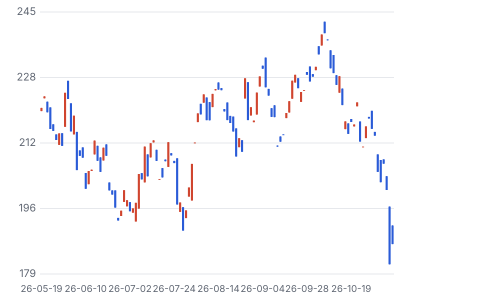

**주봉**

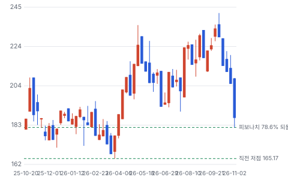

**월봉**

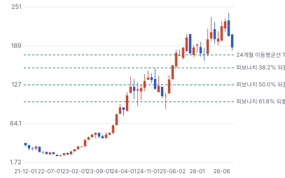

**분기 매출·EPS 실적과 컨센서스**

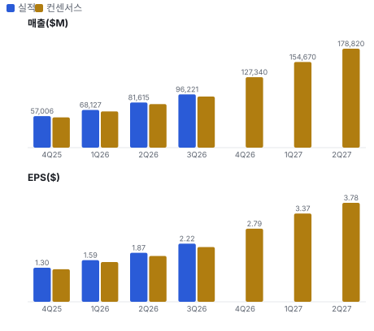

**최근 4개 분기 주가 변화 분석**

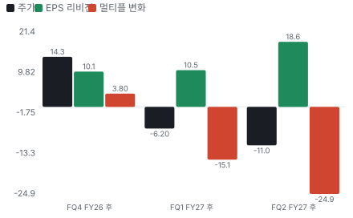

**EPS 리비전**

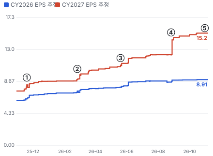

① 25-11-19 FQ3 FY26 실적 · EPS 리비전 +8%
② 26-02-25 FQ4 FY26 실적 · EPS 리비전 +9%
③ 26-05-20 FQ1 FY27 실적 · EPS 리비전 +4%
④ 26-08-26 FQ2 실적, FY28 +70% · EPS 리비전 +19%
⑤ 26-11-05 AI 인프라주 동반 매도 · EPS 리비전 +0%

**밸류에이션 주가 시나리오**

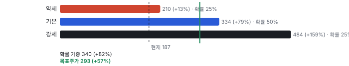

**주가별 업사이드**

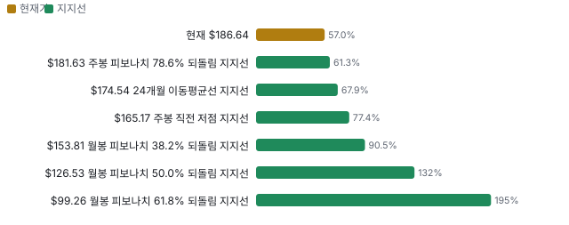

**제품·서비스 포트폴리오**

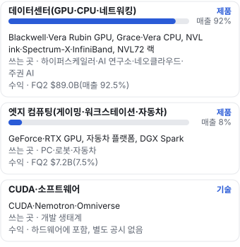

**고객 믹스(FQ2 FY27, 매출 대비)**

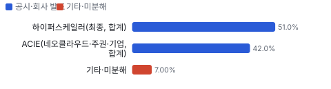

**공급 병목(10점, 낮을수록 병목)**

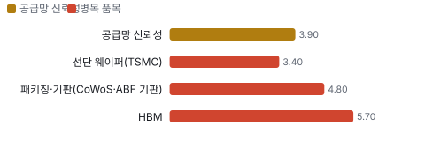

**어닝콜 변화별 주주가치 영향**

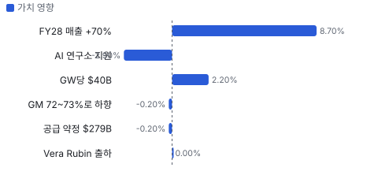

**멀티플 프리미엄(Fwd 1Y P/E, 최근 4개 분기말)**

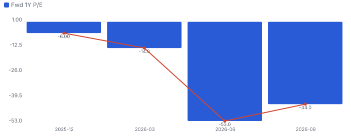

**합리적 멀티플**

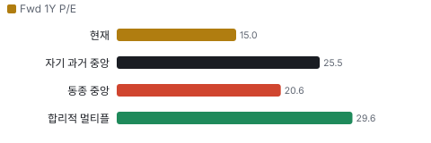

**일별 거래량 분해**

**기관 자금 흐름**

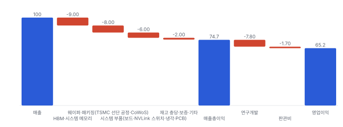

**몬테카를로**

해석: 3,000번 중 1,411번(47%)에서 가치가 지금 주가 이상이었다. 지금 주가를 뒷받침하는 경우와 그렇지 않은 경우가 반반에 가깝다. 가운데 값은 0.73배이고, 열 번 중 여덟 번은 0.45~1.26배 사이에 든다.

**규모·마진·진척도**

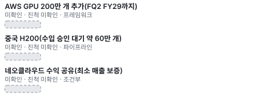

**매출 → 매출총이익 → 영업이익(매출 = 100, 최근 4분기)**

**1년 전 대비 마진 기여(비용 비중 변화의 반대)**

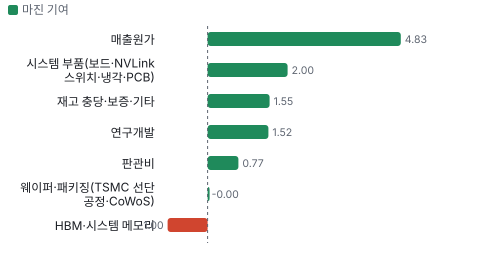

**분기 비용 비중 추이(매출 대비, 공시)**

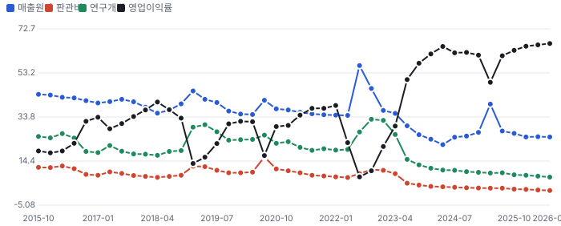

**매출 100의 쓰임(최근 4개 분기)**

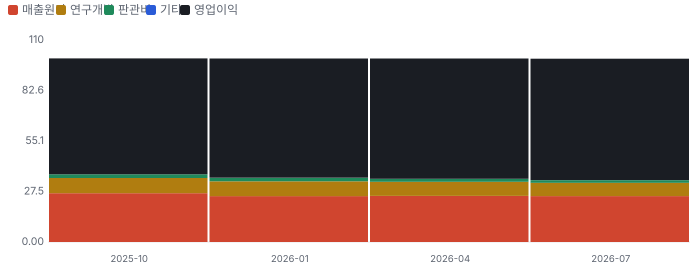

**비용 요인별 매출 대비 비중과 1년 변화**

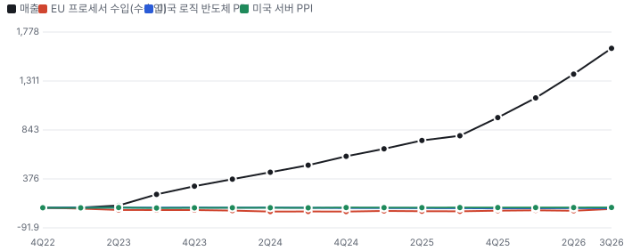

**BOM 항목 가격 +10% 시 OPM 변화**

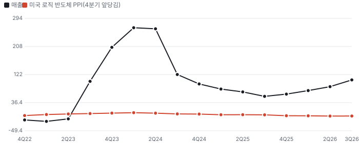

**데이터센터(GPU·CPU·네트워킹) BOM 원가 몫과 가격 +10% 시 OPM**

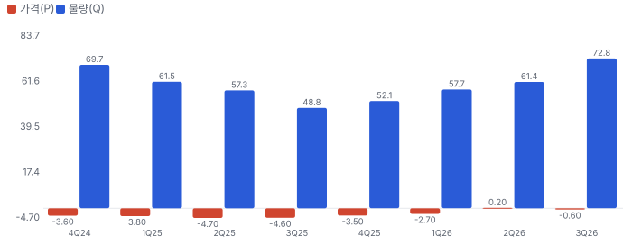

**엣지 컴퓨팅(게이밍·워크스테이션·자동차) BOM 원가 몫과 가격 +10% 시 OPM**

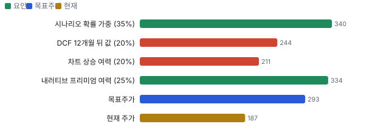

**10년 P·Q 사이클 — 추세(HP 필터) 대비 갭과 8분기 전망**

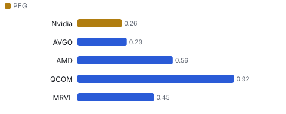

**P·Q 프리미엄 — 매출총이익 정상 수준 대비(−100~+100%)**

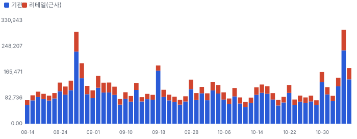

**매출 증가율의 가격·물량 분해와 AR(2) 투영(전년 대비)**

**분기별 매출 증가율 분해**

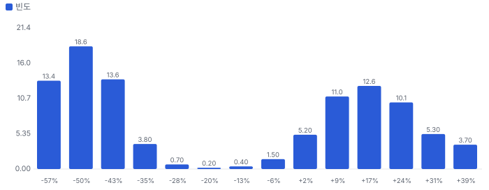

**목표주가 산정 — 약세와 기본 사이(약세 쪽 33%), 도달 확률 약 62%**

**일봉 지지·저항과 목표주가**

## 내러티브

> **기업가치를 결정하는 이야기:** 값은 배치 GW × GW당 매출이다. GW당 기회는 Hopper(NVIDIA 이전 GPU 세대) \$18B → Blackwell \$25B → Vera Rubin \$40B다. 공급은 공급 약정이 정하고, 이익률은 메모리 가격 전가가 정한다. 값을 가르는 것은 FY28 +70%가 공급으로 채워지는지와 GM 72~73% 바닥이다.

> **멀티플·EPS 프리미엄**
> **멀티플:** Fwd 1Y P/E 15.0배로 Broadcom 16.9배·Qualcomm 17.1배보다 낮고 Marvell 24.2배·AMD(미국 AMD) 34.6배보다 훨씬 낮다(11/6 종가). Fwd 2Y는 9.4배다.
> **EPS:** FQ2 실적 직후(8/28) 대비 다음 4개 분기 EPS 추정은 +2~7% 올랐다. 같은 기간 주가는 −11%다.

### 투자자들은 왜 열광했나

Blackwell 램프로 2025~26년 매출이 매 분기 가속했고 8/26 FY28 +70% 전망으로 정점을 찍었다. 10월 사상 최고 \$243 뒤 식은 순서는 10월 말 반도체 약세, 11/3~4 중국 관련 보도, 11/5 AI 인프라주 동반 매도(−9.3%), 11/7 하원 브리핑 요청 보도다.

### 무엇이 기업가치를 바꾸나

> **구조적 체질 변화**
> **변화:** 칩 회사에서 랙 규모 AI 팩토리 회사로
> **증거:** NVL72(GPU 72개를 묶은 랙 시스템) 3세대, GW당 매출 기회 확대(콜)
> **반증:** 랙 대신 칩 단위 판매로 회귀

> **고부가 믹스 확장**
> **변화:** CPU(중앙 처리 장치)·네트워킹·Groq(저지연 추론 칩 회사(NVIDIA가 기술 결합))가 GPU 위에 얹힌다
> **증거:** Grace(NVIDIA 서버 CPU) CPU TTM \$5B 초과, FY28 CPU 2배(콜)
> **반증:** CPU 매출 성장 미달

> **기술 혁신**
> **변화:** Vera Rubin(전력 대비 처리량 30배, 회사 주장) 8월 출하
> **증거:** FQ2 콜
> **반증:** Vera Rubin 램프 지연

> **실행 속도**
> **변화:** 해당 없음(주문→출하 기간을 회사·동종이 공시하지 않고, 배치 속도는 고객 LPS(토지·전력·건물)가 2~3년 앞서 정한다고 회사가 밝혔다)
> **증거:** FQ2 콜 Morgan Stanley 질의
> **반증:** 고객 배치 지연

> **M&A**
> **변화:** Groq 기술 결합, AI 연구소 지분 투자 약 \$50B, Naver(한국 네이버) \$1B
> **증거:** FQ2 콜·11/6 보도
> **반증:** 투자 손상 인식

> **정책·입법 연관성**
> **재정정책:** 해당 없음(보조금·세액공제에 기대는 사업이 아니다)
> **행정명령:** 대중 수출 통제 — H200 라이선스 출하, 중국 데이터센터 전망 제외 FQ2 콜·11/5 보도 반증: 라이선스 철회 의회 동의 2/10 — 하원 1/5(행정부 조치 — 하원 위원회는 브리핑 요청 단계(11/7 보도)) · 상원 1/5(관련 표결을 찾지 못했다).
> **연관입법:** 선거 뒤 데이터센터 건설 제한 논의·칩 추적 입법 논의(발언 단계) 11월 보도 — 법안 번호 미확인 반증: 법안 위원회 통과

> **CAPEX 낙수효과**
> **변화:** 상위 5개 하이퍼스케일러 CAPEX 2026 약 \$800B·2027 \$1.3T(회사 인용 업계 전망). 고객 투자를 NVIDIA 매출로 바로 옮기지 않는다
> **증거:** FQ2 콜
> **반증:** 하이퍼스케일러 CAPEX 하향

### 내러티브 근거

> '수요가 공급을 넘는다'는 이야기가 FY28 매출 +70%를 만들었지만 주가는 10월 고점 대비 약 −23%다. 시장은 메모리 원가에 따른 GM 하락, 고객 자체 칩, AI 연구소 지원 구조에 할인을 건다. 동종 대비 멀티플 차이 -27% 중 회사 고유 몫은 -49%다. 단계는 컨센서스, 쏠림은 높음이다.

> **AI 팩토리 수요 > 공급** · 유지
> **논리:** 공급만 늘면 매출이 따라온다
> **숫자:** FY28 +70%(공급 기준), 공급 약정 \$279B
> **반증:** FQ3 매출 \$108B 미달(2026-11)

> **GW당 콘텐츠 확대** · 유지
> **논리:** 세대마다 GW당 매출이 커진다
> **숫자:** \$25B → \$40B(Vera Rubin)
> **반증:** Vera Rubin 비중 FQ3 20% 미달

> **고객 자체 칩(약세)** · 강화
> **논리:** Broadcom XPU가 추론을 가져간다
> **숫자:** Broadcom FY28 AI \$230B 전망
> **반증:** ACIE(AI 클라우드·산업·기업 고객군) 성장 100% 유지

> **메모리 원가·GM 하락(약세)** · 강화
> **논리:** HBM 값이 GM을 깎는다
> **숫자:** GM 75% → 71~72%(FQ4)
> **반증:** FQ3 GM 74% 이상

> **정책·중국(약세)** · 신규
> **논리:** 중국 매출 0과 의회 조사
> **숫자:** 중국 데이터센터 전망 제외
> **반증:** H200 수입 승인

## 포트폴리오

| 제품·서비스 | 구분 | 무엇 | 쓰는 곳 | 돈 버는 방식 | Mix | Mix 변화(전 분기 대비) |
|---|---|---|---|---|---|---|
| 데이터센터(GPU·CPU·네트워킹) | 제품 | Blackwell·Vera Rubin GPU, Grace·Vera(NVIDIA 차세대 CPU) CPU, NVLink(NVIDIA 칩 간 연결 기술)·Spectrum-X(NVIDIA AI 이더넷)·InfiniBand(고속 서버 연결 규격), NVL72 랙 | 하이퍼스케일러·AI 연구소·네오클라우드·주권 AI | FQ2 \$89.0B(매출 92.5%) | 93% | +0.3%p |
| 엣지 컴퓨팅(게이밍·워크스테이션·자동차) | 제품 | GeForce(NVIDIA 게이밍 GPU 브랜드)·RTX(NVIDIA 그래픽 GPU 브랜드) GPU, 자동차 플랫폼, DGX(NVIDIA AI 시스템 브랜드) Spark | PC(개인용 컴퓨터)·로봇·자동차 | FQ2 \$7.2B(7.5%) | 7% | -0.3%p |
| CUDA(NVIDIA GPU 프로그래밍 플랫폼)·소프트웨어 | 기술 | CUDA·Nemotron(NVIDIA 오픈 모델)·Omniverse(NVIDIA 3D 시뮬레이션 플랫폼) | 개발 생태계 | 하드웨어에 포함, 별도 공시 없음 | 미확인 | 미확인 |

**Mix 변화가 가장 큰 쪽은 엣지 컴퓨팅(게이밍·워크스테이션·자동차)(-0.3%p, 전 분기 대비).** 계절성 판정: 분기 매출 계절 지수 기준 없음 → 직전 분기와 비교.

## 고객

> **FQ2 FY27 최대 고객 하이퍼스케일러(최종, 합계) 51%, 상위 3곳 93%, 집중도 집중.** 공시·회사 발표로 확인한 몫은 매출의 93%이고, 나머지 고객 몫은 추정이거나 미분해다. 직접 고객 1곳이 매출의 16%다(10-Q). 매출채권은 직접 고객 5곳이 22·14·13·11·10%다. 최종 고객은 하이퍼스케일 \$49B·ACIE \$40B로 나뉜다(콜)

**고객별 매출 몫(FQ2 FY27)**
| 고객 | 몫 | 변화 | 근거 |
|---|---|---|---|
| 하이퍼스케일러(최종, 합계) | 51% | 미확인 | 회사 발표 |
| ACIE(네오클라우드·주권·기업, 합계) | 42% | 미확인 | 회사 발표 |
| 직접 고객 1곳(이름 미공시, 매출 16%) | 미확인 | 미확인 | 공시 |
| 기타·미분해 | 7% | - | - |

> **하이퍼스케일러(최종, 합계)** · 회사 발표
> **사는 것:** GPU·시스템
> **추정 근거:** 회사가 밝힌 최종 고객군

> **ACIE(네오클라우드·주권·기업, 합계)** · 회사 발표
> **사는 것:** AI 팩토리 플랫폼
> **추정 근거:** +138% YoY

> **직접 고객 1곳(이름 미공시, 매출 16%)** · 공시
> **사는 것:** 데이터센터 시스템
> **추정 근거:** 직접 고객(ODM(주문자 설계 생산 회사)·OEM(주문자 상표 제조사))이라 아래 최종 고객군과 겹친다 — 몫은 요약에만

## 수주·파이프라인

> **2026-08-26 기준 3건.** 건별 확정 금액은 공개되지 않았다. 서로 겹치는 항목은 합계에서 뺐다.

**실행 속도와 방해 요인**
| 항목 | 상태 | 실행 속도 | 방해 요인 |
|---|---|---|---|
| AWS GPU 200만 개 추가(FQ2 FY29까지) | 프레임워크 | 이번 분기부터 배치 | 공급 · LPS |
| 중국 H200(수입 승인 대기 약 60만 개) | 파이프라인 | 회사 전망에서 제외 | 미·중 규제 |
| 네오클라우드 수익 공유(최소 매출 보증) | 조건부 | 설치 용량 3GW → 8GW(올해 말, 업계) | 파트너 신용 |

## 마진 구조

> **GPM 75.0%, OPM 66.2%.** FQ2 FY26 대비 GPM +2.6%p, OPM +5.4%p. FQ2 FY27 매출원가는 매출의 25.0%로 1년 전 27.6%보다 2.6%p 낮다. 그러나 회사는 메모리 원가로 GM이 FQ4 71~72%까지 내려간다고 했다 — 매출원가 비중이 28~29%로 다시 오른다는 뜻이다. 연구개발비는 9.2% → 7.3%로 매출 증가에 희석됐다

> **매출 100 중 매출원가 25.3, 매출총이익 74.7(최근 4분기, 공시).** 매출원가 요인 중 HBM·시스템 메모리이 매출의 9.0%로 가장 무겁고, 단가가 +10% 오르면 GPM이 -0.90%p 움직인다. 분기 회귀로 매출 1이 늘 때 매출원가는 0.25 늘고, 매출원가의 고정비 몫은 12%다.

**비용 요인 강도 — 비중·추세·충격(+10%)·탄력**
| 비용 | 구분 | 매출 대비 | 1년 변화 | 마진 기여 | 충격 시 마진 | 매출 탄력 | 고정비 몫 |
|---|---|---|---|---|---|---|---|
| HBM·시스템 메모리 | 매출원가 요인 | 9.0% | +1.0%p | -1.0%p | -0.90%p | 미확인 | 0% |
| 웨이퍼·패키징(TSMC 선단 공정·CoWoS(TSMC 2.5D 첨단 패키징)) | 매출원가 요인 | 8.0% | +0.0%p | -0.0%p | -0.80%p | 미확인 | 0% |
| 시스템 부품(보드·NVLink 스위치·냉각·PCB(인쇄회로기판)) | 매출원가 요인 | 6.0% | -2.0%p | +2.0%p | -0.60%p | 미확인 | 10% |
| 재고 충당·보증·기타 | 매출원가 요인 | 2.0% | -1.6%p | +1.6%p | -0.20%p | 미확인 | 미확인 |
| 매출원가 | 공시 항목 | 25.3% | -4.8%p | +4.8%p | -2.53%p | 0.25 | 12% |
| 연구개발 | 공시 항목 | 7.8% | -1.5%p | +1.5%p | 미확인 | 0.07 | 36% |
| 판관비 | 공시 항목 | 1.7% | -0.8%p | +0.8%p | 미확인 | 0.01 | 60% |

매출 탄력 = 분기 비용을 매출에 회귀한 기울기(매출 1당 변동비), 고정비 몫 = 절편 ÷ 평균 비용. 표본이 8분기 미만이면 미확인. 매출원가 요인 비중은 margin 재료의 추정이 섞여 있고, 공시 매출원가와의 차이는 '기타 매출원가'로 둔다.

**GPM에서 OPM까지(GAAP)**
| 기간 | GPM | 연구개발 | 판관비 | 기타 | OPM |
|---|---|---|---|---|---|
| FQ2 FY26 | 72.4% | 9.2% | 2.4% | 0.0% | 60.8% |
| FQ2 FY27 | 75.0% | 7.3% | 1.4% | 0.0% | 66.2% |

**GPM·OPM 최근 4개 분기**
| 분기 | GPM | OPM |
|---|---|---|
| 2025-10 | 73.4% | 63.2% |
| 2026-01 | 75.0% | 65.0% |
| 2026-04 | 74.9% | 65.6% |
| 2026-07 | 75.0% | 66.2% |

**마진을 결정하는 비용 요인 — 비용 +10% 시 OPM**
| 비용 | 매출 대비 | 변화 | 고정비 | OPM |
|---|---|---|---|---|
| HBM·시스템 메모리 | 9.0% | +1.0%p | 0% | -0.90%p |
| 웨이퍼·패키징(TSMC 선단 공정·CoWoS) | 8.0% | +0.0%p | 0% | -0.80%p |
| 연구개발비 | 7.3% | -1.9%p | 90% | -0.73%p |
| 시스템 부품(보드·NVLink 스위치·냉각·PCB) | 6.0% | -2.0%p | 10% | -0.60%p |
| 재고 충당·보증·기타 | 2.0% | -1.6%p | 미확인 | -0.20%p |
| 판관비 | 1.4% | -1.0%p | 80% | -0.14%p |

**비용을 움직이는 요인**
| 비용 | 요인 |
|---|---|
| HBM·시스템 메모리(매출원가) | 메모리 가격 상승(FQ2 콜) · 근거 추정 |
| 웨이퍼·패키징(TSMC 선단 공정·CoWoS)(매출원가) | GPU 출하 · 근거 추정 |
| 연구개발비(연구개발) | 컴퓨팅 인프라·인건비 · 근거 공시 |
| 시스템 부품(보드·NVLink 스위치·냉각·PCB)(매출원가) | 랙 시스템 비중 · 근거 추정 |
| 재고 충당·보증·기타(매출원가) | 세대 전환 · 근거 추정 |
| 판관비(판관비) | 인건비 · 근거 공시 |

**데이터센터(GPU·CPU·네트워킹) BOM — 매출의 92%, GPM 75%(회사 전체 FQ2 GAAP GM 75% — 부문 GM 미공시), 항목 가격 +10% 시**
| 항목 | 원가 몫 | 전가 | 제품 GPM | OPM |
|---|---|---|---|---|
| HBM | 30~45% | 미확인 | -0.9%p | -0.87%p |
| 선단 웨이퍼(TSMC) | 20~35% | 미확인 | -0.7%p | -0.64%p |
| 패키징·기판(CoWoS·ABF(반도체 패키지 기판용 절연 필름) 기판) | 10~20% | 미확인 | -0.4%p | -0.35%p |
| 미분해 | 20% | - | - | - |

**엣지 컴퓨팅(게이밍·워크스테이션·자동차) BOM — 매출의 8%, GPM 75%(회사 전체 값 — 부문 GM 미공시), 항목 가격 +10% 시**
| 항목 | 원가 몫 | 전가 | 제품 GPM | OPM |
|---|---|---|---|---|
| 웨이퍼 | 30~45% | 미확인 | -0.9%p | -0.07%p |
| GDDR(그래픽용 메모리) 메모리 | 20~35% | 미확인 | -0.7%p | -0.05%p |
| 보드·기타 | 20~35% | 미확인 | -0.7%p | -0.05%p |
| 미분해 | 7% | - | - | - |

HBM 가격이 +10% 오르면 영업이익은 -1.3% 움직인다. 판매가 전가를 모르는 항목은 전가 0%로 계산했다.

**BOM 항목 가격을 움직이는 것**
| 항목 | 요인 |
|---|---|
| 선단 웨이퍼(TSMC) | GPU·CPU 다이 · 근거 추정 |
| HBM | GM을 가르는 원가 — FY28 1분기 가격 인상으로 일부 넘긴다(콜) · 근거 추정 |
| 패키징·기판(CoWoS·ABF 기판) | 공급 병목 · 근거 추정 |
| 웨이퍼 | GPU 다이 · 근거 추정 |
| GDDR 메모리 | 메모리 가격 · 근거 추정 |
| 보드·기타 | 부품 · 근거 추정 |

## 공급망 병목

> **공급망 신뢰성 3.9/10, 병목 심각.** 가장 약한 고리는 선단 웨이퍼(TSMC) 3.4점이고, 품목 평균은 4.7점이다. 병목은 선단 웨이퍼·HBM·패키징·데이터센터 부지와 전력이다(FQ2 콜: 공급망 전체가 최대 가동). 회사는 공급·캐파 약정을 \$119B에서 \$279B로 늘려 물량을 묶었다(10-Q)

**병목과 마진 — 품목 가격 +10% 시 OPM**
| 품목 | 점수 | 판정 | 구분 | OPM |
|---|---|---|---|---|
| 선단 웨이퍼(TSMC)(필수) | 3.4 | 병목 심각 | 핵심 통제 품목 | -0.64%p |
| 패키징·기판(CoWoS·ABF 기판)(필수) | 4.8 | 병목 주의 | 출하 차질 위험 | -0.35%p |
| HBM(필수) | 5.7 | 병목 주의 | 핵심 통제 품목 | -0.87%p |

> **선단 웨이퍼(TSMC)** · 3.4/10
> **왜:** 대체 공급사가 사실상 없다
> **병목 요인:** 인증 공급사 1곳 · 캐파 빠듯 · 리드타임 미확인 · 재인증 12개월 · 1위 점유율 90% · 대만 집중 90% · 물량 확보 장기계약
> **풀리는 조건:** 미확인

> **패키징·기판(CoWoS·ABF 기판)** · 4.8/10
> **왜:** 시스템 출하 속도
> **병목 요인:** 인증 공급사 2곳 · 캐파 빠듯 · 리드타임 미확인 · 재인증 미확인 · 1위 점유율 70% · 대만·일본 집중 80% · 물량 확보 장기계약
> **풀리는 조건:** 미확인

> **HBM** · 5.7/10
> **왜:** GM과 출하를 함께 정한다
> **병목 요인:** 인증 공급사 3곳 · 캐파 부족 · 리드타임 미확인 · 재인증 6개월 · 1위 점유율 50% · 한국 집중 70% · 물량 확보 장기계약
> **풀리는 조건:** 미확인

**공급사**
| 품목 | 공급사 | 몫 | 근거 |
|---|---|---|---|
| 선단 웨이퍼(TSMC) | TSMC(N3·N2 웨이퍼) | 미확인 | 보도 |
| HBM | 메모리 3사(HBM) | 미확인 | 회사 발표 |
| 패키징·기판(CoWoS·ABF 기판) | TSMC(CoWoS)(2.5D 패키징) | 미확인 | 보도 |
| 패키징·기판(CoWoS·ABF 기판) | Ibiden(일본 패키지 기판 회사 이비덴) 등 기판사(기판) | 미확인 | 보도 |

## 해자

> 해자는 CUDA 생태계와 GPU·CPU·네트워크·소프트웨어를 묶은 랙 규모 시스템, 그리고 공급 약정으로 묶은 물량이다.

> **CUDA·소프트웨어 생태계** · 강함
> **해자:** 거의 모든 오픈·폐쇄 모델이 NVIDIA에서 개발되고 실행된다
> **근거:** FQ2 콜(회사 주장), 설치 기반 최대
> **숫자:** 데이터센터 매출 \$89B(분기)
> **깨지는 조건:** 주요 연구소가 학습까지 자체 칩으로 옮긴다

> **랙 규모 시스템(NVL72)** · 강함
> **해자:** GPU·CPU·NVLink·네트워크를 한 시스템으로 판다
> **근거:** GW당 매출 기회 \$18B → \$25B → \$40B(콜)
> **숫자:** 네트워킹 +18% QoQ, Spectrum-X 2.6배
> **깨지는 조건:** GW당 콘텐츠가 다음 세대에서 줄어든다

> **공급 약정 물량** · 보통
> **해자:** 웨이퍼·HBM·패키징 물량을 먼저 묶었다
> **근거:** 공급·캐파 약정 \$279B(10-Q)
> **숫자:** 직전 분기 \$119B의 2.3배
> **깨지는 조건:** 수요 둔화로 초과 재고 충당금 증가

## 경영진·네트워크

> 창업자 Jensen Huang이 1993년부터 CEO다. CFO는 Colette Kress다. 정치 연결은 공개 기록만 — 11/7 하원 3개 위원회가 CEO 비공개 브리핑을 요청했다는 보도가 있다

> **Jensen Huang** · 창업자·CEO · 1993
> **프로필:** NVIDIA 공동 창업
> **비즈니스:** 반도체·AI 생태계
> **정계:** 하원 위원회 브리핑 요청(2026-11-07 보도) — 공개 기록
> **동문:** 오리건주립대·스탠퍼드
> **사모임:** 미확인

> **Colette Kress** · CFO · 2013
> **프로필:** 전 Cisco 재무 임원
> **비즈니스:** 미확인
> **정계:** 미확인
> **동문:** 미확인
> **사모임:** 미확인

**네트워크 정량화**
| 연결 | 강도 | 닿는 매출 | 가중 노출 | 매출 대비 | 근거 |
|---|---|---|---|---|---|
| 정계: 하원 위원회 브리핑 요청 | 1/5 | 미확인 | 미확인 | 미확인 | 보도 1건, 매출 연결 없음 2026-11-07 보도 |

가중 노출은 연결이 닿는 매출의 크기다. 연결이 그 매출을 만들었다는 뜻이 아니며, 인과는 공개 자료로 입증하지 못한다.

## 약세 논리 및 셀온 조건

| 약세 논리 | 근거 | 반박 | 가를 자료 |
|---|---|---|---|
| 수요의 일부를 회사 대차대조표가 만든다 | AI 연구소 투자 약 \$50B, 내년 연구소 수요의 약 1/4이 회사 대차대조표 활용(콜). LPS 보증 \$3.5B, VIE(변동 지분 실체(연결하지 않는 투자 법인)) 최대 손실 \$4.7B(10-Q) | 회사는 그 컴퓨팅을 투자등급 고객이 소비한다고 밝혔다. 보증 규모는 매출 대비 작다 | FQ3 10-Q 보증·투자 증감(2026-11 말) |
| 공급 약정이 수요 꺾임을 키운다 | 공급·캐파 약정 \$119B → \$279B, 재고 \$32B(10-Q) | 약정 대부분이 첫 3년이고 Vera Rubin 램프용이다(CFO) | FQ3 재고·초과 구매 의무(2026-11) |
| GM이 메모리에 깎인다 | GM 75% → FQ4 71~72%, 메모리 가격 내년 추가 상승(콜) | FY28 1분기 가격 인상으로 72~73%에서 바닥이라고 했다 | FQ3 GM과 FQ4 가이던스(2026-11) |
| 고객 자체 칩이 추론을 가져간다 | Broadcom FY27 AI \$115B·FY28 \$230B 전망, OpenAI Jalapeño | ACIE(맞춤 칩을 안 사는 고객군)가 데이터센터의 약 45%이고 +138%다(콜) | FQ3 ACIE 성장률 |
| 중국·정책 | 중국 데이터센터 전망 제외, 하원 위원회 브리핑 요청(11/7 보도) | 중국은 이미 전망 밖이라 추가 하방은 제한적이다 | 브리핑 결과·법안 발의 여부 |

> **셀온 조건**
> **조건 1:** FQ3 매출이 가이던스 하단(\$105.8B) 아래다
> **조건 2:** GM이 FQ4 가이던스 71% 아래로 간다
> **조건 3:** FY28 +70% 전망을 낮춘다
> **조건 4:** 초과 재고 구매 의무가 2분기 연속 늘어난다
> **조건 5:** 하이퍼스케일러 2027 CAPEX 가이던스가 내려간다

## 어닝콜 변화

**직전 콜 대비 새로 나오거나 바뀐 내용 → 가치 영향**
| 항목 | 내용 | 직전 콜 | 최신 콜 | 모델 동인 이동 | 확신도 | 가치 영향 |
|---|---|---|---|---|---|---|
| 신규 | FY28 매출 전망 |  |  | 1년차 성장률 +8.0% | 0.8 | +8.7% |
| 부정 | 매출총이익률 |  |  | 출발 이익률 -2.0% | 0.8 | -0.2% |
| 신규 | GW당 매출 기회 |  |  | 장기 성장 수렴값 +1.0% | 0.5 | +2.2% |
| 업데이트 | 공급·캐파 약정 |  |  | 매출÷투하자본 -10.0% | 1.0 | -0.2% |
| 신규 | AI 연구소 투자·대차대조표 지원 |  |  | 할인율(WACC) +0.30% | 0.5 | -2.9% |
| 업데이트 | Vera Rubin 출하 |  |  | 기준연도 매출 +\$0.01B | 1.0 | +0.0% |
| **합계** | 단독 합 |  |  | 동시 적용 +7.5% |  | **+7.6%** |

**사건별 EPS 리비전**
| # | 날짜 | 구분 | 사건 | CY2026 EPS 전→후 | CY2027 EPS 전→후 | 리비전 | 주가 반응 |
|---|---|---|---|---|---|---|---|
| ① | 25-11-19 | 실적 | FQ3 FY26 실적 | \$6.28 → \$6.84 | \$7.90 → \$8.51 | +7.8% | -2.1% |
| ② | 26-02-25 | 실적 | FQ4 FY26 실적 | \$7.18 → \$7.56 | \$8.89 → \$9.68 | +8.9% | -5.5% |
| ③ | 26-05-20 | 실적 | FQ1(회계 1분기(2~4월)) FY27 실적 | \$7.89 → \$8.08 | \$10.67 → \$11.15 | +4.5% | -1.8% |
| ④ | 26-08-26 | 실적 | FQ2 실적, FY28 +70% | \$8.57 → \$8.84 | \$12.29 → \$14.63 | +19.1% | +8.7% |
| ⑤ | 26-11-05 | 내러티브 | AI 인프라주 동반 매도 | \$8.91 → \$8.91 | \$15.21 → \$15.21 | +0.0% | -9.3% |

**해석:** 3개 구간 누적 주가 -5% = EPS 리비전 +44% × 멀티플 -34%. 더 크게 움직인 쪽은 **EPS 리비전**이다.

## P·Q 사이클

> **10년 위치: Q형 기업(매출 갭 분산의 0%가 가격) — 가격은 추세 대비 -1.1%(회복, 10년 분위 25%), 물량은 +13.5%(확장, 분위 82%). P 프리미엄 -2%, Q 프리미엄 +16%(매출총이익이 정상(추세) 수준보다 요인별로 이만큼 높거나 낮다).** AR(2) 전망으로 P 프리미엄은 4분기 뒤 +0%·8분기 뒤 +1%(비슷하게 유지), Q 프리미엄은 -1%·-8%(−로 반전).

**10년 P·Q 사이클 위치·프리미엄**
| 항목 | 가격(P) | 물량(Q) |
|---|---|---|
| 추세 대비 갭(현재) | -1.1% | +13.5% |
| 사이클 시계 | 회복 | 확장 |
| 10년 분위 | 25% | 82% |
| 프리미엄(현재) | -2% | +16% |
| 프리미엄 4분기 뒤 | +0% | -1% |
| 프리미엄 8분기 뒤 | +1% | -8% |
| 갭 반감기 | 3분기 | 3분기 |

방법: P = 가격 지수 4분기 평균(미국 PPI(생산자물가지수) 반도체·관련 소자 대용 — 회사 판매가가 아니라 업종 가격), Q = TTM 매출 ÷ P. 추세는 로그 레벨의 HP(추세 분리 필터) 필터(λ 1600)로 정상(mid-cycle) 수준을 잡는다. 프리미엄 = 요인별 매출총이익 증분 ÷ 정상 매출총이익(정상 GPM 62.6% = 10년 중앙값, 물량 증분 마진 74.9% = 전년 대비 ΔGP(매출총이익)÷ΔRev 회귀, 가격은 전액 이익 반영). 표본 40개 TTM 분기. 전망은 갭의 AR(2) 통계 외삽이며 가이던스·컨센서스가 아니다. HP 필터는 끝점에서 추세가 최근 값 쪽으로 끌려 현재 갭을 작게 볼 수 있다.

> **Q 사이클 — 최근 4분기 평균 가격 기여 -1.7%, 물량 기여 +61.0%(전년 대비 로그 증가율).** P 강도 5.3/10, Q 강도 6.0/10, 최근 8분기 중 100%가 같은 요인 우세(구조적). AR(2) 투영으로는 8분기 안에 전환 신호가 없다.

**P·Q 사이클 정량**
| 항목 | 가격(P) | 물량(Q) |
|---|---|---|
| 최근 4분기 평균 기여 | -1.7% | +61.0% |
| 강도(0~10, 자기 이력 z) | 5.3 | 6.0 |
| AR(2) 고유 주기 | 15.5분기 | 11.5분기 |
| 다음 4분기 투영 평균 | -1.8% | +56.7% |

가격 근거: 미국 PPI 반도체·관련 소자 대용 — 회사 판매가가 아니라 업종 가격. PPI를 쓰면 회사 판매가가 아니라 업종 가격 대용이다. 로그 증가율이라 가격·물량 기여의 합이 매출 증가율이다. 투영은 통계 외삽이며 가이던스·컨센서스가 아니다. 회사 판매가로 잴 수 없는 이유: GPU 출하량·단가를 공시하지 않는다 — 업종 PPI로 대신한다

## 밸류에이션

> **목표주가 \$293, 업사이드 +57%.** 자리는 약세와 기본 사이(약세 쪽 33%)이고 도달 확률은 약 62%다. 기본 \$334, 강세 \$484(+159%), 약세 \$210(+13%). DCF 기준 업사이드는 기본 +17%, 강세 -45%, 약세 -55%다(WACC 11.6%).

기준 멀티플이 Fwd 1Y P/E라 EPS도 다음 4개 분기 조정 EPS를 쓴다. 배수는 엔진이 동종 중앙값에서 출발해 정한다.

> **약세 \$210 (+13%)** · 확률 25%
> **가정:** 20.0배 × EPS \$10.50
> **근거:** 메모리 원가와 공급 병목으로 GM이 70% 아래로, 출하가 FY28 +70% 경로 밑으로 간다. 다음 4개 분기 EPS 컨센서스 \$12.5보다 약 16% 낮다

> **기본 \$334 (+79%)** · 확률 50%
> **가정:** 26.7배 × EPS \$12.50
> **근거:** 다음 4개 분기 EPS 컨센서스 \$12.5대로 간다. FQ3 가이던스가 첫 분기다

> **강세 \$484 (+159%)** · 확률 25%
> **가정:** 33.4배 × EPS \$14.50
> **근거:** 공급이 70%보다 빨리 늘고 FY28 1분기 가격 인상으로 GM이 73% 위에서 바닥을 친다

**멀티플 선정 — Fwd 1Y P/E**
| 단계 | 조정 | 근거 |
|---|---|---|
| 동종 중앙값 | 20.6배 | 범위 16.9~34.6배, 4곳 |
| 펀더멘털 | +20% | 성장·이익률·ROIC로 본 합리적 멀티플 29.6배와의 차이의 일부만 인정 |
| 해자 | +10% | CUDA·소프트웨어 생태계 강함 · 랙 규모 시스템(NVL72) 강함 · 공급 약정 물량 보통 |
| 반복 매출 | +0% | 재료 없음 |
| 수주 전환·가시성 | +0% | 가시성 재료 없음 |
| 내러티브 | +0% | 단계 컨센서스 |
| 사이클·실행 판단 | +0% | 고객 집중(직접 고객 1곳 16%)과 AI 연구소 지원은 있으나 공급 약정이 경쟁사 대비 물량 우위를 만든다 — 판단 조정을 하지 않는다 |
| **선정** | **26.7배** | 지금 15.0배 |

**동종 레인지**
| 회사 | Fwd 1Y P/E | Fwd 2Y P/E | Fwd 3Y P/E | 성장 | 영업이익률 | ROIC |
|---|---|---|---|---|---|---|
| AVGO(미국 Broadcom) | 16.9 | 10.6 | 6.9 | 77% | 66% | 37% |
| AMD | 34.6 | 21.4 | 15.1 | 81% | 30% | 20% |
| QCOM(미국 Qualcomm) | 17.1 | 14.4 | 11.9 | 8% | 26% | 25% |
| MRVL(미국 Marvell) | 24.2 | 15.7 | 11.2 | 70% | 39% | 16% |
| **Nvidia** | 15.0 | 9.4 | 7.3 |  |  |  |

지금 주가가 요구하는 5년 매출 CAGR 22%, 기본 시나리오 26%. 몬테카를로 중앙값 업사이드 -27%.

> 의사결정 보조(투자자문 아님): ① 매수 매력: 연 기대수익 +6.5% (자기자본비용 11.6% 대비 -5.2%p) · 자본비용 초과 확률 43% · 안전마진 0.45 → 정량 신호 약함 / ② 위험 예산 지표(이론): 0% — 기대수익이 자기자본비용에 못 미침(무위험 대비 켈리 41%는 참고) · 5년 하위10% -28% · 30%+ 손실 확률 7% / ③ 상방(5년): 기대 1.37배 · 2배 15% · 3배 0% · 10배 0% · 상위10% 2.06배

## 매수 위치(일봉)

> **현재가 \$187는 '지지선 미확인'.** 이 자리에서 목표주가까지 +57.0%, 첫 일봉 저항까지 +2.4%, 다음 지지까지 하방 미확인.

**가격대별 업사이드(일봉 기준)**
| 가격대 | 가격 | 목표주가까지 | 첫 저항까지 | 다음 지지까지 | 손익비 | 근거 기법(강도) |
|---|---|---|---|---|---|---|
| 현재가 | \$187 | +57.0% | +2.4% | 미확인 | 미확인 | - |

**일봉 저항**
| 저항 | 가격 | 현재가 대비 | 근거 기법(강도) |
|---|---|---|---|
| 저항 1 | \$191 | +2.4% | 120일 지그재그 저점(0.8) |
| 저항 2 | \$205 | +9.7% | 200일선(1.0) |
| 저항 3 | \$211 | +13.3% | 120일 지그재그 고점 · 120일 지그재그 저점 · 20일선 · 스윙 저점(2.3) |

일봉만 쓴다(주봉·월봉 제외). 손익비 = 목표주가까지 업사이드 ÷ 다음 지지까지 하방. 가격대별 기대값 참고표이며 매수·매도 시점 지시가 아니다.

## 애널리스트 토론

> **토론 결론 Neutral(규칙 등급 Neutral).** 엔진 시나리오는 약세에서도 현재가 위라 손익비를 잴 수 없었다. 시나리오가 모두 배수 확장(15.0 → 26.7배)을 가정하고, 몬테카를로 중앙값은 −27%다. DCF 기본 +17%만으로 한 단계 올릴 근거가 부족해 규칙 등급 Neutral을 유지한다. 가를 자료(FQ3)가 약 열흘 뒤다

**패널(가상 애널리스트)**
| 자리 | 애널리스트 | 핵심 논리 | 틀리는 조건 | 최종 투표 |
|---|---|---|---|---|
| Strong Buy | 한서윤(가상 리서치 하우스 아라증권) | FY28 +70% 회사에 Fwd 2Y P/E 9.4배다 | FQ3 매출 \$108B 미달 | Buy |
| Buy | 오지후(가상 리서치 하우스 누리리서치) | 추정은 오르는데 배수만 내렸다 | FY28 전망 하향 | Buy |
| Neutral | 배다온(가상 리서치 하우스 솔빛증권) | GM 바닥을 확인하기 전이다 | FQ3 GM 74% 이상 | Neutral |
| Sell | 권태하(가상 리서치 하우스 다솜리서치) | 수요의 일부를 NVIDIA 대차대조표가 만든다 | 연구소 상장으로 자체 조달 | Neutral |
| Strong Sell | 민세온(가상 리서치 하우스 한결증권) | 공급 약정 \$279B는 수요가 꺾이면 재고가 된다 | FQ3 재고 회전 개선 | Neutral |

**투표**
| Strong Buy | Buy | Neutral | Sell | Strong Sell |
|---|---|---|---|---|
| 0 | 2 | 3 | 0 | 0 |

> **개회 · Strong Buy**
> **발언:** 매출 +70%를 9배에 산다

> **개회 · Buy**
> **발언:** 8월 이후 추정은 올랐고 주가는 내렸다

> **개회 · Neutral**
> **발언:** GM 바닥이 FQ4라 그 전에는 가를 수 없다

> **개회 · Sell**
> **발언:** 고객 지원 구조가 수요를 부풀린다

> **개회 · Strong Sell**
> **발언:** 약정 \$279B는 되돌릴 수 없다(10-Q)

> **반박1 · Buy → Sell**
> **발언:** 지원받는 수요도 투자등급 고객이 소비한다고 회사가 밝혔다

> **반박1 · Sell → Strong Buy**
> **발언:** +70%는 공급 기준 예비 전망이다

> **반박1 · Neutral → Buy**
> **발언:** 추정 상향폭이 작다

> **반박2 · Strong Buy → Strong Sell**
> **발언:** 약정은 경쟁사가 못 얻는 물량이다

> **반박2 · Strong Sell → Buy**
> **발언:** 배수가 내린 이유가 바로 지속성이다

> **반박2 · Neutral → Sell**
> **발언:** 가를 자료는 11월 FQ3다

> **최종 · Strong Buy** · Buy
> **발언:** Buy로 물러선다

> **최종 · Buy**
> **발언:** Buy를 유지한다

> **최종 · Neutral**
> **발언:** 규칙 등급을 지지한다

> **최종 · Sell** · Neutral
> **발언:** Neutral로 물러선다

> **최종 · Strong Sell** · Neutral
> **발언:** Neutral로 물러선다

남은 반대 의견: Buy 두 자리 — 추정은 오르고 배수만 내렸다

패널은 가상 인물이고 실존 IB의 의견이 아니다.

## 커뮤니티 내러티브

> **커뮤니티는 'GPU 임대료 최고치·공급 부족'의 강세론과 '5주 연속 하락·약세장 진입' 걱정으로 갈렸다. 8월 FY28 +70% 때 최고조였다**

**채널별 내러티브와 기대 소화**
| 채널 | 주된 이야기 | 기대 | 1차 자료 대조 | 비중 |
|---|---|---|---|---|
| X | 중국이 \$70B 주문했는데 TSMC 캐파로 1%만 채운다 — 수요가 공급을 넘는다 | 상향 | 부분 확인 — 회사도 수요가 70%를 넘는다고 했다. 중국 몫은 전망에서 제외 | 40% |
| X | GPU 임대료가 새 최고치 | 상향 | 미확인 — 회사 공시 아님 | 20% |
| X | 5주 연속 하락, 약세장 근처 | 하향 | 확인(가격) — 10월 고점 대비 약 −23% | 40% |
| 레딧 | AI 지출 의문·기술주 조정 경고 | 하향 | 미확인 — 하이퍼스케일러 CAPEX 가이던스는 변하지 않았다 | 100% |

**기대가 바뀐 시점:** 8월 FQ2·FY28 +70%(83, 987건) → 9월 \$229 저항(77) → 10월 사상 최고 뒤 조정 경고(59, 816건) → 11월 약세장 근처 vs 공급 부족(70)

원천: Quantral(X·레딧·유튜브·서브스택 언급 집계, 작성자 적중률로 신뢰 가중). 커뮤니티 의견은 시장 기대의 증거이지 사실이 아니며, 관심 급증은 주가·펀더멘털 변화가 아니다.

## 시장 평가

> **셀사이드(IB 애널리스트)**
> **한 줄:** 추정은 오르고 의견은 만장일치 — 하락은 배수에서 왔다
> **애널리스트 의견:** 53명 — 강력 매수 49·매수 3·강력 매도 1 — 거의 만장일치
> **목표가 평균·범위:** \$327 (\$180~\$515) — 현재가 대비 +75% — 기대의 증거일 뿐 Chiip 목표가 아니다
> **FQ2 콜 질문 증권사:** Morgan Stanley·Cantor·Bernstein·Bank of America·UBS(유니온 뱅크 오브 스위츠랜드)·Melius·Goldman Sachs·Wells Fargo — 초점: FY28 +70%·GW당 콘텐츠·생태계 투자

> **바이사이드(기관 투자자)**
> **한 줄:** 회사가 가장 큰 매수자다
> **기관 보유 비중:** 72% — 대형 기관
> **공매도 비중:** 유통의 1.3% — 매우 낮다
> **자사주 매입:** FQ2 \$20B — FCF의 50% 이상 환원

> **언론·업계**
> **한 줄:** 언론은 정책 리스크를 다룬다
> **주요 보도(11월):** 중국 주문 공급 한계·하원 브리핑 요청·Naver \$1B 투자 — 정책·규제가 주제

## 체크리스트

| 시점 | 무엇 | 의미 |
|---|---|---|
| 2026년 11월 중순(예상) | FQ3 FY27 실적·FQ4 가이던스 | 매출 \$108B, GM 74%, Vera Rubin 비중 약 20%, FY28 +70% 유지 |
| 2026년 11월 중순 | 9월 말 13F | 10월 고점 전후 기관 포지션 |
| 2026년 11~12월 | 하원 위원회 브리핑 | 정책 리스크가 조사·입법 단계로 가는지 |
| 2027년 1~2월 | 하이퍼스케일러 4Q 콜 | 2027 CAPEX \$1.3T(회사 인용 전망) 확인 |
| 2027년 2월(예상) | FQ4 실적·FY28 첫 가이던스 | GM 바닥 72~73% 확인 |

## 출처
- NVIDIA FQ2 FY27 10-Q https://www.sec.gov/Archives/edgar/data/1045810/000104581026000075/nvda-20260726.htm
- NVIDIA FQ2 FY27 실적 8-K(2026-08-26)
- 하원 위원회 브리핑 요청 보도 https://af.net/realtime/three-us-house-panels-seek-nvidia-ceo-briefing-on-spy-allegations/
- 라이선스 자료 요지 포함 — 외부 공유 금지
- 마스터 노션 자료: 미확인 Bernstein_-_US_Networking_-_Connecting_the_dots..._A_primer_on_networking_equipment_in_the_age_of_AI_-_8_Oct_2026.pdf (요지만, 외부 공유 금지)
- 마스터 노션 자료: MS MS_-_Following_AIs_1.6_trillion_Money_Trail_-_Mapping_the_Revenue_Generated_by_the_Capex_Boom(1).pdf (요지만, 외부 공유 금지)
- 마스터 노션 자료: 미확인 JP Morgan SemiconductorsSemi Cap Equipment 3Q26 Sector Preview.pdf (요지만, 외부 공유 금지)
- FQ2 FY27 10-Q
- FQ2 콜 ACIE \$40B
- FQ2 콜 하이퍼스케일 \$49B ÷ 매출 \$96.2B
- 11/5 보도·FQ2 콜
- FQ2 콜
- FQ2 콜·10-Q
- 10-Q 매출원가 총액 × 업계 원가 구조 — 회사 미공시
- FQ2 콜 — 몫 미공시
- FQ2 콜(메모리 원가) — 몫 미공시
- 업계 일반
- 업계 일반 — 미공시
- 총액과의 차이(초과 재고 구매 의무 \$2.1B, 10-Q)
- 10월 캐파 계약 보도(Quantral 요약)
- FQ2 콜(3대 메모리 공급사와 장기 관계)
- 업계 보도
- 업계 보도 — 10-Q는 공급사명 미기재

_구매 등급·목표주가 모두 규칙이 계산한 모델 값으로, 개인의 보유 종목·자금 사정을 반영하지 않는다 · 공개 자료 기반 분석이며 투자 권유가 아님 · 1차 판정, 미검증 · Chiip ten-bagger_