# 텐배거 리포트 2026-11-07 — Power Solutions International — 매출은 돌아섰고 할인은 지배 구조에 있다

> 2026-11-07 · Power Solutions International, Inc.(PSIX) · 기업: 배출가스 인증 엔진과 데이터센터·석유가스용 발전 패키지 제조사 — 중국 웨이차이동력(Weichai)이 46% 지배

## Chiip View

3Q 매출 \$202.1M(+32.5% QoQ), 전력 시스템 \$163.1M, GM 29.7%(1년 전 23.9%), EPS \$1.30으로 컨센서스를 넘었다. 2Q의 관세 환급 \$22.7M 없이도 영업이익이 \$40.9M다. 그런데 주가는 52주 고점 대비 −63%이고 실적 전날 하루 −20%였다. **할인은 이익이 아니라 구조에 있다.** Weichai가 46%와 이사회 과반을 쥐고, 고객 3곳이 3분기 매출의 47%, 커버리지는 3명이다. **구매 등급은 Buy, 목표주가 \$55(+40%)다.** 규칙 등급은 Strong Buy였고 애널리스트 토론이 한 단계 낮췄다. DCF 기본 +24%, 몬테카를로 중앙값 +15%로 숫자는 같은 방향이지만, 컨센서스 표본이 3명이고 분기 변동이 커서 가를 자료(4Q)를 기다린다. 가를 것은 2027년 3월 초 4Q 실적의 전력 시스템 매출·GM 29%대 유지다.

## 대시보드
| 항목 | 값 | 설명 |
|---|---|---|
| 주가 | \$39.16 | 고점 대비 -60% · 1년 -52% |
| 시가총액 | \$0.90B | 완전 희석 기준 · EV \$0.87B |
| 업사이드 | +40% | 목표주가 \$55 · 다운사이드 -20% · 손익비(강세÷약세) 6.3 |
| 구매등급 | Buy | 애널리스트 3명: Strong Buy 0 · Buy 3 · Neutral 0 · Sell 0 · Strong Sell 0 |
| 멀티플 | Fwd 1Y P/E 10.3배 | 동종 중앙값 17.1배 |
| 가이던스 4Q26 |  | 컨센서스 \$208M |
| 알파 | 6.5/10 | 텐배거 가능성 점수 |
| 이벤트 | 4Q26 실적(날짜 미발표 — 전년 3/2 기준 추정) | 2027-03-02 |

## 한 장 요약
- **기업가치를 결정하는 내러티브** **시장이 산 이야기는 '데이터센터 발전기 수요를 받는 작은 엔진 회사'다.** 3Q 매출 \$202.1M(+32.5% QoQ), 전력 시스템 \$163.1M, GM 29.7%, EPS \$1.30(컨센서스 \$0.92~0.96)로 숫자는 다시 좋아졌다. 그런데 주가는 52주 고점 \$106.5에서 \$39로 −63%이고, 11/4 하루에 −20%였다. 쟁점은 ①Weichai 46%·이사회 과반의 지배 구조 ②고객 3곳 47% 집중과 분기 변동 ③2Q 관세 환급 같은 일회성의 질이다.
- **밸류에이션 모델로 본 주가 상방은 어디까지인가?** **목표주가 \$55(+40%), 약세와 기본 사이(약세 쪽 7%)다.** 강세 \$89(+128%)는 Fwd 1Y P/E 18.6배를 강세 EPS에 적용한 값이다. 기본 \$57, 약세 \$31. 손익비 6.3, DCF 기준 업사이드 +24%.
- **누가 사 주나?** 최대 고객 고객 B(Customer B) 22%, 상위 3곳 47%. 공시·회사 발표로 확인한 몫은 47%다.
- **마진과 공급망은 어디가 약한가?** GPM 29.7%, OPM 20.2%. OPM을 가장 흔드는 BOM(제품 원가를 이루는 부품·재료 명세) 항목은 엔진·엔진 블록이고 가격 +10%에 -3.68%p다. 공급망 신뢰성은 5.4/10(병목 주의)이고 가장 약한 고리는 엔진·엔진 블록이다.
- **생산능력은 얼마나 늘어나나?** 현재 명목 캐파 0 분기 매출 \$B(명목 캐파 미공시 — 3Q 매출로 대신), 착공 이상 증설 0 분기 매출 \$B(명목 캐파 미공시 — 3Q 매출로 대신). FY2027 CAPEX는 매출의 2.0%다.
- **지금 가격은 무엇을 가정하나?** 시가총액 약 \$0.90B, 순현금 약 \$0.04B(리스 제외)다. Fwd 1Y P/E 10.3배는 다음 4개 분기 EPS \$3.80에 동종 중앙 17.1배보다 40% 낮은 배수를 준다. DCF 기본이 +24%라는 것은 지금 가격이 3Q 수준 이익이 오래가지 않는다고 본다는 뜻이다 — 장기 이익률 10% 수렴을 가정해도 현재가보다 위다.
- **왜 움직였나?** 52주 고점 \$106.5에서 11/6 \$39.16으로 −63%다. 1Q26 매출 \$128.6M이 컨센서스를 약 20% 밑돌며 식었고, 3Q 실적 전날 11/4에 하루 −19.7%가 났다(AI 전력주 동반 매도와 같은 날, 직접 원인 1차 미확인). 11/5 실적 날 장중 −9.6% 뒤 11/6 +9.2%로 일부 회복했다.
- **3Q에서 무엇이 바뀌었나?** 전력 시스템 매출이 2Q \$122.3M에서 \$163.1M로 늘었고 GM은 29.7%다(1년 전 23.9%). 2Q의 관세 환급 \$22.7M은 3Q에 없는데도 영업이익이 \$40.9M다. 차입은 HSBC \$220M 회전 신용(2029 만기)으로 바뀌었고, 위스콘신 캐파 램프 비용이 위험 문구에 새로 들어갔다.

이번 회차는 어닝콜 전문을 확보하지 못해 쟁점(지배 구조·고객 집중)에 대한 회사 답변은 확인하지 못했다(회사 답변 없음으로 둔다).
- **무엇이 바뀌면 판단이 달라지나?** 위로는 4Q에서 전력 시스템 매출이 \$160M 이상 이어지고 GM 29%대가 유지돼 분기 변동이 줄어들 때다. 고객 집중이 줄거나 커버리지가 늘면 배수 할인이 준다.

아래로는 데이터센터 주문 시점이 밀려 매출이 1Q26처럼 꺾이거나, 미국에서 중국 지배 기업에 대한 규제가 구체화될 때다.

## 한눈에 보기

**일봉**

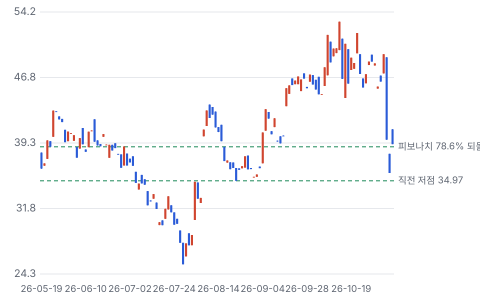

**주봉**

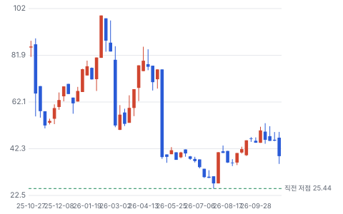

**월봉**

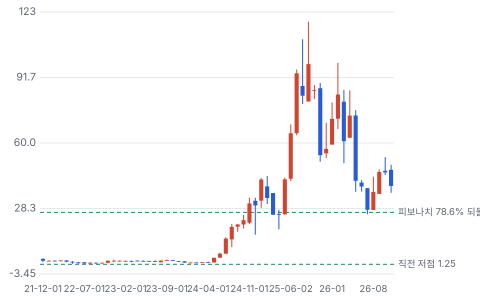

**분기 매출·EPS 실적과 컨센서스**

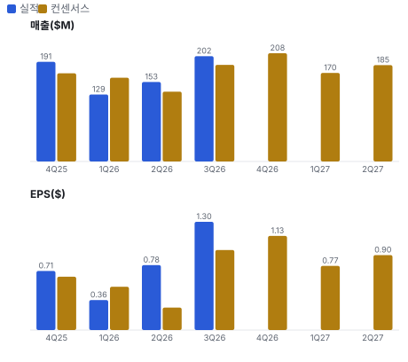

**밸류에이션 주가 시나리오**

**주가별 업사이드**

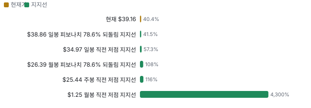

**제품·서비스 포트폴리오**

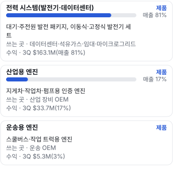

**고객 믹스(3Q26, 매출 대비)**

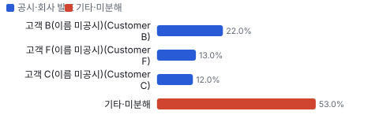

**공급 병목(10점, 낮을수록 병목)**

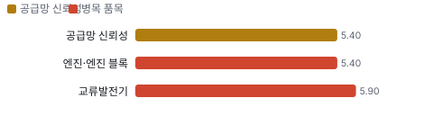

**생산능력 현재와 확충 계획(분기 매출 \$B(명목 캐파 미공시 — 3Q 매출로 대신))**

**CAPEX의 매출 대비 비중**

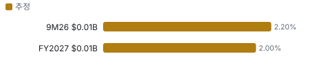

**어닝콜 변화별 주주가치 영향**

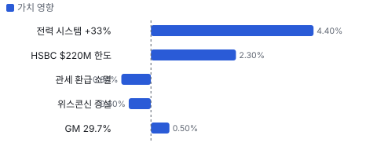

**멀티플 프리미엄(현재값 — 최근 4개 분기 추이 재료 없음)**

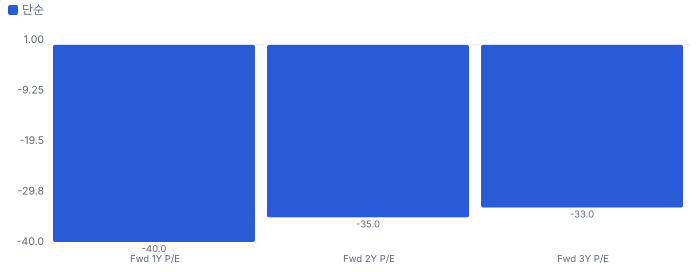

**합리적 멀티플**

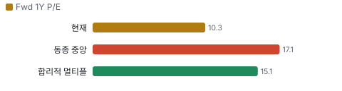

**매출 → 매출총이익 → 영업이익(매출 = 100, 최근 4분기)**

**1년 전 대비 마진 기여(비용 비중 변화의 반대)**

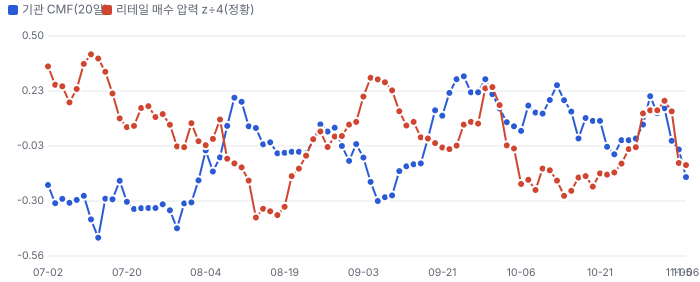

**분기 비용 비중 추이(매출 대비, 공시)**

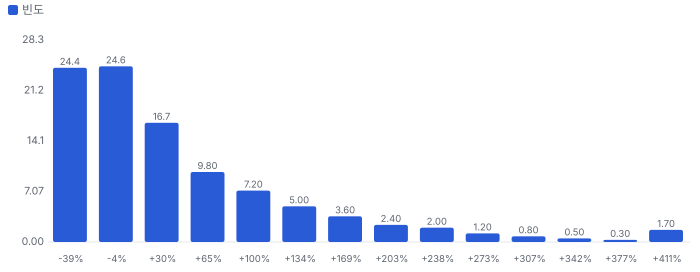

**비용 요인별 매출 대비 비중과 1년 변화**

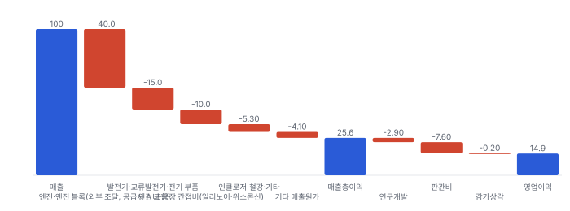

**BOM 항목 가격 +10% 시 OPM 변화**

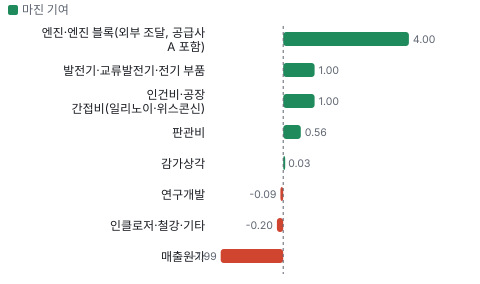

**전력 시스템(발전기·데이터센터) BOM 원가 몫과 가격 +10% 시 OPM**

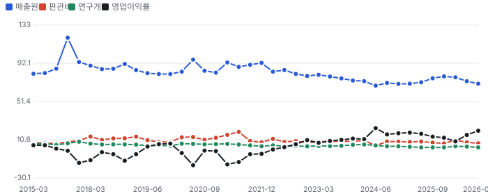

**산업용 엔진 BOM 원가 몫과 가격 +10% 시 OPM**

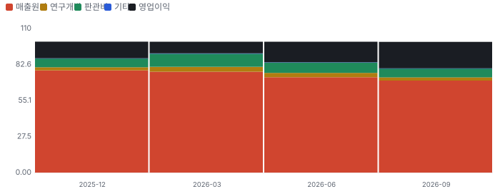

**10년 P·Q 사이클 — 추세(HP 필터) 대비 갭과 8분기 전망**

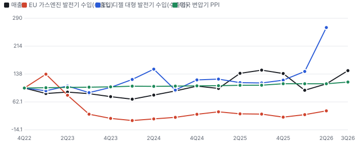

**매출 증가율의 가격·물량 분해와 8분기 전망(전년 대비)**

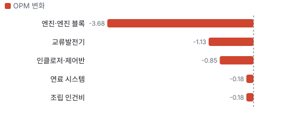

**분기별 매출 증가율 분해**

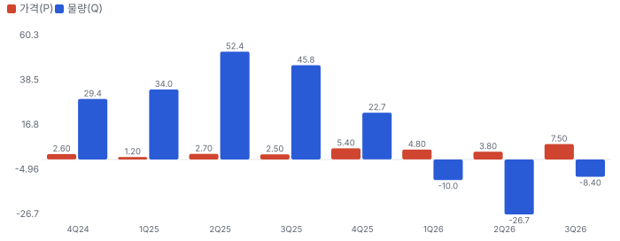

**목표주가 산정 — 약세와 기본 사이(약세 쪽 7%), 도달 확률 약 50%**

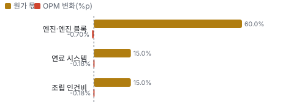

**일봉 지지·저항과 목표주가**

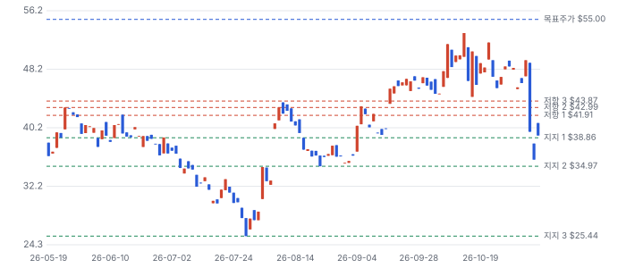

**일별 거래량 분해**

**기관 자금 흐름**

**몬테카를로**

해석: 3,000번 중 1,786번(60%)에서 가치가 지금 주가 이상이었다. 지금 주가를 뒷받침하는 경우와 그렇지 않은 경우가 반반에 가깝다. 가운데 값은 1.15배이고, 열 번 중 여덟 번은 0.62~2.75배 사이에 든다.

## 내러티브

> **기업가치를 결정하는 이야기:** 값은 전력 시스템 매출 × GM이다. 데이터센터·석유가스 발전 패키지가 전력 시스템의 대부분이고 GM은 믹스로 오른다. 값을 가르는 것은 데이터센터 주문이 분기마다 이어지는지와 지배 구조 할인이 줄어드는지다.

> **멀티플·EPS 프리미엄**
> **멀티플:** Fwd 1Y P/E 10.3배로 Generac 13.1배·Cummins 14.6배·Caterpillar 19.5배·GE Vernova 37.5배보다 낮다(11/6 종가). Fwd 2Y는 9.7배다.
> **EPS:** 추정 이력이 없어 리비전을 잴 수 없다 — 커버리지 3명

### 투자자들은 왜 열광했나

2025년 데이터센터 발전기 수요로 매출이 크게 늘며 주가가 \$106.5까지 갔다. 1Q26 매출이 컨센서스를 20% 밑돌며 식었고, 11/4 AI 전력주 동반 매도 하루 −20%(직접 원인 1차 미확인)가 더해졌다.

### 무엇이 기업가치를 바꾸나

> **구조적 체질 변화**
> **변화:** 산업·운송 엔진 회사에서 전력 시스템 회사로
> **증거:** 전력 시스템 비중 2024 2Q 66% → 3Q26 81%
> **반증:** 전력 시스템 비중 하락

> **고부가 믹스 확장**
> **변화:** 데이터센터 발전 패키지가 GM을 올린다
> **증거:** GM 23.9% → 29.7%
> **반증:** GM 25% 아래

> **기술 혁신**
> **변화:** 해당 없음(인증 엔진 통합 회사 — 새 기술 공시 없음)
> **증거:** 10-Q
> **반증:** -

> **실행 속도**
> **변화:** 해당 없음(주문→출하 기간을 공시하지 않고 동종 비교 값도 없다)
> **증거:** 10-Q
> **반증:** -

> **M&A**
> **변화:** 철강 부품 제작 회사 인수로 수직 계열화
> **증거:** 영업권 \$29.8M → \$34.9M(10-Q)
> **반증:** 인수 손상

> **정책·입법 연관성**
> **재정정책:** 해당 없음(보조금 의존 사업이 아니다)
> **행정명령:** 관세 — IEEPA(국제비상경제권한법, 관세 근거 법) 판결로 2Q 관세 환급 \$22.7M을 받았다. 다른 관세 근거(232조 등)는 계속 원가에 남는다 3Q 10-Q 반증: 추가 관세로 GM 하락 의회 동의 2/10 — 하원 1/5(행정부 조치·법원 판결 사안) · 상원 1/5(같음).
> **연관입법:** 중국 지배 기업에 대한 미국 규제 논의(일반) — 이 회사 특정 법안은 찾지 못했다 공개 기록 반증: 관련 법안 발의

> **CAPEX 낙수효과**
> **변화:** 하이퍼스케일러 데이터센터 투자가 발전기 수요로 온다. 고객 투자를 PSIX 매출로 바로 옮기지 않는다
> **증거:** 고객 3곳 47%(이름 미공시)
> **반증:** 데이터센터 주문 지연

### 내러티브 근거

> '데이터센터 발전기 소형주'가 52주 고점 \$106.5를 만들었지만 지금 \$39다. 3Q 매출이 +33% QoQ로 돌아섰는데도 시장은 Weichai 지배·고객 집중·커버리지 3명에 할인을 건다. 동종 대비 멀티플 차이 -40% 중 회사 고유 몫은 -32%다. 단계는 확산, 쏠림은 중간이다.

> **데이터센터 발전기 수요** · 유지
> **논리:** 데이터센터 대기·주전원 발전기가 전력 시스템 매출을 끈다
> **숫자:** 전력 시스템 3Q \$163.1M(+33% QoQ)
> **반증:** 4Q 전력 시스템 매출 감소(2027-03)

> **이익률 개선** · 유지
> **논리:** 믹스·가격으로 GM이 오른다
> **숫자:** GM 23.9%(3Q25) → 29.7%(3Q26)
> **반증:** GM 25% 아래

> **중국 지배주주(약세)** · 유지
> **논리:** Weichai 지배가 미국 데이터센터 고객·정책에서 할인 요인이다
> **숫자:** Weichai 46%, 이사 4석
> **반증:** 지분 매각·지배 구조 변경

> **고객 집중·변동(약세)** · 강화
> **논리:** 주문 시점에 따라 분기 매출이 크게 흔들린다
> **숫자:** 1Q26 매출 \$128.6M(−20% 미달) → 3Q \$202.1M
> **반증:** 4개 분기 연속 컨센서스 상회

## 포트폴리오

| 제품·서비스 | 구분 | 무엇 | 쓰는 곳 | 돈 버는 방식 | Mix | Mix 변화(전년 대비) |
|---|---|---|---|---|---|---|
| 전력 시스템(발전기·데이터센터) | 제품 | 대기·주전원 발전 패키지, 이동식·고정식 발전기 세트 | 데이터센터·석유가스·임대·마이크로그리드 | 3Q \$163.1M(매출 81%) | 81% | -2.4%p |
| 산업용 엔진 | 제품 | 지게차·작업차·펌프용 인증 엔진 | 산업 장비 OEM | 3Q \$33.7M(17%) | 17% | +2.9%p |
| 운송용 엔진 | 제품 | 스쿨버스·작업 트럭용 엔진 | 운송 OEM | 3Q \$5.3M(3%) | 3% | -0.5%p |

**Mix 변화가 가장 큰 쪽은 산업용 엔진(+2.9%p, 전년 대비).** 계절성 판정: 분기 매출 계절 지수 기준 있음 → 전년 같은 분기와 비교.

## 고객

> **3Q26 최대 고객 고객 B(Customer B) 22%, 상위 3곳 47%, 집중도 분산.** 공시·회사 발표로 확인한 몫은 매출의 47%이고, 나머지 고객 몫은 추정이거나 미분해다. 10% 넘는 고객 3곳이 3분기 매출의 47%다(B 22%·F 13%·C 12%). 이름은 공시되지 않는다

**고객별 매출 몫(3Q26)**
| 고객 | 몫 | 변화 | 근거 |
|---|---|---|---|
| 고객 B(Customer B) | 22% | +4%p | 공시 |
| 고객 F(Customer F) | 13% | -4%p | 공시 |
| 고객 C(Customer C) | 12% | +1%p | 공시 |
| 기타·미분해 | 53% | - | - |

> **고객 B(Customer B)** · 공시
> **사는 것:** 미확인
> **추정 근거:** 이름 미공시

> **고객 F(Customer F)** · 공시
> **사는 것:** 미확인
> **추정 근거:** 매출채권의 25%

> **고객 C(Customer C)** · 공시
> **사는 것:** 미확인
> **추정 근거:** 이름 미공시

## 마진 구조

> **GPM 29.7%, OPM 20.2%.** 3Q25 대비 GPM +5.8%p, OPM +6.4%p. 3Q26 매출원가는 매출의 70.3%로 1년 전 76.1%보다 5.8%p 낮다. 전력 시스템(데이터센터·석유가스) 믹스와 가격 덕이다. 판관비는 7.5% → 6.8%다. 2Q에는 관세 환급 \$22.7M이 끼어 있어 비교에서 뺐다

> **매출 100 중 매출원가 74.4, 매출총이익 25.6(최근 4분기, 공시).** 매출원가 요인 중 엔진·엔진 블록(외부 조달, 공급사 A 포함)이 매출의 40.0%로 가장 무겁고, 단가가 +10% 오르면 GPM이 -4.00%p 움직인다. 분기 회귀로 매출 1이 늘 때 매출원가는 0.62 늘고, 매출원가의 고정비 몫은 23%다.

**비용 요인 강도 — 비중·추세·충격(+10%)·탄력**
| 비용 | 구분 | 매출 대비 | 1년 변화 | 마진 기여 | 충격 시 마진 | 매출 탄력 | 고정비 몫 |
|---|---|---|---|---|---|---|---|
| 엔진·엔진 블록(외부 조달, 공급사 A 포함) | 매출원가 요인 | 40.0% | -4.0%p | +4.0%p | -4.00%p | 미확인 | 0% |
| 발전기·교류발전기·전기 부품 | 매출원가 요인 | 15.0% | -1.0%p | +1.0%p | -1.50%p | 미확인 | 0% |
| 인건비·공장 간접비(일리노이·위스콘신) | 매출원가 요인 | 10.0% | -1.0%p | +1.0%p | -1.00%p | 미확인 | 60% |
| 인클로저·철강·기타 | 매출원가 요인 | 5.3% | +0.2%p | -0.2%p | -0.53%p | 미확인 | 미확인 |
| 매출원가 | 공시 항목 | 74.4% | +2.0%p | -2.0%p | -7.44%p | 0.62 | 23% |
| 판관비 | 공시 항목 | 7.6% | -0.6%p | +0.6%p | 미확인 | 0.04 | 53% |
| 연구개발 | 공시 항목 | 2.9% | +0.1%p | -0.1%p | 미확인 | -0.00 | 100% |
| 감가상각 | 공시 항목 | 0.2% | -0.0%p | +0.0%p | 미확인 | -0.01 | 100% |

매출 탄력 = 분기 비용을 매출에 회귀한 기울기(매출 1당 변동비), 고정비 몫 = 절편 ÷ 평균 비용. 표본이 8분기 미만이면 미확인. 매출원가 요인 비중은 margin 재료의 추정이 섞여 있고, 공시 매출원가와의 차이는 '기타 매출원가'로 둔다.

**GPM에서 OPM까지(GAAP)**
| 기간 | GPM | 연구개발 | 판관비 | 기타 | OPM |
|---|---|---|---|---|---|
| 3Q25 | 23.9% | 2.4% | 7.5% | 0.1% | 13.9% |
| 3Q26 | 29.7% | 2.5% | 6.8% | 0.1% | 20.2% |

**GPM·OPM 최근 4개 분기**
| 분기 | GPM | OPM |
|---|---|---|
| 2025-12 | 21.9% | 12.7% |
| 2026-03 | 22.9% | 8.9% |
| 2026-06 | 27.1% | 15.7% |
| 2026-09 | 29.7% | 20.2% |

**마진을 결정하는 비용 요인 — 비용 +10% 시 OPM**
| 비용 | 매출 대비 | 변화 | 고정비 | OPM |
|---|---|---|---|---|
| 엔진·엔진 블록(외부 조달, 공급사 A 포함) | 40.0% | -4.0%p | 0% | -4.00%p |
| 발전기·교류발전기·전기 부품 | 15.0% | -1.0%p | 0% | -1.50%p |
| 인건비·공장 간접비(일리노이·위스콘신) | 10.0% | -1.0%p | 60% | -1.00%p |
| 판관비 | 6.8% | -0.7%p | 80% | -0.68%p |
| 인클로저·철강·기타 | 5.3% | +0.2%p | 미확인 | -0.53%p |
| 연구개발비 | 2.5% | +0.2%p | 90% | -0.25%p |
| 기타 영업비용 | 0.1% | -0.0%p | 100% | -0.01%p |

**비용을 움직이는 요인**
| 비용 | 요인 |
|---|---|
| 엔진·엔진 블록(외부 조달, 공급사 A 포함, 매출원가) | 엔진 단가·관세 · 근거 추정 |
| 발전기·교류발전기·전기 부품(매출원가) | 구리·전기강판 · 근거 추정 |
| 인건비·공장 간접비(일리노이·위스콘신, 매출원가) | 위스콘신 램프 · 근거 추정 |
| 판관비(판관비) | 인건비 · 근거 공시 |
| 인클로저·철강·기타(매출원가) | 철강 가격 · 근거 추정 |
| 연구개발비(연구개발) | 인증 엔진 개발 · 근거 공시 |
| 기타 영업비용(기타) | 상각 · 근거 공시 |

**전력 시스템(발전기·데이터센터) BOM — 매출의 81%, GPM 30%(회사 전체 3Q GAAP GM — 부문 GM 미공시), 항목 가격 +10% 시**
| 항목 | 원가 몫 | 전가 | 제품 GPM | OPM |
|---|---|---|---|---|
| 엔진·엔진 블록 | 45~60% | 미확인 | -3.7%p | -2.98%p |
| 교류발전기 | 15~25% | 미확인 | -1.4%p | -1.13%p |
| 인클로저·제어반 | 10~20% | 미확인 | -1.1%p | -0.85%p |
| 미분해 | 12% | - | - | - |

**산업용 엔진 BOM — 매출의 17%, GPM 30%(회사 전체 값), 항목 가격 +10% 시**
| 항목 | 원가 몫 | 전가 | 제품 GPM | OPM |
|---|---|---|---|---|
| 엔진·엔진 블록 | 50~70% | 미확인 | -4.2%p | -0.70%p |
| 연료 시스템 | 10~20% | 미확인 | -1.1%p | -0.18%p |
| 조립 인건비 | 10~20% | 미확인 | -1.1%p | -0.18%p |
| 미분해 | 10% | - | - | - |

엔진·엔진 블록 가격이 +10% 오르면 영업이익은 -18.2% 움직인다. 판매가 전가를 모르는 항목은 전가 0%로 계산했다.

**BOM 항목 가격을 움직이는 것**
| 항목 | 요인 |
|---|---|
| 엔진·엔진 블록 | 원가의 중심, 관세 노출 · 근거 추정 |
| 교류발전기 | 구리 가격 · 근거 추정 |
| 인클로저·제어반 | 철강·전기 부품 · 근거 추정 |
| 엔진·엔진 블록 | 원가 중심 · 근거 추정 |
| 연료 시스템 | 인증 부품 · 근거 추정 |
| 조립 인건비 | 공장 · 근거 추정 |

**BOM 투입 물가 — PPI 전년비, 2026-11-08 수집**
| 항목 | 미국 | 일본 | 한국 | 대만 |
|---|---|---|---|---|
| 교류발전기 | +30.0% | +54.2% | -4.9% | +40.1% |

별표는 품목보다 넓은 업종 지수다. 지난 1년 투입 물가를 판매가 전가 뒤 원가에 그대로 넣으면 OPM은 -3.54%p 움직인다(매출원가의 16% 기준).

## 공급망 병목

> **공급망 신뢰성 5.4/10, 병목 주의.** 가장 약한 고리는 엔진·엔진 블록 5.4점이고, 품목 평균은 5.5점이다. 핵심 투입물은 엔진·엔진 블록이다. 공급사 A 한 곳이 3Q 매입의 28%다(10-Q, 이름 미공시). 관계사(Weichai) 매입채무가 \$18.8M다

**병목과 마진 — 품목 가격 +10% 시 OPM**
| 품목 | 점수 | 판정 | 구분 | OPM |
|---|---|---|---|---|
| 엔진·엔진 블록(필수) | 5.4 | 병목 주의 | 핵심 통제 품목 | -3.68%p |
| 교류발전기(필수) | 5.9 | 병목 주의 | 핵심 통제 품목 | -1.13%p |

> **엔진·엔진 블록** · 5.4/10
> **왜:** 인증 엔진은 재인증이 길다
> **병목 요인:** 인증 공급사 2곳 · 캐파 빠듯 · 리드타임 미확인 · 재인증 12개월 · 1위 점유율 40% · 미국·중국(추정) 집중 60% · 물량 확보 미확인
> **풀리는 조건:** 미확인

> **교류발전기** · 5.9/10
> **왜:** 발전 패키지 출하 속도
> **병목 요인:** 인증 공급사 2곳 · 캐파 빠듯 · 리드타임 미확인 · 재인증 6개월 · 1위 점유율 40% · 미국·유럽(추정) 집중 50% · 물량 확보 미확인
> **풀리는 조건:** 미확인

**공급사**
| 품목 | 공급사 | 몫 | 근거 |
|---|---|---|---|
| 엔진·엔진 블록 | 공급사 A(매입의 28%) | 미확인 | 공시 |
| 엔진·엔진 블록 | Weichai 계열사(엔진·부품) | 미확인 | 공시 |
| 교류발전기 | 외부 공급사(미공시, 교류발전기) | 미확인 | 추정 |

## 생산능력

> **현재 명목 캐파 0 분기 매출 \$B(명목 캐파 미공시 — 3Q 매출로 대신), 가동률 미확인.** FY2027 CAPEX는 \$0.01B로 매출의 2.0%다. 회사는 명목 캐파를 밝히지 않는다. 위스콘신(Darien(위스콘신 공장 지역)·Beloit(위스콘신 공장 지역)) 램프를 진행 중이고 비용·산출이 위험 문구에 있다(10-Q). 유형자산은 \$23.0M에서 \$33.5M로 늘었다

공개된 증설 계획은 확인되지 않았다.

**CAPEX와 매출 대비**
| 기간 | CAPEX | 매출 | 매출 대비 | 구분 |
|---|---|---|---|---|
| 9M26 | \$0.01B | \$0.48B | 2.2% | 추정 |
| FY2027 | \$0.01B | \$0.75B | 2.0% | 추정 |

## 해자

> 해자는 배출가스 인증 엔진·발전 패키지의 맞춤 설계 역량과 Weichai 엔진 조달이다. 둘 다 숫자로 재기 어렵다.

> **배출가스 인증·맞춤 패키지** · 보통
> **해자:** EPA(미국 환경보호청)·CARB(캘리포니아 대기자원국) 인증 엔진을 OEM 요구에 맞춰 통합한다
> **근거:** 10-Q 사업 설명
> **숫자:** GM 29.7%(3Q)
> **깨지는 조건:** 대형 엔진사가 같은 맞춤 패키지를 직접 판다

> **Weichai 조달·자본** · 보통
> **해자:** 지배주주 Weichai의 엔진과 신용을 쓴다
> **근거:** Weichai 46%·이사회 4석, 공급사 A 매입 28%(10-Q)
> **숫자:** 관계사 매입채무 \$18.8M
> **깨지는 조건:** 미국 규제로 Weichai 관계가 제약된다

## 경영진·네트워크

> 지배주주 Weichai가 46%와 이사회 4석(과반)을 갖는다. 창업자들은 Weichai 안건에 찬성하기로 약정했다(10-Q). 경영진 이름은 이번 회차에 위임장으로 확인하지 못했다

> **미확인** · CEO · 미확인
> **프로필:** 미확인
> **비즈니스:** 미확인
> **정계:** 미확인
> **동문:** 미확인
> **사모임:** 미확인

**네트워크 정량화**
| 연결 | 강도 | 닿는 매출 | 가중 노출 | 매출 대비 | 근거 |
|---|---|---|---|---|---|
| 비즈니스: Weichai — 지분 46%, 이사 4석, 관계사 매입 | 5/5 | \$0.67B | \$0.67B | 100% | 회사 전체 TTM 매출 3Q 10-Q 지배 구조·관계사 거래 |
| 정계: 미·중 정책 노출(중국 지배주주) | 0/5 | 미확인 | 미확인 | 미확인 | 공개 기록에서 정치 연결은 찾지 못했다 10-Q |

가중 노출은 연결이 닿는 매출의 크기다. 연결이 그 매출을 만들었다는 뜻이 아니며, 인과는 공개 자료로 입증하지 못한다.

## 약세 논리 및 셀온 조건

| 약세 논리 | 근거 | 반박 | 가를 자료 |
|---|---|---|---|
| 중국 지배주주 할인은 구조적이다 | Weichai 46%, 이사 4석(과반), 창업자 의결권 약정(10-Q) | Weichai 조달과 신용이 원가·자금 경쟁력이기도 하다 | 지배 구조 변경·미국 규제 공시 |
| 고객 3곳에 몰렸다 | 3Q 고객 B 22%·F 13%·C 12%, 매출채권 F 25%(10-Q) | 전년에도 10%대 고객 3~4곳 구조였다 | FY26 10-K 고객 집중(2027-03) |
| 분기 변동이 크다 | 1Q26 \$128.6M(컨센서스 −20%) → 3Q \$202.1M | 전력 시스템 비중이 81%로 올라 방향은 위다 | 4Q 실적(2027-03) |
| 이익의 질 | 2Q 관세 환급 \$22.7M(일회성) | 3Q는 환급 없이 영업이익 \$40.9M | 4Q GM |
| 공매도·유통 물량 | 공매도 유통의 14%, 유통주식이 적다 | - | FINRA(미국 금융산업규제국) 공매도 잔고 추이 |

**추가 원천(11/8 보강).** 중간선거 영향 +0.3/10 — 정책 채널은 IRA(미국 인플레이션감축법) 청정에너지 세액공제 축소 입법 위험 하락(+0.9)과 전력망 투자(+0.5)이고, 업종 반응은 GRID 선거 뒤 CAR(사건 뒤 시장 대비 초과 누적 수익률) −2.1%(t −0.95)다. 정책 0단계(선거 결과) 가설이다. 커뮤니티 관심은 약하다 — 레딧 상위 목록에 없고, 7일 대화 점수는 Weak(50)이며 X에서 어닝콜을 두고 신중론이 나왔다는 정도다.

> **셀온 조건**
> **조건 1:** 전력 시스템 매출이 2분기 연속 감소한다
> **조건 2:** GM이 25% 아래로 간다
> **조건 3:** 고객 B·F 중 한 곳이 이탈한다
> **조건 4:** 중국 지배 기업에 대한 미국 규제가 법안 단계로 간다

## 어닝콜 변화

**직전 콜 대비 새로 나오거나 바뀐 내용 → 가치 영향**
| 항목 | 내용 | 직전 콜 | 최신 콜 | 모델 동인 이동 | 확신도 | 가치 영향 |
|---|---|---|---|---|---|---|
| 업데이트 | 전력 시스템 매출 |  |  | 기준연도 매출 +\$0.03B | 1.0 | +4.4% |
| 업데이트 | 매출총이익률 |  |  | 출발 이익률 +1.0% | 1.0 | +0.5% |
| 부정 | 관세 환급 |  |  | 목표 이익률 -0.50% | 1.0 | -0.8% |
| 신규 | 신용 한도 |  |  | 할인율(WACC) -0.20% | 1.0 | +2.3% |
| 신규 | 위스콘신 증설 |  |  | 매출÷투하자본 -10.0% | 0.8 | -0.6% |
| **합계** | 단독 합 |  |  | 동시 적용 +5.8% |  | **+5.8%** |

## P·Q 사이클

> **10년 위치: Q형 기업(매출 갭 분산의 0%가 가격) — 가격은 추세 대비 -4.1%(수축, 10년 분위 26%), 물량은 +7.6%(둔화, 분위 68%). P 프리미엄 -24%, Q 프리미엄 +9%(매출총이익이 정상(추세) 수준보다 요인별로 이만큼 높거나 낮다).** 전망으로 가격 갭은 4분기 뒤 -0.3%·8분기 뒤 +0.5%, 물량 갭은 +1.2%·+0.1%(물량은 컨센서스 몫 49%를 섞었다). 이익이 정상보다 낮다 — 바닥 이익 기준 멀티플은 높아 보여도 정상 이익 기준으로는 낮을 수 있다.

**10년 P·Q 사이클 위치·프리미엄**
| 항목 | 가격(P) | 물량(Q) |
|---|---|---|
| 추세 대비 갭(현재) | -4.1% | +7.6% |
| 사이클 시계 | 수축 | 둔화 |
| 10년 분위 | 26% | 68% |
| 프리미엄(현재) | -24% | +9% |
| 프리미엄 4분기 뒤 | -2% | +1% |
| 프리미엄 8분기 뒤 | +3% | +0% |
| 갭 반감기 | 2분기 | 4분기 |
| 갭 4분기 뒤(80% 범위) | -0.3% (-2.6%~+2.0%) | +1.2% (-7.1%~+10.1%) |
| 갭 8분기 뒤(80% 범위) | +0.5% (-1.9%~+2.9%) | +0.1% (-9.8%~+11.0%) |
| 전망 모형 | AR(3) 정상성 보정 | AR(3) + 컨센서스(분기 컨센서스 4개 + 연간 컨센서스 성장률 FY2027→FY2028 +8%, 4분기 뒤 몫 49%) |

방법: P = 가격 지수 4분기 평균(미국 PPI(생산자물가지수) 변압기·배전 기기 대용 — 회사 판매가가 아니라 업종 가격), Q = TTM 매출 ÷ P. 추세는 로그 레벨의 HP(추세 분리 필터) 필터(λ 1600)로 정상(mid-cycle) 수준을 잡는다. 프리미엄 = 요인별 매출총이익 증분 ÷ 정상 매출총이익(정상 GPM 18.3% = 10년 중앙값, 물량 증분 마진 21.1% = 전년 대비 ΔGP÷ΔRev 회귀, 가격은 전액 이익 반영). 표본 34개 TTM 분기. 전망: 가격 갭은 BIC(모형 차수를 고르는 정보 기준)로 차수를 고른 AR(정상성 보정), 물량은 통계 갭 AR과 컨센서스 매출 ÷ 가격 전망(매출 = P × Q)을 분산 역수로 섞는다(Bates·Granger 1969). 끝점 편향을 줄이려고 전망 경로를 이어 붙인 뒤 HP 필터를 다시 건다(Kaiser·Maravall 1999). 80% 범위는 AR 예측 오차와 애널리스트 범위에서 낸다. 모형 산출이며 가이던스가 아니다.

> **P 사이클 — 최근 4분기 평균 가격 기여 +5.4%, 물량 기여 -5.6%(전년 대비 로그 증가율).** P 강도 4.5/10, Q 강도 4.9/10, 최근 8분기 중 38%가 같은 요인 우세(순환적). 전망으로는 2분기 뒤(1Q27) Q 사이클로 전환(물량은 컨센서스를 섞었다).

**P·Q 사이클 정량**
| 항목 | 가격(P) | 물량(Q) |
|---|---|---|
| 최근 4분기 평균 기여 | +5.4% | -5.6% |
| 강도(0~10, 자기 이력 z) | 4.5 | 4.9 |
| AR 고유 주기(AR(2)일 때) | 19.0분기 | 미확인 |
| 다음 4분기 투영 평균 | +10.7% | +1.4% |

가격 근거: 미국 PPI 변압기·배전 기기 대용 — 회사 판매가가 아니라 업종 가격. PPI를 쓰면 회사 판매가가 아니라 업종 가격 대용이다. 로그 증가율이라 가격·물량 기여의 합이 매출 증가율이다. 전망: 가격은 BIC로 차수를 고른 AR, 물량은 AR과 '컨센서스 매출 증가율 − 가격 전망'을 분산 역수로 섞는다. 모형 산출이며 가이던스가 아니다. 회사 판매가로 잴 수 없는 이유: 출하 대수·단가를 공시하지 않는다 — 업종 PPI로 대신한다

## 밸류에이션

> **목표주가 \$55, 업사이드 +40%.** 자리는 약세와 기본 사이(약세 쪽 7%)이고 도달 확률은 약 50%다. 기본 \$57, 강세 \$89(+128%), 약세 \$31(-20%). DCF 기준 업사이드는 기본 +24%, 강세 +138%, 약세 -23%다(WACC 10.1%).

기준 멀티플이 Fwd 1Y P/E라 EPS도 다음 4개 분기 EPS를 쓴다. 컨센서스 표본이 3명이라 기본 시나리오의 정보가 적다.

> **약세 \$31 (-20%)** · 확률 30%
> **가정:** 11.2배 × EPS \$2.80
> **근거:** 데이터센터 주문이 밀리고 GM이 25%대로 돌아간다. 다음 4개 분기 EPS 컨센서스 \$3.80보다 약 26% 낮다

> **기본 \$57 (+44%)** · 확률 45%
> **가정:** 14.9배 × EPS \$3.80
> **근거:** 다음 4개 분기 EPS 컨센서스 \$3.80대로 간다(애널리스트 3명)

> **강세 \$89 (+128%)** · 확률 25%
> **가정:** 18.6배 × EPS \$4.80
> **근거:** 3Q처럼 분기 EPS \$1.2 이상이 이어지고 위스콘신 램프가 산출을 늘린다

**멀티플 선정 — Fwd 1Y P/E**
| 단계 | 조정 | 근거 |
|---|---|---|
| 동종 중앙값 | 17.1배 | 범위 13.1~37.5배, 4곳 |
| 펀더멘털 | -6% | 성장·이익률·ROIC로 본 합리적 멀티플 15.1배와의 차이의 일부만 인정 |
| 해자 | +3% | 배출가스 인증·맞춤 패키지 보통 · Weichai 조달·자본 보통 |
| 반복 매출 | +0% | 재료 없음 |
| 수주 전환·가시성 | +0% | 가시성 재료 없음 |
| 내러티브 | +5% | 단계 확산 |
| 사이클·실행 판단 | -15% | Weichai가 46%와 이사회 과반을 쥔 지배주주 회사이고, 애널리스트가 3명뿐이며, 고객 3곳이 3분기 매출의 47%라 동종 배수를 다 주지 않는다 |
| **선정** | **14.9배** | 지금 10.3배 |

**동종 레인지**
| 회사 | Fwd 1Y P/E | Fwd 2Y P/E | Fwd 3Y P/E | 성장 | 영업이익률 | ROIC |
|---|---|---|---|---|---|---|
| CAT | 19.5 | 16.7 | 14.7 | 8% | 20% | 21% |
| CMI | 14.6 | 13.3 | 11.3 | 9% | 15% | 24% |
| GEV | 37.5 | 30.7 | 23.9 | 19% | 13% | - |
| GNRC | 13.1 | 8.3 | 7.0 | 34% | 16% | 15% |
| **Power Solutions International** | 10.3 | 9.7 | 8.7 |  |  |  |

지금 주가가 요구하는 5년 매출 CAGR 2%, 기본 시나리오 8%. 몬테카를로 중앙값 업사이드 +15%.

> 의사결정 보조(투자자문 아님): ① 매수 매력: 연 기대수익 +17.9% (자기자본비용 10.1% 대비 +7.8%p) · 자본비용 초과 확률 55% · 안전마진 0.62 → 정량 신호 중립 / ② 위험 예산 지표(이론): 1/4 켈리 10.0% (상한 10%) · 5년 하위10% -10% · 30%+ 손실 확률 3% / ③ 상방(5년): 기대 2.28배 · 2배 42% · 3배 22% · 10배 1% · 상위10% 4.30배

투입 물가 점검: 지난 1년 PPI를 BOM에 넣으면 OPM -3.54%p다(매출원가의 16% 기준).

## 매수 위치(일봉)

> **현재가 \$39.16는 '지지 근접'(가장 가까운 일봉 지지 \$38.86에서 ATR 0.1배 위).** 이 자리에서 목표주가까지 +40.4%, 첫 일봉 저항까지 +7.0%, 다음 지지까지 하방 -0.8%, 손익비 52.5배.

**가격대별 업사이드(일봉 기준)**
| 가격대 | 가격 | 목표주가까지 | 첫 저항까지 | 다음 지지까지 | 손익비 | 근거 기법(강도) |
|---|---|---|---|---|---|---|
| 현재가 | \$39.16 | +40.4% | +7.0% | -0.8% | 52.5 | - |
| 지지 1 | \$38.86 | +41.5% | +7.9% | -10.0% | 4.2 | 피보 78.6%(1.0) |
| 지지 2 | \$34.97 | +57.3% | +11.1% | -27.3% | 2.1 | 120일 지그재그 저점 · 스윙 저점(1.8) |
| 지지 3 | \$25.44 | +116.2% | +37.5% | 미확인 | 미확인 | 120일 지그재그 저점(0.8) |

**일봉 저항**
| 저항 | 가격 | 현재가 대비 | 근거 기법(강도) |
|---|---|---|---|
| 저항 1 | \$41.91 | +7.0% | 피보 61.8%(1.0) |
| 저항 2 | \$42.99 | +9.8% | 120일 지그재그 고점(0.8) |
| 저항 3 | \$43.87 | +12.0% | 120일 지그재그 고점 · 피보 50.0%(1.8) |

일봉만 쓴다(주봉·월봉 제외). 손익비 = 목표주가까지 업사이드 ÷ 다음 지지까지 하방. 가격대별 기대값 참고표이며 매수·매도 시점 지시가 아니다.

## 애널리스트 토론

> **토론 결론 Buy(규칙 등급 Strong Buy).** 규칙 등급 Strong Buy는 DCF(+24%)·몬테카를로 중앙값(+15%)이 모두 현재가 위라 숫자로 지지된다. 다만 Weichai 지배·고객 3곳 47%·커버리지 3명이라 컨센서스 표본이 얇아 한 단계 낮춘 Buy로 조율한다

**패널(가상 애널리스트)**
| 자리 | 애널리스트 | 핵심 논리 | 틀리는 조건 | 최종 투표 |
|---|---|---|---|---|
| Strong Buy | 한서윤(가상 리서치 하우스 아라증권) | 3Q EPS \$1.30에 Fwd 1Y P/E 10.3배다 | 4Q 매출 \$180M 아래 | Buy |
| Buy | 오지후(가상 리서치 하우스 누리리서치) | 동종 중 가장 싸고 이익률은 오른다 | GM 하락 | Buy |
| Neutral | 배다온(가상 리서치 하우스 솔빛증권) | 분기 변동이 너무 크다 | 4개 분기 연속 상회 | Buy |
| Sell | 권태하(가상 리서치 하우스 다솜리서치) | 중국 지배주주 할인은 구조적이다 | 지배 구조 변경 | Neutral |
| Strong Sell | 민세온(가상 리서치 하우스 한결증권) | 이익의 질이 낮다 | 일회성 없이 GM 30% 유지 | Sell |

**투표**
| Strong Buy | Buy | Neutral | Sell | Strong Sell |
|---|---|---|---|---|
| 0 | 3 | 1 | 1 | 0 |

> **개회 · Strong Buy**
> **발언:** EPS \$1.30 분기에 10배다

> **개회 · Buy**
> **발언:** 동종보다 싸다

> **개회 · Neutral**
> **발언:** 분기 변동이 크다

> **개회 · Sell**
> **발언:** Weichai 지배 할인은 사라지지 않는다

> **개회 · Strong Sell**
> **발언:** 관세 환급이 이익을 부풀렸다

> **반박1 · Buy → Strong Sell**
> **발언:** 3Q에는 관세 환급이 없는데 영업이익 \$40.9M다

> **반박1 · Sell → Strong Buy**
> **발언:** 고객 3곳이 47%다

> **반박1 · Neutral → Buy**
> **발언:** 커버리지 3명의 추정은 정보가 적다

> **반박2 · Strong Buy → Sell**
> **발언:** Weichai 조달이 원가 경쟁력이기도 하다

> **반박2 · Strong Sell → Buy**
> **발언:** 공매도 14%는 이유가 있다

> **반박2 · Neutral → Sell**
> **발언:** 가를 자료는 4Q 실적이다

> **최종 · Strong Buy** · Buy
> **발언:** Buy로 물러선다

> **최종 · Buy**
> **발언:** Buy를 유지한다

> **최종 · Neutral** · Buy
> **발언:** Buy로 옮긴다. DCF·몬테카를로가 모두 현재가 위다

> **최종 · Sell** · Neutral
> **발언:** Neutral로 물러선다

> **최종 · Strong Sell** · Sell
> **발언:** Sell을 유지한다

남은 반대 의견: Neutral·Sell 두 자리 — 분기 변동과 지배 구조 할인은 4Q 전까지 가를 수 없다

패널은 가상 인물이고 실존 IB의 의견이 아니다.

## 커뮤니티 내러티브

커뮤니티 집계 없음 — Quantral 미수록 — 이번 회차 미조회

## 시장 평가

> **셀사이드(IB 애널리스트)**
> **한 줄:** 표본 3명이라 컨센서스의 정보가 적다
> **애널리스트 의견:** 3명 — 모두 강력 매수 — 커버리지가 얇다
> **목표가 평균·범위:** \$80 (\$70~\$93) — 현재가 대비 +103% — 기대의 증거일 뿐

> **바이사이드(기관 투자자)**
> **한 줄:** 유통이 적고 공매도가 많아 변동성이 크다
> **기관 보유:** 38% — 유통주식의 대부분
> **공매도 비중:** 유통의 14.1% — 높다
> **내부자(Weichai 포함):** 63%(yfinance) — 10-Q 기준 Weichai 46% — 유통 물량이 적다

> **언론·업계**
> **한 줄:** 회사 발표 위주
> **3Q 보도자료:** 매출 \$202.1M(+32.5% QoQ) — 2026-11-05

## 체크리스트

| 시점 | 무엇 | 의미 |
|---|---|---|
| 2026년 11월 중순 | 9월 말 13F | AI 전력주 하락기 기관 포지션 |
| 2026년 11월 말 | FINRA 공매도 잔고 | 유통의 14%에서 늘었나 |
| 2027년 3월 초(예상) | 4Q26 실적·FY26 10-K | 전력 시스템 매출·GM·고객 집중 |
| 2027년 상반기 | 위스콘신 램프 산출 | 캐파가 매출로 이어지는지 |

## 출처
- PSI 3Q26 10-Q https://www.sec.gov/Archives/edgar/data/1137091/000162828026071065/psix-20260930.htm
- PSI 3Q26 실적 보도자료 https://www.globenewswire.com/news-release/2026/11/05/3397148/17954/en/power-solutions-international-announces-third-quarter-2026-financial-results.html
- 3Q 10-Q
- 10-Q 매출원가 총액 × 공급사 A 매입 28% — 몫 미공시
- 10-Q 위험 문구
- 업계 일반
- 총액과의 차이
- 10-Q 관계사 매입채무

_구매 등급·목표주가 모두 규칙이 계산한 모델 값으로, 개인의 보유 종목·자금 사정을 반영하지 않는다 · 공개 자료 기반 분석이며 투자 권유가 아님 · 1차 판정, 미검증 · Chiip ten-bagger_