# 텐배거 리포트 2026-11-07 — Quanta Services — 선거 이틀에 −22.5%, 숫자는 그대로다

> 2026-11-07 · Quanta Services(PWR) · 기업: 전력망 송배전·변전·데이터센터 전기 인프라 시공(미국 최대 전력 인프라 시공사)

## Chiip View

11/3 \$657에서 11/5 \$509까지 이틀에 −22.5%가 났다. 원인은 중간선거 민주당 우세 뒤 데이터센터 반발·지방 개발 제한 안건 우려로 전력·데이터센터주가 함께 팔린 것이다(보도). 같은 기간 잔고 \$63.7B, FY26 조정 EPS 가이던스 \$17.90~18.30, 애널리스트 등급은 바뀌지 않았다. **그래도 값이 싸진 것은 아니다.** Fwd 1Y P/E 25.6배는 동종 중앙 15.3배보다 68% 높고, DCF 기본은 현재가보다 37% 낮다. 목표주가는 현재가 아래라 등급은 Neutral이다(11/2 판은 Sell). 정책 채널로 잰 중간선거 영향은 +0.3/10이고 업종 ETF는 −2.1%라, PWR만 −22.5%인 차이가 과잉 반응인지 데이터센터 몫의 재평가인지는 아직 가를 자료가 없다 — 가를 자료는 2027년 2월 4Q 실적의 잔고 구성(데이터센터 취소 여부)과 FY27 가이던스다. 중간선거 영향 +0.3/10 — 청정에너지 세액공제 축소 입법 위험 하락(노출 0.3, +0.9)이 가장 크고 전력망 투자(노출 1.0, +0.5)는 양당 사안이며, 업종 ETF(GRID) 선거 뒤 누적 초과수익 −2.1%(t −0.95)로 의미 없다. 정책 0단계(선거 결과) 가설이고 하원 결과는 미확정이다.

## 대시보드
| 항목 | 값 | 설명 |
|---|---|---|
| 주가 | \$540.90 | 고점 대비 -31% · 1년 +22% |
| 시가총액 | \$82.59B | 완전 희석 기준 · EV \$87.79B |
| 업사이드 | -5% | 목표주가 \$515 · 다운사이드 -36% · 손익비(강세÷약세) 1.2 |
| 구매등급 | Neutral | 애널리스트 28명: Strong Buy 25 · Buy 0 · Neutral 3 · Sell 0 · Strong Sell 0 |
| 멀티플 | Fwd 1Y P/E 25.6배 | 동종 중앙값 15.3배 |
| 가이던스 4Q26 | \$12,003M · \$5.12 | 컨센서스 \$11,112M · \$4.78 |
| 알파 | 5.0/10 | 텐배거 가능성 점수 |
| 이벤트 | 4Q26 실적(예상 — 회사 미발표, 지난해 2/19 기준 추정) | 2027-02-18 |

## 한 장 요약
- **기업가치를 결정하는 내러티브** **시장이 산 이야기는 '전력망 연결의 관문을 쥔 숙련공 회사'다.** 3Q는 대형 765kV(미국에서 가장 높은 등급의 교류 송전 전압) 없이 수주잔고를 \$53.4B에서 \$63.7B로 늘렸고 FY26 EPS 가이던스 중간을 \$16.70에서 \$18.10으로 올렸다. 그런데 11/4~5 중간선거 뒤 데이터센터 반발 우려로 이틀에 −22.5%가 나 주가는 5월 종가 고점 \$785의 −31%, Fwd 1Y P/E는 25.6배다. 쟁점은 성장이 아니라 동종 15배 대비 프리미엄과, 데이터센터 몫이 정책 위험에 얼마나 노출됐느냐다.
- **밸류에이션 모델로 본 주가 상방은 어디까지인가?** **목표주가 \$515(-5%), 약세와 기본 사이(약세 쪽 14%)다.** 강세 \$784(+45%)는 Fwd 1Y P/E 26.1배를 강세 EPS에 적용한 값이다. 기본 \$544, 약세 \$345. 손익비 1.2, DCF 기준 업사이드 -37%.
- **수주는 어디까지 왔나?** 잔여 이행의무(RPO(잔여 이행의무, 확정 주문 잔액)) 미확인, 100% 매출 \$41.75B · MSA(반복 공사를 단가로 묶은 기본 계약. 물량 약정은 없다)·단기 계약 추정 주문 미확인, 100% 매출 \$21.98B · NiSource(미국 인디애나 중심 유틸리티) 대형 부하(발전·송배전) 미확인, 100% 매출 미확인. 총 잔고 \$63.7B 중 확정 RPO는 \$41.8B이고 나머지 \$22.0B는 물량 약정 없는 MSA·단기 계약 추정이다. 대형 765kV와 발전은 대부분 아직 잔고 밖이다.
- **마진과 공급망은 어디가 약한가?** GPM 15.8%, OPM 6.8%. OPM을 가장 흔드는 BOM(제품 원가를 이루는 부품·재료 명세) 항목은 현장 숙련 인력(라인맨·전기공)이고 가격 +10%에 -3.24%p다. 공급망 신뢰성은 4.2/10(병목 주의)이고 가장 약한 고리는 대형 변압기·차단기다.
- **생산능력은 얼마나 늘어나나?** 현재 명목 캐파 95,000 명(직원), 착공 이상 증설 0 명(직원). FY2028 CAPEX는 매출의 2.4%다.
- **지금 가격은 무엇을 가정하나?** Fwd 1Y P/E 25.6배는 다음 4개 분기 EPS \$21.12에 동종보다 68% 높은 배수를 준다. 현금흐름으로 풀면 지금 가격도 장기 이익률 10%·WACC 기준 DCF보다 37% 높다. 즉 시장은 선거 뒤에도 PWR의 성장이 동종보다 길게 간다는 데 값을 치르고 있다. 11/2 판의 29.4배보다는 그 몫이 줄었다.
- **왜 움직였나?** 11/4 −11.7%, 11/5 −12.3%, 11/6 +6.3%다. 11/4는 중간선거 민주당 우세 뒤 데이터센터 반발과 지방 개발 제한 안건 통과 우려로 GE Vernova 등과 함께 팔렸다(보도). 11/5 이틀째 하락의 직접 원인은 1차 자료로 확인되지 않았다. 같은 기간 업종 ETF GRID는 −2.1%(t −0.95)라 PWR의 낙폭은 업종보다 훨씬 컸다. 회사 공시·가이던스·애널리스트 등급 변경은 없었다.
- **3Q 콜에서 무엇이 바뀌었나?** FY26 매출 \$41.3~41.6B, 조정 EPS \$17.90~18.30, FCF \$2.5~3.0B로 올렸다. 3Q 매출 \$12.0B(+57%) 중 인수분은 약 \$1.56B다.

쟁점인 데이터센터 위험에 대한 회사 답변은 이렇다. Roth가 데이터센터 지연을 묻자 CEO는 걱정하지 않는다고 했고, 데이터센터가 반으로 줄어도 절벽은 없다는 자체 시험과 유틸리티 성장의 50%는 데이터센터와 무관하다는 말을 했다. 선거·정책 위험에 대한 회사 답변은 아직 없다(콜이 선거 전).
- **무엇이 바뀌면 판단이 달라지나?** 위로는 4Q 실적에서 잔고가 늘고 데이터센터 취소가 없으며 FY27 EPS 가이던스가 \$22 위에서 시작할 때다. 그러면 선거 하락은 과잉 반응으로 판정된다.

아래로는 유틸리티가 2027년 설비 계획을 줄이거나 지방 인허가 제한이 대형 데이터센터 공사 취소로 잔고에 나타날 때다. 다음 확인은 2027년 2월 4Q 실적이다(일정 미발표, 지난해 2/19 기준 추정).

## 한눈에 보기

**일봉**

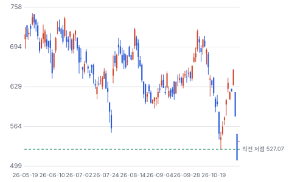

**주봉**

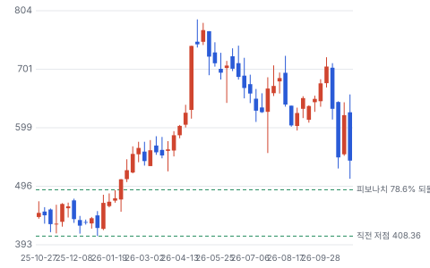

**월봉**

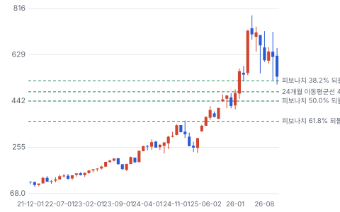

**분기 매출·EPS 실적과 컨센서스**

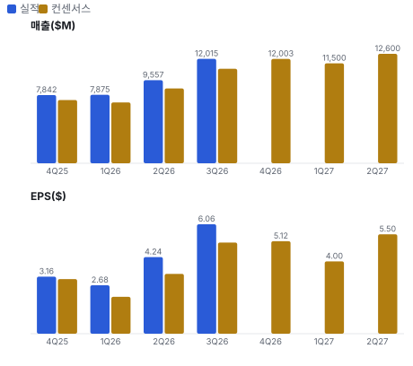

**최근 4개 분기 주가 변화 분석**

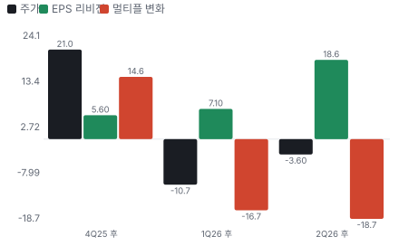

**EPS 리비전**

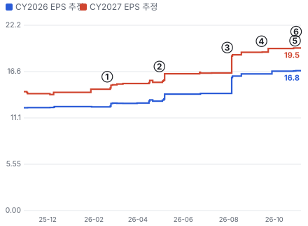

① 26-02-19 4Q25 실적 · EPS 리비전 +4%
② 26-04-30 1Q26 실적, 주가 +15.8% · EPS 리비전 +7%
③ 26-07-30 2Q26 실적, 주가 +17.3% · EPS 리비전 +13%
④ 26-09-14 GE Vernova 매도 개시로 AI 전력주 동반 하락 · EPS 리비전 +2%
⑤ 26-10-29 3Q26 실적, 주가 +4.7%(발표 뒤 추정 아직 미갱신) · EPS 리비전 +0%
⑥ 26-11-04 중간선거 뒤 데이터센터 반발 우려 — 이틀 −22.5% · 실적 창과 겹침

**밸류에이션 주가 시나리오**

**주가별 업사이드**

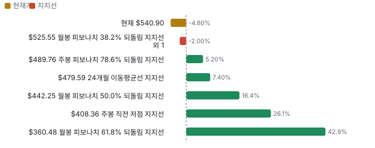

**제품·서비스 포트폴리오**

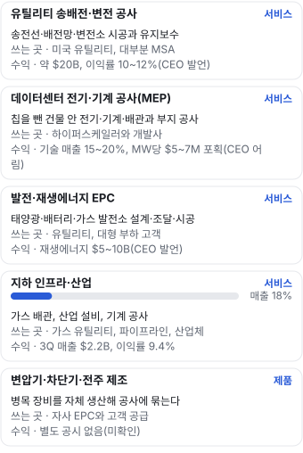

**공급 병목(10점, 낮을수록 병목)**

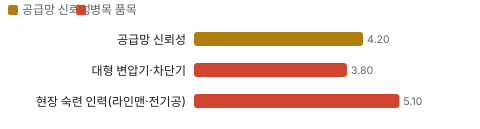

**생산능력 현재와 확충 계획(명(직원))**

**CAPEX의 매출 대비 비중**

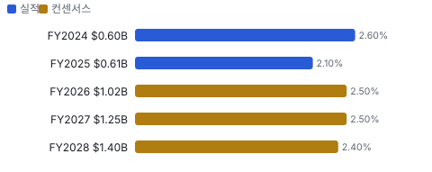

**어닝콜 변화별 주주가치 영향**

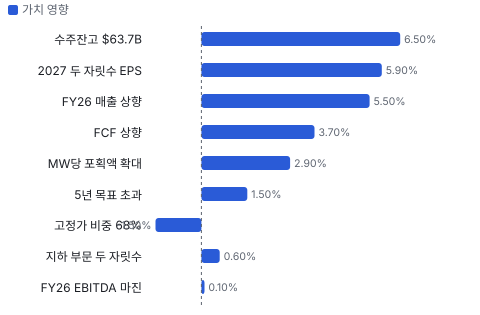

**멀티플 프리미엄(Fwd 1Y P/E, 최근 4개 분기말)**

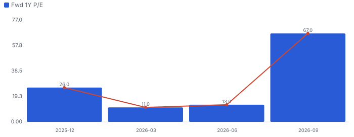

**합리적 멀티플**

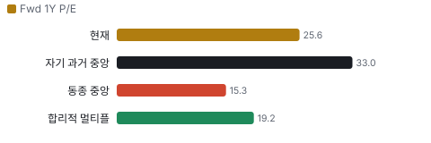

**일별 거래량 분해**

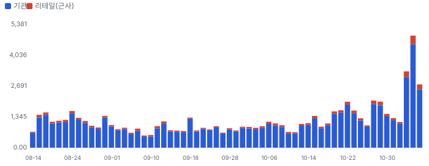

**기관 자금 흐름**

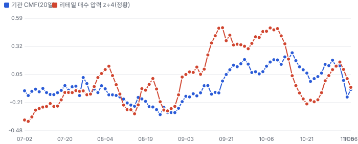

**몬테카를로**

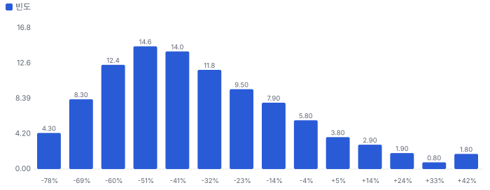

해석: 3,000번 중 342번(11%)에서 가치가 지금 주가 이상이었다. 가정을 흔들어도 지금 주가를 뒷받침하지 못하는 경우가 더 많다. 가운데 값은 0.61배이고, 열 번 중 여덟 번은 0.33~1.03배 사이에 든다.

**규모·마진·진척도**

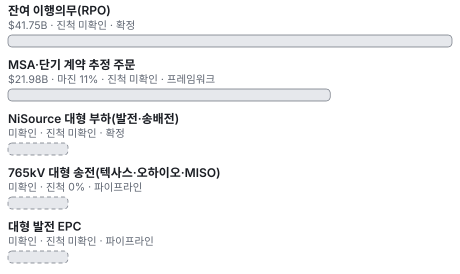

**매출 → 매출총이익 → 영업이익(매출 = 100, 최근 4분기)**

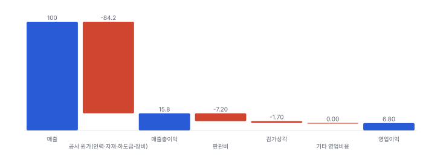

**1년 전 대비 마진 기여(비용 비중 변화의 반대)**

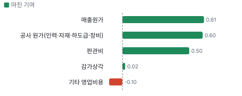

**분기 비용 비중 추이(매출 대비, 공시)**

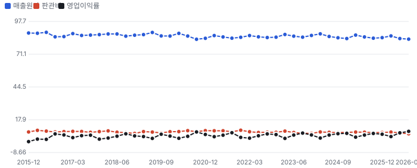

**비용 요인별 매출 대비 비중과 1년 변화**

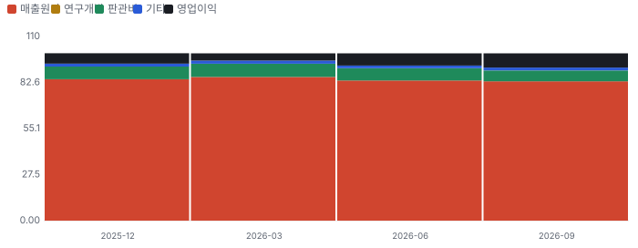

**BOM 항목 가격 +10% 시 OPM 변화**

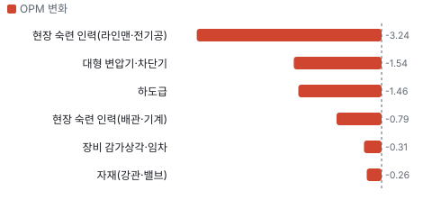

**전력·신재생 인프라 BOM 원가 몫과 가격 +10% 시 OPM**

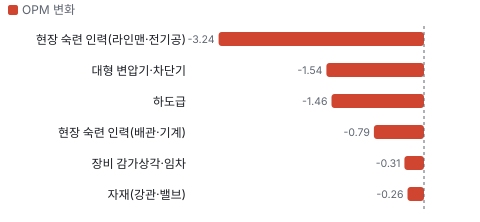

**지하 인프라·산업 BOM 원가 몫과 가격 +10% 시 OPM**

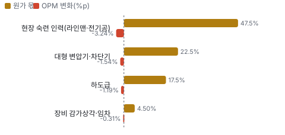

**매출과 미국 개폐기 PPI 증가율(전년 대비)**

**4Q26 매출 — 지표 추세 vs 가이던스·컨센서스**

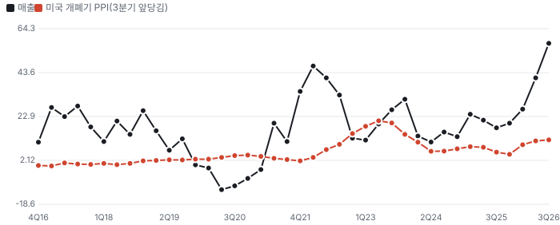

**10년 P·Q 사이클 — 추세(HP 필터) 대비 갭과 8분기 전망**

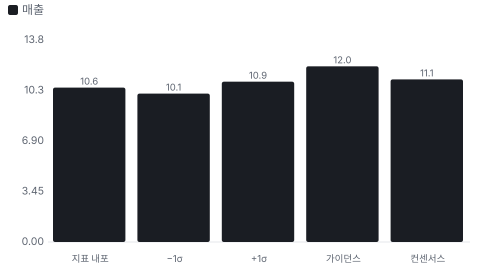

**P·Q 프리미엄 — 매출총이익 정상 수준 대비(−100~+100%)**

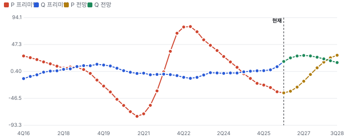

**매출 증가율의 가격·물량 분해와 AR(2) 투영(전년 대비)**

**분기별 매출 증가율 분해**

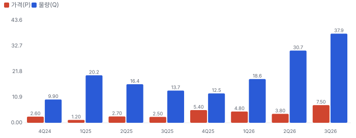

**목표주가 산정 — 약세와 기본 사이(약세 쪽 14%), 도달 확률 약 55%**

**일봉 지지·저항과 목표주가**

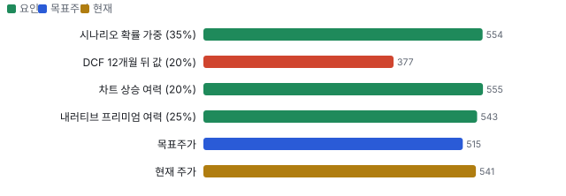

**커뮤니티 언급 수(최근 30일, 채널별)**

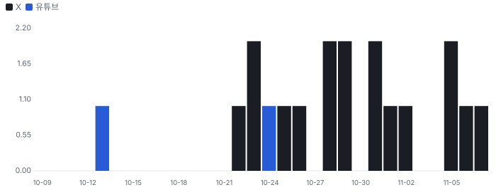

## 내러티브

> **기업가치를 결정하는 이야기:** 값은 세 겹이다. 약 \$20B 유틸리티 기반이 10~12% 이익률로 복리로 자라고, 그 위에 발전과 데이터센터 공사가 쌓이며, 대형 765kV가 아직 잔고 밖에 있다. 회사는 이 쌓임을 'stacking'이라 부른다.

> **멀티플·EPS 프리미엄**
> **멀티플:** Fwd 1Y P/E 25.6배는 동종 중앙 15.3배보다 68% 높고 자기 36개월 월말 범위 23~54배의 아래쪽이다(2025년 3월 24.5배 이후 가장 낮다). Fwd 2Y는 21.0배다. 프리미엄의 근거는 12년 연평균 20% 이상 EPS 성장(CEO 발언)과 매출의 1.7배인 잔고다.
> **EPS:** 지난 네 분기 EPS가 모두 컨센서스를 넘었고 초과 폭은 5~31%다. 3Q 뒤 FY2027 EPS 컨센서스는 \$19.47~\$22.40으로 벌어져 있고 낮은 값은 발표 전 수치다.

### 투자자들은 왜 열광했나

2026년 4월 1Q 실적 날 +15.8%, 7월 2Q 실적 날 +17.3%로 뛰었다. 3월 Investor Day의 2030 EPS 목표 \$21.60~26.75(보도 기준)를 FY27 컨센서스가 이미 넘보면서 열기가 커졌다. 9월 GE Vernova 매도 의견과 10월 AI 전력주 매도에 식었고, 3Q 실적 날 +4.7%로 반응이 줄었다. 11/4 중간선거 민주당 우세 뒤에는 데이터센터 반발·지방 개발 제한 우려로 이틀 −22.5%가 났다 — 회사 숫자가 아니라 정책 이야기가 식힌 것이다.

### 무엇이 기업가치를 바꾸나

> **구조적 체질 변화**
> **변화:** 회사 말로 거래형에서 장기 프로그램형으로 바뀌었다. 잔고 \$63.7B는 TTM 매출의 1.71배다
> **증거:** 3Q 10-Q, 3Q 콜
> **반증:** 2분기 연속 잔고 감소

> **고부가 믹스 확장**
> **변화:** MEP(건물 안 기계·전기·배관 공사)·기계 공사가 늘며 전력 부문 이익률이 11.4%에서 12.6%, 지하 부문이 8.4%에서 9.4%로 올랐다
> **증거:** 3Q 10-Q. 다만 3Q 고정가 추정 변경이 매출의 1.1%를 움직였고 전년과 같다
> **반증:** 전력 부문 이익률 11% 아래

> **기술 혁신**
> **변화:** 해당 없음(공법보다 인력·조달이 경쟁력이다). 공장 조립으로 현장 인력을 줄이는 것이 가장 가깝다
> **증거:** 3Q 콜 제조 확장 발언
> **반증:** 공장 조립 공사의 마진 희석

> **실행 속도**
> **변화:** 해당 없음(공사업이라 납품 리드타임이 없고 착공까지 기간도 공시가 없다). RPO의 67%가 12개월 안에 매출이 된다
> **증거:** 3Q 10-Q, 12월 말 66%
> **반증:** 12개월 비중 60% 아래

> **M&A**
> **변화:** 2026년 5건 + 9~10월 2건. 3Q 매출 중 인수분 약 \$1.56B로 전체의 13%다. CEO는 데이터센터 전문 회사를 사지 않는다고 했다
> **증거:** 3Q 10-Q, 3Q 콜
> **반증:** 영업권 손상 또는 인수 마진 희석

> **정책·입법 연관성**
> **재정정책:** 에너지부가 \$1.9B SPARK(미국 에너지부 재도체화·전력망 증강 지원 공모) 공모(2026-03)로 재도체화와 전력망 증강을 지원한다. 선정 결과와 PWR 수주 연결은 미확인이다 에너지부 발표, 재원은 2021 인프라법 GRIP(미국 에너지부 전력망 복원력 지원 사업) 반증: 선정 취소·재원 회수 의회 동의 10/10 — 하원 5/5(인프라법 본회의 통과) · 상원 5/5(인프라법 본회의 통과).
> **행정명령:** 에너지부가 2025-10-23 FERC(미국 연방에너지규제위원회)에 20MW 초과 대형 부하 연결 규칙을 지시했다. 행정명령이 아니라 장관 지시이고, 2026-04-30 기한 뒤 최종 상태는 미확인이다 로펌 해설(2025-10~11). 대형 부하가 망 증설비를 전액 부담하는 안 반증: FERC가 관할을 거부하거나 법원이 막는다 의회 동의 2/10 — 하원 1/5(의결 기록 미확인) · 상원 1/5(의결 기록 미확인).
> **연관입법:** SPEED Act(H.R.4776)가 2025-12 하원을 221~196으로 통과했다. 상원은 2026년 5월 기준 정체이고 송전 조항이 없다는 비판이 있다 Utility Dive·Washington Examiner 보도 반증: 상원 부결 또는 회기 내 폐기

> **CAPEX 낙수효과**
> **변화:** CEO는 5대 기술 기업 CAPEX가 유틸리티의 3배라고 했고, 유틸리티는 규모를 두 배로 키우라는 요구를 받는다. 금지표대로 PWR 몫은 계약으로만 센다
> **증거:** 3Q 콜. 10% 넘는 고객 없음. 고객별 매출 미공개
> **반증:** 대형 고객 CAPEX 감액, 프로젝트 지연이 잔고로 번짐

### 내러티브 근거

> 프리미엄은 전력망 연결의 관문, 희소한 숙련공, 긴 잔고에서 나온다. 3Q는 대형 765kV 없이 잔고를 \$10B 늘려 이야기를 숫자로 바꿨다. 선거 뒤 데이터센터 반발 이야기가 새 반대 내러티브로 떠올랐다. 셀사이드는 여전히 강세이고 리테일 관심은 낮다. 동종 대비 멀티플 차이 +68% 중 회사 고유 몫은 +33%다. 단계는 컨센서스, 쏠림은 중간이다.

> **전력망 연결의 관문(송전·변전 슈퍼사이클)** · 강화
> **논리:** 데이터센터·제조 리쇼어링 부하가 전력망 연결 대기열을 만들고, 765·500·345kV 대형 송전과 변전소가 그 병목 — PWR은 북미 최대 숙련 송전 인력
> **숫자:** 총 잔고 \$63.7B = TTM 매출의 1.71배, 12개월분 \$38.4B는 TTM의 103%
> **반증:** 2분기 연속 잔고 정체 또는 765kV 수주가 2028년 이후로 밀림

> **AI 데이터센터 전력·플랜트 보조시설** · 유지
> **논리:** 칩을 뺀 공사를 넓혀 MW(메가와트)당 포획액을 키운다
> **숫자:** MW당 \$3~4M → \$5~7M(CEO 어림), 기술 매출 비중 15~20%
> **반증:** 하이퍼스케일러 설비투자 감액, 주별 데이터센터 모라토리엄 확산

> **숙련 인력 희소성 = 해자** · 강화
> **논리:** 숙련공은 길러야 한다. 직원 약 95,000명, 2026년 약 26,000명 증가
> **숫자:** 3Q 전력 부문 이익률 12.6% — 경영진이 말한 유틸리티 10~12% 범위 상단 이미 도달
> **반증:** 교육·신입 비중 증가로 전력 마진이 11% 아래로 복귀

> **현금 전환 개선(선수금 구조)** · 강화
> **논리:** MEP·EPC(설계·조달·시공 일괄 수행)·재생에너지 계약에서 유리한 현금 조건 — 성장이 운전자본을 덜 먹는다
> **숫자:** 계약부채 3.26 → \$5.54B(9개월 +\$2.28B), FY26 FCF 가이던스 +\$0.5B
> **반증:** 계약부채 감소·FCF 전환율 55% 아래

> **연쇄 인수 플랫폼(수직 통합)** · 유지
> **논리:** 변압기·차단기·전주·모노폴 제조와 경로 설계까지 인수 — 공급망 병목을 직접 쥔다
> **숫자:** 2026년 5건 인수 + 9~10월 2건 \$245M · 영업권·무형 \$11.3B
> **반증:** 인수 기업 마진 희석, 영업권 손상

> **반대 내러티브: AI 전력 거품·업종 디레이팅** · 강화
> **논리:** 동종이 15~18배로 내려온 동안 PWR은 25.6배다. 테마가 꺾이면 프리미엄이 먼저 깎인다
> **숫자:** Fwd 1Y P/E 25.61배 vs 동종 중앙 15.28배(11/6)
> **반증:** 동종사 반등 동반 + PWR 이익 리비전 지속(프리미엄을 이익이 따라잡음)

> **반대 내러티브: 선거 뒤 데이터센터 반발·지방 인허가 제한** · 태동
> **논리:** 민주당 우세와 지방 데이터센터 제한 안건 통과로 데이터센터 공사가 밀리면 기술 매출(15~20%)과 연계 송전 투자가 늦어진다
> **숫자:** 11/4~5 이틀 −22.5% vs 업종 ETF GRID −2.1%(t −0.95), 중간선거 정책 채널 점수 +0.3/10
> **반증:** 4Q 실적(2027-02)에서 데이터센터 공사 취소가 잔고에 없고 유틸리티 2027 설비 계획이 유지된다

## 포트폴리오

| 제품·서비스 | 구분 | 무엇 | 쓰는 곳 | 돈 버는 방식 | Mix | Mix 변화(전 분기 대비) |
|---|---|---|---|---|---|---|
| 유틸리티 송배전·변전 공사 | 서비스 | 송전선·배전망·변전소 시공과 유지보수 | 미국 유틸리티, 대부분 MSA | 약 \$20B, 이익률 10~12%(CEO 발언) | 미확인 | 미확인 |
| 데이터센터 전기·기계 공사(MEP) | 서비스 | 칩을 뺀 건물 안 전기·기계·배관과 부지 공사 | 하이퍼스케일러와 개발사 | 기술 매출 15~20%, MW당 \$5~7M 포획(CEO 어림) | 미확인 | 미확인 |
| 발전·재생에너지 EPC | 서비스 | 태양광·배터리·가스 발전소 설계·조달·시공 | 유틸리티, 대형 부하 고객 | 재생에너지 \$5~10B(CEO 발언) | 미확인 | 미확인 |
| 지하 인프라·산업 | 서비스 | 가스 배관, 산업 설비, 기계 공사 | 가스 유틸리티, 파이프라인, 산업체 | 3Q 매출 \$2.2B, 이익률 9.4% | 18% | +0.4%p |
| 변압기·차단기·전주 제조 | 제품 | 병목 장비를 자체 생산해 공사에 묶는다 | 자사 EPC와 고객 공급 | 별도 공시 없음(미확인) | 미확인 | 미확인 |

**Mix 변화가 가장 큰 쪽은 지하 인프라·산업(+0.4%p, 전 분기 대비).** 계절성 판정: 분기 매출 계절 지수 기준 없음 → 직전 분기와 비교.

## 수주·파이프라인

> **2026-09-30 기준 5건.** 확정 \$41.75B, 미확정 \$21.98B. 공시 총 수주잔고 \$63.73B. 서로 겹치는 항목은 합계에서 뺐다.

**실행 속도와 방해 요인**
| 항목 | 상태 | 실행 속도 | 방해 요인 |
|---|---|---|---|
| 잔여 이행의무(RPO) | 확정 | 67%가 12개월 안, 대부분 그다음 24개월 안에 매출 | OEM 납기 · 고정가 원가 위험 |
| MSA·단기 계약 추정 주문 | 프레임워크 | 12개월분 \$10.5B | 고객 물량 약정 없음 · 단기 해지 가능 |
| NiSource 대형 부하(발전·송배전) | 확정 | 3Q에 일부 잔고 반영, 추가 예약 기대 | 금액 미공개 · 복합화력 EPC 위험 |
| 765kV 대형 송전(텍사스·오하이오·MISO(미국 중부 전력망 운영 기구)) | 파이프라인 | 2027년 착수, 1H27 수주 기대 | 인허가 · 고객의 자기 고객 협상 · 장비 납기 |
| 대형 발전 EPC | 파이프라인 | 2Q 콜 기준 95%가 잔고 밖 | 가스터빈 납기 · 계약 위험 통제 |

## 마진 구조

> **GPM 15.8%, OPM 6.8%.** TTM 3Q25 대비 GPM +0.6%p, OPM +1.0%p. TTM 매출원가(공사 원가)가 매출의 84.2%로 1년 전 84.8%보다 0.6%p 낮아졌고 판관비도 7.7%에서 7.2%로 내려 GAAP 영업이익률이 5.8%에서 6.8%로 올랐다. 공사 원가 안의 인력·자재 몫은 공시되지 않고 하도급 15~20%만 10-Q에 있다. 고정가 계약이 63%에서 68%로 늘어 원가 상승을 떠안는 몫이 커졌다

> **매출 100 중 매출원가 84.2, 매출총이익 15.8(최근 4분기, 공시).** 매출원가 요인 중 공사 원가(인력·자재·하도급·장비)이 매출의 84.2%로 가장 무겁고, 단가가 +10% 오르면 GPM이 -8.42%p 움직인다. 분기 회귀로 매출 1이 늘 때 매출원가는 0.83 늘고, 매출원가의 고정비 몫은 2%다.

**비용 요인 강도 — 비중·추세·충격(+10%)·탄력**
| 비용 | 구분 | 매출 대비 | 1년 변화 | 마진 기여 | 충격 시 마진 | 매출 탄력 | 고정비 몫 |
|---|---|---|---|---|---|---|---|
| 공사 원가(인력·자재·하도급·장비) | 매출원가 요인 | 84.2% | -0.6%p | +0.6%p | -8.42%p | 미확인 | 미확인 |
| 매출원가 | 공시 항목 | 84.2% | -0.6%p | +0.6%p | -8.42%p | 0.83 | 2% |
| 판관비 | 공시 항목 | 7.2% | -0.5%p | +0.5%p | 미확인 | 0.07 | 13% |
| 감가상각 | 공시 항목 | 1.7% | -0.0%p | +0.0%p | 미확인 | 0.02 | -63% |
| 기타 영업비용 | 공시 항목 | -0.0% | +0.1%p | -0.1%p | 미확인 | -0.00 | -100% |

매출 탄력 = 분기 비용을 매출에 회귀한 기울기(매출 1당 변동비), 고정비 몫 = 절편 ÷ 평균 비용. 표본이 8분기 미만이면 미확인. 매출원가 요인 비중은 margin 재료의 추정이 섞여 있고, 공시 매출원가와의 차이는 '기타 매출원가'로 둔다.

**GPM에서 OPM까지(GAAP)**
| 기간 | GPM | 연구개발 | 판관비 | 기타 | OPM |
|---|---|---|---|---|---|
| TTM 3Q25 | 15.2% | 0.0% | 7.7% | 1.6% | 5.8% |
| TTM 3Q26 | 15.8% | 0.0% | 7.2% | 1.7% | 6.8% |

**GPM·OPM 최근 4개 분기**
| 분기 | GPM | OPM |
|---|---|---|
| 2025-12 | 15.5% | 6.2% |
| 2026-03 | 14.1% | 4.3% |
| 2026-06 | 16.2% | 7.3% |
| 2026-09 | 16.7% | 8.5% |

**마진을 결정하는 비용 요인 — 비용 +10% 시 OPM**
| 비용 | 매출 대비 | 변화 | 고정비 | OPM |
|---|---|---|---|---|
| 공사 원가(인력·자재·하도급·장비) | 84.2% | -0.6%p | 미확인 | -8.42%p |
| 판관비 | 7.2% | -0.5%p | 70% | -0.72%p |
| 무형자산 상각·기타 영업손익 | 1.7% | +0.1%p | 100% | -0.17%p |

**비용을 움직이는 요인**
| 비용 | 요인 |
|---|---|
| 공사 원가(인력·자재·하도급·장비, 매출원가) | 숙련공 임금·자재 가격·고정가 계약 원가 추정 변경 · 근거 공시 |
| 판관비(판관비) | 인수 회사 간접비·주식 보상(9M \$193.9M) · 근거 공시 |
| 무형자산 상각·기타 영업손익(기타) | 연쇄 인수의 고객 관계·잔고 무형자산 상각(9M \$498M) · 근거 공시 |

**전력·신재생 인프라 BOM — 매출의 82%, GPM 17%(부문 GPM 미공시 — 회사 3Q26 GPM 16.7%. 부문 영업이익률 3Q 12.6%(10-Q)), 항목 가격 +10% 시**
| 항목 | 원가 몫 | 전가 | 제품 GPM | OPM |
|---|---|---|---|---|
| 현장 숙련 인력(라인맨·전기공) | 40~55% | 미확인 | -4.0%p | -3.24%p |
| 대형 변압기·차단기 | 15~30% | 미확인 | -1.9%p | -1.54%p |
| 하도급 | 15~20% | 미확인 | -1.5%p | -1.19%p |
| 장비 감가상각·임차 | 3~6% | 미확인 | -0.4%p | -0.31%p |
| 미분해 | 8% | - | - | - |

**지하 인프라·산업 BOM — 매출의 18%, GPM 17%(부문 GPM 미공시 — 회사 GPM으로 대신. 부문 영업이익률 3Q 9.4%), 항목 가격 +10% 시**
| 항목 | 원가 몫 | 전가 | 제품 GPM | OPM |
|---|---|---|---|---|
| 현장 숙련 인력(배관·기계) | 45~60% | 미확인 | -4.4%p | -0.79%p |
| 자재(강관·밸브) | 10~25% | 미확인 | -1.5%p | -0.26%p |
| 하도급 | 15~20% | 미확인 | -1.5%p | -0.26%p |
| 미분해 | 12% | - | - | - |

현장 숙련 인력(라인맨·전기공) 가격이 +10% 오르면 영업이익은 -47.5% 움직인다. 판매가 전가를 모르는 항목은 전가 0%로 계산했다.

**BOM 항목 가격을 움직이는 것**
| 항목 | 요인 |
|---|---|
| 현장 숙련 인력(라인맨·전기공) | 자체 시공이 85%라 원가의 가장 큰 몫이 자기 인력이다 · 근거 추정 |
| 대형 변압기·차단기 | EPC·변전소 공사는 장비를 회사가 조달한다. 고객 직접 조달분은 원가에 없다 · 근거 추정 |
| 하도급 | 피크 물량을 외부 업체로 받는다 · 근거 공시 |
| 장비 감가상각·임차 | 크레인·헬기·특수 차량 · 근거 추정 |
| 현장 숙련 인력(배관·기계) | 가스 배관·정비 공사는 인건비가 가장 크다 · 근거 추정 |
| 자재(강관·밸브) | 고객 지급 자재가 많아 몫이 작다 · 근거 추정 |
| 하도급 | 지역 피크 물량 · 근거 공시 |

**BOM 투입 물가 — PPI 전년비, 2026-11-07 수집**
| 항목 | 미국 | 일본 | 한국 | 대만 |
|---|---|---|---|---|
| 대형 변압기·차단기 | +7.8% | +0.7% | +10.7% | +10.6%* |

별표는 품목보다 넓은 업종 지수다. 지난 1년 투입 물가를 판매가 전가 뒤 원가에 그대로 넣으면 OPM은 -0.98%p 움직인다(매출원가의 18% 기준).

## 공급망 병목

> **공급망 신뢰성 4.2/10, 병목 주의.** 가장 약한 고리는 대형 변압기·차단기 3.8점이고, 품목 평균은 4.7점이다. 근거가 부족한 1건(가스터빈(발전 EPC))은 점수에서 뺐다. 병목은 사람에서 장비로 옮겨 가는 중이다. CEO는 3Q 콜에서 인력이 아니라 OEM 장비를 기다린다고 했다. 회사는 변압기·차단기·전주를 일부 직접 만들고 길게 사 두지만 공급사별 몫은 공시되지 않는다. 대형 가스터빈은 발전 EPC의 일정을 정한다

**병목과 마진 — 품목 가격 +10% 시 OPM**
| 품목 | 점수 | 판정 | 구분 | OPM |
|---|---|---|---|---|
| 대형 변압기·차단기(필수) | 3.8 | 병목 심각 | 핵심 통제 품목 | -1.54%p |
| 현장 숙련 인력(라인맨·전기공, 필수) | 5.1 | 병목 주의 | 핵심 통제 품목 | -3.24%p |

> **대형 변압기·차단기** · 3.8/10
> **왜:** 765kV·변전소 공사의 착공 시점을 정한다
> **병목 요인:** 인증 공급사 2곳 · 캐파 부족 · 리드타임 120주(평시 50주) · 재인증 미확인 · 1위 점유율 미확인 · 지역 집중 미확인 · 물량 확보 장기계약
> **풀리는 조건:** 미확인 — 제조 확장 가동 시점 미공시

> **현장 숙련 인력(라인맨·전기공)** · 5.1/10
> **왜:** 고전압 숙련공은 수년 훈련이 필요하다 — 자체 훈련 체계가 이 회사 해자의 근원
> **병목 요인:** 인증 공급사 2곳 · 캐파 빠듯 · 리드타임 미확인 · 재인증 미확인 · 1위 점유율 미확인 · 미국(매출 지역 비중 근사, region_mix) 집중 90% · 물량 확보 내재화
> **풀리는 조건:** 미확인

**공급사**
| 품목 | 공급사 | 몫 | 근거 |
|---|---|---|---|
| 현장 숙련 인력(라인맨·전기공) | 자체 직원 약 95,000명(자체 시공 85%) | 미확인 | 회사 발표 |
| 현장 숙련 인력(라인맨·전기공) | IBEW(미국 전기노동자 노조) 노조 인력(노조 인력 공급) | 미확인 | 공시 |
| 대형 변압기·차단기 | 자체 제조(변압기·차단기·전주, 일부 내재화) | 미확인 | 회사 발표 |
| 대형 변압기·차단기 | 외부 OEM(미공시, 고전압 장비) | 미확인 | 추정 |
| 가스터빈(발전 EPC) | 대형 가스터빈 제조사(미공시, 발전 설비) | 미확인 | 추정 |

**무역 통계로 본 공급 지역**
| 품목 | EU 수입처 | 일본 수입처 | EU 1위 전년비 |
|---|---|---|---|
| 대형 변압기·차단기 | CN(중국) 82% · KR(한국) 11% · VN(베트남) 4% | 中華人民共和国 65% · 大韓民国 19% | +18.1% |

## 생산능력

> **현재 명목 캐파 95,000 명(직원), 가동률 미확인.** 착공 이상 증설은 0 명(직원), 발표까지 합치면 0 명(직원)이다. 다 가동하면 지금보다 +0%, 착공 이상만이면 +0%다. FY2025 CAPEX는 \$0.61B로 매출의 2.1%다. 공사업이라 공장 캐파 대신 인력이 캐파다. 직원은 2Q 약 85,000명에서 3Q 약 95,000명으로 늘었고 2026년 유기 채용이 약 12,000명이다(콜). 가동률은 공시되지 않는다. CAPEX는 FY2025 매출의 2.1%에서 FY2026 컨센서스 2.5%로 오른다 — 제조 확장 몫

**생산능력 확충 계획**
| 계획 | 단계 | 증설 | 가동 시점 | CAPEX |
|---|---|---|---|---|
| 변압기·차단기·전주 제조 확장 | 발표 | 미확인 | 미확인 | 미확인 |

남은 계획의 CAPEX 합계는 \$0.00B(금액 미확인 1건 제외)다. 합계는 FY2028 매출의 0%다.

**증설 방해 요인**
| 계획 | 방해 요인 |
|---|---|
| 변압기·차단기·전주 제조 확장 | 공장 가동 시점 미공시 |

**CAPEX와 매출 대비**
| 기간 | CAPEX | 매출 | 매출 대비 | 구분 |
|---|---|---|---|---|
| FY2024 | \$0.60B | \$23.67B | 2.6% | 실적 |
| FY2025 | \$0.61B | \$28.48B | 2.1% | 실적 |
| FY2026 | \$1.02B | \$41.45B | 2.5% | 컨센서스 |
| FY2027 | \$1.25B | \$50.50B | 2.5% | 컨센서스 |
| FY2028 | \$1.40B | \$58.50B | 2.4% | 컨센서스 |

## 해자

> 해자는 사람이다. 숙련공 95,000명 규모와 85% 자체 시공이 경쟁을 막고, 공급망 통합이 그 위에 쌓인다.

> **자체 숙련공 규모** · 강함
> **해자:** 고전압 숙련공은 살 수 없고 길러야 해서 경쟁사가 단기에 따라오지 못한다.
> **근거:** 직원 약 95,000명, 2026년 약 26,000명 증가 중 유기적 약 12,000명. 자체 시공 85%. 전력 부문 3Q 이익률 12.6%
> **숫자:** 직원 2Q 85,000 → 3Q 95,000
> **깨지는 조건:** 전력 부문 이익률이 11% 아래로 내려오거나 숙련공 임금이 계약 반영보다 빨리 오른다

> **유틸리티 장기 계획 안의 자리** · 보통
> **해자:** 고객 설비 계획에 수년 앞서 들어가 반복 공사를 받는다. 다만 물량 약정은 없다.
> **근거:** MSA는 총 잔고의 37%(약 \$23.6B). 10% 넘는 고객이 없다. 10-Q는 MSA가 물량을 약정하지 않고 단기 해지가 가능하다고 적는다
> **숫자:** MSA 비중 44% → 37%
> **깨지는 조건:** 유틸리티가 대형 공사를 복수 업체로 나누거나 MSA 잔고가 줄어든다

> **장비 공급망 수직 통합** · 보통
> **해자:** 변압기·차단기·전주까지 직접 만들거나 길게 사 두어 공기 확실성을 판다.
> **근거:** 10개 주 전후 제조 확장, 고전압 장비 상위 5대 구매자(CEO 발언), 3Q 전주 제조사 인수. 10-K 장비 구매 약정 \$349M
> **숫자:** 제조 CAPEX \$500~700M 언급(콜 질문 기준)
> **깨지는 조건:** OEM 증설로 납기가 풀려 공급 프리미엄이 사라지거나 공장이 놀게 된다

> **이행보증을 받는 규모** · 보통
> **해자:** 대형 공사는 보증 용량과 실행 기록이 입찰 자격이다.
> **근거:** 이행보증 \$23.1B, 유동성 \$5.2B, 은행 기준 레버리지 약 1.3배
> **숫자:** 이행보증 ÷ 총 잔고 36%
> **깨지는 조건:** 대형 고정가 공사 손실로 보증 조건이 나빠진다

## 경영진·네트워크

> 창업자 체제가 아니다. CEO는 현장 시공사 출신이고 이사회에 유틸리티 경영자가 많다. 연결이 매출을 만들었다는 증거는 없다.

> **Earl C. (Duke) Austin, Jr.** · 사장·CEO · 2016-03
> **프로필:** 56세. 2001~2009 자회사 North Houston Pole Line 사장, 전력·가스 사업 대표, 2013~2022 COO를 거쳤다
> **비즈니스:** 미국 전기공사업체 협회 NECA(미국 전기공사업체 협회) 남서부 지회 이사
> **정계:** Texas State University System 이사회(Board of Regents) 위원. 로비·기부 기록은 미확인
> **동문:** 경영학 학사, 학교명은 위임장에 없다(미확인)
> **사모임:** 미확인

> **Doyle N. Beneby** · 이사회 의장 · 2016-03
> **프로필:** 66세. Midland Cogeneration Venture CEO(2018~2022), 시영 CPS Energy CEO(2010~2015)
> **비즈니스:** Korn Ferry·West Fraser·Northland Power 이사
> **정계:** 시영 전력회사 CEO 이력
> **동문:** 공학 학사·MBA, 학교명은 위임장에 없다(미확인)
> **사모임:** 미확인

**네트워크 정량화**
| 연결 | 강도 | 닿는 매출 | 가중 노출 | 매출 대비 | 근거 |
|---|---|---|---|---|---|
| 비즈니스: 이사 Warner Baxter는 Ameren(미국 미주리·일리노이 유틸리티) 전 집행 의장이자 EEI 전 의장으로 유틸리티 경영진과 닿는다 | 2/5 | \$20.00B | \$8.00B | 21% | CEO가 말한 유틸리티 매출 약 \$20B. 회사별 매출은 미공개 2026 위임장, 3Q 콜 |
| 비즈니스: CEO의 NECA 지회 이사직과 IBEW/NECA 견습 체계 — 숙련공 공급 쪽 연결 | 4/5 | 미확인 | 미확인 | 미확인 | 인력 연결이라 매출로 환산하지 못한다. 직원의 36%가 단체협약 대상 2026 위임장, FY2025 10-K |
| 정계: CEO의 텍사스 주립대 시스템 이사직 | 3/5 | 미확인 | 미확인 | 미확인 | 텍사스 매출 미공개 2026 위임장 |

가중 노출은 연결이 닿는 매출의 크기다. 연결이 그 매출을 만들었다는 뜻이 아니며, 인과는 공개 자료로 입증하지 못한다.

## 약세 논리 및 셀온 조건

| 약세 논리 | 근거 | 반박 | 가를 자료 |
|---|---|---|---|
| 프리미엄이 동종으로 수렴한다 | Fwd 1Y P/E 25.6배 vs 동종 중앙 15.3배. 동종은 10월 업종 매도 뒤 15~18배 | FIX·EME보다 잔고가 길고(매출의 1.7배) 이행보증 \$23.1B를 받는 규모다 | 동종 대비 프리미엄이 30% 아래로 가는지 — 4Q 실적 시즌(2027-02) |
| 선거 뒤 데이터센터 반발이 송전 투자로 번진다 | 11/4 지방 데이터센터 제한 안건 통과 보도, PWR 이틀 −22.5% | 정책 채널 점수 +0.3/10, 업종 ETF −2.1%. 전력망 투자는 양당 사안이고 유틸리티 성장의 50%는 데이터센터와 무관(CEO) | 주요 유틸리티 2027 설비 계획(11~12월 투자자 행사)·4Q 잔고의 데이터센터 취소 여부(2027-02) |
| 고정가 위험이 커진다 | 3Q 고정가 비중 63.1% → 68.1%, 이행보증 \$23.1B. 추정 변경이 3Q 매출을 1.1% 움직였다 | CEO는 위험 구조가 어느 때보다 좋다고 했다. 다만 \$300M 초과 고정가 비중은 다시 밝히지 않았다 | 고정가 손실 공시, 미승인 변경 주문 \$488M 추이 |
| 데이터센터가 밀린다 | Roth가 지연·중단 사례를 물었다. 기술 매출 15~20% | 최대 고객 신용이 높고 인력을 산업 현장으로 돌릴 수 있다. 근거는 경영진 말뿐이다 | 잔고 12개월분, MSA 외 신규 주문 |
| 성장의 질 | 3Q 인수 매출 약 \$1.56B, 영업권·무형 \$11.3B가 자기자본 \$10.5B보다 크다 | 2026년 유기적 인력 증가 약 12,000명, 인수 뺀 3Q 성장 약 +37%(추정) | 인수 효과가 빠지는 3Q27 유기적 성장 |
| 경영진이 팔았다 | CEO가 5/5 약 \$777에 15.6만 주, 약 \$121M 장내 매도 | 사전 매매 계획 여부 미확인. 지분 대비 비중도 미확인 | Form 4 각주, 2027 위임장 보유 주식 |
| 경쟁 증설 | 높은 수익은 공급을 부른다. MTZ·MYRG·PRIM도 전력 인력을 늘린다 | 숙련공은 약 4년 걸려 단기 추격이 어렵다 | 동종 송전 수주와 숙련공 임금 |

> **셀온 조건**
> **조건 1:** 총 잔고가 2분기 연속 줄어든다
> **조건 2:** 전력 부문 이익률이 3분기 기준 11% 아래로 내려온다
> **조건 3:** 고정가 대형 공사에서 손실을 공시한다
> **조건 4:** 동종이 전력 숙련공을 빠르게 늘려 765kV 입찰 경쟁이 시작된다
> **조건 5:** 주요 고객이 데이터센터 공사를 잔고에서 취소한다

## 어닝콜 변화

**직전 콜 대비 새로 나오거나 바뀐 내용 → 가치 영향**
| 항목 | 내용 | 직전 콜 | 최신 콜 | 모델 동인 이동 | 확신도 | 가치 영향 |
|---|---|---|---|---|---|---|
| 업데이트 | FY26 매출 가이던스 중간 +\$1.95B | \$39.3~39.7B | \$41.3~41.6B | 기준연도 매출 +\$1.95B | 0.8 | +5.5% |
| 업데이트 | FY26 조정 EBITDA 마진(가이던스 중간) | 10.51% | 10.72% | 출발 이익률 +0.21% | 0.8 | +0.1% |
| 업데이트 | 총 수주잔고 \$53.4B → \$63.7B, 대형 765kV 없이 넓게 늘었다 | \$53.4B | \$63.7B | 성장 지속(감속 계수) +5.0% | 1.0 | +6.5% |
| 신규 | 2027 강한 두 자릿수 조정 EPS 성장 기회 | 언급 없음 | 강한 두 자릿수, 2028~29 15~20% | 1년차 성장률 +2.0% | 0.5 | +5.9% |
| 업데이트 | FY26 FCF +\$0.5B, 다만 장기 전환율은 55~60% 유지 | \$2.0~2.5B | \$2.5~3.0B | 매출÷투하자본 +30.0% | 0.8 | +3.7% |
| 신규 | Investor Day 다년 목표보다 앞서가는 중 | 언급 없음 | pacing ahead | 장기 성장 수렴값 +0.50% | 0.5 | +1.5% |
| 신규 | 지하 부문 내년 분기 두 자릿수 이익률 가능, 3Q 9.4% | 개선 여지 | 내년 두 자릿수 분기 | 목표 이익률 +0.20% | 0.5 | +0.6% |
| 신규 | 데이터센터 MW당 포획액 \$3~4M → \$5~7M | 80~90% 범위 언급 | \$5~7M, 다음 \$7~10M | 1년차 성장률 +1.0% | 0.5 | +2.9% |
| 부정 | 3Q 고정가 매출 비중 63.1% → 68.1%, 위험 보상 요구 상승 | 63.1% | 68.1% | 할인율(WACC) +0.10% | 0.5 | -1.5% |
| **합계** | 단독 합 |  |  | 동시 적용 +25.8% |  | **+25.3%** |

**사건별 EPS 리비전**
| # | 날짜 | 구분 | 사건 | CY2026 EPS 전→후 | CY2027 EPS 전→후 | 리비전 | 주가 반응 |
|---|---|---|---|---|---|---|---|
| ① | 26-02-19 | 실적 | 4Q25 실적 | \$12.42 → \$12.85 | \$14.54 → \$15.16 | +4.3% | +6.7% |
| ② | 26-04-30 | 실적 | 1Q26 실적, 주가 +15.8% | \$13.11 → \$13.95 | \$15.36 → \$16.39 | +6.7% | +15.8% |
| ③ | 26-07-30 | 실적 | 2Q26 실적, 주가 +17.3% | \$14.03 → \$16.11 | \$16.48 → \$18.66 | +13.2% | +17.3% |
| ④ | 26-09-14 | 내러티브 | GE Vernova 매도 개시로 AI 전력주 동반 하락 | \$16.37 → \$16.70 | \$18.96 → \$19.41 | +2.4% | -4.4% |
| ⑤ | 26-10-29 | 실적 | 3Q26 실적, 주가 +4.7%(발표 뒤 추정 아직 미갱신) | \$16.72 → \$16.76 | \$19.47 → \$19.47 | +0.0% | +4.7% |
| ⑥ | 26-11-04 | 내러티브 | 중간선거 뒤 데이터센터 반발 우려 — 이틀 −22.5% | \$16.76 → \$16.76 | \$19.47 → \$19.47 | 실적 창과 겹침 | -11.7% |

**해석:** 3개 구간 누적 주가 +4% = EPS 리비전 +34% × 멀티플 -22%. 더 크게 움직인 쪽은 **EPS 리비전**이다.

## 거시 지표 싱크로율

> **미국 개폐기 PPI(생산자물가지수)와 전력·신재생 인프라 싱크로율 89%(3분기 = 약 9개월 선행, 전년 대비, 표본 10개·t 5.7·유의·신뢰 낮음).** 이 지표가 내포하는 4Q26 매출은 10.55B(±1σ 10.14B~10.95B)다. 가이던스는 이보다 +13.8%(범위 위), 컨센서스는 +5.4%(범위 위)다. 매출의 82%인 전력 부문은 유틸리티 송배전·변전 투자를 따라가고, 그 투자는 변압기·개폐기 수입과 가격에 먼저 나타난다

**지표별 싱크로율(상관계수 × 100)**
| 지표 | 비교 대상 | 증가율 기준 | 지표 선행 | 매출(t값) | 영업이익 | 방향 일치 | 표본·신뢰 | 4Q26 내포 매출 |
|---|---|---|---|---|---|---|---|---|
| 미국 변압기 수입 | 전력·신재생 인프라 | 전년 대비 | 2분기(6개월) | -83%(t -4.2) | 16%(4분기) | 90% | 10·낮음 | +28.8% → 8.28B(확정) |
| 미국 변압기 PPI | 전력·신재생 인프라 | 전년 대비 | 2분기(6개월) | 74%(t 3.1) | -21%(4분기) | 100% | 10·낮음 | +32.5% → 8.52B(확정) |
| 미국 개폐기 PPI | 전력·신재생 인프라 | 전년 대비 | 3분기(9개월) | 89%(t 5.7) | -19%(0분기) | 100% | 10·낮음 | +64.1% → 10.55B(확정) |

**선행 지표로 본 향후 분기 매출 전망(이미 나온 지표 값 기준, ±1σ)**
| 지표 | 대상 | 분기 | 지표 증가율 | 내포 매출 증가율 | 내포 매출 |
|---|---|---|---|---|---|
| 미국 변압기 수입 | 전력·신재생 인프라 | 4Q26 | +41.4% | +28.8% | 8.28B(7.77B~8.78B) |
| 미국 변압기 수입 | 전력·신재생 인프라 | 1Q27 | +30.1% | +32.9% | 8.59B(8.09B~9.10B) |
| 미국 변압기 PPI | 전력·신재생 인프라 | 4Q26 | +3.9% | +32.5% | 8.52B(7.91B~9.12B) |
| 미국 변압기 PPI | 전력·신재생 인프라 | 1Q27 | +7.8% | +63.2% | 10.56B(9.95B~11.17B) |
| 미국 개폐기 PPI | 전력·신재생 인프라 | 4Q26 | +14.9% | +64.1% | 10.55B(10.14B~10.95B) |
| 미국 개폐기 PPI | 전력·신재생 인프라 | 1Q27 | +12.1% | +48.9% | 9.63B(9.22B~10.04B) |
| 미국 개폐기 PPI | 전력·신재생 인프라 | 2Q27 | +11.5% | +45.9% | 11.43B(10.94B~11.93B) |

지표가 k분기 앞서면 이미 발표된 지표로 k분기 뒤까지의 매출 증가율을 회귀식으로 읽는다. 표본이 작거나 t값이 2 미만이면 전망은 참고용이다.

**지표를 고른 이유**
| 지표 | 이유 |
|---|---|
| 미국 변압기 수입 | 유틸리티 변전소 투자의 장비 선행 지표 |
| 미국 변압기 PPI | 장비 병목의 가격 신호 |
| 미국 개폐기 PPI | 배전·데이터센터 전기 공사 수요 |

싱크로율은 증가율의 상관계수이며 인과가 아니다. 지표 단위·통화는 원자료 그대로이고 나라끼리 더하지 않는다(EU(유럽연합) 수입만 상대국 합계). ±1σ는 회귀 잔차 표준편차다.

## P·Q 사이클

> **10년 위치: Q형 기업(매출 갭 분산의 45%가 가격) — 가격은 추세 대비 -4.6%(수축, 10년 분위 25%), 물량은 +16.5%(확장, 분위 100%). P 프리미엄 -37%, Q 프리미엄 +18%(매출총이익이 정상(추세) 수준보다 요인별로 이만큼 높거나 낮다).** AR(2) 전망으로 P 프리미엄은 4분기 뒤 -5%·8분기 뒤 +29%(+로 반전), Q 프리미엄은 +27%·+16%(비슷하게 유지). 이익이 정상보다 낮다 — 바닥 이익 기준 멀티플은 높아 보여도 정상 이익 기준으로는 낮을 수 있다.

**10년 P·Q 사이클 위치·프리미엄**
| 항목 | 가격(P) | 물량(Q) |
|---|---|---|
| 추세 대비 갭(현재) | -4.6% | +16.5% |
| 사이클 시계 | 수축 | 확장 |
| 10년 분위 | 25% | 100% |
| 프리미엄(현재) | -37% | +18% |
| 프리미엄 4분기 뒤 | -5% | +27% |
| 프리미엄 8분기 뒤 | +29% | +16% |
| 갭 반감기 | 3분기 | 미확인 |

방법: P = 가격 지수 4분기 평균(미국 PPI 변압기·배전 기기 대용 — 회사 판매가가 아니라 업종 가격), Q = TTM 매출 ÷ P. 추세는 로그 레벨의 HP(호드릭-프레스콧 추세 필터) 필터(λ 1600)로 정상(mid-cycle) 수준을 잡는다. 프리미엄 = 요인별 매출총이익 증분 ÷ 정상 매출총이익(정상 GPM 14.4% = 10년 중앙값, 물량 증분 마진 15.6% = 전년 대비 ΔGP÷ΔRev 회귀, 가격은 전액 이익 반영). 표본 40개 TTM 분기. 전망은 갭의 AR(2) 통계 외삽이며 가이던스·컨센서스가 아니다. HP 필터는 끝점에서 추세가 최근 값 쪽으로 끌려 현재 갭을 작게 볼 수 있다.

> **Q 사이클 — 최근 4분기 평균 가격 기여 +5.4%, 물량 기여 +24.9%(전년 대비 로그 증가율).** P 강도 4.6/10, Q 강도 7.8/10, 최근 8분기 중 100%가 같은 요인 우세(구조적). AR(2) 투영으로는 8분기 안에 전환 신호가 없다.

**P·Q 사이클 정량**
| 항목 | 가격(P) | 물량(Q) |
|---|---|---|
| 최근 4분기 평균 기여 | +5.4% | +24.9% |
| 강도(0~10, 자기 이력 z) | 4.6 | 7.8 |
| AR(2) 고유 주기 | 16.5분기 | 미확인 |
| 다음 4분기 투영 평균 | +11.6% | +28.0% |

가격 근거: 미국 PPI 변압기·배전 기기 대용 — 회사 판매가가 아니라 업종 가격. PPI를 쓰면 회사 판매가가 아니라 업종 가격 대용이다. 로그 증가율이라 가격·물량 기여의 합이 매출 증가율이다. 투영은 통계 외삽이며 가이던스·컨센서스가 아니다. 회사 판매가로 잴 수 없는 이유: 공사업이라 단가·물량을 공시하지 않는다 — 회사 가격 근거 없음

## 밸류에이션

> **목표주가 \$515, 업사이드 -5%.** 자리는 약세와 기본 사이(약세 쪽 14%)이고 도달 확률은 약 55%다. 기본 \$544, 강세 \$784(+45%), 약세 \$345(-36%). DCF 기준 업사이드는 기본 -37%, 강세 -17%, 약세 -59%다(WACC 10.1%).

2027년 말 시점에 FY2028 EPS를 적용했다. FY2028 EPS 컨센서스는 \$26.4이고 시나리오 EPS는 선거 전과 같게 두었다 — 선거 뒤 추정 변경이 아직 없기 때문이다.

배수는 동종 중앙(15.3배)에서 출발해 펀더멘털·해자·수주 가시성을 더해 고른다. 판단 조정 +20%는 그대로다. 애널리스트 평균 목표가 \$804는 시장 기대의 증거로만 본다.

DCF 기본값이 현재가보다 37% 낮은 이유는 장기 이익률 10%와 매출 성장 감속으로 현금흐름을 깎기 때문이다. 시나리오는 시장 멀티플을 쓴다. 두 값의 차이가 곧 남은 프리미엄의 크기다.

> **약세 \$345 (-36%)** · 확률 25%
> **가정:** 15.7배 × EPS \$22.00
> **근거:** 지방 데이터센터 제한이 공사 지연·취소로 번지고 고정가 공사에서 원가가 샌다. FY2028 EPS 컨센서스 하단

> **기본 \$544 (+1%)** · 확률 50%
> **가정:** 20.9배 × EPS \$26.00
> **근거:** CEO가 말한 성장이 이어진다. FY2026 \$18.10에서 연 20%면 FY2028 약 \$26, 컨센서스 상단 \$26.4 부근

> **강세 \$784 (+45%)** · 확률 25%
> **가정:** 26.1배 × EPS \$30.00
> **근거:** 765kV와 발전이 1H27부터 쌓이고 지하 부문이 두 자릿수 이익률에 간다. FY2028 EPS 추정 최고 \$31 부근

**멀티플 선정 — Fwd 1Y P/E**
| 단계 | 조정 | 근거 |
|---|---|---|
| 동종 중앙값 | 15.3배 | 범위 14.9~18.2배, 5곳 |
| 펀더멘털 | +13% | 성장·이익률·ROIC로 본 합리적 멀티플 19.2배와의 차이의 일부만 인정 |
| 해자 | +8% | 자체 숙련공 규모 강함 · 유틸리티 장기 계획 안의 자리 보통 · 장비 공급망 수직 통합 보통 · 이행보증을 받는 규모 보통 |
| 반복 매출 | +0% | 재료 없음 |
| 수주 전환·가시성 | +1% | 잔고 커버리지 0.66 · book-to-bill 1.00 · RPO 12개월 0.74 · RPO·ACV(연간 계약 가치) 성장 − 매출 성장 1.00 → 가시성 0.85 · 전환 20.5개월(동종 12) |
| 내러티브 | +0% | 단계 컨센서스 |
| 사이클·실행 판단 | +20% | 동종이 10월 업종 매도로 15~19배까지 내려왔고 PWR은 자기 36개월 범위 21~54배의 중간에 있다. 잔고 \$63.7B와 12년 20% 이상 EPS 성장 기록을 인정해 위로 조정한다. 엔진 상한이 동종 최고 +15%라 그 위 프리미엄은 반영되지 않는다 |
| **선정** | **20.9배** | 지금 25.6배 |

**동종 레인지**
| 회사 | Fwd 1Y P/E | Fwd 2Y P/E | Fwd 3Y P/E | 성장 | 영업이익률 | ROIC |
|---|---|---|---|---|---|---|
| MTZ | 15.0 | 11.9 | 9.8 | 22% | 5% | 9% |
| EME | 14.9 | 12.5 | 10.9 | 21% | 10% | 38% |
| FIX | 16.0 | 14.0 | 12.6 | 37% | 17% | 103% |
| MYRG | 18.2 | 15.5 | 13.6 | 22% | 6% | 32% |
| PRIM | 15.3 | 13.8 | 12.2 | 2% | 4% | 9% |
| **Quanta Services** | 25.6 | 21.0 | 18.1 |  |  |  |

지금 주가가 요구하는 5년 매출 CAGR 27%, 기본 시나리오 15%. 몬테카를로 중앙값 업사이드 -39%.

> 의사결정 보조(투자자문 아님): ① 매수 매력: 연 기대수익 +0.8% (자기자본비용 10.4% 대비 -9.6%p) · 자본비용 초과 확률 10% · 안전마진 0.33 → 정량 신호 약함 / ② 위험 예산 지표(이론): 0% — 기대수익이 자기자본비용에 못 미침(무위험 대비 켈리 0%는 참고) · 5년 하위10% -47% · 30%+ 손실 확률 24% / ③ 상방(5년): 기대 1.04배 · 2배 3% · 3배 0% · 10배 0% · 상위10% 1.65배

투입 물가 점검: 지난 1년 PPI를 BOM에 넣으면 OPM -0.98%p다(매출원가의 18% 기준).

## 매수 위치(일봉)

> **현재가 \$541는 '지지 근접'(가장 가까운 일봉 지지 \$527에서 ATR 0.4배 위).** 이 자리에서 목표주가까지 -4.8%, 첫 일봉 저항까지 +2.5%, 다음 지지까지 하방 -2.6%, 손익비 -1.9배.

**가격대별 업사이드(일봉 기준)**
| 가격대 | 가격 | 목표주가까지 | 첫 저항까지 | 다음 지지까지 | 손익비 | 근거 기법(강도) |
|---|---|---|---|---|---|---|
| 현재가 | \$541 | -4.8% | +2.5% | -2.6% | -1.9 | - |
| 지지 1 | \$527 | -2.3% | +5.2% | 미확인 | 미확인 | 120일 지그재그 저점 · 스윙 저점(1.8) |

**일봉 저항**
| 저항 | 가격 | 현재가 대비 | 근거 기법(강도) |
|---|---|---|---|
| 저항 1 | \$554 | +2.5% | 120일 지그재그 저점 · 피보 78.6%(1.8) |
| 저항 2 | \$577 | +6.6% | 피보 61.8%(1.0) |
| 저항 3 | \$593 | +9.6% | 120일 지그재그 저점 · 피보 50.0%(1.8) |

일봉만 쓴다(주봉·월봉 제외). 손익비 = 목표주가까지 업사이드 ÷ 다음 지지까지 하방. 가격대별 기대값 참고표이며 매수·매도 시점 지시가 아니다.

## 애널리스트 토론

> **토론 결론 Neutral(규칙 등급 Neutral).** 살아남은 반박은 둘이다 — ETF와의 괴리는 사실이지만 원인이 1차 자료로 확인되지 않았고, 25.6배는 여전히 동종보다 68% 높다. 목표주가 업사이드 −5%는 Neutral 구간이다

**패널(가상 애널리스트)**
| 자리 | 애널리스트 | 핵심 논리 | 틀리는 조건 | 최종 투표 |
|---|---|---|---|---|
| Strong Buy | 윤도겸(가상 리서치 하우스 한빛증권) | 선거 이틀에 −22.5%가 났는데 잔고·가이던스·추정은 하나도 안 바뀌었다 — 배수가 2025년 3월 저점까지 내려왔다 | 4Q 실적에서 잔고가 줄거나 FY27 EPS 가이던스가 \$21 아래로 시작 | Buy |
| Buy | 서하린(가상 리서치 하우스 청솔리서치) | 중간선거 영향은 정책 채널로 재면 오히려 약간 플러스다 — 시장이 데이터센터 반발을 송전 투자 전체로 넓혀 팔았다 | 주요 유틸리티가 2027년 설비 계획을 줄이거나 데이터센터 연계 대형 부하 계약을 미룬다 | Neutral |
| Neutral | 정이수(가상 리서치 하우스 도담증권) | 사업은 강하고 값은 내려왔지만 목표주가가 현재가 아래다 — 프리미엄의 정당성을 가를 사건(4Q 가이던스·765kV 수주)이 아직 남았다 | 1H27 765kV 대형 수주가 잔고에 들어오고 FY27 가이던스가 \$22 위에서 시작 | Neutral |
| Sell | 강우진(가상 리서치 하우스 백두리서치) | 떨어진 뒤에도 현금흐름 가치보다 37% 비싸다 — 동종은 15배인데 PWR만 25배다 | 동종 대비 프리미엄이 30% 아래로 줄면서 이익 추정이 유지 | Neutral |
| Strong Sell | 문태오(가상 리서치 하우스 서강증권) | 데이터센터 반발이 지방 인허가로 번지면 잔고의 기술 몫이 밀리고, 연쇄 인수로 자본보다 큰 영업권이 남는다 | 2027년 상반기까지 데이터센터 공사 취소가 잔고에서 확인되지 않는다 | Sell |

**투표**
| Strong Buy | Buy | Neutral | Sell | Strong Sell |
|---|---|---|---|---|
| 0 | 1 | 3 | 1 | 0 |

> **개회 · Strong Buy**
> **발언:** 11/3 \$657에서 11/5 \$509까지 이틀에 −22.5%다. 같은 기간 회사 숫자는 하나도 바뀌지 않았고 애널리스트 평균 목표가도 \$804에 있다

> **개회 · Buy**
> **발언:** 정책 채널로 재면 전력망 투자는 양당 사안이라 선거 영향이 +0.3이다. 업종 ETF는 −2.1%인데 PWR만 −22.5%면 과잉 반응을 의심해야 한다

> **개회 · Neutral**
> **발언:** 맞는 말이지만 목표주가가 약 \$515로 현재가 아래다. 25.6배도 동종 중앙 15.3배보다 68% 높다

> **개회 · Sell**
> **발언:** DCF 기본이 현재가보다 37% 낮다. 떨어진 것은 맞지만 아직 현금흐름보다 비싸다

> **개회 · Strong Sell**
> **발언:** 시장이 판 것은 데이터센터다. 지방 제한 안건이 통과됐다는 보도가 나왔고 기술 매출은 15~20%다

> **반박1 · Buy → Strong Sell**
> **발언:** 기술 매출 15~20%면 나머지 80%는 유틸리티 송배전이다. CEO는 데이터센터가 반으로 줄어도 절벽은 없다는 자체 시험을 말했다

> **반박1 · Sell → Strong Buy**
> **발언:** 배수가 저점에 왔다는 비교는 자기 과거의 거품 구간과의 비교다. 동종이 15배로 내려온 지금 같은 잔고 성장을 보여도 PWR만 25배를 받을 근거는 숫자가 아니라 신뢰다

> **반박1 · Neutral → Buy**
> **발언:** ETF와의 차이는 사실이지만 원인이 무엇인지 1차 자료로 확인되지 않았다. 11/5 이틀째 하락의 직접 원인은 미확인이다

> **반박2 · Strong Buy → Sell**
> **발언:** DCF는 장기 이익률 10%로 깎는다. 동종보다 잔고가 1.7배 매출로 길고 이행보증 \$23.1B를 받는 규모라 프리미엄이 공짜가 아니다

> **반박2 · Strong Sell → Buy**
> **발언:** 자체 시험은 경영진 말이다. 고객별 매출이 공시되지 않아 데이터센터 몫을 밖에서 검증할 수 없다

> **반박2 · Sell → Neutral**
> **발언:** 목표주가가 현재가 아래면 Neutral이 아니라 Sell 쪽에 가깝다. 손익비 1.2는 위험을 겨우 덮는다

> **최종 · Strong Buy** · Buy
> **발언:** 숫자가 그대로면 4Q 실적이 하락을 되돌릴 것이다. 다만 등급은 규칙 범위 안에서 Buy로 낮춰 투표한다

> **최종 · Buy** · Neutral
> **발언:** 과잉 반응이라는 판단은 유지하지만 1차 원인이 확인되지 않아 Buy를 고집하지 않는다

> **최종 · Neutral**
> **발언:** 사업은 강하고 값은 프리미엄을 다 빼지 않았다. 가를 사건은 2027년 2월 FY27 가이던스다

> **최종 · Sell** · Neutral
> **발언:** DCF −37%는 남지만 업사이드 −5%는 Sell 경계(−10%)보다 위다. Neutral에 투표한다

> **최종 · Strong Sell** · Sell
> **발언:** 데이터센터 인허가 위험은 아직 숫자로 나타나지 않았다. Sell로 한 단계 올린다

남은 반대 의견: Strong Buy 자리 — 숫자가 안 바뀐 −22.5%는 과잉 반응이고 4Q 실적이 되돌릴 것이다

패널은 가상 인물이고 실존 IB의 의견이 아니다.

## 커뮤니티 내러티브

> **X 언급의 대부분은 다른 회사(유틸리티·장비사) 실적을 PWR에 연결하는 해석 글이다. 기대 방향은 상향이지만 11/4 선거 뒤 급락을 다룬 글은 거의 없어 커뮤니티가 정책 위험을 아직 소화하지 않았다** 관심 급증 4.2/10(결합 Z +1.4), 최근 7일 신뢰 가중 감성 +0.44(관측 전체 +0.54).

**채널별 내러티브와 기대 소화**
| 채널 | 주된 이야기 | 기대 | 1차 자료 대조 | 비중 |
|---|---|---|---|---|
| X | 유틸리티·장비사 3Q 콜이 송전·변전 투자 사이클을 확인한다는 연결 해석 | 상향 | 확인 — PWR 3Q 잔고 \$63.7B·가이던스 상향과 맞는다. 다만 다른 회사 투자를 PWR 매출로 바로 옮기는 것은 금지표(고객 투자 → 특정 공급사 매출) | 75% |
| X | 병목이 인력에서 장비로 옮겨 간다는 PWR 3Q 콜 해석 | 혼재 | 확인 — CEO가 OEM 장비를 기다린다고 했다 | 10% |
| 유튜브 | 숨은 AI 수혜주 — 숙련 인력을 쥔 전력망 시공사 | 상향 | 과장 — 데이터센터 직접 몫은 기술 매출 15~20%(CEO)이고 유틸리티 성장의 절반은 데이터센터와 무관하다(콜) | 80% |
| 유튜브 | 선거 뒤 개발 증가 기대(10월 초 방송) | 상향 | 반대로 나왔다 — 11/4 민주당 우세 뒤 데이터센터 반발 우려로 이틀 −22.5% | 20% |

**채널별 급증 측정(음이항 Z·CUSUM, 사건형은 포아송 꼬리확률)**
| 채널 | 최근 | 평소 | 급증 | 지속 |
|---|---|---|---|---|
| X | 3일 4건 | 하루 0.4건 | Z +2.0 | - |
| 유튜브 | 3일 0건 | 하루 0.1건 | Z -0.5 | - |

**기대가 바뀐 시점:** 7~8월 2Q 실적 직후 상향 해석이 몰렸다가 10월에는 다른 회사 콜을 통한 간접 연결 글로 바뀌었다. 11/4 선거 뒤 정책 위험을 다룬 커뮤니티 글은 아직 없다

원천: Quantral(X·레딧·유튜브·서브스택 언급 집계, 작성자 적중률로 신뢰 가중). 커뮤니티 의견은 시장 기대의 증거이지 사실이 아니며, 관심 급증은 주가·펀더멘털 변화가 아니다.

## 시장 평가

> **셀사이드(IB 애널리스트)**
> **한 줄:** 셀사이드는 성장을 의심하지 않는다. 물음은 동종보다 낮은 마진과 데이터센터 지연이다.
> **등급:** 강력 매수 24 · 보유 4(28명, 10/6) — 매수 쏠림
> **목표가:** 평균 \$803 · 중앙 \$800 · 범위 \$684~967 — 평균까지 +29%
> **최근 변경:** Goldman Sachs \$902 → \$781(10/22) · Truist \$960 → \$967 · Citi·TD Cowen 상향 — 실적 뒤 상향, 직전엔 하향도 있었다
> **3Q 콜 질문:** 마진 구조성·765kV 시점·데이터센터 지연·고정가 비중 — 성장 여부에서 품질로 이동

> **바이사이드(기관 투자자)**
> **한 줄:** 기관이 대부분 가졌고 강세가 합의다. 남은 매수 여력보다 프리미엄 유지가 쟁점이다.
> **기관 보유:** 약 92% — 기관 주도
> **13F(9/30, 조기 제출분 703곳):** 증가 254 · 감소 235 — 중립, 아직 일부만 제출
> **내부자:** CEO 5/5 15.6만 주 장내 매도(약 \$777, 약 \$121M) · 매수 없음 — 고점 부근 매도, 사전 계획 여부 미확인
> **펀드 레터:** 2Q 강세 다수(Sands·NZS·Fidelity) · Platinum은 과대평가 지적 — 합의된 강세, 반대는 밸류에이션
> **공매도:** 유동 주식의 2.6% · 커버 3.8일 — 낮음

> **언론·업계**
> **한 줄:** 언론은 AI 전력 테마로 묶는다. 주가도 업종과 함께 흔들린다.
> **Barron's:** 퀀트 종목 선정(10/7) — 정량 호평
> **업종 기사:** 'AI 전력주 1주 7~13% 하락'(10/28), 'GE Vernova 수주 급증'(10/28) — 변동성 큼

## 체크리스트

| 시점 | 무엇 | 의미 |
|---|---|---|
| 2026년 11월 | MTZ·MYRG·PRIM·EME·FIX 콜의 선거 뒤 발언 | 동종도 데이터센터 위험을 말하는가 |
| 2026-11-16 전후 | 9월 말 13F 마감 | 선거 전 기관 포지션 |
| 2026년 11~12월 | AEP(미국 대형 유틸리티 American Electric Power)·NiSource·CenterPoint 설비 계획 갱신 | 송전 투자가 선거와 무관한가 |
| 2027년 1월 | 새 의회 개원 — 인허가·세액공제 법안 | 정책 단계(발의 전) |
| 2027년 2월(예상) | 4Q 실적과 FY27 가이던스 | 잔고 구성과 EPS \$22 위 출발 |
| 2027년 상반기 | 765kV 텍사스·오하이오 수주 | 잔고 다음 단계 |

## 재발행 기록 — 양식 3 전환

| 항목 | 전(2026-11-02) | 후(2026-11-07) |
|---|---|---|
| 주가 | \$620.73(10/30 종가) | \$540.90(11/6 종가) — 선거 뒤 11/4~5 −22.5%, 11/6 +6.3% |
| Fwd 1Y P/E · 동종 중앙 | 29.4배 · 17.4배(+69%) | 25.6배 · 15.3배(+68%) |
| 구매 등급 · 목표주가 | Sell · \$558(−10%) | Neutral · \$515(−5%) — 규칙 등급과 토론 결론 같음 |
| 새 재료 | 없음 | 세그먼트 분기 매출·마진 구조·공급망 병목·생산능력(인력)·반복 매출·수주 가시성·거시 지표 싱크로율·P·Q 사이클(업종 대용)·중간선거 영향·애널리스트 토론·커뮤니티 내러티브 |
| 반대 내러티브 | AI 전력 거품·업종 디레이팅 | + 선거 뒤 데이터센터 반발·지방 인허가 제한(태동) |
| 판단 | 프리미엄 유지가 관건 | 숫자는 그대로, 하락이 과잉 반응인지 데이터센터 몫 재평가인지는 4Q 실적(2027-02)이 가른다 |

## 출처
- Quanta 3Q26 10-Q https://www.sec.gov/Archives/edgar/data/1050915/000105091526000041/pwr-20260930.htm
- Quanta 3Q26 보도자료 https://www.sec.gov/Archives/edgar/data/0001050915/000119312526436949/d77812dex991.htm
- Quanta FY2025 10-K https://www.sec.gov/Archives/edgar/data/1050915/000105091526000006/pwr-20251231.htm
- Quanta 2026 위임장 https://www.sec.gov/Archives/edgar/data/1050915/000119312526150293/d118470ddef14a.htm
- Quanta 1Q26 보도자료 https://www.sec.gov/Archives/edgar/data/0001050915/000119312526193918/d107542dex991.htm
- Investor Day 요약 보도(2030 목표는 보도 기준) https://www.marketbeat.com/instant-alerts/quanta-services-investor-day-ceo-pegs-24t-tam-targets-2160-2675-eps-by-2030-2026-04-01/
- 에너지부 SPARK 공모 보도 https://www.power-technology.com/newsletters/us-doe-announces-1-9bn-in-funding-for-grid-upgrades
- 에너지부의 FERC 지시 해설 https://www.foley.com/insights/publications/2025/10/doe-proposes-new-federal-standards-for-interconnecting-large-loads-to-the-grid/
- SPEED Act 하원 통과 https://worldoil.com/news/2025/12/18/u-s-house-passes-bipartisan-speed-act-advancing-federal-permitting-reform/
- 상원 인허가 논의 https://www.washingtonexaminer.com/?p=4571078
- 선거 뒤 매도 보도 https://www.moomoo.com/hans/news/post/1003532403/why-a-democratic-sweep-is-crushing-ge-vernova-and-more
- 데이터센터 반발 보도 https://www.moomoo.com/news/post/1003536714/ai-data-center-backlash-is-real-the-blue-wave-takes
- 마스터 노션 자료: 미확인 Americas_Utilities__US_Power_Pipeline__September_capacity_additions_accelerate_led_by_solar_and_storage.pdf (요지만, 외부 공유 금지)
- 2Q·3Q 콜
- 3Q 10-Q
- 3Q 콜
- 3Q 콜 — 공급망이 다음 병목(CEO)
- 3Q26 10-Q
- 3Q26 10-Q(하도급 15~20%)
- 3Q26 10-Q(회사 전체 15~20%)
- 9M 감가상각 \$350.8M ÷ 9M 매출원가(10-Q)
- 업계
- 업계 공사 원가 구조
- 자체 시공 85%(3Q 콜)·업계 공사 원가 구조
- 2Q·3Q 콜 요지
- 3Q26 어닝콜 요지
- 3Q26 어닝콜 요지·FY2025 10-K
- 3Q26 어닝콜(2026-10-29) 요지
- FY2025 10-K
- 3Q26 어닝콜 요지(Stifel 질문)

_구매 등급·목표주가 모두 규칙이 계산한 모델 값으로, 개인의 보유 종목·자금 사정을 반영하지 않는다 · 공개 자료 기반 분석이며 투자 권유가 아님 · 1차 판정, 미검증 · Chiip ten-bagger_