# 텐배거 리포트 2026-11-07 — Western Digital — 이익은 올랐는데 배수가 4분의 1이 됐다

> 2026-11-07 · Western Digital Corporation(WDC) · 기업: 데이터센터용 대용량 니어라인 HDD 제조사 — 헤드·미디어 자체 생산, 매출의 88%가 클라우드

## Chiip View

FQ1 매출 +55%, TB당 가격 +28%, 비GAAP GM 58.1%에 FQ2 가이던스 매출 +69%·GM 60~61%다. 이익 추정은 3개월 새 FY2027 EPS \$18.9 → \$24.4(+29%)로 올랐는데 주가는 같은 기간 −52%다. **시장은 이익을 의심하는 게 아니라 이익의 지속 기간을 의심한다.** Fwd 1Y P/E는 6월 말 40배에서 9.1배까지 내려왔고, 10/2 Toshiba 관련 보도(−10%)와 11/5 선거 뒤 데이터센터 정치 발언 보도(−17%)가 계단을 만들었다. **구매 등급은 Sell, 목표주가 \$172(−35%)다.** 규칙 등급은 Strong Sell이었고 애널리스트 토론이 한 단계 올렸다. 동종 중앙값 7.1배가 메모리 2사(Sandisk 3.2배·Micron 3.9배)에 끌려 낮고, 거기에 사이클 정점 판단을 더한 선정 멀티플이 5.1배다. HDD 직접 동종인 Seagate 10.3배만 쓰면 기본 시나리오 EPS \$29에서 약 \$299(+13%)다(Chiip 계산) — 등급은 '어느 동종을 쓰나'에 민감하다. DCF 기본은 현재가와 같고(+0%), 몬테카를로 중앙값은 −8%다. 가를 자료는 2027년 1월 말 FQ2 실적의 EB(엑사바이트, 10억 GB) 성장 가속·TB당 가격 유지와 Toshiba 증설의 장비 반입 여부다.

## 대시보드
| 항목 | 값 | 설명 |
|---|---|---|
| 주가 | \$263.78 | 고점 대비 -65% · 1년 +73% |
| 시가총액 | \$100.24B | 완전 희석 기준 · EV \$99.72B |
| 업사이드 | -35% | 목표주가 \$172 · 다운사이드 -68% · 손익비(강세÷약세) -0.3 |
| 구매등급 | Sell | 애널리스트 30명: Strong Buy 0 · Buy 23 · Neutral 7 · Sell 0 · Strong Sell 0 |
| 멀티플 | Fwd 1Y P/E 9.1배 | 동종 중앙값 7.1배 |
| 가이던스 FQ2 FY27(12월 분기) | \$5,100M | 컨센서스 \$5,164M |
| 알파 | 7.2/10 | 텐배거 가능성 점수 |
| 이벤트 | FQ2 FY27 실적(날짜 미발표 — 전년 1/29 기준 추정) | 2027-01-29 |

## 한 장 요약
- **기업가치를 결정하는 내러티브** **시장이 산 이야기는 'AI가 만든 데이터는 결국 HDD에 쌓이고, HDD는 3사 과점이라 가격이 오른다'는 것이다.** 숫자는 나왔다. FQ1 매출 +55%, TB당 가격 +28%, 비GAAP GM 58.1%, FQ2 가이던스 매출 +69%·GM 60~61%다. 그런데 주가는 6/18 종가 고점 \$746에서 \$264로 −65%다. 쟁점은 수요가 아니라 ①Toshiba 증설이 과점 규율을 깨는지 ②54% 이익률이 사이클 정점인지 ③선거 뒤 데이터센터 정치 리스크다.
- **밸류에이션 모델로 본 주가 상방은 어디까지인가?** **목표주가 \$172(-35%), 기본과 강세 사이(강세 쪽 35%)다.** 강세 \$216(-18%)는 Fwd 1Y P/E 6.4배를 강세 EPS에 적용한 값이다. 기본 \$148, 약세 \$84. 손익비 -0.3, DCF 기준 업사이드 +0%.
- **누가 사 주나?** 최대 고객 상위 10개 고객 합계 64%, 상위 3곳 91%. 공시·회사 발표로 확인한 몫은 91%다.
- **마진과 공급망은 어디가 약한가?** GPM 52.6%, OPM 39.4%. OPM을 가장 흔드는 BOM(제품 원가를 이루는 부품·재료 명세) 항목은 자기 헤드이고 가격 +10%에 -1.19%p다. 공급망 신뢰성은 5.7/10(병목 주의)이고 가장 약한 고리는 자기 헤드다.
- **생산능력은 얼마나 늘어나나?** 현재 명목 캐파 248 EB/분기(출하), 착공 이상 증설 0 EB/분기(출하). FY2027 CAPEX는 매출의 5.5%다.
- **지금 가격은 무엇을 가정하나?** 완전 희석 시가총액 약 \$100B, 순현금 약 \$0.5B다. Fwd 1Y P/E 9.1배는 다음 4개 분기 EPS \$29.0에 Seagate 10.3배보다 낮고 메모리 2사보다 높은 배수를 준다. DCF 기본값이 현재가와 같다는 것은, 지금 가격이 FY2027~29 컨센서스 이익률 54~57%를 받아들이되 그 뒤 장기 이익률이 25%로 수렴한다고 보는 것과 같다. 즉 시장은 2~3년 이익은 인정하고 그 뒤의 과점 규율에 할인을 걸었다.
- **왜 움직였나?** 6/18 종가 고점 \$746에서 11/6 \$264로 −65%다. 계단은 다섯 번이다. 6/23~26 고점 뒤 −20%(원인 미확인), 7/15~17 HDD 수요 지속 의심(커뮤니티), 8/6 FQ4 실적 다음 날 −13%(발표일 8/5 −5.4%를 더한 이틀 −18%, EB +22%로 둔화), 10/2 Toshiba 관련 보도 −10%(원인 1차 미확인), 11/4~6 선거 뒤 −24%다. 11/5 −17%는 민주당 상원 당선인의 데이터센터 건설 중단 발언 보도와 메모리주 동반 매도가 겹친 날이다(보도). 같은 기간 회사 가이던스는 계속 올랐다.
- **FQ1 콜에서 무엇이 바뀌었나?** TB당 가격 상승률이 18%에서 28%로 커졌고, 비GAAP GM은 가이던스 55~56%를 넘어 58.1%였다. FQ2 가이던스는 매출 \$5.1B(+69%)·GM 60~61%·EPS \$5.80이다. 가시성은 대형 고객 1곳 2029년에서 상위 7개 고객 2030~31년으로 넓어졌다. 나빠진 것은 원가다 — HDD 안 DRAM·NAND 값이 올라 TB당 원가 하락이 10%보다 작다.

쟁점인 경쟁사 증설에 회사가 답했다. BofA·Melius 질문에 CEO는 단위 캐파를 늘리지 않고 헤드·미디어로 면적 밀도를 올리며, 자체 헤드·미디어가 없는 업체는 단위 수를 늘려야 할 것이라고 했다. 가격 지속성에는 3~4개 분기 더 오를 여지가 있지만 결국 둔화한다고 답했다.
- **무엇이 바뀌면 판단이 달라지나?** 위로는 FQ2(2027년 1월 말)에서 EB 성장이 22%보다 빨라지고 FQ3 GM 가이던스가 60%를 넘을 때다. 정점 의심이 줄어 배수가 Seagate 쪽으로 돌아갈 근거가 생긴다.

아래로는 Toshiba 증설이 장비 반입·가동으로 확인되거나, TB당 가격 상승률이 2분기 연속 둔화하거나, 데이터센터 제한 논의가 법안 단계로 갈 때다.

## 한눈에 보기

**일봉**

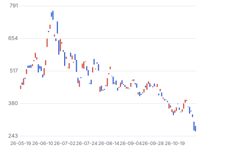

**주봉**

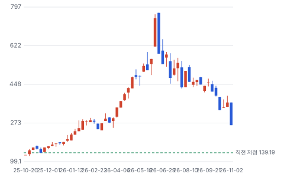

**월봉**

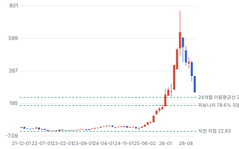

**분기 매출·EPS 실적과 컨센서스**

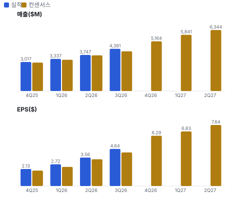

**최근 4개 분기 주가 변화 분석**

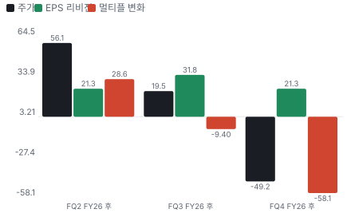

**EPS 리비전**

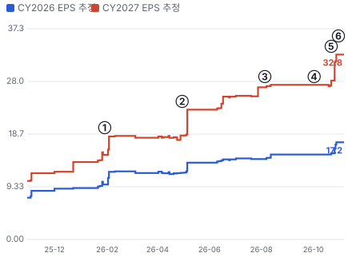

① 26-01-29 FQ2 FY26 실적 · EPS 리비전 +22%
② 26-04-30 FQ3 FY26 실적 · EPS 리비전 +25%
③ 26-08-05 FQ4 FY26 실적, EB +22% · EPS 리비전 +2%
④ 26-10-02 Toshiba 증설 보도 급락 · EPS 리비전 +0%
⑤ 26-10-22 FQ1 FY27 실적, GM 58% · EPS 리비전 +20%
⑥ 26-11-05 데이터센터 정치 리스크 −17% · 실적 창과 겹침

**밸류에이션 주가 시나리오**

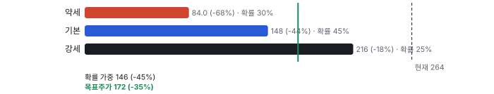

**주가별 업사이드**

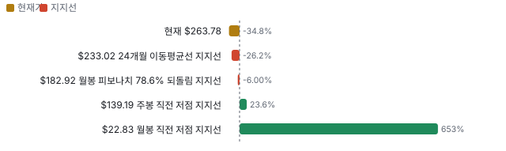

**제품·서비스 포트폴리오**

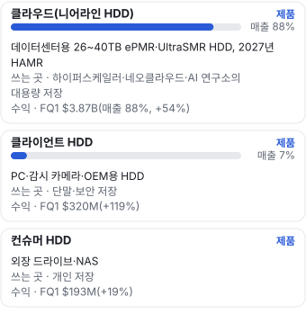

**고객 믹스(FQ1 FY27, 매출 대비)**

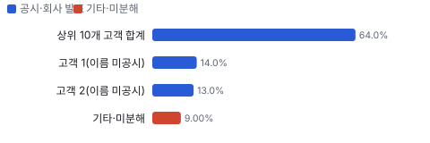

**공급 병목(10점, 낮을수록 병목)**

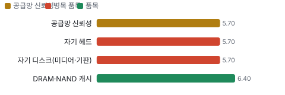

**생산능력 현재와 확충 계획(EB/분기(출하))**

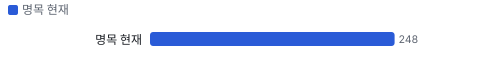

**CAPEX의 매출 대비 비중**

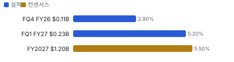

**어닝콜 변화별 주주가치 영향**

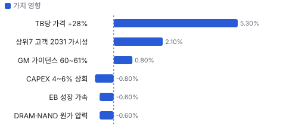

**멀티플 프리미엄(Fwd 1Y P/E, 최근 4개 분기말)**

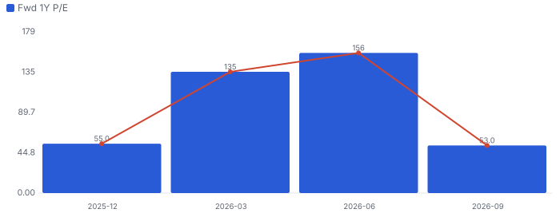

**합리적 멀티플**

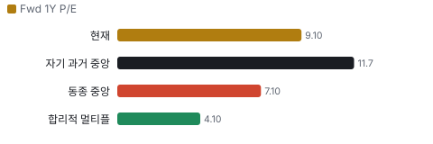

**매출 → 매출총이익 → 영업이익(매출 = 100, 최근 4분기)**

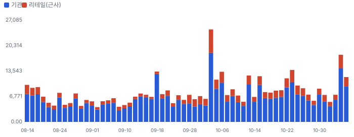

**1년 전 대비 마진 기여(비용 비중 변화의 반대)**

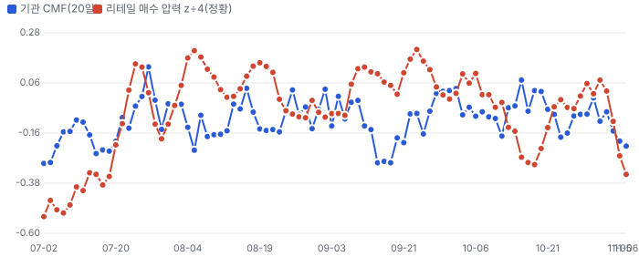

**분기 비용 비중 추이(매출 대비, 공시)**

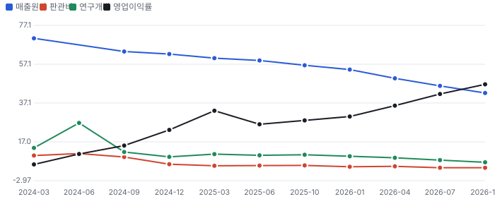

**비용 요인별 매출 대비 비중과 1년 변화**

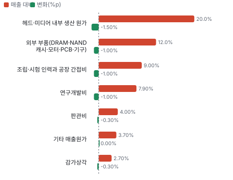

**BOM 항목 가격 +10% 시 OPM 변화**

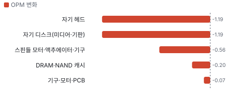

**클라우드(니어라인 HDD) BOM 원가 몫과 가격 +10% 시 OPM**

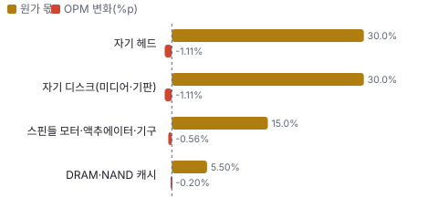

**클라이언트 HDD BOM 원가 몫과 가격 +10% 시 OPM**

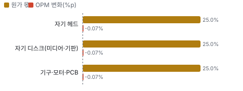

**시설별 면적(sq ft) — 생산능력 미공시라 면적을 대용으로**

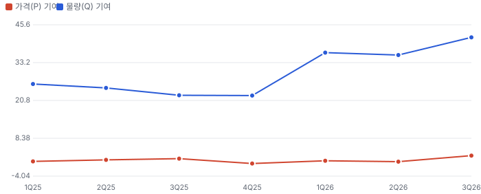

**매출 증가율의 가격·물량 분해와 8분기 전망(전년 대비)**

**분기별 매출 증가율 분해**

**목표주가 산정 — 기본과 강세 사이(강세 쪽 35%), 도달 확률 약 35%**

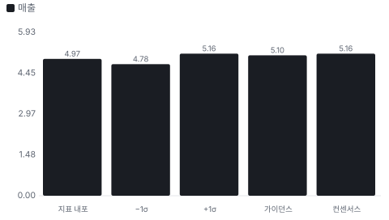

**PEG — 성장 대비 멀티플(낮을수록 성장 대비 쌈)**

**일봉 지지·저항과 목표주가**

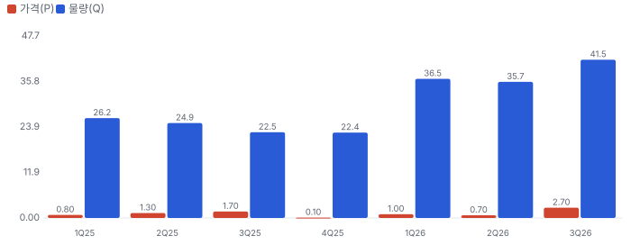

**커뮤니티 언급 수(최근 30일, 채널별)**

**커뮤니티 게시 수(월, 최근 7개월 — 이번 달은 진행 중)**

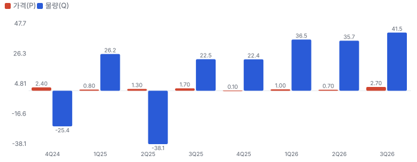

**일별 거래량 분해**

**기관 자금 흐름**

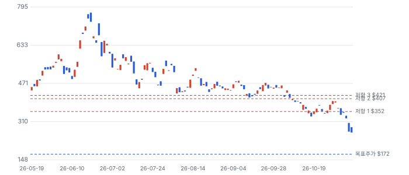

**몬테카를로**

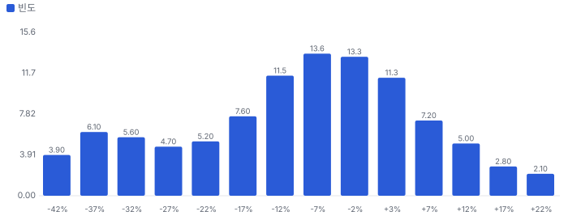

해석: 3,000번 중 860번(29%)에서 가치가 지금 주가 이상이었다. 가정을 흔들어도 지금 주가를 뒷받침하지 못하는 경우가 더 많다. 가운데 값은 0.92배이고, 열 번 중 여덟 번은 0.65~1.10배 사이에 든다.

## 내러티브

> **기업가치를 결정하는 이야기:** 값은 EB × TB당 가격 − TB당 원가다. FQ1은 248EB에 TB당 가격 약 +28%다. 원가는 면적 밀도로 연 약 10% 내려가야 하는데 지금은 DRAM·NAND 때문에 −4~5%다. 가격 상승이 원가 하락보다 크면 이익률이 오른다. 값을 가르는 것은 2028년 이후 가격이 버티는지다.

> **멀티플·EPS 프리미엄**
> **멀티플:** Fwd 1Y P/E 9.1배로 Seagate 10.3배·NetApp 17.3배보다 낮고 메모리 Sandisk 3.2배·Micron 3.9배보다 높다(11/6 종가). 6월 말 40배에서 내려왔다 — HDD를 성장주에서 메모리식 사이클주로 다시 분류하는 중이다.
> **EPS:** FY2027 EPS 컨센서스는 FQ4 실적 직후 \$18.9에서 \$24.4로 +29%, FY2028은 \$34.7에서 \$41.1로 +18%다. 같은 기간 주가는 −52%다.

### 투자자들은 왜 열광했나

2025년 9월부터 HDD 공급 부족·가격 인상이 확인되며 \$50에서 2026년 6/18 종가 \$746까지 약 15배 올랐다. 식은 순서는 6월 말 고점 뒤 −20%, 7월 수요 지속 의심, 8/6 실적 뒤 −13%(8/5 포함 이틀 −18%, EB +22%로 둔화), 10/2 Toshiba 보도 −10%, 11/5 선거 뒤 −17%다.

### 무엇이 기업가치를 바꾸나

> **구조적 체질 변화**
> **변화:** 플래시 분리 뒤 순수 HDD 회사가 됐고 클라우드가 88%다
> **증거:** 2025-02 Sandisk 분리, FQ1 클라우드 88%
> **반증:** 클라우드 매출 2분기 연속 감소

> **고부가 믹스 확장**
> **변화:** 40TB ePMR(에너지 보조 수직 자기 기록)이 FQ3 니어라인(데이터센터용 대용량 HDD) 비트의 50%가 된다
> **증거:** FQ1 콜: FQ2 30%·FQ3 50%
> **반증:** 전환 비율 미달

> **기술 혁신**
> **변화:** HAMR(열 보조 자기 기록 — 레이저로 기록 밀도를 높이는 차세대 HDD 기술) 1세대 2027년 상반기 양산, 2세대 플래터당 5TB
> **증거:** FQ1 콜·11/3 발표. Seagate는 HAMR을 먼저 양산했다
> **반증:** 2027년 1분기 인증 지연

> **실행 속도**
> **변화:** 리드타임은 회사가 공시하지 않는다. 업계 보도로는 니어라인 HDD 주문→출하가 1년 수준이고, 고객은 2030~31 물량을 미리 잡는다 **납품 리드타임 12개월.** 피어 비교 미확인. 이전 대비 미확인.
> **증거:** 업계 보도(TrendForce 2025-09: 니어라인 HDD 리드타임 52주 이상, 업계 공통) — 2026년 값과 회사별 값은 미확인. FQ1 콜 상위 7개 고객 가시성
> **반증:** 고객 재고 증가

> **M&A**
> **변화:** 해당 없음(최근 인수 없음, 2025-02 분할)
> **증거:** 10-K
> **반증:** 대형 인수

> **정책·입법 연관성**
> **재정정책:** 해당 없음(보조금·세액공제 의존 사업이 아니다, 10-Q에 CHIPS(미국 반도체지원법) 지원 없음)
> **행정명령:** 미국 관세가 아시아 생산 HDD 원가를 건드린다 10-Q 위험요인(관세) 반증: 관세를 가격에 못 넘겨 GM 하락 의회 동의 2/10 — 하원 1/5(행정부 조치로 관련 표결을 찾지 못했다) · 상원 1/5(같음).
> **연관입법:** 선거 뒤 데이터센터 건설 제한 논의(발언 단계) Barchart 2026-11-05 보도 — 법안 번호 없음 반증: 법안 발의·위원회 통과

> **CAPEX 낙수효과**
> **변화:** 하이퍼스케일러 AI CAPEX가 저장 수요로 온다. 다만 고객 투자 발표를 WDC 매출로 바로 옮기지 않는다
> **증거:** 클라우드 매출 +54%, 상위 2개 고객 27%
> **반증:** 하이퍼스케일러 CAPEX 가이던스 하향

### 내러티브 근거

> 'AI 저장 수요 + HDD 과점 가격'이 FY2027 EPS를 \$18.9에서 \$24.4로 올렸지만 주가는 6월 종가 고점 대비 −65%다. 시장은 이익을 사이클 정점으로 보고 배수를 깎는다. 동종 대비 멀티플 차이 +29% 중 회사 고유 몫은 +124%다. 단계는 과밀, 쏠림은 높음이다.

> **AI 저장 수요(추론·물리적 AI)** · 유지
> **논리:** AI가 만든 데이터를 HDD가 가장 싸게 저장한다
> **숫자:** EB +22%, 상위 7개 고객 2030~31 가시성
> **반증:** FQ2 EB 성장이 22% 아래(2027-01)

> **과점 가격 결정력** · 유지
> **논리:** 3사가 단위 캐파를 늘리지 않아 TB당 가격이 오른다
> **숫자:** TB당 가격 +28%, 증분 GM 80%
> **반증:** TB당 가격 상승률이 2분기 연속 둔화

> **경쟁사 증설로 과점 균열(약세)** · 강화
> **논리:** 가장 작은 업체(Toshiba)가 단위 캐파를 늘려 가격이 꺾인다
> **숫자:** 10/2 −10%, BofA·Melius 질의
> **반증:** Toshiba 증설이 장비 반입·가동으로 확인되지 않는다

> **사이클 정점 이익(약세)** · 강화
> **논리:** 이익률 54%는 정점이고 메모리처럼 꺾인다
> **숫자:** Fwd 1Y P/E 40배(6월) → 9.1배(11/6)
> **반증:** FQ2 GM 60% 이상과 FQ3 가이던스 상향

> **데이터센터 정치 리스크(약세)** · 신규
> **논리:** 선거 뒤 데이터센터 건설 제한 논의가 수요를 깎는다
> **숫자:** 11/5 −17%
> **반증:** 법안·규칙 단계 진전이 없다

## 포트폴리오

| 제품·서비스 | 구분 | 무엇 | 쓰는 곳 | 돈 버는 방식 | Mix | Mix 변화(전 분기 대비) |
|---|---|---|---|---|---|---|
| 클라우드(니어라인 HDD) | 제품 | 데이터센터용 26~40TB ePMR·UltraSMR(트랙을 겹쳐 쓰는 WDC 고밀도 기록 방식) HDD, 2027년 HAMR | 하이퍼스케일러·네오클라우드(GPU 임대 전문 클라우드 회사)·AI 연구소의 대용량 저장 | FQ1 \$3.87B(매출 88%, +54%) | 88% | -0.7%p |
| 클라이언트 HDD | 제품 | PC·감시 카메라·OEM용 HDD | 단말·보안 저장 | FQ1 \$320M(+119%) | 7% | +1.3%p |
| 컨슈머 HDD | 제품 | 외장 드라이브·NAS(네트워크 연결 저장장치) | 개인 저장 | FQ1 \$193M(+19%) | 4% | -0.6%p |

**Mix 변화가 가장 큰 쪽은 클라이언트 HDD(+1.3%p, 전 분기 대비).** 계절성 판정: 분기 매출 계절 지수 기준 없음 → 직전 분기와 비교.

## 고객

> **FQ1 FY27 최대 고객 상위 10개 고객 합계 64%, 상위 3곳 91%, 집중도 집중.** 공시·회사 발표로 확인한 몫은 매출의 91%이고, 나머지 고객 몫은 추정이거나 미분해다. 10% 넘는 고객이 2곳(14%·13%), 상위 10개 고객이 64%다(전년 73%). 이름은 공시되지 않는다. 클라우드가 매출의 88%다

**고객별 매출 몫(FQ1 FY27)**
| 고객 | 몫 | 변화 | 근거 |
|---|---|---|---|
| 상위 10개 고객 합계 | 64% | -9%p | 공시 |
| 고객 1(이름 미공시) | 14% | -2%p | 공시 |
| 고객 2(이름 미공시) | 13% | +0%p | 공시 |
| 기타·미분해 | 9% | - | - |

> **상위 10개 고객 합계** · 공시
> **사는 것:** 니어라인·클라이언트 HDD
> **추정 근거:** 고객 기반이 넓어졌다(엔터프라이즈·네오클라우드·물리적 AI)

> **고객 1(이름 미공시)** · 공시
> **사는 것:** 니어라인 HDD
> **추정 근거:** 전년 같은 분기에는 4곳이 10%를 넘었다(16·13·13%…)

> **고객 2(이름 미공시)** · 공시
> **사는 것:** 니어라인 HDD
> **추정 근거:** 이름 미공시

## 마진 구조

> **GPM 52.6%, OPM 39.4%.** FY2026 대비 GPM +3.8%p, OPM +4.9%p. TTM 매출원가는 매출의 47.4%로 FY2026 51.2%보다 3.8%p 낮아졌다. TB당 가격 +28%가 원가 하락(−4~5%)보다 훨씬 커서다. 연구개발비는 7.9%, 판관비는 4.0%로 매출이 늘며 비중이 줄었다

> **매출 100 중 매출원가 47.4, 매출총이익 52.6(최근 4분기, 공시).** 매출원가 요인 중 헤드·미디어 내부 생산 원가이 매출의 20.0%로 가장 무겁고, 단가가 +10% 오르면 GPM이 -2.00%p 움직인다. 분기 회귀로 매출 1이 늘 때 매출원가는 0.22 늘고, 매출원가의 고정비 몫은 59%다.

**비용 요인 강도 — 비중·추세·충격(+10%)·탄력**
| 비용 | 구분 | 매출 대비 | 1년 변화 | 마진 기여 | 충격 시 마진 | 매출 탄력 | 고정비 몫 |
|---|---|---|---|---|---|---|---|
| 헤드·미디어 내부 생산 원가 | 매출원가 요인 | 20.0% | -1.5%p | +1.5%p | -2.00%p | 미확인 | 50% |
| 외부 부품(DRAM·NAND 캐시·모터·PCB·기구) | 매출원가 요인 | 12.0% | -1.0%p | +1.0%p | -1.20%p | 미확인 | 0% |
| 조립·시험 인력과 공장 간접비 | 매출원가 요인 | 9.0% | -1.0%p | +1.0%p | -0.90%p | 미확인 | 60% |
| 기타 매출원가 | 매출원가 요인 | 3.7% | +0.0%p | -0.0%p | -0.37%p | 미확인 | 미확인 |
| 감가상각 | 매출원가 요인 | 2.7% | -0.3%p | +0.3%p | -0.27%p | 미확인 | 100% |
| 매출원가 | 공시 항목 | 47.4% | -12.0%p | +12.0%p | -4.74%p | 0.22 | 59% |
| 연구개발 | 공시 항목 | 7.9% | -2.2%p | +2.2%p | 미확인 | -0.01 | 100% |
| 판관비 | 공시 항목 | 4.0% | -1.0%p | +1.0%p | 미확인 | -0.01 | 100% |
| 기타 영업비용 | 공시 항목 | 1.3% | +3.3%p | -3.3%p | 미확인 | 0.00 | 75% |

매출 탄력 = 분기 비용을 매출에 회귀한 기울기(매출 1당 변동비), 고정비 몫 = 절편 ÷ 평균 비용. 표본이 8분기 미만이면 미확인. 매출원가 요인 비중은 margin 재료의 추정이 섞여 있고, 공시 매출원가와의 차이는 '기타 매출원가'로 둔다.

**GPM에서 OPM까지(GAAP)**
| 기간 | GPM | 연구개발 | 판관비 | 기타 | OPM |
|---|---|---|---|---|---|
| FY2026 | 48.9% | 9.0% | 4.3% | 1.1% | 34.5% |
| TTM FQ1 FY27 | 52.6% | 7.9% | 4.0% | 1.3% | 39.4% |

**GPM·OPM 최근 4개 분기**
| 분기 | GPM | OPM |
|---|---|---|
| 2026-01 | 45.7% | 30.1% |
| 2026-04 | 50.2% | 35.7% |
| 2026-07 | 54.1% | 41.7% |
| 2026-10 | 57.8% | 46.7% |

**마진을 결정하는 비용 요인 — 비용 +10% 시 OPM**
| 비용 | 매출 대비 | 변화 | 고정비 | OPM |
|---|---|---|---|---|
| 헤드·미디어 내부 생산 원가 | 20.0% | -1.5%p | 50% | -2.00%p |
| 외부 부품(DRAM·NAND 캐시·모터·PCB·기구) | 12.0% | -1.0%p | 0% | -1.20%p |
| 조립·시험 인력과 공장 간접비 | 9.0% | -1.0%p | 60% | -0.90%p |
| 연구개발비 | 7.9% | -1.0%p | 90% | -0.79%p |
| 판관비 | 4.0% | -0.3%p | 80% | -0.40%p |
| 기타 매출원가 | 3.7% | +0.0%p | 미확인 | -0.37%p |
| 감가상각 | 2.7% | -0.3%p | 100% | -0.27%p |

**비용을 움직이는 요인**
| 비용 | 요인 |
|---|---|
| 헤드·미디어 내부 생산 원가(매출원가) | 면적 밀도·HAMR 공정 단계 증가 · 근거 추정 |
| 외부 부품(DRAM·NAND 캐시·모터·PCB·기구, 매출원가) | 메모리 가격 상승(FQ1 콜) · 근거 추정 |
| 조립·시험 인력과 공장 간접비(매출원가) | 단위 출하 수(크게 늘지 않음) · 근거 추정 |
| 연구개발비(연구개발) | HAMR·ePMR 개발 · 근거 공시 |
| 판관비(판관비) | 인건비 · 근거 공시 |
| 기타 매출원가(매출원가) | 물류·보증 · 근거 추정 |
| 감가상각(매출원가) | 헤드·미디어 설비 · 근거 공시 |

**클라우드(니어라인 HDD) BOM — 매출의 88%, GPM 58%(회사 전체 FQ1 GAAP GM — 회사는 니어라인과 비니어라인 마진이 비슷하다고 밝혔다(FQ4 콜)), 항목 가격 +10% 시**
| 항목 | 원가 몫 | 전가 | 제품 GPM | OPM |
|---|---|---|---|---|
| 자기 헤드 | 25~35% | 미확인 | -1.3%p | -1.11%p |
| 자기 디스크(미디어·기판) | 25~35% | 미확인 | -1.3%p | -1.11%p |
| 스핀들 모터·액추에이터·기구 | 10~20% | 미확인 | -0.6%p | -0.56%p |
| DRAM·NAND 캐시 | 3~8% | 미확인 | -0.2%p | -0.20%p |
| 미분해 | 19% | - | - | - |

**클라이언트 HDD BOM — 매출의 7%, GPM 58%(회사 전체 값(부문 마진 미공시)), 항목 가격 +10% 시**
| 항목 | 원가 몫 | 전가 | 제품 GPM | OPM |
|---|---|---|---|---|
| 자기 헤드 | 20~30% | 미확인 | -1.1%p | -0.07%p |
| 자기 디스크(미디어·기판) | 20~30% | 미확인 | -1.1%p | -0.07%p |
| 기구·모터·PCB | 20~30% | 미확인 | -1.1%p | -0.07%p |
| 미분해 | 25% | - | - | - |

자기 헤드 가격이 +10% 오르면 영업이익은 -3.0% 움직인다. 판매가 전가를 모르는 항목은 전가 0%로 계산했다.

**BOM 항목 가격을 움직이는 것**
| 항목 | 요인 |
|---|---|
| 자기 헤드 | 면적 밀도를 정하는 핵심 부품 · 근거 추정 |
| 자기 디스크(미디어·기판) | 플래터 수가 용량을 정한다 · 근거 추정 |
| DRAM·NAND 캐시 | 메모리 가격 상승이 원가 하락을 늦춘다 · 근거 추정 |
| 스핀들 모터·액추에이터·기구 | 정밀 기구 부품 · 근거 추정 |
| 자기 헤드 | 저용량은 외부 헤드도 쓴다(FQ1 콜) · 근거 추정 |
| 자기 디스크(미디어·기판) | 플래터 · 근거 추정 |
| 기구·모터·PCB | 부품 · 근거 추정 |

**BOM 투입 물가 — PPI 전년비, 2026-11-08 수집**
| 항목 | 미국 | 일본 | 한국 | 대만 |
|---|---|---|---|---|
| DRAM·NAND 캐시 | -2.2%* | +3.9%* | -24.2% | +22.9%* |
| 기구·모터·PCB | +45.8% | +11.3% | -0.8% | +12.1% |

별표는 품목보다 넓은 업종 지수다. 지난 1년 투입 물가를 판매가 전가 뒤 원가에 그대로 넣으면 OPM은 +0.37%p 움직인다(매출원가의 6% 기준).

## 공급망 병목

> **공급망 신뢰성 5.7/10, 병목 주의.** 가장 약한 고리는 자기 헤드 5.7점이고, 품목 평균은 5.8점이다. 병목은 HAMR 헤드·미디어 공정이다. HAMR은 공정 단계와 사이클 타임이 길어 같은 설비에서 처리량이 준다(FQ1 콜). 단기 원가 압력은 HDD 안 DRAM·NAND다. 공급사 이름·몫은 10-Q에 없다

**병목과 마진 — 품목 가격 +10% 시 OPM**
| 품목 | 점수 | 판정 | 구분 | OPM |
|---|---|---|---|---|
| 자기 헤드(필수) | 5.7 | 병목 주의 | 핵심 통제 품목 | -1.19%p |
| 자기 디스크(미디어·기판, 필수) | 5.7 | 병목 주의 | 핵심 통제 품목 | -1.19%p |
| DRAM·NAND 캐시 | 6.4 | 관리 가능 | 일반 | -0.20%p |

> **자기 헤드** · 5.7/10
> **왜:** 면적 밀도·용량을 정한다
> **병목 요인:** 인증 공급사 2곳 · 캐파 빠듯 · 리드타임 미확인 · 재인증 미확인 · 1위 점유율 40% · 아시아(추정) 집중 80% · 물량 확보 내재화
> **풀리는 조건:** 미확인

> **자기 디스크(미디어·기판)** · 5.7/10
> **왜:** 플래터 수 = 용량
> **병목 요인:** 인증 공급사 2곳 · 캐파 빠듯 · 리드타임 미확인 · 재인증 미확인 · 1위 점유율 40% · 아시아(추정) 집중 80% · 물량 확보 내재화
> **풀리는 조건:** 미확인

> **DRAM·NAND 캐시** · 6.4/10
> **왜:** 원가 하락 속도를 늦춘다
> **병목 요인:** 인증 공급사 3곳 · 캐파 빠듯 · 리드타임 미확인 · 재인증 미확인 · 1위 점유율 40% · 한국·미국·일본(추정) 집중 60% · 물량 확보 미확인
> **풀리는 조건:** 미확인

**공급사**
| 품목 | 공급사 | 몫 | 근거 |
|---|---|---|---|
| 자기 헤드 | 자체 생산(고용량 플랫폼 전량) | 미확인 | 회사 발표 |
| 자기 헤드 | 외부 헤드 공급사(미공시, 저용량 일부) | 미확인 | 회사 발표 |
| 자기 디스크(미디어·기판) | 자체 미디어(고용량 플랫폼) | 미확인 | 회사 발표 |
| 자기 디스크(미디어·기판) | 외부 미디어·기판 공급사(미공시, 일부) | 미확인 | 회사 발표 |
| DRAM·NAND 캐시 | 메모리 3사(추정, 캐시 메모리) | 미확인 | 추정 |

**무역 통계로 본 공급 지역**
| 품목 | EU 수입처 | 일본 수입처 | EU 1위 전년비 |
|---|---|---|---|
| DRAM·NAND 캐시 | TW(대만) 45% · KR(한국) 21% · CN(중국) 16% | 台湾 52% · 大韓民国 28% | +365.5% |

## 생산능력

> **현재 명목 캐파 248 EB/분기(출하), 가동률 미확인.** 착공 이상 증설은 0 EB/분기(출하), 발표까지 합치면 0 EB/분기(출하)이다. 다 가동하면 지금보다 +0%, 착공 이상만이면 +0%다. FQ1 FY27 CAPEX는 \$0.23B로 매출의 5.2%다. 회사는 명목 캐파를 밝히지 않는다. FQ1 출하 248EB(+22%)를 지금 처리량으로 본다. 늘리는 방식은 단위 캐파가 아니라 면적 밀도(40TB ePMR → HAMR)다. CAPEX는 매출의 4~6%이고 2년간 소폭 웃돈다

**생산시설 9곳**(FY26 10-K Item 2 — 용도에 '제조'가 있는 시설(2026-07-03 기준)), 소유 6곳 · 임차 1곳 · 소유·임차 2곳. 시설별 생산능력은 공개되지 않았다 — 회사 전체 캐파만 위에 적었다.

**생산시설 9곳 — 명칭·위치·생산능력**
| 시설 | 위치 | 용도 | 생산능력 | 소유·상태 |
|---|---|---|---|---|
| San Jose | 미국 캘리포니아 San Jose | 제조·R&D·관리 | 미확인 — 시설별 캐파 미공시(10-K Item 2는 면적·용도만) · 면적 1,957,000 sq ft | 소유 · 가동 |
| Fremont | 미국 캘리포니아 Fremont | 제조·R&D | 미확인 — 시설별 캐파 미공시(10-K Item 2는 면적·용도만) · 면적 295,000 sq ft | 임차 · 가동 |
| Shenzhen | 중국 Shenzhen | 제조 | 미확인 — 시설별 캐파 미공시(10-K Item 2는 면적·용도만) · 면적 614,000 sq ft | 소유·임차 · 가동 |
| Penang | 말레이시아 Penang | 제조 | 미확인 — 시설별 캐파 미공시(10-K Item 2는 면적·용도만) · 면적 1,192,000 sq ft | 소유 · 가동 |
| Kuching | 말레이시아 Kuching | 제조·R&D | 미확인 — 시설별 캐파 미공시(10-K Item 2는 면적·용도만) · 면적 638,000 sq ft | 소유 · 가동 |
| Johor Bahru | 말레이시아 Johor Bahru | 제조 | 미확인 — 시설별 캐파 미공시(10-K Item 2는 면적·용도만) · 면적 277,000 sq ft | 소유 · 가동 |
| Laguna | 필리핀 Laguna | 제조·관리 | 미확인 — 시설별 캐파 미공시(10-K Item 2는 면적·용도만) · 면적 632,000 sq ft | 소유 · 가동 |
| Bang Pa-In | 태국 Bang Pa-In | 제조·R&D | 미확인 — 시설별 캐파 미공시(10-K Item 2는 면적·용도만) · 면적 1,595,000 sq ft | 소유·임차 · 가동 |
| Prachinburi | 태국 Prachinburi | 제조 | 미확인 — 시설별 캐파 미공시(10-K Item 2는 면적·용도만) · 면적 1,568,000 sq ft | 소유 · 가동 |

**생산능력 확충 계획**
| 계획 | 단계 | 증설 | 가동 시점 | CAPEX |
|---|---|---|---|---|
| HAMR 1세대 양산(2개 고객 인증 중) | 발표 | 미확인 | 2027 상반기 | 미확인 |

남은 계획의 CAPEX 합계는 \$0.00B(금액 미확인 1건 제외)다. 합계는 FY2027 매출의 0%다.

**증설 방해 요인**
| 계획 | 방해 요인 |
|---|---|
| HAMR 1세대 양산(2개 고객 인증 중) | 헤드·미디어 사이클 타임, 인증 |

**CAPEX와 매출 대비**
| 기간 | CAPEX | 매출 | 매출 대비 | 구분 |
|---|---|---|---|---|
| FQ4 FY26 | \$0.11B | \$3.75B | 2.9% | 실적 |
| FQ1 FY27 | \$0.23B | \$4.38B | 5.2% | 실적 |
| FY2027 | \$1.20B | \$21.73B | 5.5% | 컨센서스 |

## 해자

> 해자는 헤드·미디어 수직계열화와 3사 과점이다. 다만 과점은 증설 규율이 깨지면 시험받는다.

> **헤드·미디어 자체 생산** · 강함
> **해자:** 고용량 선도 플랫폼은 모두 자체 헤드·미디어로 만든다
> **근거:** FQ1 콜: 고용량 플랫폼은 내부 헤드, 저용량만 외부 구매. 단위 캐파 증설 없이 면적 밀도로 EB를 늘린다
> **숫자:** FQ1 증분 매출총이익률 80% 초과, GM 58.1%
> **깨지는 조건:** 경쟁사가 외부 헤드로 40TB급을 같은 시기에 양산

> **3사 과점(Seagate·WDC·Toshiba)** · 보통
> **해자:** 니어라인 HDD는 세 회사만 만든다
> **근거:** 10-K 경쟁 항목. 신규 진입자 없음. 10월 Toshiba 증설 보도 뒤 주가 −10%(원인 1차 미확인)
> **숫자:** WDC·Seagate EB 성장 22%·30%대 중반(UBS 질의)
> **깨지는 조건:** Toshiba 단위 캐파 증설이 장비 반입·가동으로 확인되고 현물 가격이 꺾인다

> **장기공급계약(LTA(장기공급계약))** · 보통
> **해자:** 물량·로드맵을 고객과 묶는다
> **근거:** 상위 7개 고객 2030~31 가시성, 기본·추가 물량과 가격 조정 조항(FQ1 콜)
> **숫자:** 구매 약정 \$304M(10-Q)은 작다 — 고객 쪽 의무 금액은 미공시
> **깨지는 조건:** LTA 갱신에서 가격 조정 폭 축소

## 경영진·네트워크

> 창업자 없는 전문경영인 회사다. CEO Irving Tan(2025-02)과 CFO Kris Sennesael(전 Skyworks CFO)이 이끈다. 공개 자료로 확인한 정치 연결은 없다

> **Irving Tan** · CEO · 2025-02
> **프로필:** Western Digital 글로벌 운영 총괄 → Sandisk 분리 때 CEO. 전 Cisco 운영 수석 부사장
> **비즈니스:** 반도체·네트워크 공급망 경력
> **정계:** 미확인
> **동문:** 미확인
> **사모임:** 미확인

> **Kris Sennesael** · CFO · 미확인
> **프로필:** 전 Skyworks Solutions CFO
> **비즈니스:** 반도체 재무
> **정계:** 미확인
> **동문:** 미확인
> **사모임:** 미확인

**네트워크 정량화**
| 연결 | 강도 | 닿는 매출 | 가중 노출 | 매출 대비 | 근거 |
|---|---|---|---|---|---|
| 정계: 정부·의회 직책 연결 | 0/5 | 미확인 | 미확인 | 미확인 | 위임장·회사 소개에서 찾지 못했다 Quantral 9월: 하원의원 1명의 소액 매수 공시(연결 아님) |

가중 노출은 연결이 닿는 매출의 크기다. 연결이 그 매출을 만들었다는 뜻이 아니며, 인과는 공개 자료로 입증하지 못한다.

## 약세 논리 및 셀온 조건

| 약세 논리 | 근거 | 반박 | 가를 자료 |
|---|---|---|---|
| 과점 균열 — 가장 작은 업체가 증설한다 | 10/2 Toshiba 관련 보도 뒤 −10%. FQ1 콜 BofA·Melius·Goldman 질문이 모두 이 쟁점 | 보도는 장비 반입·가동 근거가 없다(금지표: 투자 발표 → 공급 증가). CEO는 헤드·미디어가 없는 업체는 단위 수로 메워야 한다고 답했다 | Toshiba 장비 반입·가동 공시, 일본 HDD 수출 통계(2027 상반기) |
| 이익률 54%는 사이클 정점 | 비GAAP GM 58.1%는 10년 최고. 2023년 분기 영업적자 −\$650M | 2023년은 플래시를 포함한 회사의 재고 조정이다. 지금은 단위 캐파를 늘리지 않는 과점이고 증분 GM이 80%다 | FQ2 GM 실적과 FQ3 가이던스(2027-01 말) |
| TB당 원가 하락이 멈춘다 | DRAM·NAND 원가 상승으로 FQ1 TB당 원가 −4~5%(장기 −10%) | 회사는 가치공학으로 상쇄 중이라 했다. 가격 +28%가 원가 하락보다 훨씬 크다 | FQ2 TB당 원가(2027-01 말) |
| 데이터센터 정치 리스크 | 11/5 민주당 상원 당선인 데이터센터 건설 중단 발언 보도 뒤 −17%. 클라우드 88% | 발언 단계이고 법안 번호가 없다(금지표: 법안 발의 → 시행). 하이퍼스케일러 CAPEX 가이던스는 변하지 않았다 | 새 의회 법안 발의·위원회(2027-01~), 하이퍼스케일러 4Q 콜(2027-01~02) |
| 고객 집중 | 상위 2개 고객 27%, 상위 10개 64%(10-Q) | 전년 상위 10개 73%에서 내려왔다. 엔터프라이즈·네오클라우드·물리적 AI 고객이 늘었다 | FY2027 10-K 고객 집중(2027-08) |
| HAMR에서 Seagate보다 늦다 | Seagate EB 성장 30%대 중반 vs WDC 22%(UBS 질의) | WDC는 40TB ePMR로 FQ3 니어라인 비트 50%를 채운다. HAMR 할인 없음 | 2027년 1분기 HAMR 인증 완료 발표 |

**추가 원천(11/8 보강).** 중간선거 영향 −0.4/10 — 정책 채널은 관세 입법 고착화 가능성 하락(수입 의존 기업 소폭 유리, +0.25)이지만 업종 반응이 SMH 선거 뒤 CAR(사건 뒤 시장 대비 초과 누적 수익률) −2.7%(t −0.84)로 더 컸다. 정책 0단계(선거 결과) 가설이다. 레딧 언급 순위(ApeWisdom)는 47위(하루 전 61위), 언급 수는 15건에서 5건으로 줄었다. 무역·PPI(생산자물가지수)는 단서다: 미국 메모리 반도체(HS(국제 통일 상품 분류 코드) 854232) 9월 수입 전년비 +617%, 미국 PCB PPI 전년비 +45.8%(9월)는 FQ1 콜에서 말한 외부 부품 원가 상승과 같은 방향이다.

> **셀온 조건**
> **조건 1:** TB당 가격 상승률이 2분기 연속 둔화한다
> **조건 2:** FQ2 또는 FQ3 GM이 가이던스 하단 아래다
> **조건 3:** Toshiba·Seagate 단위 캐파 증설이 장비 반입·가동으로 확인된다
> **조건 4:** HAMR 인증이 2027년 1분기를 넘겨 지연된다
> **조건 5:** 데이터센터 건설 제한이 법안 위원회 통과 단계로 간다

## 어닝콜 변화

**직전 콜 대비 새로 나오거나 바뀐 내용 → 가치 영향**
| 항목 | 내용 | 직전 콜 | 최신 콜 | 모델 동인 이동 | 확신도 | 가치 영향 |
|---|---|---|---|---|---|---|
| 업데이트 | TB당 평균 가격 상승률 |  |  | 1년차 성장률 +5.0% | 1.0 | +5.3% |
| 업데이트 | 매출총이익률 가이던스 |  |  | 출발 이익률 +4.0% | 0.8 | +0.8% |
| 신규 | 수요 가시성 |  |  | 장기 성장 수렴값 +1.0% | 0.5 | +2.1% |
| 업데이트 | EB 출하 성장 |  |  | 성장 지속(감속 계수) -2.0% | 0.5 | -0.6% |
| 부정 | TB당 원가 |  |  | 목표 이익률 -1.0% | 0.8 | -0.6% |
| 신규 | CAPEX |  |  | 매출÷투하자본 -20.0% | 0.8 | -0.8% |
| 반복 | HAMR 일정 |  |  | 1년차 성장률 — | 0.8 | +0.0% |
| **합계** | 단독 합 |  |  | 동시 적용 +6.4% |  | **+6.2%** |

**사건별 EPS 리비전**
| # | 날짜 | 구분 | 사건 | CY2026 EPS 전→후 | CY2027 EPS 전→후 | 리비전 | 주가 반응 |
|---|---|---|---|---|---|---|---|
| ① | 26-01-29 | 실적 | FQ2 FY26 실적 | \$9.73 → \$12.07 | \$14.99 → \$18.34 | +22.4% | -10.1% |
| ② | 26-04-30 | 실적 | FQ3 FY26 실적 | \$11.79 → \$13.61 | \$18.42 → \$23.00 | +24.9% | -0.7% |
| ③ | 26-08-05 | 실적 | FQ4 FY26 실적, EB +22% | \$14.24 → \$15.05 | \$26.95 → \$27.39 | +1.6% | -13.0% |
| ④ | 26-10-02 | 내러티브 | Toshiba 증설 보도 급락 | \$15.05 → \$15.05 | \$27.39 → \$27.39 | +0.0% | -10.2% |
| ⑤ | 26-10-22 | 실적 | FQ1 FY27 실적, GM 58% | \$15.06 → \$17.21 | \$27.26 → \$32.75 | +20.1% | -3.0% |
| ⑥ | 26-11-05 | 내러티브 | 데이터센터 정치 리스크 −17% | \$17.21 → \$17.21 | \$32.75 → \$32.75 | 실적 창과 겹침 | -17.4% |

**해석:** 3개 구간 누적 주가 -5% = EPS 리비전 +94% × 멀티플 -51%. 더 크게 움직인 쪽은 **EPS 리비전**이다.

## P·Q 사이클

> **Q 사이클 — 최근 4분기 평균 가격 기여 +1.1%, 물량 기여 +34.0%(전년 대비 로그 증가율).** P 강도 4.9/10, Q 강도 6.0/10, 최근 8분기 중 100%가 같은 요인 우세(구조적).

**P·Q 사이클 정량**
| 항목 | 가격(P) | 물량(Q) |
|---|---|---|
| 최근 4분기 평균 기여 | +1.1% | +34.0% |
| 강도(0~10, 자기 이력 z) | 4.9 | 6.0 |
| AR(자기회귀 모형) 고유 주기(AR(2)일 때) | 미확인 | 미확인 |
| 다음 4분기 투영 평균 | 미확인 | 미확인 |

가격 근거: 미국 PPI 컴퓨터 대용 — 회사 판매가가 아니라 업종 가격. PPI를 쓰면 회사 판매가가 아니라 업종 가격 대용이다. 로그 증가율이라 가격·물량 기여의 합이 매출 증가율이다. 전망: 가격은 BIC(모형 차수를 고르는 정보 기준)로 차수를 고른 AR, 물량은 AR과 '컨센서스 매출 증가율 − 가격 전망'을 분산 역수로 섞는다. 모형 산출이며 가이던스가 아니다. 회사 판매가로 잴 수 없는 이유: 회사가 분기 EB 출하·TB당 가격을 일부 분기만 밝혀(FQ4 231EB·FQ1 248EB) 시계열이 짧다 — 업종 PPI로 대신한다

10년 위치·프리미엄: 구조 단절(1Q24 Sandisk(플래시) 분리 — 이전 분기는 플래시 포함 연결 수치(datapack 선언)) 뒤 TTM 표본이 7개로 20개에 못 미쳐 10년 비교를 하지 않는다 — 단절 전후 매출은 같은 회사 범위가 아니다.

## 밸류에이션

> **목표주가 \$172, 업사이드 -35%.** 자리는 기본과 강세 사이(강세 쪽 35%)이고 도달 확률은 약 35%다. 기본 \$148, 강세 \$216(-18%), 약세 \$84(-68%). DCF 기준 업사이드는 기본 +0%, 강세 -11%, 약세 -34%다(WACC 10.8%).

기준 멀티플이 Fwd 1Y P/E라 EPS도 다음 4개 분기 조정 EPS를 쓴다. 배수는 엔진이 동종 중앙값에서 출발해 정한다.

> **약세 \$84 (-68%)** · 확률 30%
> **가정:** 3.8배 × EPS \$22.00
> **근거:** Toshiba 증설과 메모리 원가로 TB당 가격 상승이 멈추고 GM이 55%에서 꺾인다. 다음 4개 분기 EPS 컨센서스 \$29.0보다 약 24% 낮다

> **기본 \$148 (-44%)** · 확률 45%
> **가정:** 5.1배 × EPS \$29.00
> **근거:** 다음 4개 분기 EPS 컨센서스 \$29.0대로 간다. FQ2 가이던스 \$5.80이 첫 분기다

> **강세 \$216 (-18%)** · 확률 25%
> **가정:** 6.4배 × EPS \$34.00
> **근거:** FQ1처럼 가이던스를 넘고 40TB ePMR·HAMR로 EB 성장이 30%대로 가속한다

**멀티플 선정 — Fwd 1Y P/E**
| 단계 | 조정 | 근거 |
|---|---|---|
| 동종 중앙값 | 7.1배 | 범위 3.2~17.3배, 4곳 |
| 펀더멘털 | -20% | 성장·이익률·ROIC로 본 합리적 멀티플 4.1배와의 차이의 일부만 인정 |
| 해자 | +7% | 헤드·미디어 자체 생산 강함 · 3사 과점(Seagate·WDC·Toshiba) 보통 · 장기공급계약(LTA) 보통 |
| 반복 매출 | +0% | 재료 없음 |
| 수주 전환·가시성 | +0% | 가시성 재료 없음 |
| 내러티브 | -5% | 단계 과밀 |
| 사이클·실행 판단 | -10% | 이익률 54%는 HDD 과점의 가격 결정력이 만든 사이클 상단이고, 10월 경쟁사 증설 보도·11/5 데이터센터 정치 리스크가 남아 동종 배수를 다 주지 않는다 |
| **선정** | **5.1배** | 지금 9.1배 |

**동종 레인지**
| 회사 | Fwd 1Y P/E | Fwd 2Y P/E | Fwd 3Y P/E | 성장 | 영업이익률 | ROIC |
|---|---|---|---|---|---|---|
| STX | 10.3 | 7.7 | 6.9 | 62% | 55% | 131% |
| SNDK | 3.2 | 2.9 | 2.4 | 89% | 81% | 143% |
| MU | 3.9 | 3.1 | 2.8 | 111% | 84% | 88% |
| NTAP | 17.3 | 15.3 | 14.4 | 10% | 31% | 448% |
| **Western Digital** | 9.1 | 7.2 | 6.4 |  |  |  |

> **PEG 0.35** — Fwd 1Y P/E 9.1배를 다음 해 EPS 성장 26%로 나눈 값, 동종 중앙 0.28(성장 대비 비싸다). 성장률은 Fwd 1Y·2Y P/E에서 역산한 컨센서스라 다음 해 한 해 성장만 반영하고, 성장 지속 기간은 담지 않는다.

**PEG — Fwd 1Y P/E ÷ 다음 해 EPS 성장률**
| 회사 | Fwd 1Y P/E | 다음 해 EPS 성장 | PEG |
|---|---|---|---|
| **Western Digital** | 9.1 | +26% | 0.35 |
| STX | 10.3 | +33% | 0.32 |
| SNDK | 3.2 | +13% | 0.25 |
| MU | 3.9 | +27% | 0.15 |
| NTAP | 17.3 | +13% | 1.36 |

지금 주가가 요구하는 5년 매출 CAGR 10%, 기본 시나리오 11%. 몬테카를로 중앙값 업사이드 -8%.

> 의사결정 보조(투자자문 아님): ① 매수 매력: 연 기대수익 +6.8% (자기자본비용 10.8% 대비 -4.0%p) · 자본비용 초과 확률 12% · 안전마진 0.65 → 정량 신호 약함 / ② 위험 예산 지표(이론): 0% — 기대수익이 자기자본비용에 못 미침(무위험 대비 켈리 100%는 참고) · 5년 하위10% -1% · 30%+ 손실 확률 0% / ③ 상방(5년): 기대 1.39배 · 2배 0% · 3배 0% · 10배 0% · 상위10% 1.69배

투입 물가 점검: 지난 1년 PPI를 BOM에 넣으면 OPM +0.37%p다(매출원가의 6% 기준).

## 매수 위치(일봉)

> **현재가 \$264는 '지지선 미확인'.** 이 자리에서 목표주가까지 -34.8%, 첫 일봉 저항까지 +33.6%, 다음 지지까지 하방 미확인.

**가격대별 업사이드(일봉 기준)**
| 가격대 | 가격 | 목표주가까지 | 첫 저항까지 | 다음 지지까지 | 손익비 | 근거 기법(강도) |
|---|---|---|---|---|---|---|
| 현재가 | \$264 | -34.8% | +33.6% | 미확인 | 미확인 | - |

**일봉 저항**
| 저항 | 가격 | 현재가 대비 | 근거 기법(강도) |
|---|---|---|---|
| 저항 1 | \$352 | +33.6% | 20일선(0.5) |
| 저항 2 | \$407 | +54.2% | 50일선(1.0) |
| 저항 3 | \$421 | +59.5% | 200일선(1.0) |

일봉만 쓴다(주봉·월봉 제외). 손익비 = 목표주가까지 업사이드 ÷ 다음 지지까지 하방. 가격대별 기대값 참고표이며 매수·매도 시점 지시가 아니다.

## 애널리스트 토론

> **토론 결론 Sell(규칙 등급 Strong Sell).** 규칙 등급 Strong Sell은 동종 중앙값 7.1배가 메모리 2사(3~4배)에 끌려 내려간 값이다. DCF 기본이 현재가와 같고(+0%) HDD 동종 Seagate는 10.3배라 한 단계 올린 Sell로 조율한다. 그 이상은 FQ2 전에는 근거가 없다

**패널(가상 애널리스트)**
| 자리 | 애널리스트 | 핵심 논리 | 틀리는 조건 | 최종 투표 |
|---|---|---|---|---|
| Strong Buy | 한서윤(가상 리서치 하우스 아라증권) | Fwd 1Y P/E 9.1배에 FQ2 가이던스 매출 +69% — 6월 40배에서 이익은 올랐는데 배수만 4분의 1이 됐다 | FQ2 매출이 \$5.0B 아래 | Neutral |
| Buy | 오지후(가상 리서치 하우스 누리리서치) | 과점 가격은 계약으로 묶여 있다 — 상위 7개 고객 2031 가시성 | LTA 갱신에서 가격 조정 폭 축소 | Neutral |
| Neutral | 배다온(가상 리서치 하우스 솔빛증권) | 이익은 맞지만 정점 이익에 몇 배를 줄지는 Toshiba 증설이 가른다 | Toshiba 증설이 가동으로 확인되지 않고 FQ2 EB 가속 | Sell |
| Sell | 권태하(가상 리서치 하우스 다솜리서치) | 메모리처럼 HDD도 가격이 꺾이면 이익률이 반토막 난다 | FQ3 가이던스에서 GM 상향 지속 | Sell |
| Strong Sell | 민세온(가상 리서치 하우스 한결증권) | 데이터센터 정치 리스크와 클라우드 88% 집중이 겹쳤다 | 하이퍼스케일러 2027 CAPEX 가이던스 상향 | Sell |

**투표**
| Strong Buy | Buy | Neutral | Sell | Strong Sell |
|---|---|---|---|---|
| 0 | 0 | 2 | 3 | 0 |

> **개회 · Strong Buy**
> **발언:** FY2027 EPS \$25.4에 9배다. 이익 추정은 3개월 새 29% 올랐다

> **개회 · Buy**
> **발언:** 가격은 LTA로 묶였고 고객 7곳이 2031년까지 물량을 잡았다

> **개회 · Neutral**
> **발언:** 시장이 묻는 건 이익이 아니라 지속 기간이다. Toshiba 보도 하루에 −10%였다

> **개회 · Sell**
> **발언:** 2023년에 이 회사는 분기 영업적자 \$650M을 냈다. GM 58%는 정점이다

> **개회 · Strong Sell**
> **발언:** 데이터센터 건설이 정치 쟁점이 됐다. 클라우드가 88%다

> **반박1 · Buy → Sell**
> **발언:** 2023년은 플래시 포함 회사의 재고 조정이다. 지금은 단위 캐파를 늘리지 않는 과점이다

> **반박1 · Sell → Strong Buy**
> **발언:** 9배는 정점 이익 기준이다. 메모리 Sandisk는 3배다

> **반박1 · Neutral → Buy**
> **발언:** LTA 의무 금액은 공시되지 않았다. 구매 약정은 \$304M뿐이다

> **반박2 · Strong Buy → Neutral**
> **발언:** Toshiba 증설은 보도뿐이다. 장비 반입·가동 근거가 없다

> **반박2 · Strong Sell → Buy**
> **발언:** 고객 가시성은 수요 신호이지 가격 약속이 아니다

> **반박2 · Neutral → Strong Sell**
> **발언:** 정치 발언은 법안 단계가 아니다. 가를 자료는 1월 FQ2다

> **최종 · Strong Buy** · Neutral
> **발언:** Neutral로 물러선다. 동종을 메모리까지 넓히면 9배도 싸다고 말하기 어렵다

> **최종 · Buy** · Neutral
> **발언:** Neutral로 물러선다. 가격 결정력은 맞지만 FQ2 전에는 증명이 없다

> **최종 · Neutral** · Sell
> **발언:** Sell로 물러선다. 규칙 등급보다 한 단계 위가 숫자가 지지하는 끝이다

> **최종 · Sell**
> **발언:** Sell을 유지한다. 메모리식 배수가 맞다

> **최종 · Strong Sell** · Sell
> **발언:** Sell로 물러선다. 정치 리스크는 아직 발언 단계다

남은 반대 의견: Neutral 두 자리 — Seagate만 동종으로 쓰면 기본 시나리오가 현재가 위다

패널은 가상 인물이고 실존 IB의 의견이 아니다.

## 커뮤니티 내러티브

> **커뮤니티는 '과점 가격 결정력 + AI 저장 수요'로 기대를 소화하다가 10월 Toshiba 보도와 11월 선거 뒤 메모리주 동반 하락에서 '사이클 정점' 논쟁으로 갈렸다** 관심 급증 0.0/10(결합 Z -1.2), 최근 7일 신뢰 가중 감성 +0.07(관측 전체 +0.25).

**채널별 내러티브와 기대 소화**
| 채널 | 주된 이야기 | 기대 | 1차 자료 대조 | 비중 |
|---|---|---|---|---|
| X | HDD는 사실상 2사 과점이라 가격이 계속 오른다 | 상향 | 부분 확인 — TB당 가격 +28%(FQ1 콜). 다만 Toshiba까지 3사다 | 40% |
| X | AI 추론·물리적 AI가 저장 수요를 만든다 | 상향 | 부분 확인 — 회사 발언(상위 7개 고객 2031 가시성). 매출 몫은 미공시 | 30% |
| X | 메모리주가 또 무너졌다 — WDC −15% | 하향 | 확인(가격) — 11/5 −17%. 회사 숫자 변경은 없다 | 30% |
| 레딧 | 고점에 샀다·풋으로 벌었다 — 사이클 정점 논쟁 | 혼재 | 미확인 — 가격 논쟁이고 1차 자료 근거는 없다 | 100% |

**채널별 급증 측정(음이항 Z·CUSUM, 사건형은 포아송 꼬리확률)**
| 채널 | 최근 | 평소 | 급증 | 지속 |
|---|---|---|---|---|
| X | 3일 1건 | 하루 0.8건 | Z -0.6 | - |
| 레딧 | 3일 0건 | 하루 0.2건 | Z -0.8 | - |
| 유튜브 | 3일 0건 | 하루 0.3건 | Z -0.8 | - |
| 서브스택 | 3일 0건 | 하루 0.1건 | Z -0.4 | - |

**기대가 바뀐 시점:** 7월 수요 지속 의심(점수 22) → 8월 실적 뒤 반등 기대(80) → 9월 관망(44) → 10월 실적·과점 가격 결정력(83) → 11월 메모리주 동반 하락(69, 3건)

원천: Quantral(X·레딧·유튜브·서브스택 언급 집계, 작성자 적중률로 신뢰 가중). 커뮤니티 의견은 시장 기대의 증거이지 사실이 아니며, 관심 급증은 주가·펀더멘털 변화가 아니다.

## 시장 평가

> **셀사이드(IB 애널리스트)**
> **한 줄:** 추정은 오르고 목표가는 내린다 — 배수를 깎는 중이다
> **애널리스트 의견:** 24명 — 강력 매수 18·매수 1·보유 5·매도 0 — FQ1 뒤 목표가 하향이 이어졌다(Citic \$660 → \$615, Argus \$600 → \$500)
> **목표가 평균·범위:** \$615 (\$400~\$1,050, 23명) — 현재가 대비 +133% — 기대의 증거일 뿐 Chiip 목표가 아니다
> **FQ1 콜 질문 증권사:** Evercore·Bank of America·Morgan Stanley·Cantor·Citigroup·Melius·Barclays·UBS·TD Cowen·Goldman Sachs·BNP Paribas·Bernstein — 초점: 경쟁사 증설·가격 지속·HAMR

> **바이사이드(기관 투자자)**
> **한 줄:** 기관이 가격을 정하고 공매도는 적다 — 하락은 롱 이탈이다
> **기관 보유 비중:** 89% — 대형 기관 중심
> **공매도 비중:** 유통의 5.2% — 낮다
> **내부자 보유:** 0.3% — 전문경영인 회사

> **언론·업계**
> **한 줄:** 언론은 AI 저장 수요 지속을 다룬다
> **커뮤니티·언론 제목(7일):** 2건 + 의견 변경 7건 — '선거 급락 뒤 반등'·'잡음 무시' 류

## 체크리스트

| 시점 | 무엇 | 의미 |
|---|---|---|
| 2026년 11월 중순 | 9월 말 13F | 6~10월 하락기에 기관이 얼마나 줄였나 |
| 2026-12-04 | 배당 기준일(\$0.175) | 주주환원 지속 |
| 2027년 1월 | 새 의회 개원 — 데이터센터·전력 법안 | 정치 리스크가 발언에서 법안 단계로 가는지 |
| 2027년 1월 말(예상) | FQ2 FY27 실적·FQ3 가이던스 | EB 성장 가속, TB당 가격·원가, GM 60% 이상 |
| 2027년 1분기 | HAMR 1세대 2개 하이퍼스케일러 인증 완료 | 2027년 상반기 양산 전환 |
| 2027년 상반기 | Toshiba 증설 실체(장비 반입·가동) | 과점 규율 유지 여부 |

## 정정 기록 — Chiip Proviser 23:50

당일 리포트 점검에서 고친 것만 적는다. 판단·목표주가·등급·시나리오 숫자는 바꾸지 않았다. FQ1 매출 \$4.38B(+55%)·비GAAP GM 58.1%, FQ2 가이던스 매출 \$5.1B±\$0.1B·GM 60~61%·EPS \$5.80±\$0.20, 11/3→11/6 −24%, 11/5 −17%, Seagate 10.3배 × EPS \$29 = 약 \$299는 8-K EX-99.1·일봉과 일치했다.

| 무엇을(전 → 후) | 왜 | 근거 |
|---|---|---|
| '6월 고점 \$771' 3곳 → '6/18 종가 고점 \$746', 낙폭 −66% → −65% | \$771은 어느 기준에도 없는 값이다 — 6/18 종가 고점은 \$746.23, 장중 고점은 \$799.87이다. 같은 리포트 '왜 움직였나'의 종가 고점 \$746과 기준을 맞췄다 | TradingView NASDAQ:WDC 일봉 2026-06-15~26. 종목 ohlcv.csv의 6월 봉은 시가=고가·저가=종가로 저장돼 고가가 틀렸다(아래 참고) |
| '8/6 FQ4 실적 다음 날 −18%' 2곳 → −13%(발표일 포함 이틀 −18% 병기) | 실적은 8/5 장 마감 뒤 발표됐다. 8/5 종가 \$519.17 → 8/6 \$451.52는 −13.0%이고, −18%는 8/4 \$548.56부터 잰 이틀 낙폭이다 | TradingView 일봉 2026-08-03~10, WDC FQ4 FY26 실적 발표(2026-08-05 장 마감 후) |
| '6월 말 고점 뒤 −13%' → −20% | 같은 리포트 '왜 움직였나'는 6/23~26 −20%로 적었다. 6/22 종가 \$732.62 → 6/26 \$586.45 = −20.0% | TradingView 일봉 |

참고: knowledge/models/companies/co-wdc/ohlcv.csv의 일부 봉은 시가=고가·저가=종가 형태라 장중 고가·저가가 원자료와 다르다. 종가는 일치한다. 일·주·월봉 그림과 피보나치 구간은 종가가 아닌 고가·저가를 쓰는 부분이 있어 다음 회차에 원자료로 다시 받아야 한다(이번 정정에서는 그림을 바꾸지 않았다).

## 출처
- WDC FQ1 FY27 10-Q https://www.sec.gov/Archives/edgar/data/106040/000162828026066933/wdc-20261002.htm
- WDC FQ1 FY27 실적 8-K(2026-10-22)
- Barchart 2026-11-05 보도 https://www.barchart.com/story/news/8679750/seagate-western-digital-vishay-intertechnology-impinj-and-allegro-microsystems-shares-plummet-what-you-need-to-know
- 라이선스 자료 요지 포함 — 외부 공유 금지
- 마스터 노션 자료: MS MS_-_Following_AIs_1.6_trillion_Money_Trail_-_Mapping_the_Revenue_Generated_by_the_Capex_Boom(1).pdf (요지만, 외부 공유 금지)
- 10-Q
- 10-Q 고객 집중 주석
- 10-Q 매출원가 총액 × 업계 HDD 원가 구조 — 회사 미공시
- FQ1 콜 원가 발언 — 몫은 미공시
- FQ1 콜(원가 상승 품목) — 몫 미공시
- 업계 HDD 원가 구조 — 미공시
- 업계 일반
- 업계 일반 — 미공시
- 업계 일반 — 회사 미공시
- 총액과의 차이
- FQ1 콜
- FQ1 콜 Goldman Sachs 질의
- FQ1 콜(자체+외부 일부). 세계 HDD 헤드는 3사 자체 생산 + 외부 1~2곳 구조(추정, top_share는 WDC 자체 몫 추정), 생산지 태국·말레이시아·필리핀(10-K 설비 항목, 비중 추정)
- FQ1 콜. 미디어도 자체 + 외부 일부(추정), 생산지 아시아(10-K 설비, 비중 추정)
- 메모리 3사 과점(업계 일반, 추정)
- FQ1 콜·11/3 발표
- https://www.sec.gov/Archives/edgar/data/106040/000162828026057139/wdc-20260703.htm

_구매 등급·목표주가 모두 규칙이 계산한 모델 값으로, 개인의 보유 종목·자금 사정을 반영하지 않는다 · 공개 자료 기반 분석이며 투자 권유가 아님 · 1차 판정, 미검증 · Chiip ten-bagger_