# 텐배거 리포트 2026-11-08 — AXT — InP 부족은 실적으로 확인됐고, 주가는 업종과 함께 −40% 빠졌다

> 2026-11-08 · AXT, Inc.(AXTI) · 기업: 인화인듐(InP)·갈륨비소(GaAs) 화합물 반도체 기판 제조사 — AI 데이터센터 광 트랜시버 레이저용 InP가 매출의 74%, 생산 거점은 전부 중국(자회사 Tongmei)

## Chiip View

3Q 매출 \$73.4M(+162% YoY), 비GAAP 총이익률 56.1%, 비GAAP EPS \$0.41로 가이던스(\$66M·\$0.30~0.32)를 넘었고, 4Q 가이던스는 약 \$90M·EPS \$0.57~0.59다. 그런데 주가는 실적 전 10/28 종가 \$64.38에서 11/6 \$38.88로 **−40%** 다. 원인은 회사가 아니라 업종이다 — 11/2 고객 Lumentum의 Marvell 합병 발표 뒤 같은 주 LITE −37%·AAOI −30%가 났고 AXT에는 새 공시가 없었다. **우리가 다르게 보는 곳은 '부족이 언제 끝나나'다.** 시장은 2027년 공급 과잉을 먼저 넣지만, 회사는 Needham의 같은 질문에 전 고객이 할당 상태이고 2027~28년 수요가 캐파 증설을 앞선다고 답했다(경영진 주장). 반대로 중국 경쟁사의 대량 수주 보도와 Sumitomo 증설은 그 답을 시험한다. **구매 등급은 Neutral, 목표주가 \$48(+23%)다.** 규칙 등급은 Buy였고 애널리스트 토론이 한 단계 낮췄다 — 목표주가는 선정 배수 17.3배에서 나오지만, DCF 기본은 지금 시가총액과 거의 같고(−1%, Tongmei 외부 지분 확대 전) 약세 시나리오 \$21(−47%)까지 하방이 넓다. 상승 여력은 이익이 아니라 배수가 동종 수준으로 돌아오느냐에 달렸다. 가를 것은 11/9 전후 3Q 10-Q(구매 약정·고객 집중), 12/20 Tongmei 사모 마감, 2027년 2월 4Q 실적의 총이익률 60%대 여부다.

## 대시보드
| 항목 | 값 | 설명 |
|---|---|---|
| 주가 | \$38.88 | 고점 대비 -72% · 1년 +338% |
| 시가총액 | \$2.57B | 완전 희석 기준 · EV \$1.82B |
| 업사이드 | +23% | 목표주가 \$48 · 다운사이드 -47% · 손익비(강세÷약세) 2.2 |
| 구매등급 | Neutral | 애널리스트 6명: Strong Buy 4 · Buy 1 · Neutral 1 · Sell 0 · Strong Sell 0 |
| 멀티플 | Fwd 1Y P/E 12.2배 | 동종 중앙값 17.1배 |
| 가이던스 4Q26 | \$90M · \$0.58 | 컨센서스 \$92M · \$0.56 |
| 알파 | 6.6/10 | 텐배거 가능성 점수 |
| 이벤트 | 3Q26 10-Q 제출 기한(분기 말 후 40일, 예상) — 구매 약정·고객 집중·RPO 확인 | 2026-11-09 |

## 한 장 요약
- **기업가치를 결정하는 내러티브** AXT의 기업가치는 **InP(인화인듐, 광통신 레이저용 화합물 반도체) 기판 캐파 × 장당 가격 × 이익률 − Tongmei 외부 지분** 으로 정해진다. 숫자는 이야기를 따라왔다 — 3Q 매출 \$73.4M(+162% YoY), 비GAAP 총이익률 56.1%, 잔고 \$500M 이상, 4Q 가이던스 약 \$90M. 그런데 주가는 실적 전 10/28 종가 \$64.38에서 11/6 \$38.88로 **−40%** 다. 회사 고유 악재는 없었다. 11/2 고객 Lumentum의 Marvell 합병 발표 뒤 광부품 업종이 함께 무너졌다(같은 주 LITE −37%·AAOI −30%). 시장의 질문은 '부족이 얼마나 큰가'에서 '부족이 언제 끝나고, 중국 공장의 이익 중 AXT 주주 몫은 얼마인가'로 옮겨 갔다.
- **밸류에이션 모델로 본 주가 상방은 어디까지인가?** **목표주가 \$48(+23%), 기본 시나리오다.** 강세 \$78(+100%)는 Fwd 1Y P/E 21.6배를 강세 EPS에 적용한 값이다. 기본 \$47, 약세 \$21. 손익비 2.2, DCF 기준 업사이드 -1%.
- **수주는 어디까지 왔나?** 회사 전체 수주잔고 미확인, 100% 매출 \$0.50B · Lumentum 장기공급계약 미확인, 100% 매출 미확인. 건별 금액은 공시되지 않는다. 회사 전체 잔고가 \$500M 이상(장기계약·12개월 이하 계약·현물 주문, 2027년까지)이고 2Q 말 RPO(잔여 이행 의무)는 \$98.5M였다.
- **누가 사 주나?** 최대 고객 그 밖의 고객 65%, 상위 3곳 100%. 공시·회사 발표로 확인한 몫은 65%다.
- **마진과 공급망은 어디가 약한가?** GPM 56.0%, OPM 38.7%. OPM을 가장 흔드는 BOM(제품 원가를 이루는 부품·재료 명세) 항목은 고순도 인듐·인 원료이고 가격 +10%에 -1.06%p다. 공급망 신뢰성은 3.8/10(병목 심각)이고 가장 약한 고리는 pBN(열분해 질화붕소 도가니 소재) 도가니다.
- **생산능력은 얼마나 늘어나나?** 현재 명목 캐파 3 InP 상대 캐파(2025년 말 = 1), 착공 이상 증설 0 InP 상대 캐파(2025년 말 = 1). FY2028 CAPEX는 매출의 25.3%다.
- **지금 가격은 무엇을 가정하나?** 시가총액은 기본 주식 기준 \$2.55B, 순현금은 약 \$0.75B(현금·투자 \$825.9M − 차입 \$73.7M)다. Fwd 1Y P/E 12.2배는 다음 4개 분기 EPS \$3.19(높은 쪽 추정)에 동종 중앙 17.1배보다 29% 낮은 배수를 준다. 낮은 쪽 추정(\$2.27, 3명)이면 17.1배로 동종과 같다 — 지금 가격은 낮은 쪽 이익에 동종 배수, 곧 2027년 이익률 정점 뒤 하락을 가정한다고 읽힌다. DCF 기본(완전 희석·Tongmei 외부 지분 확대 전)이 시가총액과 거의 같다는 것도 같은 뜻이다.
- **왜 움직였나?** 5/22 종가 고점 \$140.83(장중 고점은 5/26 \$143.16)에서 11/6 \$38.88로 −72%다. 마지막 −40%는 10/28 \$64.38 → 11/6 \$38.88이다. 3Q 실적 다음 날 −9.6%(10/29 \$60.88 → 10/30 \$55.06), 11/2 Marvell–Lumentum 전액 주식 합병 발표 뒤 −12.5%(10/30 → 11/2 \$48.20), 11/5 하루 −22.8%였다. 같은 주 SOXX −14.6%·LITE −37%·AAOI −30%로 업종 전체가 빠졌고, AXT 고유 공시는 없었다. 11/4 Nomura가 Buy(목표가 \$90)로 개시했지만 하락을 막지 못했다.
- **3Q에서 무엇이 바뀌었나?** InP 매출이 \$54.3M로 매출의 74%가 됐고, 4Q 증가분은 전부 InP라고 회사가 말했다. 잔고는 '\$100M 이상'에서 '\$500M 이상'(장기계약·12개월 이하 계약·현물, 2027년까지)으로 처음 수치가 나왔다. Lumentum이 선수금 \$43.5M를 내고 장기공급계약을 맺었다. InP 캐파는 2026년 말 2025년 말의 2.75~3배로 앞당겨졌고 2027년에 다시 2배가 목표다. 총이익률은 4Q '60%대로 시작할 수 있다'고 CFO가 말했다. 같은 날 Tongmei가 최대 \$545M 외부 사모를 결정해 AXT 지분이 약 85.5%에서 73.4%로 내려간다(12월 마감 예정).
- **무엇이 바뀌면 판단이 달라지나?** 위로는 4Q 총이익률 60% 이상과 6인치 매출 시작, 미국 고객 InP 수출 허가가 나오면 낮은 쪽 이익 추정이 올라간다. 아래로는 신규 주문 리드타임이 9개월에서 6개월 아래로 짧아지거나, 중국 경쟁사(Yunnan Germanium 보도)·Sumitomo 증설로 장당 가격이 꺾이거나, Lumentum이 합병 뒤 조달을 나누면 2027년 이익의 근거가 약해진다. Tongmei가 3년 안에 상장하지 못하면 외부 투자자 상환권(연 8%)이 AXT 부담으로 올 수 있다.

## 한눈에 보기

**일봉**

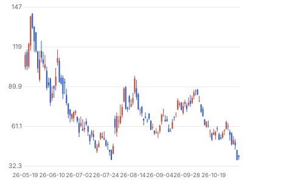

**주봉**

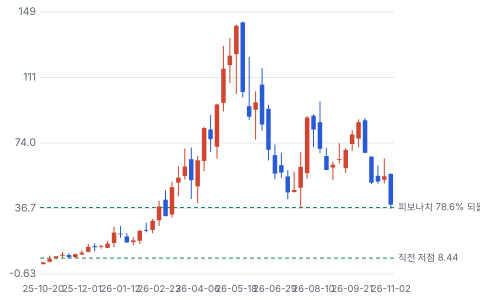

**월봉**

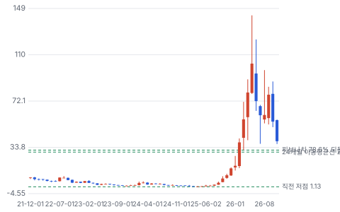

**분기 매출·EPS 실적과 컨센서스**

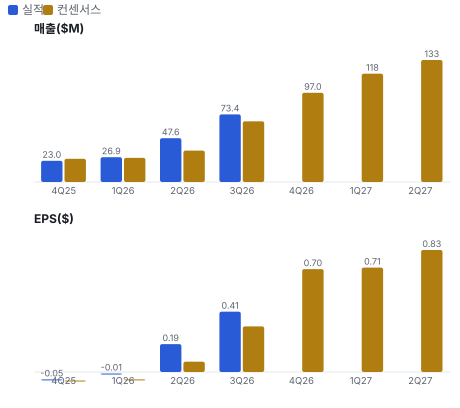

**최근 4개 분기 주가 변화 분석**

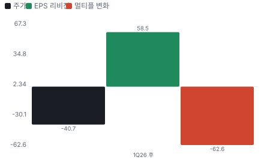

**EPS 리비전**

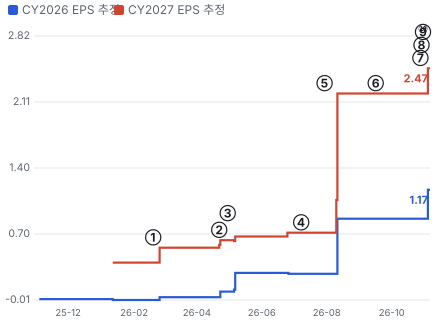

① 26-02-19 4Q25 실적·InP 수요 급증 언급 · EPS 리비전 +40%
② 26-04-22 유상증자 마감(약 \$632M, 2Q 콜 공개) · EPS 리비전 +16%
③ 26-04-30 1Q26 실적·흑자 전환 직전 · EPS 리비전 +6%
④ 26-07-08 Tongmei 상하이 상장 철회·홍콩 전환(8-K) · EPS 리비전 +0%
⑤ 26-07-30 2Q26 실적·흑자 전환·Lumentum 계약 · EPS 리비전 +209%
⑥ 26-09-16 공동 패키징 광학 수혜주 지목 보도 · EPS 리비전 +0%
⑦ 26-10-28 Tongmei 최대 \$545M 사모 투자 계약(8-K) · EPS 리비전 +0%
⑧ 26-10-29 3Q26 실적·잔고 \$500M+·4Q 약 \$90M · EPS 리비전 +12%
⑨ 26-11-02 Marvell–Lumentum 합병 발표 — 광부품 동반 하락 · 실적 창과 겹침
⑩ 26-11-04 Nomura 개시 Buy·InP 공급 70% CAGR 추정 · 실적 창과 겹침

**밸류에이션 주가 시나리오**

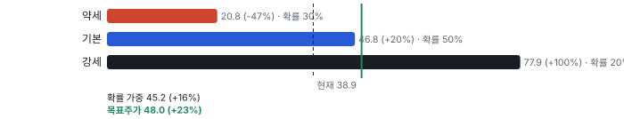

**주가별 업사이드**

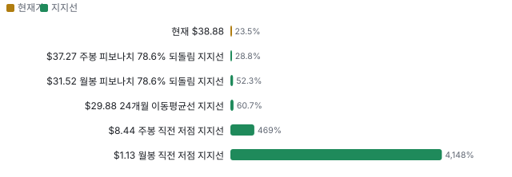

**제품·서비스 포트폴리오**

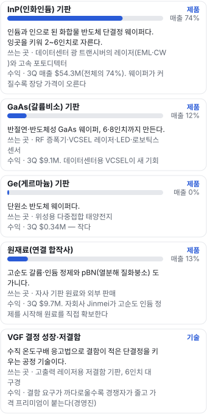

**고객 믹스(3Q26, 매출 대비)**

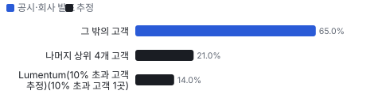

**공급 병목(10점, 낮을수록 병목)**

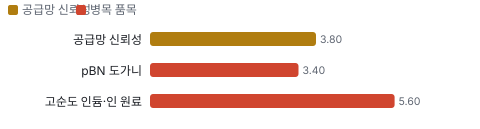

**생산능력 현재와 확충 계획(InP 상대 캐파(2025년 말 = 1))**

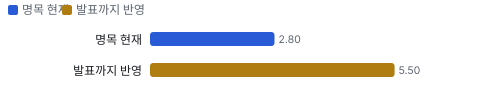

**CAPEX의 매출 대비 비중**

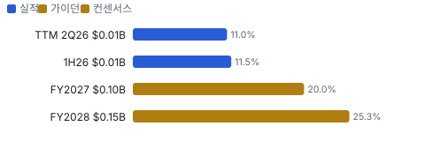

**어닝콜 변화별 주주가치 영향**

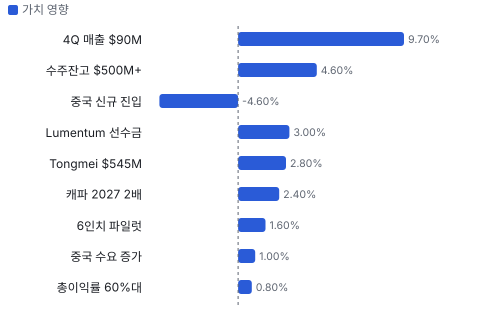

**멀티플 프리미엄(Fwd 1Y P/E, 최근 4개 분기말)**

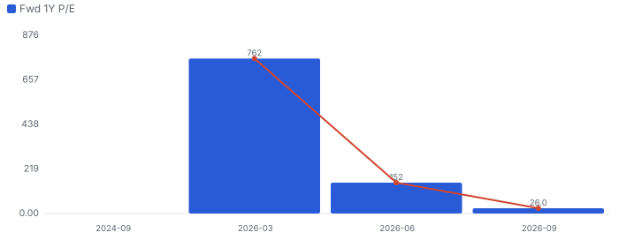

**합리적 멀티플**

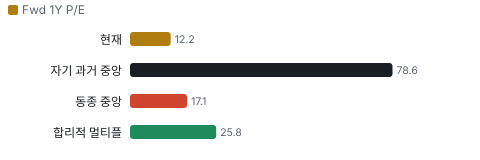

**수주·파이프라인 확실성 사다리**

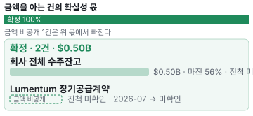

**매출 → 매출총이익 → 영업이익(매출 = 100, 최근 4분기)**

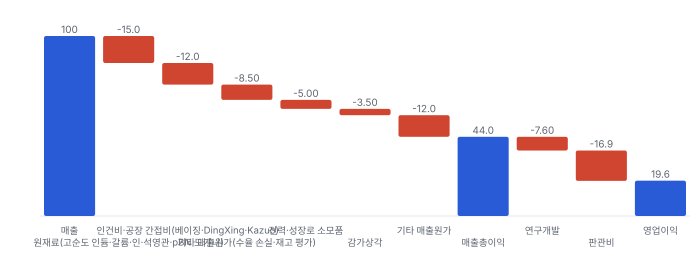

**1년 전 대비 마진 기여(비용 비중 변화의 반대)**

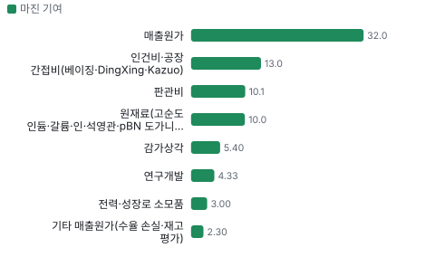

**분기 비용 비중 추이(매출 대비, 공시)**

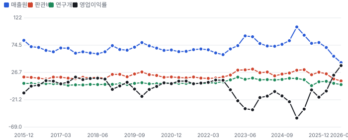

**비용 요인별 매출 대비 비중과 1년 변화**

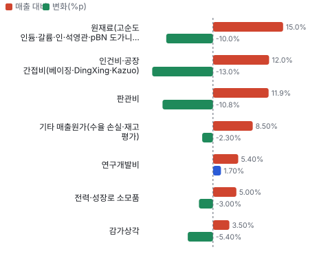

**BOM 항목 가격 +10% 시 OPM 변화**

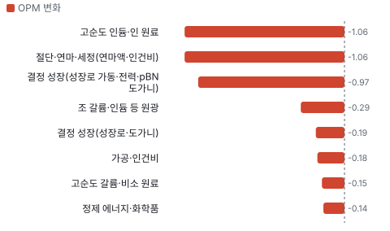

**InP(인화인듐) 기판 BOM 원가 몫과 가격 +10% 시 OPM**

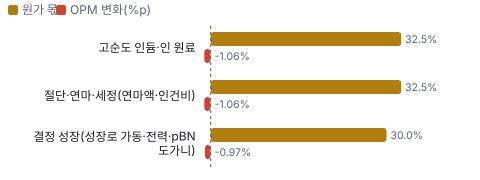

**GaAs(갈륨비소) 기판 BOM 원가 몫과 가격 +10% 시 OPM**

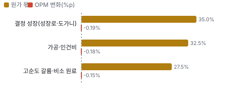

**원재료(연결 합작사) BOM 원가 몫과 가격 +10% 시 OPM**

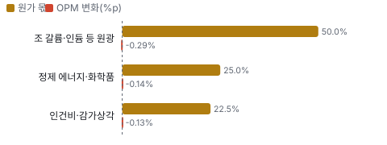

**시설별 면적(sq ft) — 생산능력 미공시라 면적을 대용으로**

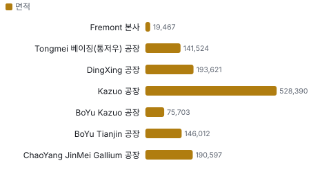

**매출·PPI·수출입 — 최근 16개 분기 같은 축(4Q22 = 100)**

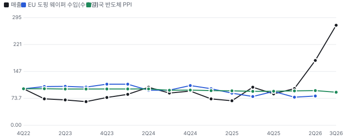

**매출과 미국 반도체 PPI 증가율(전년 대비, 최근 16개 분기)**

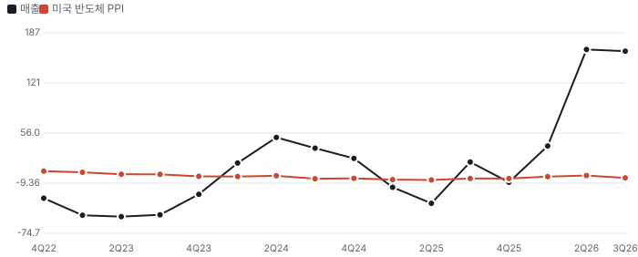

**10년 P·Q 사이클 — 추세(HP 필터) 대비 갭과 8분기 전망**

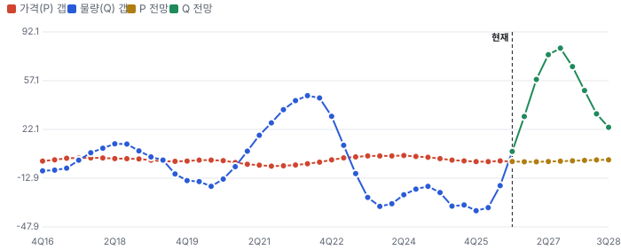

**매출 증가율의 가격·물량 분해와 8분기 전망(전년 대비)**

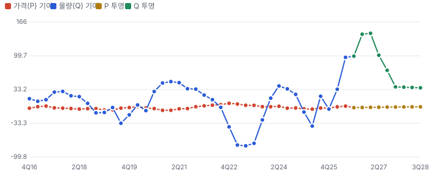

**분기별 매출 증가율 분해**

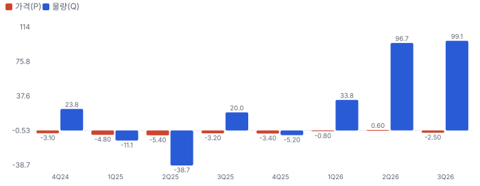

**목표주가 산정 — 기본 시나리오, 도달 확률 약 44%**

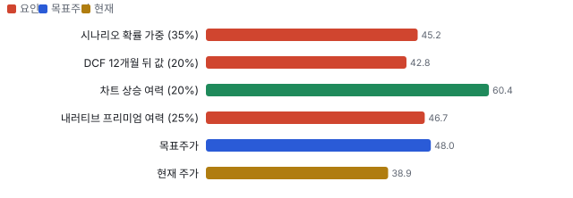

**PEG — 성장 대비 멀티플(낮을수록 성장 대비 쌈)**

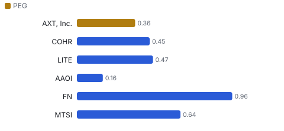

**일봉 지지·저항과 목표주가**

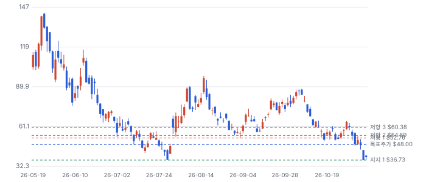

**커뮤니티 언급 수(최근 30일, 채널별)**

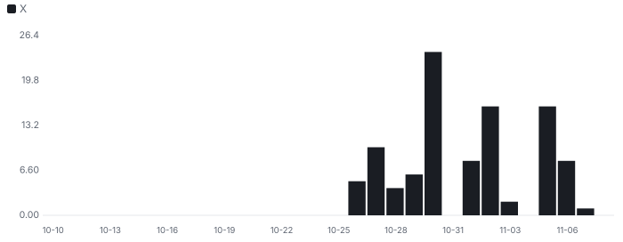

**커뮤니티 게시 수(월, 최근 10개월 — 이번 달은 진행 중)**

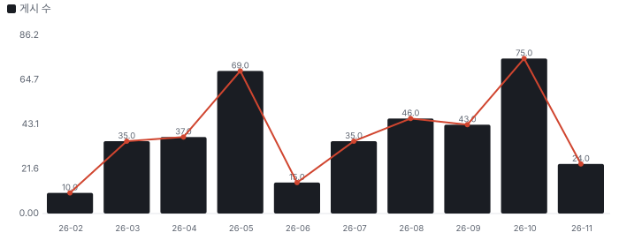

**일별 거래량 분해**

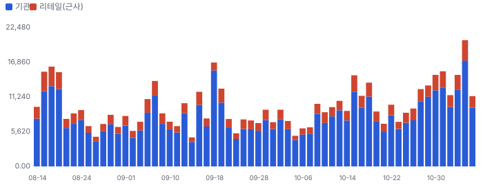

**기관 자금 흐름**

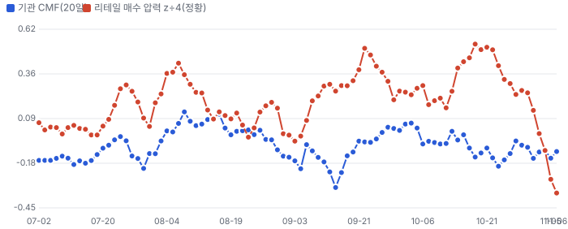

**몬테카를로**

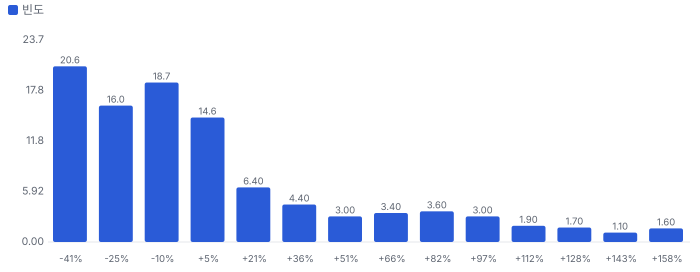

해석: 3,000번 중 1,261번(42%)에서 가치가 지금 주가 이상이었다. 지금 주가를 뒷받침하는 경우와 그렇지 않은 경우가 반반에 가깝다. 가운데 값은 0.94배이고, 열 번 중 여덟 번은 0.60~1.87배 사이에 든다.

## 내러티브

> **기업가치를 결정하는 이야기:** 매출은 지금 수요가 아니라 캐파가 정한다 — 전 고객이 할당(allocation)이고 리드타임이 9개월을 넘는다. 회사는 InP 캐파를 2025년 말의 2.75~3배(2026년 말)로 늘렸고 2027년에 다시 2배를 목표로 한다. 이익률은 대구경(3 → 4 → 6인치)·저결함 믹스와 가격이 정한다. 멀티플은 이 부족이 몇 년 가느냐와 중국 생산 위험에 대한 판단이다. 마지막으로 이익의 일부는 AXT 주주 것이 아니다 — 사업 실체 Tongmei의 외부 지분이 약 14.5%에서 최대 26.6%로 늘어난다.

> **멀티플·EPS 프리미엄**
> **멀티플:** 프리미엄은 거의 사라졌다. Fwd 1Y P/E는 12.2배로 광부품 동종 중앙(LITE 17.1·FN 17.0·AAOI 14.6·MTSI 21.3배) 17.1배보다 29% 싸다. 다만 분모가 높은 쪽 추정(향후 4개 분기 EPS \$3.19)이고, 낮은 쪽(3명 컨센서스 \$2.27)이면 17.1배로 동종과 같다. 4Q 높은 쪽 추정 \$0.70은 회사 가이던스 \$0.57~0.59보다 높다.
> **EPS:** EPS에는 기대가 크게 들어갔다. FY2027 EPS 컨센서스는 \$2.47~\$3.55로, 1월 추정 \$0.39(2명)의 6.3~9.1배다. 향후 4개 분기 EPS의 70%가 2027년 1~3분기에서 나온다 — 2027년 캐파 2배와 60%대 총이익률이 제때 와야 하는 숫자다.

### 투자자들은 왜 열광했나

열광은 세 단계였다. 첫째, 2025년 하반기 AI 광 연결에서 InP 부족이 드러나며 주가가 \$2대에서 \$16까지 올랐다. 둘째, 2026년 2~5월 실적이 매 분기 추정을 넘고 4월 유상증자 약 \$632M로 증설 자금이 생기자 5/22 종가 \$140.83(장중 고점은 5/26 \$143.16)에 닿았다. 셋째, 두 번 식었다. 6월 이사 장내 매도와 7월 Tongmei 상하이 상장 철회 뒤 7/29 종가 \$36.97까지 빠졌다가 2Q 흑자 전환으로 반등했다. 그리고 10월 말부터 다시 식었다 — 3Q 서프라이즈 다음 날 −9.6%(10/29 \$60.88 → 10/30 \$55.06), 11/2 Marvell–Lumentum 합병 발표 뒤 업종 동반 하락으로 11/5 \$36.72. 시장은 실적보다 업종 위험 회피와 공급 과잉·중국 위험을 먼저 본다.

### 무엇이 기업가치를 바꾸나

> **구조적 체질 변화**
> **변화:** 적자 소재 회사에서 AI 광 병목 공급사로 바뀌었다. 2025년 매출 \$88.3M·조정 영업손실 \$18.7M이던 회사가 3Q26 한 분기에 매출 \$73.4M·조정 영업이익률 40.2%를 냈다. 4월 유상증자 약 \$632M로 현금·투자가 \$825.9M, 차입은 \$73.7M이다. 매출의 74%가 InP다(3Q).
> **증거:** 3Q 8-K·콜(InP \$54.3M·GaAs(갈륨비소) \$9.1M·원재료 \$9.7M), 2Q 콜(유상증자 4/22 마감).
> **반증:** InP 비중이 다시 50% 아래로 내려가거나 총이익률이 40% 아래면 체질이 아니라 가격 사이클이다.

> **고부가 믹스 확장**
> **변화:** 웨이퍼가 커지고 결함이 줄수록 장당 가격이 오른다. 2026년은 레이저 3인치·디텍터 4인치였고, 2027년 말에는 장수 기준 3인치와 4인치가 비슷해질 것으로 회사는 본다. 6인치는 2027년에 한 자릿수 비중이지만 이익률이 높다. 고출력 레이저용 저결함 기판은 경쟁이 적어 가격 프리미엄이 붙는다.
> **증거:** 3Q 콜 COO·CEO: 고객 EPD(결함 밀도) 요구 500 미만 대비 그 10분의 1 이하 공급. 비GAAP 총이익률 22.4%(3Q25) → 56.1%(3Q26).
> **반증:** 4인치 전환 분기에 총이익률이 55% 아래로 내려가면 믹스가 아니라 가격 효과였다는 뜻이다.

> **기술 혁신**
> **변화:** VGF(수직 온도구배 응고) 결정 성장의 새 성장로 설계로 생산성이 크게 올랐고, 6인치 InP가 파일럿 라인에 들어갔다. 회사 설명으로 6인치를 만드는 곳은 AXT와 S사 두 곳이고 세 번째는 한참 뒤다. 신규 증설은 6인치 기반이다.
> **증거:** 3Q 콜 CEO·COO 발언(경영진 주장, 제3자 확인 없음).
> **반증:** 2027년 6인치 매출이 미미하거나 수율 문제로 지연되면 경쟁사 대비 우위 논리가 약해진다.

> **실행 속도**
> **변화:** 납품 속도는 수요가 아니라 캐파가 정한다. 회사는 신규 주문 리드타임이 9개월 이상이라고 했고 전 고객이 할당 상태다. 리드타임이 길다는 것은 가격 협상력이지만, 고객이 다른 공급사를 찾을 이유이기도 하다. **납품 리드타임 9개월.** 피어 비교 미확인. 이전 대비 미확인.
> **증거:** 3Q 콜 사업개발 부사장: 다수 주문 리드타임 9개월 이상, 전 고객 할당. 직전·동종 리드타임은 공시되지 않았다.
> **반증:** 리드타임이 6개월 아래로 짧아지는데 가격이 버티지 못하면 부족이 풀리는 신호다.

> **M&A**
> **변화:** M&A가 아니라 반대 방향 거래가 핵심이다. 자회사 Tongmei가 외부 투자자에게 최대 \$545M어치 지분을 팔고 AXT도 \$400M을 넣는다. 마감되면 AXT 지분은 약 73.4%가 된다. 원재료 합작사(고순도 갈륨·인듐·pBN 도가니)는 기존 연결 자회사다.
> **증거:** 8-K 2026-10-28: 리드 투자자 이사 1명 지명, 연 8% 상환권(3년 내 연 13% 수익의 적격 IPO 실패 시), 12월 마감 예정.
> **반증:** Tongmei 홍콩 IPO가 3년 안에 안 되면 상환 부담(원금 + 연 8%)이 AXT로 넘어올 수 있다(AXT 매수 선택권·약속어음).

> **정책·입법 연관성**
> **재정정책:** 해당 없음(생산이 전량 중국이라 미국 CHIPS(미국 반도체지원법) 보조금·세액공제 대상이 아니다 — 10-K에 정부 보조금 기재 없음) FY2025 10-K 반증: 미국 내 InP 기판 생산 보조금이 생기면 경쟁자에게 유리하다
> **행정명령:** 미국 행정부 조치는 관세였다 — 웨이퍼 기판 수입 관세가 2025년 2월 60%, 3월 70%로 올랐고(IEEPA(미국 국제긴급경제권한법) 근거) 2026-02-20 대법원이 IEEPA 관세 다수를 무효로 했다. 출하를 실제로 묶는 것은 중국 상무부 수출 허가(2025-02-04 InP 기판 추가)다. FY2025 10-K 경영진 분석: 2025년 납부 관세 약 \$0.3M, 북미 매출 \$7.6M → \$1.7M(−77.5%) 반증: 중국이 미국 고객 InP 허가를 내주면 북미 매출이 돌아온다 의회 동의 2/10 — 하원 1/5(InP 기판 관세·중국 소재 의존을 다루는 하원 법안은 이번 회차에 찾지 못했다) · 상원 1/5(상원도 마찬가지 — 확인된 법안 없음).
> **연관입법:** 해당 없음(이 회사 제품을 직접 겨냥한 연관 입법을 찾지 못했다) 이번 회차 congress.gov 미조회 — 미확인 반증: 중국산 화합물 반도체 소재 조달 금지 법안이 발의되면 고객이 탈중국 공급을 서두른다

> **CAPEX 낙수효과**
> **변화:** 돈은 하이퍼스케일러 → 광 트랜시버(800G·1.6T) → 레이저·디텍터 업체(Lumentum·Coherent 등) → AXT InP 기판으로 내려온다. 고객이 선수금을 내고 물량을 잡았고, 3Q에 10% 넘는 고객이 1곳 생겼다. 공동 패키징 광학(CPO(스위치 칩 옆에 광 엔진을 붙이는 패키징))·근접 패키징 광학은 CW(연속 발진 레이저 광원) 레이저 수요를 더 키운다.
> **증거:** 선수금 Coherent \$25.4M·Casela \$22.3M·Lumentum \$43.5M. 동종(고객) 향후 12개월 매출 성장 LITE +117%·COHR +51%(추정).
> **반증:** Lumentum·Coherent가 트랜시버·레이저 가이던스를 낮추거나 재고가 쌓이면 경로 전체가 꺾인다.

### 내러티브 근거

> 'AI 광 연결의 병목 소재 InP 기판을 몇 곳만 만든다'는 이야기는 실적으로 확인됐는데(3Q 매출 +162% YoY, 잔고 \$500M+), 주가는 5/22 종가 고점 \$140.83 대비 −72%다 — 시장은 부족이 언제 끝나는지와 중국 생산 위험, 그리고 업종 위험 회피를 먼저 가격에 넣는다. 동종 대비 멀티플 차이 -29% 중 회사 고유 몫은 -53%다. 단계는 컨센서스, 쏠림은 중간이다.

> **AI 광 연결 InP 기판 부족** · 강화
> **논리:** 800G·1.6T 트랜시버의 EML(전계흡수 변조 레이저)·CW 레이저와 포토디텍터가 InP 위에서 만들어지고, 고품질 InP 기판을 대량으로 키우는 곳은 몇 곳뿐이다
> **숫자:** InP 매출 2Q \$30.7M → 3Q \$54.3M, 잔고 \$100M+ → \$500M+, 전 고객 할당
> **반증:** 잔고 증가 정체·리드타임 단축(9개월+ → 3개월 이하), 광 트랜시버 업체 재고 증가

> **대구경·저결함 믹스로 이익률 레버리지** · 강화
> **논리:** 3 → 4 → 6인치 전환과 저결함(low EPD) 기판이 장당 가격과 총이익률을 올린다
> **숫자:** 비GAAP 총이익률 3Q25 22.4% → 2Q26 45.0% → 3Q26 56.1%, 4Q '60%대 초반' 시사
> **반증:** 매출이 늘어도 총이익률이 55% 아래로 내려가는 분기

> **고객 장기계약·선수금** · 유지
> **논리:** Coherent·Casela·Lumentum이 선수금을 내고 물량을 확보 — 수요의 진정성과 운전자본 부담 완화
> **숫자:** 선수금 \$25.4M·\$22.3M·\$43.5M, DSO(매출채권 회수 일수) 49일
> **반증:** 선수금 계약 재협상·출하 지연으로 선수금 반환

> **중국 생산·수출 허가(약세)** · 유지
> **논리:** 기판 생산이 전부 중국이라 수출은 중국 상무부 허가를 받아야 하고, 미중 긴장이 출하와 배수를 누른다
> **숫자:** 4Q 가이던스는 허가 보유·불요분 약 \$90M만, 매출의 40~60%가 중국
> **반증:** 허가 지연으로 분기 가이던스 미달, 또는 미국 쪽 중국산 소재 규제

> **증설·중국 신규 진입 → 공급 과잉(약세)** · 확산
> **논리:** AXT 자신이 2026년 약 3배·2027년 다시 2배로 늘리고 중국 신규 업체가 들어온다 — 2027~28년에 가격이 꺾인다
> **숫자:** 3Q 후 주가 −15%(10/30), EV/매출 5/29 70.5배 → 17.5배, 공개 숏(The Bear Cave)
> **반증:** 2027년 상반기에도 리드타임 9개월+·가격 인상 유지

> **Tongmei 지분 희석·상환권** · 신규
> **논리:** 사업 실체인 Tongmei 지분을 외부에 팔아 증설 자금을 댄다 — AXT 주주 몫은 줄고, 3년 안에 상장 못 하면 연 8% 상환 부담
> **숫자:** AXT 지분 약 85.5% → 73.4%(최대 투자 시), 사모 단가로 본 Tongmei 투자 전 가치 약 \$2.43B(Chiip 계산)
> **반증:** 12월 최소 금액 마감 실패, 또는 홍콩 IPO 일정 지연

이미지 없음(아직 생성 전) — InP(인화인듐) 기판·GaAs(갈륨비소) 기판

## 포트폴리오

| 제품·서비스 | 구분 | 무엇 | 쓰는 곳 | 돈 버는 방식 | Mix | Mix 변화(전 분기 대비) |
|---|---|---|---|---|---|---|
| InP(인화인듐) 기판 | 제품 | 인듐과 인으로 된 화합물 반도체 단결정 웨이퍼다. 잉곳을 키워 2~6인치로 자른다. | 데이터센터 광 트랜시버의 레이저(EML·CW)와 고속 포토디텍터 | 3Q 매출 \$54.3M(전체의 74%). 웨이퍼가 커질수록 장당 가격이 오른다 | 74% | 미확인 |
| GaAs(갈륨비소) 기판 | 제품 | 반절연·반도체성 GaAs 웨이퍼, 6·8인치까지 만든다. | RF(무선 주파수) 증폭기·VCSEL(수직 공진 표면 발광 레이저) 레이저·LED(발광다이오드)·로보틱스 센서 | 3Q \$9.1M. 데이터센터용 VCSEL이 새 기회 | 12% | 미확인 |
| Ge(게르마늄) 기판 | 제품 | 단원소 반도체 웨이퍼다. | 위성용 다중접합 태양전지 | 3Q \$0.34M — 작다 | 0% | 미확인 |
| 원재료(연결 합작사) | 제품 | 고순도 갈륨·인듐 정제와 pBN(열분해 질화붕소) 도가니다. | 자사 기판 원료와 외부 판매 | 3Q \$9.7M. 자회사 Jinmei가 고순도 인듐 정제를 시작해 원료를 직접 확보한다 | 13% | -7.9%p |
| VGF 결정 성장·저결함 | 기술 | 수직 온도구배 응고법으로 결함이 적은 단결정을 키우는 공정 기술이다. | 고출력 레이저용 저결함 기판, 6인치 대구경 | 결함 요구가 까다로울수록 경쟁자가 줄고 가격 프리미엄이 붙는다(경영진) | 미확인 | 미확인 |

**Mix 변화가 가장 큰 쪽은 기판(InP·GaAs·Ge, +7.9%p, 전 분기 대비).** 계절성 판정: 분기 매출 계절 지수 기준 없음 → 직전 분기와 비교.

## 고객

> **3Q26 최대 고객 그 밖의 고객 65%, 상위 3곳 100%, 집중도 집중.** 공시·회사 발표로 확인한 몫은 매출의 65%이고, 나머지 고객 몫은 추정이거나 미분해다. 3Q 상위 5개 고객이 매출의 35%이고 1곳이 10%를 넘었다(이름 미공시). 2025년에는 10% 넘는 고객이 없었고 상위 5곳이 29%였다. 고객 선수금 계약은 Lumentum·Coherent·Casela가 공개됐다.

**고객별 매출 몫(3Q26)**
| 고객 | 몫 | 변화 | 근거 |
|---|---|---|---|
| 그 밖의 고객 | 65% | -6%p | 공시 |
| 나머지 상위 4개 고객 | 17~25% | 미확인 | 추정 |
| Lumentum(10% 초과 고객 추정, 10% 초과 고객 1곳) | 10~18% | 미확인 | 추정 |

> **그 밖의 고객** · 공시
> **사는 것:** 기판·원재료
> **추정 근거:** 1 − 상위 5곳

> **나머지 상위 4개 고객** · 추정
> **사는 것:** InP·GaAs 기판
> **추정 근거:** 상위 5곳 35% − 1위 몫

> **Lumentum(10% 초과 고객 추정, 10% 초과 고객 1곳)** · 추정
> **사는 것:** InP 기판(레이저·디텍터)
> **추정 근거:** 3Q 선수금 \$43.5M 장기공급계약 체결 — 10% 초과 고객의 이름은 공시되지 않아 가설이다

## 수주·파이프라인

> **2026-09-30 기준 2건.** 확정 \$0.50B. 공시 수주잔고(회사 발표, 하한) \$0.50B. 서로 겹치는 항목은 합계에서 뺐다.

**실행 속도와 방해 요인**
| 항목 | 상태 | 실행 속도 | 방해 요인 |
|---|---|---|---|
| 회사 전체 수주잔고 | 확정 | 미확인 | 중국 상무부 수출 허가 · 캐파 증설 속도 · 6인치 수율 |
| Lumentum 장기공급계약 | 확정 | 미확인 | Marvell 합병 뒤 조달 정책 변화 |

## 마진 구조

> **GPM 56.0%, OPM 38.7%.** 3Q25 대비 GPM +33.7%p, OPM +42.7%p. 3Q26 매출원가는 매출의 44.0%로 1년 전 77.7%보다 33.7%p 낮다. 물량이 고정비를 덮었고(매출 2.6배), InP 비중과 4인치 전환·가격 인상이 더해졌다. 판관비는 22.7% → 11.9%로 내려갔다.

> **매출 100 중 매출원가 56.0, 매출총이익 44.0(최근 4분기, 공시).** 매출원가 요인 중 원재료(고순도 인듐·갈륨·인·석영관·pBN 도가니)이 매출의 15.0%로 가장 무겁고, 단가가 +10% 오르면 GPM이 -1.50%p 움직인다. 분기 회귀로 매출 1이 늘 때 매출원가는 0.37 늘고, 매출원가의 고정비 몫은 45%다.

**비용 요인 강도 — 비중·추세·충격(+10%)·탄력**
| 비용 | 구분 | 매출 대비 | 1년 변화 | 마진 기여 | 충격 시 마진 | 매출 탄력 | 고정비 몫 |
|---|---|---|---|---|---|---|---|
| 원재료(고순도 인듐·갈륨·인·석영관·pBN 도가니) | 매출원가 요인 | 15.0% | -10.0%p | +10.0%p | -1.50%p | 미확인 | 10% |
| 인건비·공장 간접비(베이징·DingXing(허베이성 생산 거점)·Kazuo(랴오닝성 생산 거점)) | 매출원가 요인 | 12.0% | -13.0%p | +13.0%p | -1.20%p | 미확인 | 70% |
| 기타 매출원가(수율 손실·재고 평가) | 매출원가 요인 | 8.5% | -2.3%p | +2.3%p | -0.85%p | 미확인 | 미확인 |
| 전력·성장로 소모품 | 매출원가 요인 | 5.0% | -3.0%p | +3.0%p | -0.50%p | 미확인 | 40% |
| 감가상각 | 매출원가 요인 | 3.5% | -5.4%p | +5.4%p | -0.35%p | 미확인 | 100% |
| 매출원가 | 공시 항목 | 56.0% | -32.0%p | +32.0%p | -5.60%p | 0.37 | 45% |
| 판관비 | 공시 항목 | 16.9% | -10.1%p | +10.1%p | 미확인 | 0.08 | 60% |
| 연구개발 | 공시 항목 | 7.6% | -4.3%p | +4.3%p | 미확인 | 0.04 | 50% |

매출 탄력 = 분기 비용을 매출에 회귀한 기울기(매출 1당 변동비), 고정비 몫 = 절편 ÷ 평균 비용. 표본이 8분기 미만이면 미확인. 매출원가 요인 비중은 margin 재료의 추정이 섞여 있고, 공시 매출원가와의 차이는 '기타 매출원가'로 둔다.

**GPM에서 OPM까지(GAAP)**
| 기간 | GPM | 연구개발 | 판관비 | 기타 | OPM |
|---|---|---|---|---|---|
| 3Q25 | 22.3% | 3.6% | 22.7% | 0.0% | -4.0% |
| 3Q26 | 56.0% | 5.4% | 11.9% | 0.0% | 38.7% |

**GPM·OPM 최근 4개 분기**
| 분기 | GPM | OPM |
|---|---|---|
| 2025-12 | 20.9% | -16.6% |
| 2026-03 | 29.6% | -5.9% |
| 2026-06 | 44.9% | 21.9% |
| 2026-09 | 56.0% | 38.7% |

**마진을 결정하는 비용 요인 — 비용 +10% 시 OPM**
| 비용 | 매출 대비 | 변화 | 고정비 | OPM |
|---|---|---|---|---|
| 원재료(고순도 인듐·갈륨·인·석영관·pBN 도가니) | 15.0% | -10.0%p | 10% | -1.50%p |
| 인건비·공장 간접비(베이징·DingXing·Kazuo) | 12.0% | -13.0%p | 70% | -1.20%p |
| 판관비 | 11.9% | -10.8%p | 80% | -1.19%p |
| 기타 매출원가(수율 손실·재고 평가) | 8.5% | -2.3%p | 미확인 | -0.85%p |
| 연구개발비 | 5.4% | +1.7%p | 90% | -0.54%p |
| 전력·성장로 소모품 | 5.0% | -3.0%p | 40% | -0.50%p |
| 감가상각 | 3.5% | -5.4%p | 100% | -0.35%p |

**비용을 움직이는 요인**
| 비용 | 요인 |
|---|---|
| 원재료(고순도 인듐·갈륨·인·석영관·pBN 도가니, 매출원가) | 인듐 가격·물량 · 근거 추정 |
| 인건비·공장 간접비(베이징·DingXing·Kazuo, 매출원가) | 증설 인력 · 근거 추정 |
| 판관비(판관비) | 인건비·주식보상 · 근거 공시 |
| 기타 매출원가(수율 손실·재고 평가, 매출원가) | 수율 · 근거 추정 |
| 연구개발비(연구개발) | 6인치 개발 · 근거 공시 |
| 전력·성장로 소모품(매출원가) | 결정 성장 시간 · 근거 추정 |
| 감가상각(매출원가) | 증설 설비 · 근거 공시 |

**InP(인화인듐) 기판 BOM — 매출의 74%, GPM 56%(회사 전체 3Q 비GAAP 총이익률 — 제품별 미공시(InP가 가장 수익성이 높다고 CFO가 말했다)), 항목 가격 +10% 시**
| 항목 | 원가 몫 | 전가 | 제품 GPM | OPM |
|---|---|---|---|---|
| 고순도 인듐·인 원료 | 25~40% | 미확인 | -1.4%p | -1.06%p |
| 절단·연마·세정(연마액·인건비) | 25~40% | 미확인 | -1.4%p | -1.06%p |
| 결정 성장(성장로 가동·전력·pBN 도가니) | 25~35% | 미확인 | -1.3%p | -0.97%p |
| 미분해 | 5% | - | - | - |

**GaAs(갈륨비소) 기판 BOM — 매출의 12%, GPM 56%(회사 전체 값(제품별 미공시)), 항목 가격 +10% 시**
| 항목 | 원가 몫 | 전가 | 제품 GPM | OPM |
|---|---|---|---|---|
| 결정 성장(성장로·도가니) | 30~40% | 미확인 | -1.5%p | -0.19%p |
| 가공·인건비 | 25~40% | 미확인 | -1.4%p | -0.18%p |
| 고순도 갈륨·비소 원료 | 20~35% | 미확인 | -1.2%p | -0.15%p |
| 미분해 | 5% | - | - | - |

**원재료(연결 합작사) BOM — 매출의 13%, GPM 56%(회사 전체 3Q 비GAAP 값 — 원재료 사업 총이익률은 별도 미공시), 항목 가격 +10% 시**
| 항목 | 원가 몫 | 전가 | 제품 GPM | OPM |
|---|---|---|---|---|
| 조 갈륨·인듐 등 원광 | 40~60% | 미확인 | -2.2%p | -0.29%p |
| 정제 에너지·화학품 | 20~30% | 미확인 | -1.1%p | -0.14%p |
| 인건비·감가상각 | 15~30% | 미확인 | -1.0%p | -0.13%p |
| 미분해 | 3% | - | - | - |

고순도 인듐·인 원료 가격이 +10% 오르면 영업이익은 -2.7% 움직인다. 판매가 전가를 모르는 항목은 전가 0%로 계산했다.

**BOM 항목 가격을 움직이는 것**
| 항목 | 요인 |
|---|---|
| 고순도 인듐·인 원료 | 원료 가격 상승을 CEO가 언급 · 근거 추정 |
| 결정 성장(성장로 가동·전력·pBN 도가니) | 수율이 원가를 정한다 · 근거 추정 |
| 절단·연마·세정(연마액·인건비) | 대구경일수록 가공 손실이 크다 · 근거 추정 |
| 고순도 갈륨·비소 원료 | 갈륨은 자회사 정제 · 근거 추정 |
| 결정 성장(성장로·도가니) | 6·8인치 대구경 · 근거 추정 |
| 가공·인건비 | 공정 · 근거 추정 |
| 조 갈륨·인듐 등 원광 | 원료 시세 · 근거 추정 |
| 정제 에너지·화학품 | 정제 공정 · 근거 추정 |
| 인건비·감가상각 | 공장 · 근거 추정 |

**BOM 투입 물가 — PPI 전년비, 2026-11-08 수집**
| 항목 | 미국 | 일본 | 한국 | 대만 |
|---|---|---|---|---|
| 조 갈륨·인듐 등 원광 | +48.4%* | 미확인 | 미확인 | 미확인 |
| 절단·연마·세정(연마액·인건비) | -2.2%* | +3.9%* | 미확인 | 미확인 |

별표는 품목보다 넓은 업종 지수다. 지난 1년 투입 물가를 판매가 전가 뒤 원가에 그대로 넣으면 OPM은 -7.53%p 움직인다(매출원가의 58% 기준).

## 공급망 병목

> **공급망 신뢰성 3.8/10, 병목 심각.** 가장 약한 고리는 pBN 도가니 3.4점이고, 품목 평균은 4.5점이다. 근거가 부족한 1건(석영관·비소·인·연마액)은 점수에서 뺐다. 핵심 투입물은 고순도 인듐·인과 성장로 소모품이다. 인듐·갈륨과 pBN 도가니는 연결 자회사가 만들어 내재화했고, 석영관·비소·인·연마액은 단일·소수 공급사다(10-K). 공급망 전체가 중국에 있다.

**병목과 마진 — 품목 가격 +10% 시 OPM**
| 품목 | 점수 | 판정 | 구분 | OPM |
|---|---|---|---|---|
| pBN 도가니(필수) | 3.4 | 병목 심각 | 출하 차질 위험 | 미확인 |
| 고순도 인듐·인 원료(필수) | 5.6 | 병목 주의 | 핵심 통제 품목 | -1.06%p |

> **pBN 도가니** · 3.4/10
> **왜:** 결정 성장 용기
> **병목 요인:** 인증 공급사 1곳 · 캐파 미확인 · 리드타임 미확인 · 재인증 12개월 · 1위 점유율 100% · 중국 집중 100% · 물량 확보 내재화
> **풀리는 조건:** 미확인

> **고순도 인듐·인 원료** · 5.6/10
> **왜:** InP의 원료
> **병목 요인:** 인증 공급사 2곳 · 캐파 빠듯 · 리드타임 미확인 · 재인증 6개월 · 1위 점유율 미확인 · 중국 집중 100% · 물량 확보 내재화
> **풀리는 조건:** Jinmei 증설 투자(진행 중, 가동 미확인)

**공급사**
| 품목 | 공급사 | 몫 | 근거 |
|---|---|---|---|
| 고순도 인듐·인 원료 | Jinmei(연결 자회사, 고순도 인듐 정제) | 미확인 | 회사 발표 |
| 고순도 인듐·인 원료 | 외부 인듐 공급사(조 인듐) | 미확인 | 추정 |
| 석영관·비소·인·연마액 | 단일·소수 공급사(미공시, 공정 소재) | 미확인 | 공시 |
| pBN 도가니 | BoYu(연결 자회사, pBN 도가니·부품) | 미확인 | 공시 |

**무역 통계로 본 공급 지역**
| 품목 | EU 수입처 | 일본 수입처 | EU 1위 전년비 |
|---|---|---|---|
| 고순도 인듐·인 원료 | US 49% · CN(중국) 35% · TW(대만) 8% | 中華人民共和国 28% · 台湾 25% | +231.9% |

## 생산능력

> **현재 명목 캐파 3 InP 상대 캐파(2025년 말 = 1), 가동률 미확인.** 착공 이상 증설은 0 InP 상대 캐파(2025년 말 = 1), 발표까지 합치면 3 InP 상대 캐파(2025년 말 = 1)이다. 다 가동하면 지금보다 +100%, 착공 이상만이면 +0%다. 1H26 CAPEX는 \$0.01B로 매출의 11.5%다. 회사는 명목 캐파를 장수로 밝히지 않고 배수로만 말한다 — 2026년 말 InP 캐파는 2025년 말의 2.75~3배, 2027년에 다시 2배가 목표다. 인접 건물 전환은 설계 단계이고, DingXing·Kazuo 새 건물 공사비 \$20.6M이 2Q 말 건설 중 자산에 있다.

**생산시설 7곳**(FY2025 10-K Item 2 Properties — 7개 시설, 합계 1,295,314 sq ft(2026-03-17 기준). 생산 6곳·본사 1곳), 임차 1곳 · 소유 6곳. 시설별 생산능력은 공개되지 않았다 — 회사 전체 캐파만 위에 적었다.

**생산시설 7곳 — 명칭·위치·생산능력**
| 시설 | 위치 | 용도 | 생산능력 | 소유·상태 |
|---|---|---|---|---|
| Fremont 본사 | 미국 캘리포니아 Fremont | 본사·관리 | 미확인 — 생산 없음 · 면적 19,467 sq ft | 임차 · 가동 |
| Tongmei 베이징(통저우) 공장 | 중국 베이징 | InP 기판 생산·관리 | 미확인 — 시설별 캐파 미공시(10-K는 면적·용도만) · 면적 141,524 sq ft | 소유 · 증설 중 |
| DingXing 공장 | 중국 허베이 DingXing | GaAs·Ge 기판 생산 | 미확인 — 시설별 캐파 미공시 · 면적 193,621 sq ft | 소유 · 증설 중 |
| Kazuo 공장 | 중국 랴오닝 Kazuo | 기판 생산 | 미확인 — 시설별 캐파 미공시 · 면적 528,390 sq ft | 소유 · 증설 중 |
| BoYu Kazuo 공장 | 중국 랴오닝 Kazuo | pBN 도가니 생산·관리(연결 원재료 회사) | 미확인 — 시설별 캐파 미공시 · 면적 75,703 sq ft | 소유 · 가동 |
| BoYu Tianjin 공장 | 중국 톈진 | pBN 부품 생산·관리(연결 원재료 회사) | 미확인 — 시설별 캐파 미공시 · 면적 146,012 sq ft | 소유 · 가동 |
| ChaoYang JinMei Gallium 공장 | 중국 랴오닝 Kazuo | 고순도 갈륨·인듐 정제(연결 원재료 회사) | 미확인 — 시설별 캐파 미공시 · 면적 190,597 sq ft | 소유 · 증설 중 |

**생산능력 확충 계획**
| 계획 | 단계 | 증설 | 가동 시점 | CAPEX |
|---|---|---|---|---|
| 인접 건물 InP 전환 | 발표 | 미확인 | 2027 | 미확인 |
| DingXing·Kazuo 새 건물 | 착공 | 미확인 | 미확인 | \$0.02B |
| 2027년 InP 캐파 2배 | 발표 | 3 InP 상대 캐파(2025년 말 = 1) | 2027 | \$0.10B |

남은 계획의 CAPEX 합계는 \$0.12B(금액 미확인 1건 제외)다. 금액을 아는 계획의 단위당 CAPEX는 \$0.04B/InP 상대 캐파(2025년 말 = 1)이다. 합계는 FY2028 매출의 20%다.

**증설 방해 요인**
| 계획 | 방해 요인 |
|---|---|
| 인접 건물 InP 전환 | 설계 단계 — 수개월 내 공사 시작(3Q 콜) |
| DingXing·Kazuo 새 건물 | 장비 반입·가동 미확인 |
| 2027년 InP 캐파 2배 | 성장로 반입·6인치 수율 |

**CAPEX와 매출 대비**
| 기간 | CAPEX | 매출 | 매출 대비 | 구분 |
|---|---|---|---|---|
| TTM 2Q26 | \$0.01B | \$0.13B | 11.0% | 실적 |
| 1H26 | \$0.01B | \$0.07B | 11.5% | 실적 |
| FY2027 | \$0.10B | \$0.50B | 20.0% | 가이던스 |
| FY2028 | \$0.15B | \$0.59B | 25.3% | 컨센서스 |

## 해자

> 해자는 저결함 대구경 InP를 키우는 결정 성장 기술과 원재료 수직계열화다. 다만 둘 다 중국 생산이라는 같은 지붕 아래 있어, 수출 허가가 해자를 우회하는 약점이다.

> **저결함·대구경 결정 성장(VGF)** · 보통
> **해자:** 고출력 레이저가 요구하는 결함 밀도보다 훨씬 낮은 기판을 4·6인치로 키운다
> **근거:** 3Q 비GAAP 총이익률 56.1%(3Q25 22.4%), 6인치 파일럿 라인 진입(3Q 콜)
> **숫자:** 총이익률 +33.7%p YoY
> **깨지는 조건:** Sumitomo·중국 신규 업체가 6인치 저결함을 같은 가격에 양산한다

> **원재료 수직계열화** · 보통
> **해자:** 고순도 갈륨·인듐 정제와 pBN 도가니를 연결 자회사가 만든다
> **근거:** 10-K 시설 7곳 중 3곳이 원재료 회사(BoYu·JinMei), 3Q 원재료 매출 \$9.7M, Jinmei 고순도 인듐 정제 시작(3Q 콜)
> **숫자:** 원재료 매출 비중 13%(3Q)
> **깨지는 조건:** 인듐 수출 통제가 원료가 아닌 완제품 출하를 막으면 내재화 이점이 의미를 잃는다

> **고객 인증·선수금 장기계약** · 보통
> **해자:** 레이저 업체가 기판 공급사를 바꾸려면 긴 인증이 필요하고, 고객이 선수금으로 물량을 묶었다
> **근거:** Lumentum 선수금 \$43.5M(3Q), 2Q 말 고객 선수금 \$12.1M(10-Q), 잔고 \$500M+
> **숫자:** DSO 49일(3Q)
> **깨지는 조건:** Lumentum·AAOI가 중국 밖 또는 다른 중국 공급사(예: Yunnan Germanium 보도)로 물량을 나눈다

## 경영진·네트워크

> 창업자 Morris Young이 CEO다. 사업 실체가 전부 중국 자회사라 경영진의 중국 내 사업 네트워크가 매출 전체에 닿는다. 정계 연결은 공개 기록에서 찾지 못했다.

> **Morris S. Young** · 창업자·CEO · 1986(창업)
> **프로필:** 1986년 회사(옛 American Xtal Technology)를 세웠다. 경력 상세는 위임장 미조회로 미확인
> **비즈니스:** Tongmei 이사회·중국 원재료 합작사 연결(10-K)
> **정계:** 미확인
> **동문:** 미확인
> **사모임:** 미확인

> **Gary L. Fischer** · CFO · 약 2014
> **프로필:** 3Q 콜에서 재직 약 12년 반이라고 말했다
> **비즈니스:** 미확인
> **정계:** 미확인
> **동문:** 미확인
> **사모임:** 미확인

**네트워크 정량화**
| 연결 | 강도 | 닿는 매출 | 가중 노출 | 매출 대비 | 근거 |
|---|---|---|---|---|---|
| 비즈니스: 중국 생산 자회사 Tongmei·원재료 합작사 지배 — 매출 전부가 이 구조를 거친다 | 5/5 | \$0.17B | \$0.17B | 100% | 회사 전체 TTM 매출 FY2025 10-K 시설·연결 구조 |
| 비즈니스: Tongmei 사모 리드 투자자의 이사 지명권 | 4/5 | 미확인 | 미확인 | 미확인 | 투자자 이름·지분 공시 범위 내 8-K 2026-10-28 |
| 정계: 미국 연방 로비 기록 없음(이번 회차 조회) | 0/5 | 미확인 | 미확인 | 미확인 | 공개 기록 없음 radar lobby_watch |

가중 노출은 연결이 닿는 매출의 크기다. 연결이 그 매출을 만들었다는 뜻이 아니며, 인과는 공개 자료로 입증하지 못한다.

## 약세 논리 및 셀온 조건

| 약세 논리 | 근거 | 반박 | 가를 자료 · 공개 시점 |
|---|---|---|---|
| 2027년 공급 과잉으로 가격이 꺾인다 | CEO가 중국 신규 진입 다수를 인정(3Q 콜), Sumitomo가 InP 증설을 우선순위에 넣음(10/30 보도), Yunnan Germanium의 AAOI 2027년 4인치 InP 공급 계약 보도(11/4) | 회사 답: 전 고객 할당, 장기계약 고객도 물량 2~3배 증량 요청, 2027년 2배로도 '수면 위로 못 올라올 수 있다'(Needham 질문 답변) | 4Q 실적의 장당 가격·총이익률 — 2027-02 |
| 중국 생산·수출 허가 | 생산 7곳 중 6곳이 중국(10-K), 2025년 북미 매출 −77.5%, 4Q 가이던스는 허가 보유·불요분만 | 중국 안 고객은 허가가 필요 없고 매출의 큰 몫이다(2Q 중국 \$30.8M/\$47.6M) | 3Q 10-Q 지역별 매출·허가 문구 — 2026-11-09 전후 |
| Tongmei 지분 희석·상환권 | 외부 최대 \$545M + AXT \$400M, AXT 지분 85.5% → 73.4%, 3년 내 적격 IPO 실패 시 연 8% 상환권(8-K) | 증설 자금이 AXT 신주 없이 들어온다(Wedbush는 긍정 평가) | 사모 마감 공시 — 2026-12-20 기한 |
| 고객 집중·Lumentum 합병 | 3Q 10% 초과 고객 1곳·상위 5곳 35%, 11/2 Marvell–Lumentum 합병 발표 | 합병은 InP 레이저 팹 가치를 확인한 사건이기도 하다 — 다만 AXT 매출로 잇는 1차 근거는 없다 | 3Q 10-Q 고객 집중 주석 — 2026-11-09 전후 |
| 추정이 너무 높다 | 4Q 높은 쪽 추정 \$0.70은 회사 가이던스 \$0.57~0.59보다 20% 높다 | 낮은 쪽 추정 \$0.56은 가이던스와 맞는다 | 4Q 실적 — 2027-02 |

**추가 원천(11/8).** 중간선거 영향은 0에 가깝다 — 생산이 중국이라 CHIPS 보조금 채널 노출이 없고, 업종 ETF(SMH)의 선거 뒤 반응은 CAR(사건 뒤 시장 대비 초과 누적 수익률) −2.7%(t −0.84)로 유의하지 않다. 정책 0단계(선거 결과) 가설이다. 커뮤니티 대화는 7일 Strong(79)이지만 24시간 Weak(50)로 식었고, 이야기의 대부분은 '업종 동반 매도에 휩쓸렸다'는 쪽이다 — 하락 원인이 업종이라는 것은 가격으로 확인되지만, 그래서 싸다는 것은 주장이다.

> **셀온 조건**
> **조건 1:** 4Q 총이익률이 50% 아래로 내려간다(3Q 56.1%)
> **조건 2:** 신규 주문 리드타임이 6개월 아래로 짧아지는데 장당 가격이 함께 내려간다
> **조건 3:** 중국 상무부가 기존 허가 고객(유럽·일본)의 InP 허가를 갱신하지 않는다
> **조건 4:** Lumentum이 합병 뒤 AXT 장기계약 물량을 줄이거나 다른 기판 공급사로 나눈다

## 어닝콜 변화

**직전 콜 대비 새로 나오거나 바뀐 내용 → 가치 영향**
| 항목 | 내용 | 직전 콜 | 최신 콜 | 모델 동인 이동 | 확신도 | 가치 영향 |
|---|---|---|---|---|---|---|
| 업데이트 | 다음 분기 매출 가이던스 | 3Q 약 \$66M(허가 보유·불요분)·EPS \$0.30~0.32 | 3Q 실적 \$73.4M·EPS \$0.41, 4Q 약 \$90M·EPS \$0.57~0.59 | 기준연도 매출 +\$0.03B | 0.8 | +9.7% |
| 업데이트 | 수주잔고 | \$100M 이상(2분기 넘는 물량) | \$500M 이상(장기계약·12개월 이하 계약·스팟, 2027년까지) | 성장 지속(감속 계수) +5.0% | 0.8 | +4.6% |
| 업데이트 | InP 캐파 | 2026년 약 3배·연말 InP 분기 매출 약 \$60M, 2027년 2배·연말 약 \$130M | 2026년 말 2.75~3배(8월 2배 목표 조기 달성), 4Q 증가분 전부 InP, 2027년 다시 2배·인접 건물 전환 | 1년차 성장률 +5.0% | 0.5 | +2.4% |
| 업데이트 | 총이익률 | 2Q 45.0%(비GAAP), 3Q 비슷한 수준 전망(애널리스트 계산) | 3Q 56.1%, 4Q '60%대 초반' 시사·'정점 아님'(CFO) | 출발 이익률 +5.0% | 0.8 | +0.8% |
| 신규 | Tongmei 사모 투자 | 홍콩 상장 전환, 2021년 PE(사모펀드) \$49M 상환권 발생(투자자 잔류 의사) | 외부 최대 \$545M + AXT \$400M, AXT 지분 약 85.5% → 73.4%, 연 8% 상환권(3년 내 적격 IPO 실패 시), 12월 마감 예정 | 성장 지속(감속 계수) +3.0% | 0.5 | +2.8% |
| 업데이트 | 장기계약 선수금 | Casela \$22.3M·Coherent \$25.4M 선수금, Lumentum 계약 발표 | Lumentum 선수금 \$43.5M 수령, DSO 49일 — 장기계약은 가격·물량 유연성을 위해 소수로 제한 | 매출÷투하자본 +10.0% | 1.0 | +3.0% |
| 업데이트 | 대구경·결함 밀도 | 6인치 개발 진전 | 6인치 파일럿 라인, 신형 결정성장로 생산성↑, 6인치 가능 업체는 AXT와 S사 2곳(CEO) | 목표 이익률 +2.0% | 0.3 | +1.6% |
| 부정 | 공급 과잉·중국 신규 진입 | 질문 없음 | Needham이 2027 공급 과잉 우려를 질문, CEO는 중국 신규 진입 다수를 인정(진입 장벽은 높다고 답변) | 장기 이익률 -2.0% | 0.3 | -4.6% |
| 업데이트 | 중국 수요 | 2Q 중국 비중 50% 초과, 40~60% 모델링 권고 | 중국 레이저용 InP 매출 3Q 다시 강하게 증가, 중국 고객 전원 할당(allocation) — 중국 내 출하는 허가 불요 | 1년차 성장률 +2.0% | 0.5 | +1.0% |
| **합계** | 단독 합 |  |  | 동시 적용 +21.1% |  | **+21.3%** |

**사건별 EPS 리비전**
| # | 날짜 | 구분 | 사건 | CY2026 EPS 전→후 | CY2027 EPS 전→후 | 리비전 | 주가 반응 |
|---|---|---|---|---|---|---|---|
| ① | 26-02-19 | 실적 | 4Q25 실적·InP 수요 급증 언급 | \$-0.01 → \$0.02 | \$0.39 → \$0.55 | +39.7% | +24.7% |
| ② | 26-04-22 | 내러티브 | 유상증자 마감(약 \$632M, 2Q 콜 공개) | \$0.02 → \$0.08 | \$0.55 → \$0.63 | +15.6% | +16.0% |
| ③ | 26-04-30 | 실적 | 1Q26 실적·흑자 전환 직전 | \$0.08 → \$0.28 | \$0.63 → \$0.67 | +6.3% | +21.2% |
| ④ | 26-07-08 | 내러티브 | Tongmei 상하이 상장 철회·홍콩 전환(8-K) | \$0.27 → \$0.27 | \$0.71 → \$0.71 | +0.0% | +3.4% |
| ⑤ | 26-07-30 | 실적 | 2Q26 실적·흑자 전환·Lumentum 계약 | \$0.27 → \$0.86 | \$0.71 → \$2.20 | +208.9% | +28.7% |
| ⑥ | 26-09-16 | 내러티브 | 공동 패키징 광학 수혜주 지목 보도 | \$0.86 → \$0.86 | \$2.20 → \$2.20 | +0.0% | +11.4% |
| ⑦ | 26-10-28 | 내러티브 | Tongmei 최대 \$545M 사모 투자 계약(8-K) | \$0.86 → \$0.86 | \$2.20 → \$2.20 | +0.0% | +10.6% |
| ⑧ | 26-10-29 | 실적 | 3Q26 실적·잔고 \$500M+·4Q 약 \$90M | \$0.86 → \$1.17 | \$2.20 → \$2.47 | +12.3% | -9.6% |
| ⑨ | 26-11-02 | 내러티브 | Marvell–Lumentum 합병 발표 — 광부품 동반 하락 | \$0.86 → \$0.86 | \$2.20 → \$2.20 | 실적 창과 겹침 | -12.5% |
| ⑩ | 26-11-04 | 내러티브 | Nomura 개시 Buy·InP 공급 70% CAGR 추정 | \$0.86 → \$1.17 | \$2.20 → \$2.47 | 실적 창과 겹침 | -7.4% |

**해석:** 1개 구간 누적 주가 -41% = EPS 리비전 +59% × 멀티플 -63%. 더 크게 움직인 쪽은 **멀티플**이다.

## 거시 지표 싱크로율

> **미국 반도체 PPI(생산자물가지수)와 기판(InP·GaAs·Ge) 싱크로율 66%(0분기 = 약 0개월 선행, 전년 대비, 표본 11개·t 2.7·유의·신뢰 낮음).**  InP·GaAs 기판은 HS(국제 통일 상품 분류 코드) 3818(전자용 도핑 화합물 웨이퍼)이다. 경쟁사(Sumitomo·JX)가 있는 일본 수출과 EU(유럽연합) 수입을 업황 대용으로, 반도체 PPI를 가격 대용으로 쓴다

**지표별 싱크로율(상관계수 × 100)**
| 지표 | 비교 대상 | 증가율 기준 | 지표 선행 | 매출(t값) | 영업이익 | 방향 일치 | 표본·신뢰 | 4Q26 내포 매출 |
|---|---|---|---|---|---|---|---|---|
| 일본 도핑 웨이퍼 수출 | 기판(InP·GaAs·Ge) | 표본 부족 | 미확인 | 미확인 | 미확인 | 미확인 | 미확인 | 미확인 |
| EU 도핑 웨이퍼 수입 | 기판(InP·GaAs·Ge) | 전년 대비 | 2분기(6개월) | -43%(t -1.4) | 28%(2분기) | 55% | 11·낮음 | +64.4% → 25M(확정) |
| 미국 반도체 PPI | 기판(InP·GaAs·Ge) | 전년 대비 | 0분기(0개월) | 66%(t 2.7) | -19%(2분기) | 45% | 11·낮음 | 미확인 |

**선행 지표로 본 향후 분기 매출 전망(이미 나온 지표 값 기준, ±1σ)**
| 지표 | 대상 | 분기 | 지표 증가율 | 내포 매출 증가율 | 내포 매출 |
|---|---|---|---|---|---|
| EU 도핑 웨이퍼 수입 | 기판(InP·GaAs·Ge) | 4Q26 | -8.7% | +64.4% | 25M(12M~38M) |

지표가 k분기 앞서면 이미 발표된 지표로 k분기 뒤까지의 매출 증가율을 회귀식으로 읽는다. 표본이 작거나 t값이 2 미만이면 전망은 참고용이다.

**지표를 고른 이유**
| 지표 | 이유 |
|---|---|
| 일본 도핑 웨이퍼 수출 | 경쟁사 Sumitomo·JX 출하 대용 |
| EU 도핑 웨이퍼 수입 | 유럽 고객(매출 13%) 수요 |
| 미국 반도체 PPI | 같은 사이클의 가격 |

싱크로율은 증가율의 상관계수이며 인과가 아니다. 지표 단위·통화는 원자료 그대로이고 나라끼리 더하지 않는다(EU 수입만 상대국 합계). ±1σ는 회귀 잔차 표준편차다.

## P·Q 사이클

> **10년 위치: Q형 기업(매출 갭 분산의 0%가 가격) — 가격은 추세 대비 -0.9%(회복, 10년 분위 28%), 물량은 +6.3%(확장, 분위 68%). P 프리미엄 -3%, Q 프리미엄 +11%(매출총이익이 정상(추세) 수준보다 요인별로 이만큼 높거나 낮다).** 전망으로 가격 갭은 4분기 뒤 -0.7%·8분기 뒤 +0.3%, 물량 갭은 +80.4%·+23.6%(물량은 컨센서스 몫 68%를 섞었다).

**10년 P·Q 사이클 위치·프리미엄**
| 항목 | 가격(P) | 물량(Q) |
|---|---|---|
| 추세 대비 갭(현재) | -0.9% | +6.3% |
| 사이클 시계 | 회복 | 확장 |
| 10년 분위 | 28% | 68% |
| 프리미엄(현재) | -3% | +11% |
| 프리미엄 4분기 뒤 | -4% | +100% |
| 프리미엄 8분기 뒤 | +1% | +42% |
| 갭 반감기 | 5분기 | 미확인 |
| 갭 4분기 뒤(80% 범위) | -0.7% (-2.6%~+1.2%) | +80.4% (+53.7%~+111.7%) |
| 갭 8분기 뒤(80% 범위) | +0.3% (-2.1%~+2.8%) | +23.6% (+0.3%~+52.3%) |
| 전망 모형 | 자기회귀모델(과거 2개 시점) | 자기회귀모델(과거 2개 시점) 정상성 보정 + 컨센서스(분기 컨센서스 4개 + 연간 컨센서스 성장률 FY2027→FY2028 +43%, 4분기 뒤 몫 68%) |

방법: P = 가격 지수 4분기 평균(미국 PPI 반도체·관련 소자 대용 — 회사 판매가가 아니라 업종 가격), Q = TTM 매출 ÷ P. 추세는 로그 레벨의 HP(추세 분리 필터) 필터(λ 1600)로 정상(mid-cycle) 수준을 잡는다. 프리미엄 = 요인별 매출총이익 증분 ÷ 정상 매출총이익(정상 GPM 32.7% = 10년 중앙값, 물량 증분 마진 58.1% = 전년 대비 ΔGP÷ΔRev 회귀, 가격은 전액 이익 반영). 표본 40개 TTM 분기. 전망: 가격 갭은 BIC(모형 차수를 고르는 정보 기준)로 차수를 고른 자기회귀모델(정상성 보정), 물량은 통계 갭 자기회귀모델과 컨센서스 매출 ÷ 가격 전망(매출 = P × Q)을 분산 역수로 섞는다(Bates·Granger 1969). 끝점 편향을 줄이려고 전망 경로를 이어 붙인 뒤 HP 필터를 다시 건다(Kaiser·Maravall 1999). 80% 범위는 예측 오차(TTM이 4분기씩 겹쳐 생기는 자기상관을 뉴이·웨스트 장기 분산으로 반영)와 애널리스트 범위에서 낸다. 모형 산출이며 가이던스가 아니다.

> **Q 사이클 — 최근 4분기 평균 가격 기여 -1.5%, 물량 기여 +56.1%(전년 대비 로그 증가율).** P 강도 5.4/10, Q 강도 7.5/10, 최근 8분기 중 62%가 같은 요인 우세(순환적). 전망으로는 8분기 안에 전환 신호가 없다(물량은 컨센서스를 섞었다).

**P·Q 사이클 정량**
| 항목 | 가격(P) | 물량(Q) |
|---|---|---|
| 최근 4분기 평균 기여 | -1.5% | +56.1% |
| 강도(0~10, 자기 이력 z) | 5.4 | 7.5 |
| 고유 주기(자기회귀모델 과거 2개 시점일 때) | 미확인 | 미확인 |
| 다음 4분기 투영 평균 | -1.7% | +114.6% |
| 4분기 뒤 투영(80% 범위) | -1.4% (-5.9%~+3.2%) | +71.2% (+52.3%~+90.2%) |
| 장기 평균(표본 → 기저율 수축) | -1.9% → -0.5% | +22.3% → +15.1% |
| 투영 모형 | 자기회귀모델(과거 1개 시점) | 자기회귀모델(과거 1개 시점) + 컨센서스(분기 컨센서스 4개 + 연간 컨센서스 성장률 FY2027→FY2028 +43%) |

가격 근거: 미국 PPI 반도체·관련 소자 대용 — 회사 판매가가 아니라 업종 가격. PPI를 쓰면 회사 판매가가 아니라 업종 가격 대용이다. 로그 증가율이라 가격·물량 기여의 합이 매출 증가율이다. 전망: 가격은 BIC로 차수를 고른 자기회귀모델에 이미 발표된 월간 가격을 먼저 넣고(나우캐스트), 물량은 자기회귀모델과 '컨센서스 매출 증가율 − 가격 전망'을 분산 역수로 섞는다. 장기 평균은 표본 평균을 장기 기저율(가격 연 2%·물량 연 4%) 쪽으로 줄인다 — 고성장 구간만 담긴 표본이 그 성장을 끝없이 잇지 않게. 범위는 4분기 겹친 표본의 자기상관을 반영한다. 모형 산출이며 가이던스가 아니다. 회사 판매가로 잴 수 없는 이유: 출하 장수·ASP를 공시하지 않는다 — 회사는 '시장 가격 상승·3→4인치 전환'만 말했다(3Q 콜)

## 밸류에이션

> **목표주가 \$48, 업사이드 +23%.** 자리는 기본 시나리오이고 도달 확률은 약 44%다. 기본 \$47, 강세 \$78(+100%), 약세 \$21(-47%). DCF 기준 업사이드는 기본 -1%, 강세 +89%, 약세 -36%다(WACC 11.6%).

기준 멀티플이 Fwd 1Y P/E라 EPS도 다음 4개 분기 비GAAP EPS를 쓴다. 두 컨센서스가 \$2.27(3명)과 \$3.19로 40% 벌어져 있어 기본 시나리오를 그 사이에 둔다. 이 EPS는 연결 기준이라 Tongmei 외부 지분(지금 약 14.5%, 사모 마감 뒤 최대 26.6%)이 커지면 AXT 주주 몫이 그만큼 줄어든다(추정).

> **약세 \$21 (-47%)** · 확률 30%
> **가정:** 13.0배 × EPS \$1.60
> **근거:** 2027년 중국 신규 공급이 들어와 장당 가격이 내려가고 미국 고객 허가가 늦어진다. 총이익률이 40%대로 돌아가 낮은 쪽 추정 \$2.27보다 약 30% 낮다

> **기본 \$47 (+20%)** · 확률 50%
> **가정:** 17.3배 × EPS \$2.70
> **근거:** 4Q 가이던스대로 가고 2027년 캐파 2배가 매출이 된다. 두 컨센서스(\$2.27·\$3.19)의 중간쯤

> **강세 \$78 (+100%)** · 확률 20%
> **가정:** 21.6배 × EPS \$3.60
> **근거:** 총이익률 60%대가 이어지고 6인치·저결함 프리미엄이 붙는다. 높은 쪽 추정 \$3.19보다 약 13% 높다

**멀티플 선정 — Fwd 1Y P/E**
| 단계 | 조정 | 근거 |
|---|---|---|
| 동종 중앙값 | 17.1배 | 범위 14.6~21.3배, 5곳 |
| 펀더멘털 | +20% | 성장·이익률·ROIC로 본 합리적 멀티플 25.8배와의 차이의 일부만 인정 |
| 해자 | +4% | 저결함·대구경 결정 성장(VGF) 보통 · 원재료 수직계열화 보통 · 고객 인증·선수금 장기계약 보통 |
| 반복 매출 | +0% | 재료 없음 |
| 수주 전환·가시성 | -3% | 가시성 재료 없음 |
| 내러티브 | +0% | 단계 컨센서스 |
| 사이클·실행 판단 | -20% | 생산이 전량 중국이라 출하가 중국 상무부 수출 허가에 묶이고, Tongmei 외부 지분이 최대 26.6%로 늘며, 2027~28년 공급 과잉 시점을 가를 자료가 없어 동종 배수를 다 주지 않는다 |
| **선정** | **17.3배** | 지금 12.2배 |

**동종 레인지**
| 회사 | Fwd 1Y P/E | Fwd 2Y P/E | Fwd 3Y P/E | 성장 | 영업이익률 | ROIC |
|---|---|---|---|---|---|---|
| COHR | 19.9 | 13.8 | 11.4 | 51% | 25% | 13% |
| LITE | 17.1 | 12.5 | 9.9 | 113% | 48% | 25% |
| AAOI | 14.6 | 7.7 | 5.6 | 223% | 14% | 4% |
| FN | 17.0 | 14.4 | 12.6 | 34% | 11% | 16% |
| MTSI | 21.3 | 16.0 | 13.6 | 49% | 41% | 25% |
| **AXT, Inc.** | 12.2 | 9.1 | 6.2 |  |  |  |

> **PEG 0.36** — Fwd 1Y P/E 12.2배를 다음 해 EPS 성장 34%로 나눈 값, 동종 중앙 0.47(성장 대비 싸다). 성장률은 Fwd 1Y·2Y P/E에서 역산한 컨센서스라 다음 해 한 해 성장만 반영하고, 성장 지속 기간은 담지 않는다.

**PEG — Fwd 1Y P/E ÷ 다음 해 EPS 성장률**
| 회사 | Fwd 1Y P/E | 다음 해 EPS 성장 | PEG |
|---|---|---|---|
| **AXT, Inc.** | 12.2 | +34% | 0.36 |
| COHR | 19.9 | +44% | 0.45 |
| LITE | 17.1 | +37% | 0.47 |
| AAOI | 14.6 | +89% | 0.16 |
| FN | 17.0 | +18% | 0.96 |
| MTSI | 21.3 | +33% | 0.64 |

지금 주가가 요구하는 5년 매출 CAGR 35%, 기본 시나리오 35%. 몬테카를로 중앙값 업사이드 -6%.

> 의사결정 보조(투자자문 아님): ① 매수 매력: 연 기대수익 +10.8% (자기자본비용 11.6% 대비 -0.9%p) · 자본비용 초과 확률 31% · 안전마진 0.60 → 정량 신호 약함 / ② 위험 예산 지표(이론): 0% — 기대수익이 자기자본비용에 못 미침(무위험 대비 켈리 100%는 참고) · 5년 하위10% -14% · 30%+ 손실 확률 1% / ③ 상방(5년): 기대 1.67배 · 2배 24% · 3배 10% · 10배 0% · 상위10% 3.01배

투입 물가 점검: 지난 1년 PPI를 BOM에 넣으면 OPM -7.53%p다(매출원가의 58% 기준).

## 매수 위치(일봉)

> **현재가 \$38.88는 '지지 근접'(가장 가까운 일봉 지지 \$36.73에서 ATR 0.3배 위).** 이 자리에서 목표주가까지 +23.5%, 첫 일봉 저항까지 +35.7%, 다음 지지까지 하방 -5.5%, 손익비 4.2배.

**가격대별 업사이드(일봉 기준)**
| 가격대 | 가격 | 목표주가까지 | 첫 저항까지 | 다음 지지까지 | 손익비 | 근거 기법(강도) |
|---|---|---|---|---|---|---|
| 현재가 | \$38.88 | +23.5% | +35.7% | -5.5% | 4.2 | - |
| 지지 1 | \$36.73 | +30.7% | +43.6% | 미확인 | 미확인 | 120일 지그재그 저점(0.8) |

**일봉 저항**
| 저항 | 가격 | 현재가 대비 | 근거 기법(강도) |
|---|---|---|---|
| 저항 1 | \$52.76 | +35.7% | 120일 지그재그 저점 · 스윙 저점(1.8) |
| 저항 2 | \$54.59 | +40.4% | 20일선(0.5) |
| 저항 3 | \$60.38 | +55.3% | 피보 78.6%(1.0) |

일봉만 쓴다(주봉·월봉 제외). 손익비 = 목표주가까지 업사이드 ÷ 다음 지지까지 하방. 가격대별 기대값 참고표이며 매수·매도 시점 지시가 아니다.

## 애널리스트 토론

> **토론 결론 Neutral(규칙 등급 Buy).** Buy 쪽의 '동종보다 싸다'는 높은 쪽 추정(\$3.19)에서만 성립하고, 낮은 쪽(\$2.27)이면 배수가 동종과 같다는 Neutral의 반박이 살아남았다. DCF 기본이 시가총액과 거의 같고 Tongmei 외부 지분 확대가 아직 빠져 있어, 가를 자료(3Q 10-Q·4Q 총이익률) 전에는 한 방향으로 기울 근거가 약하다

**패널 — 등급별 자리**
| 자리 | 핵심 논리 | 틀리는 조건 | 최종 투표 |
|---|---|---|---|
| Strong Buy | InP 부족이 2027년까지 이어지는데 Fwd 1Y P/E가 12.2배다 | 4Q 총이익률이 55% 아래 | Buy |
| Buy | 하락은 업종 동반이고 회사 숫자는 가이던스를 넘고 있다 | 4Q 매출이 \$85M 아래 | Buy |
| Neutral | 싸 보이는지는 어느 추정을 쓰느냐에 달렸다 | 두 추정이 4Q 실적 뒤 \$3 근처로 수렴 | Neutral |
| Sell | 2027년 공급이 따라잡으면 가격이 먼저 꺾인다 | 2027년 상반기 장당 가격 유지·리드타임 9개월 이상 | Neutral |
| Strong Sell | 중국 생산·Tongmei 희석으로 AXT 주주 몫이 줄어든다 | 미국 고객 InP 허가·Tongmei 상장 | Sell |

**투표**
| Strong Buy | Buy | Neutral | Sell | Strong Sell |
|---|---|---|---|---|
| 0 | 2 | 2 | 1 | 0 |

> **개회 · Strong Buy**
> **발언:** 총이익률 56%, 잔고 \$500M+ 회사가 12배다

> **개회 · Buy**
> **발언:** −40%는 업종 매도이고 회사 공시는 없었다

> **개회 · Neutral**
> **발언:** 12배는 높은 쪽 추정 기준이다. 낮은 쪽이면 17배로 동종과 같다

> **개회 · Sell**
> **발언:** 부족이 끝나는 시점이 가격에 먼저 들어간다

> **개회 · Strong Sell**
> **발언:** 이익의 일부는 AXT 주주 것이 아니다

> **반박1 · Buy → Sell**
> **발언:** 회사는 장기계약 고객도 2~3배 증량을 요청했다고 답했다

> **반박1 · Sell → Strong Buy**
> **발언:** 4Q 높은 쪽 추정 \$0.70은 회사 가이던스보다 20% 높다

> **반박1 · Neutral → Buy**
> **발언:** 업종 동반 하락이라도 배수가 돌아온다는 보장은 없다

> **반박2 · Strong Buy → Strong Sell**
> **발언:** Tongmei 사모는 AXT 신주 없이 증설 자금을 댄다

> **반박2 · Strong Sell → Buy**
> **발언:** 4Q 가이던스는 허가 보유분만이다 — 허가는 중국이 쥐고 있다

> **반박2 · Neutral → Sell**
> **발언:** 공급 과잉을 가를 자료는 4Q 장당 가격이고 아직 없다

> **최종 · Strong Buy** · Buy
> **발언:** Buy로 물러선다 — 두 추정 차이가 크다

> **최종 · Buy**
> **발언:** Buy를 유지한다

> **최종 · Neutral** · Neutral
> **발언:** Neutral로 둔다

> **최종 · Sell** · Neutral
> **발언:** Neutral로 물러선다 — 회사 답변을 깨는 1차 자료가 아직 없다

> **최종 · Strong Sell** · Sell
> **발언:** Sell로 물러선다

남은 반대 의견: Sell 자리 — 2027년 공급 과잉과 Tongmei 희석은 4Q 실적과 사모 마감 전까지 가를 수 없다

패널은 등급별 논리를 대표하는 자리이고 실존 IB의 의견이 아니다.

## 커뮤니티 내러티브

> **커뮤니티는 하락을 '업종 동반 매도에 휩쓸린 오판'으로 소화한다. 대화 강도는 7일 Strong(79)이지만 24시간은 Weak(50)로 식었고, 글 대부분이 X의 소수 계정에서 나온다.** 관심 급증 0.0/10(결합 Z -1.2), 최근 7일 신뢰 가중 감성 +0.54(관측 전체 +0.56).

**채널별 내러티브와 기대 소화**
| 채널 | 주된 이야기 | 기대 | 1차 자료 대조 | 비중 |
|---|---|---|---|---|
| X | InP 부족은 그대로인데 업종 디레버리징에 같이 팔렸다 | 상향 | 확인 — 3Q 실적·4Q 가이던스는 1차 자료와 맞다. 단 하락 원인은 업종 동반(확인), '오판'은 주장 | 50% |
| X | Marvell의 Lumentum 인수가 InP 레이저 팹 가치를 입증했다 | 상향 | 과장 — 합병 발표는 확인되지만 AXT 매출로 잇는 근거는 없다(금지표: 고객 투자 → 공급사 매출) | 20% |
| X | 2027년 공급이 수요를 따라잡아 마진이 꺾인다·중국 경쟁사 수주 | 하향 | 미확인 — 업계 전문가 전언·중국 경쟁사 공시 보도뿐, AXT 1차 자료는 반대(전 고객 할당) | 15% |
| 레딧 | 언급 거의 없음(ApeWisdom 666위) | 소진 | 확인 | 5% |

**채널별 급증 측정(음이항 Z·CUSUM, 사건형은 포아송 꼬리확률)**
| 채널 | 최근 | 평소 | 급증 | 지속 |
|---|---|---|---|---|
| X | 3일 9건 | 하루 7.8건 | Z -1.2 | - |

**기대가 바뀐 시점:** 6월 Negative(15) → 7월 Exceptional(93, Lumentum·Coherent 계약·2Q 실적) → 8~10월 Strong 유지 → 11월 Strong이지만 24시간 Weak로 식음

원천: Quantral(X·레딧·유튜브·서브스택 언급 집계, 작성자 적중률로 신뢰 가중). 커뮤니티 의견은 시장 기대의 증거이지 사실이 아니며, 관심 급증은 주가·펀더멘털 변화가 아니다.

## 시장 평가

> **셀사이드(IB 애널리스트)**
> **한 줄:** 셀사이드는 수요가 아니라 '부족이 언제 끝나나'를 묻기 시작했다 — 이익 추정은 올리지만 배수는 주지 않는 쪽
> **애널리스트 의견:** 6명 — 강력 매수 3·매수 1·보유 2·매도 0 — 실적 후에도 B. Riley는 중립(목표가 \$55 → \$56)
> **목표가 평균·범위:** \$91.6 (\$55~\$125, 5명, 10/29) — 10/30 종가 \$51.72 대비 평균 +77% — IB 기대의 증거(Chiip 목표가 아님), 하단 \$55는 지금 가격 근처
> **EPS 추정 분산:** FY2027 \$2.20~\$3.55 — 하단은 8/11 이후 미갱신(3명), 상단은 3Q 실적 반영 — 같은 해 이익이 1.6배 차이
> **3Q 콜 질문 증권사:** Craig-Hallum·Needham·Northland·Wedbush — 질문 초점 = 총이익률 상한·2027 공급 과잉·4·6인치 경쟁력

> **바이사이드(기관 투자자)**
> **한 줄:** 바이사이드는 증자를 받아 들어왔고 공개 숏 논리가 맞서 있다 — 쏠림은 중간
> **13F 기관(2Q26):** 233곳 · 순 +14.85백만 주 · 증가 62·감소 43 — 4월 유상증자 물량을 기관이 받았다(BlackRock +3.95M, Marex +3.56M, D. E. Shaw +1.47M)
> **펀드 레터:** The Bear Cave 3Q26 숏 아이디어(약세) — '사이클 정점에서 선행 매출 16배, 낮은 이익률' — 2024년 J Capital 숏 보고서 이후 두 번째 공개 약세 논리
> **내부자 장내 거래(누적):** 매수 1·매도 50 — 6월 고점권에서 이사 3명 장내 매도(약 \$5.2M), 10/27 CEO·CFO는 주식 보상만

> **언론·업계**
> **한 줄:** 언론은 AXT를 AI 광 인터커넥트(CPO 포함) 수혜 소재주로 묶는다
> **업종·종목 기사(30일):** 투자 매체(Seeking Alpha·MarketBeat 등) 약 30건 — 'InP 수요가 캐파를 앞선다' vs '밸류에이션·공급 과잉' — 3Q 후 주가 −15% 기사

## 체크리스트

| 시점 | 무엇 | 의미 |
|---|---|---|
| 2026-11-09 전후(예상) | 3Q26 10-Q | 구매 약정·제한 현금·10% 초과 고객·RPO 인식 시기·수출 허가 문구 |
| 2026년 11월 중순 | 9월 말 13F | 업종 급락 전 기관 포지션(2Q 대비 3Q 보유 기관 132곳 집계 중) |
| 2026-12-20 기한 | Tongmei 사모 마감 | AXT 지분 73.4%로 확정되는지, 투자 규모 |
| 2027년 2월(예상) | 4Q26 실적·FY26 10-K | 총이익률 60%대, 매출 약 \$90M, 2027년 캐파·CAPEX 계획 |
| 2027년 상반기 | 6인치 InP 매출 | 대구경 프리미엄이 이익률로 이어지는지 |

## 출처
- 3Q26 실적 보도자료(8-K EX-99.1, 2026-10-29): https://www.sec.gov/Archives/edgar/data/1051627/000143774926033941/ex_1013304.htm
- Tongmei 사모 투자 8-K(2026-10-28): https://www.sec.gov/Archives/edgar/data/1051627/000121390026113058/ea0309774-8k_axt.htm
- FY2025 10-K(시설·고객·수출 통제·경쟁사): https://www.sec.gov/Archives/edgar/data/1051627/000143774926008612/axti20251231_10k.htm
- 2Q26 10-Q(제한 현금·선수금·CAPEX·4월 유상증자): https://www.sec.gov/Archives/edgar/data/1051627/000143774926027677/axti20260630_10q.htm
- 3Q26 어닝콜(2026-10-29) — 요지만 자기 말로
- Marvell–Lumentum 합병 보도 헤드라인(2026-11-02~06, Barron's·Seeking Alpha)
- Nomura 커버리지 개시(2026-11-04): https://www.marketscreener.com/news/nomura-initiates-axt-inc-at-buy-with-90-price-target-ce785fdfdd8bf122
- 가격: TradingView NASDAQ:AXTI 일봉·월봉(실제 고가·저가, 2026-11-08 조회)
- 3Q 콜
- 3Q 콜 CFO
- 3Q 콜·FY2025 10-K(상위 5곳 29%)
- 3Q 콜 CEO
- 3Q 콜 CFO(선수금 \$43.5M) — 기간·물량 미공시
- 10-K 연마액 단일·소수 공급사
- 10-K 종업원 1,541명(대부분 중국)
- 3Q 콜 감가상각 \$2.6M ÷ 매출
- 매출원가 총액만 공시 — 몫 미공시(10-K 원재료 단일·소수 공급사 문구)
- 업계 일반
- 총액과의 차이
- 3Q 콜·10-K
- FY2025 10-K Item 2(Kazuo·Tianjin 시설)
- FY2025 10-K 위험 요인
- https://www.sec.gov/Archives/edgar/data/1051627/000143774926008612/axti20251231_10k.htm
- 업계 일반 — 이름 미공시
- 2Q 10-Q 건설 중 자산 \$20.6M
- 3Q 콜 CEO·COO
- 3Q 콜 · FY2027 CAPEX 약 \$100M(회사 가이던스 기반 추정)

_구매 등급·목표주가 모두 규칙이 계산한 모델 값으로, 개인의 보유 종목·자금 사정을 반영하지 않는다 · 공개 자료 기반 분석이며 투자 권유가 아님 · 1차 판정, 미검증 · Chiip ten-bagger_