# 텐배거 리포트 2026-11-08 — Corpay — 연료카드 회사가 기업결제 회사로 바뀌는 중, 가격은 먼저 와 있다

> 2026-11-08 · Corpay, Inc.(CPAY) · 기업: 법인 연료카드·기업 간 지급(AP 자동화)·국경 간 환전 송금·숙박·차량 결제를 운영하는 미국 기업 결제 회사 — 매출의 41%가 기업결제, 42%가 차량결제이고 미국 밖 매출이 55%다

## Chiip View

3Q 매출 \$1.382B(+17.9%, 유기 +11%), 조정 EPS \$7.54(+32%)로 회사는 FY2026 가이던스를 매출 약 \$5.35B·조정 EPS \$28.00으로 올렸다(2Q 콜 \$5.31B·\$27.35, 2월 최초 \$26.00). 성장축은 기업결제다 — 3Q 매출 \$571.3M(+40.8%, 유기 18%), 결제액 \$95.3B(+24%), 매출 비중 41.3%(1년 전 34.6%, 10-Q). 영업이익률 51.3%의 차량결제가 현금을 대고, 회사는 9개월 동안 자사주 \$1.9B(5.3M주)를 샀다. 주가는 실적 다음 날(11/5) +6.8%, 11/6 종가 \$455.16으로 종가 고점이다(11/5 장중 고점 \$479.53). 시가총액은 기본 주식 기준 \$29.12B, 완전 희석 기준 \$29.48B다. **우리가 다르게 보는 곳은 3Q 서프라이즈의 질이다.** CFO가 질의응답에서 직접 '3Q 기업결제 성장 중 약 100bp는 4Q에 반복될지 모른다, 정상화하면 기업결제 약 17%·전체 약 10%'라고 답했다. 10-Q는 거시 효과를 +\$32M(매출의 2.3%, 그중 연료 가격 약 +\$22M)으로 적었고, 미국 경유 PPI(생산자물가지수)는 전년 대비 +115%(2026-09)다. 경유 PPI와 차량결제 매출의 싱크로율은 56%(t 2.2)이고, 이 지표가 내포하는 4Q 차량결제 매출은 \$642M(±1σ \$600~683M, 통계 투영)으로 3Q \$580M보다 높다 — 연료 가격이 4Q까지 숫자를 받쳐 주지만 반복되는 체력은 아니다(자체추론). 경쟁 가설은 셋이다. '수수료율이 떨어진다'는 4Q 기업결제 결제액 대비 매출(2027-02-03 예상)이, '거시가 실적을 만든다'는 FY2026 10-K 경영진 분석의 연간 거시 효과 금액(2027-02 말)이, '결제 업종 디레이팅이 번진다'는 동종 Fwd 1Y P/E(상시)가 가른다. **구매 등급은 Neutral, 목표주가 \$467(+3%)다.** 규칙 등급도 Neutral이고 애널리스트 토론은 그대로 두었다. 목표주가는 선정 배수 Fwd 1Y P/E 12.6배(지금 14.3배, 동종 중앙값 7.7배)에서 나온 기본 \$410과 강세 \$544 사이(강세 쪽 42%)다. DCF 내재가치(기본)는 +26%로 배수보다 높다 — DCF는 장기 GAAP 영업이익률 44%와 낮은 재투자(매출 \$1 증가에 자본 약 \$0.5)를 쓰고, 배수는 Fwd P/E 6~8배로 눌린 동종 중앙값에서 출발하기 때문이다. 정량 신호는 중립이다(연 기대수익 +13.8%, 자기자본비용 9.3% 대비 +4.5%p, 안전마진 0.93). 그래서 판단의 근거는 '좋은 회사가 이미 비싼 쪽에 섰다'는 한 고리이고, 가를 것은 2월 초 4Q 실적과 2027 정식 가이던스다.

## 대시보드
| 항목 | 값 | 설명 |
|---|---|---|
| 주가 | \$455.16 | 고점 대비 +0% · 1년 +64% |
| 시가총액 | \$29.48B | 완전 희석 기준 · EV \$34.68B |
| 업사이드 | +3% | 목표주가 \$467 · 다운사이드 -38% · 손익비(강세÷약세) 0.5 |
| 구매등급 | Neutral | 애널리스트 18명: Strong Buy 12 · Buy 2 · Neutral 4 · Sell 0 · Strong Sell 0 |
| 멀티플 | Fwd 1Y P/E 14.3배 | 동종 중앙값 7.7배 |
| 가이던스 4Q26 | \$1,370M · \$7.65 | 컨센서스 \$1,365M · \$7.50 |
| 알파 | 5.8/10 | 텐배거 가능성 점수 |
| 이벤트 | 4Q26 실적·2027 정식 가이던스(예상 — 전년 2/4 발표 기준, 날짜 미공지) | 2027-02-03 |

## 한 장 요약
- **기업가치를 결정하는 내러티브** Corpay의 값은 **기업결제 성장 × 차량결제 현금 × 자사주** 세 가지로 정해진다. 기업결제(매출 41%)가 유기 17~18%로 크고, 영업이익률 51%의 차량결제가 현금을 대며, 회사는 그 현금과 사업 매각 대금으로 1년에 주식의 약 8%를 사들인다. 그래서 매출은 10%대인데 조정 EPS는 20%대 후반으로 큰다.
- **밸류에이션 모델로 본 주가 상방은 어디까지인가?** **목표주가 \$467(+3%), 기본과 강세 사이(강세 쪽 42%)다.** 강세 \$544(+20%)는 Fwd 1Y P/E 15.8배를 강세 EPS에 적용한 값이다. 기본 \$410, 약세 \$284. 손익비 0.5, DCF 기준 업사이드 +26%.
- **누가 사 주나?** 최대 고객 중견기업(국경 간 결제·AP(기업이 공급업체에 줄 돈, 매입채무을 처리하는 업무)·지출관리) 41%, 상위 3곳 82%. 공시·회사 발표로 확인한 몫은 58%다.
- **마진과 공급망은 어디가 약한가?** GPM 78.4%, OPM 45.0%. OPM을 가장 흔드는 BOM(제품 원가를 이루는 부품·재료 명세) 항목은 판매·마케팅이고 가격 +10%에 -0.54%p다. 공급망 신뢰성은 7.6/10(관리 가능)이고 가장 약한 고리는 카드 네트워크 레일(가상카드·법인카드)이다.
- **지금 가격은 무엇을 가정하나?** 시가총액은 기본 주식 기준 \$29.12B(11/6 종가 \$455.16 × 10-Q 표지 63.97M주), 완전 희석 기준 \$29.48B다. 순차입은 Maintenance 매각 대금 약 \$0.8B를 넣은 프로포마로 약 \$5.2B다(증권화 \$2.3B·고객 예치금 제외). Fwd 1Y P/E 14.3배는 다음 4개 분기 조정 EPS 약 \$31.8에 자기 3년 레인지(11~17배) 중간 배수를 준다. 동종 중앙값 7.7배보다 85% 비싸다. 지금 가격은 회사의 '조정 EPS 연 20% 이상' 알고리즘이 2027년에도 지켜진다는 가정에 가깝다.
- **왜 움직였나?** 1년 +64%(2025-11-06 \$278.00 → 2026-11-06 \$455.16)다. 2Q 실적일(8/5) 종가 \$394.53 → 11/6 \$455.16의 +15.4%는 FY2027 EPS 컨센서스 +3.3%(\$30.53 → \$31.55)와 배수 확장 약 +11.7%(1.154 ÷ 1.033)로 나뉜다 — 같은 기간 주가 상승의 대부분이 배수다. 3Q 실적 다음 날(11/4 종가 \$418.60 → 11/5 \$447.00)이 +6.8%였고, 다음 날 \$455.16으로 종가 고점을 다시 썼다. 6/25 −5.4%와 6/18·6/26 거래량 급증은 회사 사건이 없어 원인 미확인이다.
- **3Q에서 무엇이 바뀌었나?** 가이던스가 세 번째 올랐다 — FY2026 매출 약 \$5.35B·조정 EPS \$28.00, 4Q 매출 약 \$1.37B·조정 EPS \$7.65(+27%). 2027 전망이 처음 나왔다 — 유기 매출 9~11%, 기업결제 중간 10%대 이상, FCF 약 \$2B를 인수·자사주에 쓴다. CFO는 2029년 조정 EPS 약 \$50 경로를 말했다. 새로 나온 부정 신호는 일회성 수익화 100bp다. 시장이 쟁점으로 삼은 '결제액 +24%인데 매출 +18%'에 CEO는 대형 고객의 낮은 수수료율이 섞인 고객 구성 문제이고 결제액의 80~85%가 아직 수익화 전이라고 답했다. 2Q 콜의 FTC(미국 연방거래위원회) 합의 \$100M(최종 승인 조건)은 3Q 콜에 다시 나오지 않았다(회사 답변 없음).
- **무엇이 바뀌면 판단이 달라지나?** 위로는 2월 초 4Q 실적에서 일회성 없이 기업결제 유기 17% 이상이 나오고 2027 정식 가이던스가 조정 EPS +20% 이상(약 \$33.6 이상)을 내면 선정 배수가 지금 배수 쪽으로 올라갈 근거가 생긴다. 아래로는 4Q 거시 효과가 마이너스로 돌아서거나(연료 가격 하락), 기업결제 결제액 대비 매출 비율이 계속 떨어지거나, 추가 매각이 EPS를 희석하면 약세 시나리오 쪽으로 간다.

## 한눈에 보기

**일봉**

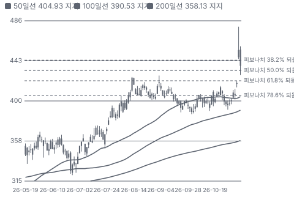

**주봉**

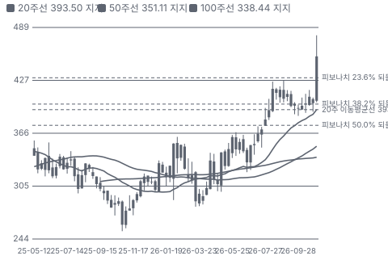

**월봉**

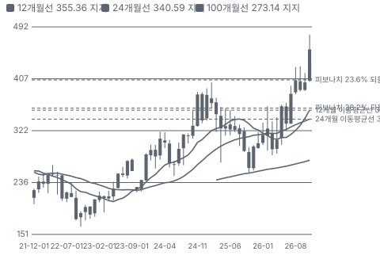

**분기 매출·EPS 실적과 컨센서스**

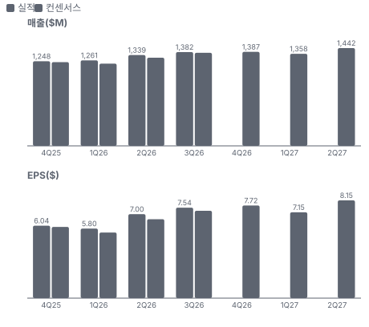

**4Q26 매출 — 지표 추세 vs 가이던스·컨센서스**

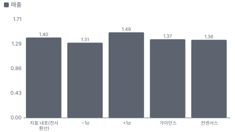

**최근 4개 분기 주가 변화 분석**

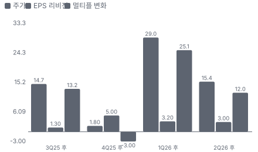

**EPS 리비전**

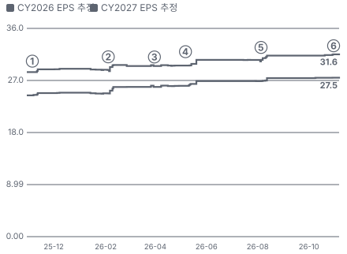

① 25-11-05 3Q25 실적 · EPS 리비전 +2%
② 26-02-04 4Q25 실적·FY26 가이던스 \$26 · EPS 리비전 +3%
③ 26-03-31 PayByPhone 매각 종결 · EPS 리비전 +1%
④ 26-05-07 1Q26 실적, 다음 날 +12.5% · EPS 리비전 +3%
⑤ 26-08-05 2Q26 실적·가이던스 상향 · EPS 리비전 +3%
⑥ 26-11-04 3Q26 실적·2027 첫 전망 · EPS 리비전 +0%

**밸류에이션 주가 시나리오**

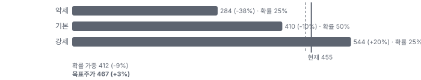

**주가별 업사이드**

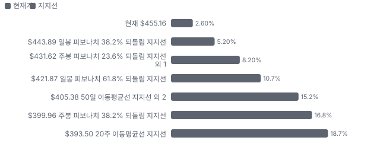

**제품·서비스 포트폴리오**

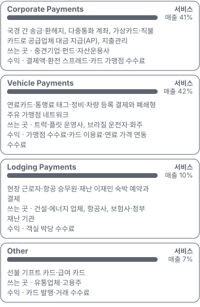

**고객 믹스(3Q26, 매출 대비)**

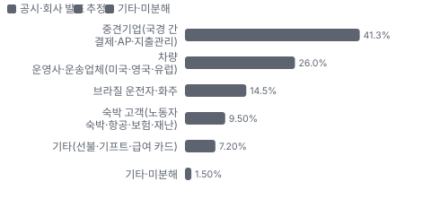

**공급 병목(10점, 낮을수록 병목)**

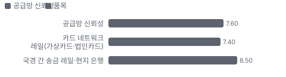

**어닝콜 변화별 주주가치 영향**

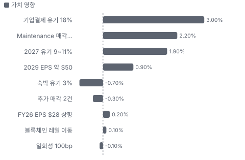

**멀티플 프리미엄(Fwd 1Y P/E, 최근 4개 분기말)**

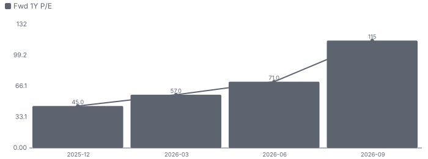

**합리적 멀티플**

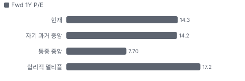

**매출 → 매출총이익 → 영업이익(매출 = 100, 최근 4분기)**

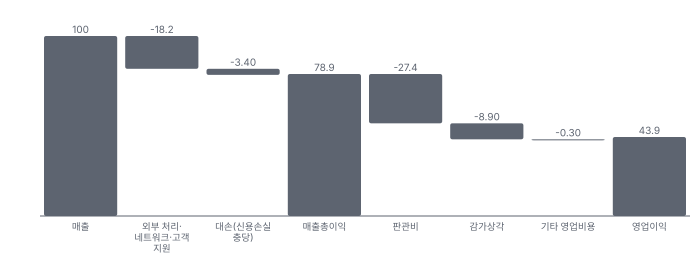

**1년 전 대비 마진 기여(비용 비중 변화의 반대)**

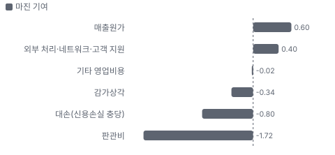

**분기 비용 비중 추이(매출 대비, 공시)**

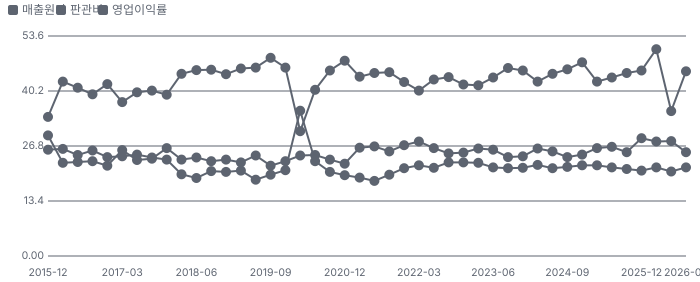

**비용 요인별 매출 대비 비중과 1년 변화**

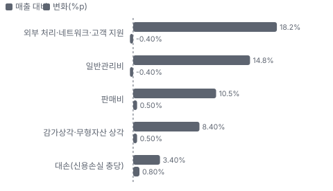

**BOM 항목 가격 +10% 시 OPM 변화**

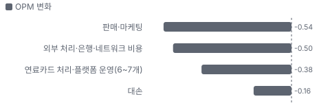

**Corporate Payments BOM 원가 몫과 가격 +10% 시 OPM**

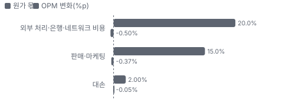

**Vehicle Payments BOM 원가 몫과 가격 +10% 시 OPM**

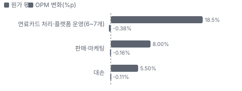

**매출·PPI·수출입 — 최근 16개 분기 같은 축(4Q22 = 100) + 다음 분기 추정**

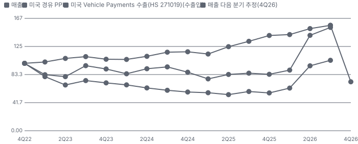

**매출과 미국 경유 PPI 증가율(전년 대비, 최근 16개 분기 + 다음 분기 추정)**

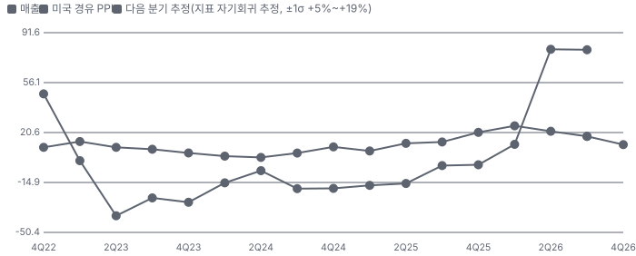

**목표주가 산정 — 기본과 강세 사이(강세 쪽 42%), 도달 확률 약 34%**

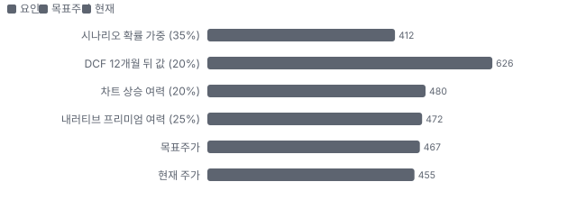

**PEG — 성장 대비 멀티플(낮을수록 성장 대비 쌈)**

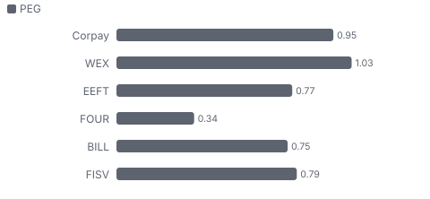

**일봉 지지·저항과 목표주가**

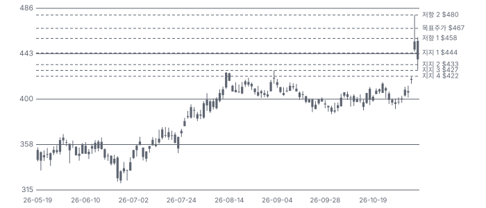

**일별 거래량 분해**

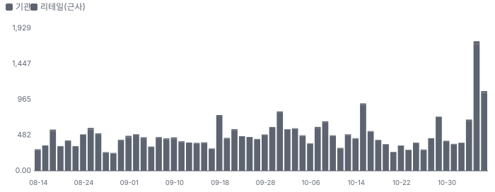

**기관 자금 흐름**

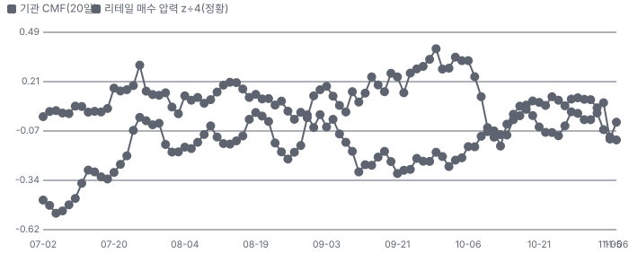

**몬테카를로**

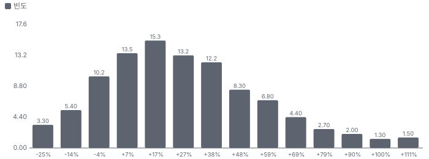

해석: 3,000번 중 2,491번(83%)에서 가치가 지금 주가 이상이었다. 가정을 흔들어도 지금 주가를 뒷받침하는 경우가 더 많다. 가운데 값은 1.24배이고, 열 번 중 여덟 번은 0.93~1.68배 사이에 든다.

## 내러티브

> **기업가치를 결정하는 이야기:** 성장축은 기업결제다 — 3Q 매출 \$571.3M(+40.8%, 유기 18%), 결제액 \$95.3B(+24%). 신규 판매가 연 24% 늘고 기업결제 유지율이 약 95%라 다음 해 성장의 상당 부분이 연초에 이미 보인다(CEO '2027 매출 램프 7~8%p'). 바닥은 차량결제다 — 유기 8%로 느리지만 영업이익 \$297.4M으로 회사 영업이익의 48%를 낸다. 세 번째 축은 자본 배분이다. 9개월 동안 자사주 \$1.9B(5.3M주)를 샀고, 매각 대금 약 \$2B를 같은 곳에 쓴다.

> **멀티플·EPS 프리미엄**
> **멀티플:** Fwd 1Y P/E 14.3배는 자기 3년 레인지(11~17배)의 중간이고, 동종 중앙값 약 7.7배보다 85% 비싸다. 동종 할인은 Fiserv 감손·Global Payments 인수 통합 같은 회사 사고 영향이 크다 — CPAY 프리미엄은 성장률(EPS +20%대 vs 동종 한 자릿수)로 설명된다.
> **EPS:** EPS 추정이 계속 오른다. FY2027 컨센서스는 8/5 \$30.53 → 11/6 \$31.55(+3.3%), FY2026은 \$26.86 → \$27.52이고 회사 가이던스 \$28이 그 위에 있다. 다만 3Q 상회분 일부는 일회성 수익화(100bp)와 거시 효과(+\$32M)였다.

### 투자자들은 왜 열광했나

열광의 근거는 두 번 확인됐다. 첫째, 2026년 내내 가이던스를 올렸다(\$26 → \$27.35 → \$28). 둘째, 3Q 콜에서 2027 유기 9~11%와 2029 EPS 약 \$50 경로를 처음 내놓았다 — 실적 다음 날 +6.8%, 장중 \$479.53까지 갔다. 식을 수 있는 이유도 같은 콜에 있다. CFO가 일회성 100bp를 먼저 밝혔고, 4Q 유기 성장 가이던스는 10%로 3Q 11%보다 낮다.

### 무엇이 기업가치를 바꾸나

> **구조적 체질 변화**
> **변화:** 연료카드 회사에서 기업결제 회사로 — 기업결제 비중 1년 새 +6.7%p, 차량·숙박 비핵심 사업은 매각
> **증거:** 10-Q 부문 표(41.3% vs 34.6%), PayByPhone(3/31)·epyx·Maintenance(11/2) 매각
> **반증:** 기업결제 비중이 2분기 연속 내려간다

> **고부가 믹스 확장**
> **변화:** 가상카드 하나에 기대던 수익화를 직불카드·ACH Plus(대사·빠른 이체를 묶은 Corpay의 유료 계좌 이체 상품)로 넓힌다. 결제액의 80~85%가 아직 수익화 전
> **증거:** 3Q 콜(CEO)
> **반증:** 결제액 대비 매출 비율이 계속 떨어진다

> **기술 혁신**
> **변화:** 국경 간 결제 일부가 SWIFT에서 JPMorgan Kinexys(JPMorgan의 사설 블록체인 결제망) 같은 사설 블록체인 레일로 이동, BVNK와 스테이블코인 레일 구축
> **증거:** 3Q 콜 — 거래량은 아직 작다
> **반증:** 레일별 거래 비중을 공시하지 않거나 원가 절감이 매출총이익에 보이지 않는다

> **실행 속도**
> **변화:** 해당 없음(납품이 없는 결제 서비스이고 도입·구축 기간을 회사가 숫자로 공시하지 않는다). 정성 근거만 있다 — 기업 고객은 빨리 붙지만 Mastercard 금융기관 채널은 '구현 기간이 기업보다 훨씬 길다', 해외 현지 계좌는 1주일 안(최단 2일)에 연다
> **증거:** 2Q·3Q 콜
> **반증:** 금융기관 채널 계약 10곳(2Q)이 매출로 잡히지 않은 채 1년이 지난다

> **M&A**
> **변화:** Alpha(\$2.4B, 2025-10)·Avid 지분 35%(\$578M)를 샀고 2026 EPS 기여가 '\$1.40 이상'으로 당초 \$1을 넘었다. 다음 인수는 지출관리, 2028년 Avid 잔여 지분 옵션
> **증거:** 10-Q Note·3Q 콜
> **반증:** 다음 인수가 EPS를 희석하거나 레버리지가 3배를 넘는다

> **정책·입법 연관성**
> **재정정책:** 해당 없음(연방 재정에 직접 닿는 매출을 확인하지 못했다). 숙박 사업의 재난 고객(FEMA(미국 연방재난관리청) 등)은 재난 규모에 따라 객실 수가 흔들린다 3Q 콜 반증: 해당 없음 의회 동의 2/10 — 하원 1/5(관련 재정 조치 미확인) · 상원 1/5(관련 재정 조치 미확인).
> **행정명령:** 해당 없음(회사 매출에 닿는 행정명령을 확인하지 못했다). 2Q에 FTC 관련 합의 \$100M을 비용으로 잡았다 — 규제 집행이고 최종 위원회 승인 조건 2Q 콜·10-Q 반증: 최종 승인이 거부되거나 합의금이 늘어난다 의회 동의 2/10 — 하원 1/5(의회 절차 아님) · 상원 1/5(의회 절차 아님).
> **연관입법:** 해당 없음(회사 매출에 직접 닿는 의회 입법을 확인하지 못했다). 카드 수수료 규제 입법은 발의 여부·단계를 확인하지 않았다(미확인) 미확인 반증: 카드 망·수수료 규제 법안이 위원회를 통과한다

> **CAPEX 낙수효과**
> **변화:** 해당 없음(고객 설비투자에 매출이 묶인 사업이 아니다 — 기업의 간접비 지출·연료 소비에 묶인다)
> **증거:** 10-K 사업 설명
> **반증:** 해당 없음

### 내러티브 근거

> '연료카드 회사에서 기업결제 회사로'라는 이야기가 숫자로 확인되는 중이다 — 기업결제 비중 1년 새 34.6% → 41.3%, 유기 성장 18%. 시장은 이를 EPS 20%대 성장으로 받았고 주가는 1년 +64%(2025-11-06 \$278.00 → 2026-11-06 \$455.16)다. 동종 대비 멀티플 차이 +85% 중 회사 고유 몫은 -17%다. 단계는 확산, 쏠림은 낮음이다.

> **기업결제 중심 체질 전환** · 강화
> **논리:** 성장률 높은 기업결제(국경 간·AP)가 매출의 절반에 가까워지면 회사 전체 성장률과 멀티플이 같이 올라간다
> **숫자:** 기업결제 비중 3Q25 34.6% → 3Q26 41.3%, 유기 18%(일회성 제외 약 17%)
> **반증:** 2027 정식 가이던스(2월)에서 기업결제가 중간 10%대 아래

> **EPS 20%+ 알고리즘(자사주·매각 재투자)** · 강화
> **논리:** 유기 10% + 이익률 + 자사주로 조정 EPS가 매년 20% 넘게 크고, 2029년 약 \$50
> **숫자:** FY2026 조정 EPS \$28(+31%), 9개월 자사주 \$1.9B(5.3M주)
> **반증:** 2027 조정 EPS 가이던스가 +15% 아래

> **포트폴리오 단순화** · 진행 중
> **논리:** 작은 차량·숙박 사업을 팔아 회사를 단순하게 만들면 복합 기업 할인이 줄어든다
> **숫자:** 2026 매각 2건 약 \$1.2B, 추가 2건 약 \$1.5~2B 시장에
> **반증:** 매각이 EPS 희석(세금 유출)으로 끝난다

> **토큰화 법정화폐·블록체인 레일** · 태동
> **논리:** 국경 간 결제가 SWIFT에서 24시간 레일로 옮겨 가면 속도·원가에서 앞선 회사가 점유율을 얻는다
> **숫자:** 미확인(레일별 거래량 미공시)
> **반증:** 블록체인 레일 비중을 공시하지 않거나 스테이블코인 경쟁사가 수수료를 낮춘다

> **반대 — 결제 업종 디레이팅·수수료율 압박** · 잠복
> **논리:** Fiserv·Global Payments가 Fwd P/E 6~8배로 내려간 업종에서 CPAY만 14배를 유지하기 어렵고, 결제액보다 매출이 덜 크는 수수료율 하락이 이어진다
> **숫자:** 동종 Fwd 1Y P/E 중앙값 약 7.7배 vs CPAY 14.3배, 3Q 결제액 +24% vs 기업결제 매출 +18%
> **반증:** 결제액 대비 매출(수익화율)이 2분기 연속 오른다

> **반대 — 연료·금리 거시 노출** · 잠복
> **논리:** 디젤 가격·환율 변동·금리(고객 예치금 플로트)가 실적의 상당 부분을 만든다. 거시가 꺾이면 서프라이즈가 사라진다
> **숫자:** 3Q 거시 효과 약 +\$32M(매출의 2.3%, 10-Q), 2Q 플로트 역풍 180bp
> **반증:** 4Q 거시 효과가 음수로 돌아선다

이미지 없음(검수 실패) — Corporate Payments

## 포트폴리오

| 제품·서비스 | 구분 | 무엇 | 쓰는 곳 | 돈 버는 방식 | Mix | Mix 변화(전 분기 대비) |
|---|---|---|---|---|---|---|
| Corporate Payments | 서비스 | 국경 간 송금·환헤지, 다중통화 계좌, 가상카드·직불카드로 공급업체 대금 지급(AP), 지출관리 | 중견기업·펀드·자산운용사 | 결제액·환전 스프레드·카드 가맹점 수수료 | 41% | +0.4%p |
| Vehicle Payments | 서비스 | 연료카드·통행료 태그·정비·차량 등록 결제와 폐쇄형 주유 가맹점 네트워크 | 트럭·플릿 운영사, 브라질 운전자·화주 | 가맹점 수수료·카드 이용료·연료 가격 연동 수수료 | 42% | -1.4%p |
| Lodging Payments | 서비스 | 현장 근로자·항공 승무원·재난 이재민 숙박 예약과 결제 | 건설·에너지 업체, 항공사, 보험사·정부 재난 기관 | 객실 박당 수수료 | 9% | +0.3%p |
| Other | 서비스 | 선불 기프트 카드·급여 카드 | 유통업체·고용주 | 카드 발행·거래 수수료 | 7% | +0.7%p |

**Mix 변화가 가장 큰 쪽은 Vehicle Payments(-1.4%p, 전 분기 대비).** 계절성 판정: 분기 매출 계절 지수 기준 없음 → 직전 분기와 비교.

## 고객

> **3Q26 최대 고객 중견기업(국경 간 결제·AP·지출관리) 41%, 상위 3곳 82%, 집중도 집중.** 공시·회사 발표로 확인한 몫은 매출의 58%이고, 나머지 고객 몫은 추정이거나 미분해다. 10%를 넘는 단일 고객은 공시되지 않았다. 고객은 중견기업·차량 운영사·브라질 운전자·숙박 고객으로 흩어져 있고, 매출 몫은 부문 표(10-Q)로 확인한다. 미국 매출 비중은 1년 새 49% → 45%로 내려갔다.

**고객별 매출 몫(3Q26)**
| 고객 | 몫 | 변화 | 근거 |
|---|---|---|---|
| 중견기업(국경 간 결제·AP·지출관리) | 41% | +7%p | 공시 |
| 차량 운영사·운송업체(미국·영국·유럽) | 23~29% | 미확인 | 추정 |
| 브라질 운전자·화주 | 13~16% | 미확인 | 추정 |
| 숙박 고객(노동자 숙박·항공·보험·재난) | 10% | -1%p | 공시 |
| 기타(선불·기프트·급여 카드) | 7% | -1%p | 공시 |
| 기타·미분해 | 2% | - | - |

> **중견기업(국경 간 결제·AP·지출관리)** · 공시
> **사는 것:** 국경 간 송금·환헤지·가상카드·AP 자동화
> **추정 근거:** 기업결제 부문 매출 비중(3Q)

> **차량 운영사·운송업체(미국·영국·유럽)** · 추정
> **사는 것:** 연료카드·통행료·정비
> **추정 근거:** 차량결제 42% − 브라질 몫(지역 표 16% 중 차량 대부분 추정)

> **브라질 운전자·화주** · 추정
> **사는 것:** 통행료 태그·차량 등록·Vale Pedágio(브라질 화주가 운전자 통행료를 미리 내 주는 제도)
> **추정 근거:** 브라질 매출 대부분이 차량결제(추정)

> **숙박 고객(노동자 숙박·항공·보험·재난)** · 공시
> **사는 것:** 출장·현장 근로자·승무원 숙박
> **추정 근거:** 숙박 부문 매출 비중

> **기타(선불·기프트·급여 카드)** · 공시
> **사는 것:** 선물·급여 카드
> **추정 근거:** 기타 부문

## 마진 구조

> **GPM 78.4%, OPM 45.0%.** 3Q25 대비 GPM -0.4%p, OPM +0.3%p. 변동비는 매출의 23%이고, 매출이 10% 늘면 OPM은 +2.9%p 움직인다. 3Q26 처리비는 매출의 21.6%로 1년 전 21.2%보다 0.4%p 높다. 원가는 사람·시스템·대손이고 물건이 아니다. 판매비(+23.6%)를 매출(+17.9%)보다 빨리 늘린 것이 이익률을 누른 요인이고, 감가상각 증가는 Alpha 무형자산 상각이다.

> **매출 100 중 매출원가 21.1, 매출총이익 78.9(최근 4분기, 공시).** 매출원가 요인 중 외부 처리·네트워크·고객 지원이 매출의 18.2%로 가장 무겁고, 단가가 +10% 오르면 GPM이 -1.82%p 움직인다. 분기 회귀로 매출 1이 늘 때 매출원가는 0.20 늘고, 매출원가의 고정비 몫은 8%다.

**비용 요인 강도 — 비중·추세·충격(+10%)·탄력**
| 비용 | 구분 | 매출 대비 | 1년 변화 | 마진 기여 | 충격 시 마진 | 매출 탄력 | 고정비 몫 |
|---|---|---|---|---|---|---|---|
| 외부 처리·네트워크·고객 지원 | 매출원가 요인 | 18.2% | -0.4%p | +0.4%p | -1.82%p | 미확인 | 50% |
| 대손(신용손실 충당) | 매출원가 요인 | 3.4% | +0.8%p | -0.8%p | -0.34%p | 미확인 | 0% |
| 판관비 | 공시 항목 | 27.4% | +1.7%p | -1.7%p | 미확인 | 0.28 | -12% |
| 매출원가 | 공시 항목 | 21.1% | -0.6%p | +0.6%p | -2.11%p | 0.20 | 8% |
| 감가상각 | 공시 항목 | 8.9% | +0.3%p | -0.3%p | 미확인 | 0.07 | 32% |
| 기타 영업비용 | 공시 항목 | 0.3% | +0.0%p | -0.0%p | 미확인 | 0.01 | -100% |

매출 탄력 = 분기 비용을 매출에 회귀한 기울기(매출 1당 변동비), 고정비 몫 = 절편 ÷ 평균 비용. 표본이 8분기 미만이면 미확인. 매출원가 요인 비중은 margin 재료의 추정이 섞여 있고, 공시 매출원가와의 차이는 '기타 매출원가'로 둔다.

**GPM에서 OPM까지(GAAP)**
| 기간 | GPM | 연구개발 | 판관비 | 기타 | OPM |
|---|---|---|---|---|---|
| 3Q25 | 78.8% | 0.0% | 25.3% | 8.9% | 44.6% |
| 3Q26 | 78.4% | 0.0% | 25.3% | 8.2% | 45.0% |

**GPM·OPM 최근 4개 분기**
| 분기 | GPM | OPM |
|---|---|---|
| 2025-12 | 79.2% | 45.2% |
| 2026-03 | 78.4% | 50.4% |
| 2026-06 | 79.4% | 35.3% |
| 2026-09 | 78.4% | 45.0% |

**마진을 결정하는 비용 요인 — 비용 +10% 시 OPM**
| 비용 | 매출 대비 | 변화 | 고정비 | OPM |
|---|---|---|---|---|
| 외부 처리·네트워크·고객 지원 | 18.2% | -0.4%p | 50% | -1.82%p |
| 일반관리비 | 14.8% | -0.4%p | 80% | -1.48%p |
| 판매비 | 10.5% | +0.5%p | 30% | -1.05%p |
| 감가상각·무형자산 상각 | 8.4% | +0.5%p | 100% | -0.84%p |
| 대손(신용손실 충당) | 3.4% | +0.8%p | 0% | -0.34%p |

**비용을 움직이는 요인**
| 비용 | 요인 |
|---|---|
| 외부 처리·네트워크·고객 지원(매출원가) | 거래 건수·플랫폼 수(차량 6~7개, 기업결제 1개) · 근거 추정 |
| 일반관리비(판관비) | 인력·인수 통합 · 근거 공시 |
| 판매비(판관비) | 신규 판매 투자(3Q +23.6%) · 근거 공시 |
| 감가상각·무형자산 상각(기타) | Alpha 인수 무형자산 · 근거 공시 |
| 대손(신용손실 충당, 매출원가) | 연료 가격·운송업 경기·고객 신용 · 근거 추정 |

**Corporate Payments BOM — 매출의 41%, GPM 40%(부문 영업이익률 대용(226.6 ÷ 571.3, 10-Q) — 부문별 처리비 미공시), 항목 가격 +10% 시**
| 항목 | 원가 몫 | 전가 | 제품 GPM | OPM |
|---|---|---|---|---|
| 외부 처리·은행·네트워크 비용 | 15~25% | 미확인 | -1.2%p | -0.50%p |
| 판매·마케팅 | 12~18% | 0% | -0.9%p | -0.37%p |
| 대손 | 1~3% | 0% | -0.1%p | -0.05%p |
| 미분해 | 63% | - | - | - |

**Vehicle Payments BOM — 매출의 42%, GPM 51%(부문 영업이익률 대용(297.4 ÷ 579.8, 10-Q)), 항목 가격 +10% 시**
| 항목 | 원가 몫 | 전가 | 제품 GPM | OPM |
|---|---|---|---|---|
| 연료카드 처리·플랫폼 운영(6~7개) | 15~22% | 미확인 | -0.9%p | -0.38%p |
| 판매·마케팅 | 6~10% | 0% | -0.4%p | -0.16%p |
| 대손 | 4~7% | 0% | -0.3%p | -0.11%p |
| 미분해 | 68% | - | - | - |

판매·마케팅 가격이 +10% 오르면 영업이익은 -1.2% 움직인다. 판매가 전가를 모르는 항목은 전가 0%로 계산했다.

**BOM 항목 가격을 움직이는 것**
| 항목 | 요인 |
|---|---|
| 외부 처리·은행·네트워크 비용 | 국경 간·AP 거래 처리. 플랫폼이 하나라 규모의 경제가 크다(CEO) · 근거 추정 |
| 판매·마케팅 | 신규 판매 \$500M 이상을 사는 비용 · 근거 추정 |
| 대손 | 법인카드·가상카드 신용 · 근거 추정 |
| 연료카드 처리·플랫폼 운영(6~7개) | 미국·영국·브라질 등 사업별 시스템 · 근거 추정 |
| 대손 | 운송업 고객 신용 — 디젤 가격과 같이 움직인다 · 근거 추정 |
| 판매·마케팅 | 브라질·유럽 위주 판매 · 근거 추정 |

**BOM 투입 물가 — PPI 전년비, 2026-11-08 수집**
| 항목 | 미국 | 일본 | 한국 | 대만 |
|---|---|---|---|---|
| 대손 | +115.2% | 미확인 | 미확인 | 미확인 |

별표는 품목보다 넓은 업종 지수다. 지난 1년 투입 물가를 판매가 전가 뒤 원가에 그대로 넣으면 OPM은 -1.30%p 움직인다(매출원가의 5% 기준).

## 공급망 병목

> **공급망 신뢰성 7.6/10, 관리 가능.** 가장 약한 고리는 카드 네트워크 레일(가상카드·법인카드) 7.4점이고, 품목 평균은 7.9점이다. 근거가 부족한 2건(연료·정비 가맹점 수용(폐쇄형 네트워크) · 차입·증권화 자금 조달)은 점수에서 뺐다. 결제 회사의 공급망은 부품이 아니라 레일·은행·가맹점·자금이다. 가장 약한 고리는 카드 레일(Mastercard·Visa)과 차입 조달이다. 회사는 단일 공급원이나 구매 약정을 공시하지 않는다.

**병목과 마진 — 품목 가격 +10% 시 OPM**
| 품목 | 점수 | 판정 | 구분 | OPM |
|---|---|---|---|---|
| 카드 네트워크 레일(가상카드·법인카드, 필수) | 7.4 | 관리 가능 | 일반 | 미확인 |
| 국경 간 송금 레일·현지 은행 | 8.5 | 병목 낮음 | 일반 | 미확인 |

> **카드 네트워크 레일(가상카드·법인카드)** · 7.4/10
> **왜:** 가상카드 매출의 원천
> **병목 요인:** 인증 공급사 2곳 · 캐파 여유 · 리드타임 미확인 · 재인증 12개월 · 1위 점유율 미확인 · 지역 집중 미확인 · 물량 확보 장기계약
> **풀리는 조건:** 직불카드·ACH Plus로 수단 분산 중

> **국경 간 송금 레일·현지 은행** · 8.5/10
> **왜:** 국경 간 결제 원가·속도
> **병목 요인:** 인증 공급사 3곳 · 캐파 여유 · 리드타임 미확인 · 재인증 미확인 · 1위 점유율 40% · 지역 집중 미확인 · 물량 확보 복수구매
> **풀리는 조건:** 사설 블록체인 레일로 일부 이동 시작(3Q 콜)

**공급사**
| 품목 | 공급사 | 몫 | 근거 |
|---|---|---|---|
| 카드 네트워크 레일(가상카드·법인카드) | Mastercard(카드 레일·국경 간 사업 지분 2.3%) | 미확인 | 공시 |
| 카드 네트워크 레일(가상카드·법인카드) | Visa(카드 레일) | 미확인 | 추정 |
| 연료·정비 가맹점 수용(폐쇄형 네트워크) | 주유소·정비소 가맹점 다수(미공시, 수용처) | 미확인 | 공시 |
| 차입·증권화 자금 조달 | 신용한도·Term Loan 은행단(미공시, 회전대출·Term Loan A/B) | 미확인 | 공시 |
| 차입·증권화 자금 조달 | 증권화 매입 은행·CP(기업어음) 도관(\$2.3B 매출채권 증권화) | 미확인 | 공시 |
| 국경 간 송금 레일·현지 은행 | SWIFT 망 은행(송금 메시지) | 미확인 | 회사 발표 |
| 국경 간 송금 레일·현지 은행 | JPMorgan(Kinexys, 사설 블록체인 레일) | 미확인 | 회사 발표 |
| 국경 간 송금 레일·현지 은행 | BVNK(스테이블코인 레일) | 미확인 | 회사 발표 |

**무역 통계로 본 공급 지역**
| 품목 | EU 수입처 | 일본 수입처 | EU 1위 전년비 |
|---|---|---|---|
| 연료·정비 가맹점 수용(폐쇄형 네트워크) | US 75% · CN(중국) 12% · KR(한국) 6% | 大韓民国 74% · シンガポール 7% | +133.6% |

## 해자

> 해자는 기술보다 네트워크와 고객 묶음이다. 연료 가맹점 폐쇄형 네트워크와 브라질 통행료 태그망은 오래된 해자이고, 국경 간 결제는 Alpha 인수로 산 규모와 현지 계좌 인프라가 막는다. 기업 지출관리 쪽은 경쟁이 가장 치열해 아직 증명 중이다.

> **폐쇄형 연료·차량 가맹점 네트워크** · 강함
> **해자:** 주유소·정비소가 받는 자체 카드망(Fuelman 등)이라 결제 시점의 품목 데이터와 가맹점 수수료를 함께 쥔다. 일반 법인카드는 이 데이터를 못 준다.
> **근거:** CEO는 일반 법인카드 사업자는 '20년 걸려 만든 차량 구매 네트워크'가 없다고 말했다(2Q 콜). 차량결제 영업이익률 3Q 51.3%(297.4 ÷ 579.8, 10-Q).
> **숫자:** 차량결제 3Q 매출 \$579.8M·영업이익률 51.3%
> **깨지는 조건:** 차량결제 유기 성장이 2분기 연속 중간 한 자릿수 아래로 내려가고 동일 고객 매출이 마이너스

> **브라질 통행료 태그·차량 행정망** · 강함
> **해자:** 브라질 전역 36개 DMV(차량 등록 관청)와 연결돼 등록 갱신·위반 납부까지 휴대전화로 처리한다. 은행이 무료 태그로 들어와도 네트워크 폭이 다르다.
> **근거:** 3Q 콜: 계정 약 700만~800만, 차량 부가 서비스 +30%로 브라질 소비자 매출의 약 20%. 은행 3~4곳이 Corpay 제품을 받아 판다.
> **숫자:** 브라질 3Q 매출 \$227.1M(16%, 10-Q 지역 표)
> **깨지는 조건:** 은행 무료 태그 확대로 브라질 거래 건수가 2분기 연속 줄어든다

> **국경 간 결제 규모·현지 계좌 인프라** · 보통
> **해자:** Alpha 인수로 펀드·자산운용사 고객과 여러 나라 현지 계좌를 하루~1주일에 열어 주는 인프라를 얻었다. 고객 유지율이 회사 평균보다 높다.
> **근거:** 기업결제 유지율 약 95%(3Q 콜), 국경 간 매출의 약 75%가 미국 밖. Mastercard가 국경 간 사업 2.3%를 \$300M에 샀다(10-Q).
> **숫자:** 기업결제 3Q 결제액 \$95.3B(+24% 유기)
> **깨지는 조건:** Mastercard·BVNK·Wise 같은 플랫폼이 중견기업에 직접 팔며 국경 간 수수료율이 떨어진다(결제액 대비 매출 하락)

> **AP 공급업체 수용 네트워크** · 약함
> **해자:** 공급업체가 가상카드를 받도록 만든 수용 네트워크가 수익화 열쇠다. 결제액의 80~85%는 아직 수익화되지 않았다.
> **근거:** 3Q 콜(CEO). 직불카드·ACH Plus를 더해 수익화 수단을 늘리는 중.
> **숫자:** 미확인(공급업체 수·수용률 미공시)
> **깨지는 조건:** 결제액 성장과 매출 성장의 차이(3Q 24% vs 18%)가 더 벌어진다

## 경영진·네트워크

> Ron Clarke가 2000년부터 CEO(현 회장 겸)로 연쇄 인수와 사업 재편을 이끌었다. 지금 재편의 방향 — 차량에서 기업결제로 — 도 그의 판단이다. 8월에 옵션 행사 뒤 약 \$88M을 장내에서 팔았다.

> **Ronald F. Clarke** · 회장·CEO · 2000(CEO)
> **프로필:** FLEETCOR를 연료카드 회사에서 기업결제 회사로 바꿨다(2024 사명 변경). 2026-08-21 옵션 45만 주 행사 뒤 8/24·8/25 장내 매도 약 \$88M(Form 4)
> **비즈니스:** M&A·자본 배분(Alpha·Avid 인수, PayByPhone·epyx·Maintenance 매각)
> **정계:** 미확인
> **동문:** 미확인
> **사모임:** 미확인

> **Peter Walker** · CFO · 미확인
> **프로필:** 3Q 일회성 수익화 100bp를 스스로 밝혔고, 2029 EPS 약 \$50 경로를 제시했다(3Q 콜)
> **비즈니스:** 재무·가이던스
> **정계:** 미확인
> **동문:** 미확인
> **사모임:** 미확인

> **Alan King** · 그룹 사장(국제 차량결제) · 미확인
> **프로필:** 8월 옵션 행사 뒤 장내 매도 약 \$17M(Form 4)
> **비즈니스:** 브라질·유럽 차량결제
> **정계:** 미확인
> **동문:** 미확인
> **사모임:** 미확인

**네트워크 정량화**
| 연결 | 강도 | 닿는 매출 | 가중 노출 | 매출 대비 | 근거 |
|---|---|---|---|---|---|
| 비즈니스: Mastercard(국경 간 사업 지분 2.3%·금융기관 판매 제휴), TPG(Avid 공동 투자) | 3/5 | 미확인 | 미확인 | 미확인 | 금융기관 채널 매출 미공시 — 10곳 계약·100곳 파이프라인(2Q 콜) 10-Q·2Q 콜 |
| 정계: 공개 기록에서 확인한 정계 연결 없음 | 0/5 | 미확인 | 미확인 | 미확인 | 로비 공시는 Easyconomics 하원 LD(미국 하원 로비 공시) 유니버스 밖이라 확인하지 못했다 미확인 |

가중 노출은 연결이 닿는 매출의 크기다. 연결이 그 매출을 만들었다는 뜻이 아니며, 인과는 공개 자료로 입증하지 못한다.

## 약세 논리 및 셀온 조건

| 약세 논리 | 근거 | 반박 | 가를 자료 · 공개 시점 |
|---|---|---|---|
| 3Q 상회는 일회성·거시였다 | CFO: 3Q 기업결제 성장 중 약 100bp는 반복 불확실. 10-Q: 거시 효과 +\$32M(연료 가격 약 +\$22M). 미국 경유 PPI 전년 대비 +115%(2026-09) | 일회성을 빼도 기업결제 약 17%, 신규 판매 +24%, 유지율 92.2%다. 2Q 상회 \$45M 중 거시 몫 \$30M을 뺀 \$15M도 사업 자체 초과분이었다(2Q 콜) | 4Q 실적의 거시 효과·일회성 제외 기업결제 성장 — 2027-02-03 예상 |
| 수수료율이 떨어진다 | 3Q 기업결제 결제액 +24% vs 매출 +18%. 대형 고객은 결제액 대비 수익률이 낮다(CEO) | 결제액의 80~85%가 아직 수익화 전이고 직불카드·ACH Plus로 수단을 늘린다(CEO). 3Q에는 수익화가 오히려 올랐다 | 4Q 기업결제 매출 ÷ 결제액(3Q 약 0.60%) — 2027-02-03 예상 |
| 결제 업종은 디레이팅 중이다 | 동종 Fwd 1Y P/E 중앙값 7.7배(Euronet 6.3·Global Payments 6.4·WEX 7.6·Shift4 7.9·Fiserv 8.1·BILL 13.6), CPAY 14.3배 | 동종 할인은 Fiserv 감손(LTM GAAP EBIT 적자)·Global Payments 인수 통합 같은 회사 사고 몫이 크다. CPAY의 EPS 성장(+31%)을 가진 동종이 없다 | 동종 Fwd 1Y P/E 중앙값 — 상시, 다음 점검 4Q 실적 시즌(2027-02) |
| 경영진이 판다 | CEO 8/24·8/25 장내 매도 약 \$88M(8/21 옵션 45만 주 행사 뒤), 국제 차량 사장 약 \$17M(Form 4). 최근 장내 거래 매도 33건 · 매수 1건 | 옵션 만기와 묶인 매도일 수 있다. 회사는 같은 분기 자사주 \$750M(약 1.9M주)를 샀다 | 다음 Form 4·2027 위임장의 보유 지분 — 2027-04 |
| 포트폴리오 매각이 성장률을 깎는다 | 2026 매각 두 건의 매출 약 \$120M이 2027에 빠진다. 매각한 PayByPhone은 20~25%, epyx는 10~11% 성장 사업이었다(2Q 콜 CEO) | 회사는 매각 대금 자사주로 EPS 중립을 고집한다(3Q 콜). 남은 매각 후보는 작은 저성장 사업 | 추가 매각 2건(약 \$1.5~2B)의 가격·세금 유출 공시 — 향후 14개월 |

**정책·거시.** 중간선거 영향 +0.0/10 — 가장 큰 채널은 금융 규제 완화 입법 동력 약화(−0.3, 노출 0.3)이고, 업종 ETF(XLF)의 선거 뒤 반응은 CAR(사건 뒤 시장 대비 초과 누적 수익률) +0.5%(t 0.31)로 유의하지 않다. 정책 0단계(선거 결과) 가설이다. 카드 수수료 규제 입법은 단계를 확인하지 못했다(미확인). 브라질 매출이 16%인데 할인율에 국가위험을 따로 더하지 않았다 — 할인율이 실제보다 낮을 수 있다(자체추론). **추가 원천(11/8).** 노션 자료실·게시글에 이 종목 자료가 없고, 커뮤니티 대화는 최근 7일 언급이 없다. 공개 텔레그램 채널에는 3Q 실적 요약 1건이 있었다(시장 반응의 증거이고 사실이 아니다). 결제 서비스라 제품 분해도·BOM 이미지는 해당 없음이고, 생산시설·위성 판독도 해당 없음(사무실 모두 임차)이다.

> **셀온 조건**
> **조건 1:** 4Q 실적(2027-02 초)에서 일회성을 뺀 기업결제 유기 성장이 15% 아래로 나온다
> **조건 2:** 2027 정식 가이던스의 조정 EPS 성장이 +15% 아래(약 \$32.2 아래)
> **조건 3:** 기업결제 매출 ÷ 결제액 비율이 2분기 연속 떨어진다
> **조건 4:** 레버리지가 3배를 넘는 인수를 발표하거나 추가 매각이 EPS를 희석한다
> **조건 5:** FTC 합의가 최종 승인되지 않거나 합의금이 늘어난다

## 어닝콜 변화

**직전 콜 대비 새로 나오거나 바뀐 내용 → 가치 영향**
| 항목 | 내용 | 직전 콜 | 최신 콜 | 모델 동인 이동 | 확신도 | 가치 영향 |
|---|---|---|---|---|---|---|
| 업데이트 | FY2026 가이던스 | 매출 \$5.31B·조정 EPS \$27.35 | 매출 \$5.35B·조정 EPS \$28.00 | 기준연도 매출 +\$0.01B | 0.8 | +0.2% |
| 신규 | 2027 전망 | 중기 알고리즘 '유기 10% 이상'만 | 2027 유기 9~11%, 기업결제 중간 10%대 이상 | 1년차 성장률 +0.50% | 0.8 | +1.9% |
| 업데이트 | 기업결제 성장 | 2Q 16%(플로트 역풍 180bp) | 3Q 18%(플로트 제외 20%), 결제액 \$95B +24% | 1년차 성장률 +0.80% | 1.0 | +3.0% |
| 부정 | 일회성 수익화 | 언급 없음 | 3Q 기업결제 성장 중 약 100bp는 반복 불확실 | 기준연도 매출 -\$0.00B | 0.8 | -0.1% |
| 업데이트 | Maintenance 매각 | 6월 매각 계약(약 £600M) | 11/2 종결, 대금 약 \$0.8B | 순차입 -\$0.80B | 1.0 | +2.2% |
| 신규 | 추가 매각 | 2Q '6~12개월 안 epyx 같은 매각' | 2건(약 \$1.5~2B) 시장에, EPS 중립 선호 | 기준연도 매출 -\$0.01B | 0.5 | -0.3% |
| 신규 | 2029 EPS 경로 | 'EPS 20% 초과' 알고리즘 | 2026 \$28 → 2029 약 \$50 | 장기 성장 수렴값 +1.0% | 0.5 | +0.9% |
| 부정 | 숙박 | 2Q '하반기 중간 한 자릿수 가속' | 3Q 3%, 보험·항공 부진 | 1년차 성장률 -0.20% | 1.0 | -0.7% |
| 신규 | 결제 레일 | 2Q 'SWIFT 40%' | 일부 거래가 사설 블록체인 레일로 이동 시작 | 성장 지속(감속 계수) +0.30% | 0.3 | +0.1% |
| **합계** | 단독 합 |  |  | 동시 적용 +7.4% |  | **+7.1%** |

**사건별 EPS 리비전**
| # | 날짜 | 구분 | 사건 | CY2026 EPS 전→후 | CY2027 EPS 전→후 | 리비전 | 주가 반응 |
|---|---|---|---|---|---|---|---|
| ① | 25-11-05 | 실적 | 3Q25 실적 | \$24.40 → \$24.79 | \$28.42 → \$28.89 | +1.7% | +6.2% |
| ② | 26-02-04 | 실적 | 4Q25 실적·FY26 가이던스 \$26 | \$24.74 → \$25.84 | \$28.79 → \$29.65 | +3.0% | +11.6% |
| ③ | 26-03-31 | 내러티브 | PayByPhone 매각 종결 | \$25.86 → \$26.09 | \$29.47 → \$29.62 | +0.5% | -0.5% |
| ④ | 26-05-07 | 실적 | 1Q26 실적, 다음 날 +12.5% | \$26.05 → \$26.86 | \$29.55 → \$30.53 | +3.3% | +12.5% |
| ⑤ | 26-08-05 | 실적 | 2Q26 실적·가이던스 상향 | \$26.85 → \$27.39 | \$30.27 → \$31.26 | +3.3% | +1.0% |
| ⑥ | 26-11-04 | 실적 | 3Q26 실적·2027 첫 전망 | \$27.45 → \$27.52 | \$31.48 → \$31.55 | +0.2% | +6.8% |

**해석:** 4개 구간 누적 주가 +74% = EPS 리비전 +13% × 멀티플 +54%. 더 크게 움직인 쪽은 **멀티플**이다.

## 거시 지표 싱크로율

> **미국 경유 PPI와 Vehicle Payments 싱크로율 56%(0분기 = 약 0개월 선행, 전년 대비, 표본 12개·t 2.2·유의·신뢰 보통).** 이 지표가 내포하는 4Q26 Vehicle Payments은 642M(±1σ 600M~683M, 지표 자기회귀 추정)다. 기준 분기(4Q25) 세그먼트 비중 46%로 환산한 전사 매출은 1.40B(1.31B~1.49B)다(다른 사업이 같은 속도로 움직인다는 가정). 가이던스는 이보다 -2.0%(범위 안), 컨센서스는 -2.4%(범위 안)다. 차량결제 매출의 일부는 연료 가격에 연동된다(10-Q: 3Q 연료 가격 효과 약 +\$22M). 기업결제·숙박은 맞는 무역·PPI 지표가 없다

**지표별 싱크로율(상관계수 × 100) — 위 두 줄이 제품 연관성 × 싱크로율로 고른 PPI·수출입 세부 지표**
| 지표 | 비교 대상 | 증가율 기준 | 지표 선행 | 매출(t값) | 영업이익 | 방향 일치 | 표본·신뢰 | 4Q26 내포 매출 |
|---|---|---|---|---|---|---|---|---|
| 미국 경유 PPI | Vehicle Payments | 전년 대비 | 0분기(0개월) | 56%(t 2.2) | 44%(0분기) | 58% | 12·보통 | +12.0% → 642M(지표 자기회귀 추정) |
| 미국 Vehicle Payments 수출(HS(국제 통일 상품 분류 코드) 271019) | Vehicle Payments | 전년 대비 | 0분기(0개월) | 45%(t 1.6) | -6%(4분기) | 58% | 12·보통 | +12.6% → 645M(지표 자기회귀 추정) |

**지표 후보 11개 — 연관성(제품 품목 일치 × 대용 감점 × 매출 비중) × 싱크로율로 고른다. 후보가 많을수록 최대 상관은 우연히 부풀 수 있다**
| 후보 | 종류 | 연관성 | 매출 분기 일치 | 싱크로율(선행) | 점수 | 출처 |
|---|---|---|---|---|---|---|
| 미국 Vehicle Payments 수입(HS 271019) | 수출입 | 1.00 | 81% | 70%(0분기) | 0.70 | 자동 |
| 미국 경유 PPI ✔ | PPI | 1.00 | 100% | 56%(0분기) | 0.56 | 모델 지정 |
| 미국 Vehicle Payments 수출(HS 271019) ✔ | 수출입 | 1.00 | 100% | 45%(0분기) | 0.36 | 자동 |
| 미국 HS 271012 수입(Vehicle Payments과 같은 4자리 품목군) | 수출입 | 0.70 | 81% | 43%(4분기) | 0.24 | 자동 |
| 미국 HS 271012 수출(Vehicle Payments과 같은 4자리 품목군) | 수출입 | 0.70 | 100% | -57%(4분기) | 0.00 | 자동 |
| 미국 HS 271020 수출(Vehicle Payments과 같은 4자리 품목군) | 수출입 | 0.70 | 100% | -36%(4분기) | 0.00 | 자동 |
| 미국 HS 271091 수출(Vehicle Payments과 같은 4자리 품목군) | 수출입 | 0.70 | 38% | 미확인 | 0.00 | 자동 |
| 미국 HS 271099 수출(Vehicle Payments과 같은 4자리 품목군) | 수출입 | 0.70 | 100% | -59%(3분기) | 0.00 | 자동 |
| 미국 HS 271020 수입(Vehicle Payments과 같은 4자리 품목군) | 수출입 | 0.70 | 38% | 미확인 | 0.00 | 자동 |
| 미국 HS 271091 수입(Vehicle Payments과 같은 4자리 품목군) | 수출입 | 0.70 | 0% | 미확인 | 0.00 | 자동 |
| 미국 HS 271099 수입(Vehicle Payments과 같은 4자리 품목군) | 수출입 | 0.70 | 81% | -65%(2분기) | 0.00 | 자동 |

**선행 지표로 본 향후 분기 매출 전망(이미 나온 지표 값 기준, ±1σ)**
| 지표 | 대상 | 분기 | 지표 증가율 | 내포 매출 증가율 | 내포 매출 |
|---|---|---|---|---|---|
| 미국 HS 271012 수출(Vehicle Payments과 같은 4자리 품목군) | Vehicle Payments | 4Q26 | -5.4% | +6.8% | 612M(572M~652M) |
| 미국 HS 271012 수출(Vehicle Payments과 같은 4자리 품목군) | Vehicle Payments | 1Q27 | +8.8% | -4.4% | 539M(500M~578M) |
| 미국 HS 271012 수출(Vehicle Payments과 같은 4자리 품목군) | Vehicle Payments | 2Q27 | +37.5% | -27.2% | 422M(382M~462M) |
| 미국 HS 271012 수출(Vehicle Payments과 같은 4자리 품목군) | Vehicle Payments | 3Q27 | +34.3% | -24.7% | 437M(397M~477M) |
| 미국 HS 271020 수출(Vehicle Payments과 같은 4자리 품목군) | Vehicle Payments | 4Q26 | +70.7% | +7.3% | 615M(570M~660M) |
| 미국 HS 271020 수출(Vehicle Payments과 같은 4자리 품목군) | Vehicle Payments | 1Q27 | +12.2% | +7.7% | 607M(563M~652M) |
| 미국 HS 271020 수출(Vehicle Payments과 같은 4자리 품목군) | Vehicle Payments | 2Q27 | +33.2% | +7.6% | 624M(578M~670M) |
| 미국 HS 271020 수출(Vehicle Payments과 같은 4자리 품목군) | Vehicle Payments | 3Q27 | +127.2% | +7.0% | 621M(575M~666M) |
| 미국 HS 271099 수출(Vehicle Payments과 같은 4자리 품목군) | Vehicle Payments | 4Q26 | -15.6% | +5.5% | 604M(566M~642M) |
| 미국 HS 271099 수출(Vehicle Payments과 같은 4자리 품목군) | Vehicle Payments | 1Q27 | +2340.5% | -326.6% | -1.28B(-1.32B~-1.24B) |
| 미국 HS 271099 수출(Vehicle Payments과 같은 4자리 품목군) | Vehicle Payments | 2Q27 | +1.9% | +3.0% | 598M(559M~636M) |
| 미국 HS 271012 수입(Vehicle Payments과 같은 4자리 품목군) | Vehicle Payments | 4Q26 | -10.8% | +17.1% | 671M(639M~702M) |
| 미국 HS 271012 수입(Vehicle Payments과 같은 4자리 품목군) | Vehicle Payments | 1Q27 | -20.7% | +11.9% | 631M(600M~662M) |
| 미국 HS 271012 수입(Vehicle Payments과 같은 4자리 품목군) | Vehicle Payments | 2Q27 | +3.5% | +24.5% | 722M(691M~754M) |
| 미국 HS 271012 수입(Vehicle Payments과 같은 4자리 품목군) | Vehicle Payments | 3Q27 | -0.1% | +22.6% | 711M(679M~743M) |
| 미국 HS 271099 수입(Vehicle Payments과 같은 4자리 품목군) | Vehicle Payments | 4Q26 | -46.4% | +7.2% | 614M(575M~653M) |
| 미국 HS 271099 수입(Vehicle Payments과 같은 4자리 품목군) | Vehicle Payments | 1Q27 | +18.5% | -0.9% | 559M(520M~597M) |

지표가 k분기 앞서면 이미 발표된 지표로 k분기 뒤까지의 매출 증가율을 회귀식으로 읽는다. 표본이 작거나 t값이 2 미만이면 전망은 참고용이다.

**지표를 고른 이유**
| 지표 | 이유 |
|---|---|
| 미국 경유 PPI | 연료 가격 연동 수수료·결제액의 대용 |
| 미국 Vehicle Payments 수출(HS 271019) | Vehicle Payments 품목 일치 |

싱크로율은 증가율의 상관계수이며 인과가 아니다. 지표 단위·통화는 원자료 그대로이고 나라끼리 더하지 않는다(EU(유럽연합) 수입만 상대국 합계). ±1σ는 회귀 잔차 표준편차이고, 지표를 예측한 분기는 지표 예측 오차까지 더해 넓혔다.

## 밸류에이션

> **목표주가 \$467, 업사이드 +3%.** 자리는 기본과 강세 사이(강세 쪽 42%)이고 도달 확률은 약 34%다. 기본 \$410, 강세 \$544(+20%), 약세 \$284(-38%). DCF 기준 업사이드는 기본 +26%, 강세 +46%, 약세 +4%다(WACC 8.6%).

기준 멀티플이 Fwd 1Y P/E라 시나리오도 FY2027 조정 EPS로 둔다. 회사가 조정 EPS(cash EPS)를 가이던스와 장기 알고리즘의 기준으로 쓰기 때문이다. 확률은 어닝콜 톤 규칙에서 강세를 25%로 낮췄다 — 3Q 상회에 일회성 100bp와 거시 +\$32M이 섞였고 VIX(S&P500 옵션 내재 변동성 지수) 28 국면이다(자체추론). 기본 시나리오 주가 \$410이 지금 주가보다 낮은 이유는 EPS가 아니라 배수다 — 선정 배수 12.6배는 동종 중앙값 7.7배에서 출발해 성장·해자 프리미엄을 더한 값이고, 지금 시장 배수 14.3배보다 낮다.

> **약세 \$284 (-38%)** · 확률 25%
> **가정:** 9.5배 × EPS \$30.00
> **근거:** 연료 가격이 내려가 거시 효과가 마이너스로 돌고, 기업결제 성장이 중간 10%대 아래로 내려간다. 2027 조정 EPS가 컨센서스 하단(\$30.8) 아래다

> **기본 \$410 (-10%)** · 확률 50%
> **가정:** 12.6배 × EPS \$32.50
> **근거:** 회사 2027 전망(유기 9~11%)과 자사주로 조정 EPS +16%. 컨센서스 범위(\$31.5~32.9) 안이다

> **강세 \$544 (+20%)** · 확률 25%
> **가정:** 15.8배 × EPS \$34.50
> **근거:** 기업결제 신규 판매 램프(7~8%p)와 수익화 확대로 유기 11%를 넘고, 매각 대금 자사주로 EPS가 +23%. 컨센서스 상단(\$34.8) 근처다

**멀티플 선정 — Fwd 1Y P/E**
| 단계 | 조정 | 근거 |
|---|---|---|
| 동종 중앙값 | 7.7배 | 범위 6.2~13.6배, 6곳 |
| 펀더멘털 | +20% | 성장·이익률·ROIC로 본 합리적 멀티플 17.2배와의 차이의 일부만 인정 |
| 해자 | +8% | 폐쇄형 연료·차량 가맹점 네트워크 강함 · 브라질 통행료 태그·차량 행정망 강함 · 국경 간 결제 규모·현지 계좌 인프라 보통 · AP 공급업체 수용 네트워크 약함 |
| 반복 매출 | +15% | 반복 매출 85%(동종 20%) · 반복 거래 수수료(카드·결제·환전) · 유지율 92% · 이미 반복 단계 · 기반 중견기업 고객 약 3~4만 곳(국경 간, CEO), 기업결제 결제액 분기 \$95B(3Q) |
| 수주 전환·가시성 | +0% | 재료 없음 |
| 내러티브 | +5% | 단계 확산 |
| 사이클·실행 판단 | +15% | 동종 Fwd 1Y P/E 중앙값(약 7.7배)은 Fiserv 감손·Global Payments 인수 통합·Shift4 차입 같은 회사별 사고로 눌려 있다. CPAY는 유기 매출 10%·조정 EPS 20%대 성장, 고객 유지율 92.2%, 조정 EBITDA율 57%로 성장·이익률이 동종 상단이고 자기 3년 Fwd P/E 레인지도 11~17배다 |
| **선정** | **12.6배** | 지금 14.3배 |

**동종 레인지**
| 회사 | Fwd 1Y P/E | Fwd 2Y P/E | Fwd 3Y P/E | 성장 | 영업이익률 | ROIC |
|---|---|---|---|---|---|---|
| WEX | 7.6 | 7.1 | 6.4 | 9% | 41% | 73% |
| GPN | 6.4 | 13.6 | 4.9 | 18% | 41% | 9% |
| EEFT | 6.2 | 5.8 | 5.2 | 2% | 12% | 22% |
| FOUR | 7.9 | 6.4 | 5.6 | 6% | 9% | 7% |
| BILL | 13.6 | 11.6 | 9.8 | -9% | 30% | 10% |
| FISV | 8.1 | 7.4 | 6.5 | 2% | 31% | 10% |
| **Corpay** | 14.3 | 12.4 | 11.0 |  |  |  |

> **PEG 0.95** — Fwd 1Y P/E 14.3배를 다음 해 EPS 성장 15%로 나눈 값, 동종 중앙 0.77(성장 대비 비싸다). 성장률은 Fwd 1Y·2Y P/E에서 역산한 컨센서스라 다음 해 한 해 성장만 반영하고, 성장 지속 기간은 담지 않는다.

**PEG — Fwd 1Y P/E ÷ 다음 해 EPS 성장률**
| 회사 | Fwd 1Y P/E | 다음 해 EPS 성장 | PEG |
|---|---|---|---|
| **Corpay** | 14.3 | +15% | 0.95 |
| WEX | 7.6 | +7% | 1.03 |
| GPN | 6.4 | -53% | - |
| EEFT | 6.2 | +8% | 0.77 |
| FOUR | 7.9 | +23% | 0.34 |
| BILL | 13.6 | +18% | 0.75 |
| FISV | 8.1 | +10% | 0.79 |

지금 주가가 요구하는 5년 매출 CAGR 4%, 기본 시나리오 8%. 몬테카를로 중앙값 업사이드 +24%.

> 의사결정 보조(투자자문 아님): ① 매수 매력: 연 기대수익 +13.8% (자기자본비용 9.3% 대비 +4.5%p) · 자본비용 초과 확률 78% · 안전마진 0.93 → 정량 신호 중립 / ② 위험 예산 지표(이론): 1/4 켈리 10.0% (상한 10%) · 5년 하위10% +39% · 30%+ 손실 확률 0% / ③ 상방(5년): 기대 1.90배 · 2배 37% · 3배 2% · 10배 0% · 상위10% 2.49배

투입 물가 점검: 지난 1년 PPI를 BOM에 넣으면 OPM -1.30%p다(매출원가의 5% 기준).

## 매수 위치(일봉)

> **현재가 \$455는 '지지 근접'(가장 가까운 일봉 지지 \$444에서 ATR 0.8배 위).** 이 자리에서 목표주가까지 +2.6%, 첫 일봉 저항까지 +0.5%, 다음 지지까지 하방 -2.5%, 손익비 1.1배. 손익비는 지지 3 \$427에서 7.1배로 가장 높다(목표주가까지 +9.2%).

**가격대별 업사이드(일봉 기준)**
| 가격대 | 가격 | 목표주가까지 | 첫 저항까지 | 다음 지지까지 | 손익비 | 근거 기법(강도) |
|---|---|---|---|---|---|---|
| 현재가 | \$455 | +2.6% | +0.5% | -2.5% | 1.1 | - |
| 지지 1 | \$444 | +5.2% | +3.1% | -2.5% | 2.1 | 피보 38.2%(1.0) |
| 지지 2 | \$433 | +7.9% | +2.5% | -1.3% | 6.3 | 피보 50.0%(1.0) |
| 지지 3 | \$427 | +9.2% | +1.3% | -1.3% | 7.1 | 120일 지그재그 고점(0.8) |
| 지지 4 | \$422 | +10.7% | +1.3% | 미확인 | 미확인 | 피보 61.8%(1.0) |

**일봉 저항**
| 저항 | 가격 | 현재가 대비 | 근거 기법(강도) |
|---|---|---|---|
| 저항 1 | \$458 | +0.5% | 피보 23.6%(1.0) |
| 저항 2 | \$480 | +5.4% | 120일 지그재그 고점 · 스윙 고점(1.8) |

일봉만 쓴다(주봉·월봉 제외). 손익비 = 목표주가까지 업사이드 ÷ 다음 지지까지 하방. 가격대별 기대값 참고표이며 매수·매도 시점 지시가 아니다.

## 애널리스트 토론

> **토론 결론 Neutral(규칙 등급 Neutral).** 펀더멘털(EPS +31%, 기업결제 유기 17~18%)은 강하지만 3Q 뒤 주가가 목표가 평균 근처(\$455 vs \$478)에 와 있고 서프라이즈 일부가 일회성·거시였다

**패널 — 등급별 자리**
| 자리 | 핵심 논리 | 틀리는 조건 | 최종 투표 |
|---|---|---|---|
| Strong Buy | EPS 20%대 성장주가 Fwd P/E 14배면 싸다 | 2027 정식 가이던스 EPS 성장이 +15% 아래 | Buy |
| Buy | 기업결제 비중이 오를수록 회사 전체 성장률이 올라간다 | 기업결제 유기 성장이 중간 10%대 아래로 | Buy |
| Neutral | 좋은 회사지만 3Q 뒤 주가가 컨센서스 목표가 근처까지 왔다 | 4Q 실적에서 일회성 없이 기업결제 18% 이상 | Neutral |
| Sell | 3Q 상회의 일부는 일회성과 거시였다 | 4Q 거시 효과가 0 이하인데도 유기 10% 이상 | Neutral |
| Strong Sell | 결제 업종은 디레이팅 중이고 수수료율이 떨어진다 | 수익화율(결제액 대비 매출)이 2분기 연속 오른다 | Sell |

**투표**
| Strong Buy | Buy | Neutral | Sell | Strong Sell |
|---|---|---|---|---|
| 0 | 2 | 2 | 1 | 0 |

> **개회 · Strong Buy**
> **발언:** EPS가 매년 20% 넘게 크는 회사에 14배는 PEG 0.7 수준이다

> **개회 · Buy**
> **발언:** 성장의 근거는 숫자다. 기업결제 비중이 1년 새 6.7%p 올랐다

> **개회 · Neutral**
> **발언:** 회사는 좋지만 가격이 먼저 달렸다. 1년 +64%, 목표가 평균까지 5%다

> **개회 · Sell**
> **발언:** 3Q 서프라이즈의 질이 낮다. CFO가 스스로 100bp를 빼라고 했다

> **개회 · Strong Sell**
> **발언:** 동종이 7~8배인 업종에서 두 배 배수는 업종 할인이 번지면 무너진다

> **반박1 · Strong Buy → Strong Sell**
> **발언:** 동종 할인은 Fiserv 감손·Global Payments 통합 같은 회사 사고다. CPAY의 성장률을 가진 동종이 없다

> **반박1 · Sell → Buy**
> **발언:** 100bp와 거시 +\$32M을 빼면 3Q 유기 성장은 약 8~10%로 알고리즘 하단이다

> **반박1 · Buy → Sell**
> **발언:** 거시를 빼도 기업결제는 17%다. 판매 +24%가 2027 램프 7~8%p를 만든다

> **반박1 · Strong Sell → Strong Buy**
> **발언:** 결제액 대비 매출 차이가 6%p다. 대형 고객의 낮은 수수료율이 섞이면 이 차이는 더 벌어진다

> **반박1 · Neutral → Sell**
> **발언:** 양쪽 다 맞다 — 그래서 가를 자료는 4Q 실적의 일회성 제외 기업결제 성장률이다

> **반박2 · Strong Buy → Neutral**
> **발언:** 자사주가 하방을 받친다. 9개월 \$1.9B, 매각 대금 약 \$2B도 같은 곳에 간다

> **반박2 · Sell → Strong Buy**
> **발언:** 자사주는 차입과 같다. 레버리지 2.47배(프로포마)에서 더 사면 금리 상승에 노출된다

> **반박2 · Buy → Sell**
> **발언:** 고객 예치금 이자가 변동금리 차입의 85%를 자연 헤지한다(2Q 콜) — 금리 노출은 작다

> **반박2 · Strong Sell → Buy**
> **발언:** 내부자가 \$400대에서 팔았다. 경영진이 지금 가격을 싸다고 보는 신호는 아니다

> **반박2 · Neutral → Strong Sell**
> **발언:** 옵션 만기 매도일 수 있어 단서일 뿐이다. 그래도 목표가 대비 여력이 작다는 점은 바뀌지 않는다

> **최종 · Strong Buy**
> **발언:** 2월 정식 가이던스가 EPS +20%를 확인하면 15배 이상이 맞다

> **최종 · Buy**
> **발언:** 기업결제 비중 50%가 가까워질수록 배수는 오른다

> **최종 · Neutral**
> **발언:** 펀더멘털은 강하고 가격은 그것을 상당 부분 반영했다

> **최종 · Sell**
> **발언:** 4Q에서 일회성 없는 성장률이 확인될 때까지 서프라이즈의 질을 할인한다

> **최종 · Strong Sell**
> **발언:** 업종 디레이팅이 끝났다는 증거가 없다

남은 반대 의견: Strong Buy 자리는 2029 EPS 약 \$50 경로를 근거로 15배 이상 재평가를 끝까지 주장했다

패널은 등급별 논리를 대표하는 자리이고 실존 IB의 의견이 아니다.

## 커뮤니티 내러티브

커뮤니티 집계 없음 — Quantral 수록 종목이지만 최근 24시간·7일 언급이 없고 월간 요약도 없다(2026-11-08)

## 시장 평가

> **셀사이드(IB 애널리스트)**
> **한 줄:** 셀사이드는 강세 쏠림이다. 3Q 뒤 질문은 기업결제 성장의 지속성(KBW·Autonomous)과 결제액 대비 매출 차이(Bank of America)에 몰렸다 — 성장의 '질'을 묻는 단계다.
> **애널리스트 의견:** Strong Buy 12 · Buy 2 · Hold 4
> **목표가 평균(17명):** \$478 (범위 \$408~539)
> **FY2027 EPS 리비전 8/5 → 11/6:** \$30.53 → \$31.55 (+3.3%)

> **바이사이드(기관 투자자)**
> **한 줄:** 기관 보유는 정체였고 성장주 펀드(FMR·Tiger Global)가 늘렸다. 내부자는 주가 \$400대에서 옵션 행사 뒤 팔았다 — 보상 구조상 흔하지만 경영진의 가격 판단을 읽는 단서다.
> **13F 기관(2Q26):** 684곳, 늘림 254 · 줄임 230, 순 −0.18M주
> **가장 많이 늘린 기관:** FMR +0.65M주 · Tiger Global +0.40M주 · Boston Partners +0.39M주
> **내부자 장내 거래(최근):** 매도 33건 · 매수 1건, CEO 8월 약 \$88M 매도

> **언론·업계**
> **한 줄:** 언론은 2027 전망과 자본 배분을 다뤘고, 결제 업종 전반의 디레이팅(Fiserv·Global Payments)과는 다른 흐름으로 읽혔다.
> **주요 제목:** '2027 유기 성장 9~11%, FCF 약 \$2B 배분'(Seeking Alpha 색인)

## 체크리스트

| 시점 | 무엇 | 의미 |
|---|---|---|
| 2026-11 중순 | 3Q 13F — FMR·Tiger Global 등 성장주 펀드의 추가 매수 여부 | 기관 수급이 실적 뒤 따라왔는지 |
| 2026-12 | Alpha 글로벌 은행 계좌 통합·브라질 Google 검색 정상화(1/1 목표) | 회사가 말한 상방 요인 두 개의 실행 |
| 2027-02-03(예상) | 4Q 실적 — 일회성 제외 기업결제 성장, 거시 효과, 결제액 대비 매출 | 3Q 서프라이즈의 질을 가르는 첫 자료 |
| 2027-02-03(예상) | 2027 정식 가이던스 — 조정 EPS +20% 여부, 매각 사업 제외 매출 | 'EPS 연 20% 이상' 알고리즘의 2027년 숫자 |
| 2027-02 말 | FY2026 10-K — 연간 거시 효과, 고객 예치금·제한 현금, FTC 합의 상태 | 연료·금리 의존도와 규제 위험 |
| 2027-08~2028 | Mastercard 풋(2027-08) · Avid 잔여 지분 옵션(2028) | 국경 간 사업 지분 구조와 다음 대형 자본 배분 |

## 출처
- https://www.sec.gov/Archives/edgar/data/1175454/000117545426000059/cpay-20260930.htm
- https://www.sec.gov/Archives/edgar/data/1175454/000117545426000059/cpay-20260930.htm 지역 표(브라질 16.4%)
- 10-Q 신용손실
- 10-Q 신용손실·2Q 콜 '연료 가격 상승 시 신용 위험'
- 10-Q 처리비 비중·3Q 콜(플랫폼 1개)
- 2Q 콜 '미국 차량 판매 투자를 기업결제로 재배분'
- 3Q 콜 '기업결제에 판매 투자 대부분'
- 3Q 콜(CEO 플랫폼 수)
- https://www.sec.gov/Archives/edgar/data/1175454/000117545426000059/cpay-20260930.htm 처리비 \$298.1M − 대손 추정
- https://www.sec.gov/Archives/edgar/data/1175454/000117545426000059/cpay-20260930.htm 현금흐름표 9개월 신용손실 \$141.6M(전년 \$89.8M) ÷ 3 ÷ 분기 매출
- 10-K 사업 설명
- 2Q 콜 '흐름의 약 40%'
- 3Q 콜
- https://www.sec.gov/Archives/edgar/data/1175454/000117545426000018/flt-20251231.htm

_구매 등급·목표주가 모두 규칙이 계산한 모델 값으로, 개인의 보유 종목·자금 사정을 반영하지 않는다 · 공개 자료 기반 분석이며 투자 권유가 아님 · 1차 판정, 미검증 · Chiip ten-bagger_