# 텐배거 리포트 2026-11-08 — TTM Technologies — 2027 가이던스는 그대로인데 주가는 3Q 발표 전보다 35% 낮다

> 2026-11-08 · TTM Technologies, Inc.(TTMI) · 기업: 미국 최대 인쇄회로기판(PCB) 제조사 — AI 데이터센터·네트워크용 고다층 보드(매출 41%)와 국방 레이더·RF 부품·임무 시스템(34%)을 만들고, 생산 면적 대부분은 중국·말레이시아에 있다

## Chiip View

3Q 매출 \$1,203.9M(+60% YoY), 조정 EPS \$1.46로 컨센서스 \$1.25를 17% 넘었고, 회사는 4Q 매출 \$1.42~1.44B와 2027 조정 EPS \$8.10~8.90을 냈다. 그 뒤 컨센서스 EPS는 오히려 올랐다(FY2027 \$6.06 → \$8.61, 8/7 → 10/28). 그런데 주가는 실적 전 10/21 종가 \$102.15에서 11/6 \$66.51로 **−35%** 다. 실적 당일 −27.7%는 데이터센터 매출이 가이던스보다 약 10% 낮았고 N+M(서로 다른 층수를 맞붙인 비대칭 고다층 PCB) 프로그램 하나가 4Q 하반기로 밀린 탓이다. 11/2~11/5의 추가 −25%(10/30 \$82.94 → 11/5 \$62.22)는 회사 공시가 없어 원인 미확인이고, 같은 기간 나스닥100이 20거래일 −12.6%였다. 그래서 Fwd 1Y P/E는 8.2배로 동종 중앙값 13.5배보다 39% 낮다. **우리가 다르게 보는 곳은 할인의 이유다.** 시장은 순차입 약 \$2.1B(TTM 조정 EBITDA의 3.1배)와 한 고객 약 20% 집중을 벌하고 있다. 회사는 CFO 답변으로 큰 인수는 당분간 끝이고 레버리지를 줄이며, Ophir 종결 때 순레버리지 2배 미만을 목표로 한다고 했다(경영진 목표). **구매 등급은 Buy, 목표주가 \$98(+47%)다.** 규칙 등급은 Strong Buy였고 애널리스트 토론이 한 단계 낮췄다 — FY2027 FCF 컨센서스 범위(−\$50M~\$620M)가 넓어 부채 감소 속도를 확신할 수 없어서다. 목표주가는 선정 배수 10.9배(동종 중앙값보다 낮게 둔 값)에서 나오고, 약세 시나리오 \$50(−24%)까지 하방이 있다. 가를 것은 4Q 실적(2027년 2월 예상)의 N+M 지연 프로그램 양산 진입과 4Q 이자비용 약 \$34M 뒤 FCF다.

## 대시보드
| 항목 | 값 | 설명 |
|---|---|---|
| 주가 | \$66.51 | 고점 대비 -70% · 1년 -2% |
| 시가총액 | \$7.08B | 완전 희석 기준 · EV \$9.15B |
| 업사이드 | +47% | 목표주가 \$98 · 다운사이드 -24% · 손익비(강세÷약세) 3.8 |
| 구매등급 | Buy | 애널리스트 6명: Strong Buy 4 · Buy 1 · Neutral 1 · Sell 0 · Strong Sell 0 |
| 멀티플 | Fwd 1Y P/E 8.2배 | 동종 중앙값 13.5배 |
| 가이던스 4Q26 | \$1,430M · \$1.80 | 컨센서스 \$1,435M · \$1.78 |
| 알파 | 6.9/10 | 텐배거 가능성 점수 |
| 이벤트 | 4Q26 실적(예상, 전년 2/4 기준. 날짜 미공지) | 2027-02-03 |

## 한 장 요약
- **기업가치를 결정하는 내러티브** TTMI의 값은 **N+M 보드의 램프 × 국방 잔고 − 부채 이자** 세 가지로 정해진다. 3Q 매출 \$1.20B(+60%), 조정 EBITDA 20.1%, 2027 EPS 가이던스 \$8.10~8.90까지 숫자는 올랐다. 주가는 고점 대비 −63%, Fwd 1Y P/E 10.4배로 동종 중앙값 15.5배보다 33% 낮다. 멀티플을 깎은 이유는 **일정과 부채**다. N+M 프로그램 3개 중 1개가 밀렸고, Epiq 인수 뒤 순차입은 약 \$2.07B(추정)로 2Q의 3.6배다.
- **밸류에이션 모델로 본 주가 상방은 어디까지인가?** **목표주가 \$98(+47%), 기본과 강세 사이(강세 쪽 22%)다.** 강세 \$128(+92%)는 Fwd 1Y P/E 13.6배를 강세 EPS에 적용한 값이다. 기본 \$89, 약세 \$50. 손익비 3.8, DCF 기준 업사이드 +60%.
- **수주는 어디까지 왔나?** A&D(항공우주·방위) 프로그램 잔고(SPY-6(미 해군 함정 레이더)·APS-143(해상 감시 레이더)·Golden Dome(미국 본토 미사일 방어 구상)·제한 프로그램) 미확인, 100% 매출 \$2.00B · 90일 수주잔고 미확인, 100% 매출 \$1.30B · 장기 계약 잔여 이행의무 미확인, 100% 매출 \$0.46B. 확정으로 셀 수 있는 것은 A&D 잔고 \$2.0B다. 프로그램별 금액은 공개되지 않아 진척도는 미확인이고, N+M은 수주가 아니라 프로그램 램프로 읽어야 한다.
- **누가 사 주나?** 최대 고객 그 밖의 고객(약 1,300곳) 56%, 상위 3곳 100%. 공시·회사 발표로 확인한 몫은 20%다.
- **마진과 공급망은 어디가 약한가?** GPM 24.2%, OPM 13.5%. OPM을 가장 흔드는 BOM(제품 원가를 이루는 부품·재료 명세) 항목은 가공(적층·드릴·도금 공정 인건비·감가)이고 가격 +10%에 -1.33%p다. 공급망 신뢰성은 8.3/10(병목 낮음)이고 가장 약한 고리는 구리(동박·도금)다.
- **생산능력은 얼마나 늘어나나?** 현재 명목 캐파 미확인, 착공 이상 증설 0 미공시(회사는 캐파를 면적·투자액으로만 밝힌다). FY2027 CAPEX는 매출의 8.4%다.
- **지금 가격은 무엇을 가정하나?** 시가총액은 기본 주식 기준 \$7.01B(11/6 종가 × 10-Q 표지 주식), 순차입은 Epiq 차입과 10월 자사주를 반영해 약 \$2.07B다(추정, 프로포마). Fwd 1Y P/E 8.2배는 다음 4개 분기 EPS 약 \$8.12에 동종 중앙값 13.5배보다 39% 낮은 배수를 준다. 자기 3년 월말 범위(9.4~46.1배)의 바닥보다도 낮아, 2024년 AI 이전 수준(9~13배) 아래로 내려간 셈이다. 다시 말해 지금 가격은 2027 가이던스가 맞아도 그 이익에 AI 프리미엄을 주지 않는다는 가정이다.
- **왜 움직였나?** 6/22 종가 고점 \$221.47에서 11/6 \$66.51로 −70%다. 7월에 이미 −38%(6/30 \$187.02 → 7/31 \$115.44, 원인 미확인 구간 포함), 8/17 Epiq \$1.1B 차입 인수 발표 뒤 이틀 −17%가 있었다. 3Q 실적 당일(10/22, 장전 발표) 10/21 \$102.15 → \$73.89, −27.7%였다. 그 뒤 자사주 \$100M 매입·CEO 장내 매수로 10/28 \$90.79까지 올랐다가 11/2~11/5에 다시 −25%가 났다(회사 공시 없음, 원인 미확인). 11/5에는 이사 1명이 약 \$632K를 장내 매수했다(Form 4).
- **3Q에서 무엇이 바뀌었나?** 2027 예비 가이던스가 처음 나왔다 — 매출 \$6.5~6.75B, 조정 EPS \$8.10~8.90(완료 인수 약 \$0.5B 포함, Ophir 제외). 2Q 콜의 '2027 유기 성장 15~20%'보다 높다. A&D 잔고는 사상 최대 \$2.0B(수주 ÷ 매출 1.6), 전체 수주 ÷ 매출은 2.1이다. N+M 3개 프로그램 중 하나가 밀려 4Q 하반기 램프·1Q27 양산으로 바뀌었고, N+M 금액 대신 '데이터센터의 약 30%'라는 비중으로만 답했다. 인수 차입으로 4Q 이자 가이던스가 \$33.9M(3Q \$12.1M)로 뛴다. 시장이 쟁점으로 삼은 레버리지에 CFO는 '큰 인수는 당분간 끝, 레버리지 축소에 집중'이라고 답했다.
- **무엇이 바뀌면 판단이 달라지나?** 위로는 4Q 실적에서 지연 프로그램이 예정대로 양산에 들어가고 N+M 프로그램이 4개 이상으로 늘었다고 밝히거나, 2027 가이던스가 유지·상향되면 배수 할인의 근거가 약해진다. 미국 PCB PPI(생산자물가지수)가 전년비 +45.8%(9월)라 가격 환경은 우호적이다. 아래로는 최대 고객 몫이 25%를 넘으며 N+M이 다시 밀리거나, 4Q FCF가 이자 증가로 마이너스가 되거나, 구리 PPI +30%가 가격 전가보다 빨라 총이익률이 3Q 24.2%에서 내려가면 2027 이익의 근거가 약해진다.

## 한눈에 보기

**일봉**

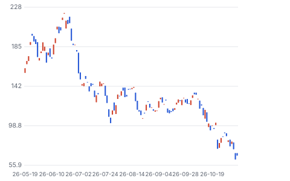

**주봉**

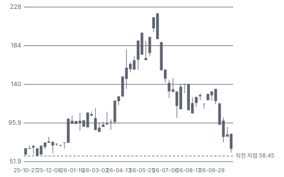

**월봉**

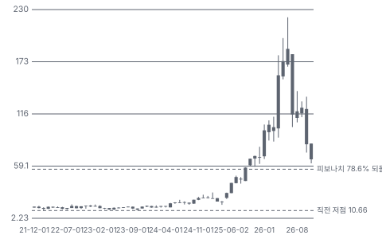

**분기 매출·EPS 실적과 컨센서스**

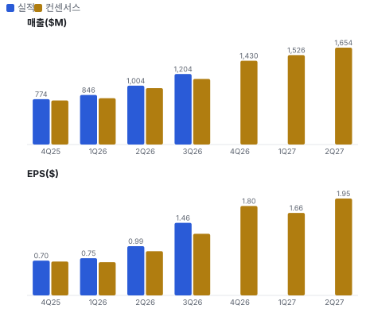

**최근 4개 분기 주가 변화 분석**

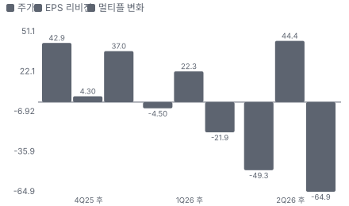

**EPS 리비전**

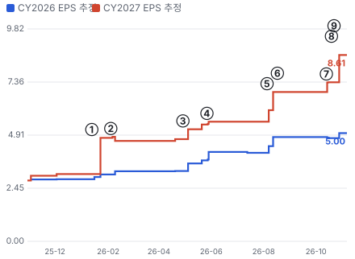

① 26-01-13 1/13 +19.7% 급등, 원인 미확인 · EPS 리비전 +54%
② 26-02-04 4Q25 실적 · EPS 리비전 -3%
③ 26-04-29 1Q26 실적 후 +15% · EPS 리비전 +10%
④ 26-05-27 Investor Day, 이익률 목표 상향 · EPS 리비전 +3%
⑤ 26-08-05 2Q26 실적, N+M 하반기 약 \$600M 시사 · EPS 리비전 +25%
⑥ 26-08-17 Epiq \$1.1B 차입 인수 발표 · 실적 창과 겹침
⑦ 26-10-13 N+M 캐파 \$400M 추가 8-K · EPS 리비전 +7%
⑧ 26-10-19 Ophir \$650M 인수 발표 · EPS 리비전 +0%
⑨ 26-10-22 3Q26 실적, N+M 지연으로 −27.7% · EPS 리비전 +17%

**밸류에이션 주가 시나리오**

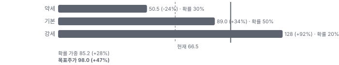

**주가별 업사이드**

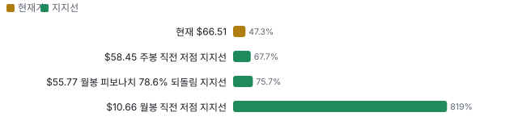

**제품·서비스 포트폴리오**

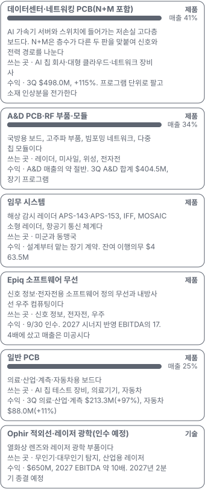

**고객 믹스(3Q26, 매출 대비)**

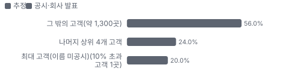

**공급 병목(10점, 낮을수록 병목)**

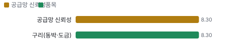

**CAPEX의 매출 대비 비중**

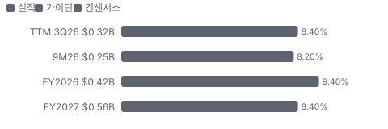

**어닝콜 변화별 주주가치 영향**

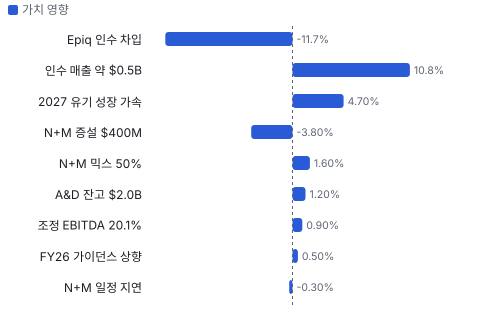

**멀티플 프리미엄(Fwd 1Y P/E, 최근 4개 분기말)**

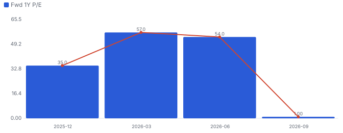

**합리적 멀티플**

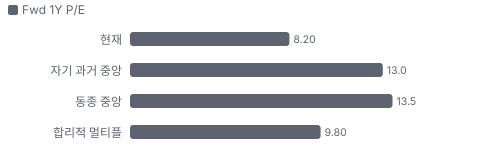

**수주·파이프라인 확실성 사다리**

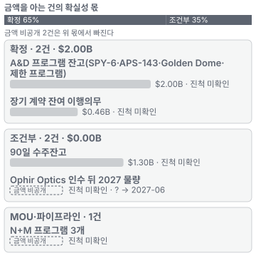

**매출 → 매출총이익 → 영업이익(매출 = 100, 최근 4분기)**

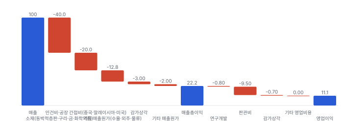

**1년 전 대비 마진 기여(비용 비중 변화의 반대)**

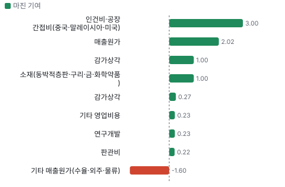

**분기 비용 비중 추이(매출 대비, 공시)**

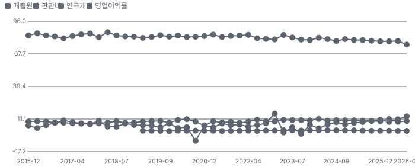

**비용 요인별 매출 대비 비중과 1년 변화**

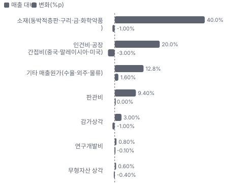

**BOM 항목 가격 +10% 시 OPM 변화**

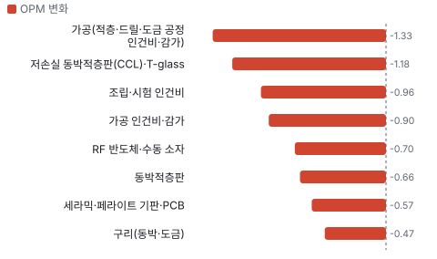

**데이터센터·네트워킹 PCB(N+M 포함) BOM 원가 몫과 가격 +10% 시 OPM**

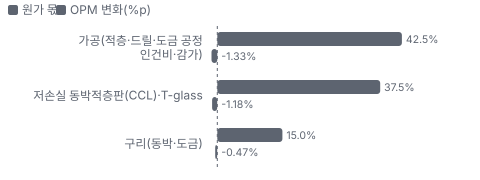

**A&D PCB·RF 부품·모듈 BOM 원가 몫과 가격 +10% 시 OPM**

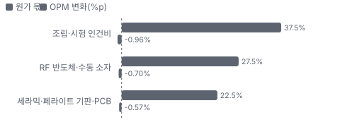

**일반 PCB BOM 원가 몫과 가격 +10% 시 OPM**

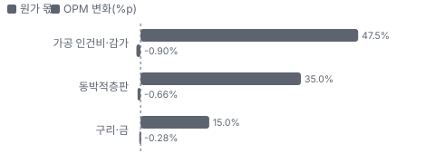

**시설별 면적(sq ft) — 생산능력 미공시라 면적을 대용으로**

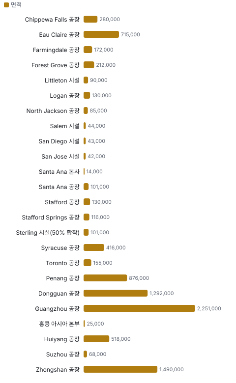

**Epiq Solutions 시너지 램프(종류별, 확률 가중)**

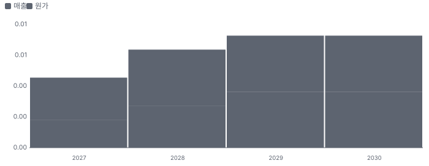

**시너지 가치 vs 웃돈**

**EPS 효과(인수 기업, 기존 대비)**

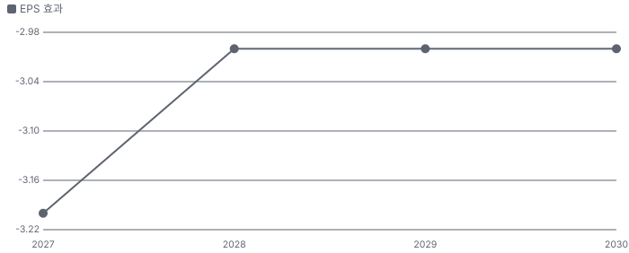

**매출·PPI·수출입 — 최근 16개 분기 같은 축(4Q22 = 100) + 다음 분기 추정**

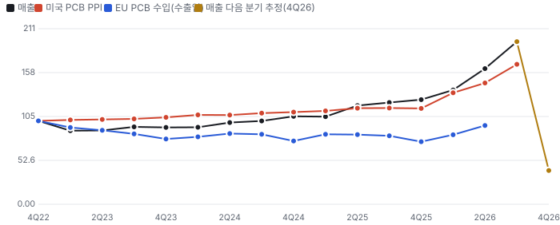

**매출과 EU PCB 수입 증가율(전년 대비, 최근 16개 분기 + 다음 분기 추정)**

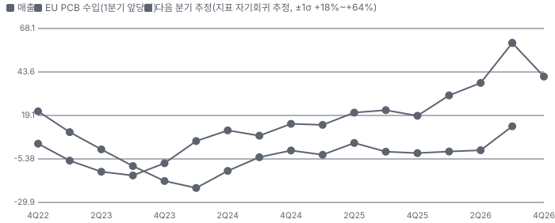

**4Q26 매출 — 지표 추세 vs 가이던스·컨센서스**

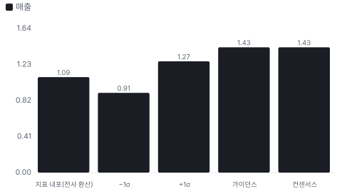

**10년 P·Q 사이클 — 추세(HP 필터) 대비 갭과 8분기 전망**

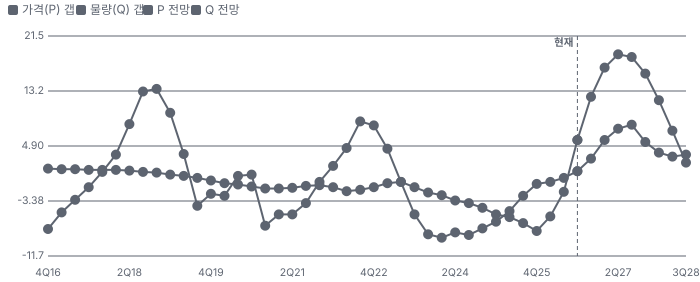

**매출 증가율의 가격·물량 분해와 8분기 전망(전년 대비)**

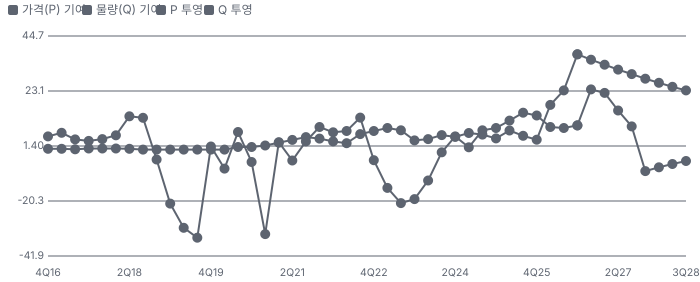

**분기별 매출 증가율 분해**

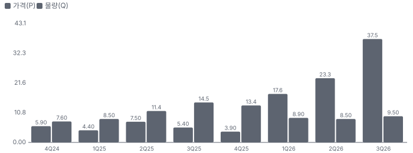

**목표주가 산정 — 기본과 강세 사이(강세 쪽 22%), 도달 확률 약 37%**

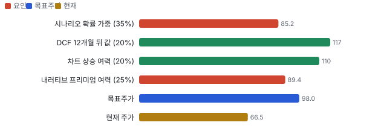

**PEG — 성장 대비 멀티플(낮을수록 성장 대비 쌈)**

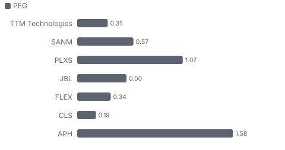

**일봉 지지·저항과 목표주가**

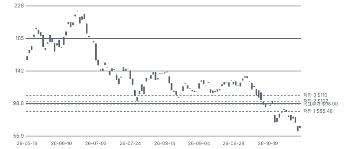

**커뮤니티 언급 수(최근 30일, 채널별)**

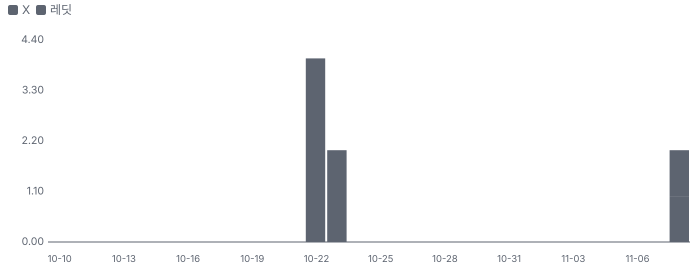

**커뮤니티 게시 수(월, 최근 7개월)**

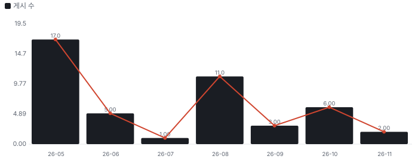

**일별 거래량 분해**

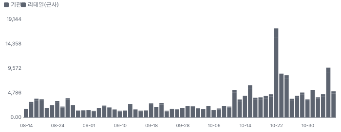

**기관 자금 흐름**

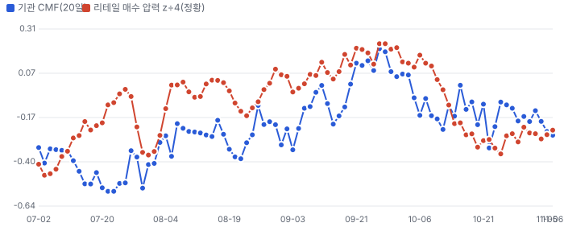

**몬테카를로**

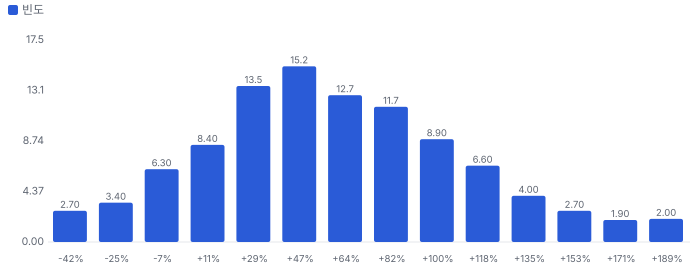

해석: 3,000번 중 2,655번(88%)에서 가치가 지금 주가 이상이었다. 가정을 흔들어도 지금 주가를 뒷받침하는 경우가 더 많다. 가운데 값은 1.56배이고, 열 번 중 여덟 번은 0.96~2.28배 사이에 든다.

## 내러티브

> **기업가치를 결정하는 이야기:** 매출의 성장축은 데이터센터·네트워킹(3Q \$498M, +115%)이고, 그중 N+M이 약 30%에서 2027년 50%로 간다. N+M 총이익률은 전사 평균보다 크게 높아 믹스가 곧 이익률이다. 바닥은 A&D다(3Q \$404.5M, 잔고 \$2.0B). 멀티플은 이 성장이 몇 년 가느냐와 차입 인수가 ROIC를 깎느냐로 정해진다. EPS는 EBITDA에서 분기 이자 약 \$34M을 뺀 값이라 부채가 곧바로 닿는다.

> **멀티플·EPS 프리미엄**
> **멀티플:** 지금은 프리미엄이 아니라 할인이다. Fwd 1Y P/E 10.4배는 6/30 37.4배에서 −72%이고 동종 중앙값 15.5배보다 33% 낮다. 6월의 프리미엄은 'AI 보드 희소성 + 국방'이 만들었고, 8/17 Epiq 차입 인수와 10/22 N+M 지연이 지웠다.
> **EPS:** EPS 추정은 강하다. FY2027 추정이 8/7 \$6.06에서 10/28 \$8.61로 +42%다. 같은 기간 주가는 −39%라 P/E가 22.5배에서 9.6배로 −57%다. 다만 이 추정은 Ophir를 빼고 있고 표본은 2~3명이다.

### 투자자들은 왜 열광했나

열광의 정점은 6월이었다. 첫째, 콘텐츠다. N+M은 기존 구조보다 보드 가치를 약 4배 올린다고 회사는 말한다. 둘째, 희소성이다. AI 서버·스위치 고다층 보드와 국방 인증을 함께 가진 미국 상장사가 드물다. 셋째, 이익률이다. 5월 Investor Day에서 EBITDA 목표가 16~18%로 올랐는데 3Q에 20.1%가 나왔다. 식은 이유도 같은 곳에 있다. 7월 하락은 AI 하드웨어 업종 약세와 겹쳤고 회사 고유 원인은 확인하지 못했다. 이어 8/17 Epiq 발표 뒤 이틀에 −17%, 10/22 N+M 지연으로 하루 −27.7%였다.

### 무엇이 기업가치를 바꾸나

> **구조적 체질 변화**
> **변화:** 보드 제조사에서 방산 전자 플랫폼으로 옮기는 중이다. CEO가 2025년 9월 Teledyne에서 왔고 13개월 동안 STG, Epiq, Ophir 등 약 \$2.1B를 썼다. 재무 구조도 바뀌었다. 순차입이 1개 분기 만에 약 3.6배가 됐다.
> **증거:** 10-Q Note 13. 2026 상반기 STG \$369.1M, 9/30 Epiq \$1.1B, 10/19 Ophir \$650M 계약.
> **반증:** 인수 자산의 이익률이 전사를 못 넘거나 2027 ROIC가 낮아지면 체질 변화가 아니라 차입 확대다.

> **고부가 믹스 확장**
> **변화:** N+M이 데이터센터의 약 30%에서 2027년 50%로 간다. CFO는 N+M 총이익률이 전사 평균보다 크게 높고 2027 EBITDA 이익률이 200bp 이상 오른다고 말했다.
> **증거:** 3Q 조정 EBITDA 20.1%(2Q 16.6%). CEO는 일부 물량이 3Q로 당겨졌다고 했다.
> **반증:** 1Q27 조정 EBITDA 이익률 18% 미만

> **기술 혁신**
> **변화:** AI 서버의 전력·신호 병목을 보드에서 푸는 제품이 N+M이다. 다음은 Eau Claire(위스콘신주 도시) 혁신센터의 MSAP(세미 애디티브 미세 회로 공정)·SAP(세미 애디티브 회로 공정), 내장 수동소자, 광학 내장이다.
> **증거:** CEO 설명과 3Q 콜. 연구개발비는 3Q \$9.5M으로 매출의 1% 미만이다.
> **반증:** 차세대 플랫폼에서 보드 층수·면적이 줄거나 다른 인터커넥트가 대체한다.

> **실행 속도**
> **변화:** 해당 없음(회사가 주문에서 납품까지의 기간을 공시하지 않아 동종과 비교할 수 없다). 콜에서 확인되는 값은 CCL(동박적층판, PCB 원판)·T-glass(저열팽창 유리섬유) 소재 리드타임 12~24주 이상이고 납품 기간이 아니다. 증설은 기존 부지 방식이라 \$400M이 약 15개월에 끝난다.
> **증거:** 3Q 콜 B. Riley 질문. 동종의 같은 기준 값은 찾지 못했다.
> **반증:** 소재 부족이 매출 지연 사유로 공시된다.

> **M&A**
> **변화:** 시장이 가장 싫어하는 지점이다. Epiq는 시너지 반영 2027 EBITDA의 17.4배로 비쌌고 2027 EPS를 희석한다. Ophir는 약 10배로 낫다. CFO는 큰 인수는 당분간 끝이라고 말했다.
> **증거:** 8-K와 보도, 3Q 콜. 영업권·무형자산 \$1.11B(9/28)는 Epiq 전 값이다.
> **반증:** CFO 발언 뒤 추가 대형 인수가 나오면 멀티플 할인이 굳는다.

> **정책·입법 연관성**
> **재정정책:** FY2027 Golden Dome 요청 약 \$17.5B 중 98%가 재정조정 법안에 달렸다. 군수품 재고 복구 약 \$90B도 요청돼 있다. 회사는 3Q에 Golden Dome 수주를 언급했으나 금액은 없다. 예산 요청, 하원 군사위 NDAA(미국 국방수권법) 수정안 보도. 본회의 통과는 찾지 못했다. 반증: 재정조정 법안이 무산되거나 임시예산이 새 사업을 막는다. 의회 동의 5/10 — 하원 4/5(하원 군사위 NDAA 수정안 확인, 본회의는 미확인) · 상원 1/5(상원 단계는 확인하지 못했다, 미확인).
> **행정명령:** 2025년 1월 행정명령이 Golden Dome을 시작했고 2025년 재정조정법이 약 \$25B를 줬다. 2025 재정조정법 세출 반영. 반증: 사업 축소나 자금 재배정. 의회 동의 10/10 — 하원 5/5(2025 재정조정법 세출 반영) · 상원 5/5(2025 재정조정법 세출 반영).
> **연관입법:** 10 U.S.C. § 4873이 2027-01-01부터 중국·러시아·이란·북한산 대상 PCB의 국방 조달을 막는다. 2026-07-02 사전 공고만 나왔고 최종 규칙은 찾지 못했다. 면제 조항이 있다. FY2021 NDAA 841조, FY2022 851조. 공고는 모든 하청 단계 전달을 예상한다. 반증: 규칙이 늦어지거나 면제가 넓어진다. TTMI 중국 공장이 국방 물량을 만들지 못하는 점은 원래 전제다.

> **CAPEX 낙수효과**
> **변화:** 돈은 하이퍼스케일러 → AI 칩·네트워크 회사 → EMS(전자제품 위탁 생산) → TTMI로 내려온다. 3Q 한 고객이 매출의 약 20%를 차지할 만큼 몰렸다. 고객 이름은 공시하지 않아 경로는 미확인이다.
> **증거:** 10-Q 고객 집중 주석. 전체 BtB(수주 ÷ 매출) 2.1, 상업 2.5, 90일 잔고 \$1.3B.
> **반증:** 하이퍼스케일러 CAPEX 가이던스 하향, 90일 잔고 감소.

### 내러티브 근거

> 'AI 고다층 PCB + 국방 잔고'는 숫자로 올라왔다(FY27 EPS 추정 +42%). 주가는 8/6 뒤 −39%다. 시장은 N+M 일정과 \$1.75B 차입 인수를 먼저 가격에 넣었다. 동종 대비 멀티플 차이 -39% 중 회사 고유 몫은 -16%다. 단계는 컨센서스, 쏠림은 중간이다.

> **AI 데이터센터 N+M 고다층 PCB 콘텐츠** · 지연
> **논리:** 비대칭 N+M 보드가 데이터센터·네트워킹 매출의 30% → 50%로, ASP가 원가보다 빨리 오른다
> **숫자:** 3Q 데이터센터·네트워킹 +115% YoY, 4Q 비중 약 49%, N+M 4Q 약 \$210M
> **반증:** 4Q 실적(2027-02)에서 데이터센터·네트워킹 매출이 4Q 가이던스(약 \$700M)를 10% 이상 밑돎

> **국방 수주잔고(A&D \$2.0B)** · 강화
> **논리:** Golden Dome·SPY-6 등 다년 프로그램이 경기와 무관한 바닥을 준다
> **숫자:** A&D 매출 34%, 잔고 \$2.0B(전년 \$1.5B), 2027 A&D 매출 약 65% 가시성
> **반증:** A&D BtB 1.0 미만 2분기 연속

> **이익률 레버리지** · 강화
> **논리:** 믹스(N+M·A&D)와 가격 조정으로 조정 EBITDA 20%대가 유지된다
> **숫자:** 조정 EBITDA 2Q 16.6% → 3Q 20.1%, FY27 조정 EBIT 이익률 추정 19.5%
> **반증:** 2027 1Q 조정 EBITDA 이익률 18% 미만

> **N+M 일정 지연·고객 집중(약세)** · 확산
> **논리:** 소수 대형 고객 프로그램이 밀리면 데이터센터 매출이 분기마다 흔들린다 — '일정'이 '수요'일 수 있다
> **숫자:** N+M 하반기 약 \$364~378M vs 2Q 콜 시사 약 \$600M(−37~−39%), 3Q 데이터센터 가이던스 약 −10%
> **반증:** 4Q에 N+M 비중이 데이터센터의 30%를 넘고 2027 1Q 가이던스가 컨센서스(\$1.51B) 이상

> **부채 기반 연쇄 인수(약세)** · 확산
> **논리:** PCB 회사가 차입으로 광학·처리 사업을 사서 이익의 질과 ROIC를 희석한다
> **숫자:** 순차입 \$0.57B → 약 \$2.07B(1개 분기, 추정), Ophir \$0.65B 추가 예정, 4Q 이자 \$33.9M(3Q \$12.1M)
> **반증:** Ophir 종결 시 순차입 ÷ LTM 조정 EBITDA 2배 미만 달성, 2027 FCF가 \$330M 이상

> **AI 하드웨어 배수 압축(약세)** · 확산
> **논리:** AI 투자 지속성 의심이 보드·부품 업종 배수를 누른다
> **숫자:** Fwd 1Y P/E 6/30 37.4배 → 10/30 10.4배, 같은 기간 FY27 EPS 추정 +56%
> **반증:** Fwd 1Y P/E가 동종 중앙값 15배대 회복

## 포트폴리오

| 제품·서비스 | 구분 | 무엇 | 쓰는 곳 | 돈 버는 방식 | Mix | Mix 변화(전 분기 대비) |
|---|---|---|---|---|---|---|
| 데이터센터·네트워킹 PCB(N+M 포함) | 제품 | AI 가속기 서버와 스위치에 들어가는 저손실 고다층 보드다. N+M은 층수가 다른 두 판을 맞붙여 신호와 전력 경로를 나눈다 | AI 칩 회사·대형 클라우드·네트워크 장비사 | 3Q \$498.0M, +115%. 프로그램 단위로 팔고 소재 인상분을 전가한다 | 41% | +1.0%p |
| A&D PCB·RF(무선 주파수) 부품·모듈 | 제품 | 국방용 보드, 고주파 부품, 빔포밍 네트워크, 다중 칩 모듈이다 | 레이더, 미사일, 위성, 전자전 | A&D 매출의 약 절반. 3Q A&D 합계 \$404.5M, 장기 프로그램 | 34% | -3.4%p |
| 임무 시스템 | 제품 | 해상 감시 레이더 APS-143·APS-153(다중 모드 해상 감시 레이더), IFF(피아식별 장치), MOSAIC(TTM 소형 레이더 브랜드) 소형 레이더, 항공기 통신 체계다 | 미군과 동맹국 | 설계부터 맡는 장기 계약. 잔여 이행의무 \$463.5M | 미확인 | 미확인 |
| Epiq 소프트웨어 무선 | 제품 | 신호 정보·전자전용 소프트웨어 정의 무선과 내방사선 우주 컴퓨팅이다 | 신호 정보, 전자전, 우주 | 9/30 인수. 2027 시너지 반영 EBITDA의 17.4배에 샀고 매출은 미공시다 | 미확인 | 미확인 |
| 일반 PCB | 제품 | 의료·산업·계측·자동차용 보드다 | AI 칩 테스트 장비, 의료기기, 자동차 | 3Q 의료·산업·계측 \$213.3M(+97%), 자동차 \$88.0M(+11%) | 25% | +2.4%p |
| Ophir 적외선·레이저 광학(인수 예정) | 기술 | 열화상 렌즈와 레이저 광학 부품이다 | 무인기·대무인기 탐지, 산업용 레이저 | \$650M, 2027 EBITDA 약 10배. 2027년 2분기 종결 예정 | 미확인 | 미확인 |

**Mix 변화가 가장 큰 쪽은 A&D PCB·RF 부품·모듈(-3.4%p, 전 분기 대비).** 계절성 판정: 분기 매출 계절 지수 기준 없음 → 직전 분기와 비교.

## 고객

> **3Q26 최대 고객 그 밖의 고객(약 1,300곳) 56%, 상위 3곳 100%, 집중도 집중.** 공시·회사 발표로 확인한 몫은 매출의 20%이고, 나머지 고객 몫은 추정이거나 미분해다. 3Q 한 고객이 매출의 약 20%이고, 9개월 기준 두 고객이 27%다(이름 미공시). 2025년에는 상위 5개 완제품 고객이 44%, 두 고객이 23%였다. 데이터센터 램프가 집중도를 높이고 있다.

**고객별 매출 몫(3Q26)**
| 고객 | 몫 | 변화 | 근거 |
|---|---|---|---|
| 그 밖의 고객(약 1,300곳) | 52~60% | +0%p | 추정 |
| 나머지 상위 4개 고객 | 20~28% | 미확인 | 추정 |
| 최대 고객(이름 미공시, 10% 초과 고객 1곳) | 20% | 미확인 | 공시 |

> **그 밖의 고객(약 1,300곳)** · 추정
> **사는 것:** PCB·RF 부품·시스템
> **추정 근거:** 1 − 상위 5곳. 2025년 상위 5곳 44%

> **나머지 상위 4개 고객** · 추정
> **사는 것:** PCB·A&D 부품
> **추정 근거:** 2025년 상위 5곳 44% − 최대 고객 몫, 3Q 집중 상승을 반영한 범위

> **최대 고객(이름 미공시, 10% 초과 고객 1곳)** · 공시
> **사는 것:** 데이터센터·네트워킹 PCB(추정)
> **추정 근거:** 10-Q 고객 집중 공시. 어느 회사인지는 공시되지 않아 특정하지 않는다

## 수주·파이프라인

> **2026-09-28 기준 5건.** 확정 \$2.00B. 공시 A&D 수주잔고 \$2.00B. 서로 겹치는 항목은 합계에서 뺐다.

**실행 속도와 방해 요인**
| 항목 | 상태 | 실행 속도 | 방해 요인 |
|---|---|---|---|
| A&D 프로그램 잔고(SPY-6·APS-143·Golden Dome·제한 프로그램) | 확정 | 3Q BtB 1.6, 2027 A&D 매출의 약 65% 가시성 | 미국 예산 지연 · 소재 리드타임 |
| 90일 수주잔고 | 조건부 | 전년 \$610M 대비 +111%. 회사는 취소될 수 있다고 적었다 | 고객 취소·일정 변경 |
| 장기 계약 잔여 이행의무 | 확정 | 55%를 12개월 안에 인식. 2025년 말 \$415.1M에서 증가. A&D 잔고와 겹친다 | 개발 계약 일정 |
| N+M 프로그램 3개 | 파이프라인 | 3Q 약 \$154M, 4Q 약 \$210~224M, 2027 데이터센터의 약 50%. 지연된 1개는 4Q 하반기 램프, 1Q27 양산 | 고객 프로그램 일정 · 복수 공급사 · CCL·T-glass 수급 |
| Ophir Optics 인수 뒤 2027 물량 | 조건부 | CEO: 2027 수주 85% 이상 확보. 2027년 2분기 종결 예정 | 규제 승인 · 분할 인수 통합 |

## 마진 구조

> **GPM 24.2%, OPM 13.5%.** 3Q25 대비 GPM +3.4%p, OPM +3.9%p. 3Q26 매출원가는 매출의 75.8%로 1년 전 79.2%보다 3.4%p 낮다. 데이터센터 믹스와 가격이 원가를 앞섰고(회사), 판관비 비중은 9.4%로 그대로다. 비용 대부분이 소재·인건비라 소재값이 오르면 전가 속도가 마진을 정한다.

> **매출 100 중 매출원가 77.8, 매출총이익 22.2(최근 4분기, 공시).** 매출원가 요인 중 소재(동박적층판·구리·금·화학약품)이 매출의 40.0%로 가장 무겁고, 단가가 +10% 오르면 GPM이 -4.00%p 움직인다. 분기 회귀로 매출 1이 늘 때 매출원가는 0.72 늘고, 매출원가의 고정비 몫은 11%다.

**비용 요인 강도 — 비중·추세·충격(+10%)·탄력**
| 비용 | 구분 | 매출 대비 | 1년 변화 | 마진 기여 | 충격 시 마진 | 매출 탄력 | 고정비 몫 |
|---|---|---|---|---|---|---|---|
| 소재(동박적층판·구리·금·화학약품) | 매출원가 요인 | 40.0% | -1.0%p | +1.0%p | -4.00%p | 미확인 | 5% |
| 인건비·공장 간접비(중국·말레이시아·미국) | 매출원가 요인 | 20.0% | -3.0%p | +3.0%p | -2.00%p | 미확인 | 60% |
| 기타 매출원가(수율·외주·물류) | 매출원가 요인 | 12.8% | +1.6%p | -1.6%p | -1.28%p | 미확인 | 미확인 |
| 감가상각 | 매출원가 요인 | 3.0% | -1.0%p | +1.0%p | -0.30%p | 미확인 | 100% |
| 매출원가 | 공시 항목 | 77.8% | -2.0%p | +2.0%p | -7.78%p | 0.72 | 11% |
| 판관비 | 공시 항목 | 9.5% | -0.2%p | +0.2%p | 미확인 | 0.09 | 0% |
| 연구개발 | 공시 항목 | 0.8% | -0.2%p | +0.2%p | 미확인 | 0.01 | 36% |
| 감가상각 | 공시 항목 | 0.7% | -0.3%p | +0.3%p | 미확인 | -0.00 | 100% |
| 기타 영업비용 | 공시 항목 | 0.0% | -0.2%p | +0.2%p | 미확인 | -0.03 | 100% |

매출 탄력 = 분기 비용을 매출에 회귀한 기울기(매출 1당 변동비), 고정비 몫 = 절편 ÷ 평균 비용. 표본이 8분기 미만이면 미확인. 매출원가 요인 비중은 margin 재료의 추정이 섞여 있고, 공시 매출원가와의 차이는 '기타 매출원가'로 둔다.

**GPM에서 OPM까지(GAAP)**
| 기간 | GPM | 연구개발 | 판관비 | 기타 | OPM |
|---|---|---|---|---|---|
| 3Q25 | 20.8% | 0.9% | 9.4% | 1.0% | 9.6% |
| 3Q26 | 24.2% | 0.8% | 9.4% | 0.6% | 13.5% |

**GPM·OPM 최근 4개 분기**
| 분기 | GPM | OPM |
|---|---|---|
| 2025-12 | 21.4% | 10.4% |
| 2026-03 | 21.4% | 8.6% |
| 2026-06 | 21.1% | 10.9% |
| 2026-09 | 24.2% | 13.5% |

**마진을 결정하는 비용 요인 — 비용 +10% 시 OPM**
| 비용 | 매출 대비 | 변화 | 고정비 | OPM |
|---|---|---|---|---|
| 소재(동박적층판·구리·금·화학약품) | 40.0% | -1.0%p | 5% | -4.00%p |
| 인건비·공장 간접비(중국·말레이시아·미국) | 20.0% | -3.0%p | 60% | -2.00%p |
| 기타 매출원가(수율·외주·물류) | 12.8% | +1.6%p | 미확인 | -1.28%p |
| 판관비 | 9.4% | +0.0%p | 70% | -0.94%p |
| 감가상각 | 3.0% | -1.0%p | 100% | -0.30%p |
| 연구개발비 | 0.8% | -0.1%p | 90% | -0.08%p |
| 무형자산 상각 | 0.6% | -0.4%p | 100% | -0.06%p |

**비용을 움직이는 요인**
| 비용 | 요인 |
|---|---|
| 소재(동박적층판·구리·금·화학약품, 매출원가) | 구리·금 가격, CCL 단가 · 근거 추정 |
| 인건비·공장 간접비(중국·말레이시아·미국, 매출원가) | 가동률·Penang(말레이시아 페낭) 램프 · 근거 추정 |
| 기타 매출원가(수율·외주·물류, 매출원가) | 수율 · 근거 추정 |
| 판관비(판관비) | 인건비·주식보상·인수 비용 · 근거 공시 |
| 감가상각(매출원가) | 증설 설비 · 근거 공시 |
| 연구개발비(연구개발) | 공정 개발 · 근거 공시 |
| 무형자산 상각(기타) | 인수 · 근거 공시 |

**데이터센터·네트워킹 PCB(N+M 포함) BOM — 매출의 41%, GPM 24%(회사 전체 3Q GAAP 총이익률 — 제품별 미공시(회사는 데이터센터 가격이 원가보다 빨리 올랐다고 말했다)), 항목 가격 +10% 시**
| 항목 | 원가 몫 | 전가 | 제품 GPM | OPM |
|---|---|---|---|---|
| 가공(적층·드릴·도금 공정 인건비·감가) | 35~50% | 미확인 | -3.2%p | -1.33%p |
| 저손실 동박적층판(CCL)·T-glass | 30~45% | 미확인 | -2.8%p | -1.18%p |
| 구리(동박·도금) | 10~20% | 미확인 | -1.1%p | -0.47%p |
| 미분해 | 5% | - | - | - |

**A&D PCB·RF 부품·모듈 BOM — 매출의 34%, GPM 24%(회사 전체 값(부문별 총이익률 미공시)), 항목 가격 +10% 시**
| 항목 | 원가 몫 | 전가 | 제품 GPM | OPM |
|---|---|---|---|---|
| 조립·시험 인건비 | 30~45% | 미확인 | -2.8%p | -0.96%p |
| RF 반도체·수동 소자 | 20~35% | 미확인 | -2.1%p | -0.70%p |
| 세라믹·페라이트 기판·PCB | 15~30% | 미확인 | -1.7%p | -0.57%p |
| 미분해 | 12% | - | - | - |

**일반 PCB BOM — 매출의 25%, GPM 24%(회사 전체 값), 항목 가격 +10% 시**
| 항목 | 원가 몫 | 전가 | 제품 GPM | OPM |
|---|---|---|---|---|
| 가공 인건비·감가 | 40~55% | 미확인 | -3.6%p | -0.90%p |
| 동박적층판 | 30~40% | 미확인 | -2.7%p | -0.66%p |
| 구리·금 | 10~20% | 미확인 | -1.1%p | -0.28%p |
| 미분해 | 2% | - | - | - |

가공(적층·드릴·도금 공정 인건비·감가) 가격이 +10% 오르면 영업이익은 -9.9% 움직인다. 판매가 전가를 모르는 항목은 전가 0%로 계산했다.

**BOM 항목 가격을 움직이는 것**
| 항목 | 요인 |
|---|---|
| 저손실 동박적층판(CCL)·T-glass | CCL·T-glass 수급을 회사가 제약으로 언급 · 근거 추정 |
| 구리(동박·도금) | 구리 가격 상승은 총이익률 위험(10-K) · 근거 추정 |
| 가공(적층·드릴·도금 공정 인건비·감가) | N+M은 순차 적층 횟수가 많다 · 근거 추정 |
| RF 반도체·수동 소자 | 장기 계약이라 가격 조정이 늦다 · 근거 추정 |
| 세라믹·페라이트 기판·PCB | 자체 PCB를 쓴다 · 근거 추정 |
| 조립·시험 인건비 | 미국 내 생산 · 근거 추정 |
| 동박적층판 | 범용 소재 · 근거 추정 |
| 구리·금 | 금속 가격 · 근거 추정 |
| 가공 인건비·감가 | 중국 공장 · 근거 추정 |

**BOM 투입 물가 — PPI 전년비, 2026-11-08 수집**
| 항목 | 미국 | 일본 | 한국 | 대만 |
|---|---|---|---|---|
| 동박적층판 | +45.8% | +11.3% | -0.8% | +12.1% |
| 구리·금 | +30.0% | +54.2% | -4.9% | +40.1% |

별표는 품목보다 넓은 업종 지수다. 지난 1년 투입 물가를 판매가 전가 뒤 원가에 그대로 넣으면 OPM은 -6.48%p 움직인다(매출원가의 42% 기준).

## 공급망 병목

이미지 없음(아직 생성 전) — A&D PCB·RF 부품·모듈

이미지 없음(검수 실패) — 데이터센터·네트워킹 PCB(N+M 포함)

> **공급망 신뢰성 8.3/10, 병목 낮음.** 가장 약한 고리는 구리(동박·도금) 8.3점이고, 품목 평균은 8.3점이다. 근거가 부족한 2건(저손실 동박적층판(CCL)·T-glass · RF 반도체·커넥터·전원(A&D 조립))은 점수에서 뺐다. 핵심 투입물은 저손실 동박적층판과 그 안의 T-glass, 구리·금이다. 10-K는 원재료 대부분을 여러 공급사에서 산다고 적었지만, 3Q 콜에서 회사는 CCL·T-glass 수급을 데이터센터 램프의 제약으로 꼽았다. 공급사 이름은 공시되지 않는다.

**병목과 마진 — 품목 가격 +10% 시 OPM**
| 품목 | 점수 | 판정 | 구분 | OPM |
|---|---|---|---|---|
| 구리(동박·도금, 필수) | 8.3 | 병목 낮음 | 일반 | -0.47%p |

> **구리(동박·도금)** · 8.3/10
> **왜:** 배선·도금
> **병목 요인:** 인증 공급사 3곳 · 캐파 여유 · 리드타임 미확인 · 재인증 3개월 · 1위 점유율 미확인 · 지역 집중 미확인 · 물량 확보 현물
> **풀리는 조건:** 해당 없음

**공급사**
| 품목 | 공급사 | 몫 | 근거 |
|---|---|---|---|
| 저손실 동박적층판(CCL)·T-glass | 공급사 미공시(고속 적층판·유리섬유) | 미확인 | 공시 |
| 구리(동박·도금) | 다수 공급사(미공시, 구리) | 미확인 | 공시 |
| RF 반도체·커넥터·전원(A&D 조립) | 단일·제한 공급원(미공시, 조립 부품) | 미확인 | 공시 |

**무역 통계로 본 공급 지역**
| 품목 | EU 수입처 | 일본 수입처 | EU 1위 전년비 |
|---|---|---|---|
| 저손실 동박적층판(CCL)·T-glass | CN(중국) 85% · TW(대만) 4% · KR(한국) 4% | 中華人民共和国 62% · 台湾 11% | +25.2% |
| 구리(동박·도금) | MY(말레이시아) 69% · KR 10% · US 7% | マレーシア 58% · タイ 36% | 미확인 |

## 생산능력

> **현재 명목 캐파 미확인, 가동률 미확인.** 착공 이상 증설은 0 미공시(회사는 캐파를 면적·투자액으로만 밝힌다), 발표까지 합치면 0 미공시(회사는 캐파를 면적·투자액으로만 밝힌다)이다. 9M26 CAPEX는 \$0.25B로 매출의 8.2%다. 시설은 24곳(미국 16·해외 8), 면적 합계 약 936만 sq ft다. 회사는 명목 캐파와 가동률을 숫자로 밝히지 않는다. 증설은 2025~29년 약 \$1.2B에 10월 발표한 N+M용 \$400M(중국·말레이시아, 4Q26~2028 초)이 더해진다.

**생산시설 24곳**(FY2025 10-K Item 2 Properties — 24곳(미국 16·해외 8), 합계 약 9,366,000 sq ft(2025-12-29 기준). 표는 문서 요약 판독이라 원문 대조 전), 소유 11곳 · 소유·임차 6곳 · 임차 7곳. 시설별 생산능력은 공개되지 않았다 — 회사 전체 캐파만 위에 적었다.

**생산시설 24곳 — 명칭·위치·생산능력**
| 시설 | 위치 | 용도 | 생산능력 | 소유·상태 |
|---|---|---|---|---|
| Chippewa Falls(위스콘신주 도시) 공장 | 미국 위스콘신 Chippewa Falls | A&D PCB | 미확인 — 시설별 캐파 미공시(10-K는 면적·용도만) · 면적 280,000 sq ft | 소유 · 가동 |
| Eau Claire 공장 | 미국 위스콘신 Eau Claire | 상업용 PCB | 미확인 — 시설별 캐파 미공시(10-K는 면적·용도만) · 면적 715,000 sq ft | 소유 · 가동 |
| Farmingdale 공장 | 미국 뉴욕 Farmingdale | A&D | 미확인 — 시설별 캐파 미공시(10-K는 면적·용도만) · 면적 172,000 sq ft | 소유 · 가동 |
| Forest Grove 공장 | 미국 오리건 Forest Grove | A&D PCB | 미확인 — 시설별 캐파 미공시(10-K는 면적·용도만) · 면적 212,000 sq ft | 소유 · 가동 |
| Littleton 시설 | 미국 콜로라도 Littleton | A&D | 미확인 — 시설별 캐파 미공시(10-K는 면적·용도만) · 면적 90,000 sq ft | 소유·임차 · 가동 |
| Logan 공장 | 미국 유타 Logan | 상업용 PCB | 미확인 — 시설별 캐파 미공시(10-K는 면적·용도만) · 면적 130,000 sq ft | 소유·임차 · 가동 |
| North Jackson 공장 | 미국 오하이오 North Jackson | A&D | 미확인 — 시설별 캐파 미공시(10-K는 면적·용도만) · 면적 85,000 sq ft | 소유 · 가동 |
| Salem 시설 | 미국 뉴햄프셔 Salem | A&D | 미확인 — 시설별 캐파 미공시(10-K는 면적·용도만) · 면적 44,000 sq ft | 임차 · 가동 |
| San Diego 시설 | 미국 캘리포니아 San Diego | A&D | 미확인 — 시설별 캐파 미공시(10-K는 면적·용도만) · 면적 43,000 sq ft | 임차 · 가동 |
| San Jose 시설 | 미국 캘리포니아 San Jose | 상업용 PCB | 미확인 — 시설별 캐파 미공시(10-K는 면적·용도만) · 면적 42,000 sq ft | 임차 · 가동 |
| Santa Ana 본사 | 미국 캘리포니아 Santa Ana | 본사 | 미확인 — 생산 없음 · 면적 14,000 sq ft | 임차 · 가동 |
| Santa Ana 공장 | 미국 캘리포니아 Santa Ana | A&D PCB | 미확인 — 시설별 캐파 미공시(10-K는 면적·용도만) · 면적 101,000 sq ft | 소유·임차 · 가동 |
| Stafford 공장 | 미국 코네티컷 Stafford | A&D PCB | 미확인 — 시설별 캐파 미공시(10-K는 면적·용도만) · 면적 130,000 sq ft | 소유 · 가동 |
| Stafford Springs 공장 | 미국 코네티컷 Stafford Springs | A&D PCB | 미확인 — 시설별 캐파 미공시(10-K는 면적·용도만) · 면적 116,000 sq ft | 소유 · 가동 |
| Sterling 시설(50% 합작) | 미국 버지니아 Sterling | A&D(지분법 합작) | 미확인 — 시설별 캐파 미공시(10-K는 면적·용도만) · 면적 101,000 sq ft | 임차 · 가동 |
| Syracuse(뉴욕주 도시) 공장 | 미국 뉴욕 Syracuse | A&D·RF 부품, Ultra-HDI(초고밀도 배선 기판) PCB | 미확인 — 시설별 캐파 미공시(10-K는 면적·용도만) · 면적 416,000 sq ft | 소유·임차 · 가동 |
| Toronto 공장 | 캐나다 Toronto | 상업용 PCB | 미확인 — 시설별 캐파 미공시(10-K는 면적·용도만) · 면적 155,000 sq ft | 소유·임차 · 가동 |
| Penang 공장 | 말레이시아 Penang | 상업용 PCB | 미확인 — 시설별 캐파 미공시(10-K는 면적·용도만) · 면적 876,000 sq ft | 임차 · 가동 |
| Dongguan 공장 | 중국 광둥 Dongguan | 상업용 PCB | 미확인 — 시설별 캐파 미공시(10-K는 면적·용도만) · 면적 1,292,000 sq ft | 소유 · 가동 |
| Guangzhou 공장 | 중국 광둥 Guangzhou | 상업용 PCB | 미확인 — 시설별 캐파 미공시(10-K는 면적·용도만) · 면적 2,251,000 sq ft | 소유 · 가동 |
| 홍콩 아시아 본부 | 홍콩 | 본사 | 미확인 — 시설별 캐파 미공시(10-K는 면적·용도만) · 면적 25,000 sq ft | 소유 · 가동 |
| Huiyang 공장 | 중국 광둥 Huiyang | 상업용 PCB | 미확인 — 시설별 캐파 미공시(10-K는 면적·용도만) · 면적 518,000 sq ft | 소유 · 가동 |
| Suzhou 공장 | 중국 장쑤 Suzhou | RF 부품 | 미확인 — 시설별 캐파 미공시(10-K는 면적·용도만) · 면적 68,000 sq ft | 임차 · 가동 |
| Zhongshan 공장 | 중국 광둥 Zhongshan | 상업용 PCB | 미확인 — 시설별 캐파 미공시(10-K는 면적·용도만) · 면적 1,490,000 sq ft | 소유·임차 · 가동 |

**생산능력 확충 계획**
| 계획 | 단계 | 증설 | 가동 시점 | CAPEX |
|---|---|---|---|---|
| N+M용 아시아 AI 캐파(중국·말레이시아) | 발표 | 미확인 | 2028 | \$0.40B |
| 2025~29년 증설 계획 | 발표 | 미확인 | 2029 | \$1.20B |
| Penang 인접 부지(10에이커 토지 권리) | 발표 | 미확인 | 미확인 | 미확인 |

남은 계획의 CAPEX 합계는 \$1.60B(금액 미확인 1건 제외)다. 합계는 FY2027 매출의 24%다.

**증설 방해 요인**
| 계획 | 방해 요인 |
|---|---|
| N+M용 아시아 AI 캐파(중국·말레이시아) | 장비 반입·고객 인증, 고객 약정 금액 미공개 |
| 2025~29년 증설 계획 | 데이터센터 수요 지속 |
| Penang 인접 부지(10에이커 토지 권리) | 착공 미확인 |

**CAPEX와 매출 대비**
| 기간 | CAPEX | 매출 | 매출 대비 | 구분 |
|---|---|---|---|---|
| TTM 3Q26 | \$0.32B | \$3.83B | 8.4% | 실적 |
| 9M26 | \$0.25B | \$3.05B | 8.2% | 실적 |
| FY2026 | \$0.42B | \$4.48B | 9.4% | 가이던스 |
| FY2027 | \$0.56B | \$6.63B | 8.4% | 컨센서스 |

## M&A 시너지

> **Epiq Solutions 인수(2026-09-30, \$1.10B): 시너지가 다 나면 연 \$0.01B(확률 가중 이익 기여), 인수 배수 EV/EBITDA 20.0배 → 시너지 반영 17.5배.** 세후 시너지 가치는 통합 비용을 빼고 \$0.04B. EPS 효과는 2027년 -3.2%에서 2030년 -3.0%.

**Epiq Solutions 시너지가 생기는 길**
| 종류 | 시너지 | 연 규모 | 완성 | 확률 | 어떻게 생기나 | 근거 |
|---|---|---|---|---|---|---|
| 매출 | 보드·RF 모듈과 무선 시스템 교차 판매 | \$0.05B(이익률 20%) | 2029 | 40% | TTM의 RF 모듈·레이더 고객에 Epiq 무선을 묶어 탐지 시스템으로 판다 | 추정 — 회사는 시너지 금액을 밝히지 않았다 |
| 원가 | 부품 조달 통합 | \$0.01B | 2028 | 50% | RF 부품을 TTM 내부 조달로 돌린다 | 추정 — 회사가 밝힌 '시너지 반영 2027 EBITDA 17.4배'와 무시너지 EBITDA의 차이를 어림 |

시너지 가치 = 세후 이익 기여 5년 + 말기 가치(할인율 9%, 성장 0) − 통합 비용. 매출 시너지는 그 매출의 이익률만 반영하고, 모든 시너지에 실현 확률을 곱했다.

## 해자

> 가장 단단한 곳은 국방 쪽 자격이고, 데이터센터 N+M은 공정 노하우라 특허로 막히지 않는다. 시장이 값을 매기는 해자는 N+M인데 더 강한 해자는 A&D다.

> **미국 국방 보안 자격** · 강함
> **해자:** 기밀·제한 프로그램을 하려면 보안 체계와 수출 통제 준수가 먼저다. 회사는 제한 프로그램이 경쟁사가 밀어내기 매우 어렵다고 말한다.
> **근거:** 이사회에 정부 보안위원회를 두고 국방방첩보안국(DCSA(미국 국방방첩보안국))과 맺은 SBR(외국 지분 관리 이사회 결의)을 정관으로 유지한다. CMMC(미 국방 공급망 사이버 보안 인증) 레벨 2 인증을 받았다(2026 위임장). 잔고 \$2.0B는 전년 약 \$1.5B에서 늘었다.
> **숫자:** 3Q A&D 매출 \$404.5M(+21%), BtB 1.6
> **깨지는 조건:** A&D BtB 1.0 미만이 2분기 이어지거나, 미국 군수품 목록 완화로 해외 생산 제한이 풀린다

> **N+M 고다층 공정 노하우** · 보통
> **해자:** AI 서버·스위치의 비대칭 고다층 보드를 수율 있게 만드는 능력이다. CEO는 기존 구조 대비 가치가 약 4배라고 말했다.
> **근거:** 3개 주요 프로그램 중 2개가 순항이고 5~10개로 늘린다고 했다. 그러나 10-K는 제조 공정 기술이 대체로 지식재산 보호를 받지 못한다고 적었고, CEO도 고객이 항상 복수 공급사를 쓴다고 말했다.
> **숫자:** 3Q N+M 약 \$154M, 데이터센터의 약 31%
> **깨지는 조건:** 대만·중국 PCB사가 같은 프로그램 인증을 받아 N+M 비중이 2027년 50%에 못 미친다

> **기존 부지 증설 속도** · 보통
> **해자:** 기존 공장 옆 건물에 장비를 넣는 방식이라 수요를 따라가는 시간이 짧고 위험이 작다.
> **근거:** \$400M 증설이 4Q26에 시작해 2028년 초에 끝난다. 2026 CAPEX \$410~430M. 다만 고객 약정이 있느냐는 질문에 금액 답변은 없었다.
> **숫자:** 2025~29 증설 합계 약 \$1.6B
> **깨지는 조건:** 증설 뒤 가동률 하락이나 고객 약정 부재가 드러난다

> **미국 내 Ultra-HDI 공장** · 보통
> **해자:** 미국 안의 초고밀도 PCB 양산 능력은 국방 공급망 국산화 수요와 맞닿아 있다.
> **근거:** Syracuse 공장은 건물 완공, 장비 설치 중으로 2026년 하반기 양산 예정이었다(10-K). 2025년 DIBC(미 국방 산업기반 컨소시엄) 지원금 현금 \$20.4M을 받았다. 2027-01-01부터 중국산 등 PCB의 국방 조달 금지가 시행된다.
> **숫자:** 미확인
> **깨지는 조건:** 최종 규칙에서 면제가 넓어지거나 양산이 2027년으로 밀린다

> **보드에서 시스템으로의 상향** · 약함
> **해자:** RF 모듈, 레이더, Epiq 무선, Ophir 광학을 묶어 탐지 시스템을 파는 전략이다.
> **근거:** A&D의 약 절반이 이미 상위 제품이다. 그러나 Epiq·Ophir 결합 제품은 아직 매출로 확인되지 않았고 시너지 숫자도 회사 추정이다.
> **숫자:** 두 인수 합계 \$1.75B
> **깨지는 조건:** 2027년까지 결합 제품 수주가 공시되지 않는다

## 경영진·네트워크

> 창업자 경영 회사가 아니다. 회장과 CEO가 모두 Teledyne 출신이고 전략도 Teledyne식 방산 전자 인수에 가깝다. 연결이 매출을 만들었다는 증거는 없다.

> **Edwin Roks** · 사장·CEO·이사 · 2025-09
> **프로필:** Teledyne CEO(2024-01~2025-04), 그 전 Teledyne 디지털 이미징 부문 대표. 네덜란드 Twente 대학 전자·반도체 물리 박사. 취임 뒤 Epiq·Ophir 등 인수 \$1.75B를 주도했고 8/25 1만 주, 10/28 5천 주를 장내 매수했다
> **비즈니스:** Teledyne에서 이미징·방산 전자 사업을 이끌었다
> **정계:** 미확인
> **동문:** Twente 대학, Eindhoven 공대
> **사모임:** 미확인

> **Rex D. Geveden** · 이사회 의장(사외) · 2018-05(의장 2021)
> **프로필:** BWX Technologies 사장·CEO. 그 전 Teledyne 부사장, NASA(미국 항공우주국) 고위 행정직(Associate Administrator)으로 17년 근무. 8/24 5천 주 장내 매수
> **비즈니스:** BWXT(원자력·해군 추진)와 Teledyne 경력
> **정계:** NASA 고위직 공직 이력. 선거자금·로비 기록은 확인하지 않았다(미확인)
> **동문:** Murray State 대학
> **사모임:** 미확인

> **Wajid Ali** · 사외이사 · 2024-05
> **프로필:** Lumentum CFO. 그 전 Synaptics CFO, Teledyne 재무. 10/28 1만 주 장내 매수
> **비즈니스:** Lumentum 광부품 사업과 AI 광통신 공급망
> **정계:** 미확인
> **동문:** 미확인
> **사모임:** 미확인

**네트워크 정량화**
| 연결 | 강도 | 닿는 매출 | 가중 노출 | 매출 대비 | 근거 |
|---|---|---|---|---|---|
| 정계: DCSA와 맺은 SBR과 이사회 정부 보안위원회. 정치 인맥이 아니라 문서로 확인되는 제도 연결이다 | 5/5 | \$1.62B | \$1.62B | 42% | 3Q A&D 매출 \$404.5M 연환산 2026 위임장 |
| 비즈니스: 회장·CEO·이사 3명의 Teledyne 경력. 거래 금액은 공시에서 확인하지 못했다 | 3/5 | 미확인 | 미확인 | 미확인 | 특수관계 거래 금액 미확인 2026 위임장 |
| 비즈니스: 이사 Ali의 Lumentum 재직. TTM의 Lumentum 거래는 확인하지 못했다 | 2/5 | 미확인 | 미확인 | 미확인 | 거래 미공시 2026 위임장 |

가중 노출은 연결이 닿는 매출의 크기다. 연결이 그 매출을 만들었다는 뜻이 아니며, 인과는 공개 자료로 입증하지 못한다.

## 약세 논리 및 셀온 조건

| 약세 논리 | 근거 | 반박 | 가를 자료 · 공개 시점 |
|---|---|---|---|
| 차입 인수로 주주 몫이 줄었다 | Epiq \$1.1B 전액 차입(Term Loan A \$300M·B \$800M), 4Q 이자 \$33.9M(3Q \$12.1M), Ophir \$650M 현금 인수 예정 | CFO: 큰 인수는 당분간 끝, 레버리지 축소. 10/26~27 자사주 \$100M과 신규 \$100M 승인 | 4Q 실적의 순차입·FCF — 2027-02(예상) |
| N+M은 해자가 아니다 | 10-K: 제조 공정 기술은 대체로 지식재산 보호를 받지 못한다. CEO: 고객은 늘 복수 공급사를 쓴다. 3개 중 1개 프로그램 지연 | 2개는 순항, 5~10개로 확대 목표, 기존 구조 대비 가치 약 4배(CEO) | 4Q 콜의 N+M 프로그램 수·데이터센터 비중 — 2027-02 |
| 고객 집중 | 3Q 한 고객 약 20%, 9개월 두 고객 27%(10-Q). 2025년 상위 5곳 44% | A&D 잔고 \$2.0B는 고객이 다르다(국방 원청) | FY2026 10-K 고객 주석 — 2027-02 |
| PCB 사이클 정점 | 커뮤니티의 '낮은 P/E는 이익 정점의 함정' 주장, 업계 전문가의 2028 수급 균형 전언 | 회사 2027 가이던스는 성장, 미국 PCB PPI 전년비 +45.8%(9월) | 2027 가이던스 유지 여부 — 2027-02 |
| 생산이 아시아에 있다 | 시설 면적의 약 71%가 해외(중국 4곳·말레이시아 등, 10-K Item 2), 미국 수입 관세 노출 | 국방 PCB는 미국 안(Syracuse·Chippewa Falls 등), 2027-01-01부터 중국산 PCB 국방 조달 금지 | 관세 판결·국방 조달 최종 규칙 — 2027-01 |

**추가 원천(11/8).** 중간선거 영향은 −0.1/10으로 거의 없다 — 관세 입법 고착화 위험이 줄어 수입 의존 생산엔 소폭 유리하지만 업종 ETF(SMH)의 선거 뒤 반응이 CAR(사건 뒤 시장 대비 초과 누적 수익률) −2.7%(t −0.84)로 유의하지 않다. 정책 0단계(선거 결과) 가설이다. 커뮤니티 대화는 7일 Moderate(56)·24시간 Weak(44)로 식었고, '미국 유일 AI·방산 PCB가 싸졌다'와 '사이클 정점'으로 갈린다 — 싸다는 것은 배수로 확인되지만, 할인이 풀린다는 것은 주장이다. 제품 분해도는 자동 눈 검수(글자·부품 수)를 3회 통과하지 못해 싣지 않았다.

> **셀온 조건**
> **조건 1:** 4Q 실적에서 지연된 N+M 프로그램이 1Q27 양산에 들어가지 못한다
> **조건 2:** 2027 매출 가이던스 \$6.5~6.75B를 낮춘다
> **조건 3:** 최대 고객 몫이 25%를 넘는데 N+M 프로그램 수가 늘지 않는다
> **조건 4:** 4Q 또는 2027년 상반기 FCF가 이자 증가로 마이너스로 돌고 순레버리지가 내려가지 않는다

## 어닝콜 변화

**직전 콜 대비 새로 나오거나 바뀐 내용 → 가치 영향**
| 항목 | 내용 | 직전 콜 | 최신 콜 | 모델 동인 이동 | 확신도 | 가치 영향 |
|---|---|---|---|---|---|---|
| 업데이트 | FY2026 매출 가이던스 | 약 \$4.4B(2Q 콜) | \$4.47~4.49B, 4Q \$1.42~1.44B | 기준연도 매출 +\$0.02B | 0.8 | +0.5% |
| 업데이트 | 2027 유기 성장 | 2027·28 유기 15~20% | 2027 매출 \$6.5~6.75B, 유기 '20% 이상' | 1년차 성장률 +5.0% | 0.8 | +4.7% |
| 신규 | 완료 인수 매출 편입 | 인수 기여 5% 미만 언급 | 2027 가이던스에 약 \$0.5B 포함 | 1년차 성장률 +11.0% | 1.0 | +10.8% |
| 부정 | 인수 차입 | 순차입 \$0.57B(6/29) | 약 \$2.07B(Epiq \$1.1B·자사주 \$0.1B 뒤, 추정), 이자 분기 +\$20M | 순차입 +\$1.50B | 1.0 | -11.7% |
| 부정 | N+M 램프 지연 | 하반기 N+M 약 \$600M | 3Q 약 \$154M·4Q 약 \$210~224M, 3Q 데이터센터 가이던스 약 −10% | 기준연도 매출 -\$0.01B | 1.0 | -0.3% |
| 업데이트 | 이익률 | 2Q 조정 EBITDA 16.6% | 3Q 조정 EBITDA 20.1%, 2027 +200bp 이상 시사 | 출발 이익률 +2.0% | 1.0 | +0.9% |
| 신규 | 수주잔고 | A&D 잔고 \$1.7B·BtB 1.3, 90일 \$0.90B | A&D \$2.0B·BtB 1.6, 전체 BtB 2.1, 90일 \$1.3B | 성장 지속(감속 계수) +2.0% | 0.5 | +1.2% |
| 신규 | N+M 증설 | 2025~29 증설 약 \$1.2B | \$400M 추가(N+M 전용, 2028 매출 대상), 고객 약정 답변 없음 | 매출÷투하자본 -10.0% | 0.8 | -3.8% |
| 반복 | N+M 믹스·마진 | N+M 마진이 평균 이상 | 데이터센터의 30% → 내년 50%, 총이익률 평균보다 크게 높음 | 목표 이익률 +1.0% | 0.5 | +1.6% |
| **합계** | 단독 합 |  |  | 동시 적용 +0.7% |  | **+3.9%** |

**사건별 EPS 리비전**
| # | 날짜 | 구분 | 사건 | CY2026 EPS 전→후 | CY2027 EPS 전→후 | 리비전 | 주가 반응 |
|---|---|---|---|---|---|---|---|
| ① | 26-01-13 | 내러티브 | 1/13 +19.7% 급등, 원인 미확인 | \$2.87 → \$3.09 | \$3.11 → \$4.78 | +53.7% | +19.7% |
| ② | 26-02-04 | 실적 | 4Q25 실적 | \$3.09 → \$3.24 | \$4.78 → \$4.64 | -3.0% | -3.8% |
| ③ | 26-04-29 | 실적 | 1Q26 실적 후 +15% | \$3.25 → \$3.60 | \$4.72 → \$5.18 | +9.7% | +15.1% |
| ④ | 26-05-27 | 내러티브 | Investor Day, 이익률 목표 상향 | \$3.74 → \$4.13 | \$5.40 → \$5.53 | +2.5% | -3.2% |
| ⑤ | 26-08-05 | 실적 | 2Q26 실적, N+M 하반기 약 \$600M 시사 | \$4.09 → \$4.82 | \$5.53 → \$6.90 | +24.7% | +3.9% |
| ⑥ | 26-08-17 | 내러티브 | Epiq \$1.1B 차입 인수 발표 | \$4.82 → \$4.82 | \$6.90 → \$6.90 | 실적 창과 겹침 | -10.8% |
| ⑦ | 26-10-13 | 내러티브 | N+M 캐파 \$400M 추가 8-K | \$4.82 → \$4.77 | \$6.90 → \$7.35 | +6.6% | +5.2% |
| ⑧ | 26-10-19 | 내러티브 | Ophir \$650M 인수 발표 | \$4.77 → \$4.77 | \$7.35 → \$7.35 | +0.0% | +5.6% |
| ⑨ | 26-10-22 | 실적 | 3Q26 실적, N+M 지연으로 −27.7% | \$4.77 → \$5.00 | \$7.35 → \$8.61 | +17.0% | -27.7% |

**해석:** 3개 구간 누적 주가 -31% = EPS 리비전 +84% × 멀티플 -62%. 더 크게 움직인 쪽은 **EPS 리비전**이다.

## 거시 지표 싱크로율

> **EU(유럽연합) PCB 수입과 일반 PCB 싱크로율 86%(1분기 = 약 3개월 선행, 전년 대비, 표본 12개·t 5.4·유의·신뢰 보통).** 이 지표가 내포하는 4Q26 일반 PCB은 250M(±1σ 209M~291M, 지표 자기회귀 추정)다. 기준 분기(4Q25) 세그먼트 비중 23%로 환산한 전사 매출은 1.09B(913M~1.27B)다(다른 사업이 같은 속도로 움직인다는 가정). 가이던스는 이보다 +31.0%(범위 위), 컨센서스는 +31.4%(범위 위)다. 회사 제품은 HS(국제 통일 상품 분류 코드) 8534(인쇄회로)이고 핵심 원가는 구리·적층판이다. PCB PPI(미국·대만)를 가격 대용, EU PCB 수입을 수요 대용으로 쓴다

**지표별 싱크로율(상관계수 × 100) — 위 두 줄이 제품 연관성 × 싱크로율로 고른 PPI·수출입 세부 지표**
| 지표 | 비교 대상 | 증가율 기준 | 지표 선행 | 매출(t값) | 영업이익 | 방향 일치 | 표본·신뢰 | 4Q26 내포 매출 |
|---|---|---|---|---|---|---|---|---|
| 미국 PCB PPI | 데이터센터·네트워킹 PCB(N+M 포함) | 전년 대비 | 0분기(0개월) | 85%(t 5.0) | 13%(0분기) | 92% | 12·보통 | +115.1% → 606M(지표 자기회귀 추정) |
| EU PCB 수입 | 일반 PCB | 전년 대비 | 1분기(3개월) | 86%(t 5.4) | 36%(1분기) | 58% | 12·보통 | +41.0% → 250M(지표 자기회귀 추정) |
| 대만 PCB PPI | 데이터센터·네트워킹 PCB(N+M 포함) | 전년 대비 | 0분기(0개월) | 80%(t 4.2) | 33%(0분기) | 42% | 12·보통 | +113.8% → 602M(나우캐스트 1개월) |
| 미국 구리 PPI | 일반 PCB | 전년 대비 | 1분기(3개월) | 75%(t 3.6) | 16%(3분기) | 67% | 12·보통 | +41.8% → 251M(확정) |

**지표 후보 20개 — 연관성(제품 품목 일치 × 대용 감점 × 매출 비중) × 싱크로율로 고른다. 후보가 많을수록 최대 상관은 우연히 부풀 수 있다**
| 후보 | 종류 | 연관성 | 싱크로율(선행) | 점수 | 출처 |
|---|---|---|---|---|---|
| EU PCB 수입 ✔ | 수출입 | 1.00 | 86%(1분기) | 0.86 | 모델 지정 |
| 미국 PCB PPI ✔ | PPI | 1.00 | 85%(0분기) | 0.85 | 모델 지정 |
| 대만 PCB PPI | PPI | 1.00 | 80%(0분기) | 0.80 | 모델 지정 |
| 미국 구리 PPI | PPI | 1.00 | 75%(1분기) | 0.75 | 모델 지정 |
| 미국 데이터센터·네트워킹 PCB 수출(HS 853400) | 수출입 | 0.41 | 91%(2분기) | 0.37 | 자동 |
| 영국 구리 PPI | PPI | 0.41 | 85%(0분기) | 0.35 | 자동 |
| 대만 구리 PPI | PPI | 0.41 | 84%(0분기) | 0.35 | 자동 |
| 일본 구리 PPI | PPI | 0.41 | 83%(0분기) | 0.34 | 자동 |
| 일본 인쇄회로기판 PPI | PPI | 0.41 | 71%(0분기) | 0.29 | 자동 |
| EU 구리 PPI(업종 대용) | PPI | 0.25 | 87%(0분기) | 0.21 | 자동 |
| EU 데이터센터·네트워킹 PCB 수출(HS 853400) | 수출입 | 0.41 | -59%(4분기) | 0.00 | 자동 |
| 미국 데이터센터·네트워킹 PCB 수입(HS 853400) | 수출입 | 0.41 | -72%(2분기) | 0.00 | 자동 |

**선행 지표로 본 향후 분기 매출 전망(이미 나온 지표 값 기준, ±1σ)**
| 지표 | 대상 | 분기 | 지표 증가율 | 내포 매출 증가율 | 내포 매출 |
|---|---|---|---|---|---|
| 미국 구리 PPI | 일반 PCB | 4Q26 | +24.4% | +41.8% | 251M(223M~279M) |
| EU 데이터센터·네트워킹 PCB 수출(HS 853400) | 데이터센터·네트워킹 PCB(N+M 포함) | 4Q26 | -6.8% | +51.5% | 427M(345M~509M) |
| EU 데이터센터·네트워킹 PCB 수출(HS 853400) | 데이터센터·네트워킹 PCB(N+M 포함) | 1Q27 | -12.2% | +62.0% | 489M(401M~577M) |
| EU 데이터센터·네트워킹 PCB 수출(HS 853400) | 데이터센터·네트워킹 PCB(N+M 포함) | 2Q27 | -0.8% | +39.6% | 566M(448M~684M) |
| 미국 데이터센터·네트워킹 PCB 수출(HS 853400) | 데이터센터·네트워킹 PCB(N+M 포함) | 4Q26 | +32.9% | +72.2% | 485M(449M~521M) |
| 미국 데이터센터·네트워킹 PCB 수출(HS 853400) | 데이터센터·네트워킹 PCB(N+M 포함) | 1Q27 | +3.0% | +46.0% | 441M(402M~479M) |
| 미국 데이터센터·네트워킹 PCB 수입(HS 853400) | 데이터센터·네트워킹 PCB(N+M 포함) | 4Q26 | +14.8% | +52.3% | 429M(360M~498M) |
| 미국 데이터센터·네트워킹 PCB 수입(HS 853400) | 데이터센터·네트워킹 PCB(N+M 포함) | 1Q27 | +34.7% | +19.3% | 360M(286M~434M) |
| 일본 HS 8534 수출(데이터센터·네트워킹 PCB과 같은 4자리 품목군) | 데이터센터·네트워킹 PCB(N+M 포함) | 4Q26 | +15.7% | +14.9% | 572M(521M~623M) |
| 일본 HS 8534 수입(데이터센터·네트워킹 PCB과 같은 4자리 품목군) | 데이터센터·네트워킹 PCB(N+M 포함) | 4Q26 | +14.5% | +13.1% | 563M(519M~607M) |
| EU 인쇄회로기판 PPI(업종 대용) | 데이터센터·네트워킹 PCB(N+M 포함) | 4Q26 | -2.1% | +75.3% | 494M(433M~554M) |
| EU 인쇄회로기판 PPI(업종 대용) | 데이터센터·네트워킹 PCB(N+M 포함) | 1Q27 | +2.2% | +27.4% | 384M(320M~449M) |
| EU 인쇄회로기판 PPI(업종 대용) | 데이터센터·네트워킹 PCB(N+M 포함) | 2Q27 | +6.3% | -18.2% | 332M(245M~418M) |
| 영국 인쇄회로기판 PPI(업종 대용) | 데이터센터·네트워킹 PCB(N+M 포함) | 4Q26 | +0.3% | +82.9% | 515M(465M~565M) |
| 영국 인쇄회로기판 PPI(업종 대용) | 데이터센터·네트워킹 PCB(N+M 포함) | 1Q27 | +2.5% | +44.3% | 435M(382M~489M) |
| 영국 인쇄회로기판 PPI(업종 대용) | 데이터센터·네트워킹 PCB(N+M 포함) | 2Q27 | +3.1% | +33.6% | 541M(469M~613M) |

지표가 k분기 앞서면 이미 발표된 지표로 k분기 뒤까지의 매출 증가율을 회귀식으로 읽는다. 표본이 작거나 t값이 2 미만이면 전망은 참고용이다.

**지표를 고른 이유**
| 지표 | 이유 |
|---|---|
| 미국 PCB PPI | 같은 제품의 가격 |
| EU PCB 수입 | 산업·의료 수요 |
| 대만 PCB PPI | 대만 경쟁사 가격 |
| 미국 구리 PPI | 핵심 원가 |

싱크로율은 증가율의 상관계수이며 인과가 아니다. 지표 단위·통화는 원자료 그대로이고 나라끼리 더하지 않는다(EU 수입만 상대국 합계). ±1σ는 회귀 잔차 표준편차이고, 지표를 예측한 분기는 지표 예측 오차까지 더해 넓혔다.

## P·Q 사이클

> **10년 위치: Q형 기업(매출 갭 분산의 24%가 가격) — 가격은 추세 대비 +5.8%(확장, 10년 분위 100%), 물량은 +1.1%(확장, 분위 72%). P 프리미엄 +34%, Q 프리미엄 +1%(매출총이익이 정상(추세) 수준보다 요인별로 이만큼 높거나 낮다).** 전망으로 가격 갭은 4분기 뒤 +18.3%·8분기 뒤 +2.4%, 물량 갭은 +8.1%·+3.6%(물량은 컨센서스 몫 51%를 섞었다). 이익이 사이클 덕에 정상보다 높다 — 지금 이익에 높은 멀티플을 함께 주면 사이클을 두 번 세는 셈이다(IB는 정상 이익에 멀티플을 건다).

**10년 P·Q 사이클 위치·프리미엄**
| 항목 | 가격(P) | 물량(Q) |
|---|---|---|
| 추세 대비 갭(현재) | +5.8% | +1.1% |
| 사이클 시계 | 확장 | 확장 |
| 10년 분위 | 100% | 72% |
| 프리미엄(현재) | +34% | +1% |
| 프리미엄 4분기 뒤 | +100% | +10% |
| 프리미엄 8분기 뒤 | +14% | +5% |
| 갭 반감기 | 8분기 | 미확인 |
| 갭 4분기 뒤(80% 범위) | +18.3% (+13.2%~+23.5%) | +8.1% (+2.3%~+14.3%) |
| 갭 8분기 뒤(80% 범위) | +2.4% (-4.0%~+9.2%) | +3.6% (-3.0%~+10.7%) |
| 전망 모형 | 자기회귀모델(과거 2개 시점) 정상성 보정 | 자기회귀모델(과거 2개 시점) + 컨센서스(분기 컨센서스 4개 + 연간 컨센서스 성장률 FY2027→FY2028 +17%, 4분기 뒤 몫 51%) |

방법: P = 가격 지수 4분기 평균(미국 PPI 인쇄회로기판 대용 — 회사 판매가가 아니라 업종 가격), Q = TTM 매출 ÷ P. 추세는 로그 레벨의 HP(경기 추세를 떼어 내는 통계 필터) 필터(λ 1600)로 정상(mid-cycle) 수준을 잡는다. 프리미엄 = 요인별 매출총이익 증분 ÷ 정상 매출총이익(정상 GPM 17.3% = 10년 중앙값, 물량 증분 마진 21.8% = 전년 대비 ΔGP÷ΔRev 회귀, 가격은 전액 이익 반영). 표본 40개 TTM 분기. 전망: 가격 갭은 BIC(모형 차수를 고르는 정보 기준)로 차수를 고른 자기회귀모델(정상성 보정), 물량은 통계 갭 자기회귀모델과 컨센서스 매출 ÷ 가격 전망(매출 = P × Q)을 분산 역수로 섞는다(Bates·Granger 1969). 끝점 편향을 줄이려고 전망 경로를 이어 붙인 뒤 HP 필터를 다시 건다(Kaiser·Maravall 1999). 80% 범위는 예측 오차(TTM이 4분기씩 겹쳐 생기는 자기상관을 뉴이·웨스트 장기 분산으로 반영)와 애널리스트 범위에서 낸다. 모형 산출이며 가이던스가 아니다.

> **P 사이클 — 최근 4분기 평균 가격 기여 +20.6%, 물량 기여 +10.1%(전년 대비 로그 증가율).** P 강도 9.5/10, Q 강도 6.6/10, 최근 8분기 중 38%가 같은 요인 우세(순환적). 전망으로는 8분기 안에 전환 신호가 없다(물량은 컨센서스를 섞었다).

**P·Q 사이클 정량**
| 항목 | 가격(P) | 물량(Q) |
|---|---|---|
| 최근 4분기 평균 기여 | +20.6% | +10.1% |
| 강도(0~10, 자기 이력 z) | 9.5 | 6.6 |
| 고유 주기(자기회귀모델 과거 2개 시점일 때) | 미확인 | 미확인 |
| 다음 4분기 투영 평균 | +32.5% | +17.6% |
| 4분기 뒤 투영(80% 범위) | +29.7% (+22.0%~+37.3%) | +9.1% (+0.3%~+17.8%) |
| 장기 평균(표본 → 기저율 수축) | -8.4% → -4.7% | -0.5% → +1.2% |
| 투영 모형 | 자기회귀모델(과거 1개 시점) | 자기회귀모델(과거 1개 시점) + 컨센서스(분기 컨센서스 4개 + 연간 컨센서스 성장률 FY2027→FY2028 +17%) |

가격 근거: 미국 PPI 인쇄회로기판 대용 — 회사 판매가가 아니라 업종 가격. PPI를 쓰면 회사 판매가가 아니라 업종 가격 대용이다. 로그 증가율이라 가격·물량 기여의 합이 매출 증가율이다. 전망: 가격은 BIC로 차수를 고른 자기회귀모델에 이미 발표된 월간 가격을 먼저 넣고(나우캐스트), 물량은 자기회귀모델과 '컨센서스 매출 증가율 − 가격 전망'을 분산 역수로 섞는다. 장기 평균은 표본 평균을 장기 기저율(가격 연 2%·물량 연 4%) 쪽으로 줄인다 — 고성장 구간만 담긴 표본이 그 성장을 끝없이 잇지 않게. 범위는 4분기 겹친 표본의 자기상관을 반영한다. 모형 산출이며 가이던스가 아니다. 회사 판매가로 잴 수 없는 이유: 출하 면적·장당 가격을 공시하지 않는다 — 회사는 '가격이 원가보다 빨리 올랐다'고만 말했다(3Q 콜). 업종 PPI 대용으로 잰다

## 밸류에이션

> **목표주가 \$98, 업사이드 +47%.** 자리는 기본과 강세 사이(강세 쪽 22%)이고 도달 확률은 약 37%다. 기본 \$89, 강세 \$128(+92%), 약세 \$50(-24%). DCF 기준 업사이드는 기본 +60%, 강세 +102%, 약세 +32%다(WACC 8.8%).

기준 멀티플이 Fwd 1Y P/E라 EPS도 다음 4개 분기 조정 EPS를 쓴다. 확률은 어닝콜 톤 규칙(20·50·30)에서 약세를 30%로 올렸다 — 순차입·고객 집중·업종 하락 국면이 하방 꼬리를 키운다(자체추론). 조정 EPS는 인수 무형자산 상각을 빼므로, GAAP 순이익은 이보다 낮다.

> **약세 \$50 (-24%)** · 확률 30%
> **가정:** 8.1배 × EPS \$6.20
> **근거:** N+M 지연이 1Q27을 넘기고 최대 고객이 물량을 나눈다. 2027 매출이 가이던스 하단을 밑돌고 이자·상각이 더해져 다음 4개 분기 EPS가 컨센서스 약 \$8.1보다 약 24% 낮다

> **기본 \$89 (+34%)** · 확률 50%
> **가정:** 10.9배 × EPS \$8.20
> **근거:** 2027 가이던스 중간(조정 EPS \$8.5)으로 가고 지연 프로그램이 1Q27에 양산된다. 다음 4개 분기 컨센서스와 같다

> **강세 \$128 (+92%)** · 확률 20%
> **가정:** 13.6배 × EPS \$9.40
> **근거:** N+M 프로그램이 5개 이상으로 늘고 PCB 가격 상승(미국 PPI +45.8%)이 소재값보다 앞선다. 가이던스 상단 \$8.90보다 약 6% 높다

**멀티플 선정 — Fwd 1Y P/E**
| 단계 | 조정 | 근거 |
|---|---|---|
| 동종 중앙값 | 13.5배 | 범위 10.4~20.7배, 5곳 |
| 펀더멘털 | -14% | 성장·이익률·ROIC로 본 합리적 멀티플 9.8배와의 차이의 일부만 인정 |
| 해자 | +7% | 미국 국방 보안 자격 강함 · N+M 고다층 공정 노하우 보통 · 기존 부지 증설 속도 보통 · 미국 내 Ultra-HDI 공장 보통 · 보드에서 시스템으로의 상향 약함 |
| 반복 매출 | +0% | 재료 없음 |
| 수주 전환·가시성 | +2% | book-to-bill 1.00 · RPO(계약상 아직 인식하지 않은 매출 잔액) 12개월 0.50 → 가시성 0.75 · 전환 14.8개월(동종 12) |
| 내러티브 | +0% | 단계 컨센서스 |
| 사이클·실행 판단 | -15% | Epiq 뒤 순차입이 TTM 조정 EBITDA의 약 3.1배이고 Ophir가 더해진다. 3Q 한 고객이 매출의 약 20%이며 핵심 N+M 프로그램 하나가 밀렸다. 동종 EMS는 순차입이 작아 같은 배수를 주기 어렵다 |
| **선정** | **10.9배** | 지금 8.2배 |

**동종 레인지**
| 회사 | Fwd 1Y P/E | Fwd 2Y P/E | Fwd 3Y P/E | 성장 | 영업이익률 | ROIC |
|---|---|---|---|---|---|---|
| SANM | 10.4 | 8.8 | 8.2 | 21% | 7% | 24% |
| PLXS | 17.7 | 15.2 | 13.6 | 17% | 6% | 15% |
| JBL | 13.5 | 10.6 | 9.2 | 24% | 6% | 44% |
| FLEX | 10.9 | 8.2 | 6.5 | 31% | 8% | 23% |
| APH | 20.7 | 18.3 | 15.9 | 36% | 30% | 26% |
| **TTM Technologies** | 8.2 | 6.5 | 5.1 |  |  |  |

> **PEG 0.31** — Fwd 1Y P/E 8.2배를 다음 해 EPS 성장 26%로 나눈 값, 동종 중앙 0.53(성장 대비 싸다). 성장률은 Fwd 1Y·2Y P/E에서 역산한 컨센서스라 다음 해 한 해 성장만 반영하고, 성장 지속 기간은 담지 않는다.

**PEG — Fwd 1Y P/E ÷ 다음 해 EPS 성장률**
| 회사 | Fwd 1Y P/E | 다음 해 EPS 성장 | PEG |
|---|---|---|---|
| **TTM Technologies** | 8.2 | +26% | 0.31 |
| SANM | 10.4 | +18% | 0.57 |
| PLXS | 17.7 | +17% | 1.07 |
| JBL | 13.5 | +27% | 0.50 |
| FLEX | 10.9 | +32% | 0.34 |
| CLS | 11.7 | +62% | 0.19 |
| APH | 20.7 | +13% | 1.58 |

지금 주가가 요구하는 5년 매출 CAGR 4%, 기본 시나리오 17%. 몬테카를로 중앙값 업사이드 +56%.

> 의사결정 보조(투자자문 아님): ① 매수 매력: 연 기대수익 +19.4% (자기자본비용 9.9% 대비 +9.5%p) · 자본비용 초과 확률 86% · 안전마진 0.96 → 정량 신호 강함 / ② 위험 예산 지표(이론): 1/4 켈리 10.0% (상한 10%) · 5년 하위10% +48% · 30%+ 손실 확률 1% / ③ 상방(5년): 기대 2.43배 · 2배 72% · 3배 22% · 10배 0% · 상위10% 3.44배

투입 물가 점검: 지난 1년 PPI를 BOM에 넣으면 OPM -6.48%p다(매출원가의 42% 기준).

## 매수 위치(일봉)

> **현재가 \$66.51는 '지지선 미확인'.** 이 자리에서 목표주가까지 +47.3%, 첫 일봉 저항까지 +33.0%, 다음 지지까지 하방 미확인.

**가격대별 업사이드(일봉 기준)**
| 가격대 | 가격 | 목표주가까지 | 첫 저항까지 | 다음 지지까지 | 손익비 | 근거 기법(강도) |
|---|---|---|---|---|---|---|
| 현재가 | \$66.51 | +47.3% | +33.0% | 미확인 | 미확인 | - |

**일봉 저항**
| 저항 | 가격 | 현재가 대비 | 근거 기법(강도) |
|---|---|---|---|
| 저항 1 | \$88.48 | +33.0% | 20일선(0.5) |
| 저항 2 | \$102 | +53.0% | 120일 지그재그 저점 · 스윙 저점(1.8) |
| 저항 3 | \$110 | +64.7% | 50일선 · 피보 78.6%(2.0) |

일봉만 쓴다(주봉·월봉 제외). 손익비 = 목표주가까지 업사이드 ÷ 다음 지지까지 하방. 가격대별 기대값 참고표이며 매수·매도 시점 지시가 아니다.

## 애널리스트 토론

> **토론 결론 Buy(규칙 등급 Strong Buy).** Neutral의 '부채가 할인을 먹는다'는 EV 기준에서도 동종보다 낮은 배수라는 반박을 넘지 못했다. 반면 Strong Buy의 FCF 논리는 추정 하단 −\$50M이라는 반박에 막혀 한 단계 내려왔다

**패널 — 등급별 자리**
| 자리 | 핵심 논리 | 틀리는 조건 | 최종 투표 |
|---|---|---|---|
| Strong Buy | 2027 가이던스가 맞으면 지금 배수는 AI 이전 바닥보다 낮다 | 4Q 실적에서 2027 가이던스 하향 | Buy |
| Buy | 11월 하락은 회사 사건이 아니고 내부자가 샀다 | 지연된 N+M 프로그램이 1Q27 양산을 놓친다 | Buy |
| Neutral | 싸다는 것은 조정 EPS 기준이고 부채가 그 차이를 먹는다 | 2027년 상반기 순레버리지가 2배 아래로 내려간다 | Buy |
| Sell | N+M은 특허가 없는 공정이고 고객은 복수 공급사를 쓴다 | N+M 프로그램이 5개 이상으로 늘었다는 회사 발표 | Neutral |
| Strong Sell | 차입 인수가 이어지면 주주 몫이 계속 준다 | Ophir 뒤 추가 인수 없이 순레버리지가 줄어든다 | Sell |

**투표**
| Strong Buy | Buy | Neutral | Sell | Strong Sell |
|---|---|---|---|---|
| 0 | 3 | 1 | 1 | 0 |

> **개회 · Strong Buy**
> **발언:** 가이던스 중간 \$8.5에 8배면 AI 프리미엄은 0이다

> **개회 · Buy**
> **발언:** 마지막 −25%에는 공시가 없었고 이사는 \$63에 샀다

> **개회 · Neutral**
> **발언:** EV로 보면 순차입 \$2.1B가 시가총액의 30%다

> **개회 · Sell**
> **발언:** 한 프로그램이 밀린 것은 시작일 뿐일 수 있다

> **개회 · Strong Sell**
> **발언:** 인수 두 건이 EPS보다 부채를 먼저 키웠다

> **반박1 · Buy → Sell**
> **발언:** 나머지 2개 프로그램은 순항이고 4Q 데이터센터 비중은 약 49% 가이던스다

> **반박1 · Neutral → Strong Buy**
> **발언:** 조정 EPS는 상각을 뺀다. GAAP 기준 배수는 더 높다

> **반박1 · Sell → Buy**
> **발언:** 내부자 매수 \$1.9M은 시가총액 \$7B에 비해 작다

> **반박2 · Strong Buy → Neutral**
> **발언:** FY2027 컨센서스 FCF는 약 \$330M로 이자 증가를 덮는다

> **반박2 · Strong Sell → Strong Buy**
> **발언:** 그 FCF 추정의 하단은 −\$50M이다

> **반박2 · Neutral → Sell**
> **발언:** N+M을 가를 자료는 4Q 콜의 프로그램 수이고 아직 없다

> **최종 · Strong Buy** · Buy
> **발언:** Buy로 물러선다 — FCF 추정 범위가 넓다

> **최종 · Buy**
> **발언:** Buy를 유지한다

> **최종 · Neutral** · Buy
> **발언:** Buy로 옮긴다 — 순차입을 빼도 배수가 동종보다 낮다

> **최종 · Sell** · Neutral
> **발언:** Neutral로 물러선다 — 지연이 확산된다는 1차 자료가 없다

> **최종 · Strong Sell** · Sell
> **발언:** Sell로 물러선다

남은 반대 의견: Sell 자리 — N+M 확산과 고객 집중은 2027년 2월 4Q 콜 전까지 가를 수 없다

패널은 등급별 논리를 대표하는 자리이고 실존 IB의 의견이 아니다.

## 커뮤니티 내러티브

> **커뮤니티는 하락을 '미국 유일 AI·방산 PCB가 동종보다 싸졌다'와 '반도체 사이클 정점의 낮은 P/E는 함정'으로 나눠 소화한다. 대화 강도는 7일 Moderate(56)·24시간 Weak(44)로 식었고, 글 대부분이 X 소수 계정과 내부자 공시 피드다.** 관심 급증 2.7/10(결합 Z +0.8), 최근 7일 신뢰 가중 감성 -0.12(관측 전체 +0.52).

**채널별 내러티브와 기대 소화**
| 채널 | 주된 이야기 | 기대 | 1차 자료 대조 | 비중 |
|---|---|---|---|---|
| X | 미국 상장 유일 AI·방산 PCB 순수 기업이 아시아 동종보다 싸다 | 상향 | 확인 — Fwd 1Y P/E 8.2배로 동종 중앙값보다 낮다. 단 순차입·고객 집중이 할인 이유일 수 있다 | 40% |
| X | AI 랙당 PCB 탑재 금액이 세대마다 급증한다 | 상향 | 과장 — IB·업계 추정이고 TTM 매출 몫으로 바로 잇는 근거는 없다(금지표: 고객 투자 → 공급사 매출) | 25% |
| 내부자 매수 | 실적 급락 뒤 CEO·이사 장내 매수(10/28·11/5) | 상향 | 확인 — Form 4 | 15% |
| 레딧 | 반도체 이익 정점, 낮은 선행 P/E는 분모의 함정 | 하향 | 미확인 — 업종 전체 주장이고 TTM 2027 가이던스와는 반대 | 10% |
| X | 2027 PCB 수급 부족이 더 심해지고 2028에 균형 | 혼재 | 미확인 — 전문가 통화 전언 | 10% |

**채널별 급증 측정(음이항 Z·CUSUM, 사건형은 포아송 꼬리확률)**
| 채널 | 최근 | 평소 | 급증 | 지속 |
|---|---|---|---|---|
| X | 3일 1건 | 하루 0.2건 | Z +0.5 | - |
| 레딧 | 3일 1건 | 하루 0.1건 | Z +2.2 | - |
| 유튜브 | 3일 0건 | 하루 0.1건 | Z -0.4 | - |
| 서브스택 | 3일 0건 | 하루 0.1건 | Z -0.4 | - |

**기대가 바뀐 시점:** 5월 Strong(79, NVIDIA 차세대 BOM의 PCB 증가 보도) → 7월 Weak(50, 주가 급락) → 8월 Strong(87, 2Q 실적·내부자 매수) → 10월 Strong(82, 3Q) → 11월 Moderate(63, 부분)·24시간 Weak(44)

원천: Quantral(X·레딧·유튜브·서브스택 언급 집계, 작성자 적중률로 신뢰 가중). 커뮤니티 의견은 시장 기대의 증거이지 사실이 아니며, 관심 급증은 주가·펀더멘털 변화가 아니다.

## 시장 평가

> **셀사이드(IB 애널리스트)**
> **한 줄:** 셀사이드는 이익 추정을 크게 올렸지만 목표가는 내렸다 — 'N+M 일정'이 확인될 때까지 배수를 주지 않는다
> **애널리스트 의견:** 6명 — Strong Buy 4·Buy 1·Neutral 1 — 다른 채널은 Buy 6명, 표본이 적다. 실적 후 등급 하향 0건
> **목표가 평균·범위:** \$179.8 (\$136~\$250, 6명) — 10/30 종가 \$82.94 대비 평균 +117%, 최저 목표가도 +64% — 시장 기대의 증거이지 Chiip 목표주가가 아니다
> **실적 후 목표가 조정:** Truist \$231→\$170 · Needham \$175→\$150 · Stifel 하향(10/23) — 추정은 올리고 목표가는 내림 = 배수 압축
> **3Q 콜 질문 증권사:** Fox Advisors·Truist·B. Riley·Stifel·Needham — 질문 초점 = N+M 일정·4분기 회복의 성격·인수 차입·소재 수급

> **바이사이드(기관 투자자)**
> **한 줄:** 약세 펀드의 논리는 '가격'이었다. Fwd 1Y P/E가 6월 37배에서 10배로 내려와 그 논리는 약해졌고, 이제 쟁점은 부채다
> **13F 기관(2Q26):** 598곳 · 순 −4.77M주 · 증가 203·감소 188 — 고점 분기에 기관 순매도, 3Q 13F는 11월 중순 공개
> **펀드 레터(3Q25~2Q26):** 6개 펀드 — 강세 5(Voya·Invesco Discovery·Technology Innovators 신규·Nomura 비중 축소), 약세 2(Longleaf·Fidelity Small Cap Value — 리서치만, 미보유) — 강세 쪽은 AI+국방 교차, 약세 쪽은 '내재가치 초과·품질 대비 비쌈'(2분기 고점 기준)
> **내부자 장내 거래:** 매수 6·매도 78(누적) — 10/28 CEO 5천 주·이사 1만 주, 8/24~25 CEO 1만 주·의장 5천 주 — 6~8월 임원 장내 매도 뒤 8·10월 경영진 매수

> **언론·업계**
> **한 줄:** 업종 서사는 살아 있고, TTMI 개별 서사만 '일정·부채'로 꺾였다
> **업종 기사:** Celestica 강세 장문·'AI 인프라 수혜 5종목'(10/23~28) — AI 보드·스위치 수요는 강세 서사 유지

## 체크리스트

| 시점 | 무엇 | 의미 |
|---|---|---|
| 2026년 11월 중순 | 9월 말 13F | 3Q 급락 전후 기관 보유 변화(2Q 597곳, 순감 477만 주) |
| 2027-01-01 | 중국산 등 PCB 국방 조달 금지 시행 | 미국 내 국방 PCB 수요 — 최종 규칙의 예외 범위 |
| 2027-02(예상) | 4Q26 실적·FY2026 10-K | N+M 프로그램 수·지연분 양산, 2027 가이던스, 순차입·FCF, 고객 집중 |
| 2027년 2분기 | Ophir 인수 종결 | 순레버리지 2배 미만 목표 달성 여부 |
| 2028년 초 | N+M용 \$400M 증설 완공 | 증설분이 고객 약정으로 채워지는지 |

## 출처
- 3Q26 실적 보도자료(8-K EX-99.1): https://www.sec.gov/Archives/edgar/data/1116942/000119312526434993/d28453d8k.htm
- 3Q26 10-Q: https://www.sec.gov/Archives/edgar/data/1116942/000119312526435875/ttmi-20260928.htm
- FY2025 10-K(Item 1 원재료·Item 2 시설·고객 집중): https://www.sec.gov/Archives/edgar/data/1116942/000119312526051976/ttmi-20251229.htm
- 이사 장내 매수 Form 4(2026-11-05): https://www.sec.gov/Archives/edgar/data/1116942/000119312526449379/0001193125-26-449379-index.htm
- Ophir Optics 인수 발표(2026-10-19): https://www.globenewswire.com/news-release/2026/10/19/3383408/0/en/ttm-technologies-inc-agrees-to-acquire-mks-inc-s-ophir-optics-business-adding-advanced-infrared-optics-capabilities.html
- 자사주 매입 완료·신규 승인(2026-10-27): https://www.globenewswire.com/news-release/2026/10/27/3389746/0/en/ttm-announces-completion-of-existing-2025-share-repurchase-program-and-authorization-of-new-100-million-program.html
- 2026 위임장: https://www.sec.gov/Archives/edgar/data/1116942/000119312526115993/ttmi-20260319.htm
- https://www.sec.gov/Archives/edgar/data/1116942/000119312526051976/ttmi-20251229.htm
- https://www.sec.gov/Archives/edgar/data/1116942/000119312526435875/ttmi-20260928.htm
- 10-Q 매출 주석
- 3Q 콜
- 3Q 콜, 10-Q
- 3Q 콜, 10-Q Note 13
- 10-K
- 10-K 부품 목록
- 10-K 원재료
- 10-K 종업원 약 1.8만 명, Penang 램프 비용이 2025 총이익률을 낮췄다(10-K)
- 매출원가 총액만 공시 — 10-K 원재료 목록, 금속 가격 상승이 총이익률을 낮출 수 있다는 위험 요인
- 업계 일반
- 업계 일반 — 고다층 보드는 적층판 비중이 크다
- 총액과의 차이
- 3Q 콜(2026-10-22), https://www.sec.gov/Archives/edgar/data/1116942/000119312526051976/ttmi-20251229.htm
- https://www.sec.gov/Archives/edgar/data/1116942/000119312526051976/ttmi-20251229.htm 위험 요인
- 회사 발표 2026-06(국방부 지원 \$30M 보도)
- 회사 보도자료 2026-10-12·3Q 콜

_구매 등급·목표주가 모두 규칙이 계산한 모델 값으로, 개인의 보유 종목·자금 사정을 반영하지 않는다 · 공개 자료 기반 분석이며 투자 권유가 아님 · 1차 판정, 미검증 · Chiip ten-bagger_