# 텐배거 리포트 2026-11-08 — Willdan Group — EBITDA는 30% 늘어나는데 2027년 EPS는 멈춘다

> 2026-11-08 · Willdan Group, Inc.(WLDN) · 기업: 전력회사·지방정부·상업 고객에게 에너지 효율 프로그램·전력 계획·엔지니어링 컨설팅을 제공하는 미국 기술 서비스 회사 — 매출의 86%가 에너지 부문이고 공장 없이 엔지니어 인력으로 일한다

## Chiip View

3Q 순매출 \$112.2M(+18%, 유기 +12%), 조정 EBITDA \$28.3M(+22%)로 회사는 FY2026 가이던스를 두 분기 연속 올렸고, 2027년 조정 EBITDA \$140M 이상(+27% 이상)이라는 목표를 처음 냈다. 그런데 조정 EPS는 \$1.20으로 1년 전 \$1.21과 같았다. 179D(미국 상업용 건물 에너지 효율 세금 공제) 공제가 2026-06-30 이후 착공분부터 없어져 세금이 붙었고(2Q 세금 혜택 \$5.3M → 3Q 세금 \$3.5M), Mantis \$285M 전액 차입 인수로 순차입이 \$40M에서 프로포마 \$293M이 된다. 그래서 FY2027 컨센서스는 조정 EBITDA +31%인데 조정 EPS는 +4%다. 주가는 1/27 종가 고점 \$134.94에서 11/6 \$66.22로 −51%, 3Q 발표 다음 날만 −6.5%다. **우리가 다르게 보는 곳은 기준 지표다.** Fwd 1Y P/E 13.1배도 동종 중앙값 16.7배보다 22% 낮지만, 회사가 핵심 목표로 내건 EBITDA로 보면 Fwd 1Y EV/EBITDA 9.2배로 동종 중앙값 13.2배보다 30% 낮다. 2027년의 EPS 정체는 세율이 0%에서 정상으로 가는 한 번의 계단과 인수 이자 때문이고, 영업 체력의 둔화는 아니다(자체추론). 경쟁 가설은 둘이다 — '인수 숫자를 못 믿는다'는 4Q 실적의 Mantis 기여(2027-02 말)가, '데이터센터 정치 역풍이 상업 고객을 꺾는다'는 643MW 착수 통지의 정식 계약 전환(2026년 4분기~2027 상반기)이 가른다. **구매 등급은 Buy, 목표주가 \$82(+24%)다.** 규칙 등급도 Buy이고 애널리스트 토론은 그대로 두었다. 목표주가는 선정 배수 Fwd 1Y EV/EBITDA 11.7배(동종 중앙값보다 낮게 둔 값)에서 나오고, 약세 시나리오 \$49(−25%)까지 하방이 있다. DCF 기본은 −14%로 배수보다 낮다 — DCF는 GAAP 영업이익(주식보상·인수 상각을 뺀 값)에 정상 세율 25%와 장기 이익률 10%를 쓰고, 배수는 조정 EBITDA를 쓰기 때문이다. 정량 신호도 약하다(연 기대수익 +6.9%로 자기자본비용 11.0%보다 낮다). 그래서 등급의 근거는 'EBITDA가 목표대로 가면 배수가 동종 쪽으로 돌아온다'는 한 고리이고, 가를 것은 2월 말 2027 정식 가이던스다.

## 대시보드
| 항목 | 값 | 설명 |
|---|---|---|
| 주가 | \$66.22 | 고점 대비 -51% · 1년 -22% |
| 시가총액 | \$1.05B | 완전 희석 기준 · EV \$1.37B |
| 업사이드 | +24% | 목표주가 \$82 · 다운사이드 -25% · 손익비(강세÷약세) 3.4 |
| 구매등급 | Buy | 애널리스트 5명: Strong Buy 4 · Buy 0 · Neutral 1 · Sell 0 · Strong Sell 0 |
| 멀티플 | Fwd 1Y EV/EBITDA 9.2배 | 동종 중앙값 13.2배 |
| 가이던스 4Q26 | \$118M · \$1.02 | 컨센서스 \$107M · \$1.04 |
| 알파 | 6.2/10 | 텐배거 가능성 점수 |
| 이벤트 | 4Q26 실적·2027 정식 가이던스(예상 — 회사 '2월 말', 전년 2/26 기준. 날짜 미공지) | 2027-02-25 |

## 한 장 요약
- **기업가치를 결정하는 내러티브** Willdan의 값은 **유기 성장 × 인수로 산 상업 고객 − 부채 이자와 세금** 세 가지로 정해진다. 3Q 순매출 \$112.2M(+18%, 유기 +12%), 조정 EBITDA \$28.3M(+22%), 2027 조정 EBITDA 목표 \$140M 이상까지 숫자는 올랐다. 주가는 1/27 종가 고점 \$134.94 대비 −51%, Fwd 1Y EV/EBITDA 9.2배로 동종 중앙값 13.2배보다 낮다. 할인의 이유는 **부채와 세금**이다. Mantis 인수로 순차입이 프로포마 \$293M이 됐고, 2027년 EPS 컨센서스는 세율 정상화로 +4%에 그친다.
- **밸류에이션 모델로 본 주가 상방은 어디까지인가?** **목표주가 \$82(+24%), 약세와 기본 사이(약세 쪽 8%)다.** 강세 \$123(+86%)는 Fwd 1Y EV/EBITDA 14.7배를 강세 EBITDA에 적용한 값이다. 기본 \$85, 약세 \$49. 손익비 3.4, DCF 기준 업사이드 -14%.
- **수주는 어디까지 왔나?** 고정가 계약 잔여 이행의무 미확인, 100% 매출 \$0.49B · LADWP(로스앤젤레스 수도전력국) 가로등 효율화 계약 확장 미확인, 100% 매출 \$0.11B · NYPA(뉴욕전력청) 10년 다수 수주 IDIQ(총액 한도 안에서 개별 발주로 일하는 정부 계약) 미확인, 100% 매출 미확인. 회사는 전체 수주잔고를 공시하지 않는다. 숫자로 확인되는 것은 고정가 계약 RPO(계약상 아직 인식하지 않은 매출 잔액) \$492.6M(시간·자재 계약 제외)과 콜에서 밝힌 개별 수주다. NYPA \$3.3B는 다수 업체가 나눠 쓰는 IDIQ 예산 한도라 매출 규모로 읽지 않는다(금지표).
- **누가 사 주나?** 최대 고객 그 밖의 고객(상업·주·지방정부) 73%, 상위 3곳 93%. 공시·회사 발표로 확인한 몫은 10%다.
- **마진과 공급망은 어디가 약한가?** GPM 38.4%, OPM 7.6%. OPM을 가장 흔드는 BOM(제품 원가를 이루는 부품·재료 명세) 항목은 프로그램 운영 하도급(설치업체·현장 인력)이고 가격 +10%에 -0.94%p다. 공급망 신뢰성은 7.3/10(관리 가능)이고 가장 약한 고리는 하도급 시공사(전기·기계 설치)다.
- **생산능력은 얼마나 늘어나나?** 현재 명목 캐파 1,814 명(직원, 계약직 제외), 착공 이상 증설 0 명(직원, 계약직 제외). FY2027 CAPEX는 매출의 0.9%다.
- **지금 가격은 무엇을 가정하나?** 시가총액은 기본 주식 기준 \$1.01B(11/6 종가 × 10-Q 표지 주식 15.33M), Mantis 차입 뒤 순차입은 프로포마 \$293M이다(CFO, 리스 제외). Fwd 1Y P/E 13.1배는 다음 4개 분기 조정 EPS 약 \$5.07에 동종 중앙값보다 낮은 배수를 준다. 같은 기간 EBITDA 기준 Fwd 1Y EV/EBITDA는 9.2배로 동종 중앙값 13.2배보다 30% 낮다. 지금 가격은 2027 EBITDA가 목표대로 늘어도 그것이 세금·이자 뒤 주주 이익으로 오지 않는다는 가정에 가깝다.
- **왜 움직였나?** 1/27 종가 고점 \$134.94에서 11/6 \$66.22로 −51%다. 큰 하락은 세 번이었다. 2/27 4Q25 실적 다음 날 −25.5%(4Q EPS는 추정을 넘었다, 원인 미확인), 4/27 −14.2%(회사 사건 없음, 원인 미확인), 6/17~7/31 −26%(원인 미확인 구간). 반대로 1Q·2Q 실적 다음 날은 +18.7%·+17.0%였다. 3Q 실적 다음 날(11/6)은 −6.5%다 — 조정 EPS \$1.20이 1년 전 \$1.21과 같았고 Mantis 순매출이 \$120M에서 약 \$75M으로 다시 잡혔다.
- **3Q에서 무엇이 바뀌었나?** 가이던스가 두 분기 연속 올랐다 — FY2026 순매출 \$435~445M, 조정 EBITDA \$109~111M, 조정 EPS \$5.15~5.25. 2027 예비 목표가 처음 나왔다 — 계약매출 약 \$1B, 순매출 \$500M 이상, 조정 EBITDA \$140M 이상. NYPA 10년 IDIQ를 재경쟁에서 다시 땄다. 부정적인 변화도 있다. 2Q 세금 혜택 \$5.3M이 3Q 세금 비용 \$3.5M으로 바뀌었고, 순차입은 \$40M에서 \$293M이 된다. 시장이 쟁점으로 삼은 데이터센터 정치 역풍에 CEO는 '수요는 줄지 않았고 파이프라인이 2029년 너머까지 있다'고 답했다. 세금 쟁점은 3Q 질의응답에서 다시 나오지 않았다(회사 답변 없음). 2Q 콜에서 CFO는 179D 혜택이 6월 말로 끝나 하반기에 세금 비용이 생긴다고 이미 말했다.
- **무엇이 바뀌면 판단이 달라지나?** 위로는 2월 말 2027 정식 가이던스가 조정 EBITDA \$140M 이상에 조정 EPS \$6 이상을 내거나, 1Q27 순레버리지가 2배 아래로 내려가면 할인의 근거가 약해진다. 아래로는 4Q 실적에서 Mantis 기여가 회사 전달치(순매출 약 \$75M, EBITDA율 약 35%)를 밑돌거나, 데이터센터 수주 발표가 끊기거나, 유기 순매출 성장이 한 자릿수로 내려가면 2027 목표의 근거가 약해진다.

## 한눈에 보기

**일봉**

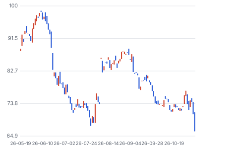

**주봉**

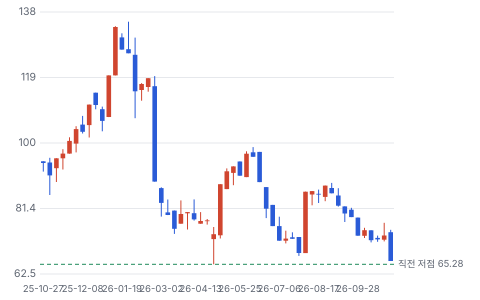

**월봉**

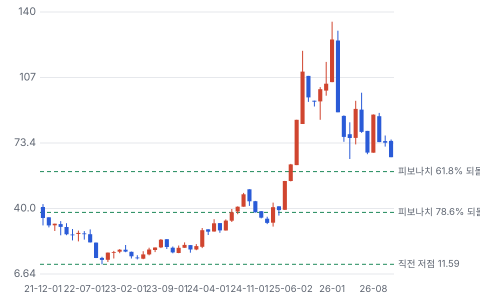

**분기 매출·EPS 실적과 컨센서스**

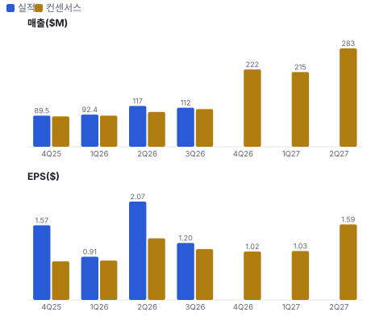

**최근 4개 분기 주가 변화 분석**

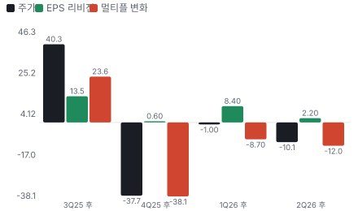

**EPS 리비전**

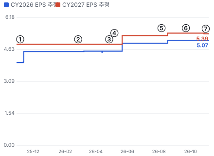

① 25-11-06 3Q25 실적 · EPS 리비전 +0%
② 26-02-26 4Q25 실적, 다음 날 −25.5% · EPS 리비전 +0%
③ 26-04-27 4/27 −14.2%, 원인 미확인 · EPS 리비전 +0%
④ 26-05-07 1Q26 실적, Burton 인수 · EPS 리비전 +0%
⑤ 26-08-06 2Q26 실적, 가이던스 상향 · EPS 리비전 +2%
⑥ 26-09-22 Mantis \$285M 차입 인수 발표 · EPS 리비전 +0%
⑦ 26-11-05 3Q26 실적, 2027 \$1B 목표 · EPS 리비전 +0%

**밸류에이션 주가 시나리오**

**주가별 업사이드**

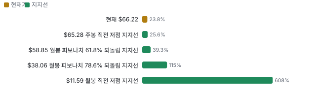

**제품·서비스 포트폴리오**

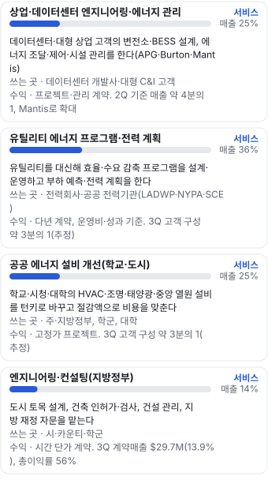

**고객 믹스(3Q26, 매출 대비)**

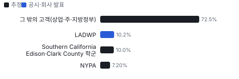

**공급 병목(10점, 낮을수록 병목)**

**생산능력 현재와 확충 계획(명(직원, 계약직 제외))**

**CAPEX의 매출 대비 비중**

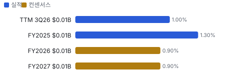

**어닝콜 변화별 주주가치 영향**

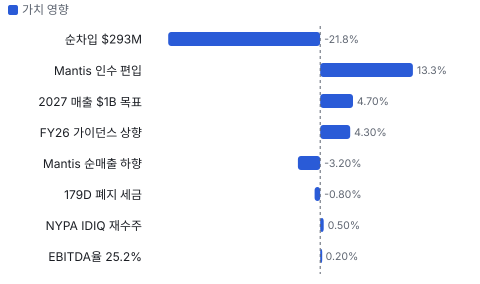

**멀티플 프리미엄(Fwd 1Y EV/EBITDA, 최근 4개 분기말)**

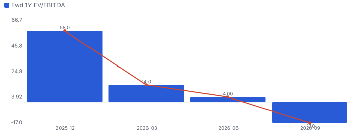

**합리적 멀티플**

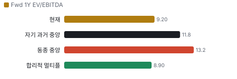

**수주·파이프라인 확실성 사다리**

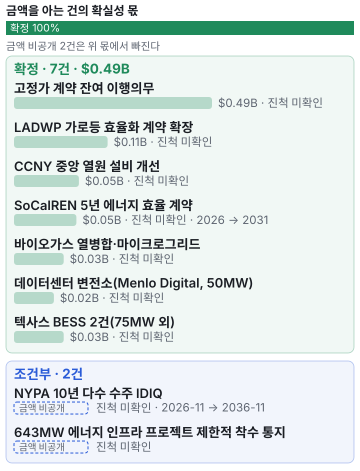

**매출 → 매출총이익 → 영업이익(매출 = 100, 최근 4분기)**

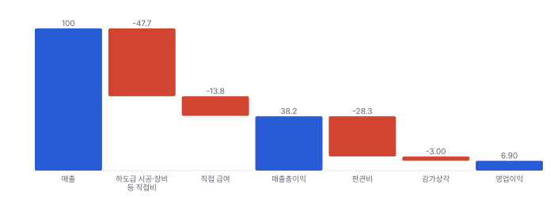

**1년 전 대비 마진 기여(비용 비중 변화의 반대)**

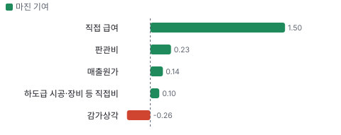

**분기 비용 비중 추이(매출 대비, 공시)**

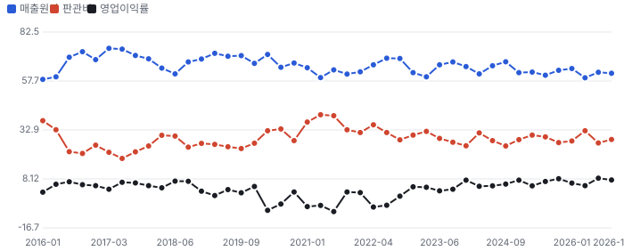

**비용 요인별 매출 대비 비중과 1년 변화**

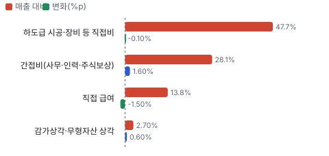

**BOM 항목 가격 +10% 시 OPM 변화**

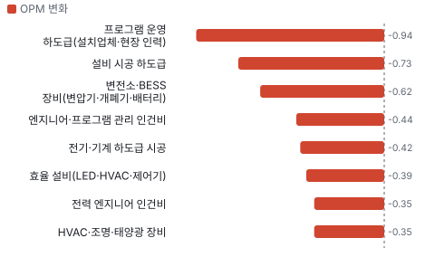

**유틸리티 에너지 프로그램·전력 계획 BOM 원가 몫과 가격 +10% 시 OPM**

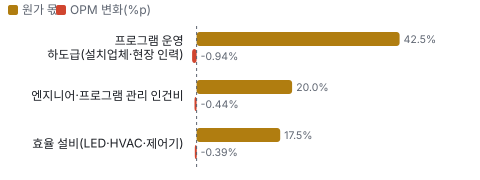

**상업·데이터센터 엔지니어링·에너지 관리 BOM 원가 몫과 가격 +10% 시 OPM**

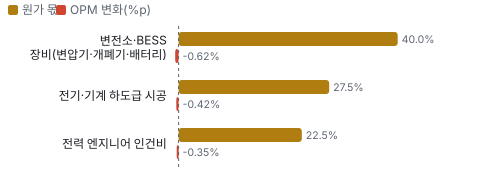

**공공 에너지 설비 개선(학교·도시) BOM 원가 몫과 가격 +10% 시 OPM**

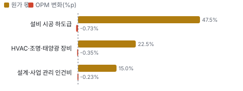

**엔지니어링·컨설팅(지방정부) BOM 원가 몫과 가격 +10% 시 OPM**

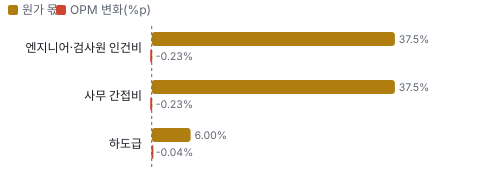

**Mantis Innovation 시너지 램프(종류별, 확률 가중)**

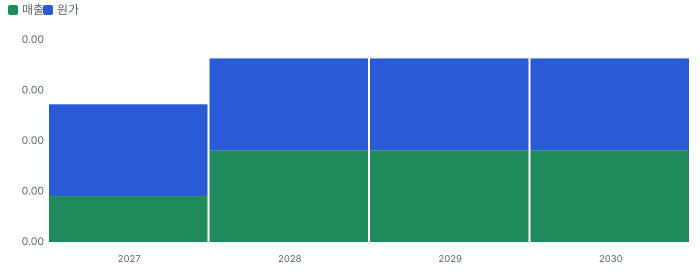

**시너지 가치 vs 웃돈**

**EPS 효과(인수 기업, 기존 대비)**

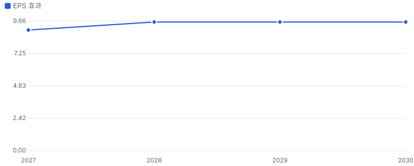

**매출·PPI·수출입 — 최근 16개 분기 같은 축(4Q22 = 100) + 다음 분기 추정**

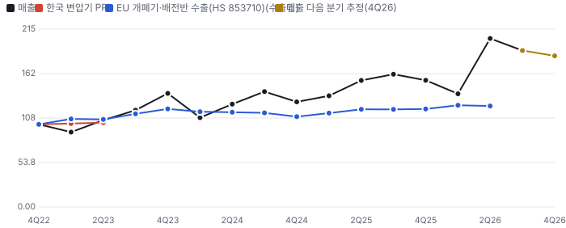

**매출과 EU 개폐기·배전반 수출(HS 853710) 증가율(전년 대비, 최근 16개 분기 + 다음 분기 추정)**

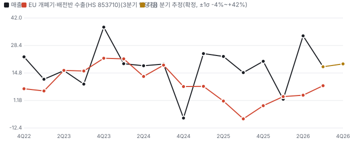

**4Q26 매출 — 지표 추세 vs 가이던스·컨센서스**

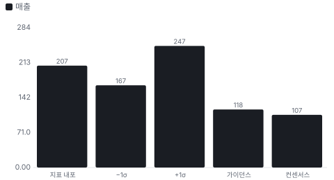

**10년 P·Q 사이클 — 추세(HP 필터) 대비 갭과 8분기 전망**

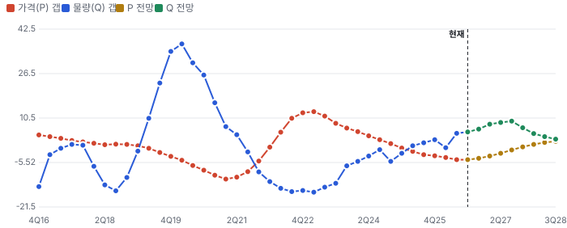

**매출 증가율의 가격·물량 분해와 8분기 전망(전년 대비)**

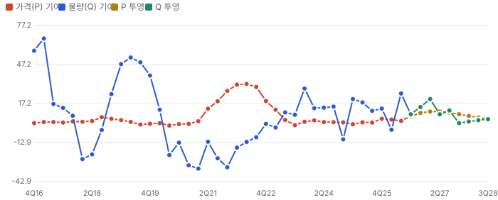

**분기별 매출 증가율 분해**

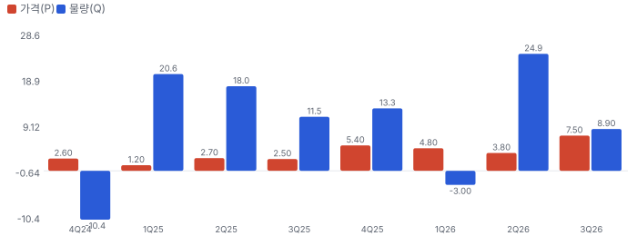

**목표주가 산정 — 약세와 기본 사이(약세 쪽 8%), 도달 확률 약 53%**

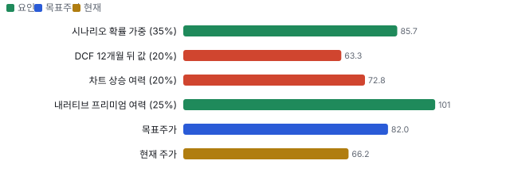

**PEG — 성장 대비 멀티플(낮을수록 성장 대비 쌈)**

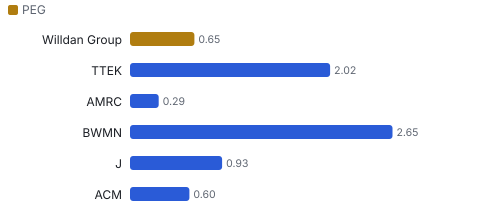

**일봉 지지·저항과 목표주가**

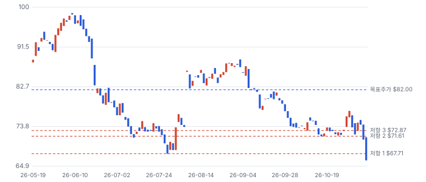

**커뮤니티 언급 수(최근 30일, 채널별)**

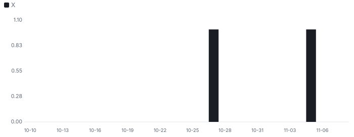

**일별 거래량 분해**

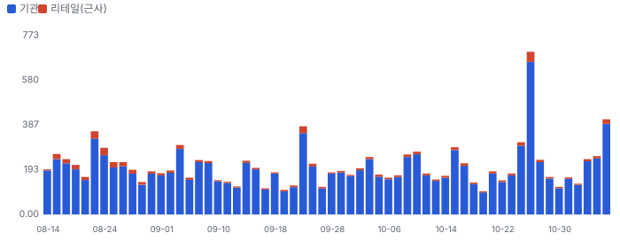

**기관 자금 흐름**

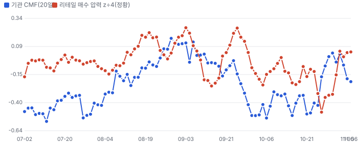

**몬테카를로**

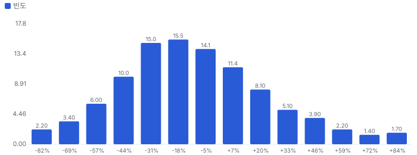

해석: 3,000번 중 1,046번(35%)에서 가치가 지금 주가 이상이었다. 가정을 흔들어도 지금 주가를 뒷받침하지 못하는 경우가 더 많다. 가운데 값은 0.86배이고, 열 번 중 여덟 번은 0.47~1.37배 사이에 든다.

## 내러티브

> **기업가치를 결정하는 이야기:** 성장축은 에너지 부문(3Q 계약매출 \$184.8M, 유기 +17%)이다. 유틸리티 효율 프로그램이 바닥을 깔고, 데이터센터·상업 고객의 변전소·BESS(배터리 에너지 저장 설비)·에너지 관리가 위를 연다. 원가의 절반이 하도급 통과분이라 이익은 순매출(계약매출의 약 52%)에서 나온다. 멀티플은 이 성장이 인수 없이도 두 자릿수냐와, 부채를 2027년 안에 2배 아래로 줄이느냐로 정해진다.

> **멀티플·EPS 프리미엄**
> **멀티플:** 지금은 할인이다. Fwd 1Y EV/EBITDA 9.2배는 동종 중앙값 13.2배보다 낮고, 1/30 21.9배에서 −58%다. 2025년 하반기의 프리미엄은 '전력망·데이터센터 서비스 희소성'이 만들었고, 2/27 4Q25 실적 뒤 하루 −25.5%와 차입 인수가 지웠다.
> **EPS:** EBITDA 추정은 강하고 EPS 추정은 약하다. FY2027 조정 EBITDA 컨센서스는 \$144M(+31%)인데 조정 EPS는 \$5.42(+4%)다. 2026년 EPS는 GAAP 세율 0%(179D)라 부풀어 있고, 2027년에는 세금과 Mantis 이자 약 \$16M(추정)가 붙는다.

### 투자자들은 왜 열광했나

열광의 정점은 1월이었다. 첫째, 위치다. AI 데이터센터 부하가 전력망을 압박하고 Willdan은 그 설계·효율을 파는 몇 안 되는 상장 소형주다. 둘째, 이익률이다. 조정 EBITDA율이 2025년 21.8%에서 올라갔다. 셋째, 실적이다. 2025년 내내 EPS가 추정을 크게 넘었다. 식은 이유도 실적에 있다. 2/27 4Q25 실적 다음 날 −25.5%(원인 미확인 — 4Q EPS는 추정을 넘었다), 4/27 −14.2%(원인 미확인), 11/6 3Q 뒤 −6.5%(조정 EPS 제자리·Mantis 순매출 하향).

### 무엇이 기업가치를 바꾸나

> **구조적 체질 변화**
> **변화:** 지방정부 엔지니어링 회사에서 전력·에너지 서비스 회사로 옮겼다. 2027년 매출의 90% 이상이 에너지 부문이 된다(3Q 콜). 고객도 유틸리티·공공 중심에서 상업이 3분의 1로 늘었다.
> **증거:** 3Q 엔지니어링 비중 13.9%(1년 전 15.0%). CEO는 엔지니어링이 약 10%로 준다고 말했다.
> **반증:** 상업 고객 매출이 인수 효과를 빼면 늘지 않는다.

> **고부가 믹스 확장**
> **변화:** 상업 프로젝트는 총이익률이 낮지만 간접비가 더 낮아 EBITDA율이 높다(2Q 콜). Mantis는 순매출 대비 EBITDA 약 35%로 전사(25%)보다 높다.
> **증거:** 조정 EBITDA ÷ 순매출 2025 21.8% → 3Q26 25.2%.
> **반증:** 2027년 상반기 조정 EBITDA율 23% 미만

> **기술 혁신**
> **변화:** 해당 없음(자체 기술 제품이 아니라 설계·운영 서비스다). AI를 쓴 생산성 향상을 회사가 이익률 요인으로 꼽았지만 숫자는 없다.
> **증거:** 3Q 콜 CFO 발언
> **반증:** 해당 없음

> **실행 속도**
> **변화:** 해당 없음(회사가 수주에서 착수·완료까지의 기간을 공시하지 않아 동종과 비교할 수 없다). 확인되는 값은 고정가 RPO의 68%가 12개월 안에 매출이 된다는 것이다.
> **증거:** 10-Q 매출 주석
> **반증:** RPO 12개월 인식 비중이 낮아진다.

> **M&A**
> **변화:** 시장이 가장 의심하는 곳이다. 1년 동안 Burton(최대 \$74M)·KCS·Mantis(\$285M)를 샀다. Mantis는 EBITDA 약 10.8배로 동종 배수보다 싸게 샀지만 순매출이 회사 전달치보다 38% 낮게 다시 잡혔다.
> **증거:** 8-K·10-Q Note 12·14, 3Q 콜
> **반증:** 2027년에 추가 차입 인수가 나오면 할인이 굳는다.

> **정책·입법 연관성**
> **재정정책:** 연방 재정의 직접 노출은 작다. 매출의 원천은 주 규제 기관이 승인한 요금 기반 효율 예산과 지방정부 예산이다. IIJA(2021년 미국 인프라 투자·일자리법)·IRA(2022년 미국 인플레이션 감축법) 보조금은 일부 공공 설비 사업의 재원이다. 10-K 사업 설명, 3Q 콜(고객 구성) 반증: 주 규제 기관이 효율 프로그램 예산을 줄인다. 의회 동의 10/10 — 하원 5/5(IIJA(2021)·IRA(2022) 하원 통과·세출 반영) · 상원 5/5(IIJA·IRA 상원 통과).
> **행정명령:** 해당 없음(회사 매출에 직접 닿는 행정명령을 확인하지 못했다). 미확인 반증: 해당 없음 의회 동의 2/10 — 하원 1/5(관련 행정명령 미확인) · 상원 1/5(관련 행정명령 미확인).
> **연관입법:** 2025년 OBBBA(2025년 미국 감세·지출 법)가 179D 건물 효율 공제를 2026-06-30 이후 착공분부터 없앴다. 회사의 2026년 GAAP 세율 0%는 이 공제 덕이고, 2027년부터 세금이 정상화된다. FY2025 10-K 세금 주석, 2Q 콜 CFO 반증: 공제 부활 입법.

> **CAPEX 낙수효과**
> **변화:** 돈은 하이퍼스케일러·데이터센터 개발사 → 전력 연계·변전소 → Willdan 설계·시공 관리로 내려온다. 유틸리티 쪽은 요금 기반 효율 예산이 같은 방향이다.
> **증거:** 3Q 데이터센터 변전소·BESS 수주. 데이터센터 매출 금액은 공시되지 않았다(애널리스트가 APG \$75M을 언급했지만 회사 확인 전).
> **반증:** 데이터센터 착공 지연이 수주 감소로 나타난다.

### 내러티브 근거

> '전력망 병목을 푸는 자산 경량 서비스주'라는 이야기는 숫자로 올라왔다(조정 EBITDA TTM +29%). 주가는 1월 고점 대비 −51%다. 시장은 차입 인수와 세율 정상화로 EPS 성장이 멈추는 2027년을 먼저 가격에 넣었다. 동종 대비 멀티플 차이 -30% 중 회사 고유 몫은 +3%다. 단계는 확산, 쏠림은 낮음이다.

> **전력망 병목·데이터센터 연계 엔지니어링** · 강화
> **논리:** 부하 증가로 변전소·BESS·연계 설계 수요가 늘고, 엔지니어를 가진 회사가 먼저 받는다
> **숫자:** 3Q 에너지 부문 유기 성장 +17%, 변전소 \$20M·BESS \$16M 수주
> **반증:** 2027 정식 가이던스(2월 말)가 계약매출 \$1B 아래

> **에너지 요금 부담 → 효율 프로그램 확대** · 유지
> **논리:** 요금이 오를수록 규제 기관과 유틸리티가 효율·수요 감축 프로그램 예산을 늘린다
> **숫자:** NYPA 10년 IDIQ 재수주, SoCalREN(남부 캘리포니아 지역 에너지 네트워크) \$49M
> **반증:** 주요 주의 효율 프로그램 예산 삭감

> **이익률 레버리지** · 강화
> **논리:** 상업 믹스·생산성으로 조정 EBITDA ÷ 순매출이 20%대 후반으로 간다
> **숫자:** 2025 21.8% → 9M26 24.7%, Mantis 약 35%
> **반증:** 2027년 상반기 이익률 23% 미만

> **차입 연쇄 인수(약세)** · 확산
> **논리:** 유기 성장이 12%인데 인수로 성장을 사며 부채를 늘린다. Mantis 순매출 하향처럼 인수 숫자가 흔들린다
> **숫자:** 순차입 \$40M(10/2) → \$293M(프로포마), Mantis 순매출 \$120M → \$75M
> **반증:** 2027년 3분기 순레버리지 2배 미만 달성

> **세율 정상화로 EPS 정체(약세)** · 확산
> **논리:** 179D 폐지로 2026년 0% 세율이 끝나 2027년 EPS 성장이 EBITDA를 크게 밑돈다
> **숫자:** FY2027 EPS 컨센서스 +4% vs 조정 EBITDA +31%
> **반증:** 2027 가이던스 조정 EPS가 \$6 이상

이미지 없음(검수 실패) — 상업·데이터센터 엔지니어링·에너지 관리

## 포트폴리오

| 제품·서비스 | 구분 | 무엇 | 쓰는 곳 | 돈 버는 방식 | Mix | Mix 변화(공시 — 10-Q 부문 표 29.7 ÷ 214.5) |
|---|---|---|---|---|---|---|
| 상업·데이터센터 엔지니어링·에너지 관리 | 서비스 | 데이터센터·대형 상업 고객의 변전소·BESS 설계, 에너지 조달·제어·시설 관리를 한다(APG·Burton·Mantis) | 데이터센터 개발사·대형 C&I(상업·산업 고객) 고객 | 프로젝트·관리 계약. 2Q 기준 매출 약 4분의 1, Mantis로 확대 | 미확인 | 미확인 |
| 유틸리티 에너지 프로그램·전력 계획 | 서비스 | 유틸리티를 대신해 효율·수요 감축 프로그램을 설계·운영하고 부하 예측·전력 계획을 한다 | 전력회사·공공 전력기관(LADWP·NYPA·SCE) | 다년 계약, 운영비·성과 기준. 3Q 고객 구성 약 3분의 1(추정) | 미확인 | 미확인 |
| 공공 에너지 설비 개선(학교·도시) | 서비스 | 학교·시청·대학의 HVAC(냉난방·공조 설비)·조명·태양광·중앙 열원 설비를 턴키로 바꾸고 절감액으로 비용을 맞춘다 | 주·지방정부, 학군, 대학 | 고정가 프로젝트. 3Q 고객 구성 약 3분의 1(추정) | 미확인 | 미확인 |
| 엔지니어링·컨설팅(지방정부) | 서비스 | 도시 토목 설계, 건축 인허가·검사, 건설 관리, 지방 재정 자문을 맡는다 | 시·카운티·학군 | 시간 단가 계약. 3Q 계약매출 \$29.7M(13.9%), 총이익률 56% | 14% | -1.1%p |

**Mix 변화가 가장 큰 쪽은 엔지니어링·컨설팅(지방정부, -1.1%p, 공시 — 10-Q 부문 표 29.7 ÷ 214.5).** 계절성 판정: 분기 매출 계절 지수 기준 없음 → 직전 분기와 비교.

## 고객

> **3Q26 최대 고객 그 밖의 고객(상업·주·지방정부) 73%, 상위 3곳 93%, 집중도 집중.** 공시·회사 발표로 확인한 몫은 매출의 10%이고, 나머지 고객 몫은 추정이거나 미분해다. 3Q에는 LADWP가 계약매출의 10.2%였고 9개월 기준으로는 10%를 넘는 고객이 없다. 1년 전 3Q에는 SCE·Clark County 학군 두 곳이 26.8%였다. 집중도는 크게 낮아졌고, 2027년 고객은 상업·유틸리티·주·지방정부가 3분의 1씩이 된다고 회사는 말했다.

**고객별 매출 몫(3Q26)**
| 고객 | 몫 | 변화 | 근거 |
|---|---|---|---|
| 그 밖의 고객(상업·주·지방정부) | 67~78% | 미확인 | 추정 |
| LADWP | 10% | 미확인 | 공시 |
| Southern California Edison·Clark County 학군 | 5~15% | -17%p | 추정 |
| NYPA | 6~8% | 미확인 | 추정 |

> **그 밖의 고객(상업·주·지방정부)** · 추정
> **사는 것:** 엔지니어링·에너지 관리·설비 개선
> **추정 근거:** 1 − 위 고객

> **LADWP** · 공시
> **사는 것:** 가로등 효율화·유틸리티 프로그램
> **추정 근거:** 10-Q 고객 집중 주석(3Q 10.2%, 에너지 부문의 11.6%)

> **Southern California Edison·Clark County 학군** · 추정
> **사는 것:** 효율 프로그램·학교 설비 개선
> **추정 근거:** 3Q25 두 곳 26.8% → 3Q26 각각 10% 미만(공시). 합계는 범위로 둔다

> **NYPA** · 추정
> **사는 것:** 에너지 프로젝트(IDIQ 발주)
> **추정 근거:** 연 \$50~60M ÷ TTM 계약매출 \$774M

## 수주·파이프라인

> **2026-11-06 기준 9건.** 확정 \$0.49B. 공시 고정가 계약 잔여 이행의무(RPO) \$0.49B. 서로 겹치는 항목은 합계에서 뺐다.

**실행 속도와 방해 요인**
| 항목 | 상태 | 실행 속도 | 방해 요인 |
|---|---|---|---|
| 고정가 계약 잔여 이행의무 | 확정 | \$334.8M(68%)을 12개월 안에 인식, \$157.8M은 그 뒤 | 프로젝트 일정 · 고객 착수 승인 |
| LADWP 가로등 효율화 계약 확장 | 확정 | 착수 승인 약 50%(2Q 콜). 2027년 초 정상 가동 목표(2Q 콜) | LADWP 램프 속도 |
| NYPA 10년 다수 수주 IDIQ | 조건부 | 기존 연 \$50~60M 업무의 연장. 총예산 약 \$3.3B는 여러 업체 공동 한도 | 개별 발주 금액 · 다수 수주 경쟁 |
| CCNY(뉴욕시립대 시티칼리지) 중앙 열원 설비 개선 | 확정 | 미확인 | 공공 조달 일정 |
| SoCalREN 5년 에너지 효율 계약 | 확정 | 5년 분할 | 주 규제 예산 |
| 바이오가스 열병합·마이크로그리드 | 확정 | 미확인 | 장비 조달 |
| 데이터센터 변전소(Menlo Digital, 50MW) | 확정 | 미확인 | 변압기·개폐기 리드타임 · 전력망 연계 승인 |
| 텍사스 BESS 2건(75MW 외) | 확정 | 미확인 | 배터리 조달·연계 |
| 643MW 에너지 인프라 프로젝트 제한적 착수 통지 | 조건부 | 제한적 착수 통지(설계·조달 일부). 정식 계약 전 | 정식 계약 전환 · 고객 자금 조달 |

## 마진 구조

> **GPM 38.4%, OPM 7.6%.** 3Q25 대비 GPM +1.6%p, OPM -0.6%p. 변동비는 매출의 63%이고, 매출이 10% 늘면 OPM은 +2.7%p 움직인다. 3Q26 매출원가는 계약매출의 61.6%로 1년 전 63.1%보다 1.5%p 낮다. 원가의 대부분(매출의 47.7%)은 하도급 시공·장비 통과분이라 이익률은 계약매출이 아니라 순매출로 봐야 한다. 간접비 비중은 28.1%로 1.6%p 올랐다(주식보상·인수 상각·인력).

> **매출 100 중 매출원가 61.8, 매출총이익 38.2(최근 4분기, 공시).** 매출원가 요인 중 하도급 시공·장비 등 직접비이 매출의 47.7%로 가장 무겁고, 단가가 +10% 오르면 GPM이 -4.77%p 움직인다. 분기 회귀로 매출 1이 늘 때 매출원가는 0.61 늘고, 매출원가의 고정비 몫은 6%다.

**비용 요인 강도 — 비중·추세·충격(+10%)·탄력**
| 비용 | 구분 | 매출 대비 | 1년 변화 | 마진 기여 | 충격 시 마진 | 매출 탄력 | 고정비 몫 |
|---|---|---|---|---|---|---|---|
| 하도급 시공·장비 등 직접비 | 매출원가 요인 | 47.7% | -0.1%p | +0.1%p | -4.77%p | 미확인 | 0% |
| 직접 급여 | 매출원가 요인 | 13.8% | -1.5%p | +1.5%p | -1.38%p | 미확인 | 50% |
| 매출원가 | 공시 항목 | 61.8% | -0.1%p | +0.1%p | -6.18%p | 0.61 | 6% |
| 판관비 | 공시 항목 | 28.3% | -0.2%p | +0.2%p | 미확인 | 0.27 | 5% |
| 감가상각 | 공시 항목 | 3.0% | +0.3%p | -0.3%p | 미확인 | 0.03 | 7% |

매출 탄력 = 분기 비용을 매출에 회귀한 기울기(매출 1당 변동비), 고정비 몫 = 절편 ÷ 평균 비용. 표본이 8분기 미만이면 미확인. 매출원가 요인 비중은 margin 재료의 추정이 섞여 있고, 공시 매출원가와의 차이는 '기타 매출원가'로 둔다.

**GPM에서 OPM까지(GAAP)**
| 기간 | GPM | 연구개발 | 판관비 | 기타 | OPM |
|---|---|---|---|---|---|
| 3Q25 | 36.9% | 0.0% | 26.5% | 2.1% | 8.2% |
| 3Q26 | 38.4% | 0.0% | 28.1% | 2.7% | 7.6% |

**GPM·OPM 최근 4개 분기**
| 분기 | GPM | OPM |
|---|---|---|
| 2026-01 | 36.0% | 6.0% |
| 2026-04 | 40.7% | 4.7% |
| 2026-07 | 37.9% | 8.5% |
| 2026-10 | 38.4% | 7.6% |

**마진을 결정하는 비용 요인 — 비용 +10% 시 OPM**
| 비용 | 매출 대비 | 변화 | 고정비 | OPM |
|---|---|---|---|---|
| 하도급 시공·장비 등 직접비 | 47.7% | -0.1%p | 0% | -4.77%p |
| 간접비(사무·인력·주식보상) | 28.1% | +1.6%p | 70% | -2.81%p |
| 직접 급여 | 13.8% | -1.5%p | 50% | -1.38%p |
| 감가상각·무형자산 상각 | 2.7% | +0.6%p | 100% | -0.27%p |

**비용을 움직이는 요인**
| 비용 | 요인 |
|---|---|
| 하도급 시공·장비 등 직접비(매출원가) | 프로젝트 물량·장비 가격(통과) · 근거 공시 |
| 간접비(사무·인력·주식보상, 판관비) | 인력·주식보상·인수 통합 · 근거 공시 |
| 직접 급여(매출원가) | 엔지니어 가동률·임금 · 근거 공시 |
| 감가상각·무형자산 상각(기타) | 인수 무형자산 · 근거 공시 |

**유틸리티 에너지 프로그램·전력 계획 BOM — 매출의 36%, GPM 38%(회사 전체 3Q GAAP 총이익률(82.5 ÷ 214.5) — 서비스 계열별 미공시), 항목 가격 +10% 시**
| 항목 | 원가 몫 | 전가 | 제품 GPM | OPM |
|---|---|---|---|---|
| 프로그램 운영 하도급(설치업체·현장 인력) | 35~50% | 미확인 | -2.6%p | -0.94%p |
| 엔지니어·프로그램 관리 인건비 | 15~25% | 미확인 | -1.2%p | -0.44%p |
| 효율 설비(LED(발광 다이오드 조명)·HVAC·제어기) | 10~25% | 미확인 | -1.1%p | -0.39%p |
| 미분해 | 20% | - | - | - |

**상업·데이터센터 엔지니어링·에너지 관리 BOM — 매출의 25%, GPM 38%(회사 전체 값 — 회사는 상업 프로젝트가 총이익률은 낮고 간접비도 낮다고 말했다(2Q 콜)), 항목 가격 +10% 시**
| 항목 | 원가 몫 | 전가 | 제품 GPM | OPM |
|---|---|---|---|---|
| 변전소·BESS 장비(변압기·개폐기·배터리) | 30~50% | 미확인 | -2.5%p | -0.62%p |
| 전기·기계 하도급 시공 | 20~35% | 미확인 | -1.7%p | -0.42%p |
| 전력 엔지니어 인건비 | 15~30% | 미확인 | -1.4%p | -0.35%p |
| 미분해 | 10% | - | - | - |

**공공 에너지 설비 개선(학교·도시) BOM — 매출의 25%, GPM 38%(회사 전체 값), 항목 가격 +10% 시**
| 항목 | 원가 몫 | 전가 | 제품 GPM | OPM |
|---|---|---|---|---|
| 설비 시공 하도급 | 40~55% | 미확인 | -2.9%p | -0.73%p |
| HVAC·조명·태양광 장비 | 15~30% | 미확인 | -1.4%p | -0.35%p |
| 설계·사업 관리 인건비 | 10~20% | 미확인 | -0.9%p | -0.23%p |
| 미분해 | 15% | - | - | - |

**엔지니어링·컨설팅(지방정부) BOM — 매출의 14%, GPM 56%(10-Q 부문 표 엔지니어링 총이익 16.7 ÷ 29.7(3Q26)), 항목 가격 +10% 시**
| 항목 | 원가 몫 | 전가 | 제품 GPM | OPM |
|---|---|---|---|---|
| 엔지니어·검사원 인건비 | 35~40% | 미확인 | -1.6%p | -0.23%p |
| 사무 간접비 | 35~40% | 미확인 | -1.6%p | -0.23%p |
| 하도급 | 5~7% | 미확인 | -0.3%p | -0.04%p |
| 미분해 | 19% | - | - | - |

프로그램 운영 하도급(설치업체·현장 인력) 가격이 +10% 오르면 영업이익은 -12.4% 움직인다. 판매가 전가를 모르는 항목은 전가 0%로 계산했다.

**BOM 항목 가격을 움직이는 것**
| 항목 | 요인 |
|---|---|
| 프로그램 운영 하도급(설치업체·현장 인력) | 유틸리티 고객에게 설치 비용을 넘기는 구조 · 전가: 계약 연동(비용 상환형 비중 미공시) · 근거 추정 |
| 엔지니어·프로그램 관리 인건비 | 다년 계약의 단가 조정은 계약 갱신 때 · 전가: 시간·자재 계약은 단가에 반영 · 근거 추정 |
| 효율 설비(LED·HVAC·제어기) | 고정가 계약이면 장비 가격 상승을 회사가 진다 · 근거 추정 |
| 변전소·BESS 장비(변압기·개폐기·배터리) | 장비는 대개 고객이나 시공사가 조달 — 회사가 사는 몫은 미공시 · 근거 추정 |
| 전기·기계 하도급 시공 | 턴키 프로젝트의 시공 몫 · 근거 추정 |
| 전력 엔지니어 인건비 | 희소 인력 · 근거 추정 |
| 설비 시공 하도급 | 공공 성과 계약 · 전가: 고정가 계약 위주(미확인) · 근거 추정 |
| HVAC·조명·태양광 장비 | 장비 가격 위험 · 근거 추정 |
| 설계·사업 관리 인건비 | 서비스 원가 구성 · 근거 추정 |
| 엔지니어·검사원 인건비 | 인력 사업 · 전가: 시간 단가 계약 · 근거 공시 |
| 하도급 | 서비스 원가 구성 · 근거 공시 |
| 사무 간접비 | 서비스 원가 구성 · 근거 공시 |

**BOM 투입 물가 — PPI 전년비, 2026-11-08 수집**
| 항목 | 미국 | 일본 | 한국 | 대만 |
|---|---|---|---|---|
| HVAC·조명·태양광 장비 | +30.0% | +54.2% | -4.9% | +40.1% |
| 변전소·BESS 장비(변압기·개폐기·배터리) | +7.8% | +0.7% | +10.7% | +10.6%* |
| 전기·기계 하도급 시공 | +12.3% | +14.8% | +1.6% | +10.6%* |

별표는 품목보다 넓은 업종 지수다. 지난 1년 투입 물가를 판매가 전가 뒤 원가에 그대로 넣으면 OPM은 -3.09%p 움직인다(매출원가의 29% 기준).

## 공급망 병목

> **공급망 신뢰성 7.3/10, 관리 가능.** 가장 약한 고리는 하도급 시공사(전기·기계 설치) 7.3점이고, 품목 평균은 7.3점이다. 근거가 부족한 2건(전력·에너지 엔지니어 인력 · 변전소·BESS 전력 장비(변압기·개폐기))은 점수에서 뺐다. 서비스 회사라 투입물은 사람과 하도급 시공이다. 병목은 전력 엔지니어 인력과, 고객 프로젝트에 들어가는 변압기·개폐기 같은 전력 장비 리드타임이다. 회사는 단일 공급원이나 구매 약정을 공시하지 않는다(FY2025 10-K 계약 의무 표에 구매 약정 없음).

**병목과 마진 — 품목 가격 +10% 시 OPM**
| 품목 | 점수 | 판정 | 구분 | OPM |
|---|---|---|---|---|
| 하도급 시공사(전기·기계 설치, 필수) | 7.3 | 관리 가능 | 일반 | 미확인 |

> **하도급 시공사(전기·기계 설치)** · 7.3/10
> **왜:** 매출의 47.7%가 하도급·직접비
> **병목 요인:** 인증 공급사 3곳 · 캐파 미확인 · 리드타임 미확인 · 재인증 3개월 · 1위 점유율 미확인 · 미국(모든 사업장이 미국·캐나다·푸에르토리코, 10-K) 집중 100% · 물량 확보 복수구매
> **풀리는 조건:** 해당 없음

**공급사**
| 품목 | 공급사 | 몫 | 근거 |
|---|---|---|---|
| 전력·에너지 엔지니어 인력 | 자체 고용(1,814명, 2026-01-02, 설계·프로그램 관리) | 미확인 | 공시 |
| 하도급 시공사(전기·기계 설치) | 지역 시공사 다수(미공시, 설치·시공) | 미확인 | 공시 |
| 변전소·BESS 전력 장비(변압기·개폐기) | 고객·시공사 조달(미공시, 장비) | 미확인 | 추정 |

**무역 통계로 본 공급 지역**
| 품목 | EU 수입처 | 일본 수입처 | EU 1위 전년비 |
|---|---|---|---|
| 하도급 시공사(전기·기계 설치) | CN(중국) 55% · US 24% · KR(한국) 6% | 中華人民共和国 47% · アメリカ合衆国 10% | +26.6% |
| 변전소·BESS 전력 장비(변압기·개폐기) | CN 82% · KR 11% · VN 4% | 中華人民共和国 65% · 大韓民国 19% | +18.1% |

## 생산능력

> **현재 명목 캐파 1,814 명(직원, 계약직 제외), 가동률 미확인.** FY2025 CAPEX는 \$0.01B로 매출의 1.3%다. 공장이 없는 인력 사업이다. 캐파는 직원 수로 잰다 — 2026-01-02 1,814명(계약직 제외)에 Burton·KCS·Mantis(220명 이상)가 더해졌다. 사무실 51곳은 모두 임차다.

**생산시설 51곳**(FY2025 10-K Item 2 Properties — 본사(애너하임) + 미국 48곳 + 캐나다 1곳 + 푸에르토리코 1곳, 모두 임차 사무실, 합계 약 224,000 sq ft. 생산 시설 없음) — 이름·위치를 밝힌 곳 1곳, 임차 1곳. 시설별 생산능력은 공개되지 않았다 — 회사 전체 캐파만 위에 적었다.

**생산시설 51곳 — 명칭·위치·생산능력**
| 시설 | 위치 | 용도 | 생산능력 | 소유·상태 |
|---|---|---|---|---|
| 본사 | 미국 캘리포니아 애너하임 2401 East Katella Avenue | 본사 사무 | 미확인 — 사무실 — 생산능력 개념 없음(인력 사업) · 면적 18,000 sq ft | 임차 · 가동 |

공개된 증설 계획은 확인되지 않았다.

**CAPEX와 매출 대비**
| 기간 | CAPEX | 매출 | 매출 대비 | 구분 |
|---|---|---|---|---|
| TTM 3Q26 | \$0.01B | \$0.77B | 1.0% | 실적 |
| FY2025 | \$0.01B | \$0.68B | 1.3% | 실적 |
| FY2026 | \$0.01B | \$0.82B | 0.9% | 컨센서스 |
| FY2027 | \$0.01B | \$1.02B | 0.9% | 컨센서스 |

## M&A 시너지

> **Mantis Innovation 인수(2026-10-30, \$0.28B): 시너지가 다 나면 연 \$0.00B(확률 가중 이익 기여), 인수 배수 EV/EBITDA 10.8배 → 시너지 반영 9.6배.** 세후 시너지 가치는 통합 비용을 빼고 \$0.02B. EPS 효과는 2027년 +9.0%에서 2030년 +9.6%.

**Mantis Innovation 시너지가 생기는 길**
| 종류 | 시너지 | 연 규모 | 완성 | 확률 | 어떻게 생기나 | 근거 |
|---|---|---|---|---|---|---|
| 매출 | Mantis 상업 고객에 Willdan 엔지니어링 교차 판매 | \$0.02B(이익률 25%) | 2028 | 40% | 고객 겹침이 거의 없어(CEO) Mantis의 대형 C&I 고객에 전력 계획·변전소 설계를 팔고, 반대로 Willdan 유틸리티 고객에 시설 관리를 판다 | 추정 — 회사는 시너지 금액을 밝히지 않았다 |
| 원가 | ERP·관리 기능 통합 | \$0.00B | 2027 | 50% | Burton처럼 Willdan ERP로 옮기고 중복 관리 인력을 줄인다 | 추정 — 2Q 콜의 Burton ERP 전환 설명을 원용 |

시너지 가치 = 세후 이익 기여 5년 + 말기 가치(할인율 9%, 성장 0) − 통합 비용. 매출 시너지는 그 매출의 이익률만 반영하고, 모든 시너지에 실현 확률을 곱했다.

## 해자

> 해자는 기술이 아니라 관계와 자격이다. 유틸리티·공공 기관의 다년 프로그램을 재입찰에서 다시 따내는 실적이 가장 단단하고, 상업 쪽은 인수로 산 고객 명단이라 아직 증명 전이다.

> **유틸리티·공공 다년 프로그램 재수주** · 보통
> **해자:** 에너지 효율 프로그램은 규제 기관이 승인한 예산을 유틸리티가 외부에 맡기는 구조라, 운영 실적이 있는 업체가 재입찰에서 유리하다.
> **근거:** NYPA 10년 IDIQ(총예산 약 \$3.3B, 다수 수주)를 재경쟁에서 다시 땄다. 회사는 일의 80% 이상이 반복 고객에서 나온다고 말했다(3Q 콜).
> **숫자:** NYPA 연 \$50~60M, LADWP 3Q 매출의 10.2%
> **깨지는 조건:** 주요 유틸리티 프로그램 재입찰 탈락, 또는 주 규제 기관의 효율 프로그램 예산 삭감

> **계약 경로(IDIQ·협동 구매 계약)** · 보통
> **해자:** 공공 고객은 이미 체결된 IDIQ·협동 구매 계약으로 발주해 경쟁 입찰을 건너뛸 수 있다. 계약을 가진 업체가 발주 속도를 쥔다.
> **근거:** NYPA·SoCalREN(\$49M, 5년)·LADWP 확장(\$110M, 절반 착수 승인) 같은 다년 계약이 이어진다(2Q·3Q 콜).
> **숫자:** 고정가 계약 잔여 이행의무 \$492.6M(10/2), 그중 \$157.8M은 12개월 초과
> **깨지는 조건:** 고정가 RPO가 2분기 연속 줄어든다

> **전력·에너지 엔지니어 인력** · 보통
> **해자:** 변전소·BESS·전력 계획을 설계할 전문 인력이 업계 병목이다. 인력을 가진 회사가 데이터센터 연계 수요를 먼저 받는다.
> **근거:** 직원 1,814명(2026-01-02, 10-K) + Mantis 220명 이상. 플로리다·조지아·노스캐롤라이나·켄터키·텍사스에 18개월 안에 새 거점을 열었다(2Q 콜).
> **숫자:** 미확인(엔지니어 수·이직률 미공시)
> **깨지는 조건:** 직접 급여 ÷ 매출이 오르는데 순매출 성장이 둔화한다(인력 경쟁 비용)

> **자체 분석 소프트웨어·데이터** · 약함
> **해자:** 에너지 계획·부하 예측 소프트웨어와 데이터가 자문 수주를 돕는다.
> **근거:** 10-K는 자체 분석·소프트웨어를 언급하지만 매출을 따로 밝히지 않는다.
> **숫자:** 미확인
> **깨지는 조건:** 소프트웨어 매출이 공시되지 않거나 경쟁사가 같은 도구를 판다

## 경영진·네트워크

> 창업자 경영 회사가 아니다. 2024년부터 Mike Bieber CEO가 상업 고객 확대와 연쇄 인수(APG·Compass·Burton·KCS·Mantis)를 이끌었다. 이사회에 전력망·해군 에너지 이력이 있지만 그 연결이 매출을 만들었다는 증거는 없다.

> **Michael A. Bieber** · 사장·CEO·이사 · 2023-12-30(CEO)
> **프로필:** 2023년 말 전임 CEO 은퇴 뒤 CEO에 올라 회장과 CEO를 분리했다(2026 위임장). 취임 때 상업 시장 비중 확대 전략을 내걸었고 상업 매출이 2Q 기준 약 4분의 1까지 늘었다. 2026-05-14 옵션 행사 뒤 장내 매도 \$5.2M(Form 4)
> **비즈니스:** 상업·데이터센터 고객 확대, 인수 5건
> **정계:** 미확인
> **동문:** 미확인
> **사모임:** 미확인

> **Creighton K. Early** · 부사장·CFO · 미확인
> **프로필:** FCF ÷ 조정 EBITDA 70% 이상, 순레버리지 2027년 3분기 2배 미만 목표를 제시했다(3Q 콜)
> **비즈니스:** 재무
> **정계:** 미확인
> **동문:** 미확인
> **사모임:** 미확인

> **Thomas D. Brisbin** · 이사회 의장(전 CEO) · CEO 은퇴 2023-12-29, 의장 유지
> **프로필:** 2026년 9월 옵션 행사 뒤 장내 매도 약 \$5.9M(9/3·9/8·9/15, Form 4). 2025년 8월에도 약 \$42M 매도
> **비즈니스:** 전 CEO
> **정계:** 미확인
> **동문:** 미확인
> **사모임:** 미확인

> **Dennis V. McGinn** · 사외이사 · 2017
> **프로필:** 퇴역 해군 중장, 전 해군성 에너지·시설·환경 차관보(2026 위임장)
> **비즈니스:** 연방 에너지 정책 경력
> **정계:** 공직 이력(해군성). 선거자금·로비 기록은 확인하지 않았다(미확인)
> **동문:** 미확인
> **사모임:** 미확인

> **Wanda K. Reder** · 사외이사 · 2021
> **프로필:** Reder Advisors(옛 Grid-X Partners) 대표, 전력망 업계 경력(2026 위임장)
> **비즈니스:** 전력망 자문
> **정계:** 미확인
> **동문:** 미확인
> **사모임:** 미확인

**네트워크 정량화**
| 연결 | 강도 | 닿는 매출 | 가중 노출 | 매출 대비 | 근거 |
|---|---|---|---|---|---|
| 정계: 이사 McGinn의 해군성 에너지 차관보 이력. 연방 정부 매출 비중은 공시되지 않았다 | 2/5 | 미확인 | 미확인 | 미확인 | 연방 매출 미공시 2026 위임장 |
| 비즈니스: 이사 Reder·Shahidehpour의 전력망 업계·학계 네트워크. 거래 금액은 공시에서 확인하지 못했다 | 2/5 | 미확인 | 미확인 | 미확인 | 특수관계 거래 미공시 2026 위임장 |

가중 노출은 연결이 닿는 매출의 크기다. 연결이 그 매출을 만들었다는 뜻이 아니며, 인과는 공개 자료로 입증하지 못한다.

## 약세 논리 및 셀온 조건

| 약세 논리 | 근거 | 반박 | 가를 자료 · 공개 시점 |
|---|---|---|---|
| EBITDA가 늘어도 주주 이익은 멈춘다 | FY2027 EPS 컨센서스 \$5.42(+4%) vs 조정 EBITDA \$144M(+31%). 179D가 2026-06-30 이후 착공분부터 폐지(10-K), Mantis 이자 연 약 \$16M(5.5% × \$285M, 추정) | 세율 정상화는 한 번의 계단이다. CFO는 FCF가 EBITDA의 70% 이상이라고 했고 이연 법인세 자산 \$31M이 현금 세금을 줄인다 | 2027 정식 가이던스의 조정 EPS — 2027-02 말 |
| 인수로 성장을 산다 | 유기 순매출 +12%에 Burton·KCS·Mantis를 1년 안에 샀다. Mantis 순매출이 회사 전달치 \$120M에서 약 \$75M으로 줄었다(회계 재검토) | 계약매출 \$120M은 그대로이고 EBITDA율은 약 35%로 전사보다 높다. 인수가는 EBITDA 약 10.8배로 동종 배수보다 낮다 | 4Q 실적의 Mantis 기여 — 2027-02 말 |
| 데이터센터 정치 역풍 | 3Q 콜 첫 질문이 데이터센터 역풍이었고, 선거 뒤 연계 지연 질문이 이어졌다. 3Q 계약매출은 2Q보다 7% 낮다 | CEO: 수요는 줄지 않았고 파이프라인이 2029년 너머까지 있다. 유틸리티·공공 고객 3분의 2는 데이터센터와 무관하다 | 4Q·1Q 데이터센터 수주 발표, 643MW 착수 통지의 정식 계약 전환 — 2027 상반기 |
| 내부자는 판다 | 의장 9월 약 \$5.9M, CEO 5월 \$5.2M 장내 매도(Form 4, 옵션 행사 뒤). 장내 매수는 0건. 공매도 유통주식의 12.2% | 매도는 옵션 행사와 묶인 거래다. 2Q까지 기관 228곳이 순 +167만 주를 샀다 | 3Q 13F(11월 중순)·Form 4 |
| 새 고객 집중 | 3Q LADWP 10.2%(10-Q). 1년 전에는 SCE·Clark County 두 곳이 26.8%였다 | 9개월 기준으로는 10% 넘는 고객이 없다. 2027년 고객은 3분의 1씩이 된다(CEO) | FY2026 10-K 고객 주석 — 2027-02 말 |

**추가 원천(11/8).** 중간선거 영향은 +0.3/10으로 작다 — 전력망 투자는 양당이 지지하고 청정에너지 세액공제 축소 입법 위험이 다소 줄었지만, 업종 ETF(GRID)의 선거 뒤 반응이 CAR(사건 뒤 시장 대비 초과 누적 수익률) −2.1%(t −0.95)로 유의하지 않다. 정책 0단계(선거 결과) 가설이다. 커뮤니티 대화는 7일 Moderate(61)이고 24시간 언급이 없다. 글 대부분이 X 한 계정의 강세 글과 내부자 매도 공시라 리테일 전체의 기대로 읽기 어렵다. 노션 자료실에는 이 종목 자료가 없고, 공개 텔레그램 채널 언급도 없었다. 서비스 개념도 이미지는 자동 눈 검수(그림 안 글자·사람 형태)를 통과하지 못해 싣지 않았다.

> **셀온 조건**
> **조건 1:** 2027 정식 가이던스(2월 말)의 조정 EBITDA가 \$140M 아래로 나온다
> **조건 2:** 유기 순매출 성장이 2개 분기 연속 한 자릿수로 내려간다
> **조건 3:** 4Q 또는 1Q27에 Mantis 기여가 회사 전달치를 밑돌거나 추가 차입 인수가 나온다
> **조건 4:** 2027년 상반기에 순차입이 줄지 않아 2027년 3분기 2배 미만 목표가 멀어진다

## 어닝콜 변화

**직전 콜 대비 새로 나오거나 바뀐 내용 → 가치 영향**
| 항목 | 내용 | 직전 콜 | 최신 콜 | 모델 동인 이동 | 확신도 | 가치 영향 |
|---|---|---|---|---|---|---|
| 업데이트 | FY2026 가이던스 | 순매출 \$415~430M·조정 EBITDA \$103~107M | 순매출 \$435~445M·조정 EBITDA \$109~111M | 기준연도 매출 +\$0.03B | 0.8 | +4.3% |
| 신규 | 2027 예비 목표 | 2027 언급 없음 | 계약매출 약 \$1B·조정 EBITDA \$140M 이상 | 1년차 성장률 +3.0% | 0.5 | +4.7% |
| 신규 | Mantis 인수 | 인수 발표(9/22) | 10/30 종결, 순매출 약 \$75M·EBITDA 이익률 약 35% | 1년차 성장률 +8.0% | 1.0 | +13.3% |
| 부정 | 인수 차입 | 순차입 \$33M(2Q 말) | 프로포마 순차입 \$293M, 약 2배 | 순차입 +\$0.25B | 1.0 | -21.8% |
| 부정 | Mantis 순매출 | Mantis 순매출 약 \$120M | 약 \$75M(회계 재검토) | 기준연도 매출 -\$0.02B | 1.0 | -3.2% |
| 업데이트 | 이익률 | 2Q 조정 EBITDA ÷ 순매출 28.2% | 3Q 25.2%(+80bp YoY), 연 약 25% | 출발 이익률 +0.20% | 1.0 | +0.2% |
| 부정 | 세율 정상화 | 2Q 세금 혜택 \$5.3M | 3Q 세금 \$3.5M, 조정 EPS 제자리 \$1.20 | 목표 이익률 -0.30% | 1.0 | -0.8% |
| 신규 | NYPA 재수주 | 기존 NYPA 계약 | 10년 IDIQ 총예산 약 \$3.3B(다수 수주) | 성장 지속(감속 계수) +1.0% | 0.5 | +0.5% |
| **합계** | 단독 합 |  |  | 동시 적용 -10.4% |  | **-2.9%** |

**사건별 EPS 리비전**
| # | 날짜 | 구분 | 사건 | CY2026 EPS 전→후 | CY2027 EPS 전→후 | 리비전 | 주가 반응 |
|---|---|---|---|---|---|---|---|
| ① | 25-11-06 | 실적 | 3Q25 실적 | \$4.00 → \$4.53 | \$4.88 → \$4.88 | +0.0% | +6.6% |
| ② | 26-02-26 | 실적 | 4Q25 실적, 다음 날 −25.5% | \$4.53 → \$4.55 | \$4.88 → \$4.88 | +0.0% | -25.5% |
| ③ | 26-04-27 | 내러티브 | 4/27 −14.2%, 원인 미확인 | \$4.55 → \$4.55 | \$4.88 → \$4.88 | +0.0% | -14.2% |
| ④ | 26-05-07 | 실적 | 1Q26 실적, Burton 인수 | \$4.55 → \$4.55 | \$4.88 → \$4.88 | +0.0% | +18.7% |
| ⑤ | 26-08-06 | 실적 | 2Q26 실적, 가이던스 상향 | \$4.93 → \$5.07 | \$5.30 → \$5.42 | +2.4% | +17.0% |
| ⑥ | 26-09-22 | 내러티브 | Mantis \$285M 차입 인수 발표 | \$5.07 → \$5.07 | \$5.42 → \$5.42 | +0.0% | +1.8% |
| ⑦ | 26-11-05 | 실적 | 3Q26 실적, 2027 \$1B 목표 | \$5.07 → \$5.07 | \$5.39 → \$5.39 | +0.0% | -6.5% |

**해석:** 4개 구간 누적 주가 -22% = EPS 리비전 +26% × 멀티플 -39%. 더 크게 움직인 쪽은 **멀티플**이다.

## 거시 지표 싱크로율

> **EU(유럽연합) 개폐기·배전반 수출(HS(국제 통일 상품 분류 코드) 853710)와 전사 매출 싱크로율 36%(3분기 = 약 9개월 선행, 전년 대비, 표본 32개·t 2.1·유의·신뢰 보통).** 이 지표가 내포하는 4Q26 전사 매출은 207M(±1σ 167M~247M, 확정)다. 가이던스는 이보다 -43.0%(범위 아래), 컨센서스는 -48.3%(범위 아래)다. 서비스 회사라 팔거나 사는 품목의 수출입 지표가 직접 맞지 않는다. 상업·데이터센터 쪽 매출이 따라가는 전력 장비 수요의 대용으로 미국 변압기·개폐기 PPI(생산자물가지수)를 쓴다. 상관은 인과가 아니다

**지표별 싱크로율(상관계수 × 100) — 위 두 줄이 제품 연관성 × 싱크로율로 고른 PPI·수출입 세부 지표**
| 지표 | 비교 대상 | 증가율 기준 | 지표 선행 | 매출(t값) | 영업이익 | 방향 일치 | 표본·신뢰 | 4Q26 내포 매출 |
|---|---|---|---|---|---|---|---|---|
| 한국 변압기 PPI | 전사 매출 | 전년 대비 | 0분기(0개월) | 14%(t 0.6) | -16%(3분기) | 73% | 22·보통 | +12.5% → 195M(지표 자기회귀 추정) |
| EU 개폐기·배전반 수출(HS 853710) | 전사 매출 | 전년 대비 | 3분기(9개월) | 36%(t 2.1) | -16%(1분기) | 75% | 32·보통 | +19.3% → 207M(확정) |
| 미국 변압기 PPI | 전사 매출 | 전년 대비 | 0분기(0개월) | -10%(t -0.6) | -14%(2분기) | 78% | 40·보통 | +18.3% → 205M(지표 자기회귀 추정) |
| 미국 개폐기 PPI | 전사 매출 | 전년 대비 | 3분기(9개월) | -10%(t -0.6) | -17%(3분기) | 72% | 40·보통 | +14.4% → 199M(확정) |
| 미국 구리 PPI | 전사 매출 | 전년 대비 | 2분기(6개월) | -38%(t -2.5) | -18%(4분기) | 55% | 40·보통 | +6.8% → 186M(확정) |

**지표 후보 27개 — 연관성(제품 품목 일치 × 대용 감점 × 매출 비중) × 싱크로율로 고른다. 후보가 많을수록 최대 상관은 우연히 부풀 수 있다**
| 후보 | 종류 | 연관성 | 싱크로율(선행) | 점수 | 출처 |
|---|---|---|---|---|---|
| EU 개폐기·배전반 수출(HS 853710) ✔ | 수출입 | 0.33 | 36%(3분기) | 0.12 | 자동 |
| 미국 개폐기·배전반 수출(HS 853710) | 수출입 | 0.33 | 41%(1분기) | 0.11 | 자동 |
| EU HS 850431 수출(변압기과 같은 4자리 품목군) | 수출입 | 0.23 | 44%(2분기) | 0.10 | 자동 |
| EU 개폐기·배전반 수입(HS 853710) | 수출입 | 0.33 | 32%(3분기) | 0.09 | 자동 |
| EU 구리 수입(HS 740811) | 수출입 | 0.33 | 29%(3분기) | 0.08 | 자동 |
| EU HS 850421 수출(변압기과 같은 4자리 품목군) | 수출입 | 0.23 | 29%(0분기) | 0.05 | 자동 |
| EU HS 850422 수출(변압기과 같은 4자리 품목군) | 수출입 | 0.23 | 22%(4분기) | 0.04 | 자동 |
| EU HS 850410 수출(변압기과 같은 4자리 품목군) | 수출입 | 0.23 | 22%(0분기) | 0.04 | 자동 |
| EU 변압기 수입(HS 850423) | 수출입 | 0.33 | 15%(3분기) | 0.04 | 자동 |
| 한국 변압기 PPI ✔ | PPI | 0.33 | 14%(0분기) | 0.04 | 자동 |
| 일본 개폐기·배전반 PPI | PPI | 0.33 | 14%(0분기) | 0.04 | 자동 |
| 미국 변압기 수출(HS 850423) | 수출입 | 0.33 | 4%(0분기) | 0.01 | 자동 |

**선행 지표로 본 향후 분기 매출 전망(이미 나온 지표 값 기준, ±1σ)**
| 지표 | 대상 | 분기 | 지표 증가율 | 내포 매출 증가율 | 내포 매출 |
|---|---|---|---|---|---|
| 미국 개폐기 PPI | 전사 매출 | 4Q26 | +14.9% | +14.4% | 199M(148M~249M) |
| 미국 개폐기 PPI | 전사 매출 | 1Q27 | +12.1% | +15.9% | 180M(135M~225M) |
| 미국 개폐기 PPI | 전사 매출 | 2Q27 | +11.5% | +16.2% | 268M(201M~335M) |
| 미국 구리 PPI | 전사 매출 | 4Q26 | +25.6% | +6.8% | 186M(139M~232M) |
| 미국 구리 PPI | 전사 매출 | 1Q27 | +24.4% | +7.6% | 167M(125M~209M) |
| EU 변압기 수출(HS 850423) | 전사 매출 | 4Q26 | -34.5% | +27.3% | 221M(180M~262M) |
| EU 변압기 수출(HS 850423) | 전사 매출 | 1Q27 | +15.4% | +14.3% | 177M(141M~214M) |
| EU 변압기 수출(HS 850423) | 전사 매출 | 2Q27 | +106.8% | -9.4% | 209M(154M~264M) |
| EU 변압기 수입(HS 850423) | 전사 매출 | 4Q26 | +24.9% | +16.2% | 202M(159M~244M) |
| EU 변압기 수입(HS 850423) | 전사 매출 | 1Q27 | +35.5% | +16.6% | 181M(143M~219M) |
| 미국 변압기 수입(HS 850423) | 전사 매출 | 4Q26 | +35.1% | +20.9% | 210M(193M~227M) |
| 미국 변압기 수입(HS 850423) | 전사 매출 | 1Q27 | -27.2% | +47.5% | 229M(213M~244M) |
| 미국 변압기 수입(HS 850423) | 전사 매출 | 2Q27 | +41.4% | +18.2% | 273M(250M~296M) |
| 미국 변압기 수입(HS 850423) | 전사 매출 | 3Q27 | +30.1% | +23.0% | 264M(243M~285M) |
| 일본 변압기 PPI | 전사 매출 | 4Q26 | +0.9% | +19.2% | 207M(165M~249M) |
| 일본 변압기 PPI | 전사 매출 | 1Q27 | +0.4% | +19.9% | 186M(149M~223M) |
| EU 개폐기·배전반 수출(HS 853710) | 전사 매출 | 4Q26 | +8.4% | +19.3% | 207M(167M~247M) |
| EU 개폐기·배전반 수출(HS 853710) | 전사 매출 | 1Q27 | +3.5% | +15.1% | 179M(143M~214M) |
| EU 개폐기·배전반 수입(HS 853710) | 전사 매출 | 4Q26 | +6.2% | +16.1% | 202M(161M~242M) |
| EU 개폐기·배전반 수입(HS 853710) | 전사 매출 | 1Q27 | +9.3% | +17.6% | 182M(146M~219M) |
| 미국 개폐기·배전반 수출(HS 853710) | 전사 매출 | 4Q26 | +14.9% | +24.3% | 216M(196M~236M) |
| 미국 개폐기·배전반 수입(HS 853710) | 전사 매출 | 4Q26 | +19.9% | -26.4% | 128M(120M~136M) |
| 미국 개폐기·배전반 수입(HS 853710) | 전사 매출 | 1Q27 | +17.5% | -18.1% | 127M(120M~134M) |
| EU 구리 수입(HS 740811) | 전사 매출 | 4Q26 | +61.3% | +20.8% | 210M(169M~251M) |
| EU 구리 수입(HS 740811) | 전사 매출 | 1Q27 | +128.5% | +28.2% | 199M(162M~236M) |
| 미국 구리 수출(HS 740811) | 전사 매출 | 4Q26 | -21.3% | +25.8% | 218M(198M~239M) |
| 미국 구리 수출(HS 740811) | 전사 매출 | 1Q27 | -32.1% | +30.9% | 203M(185M~221M) |
| 미국 구리 수출(HS 740811) | 전사 매출 | 2Q27 | -43.8% | +36.6% | 315M(289M~342M) |
| 미국 구리 수출(HS 740811) | 전사 매출 | 3Q27 | -29.1% | +29.5% | 278M(253M~303M) |
| 미국 구리 수입(HS 740811) | 전사 매출 | 4Q26 | -70.5% | +18.7% | 206M(183M~229M) |
| 일본 구리 PPI | 전사 매출 | 4Q26 | +55.5% | +7.7% | 187M(168M~206M) |
| 일본 구리 PPI | 전사 매출 | 1Q27 | +56.0% | +7.6% | 167M(150M~184M) |
| 영국 구리 PPI | 전사 매출 | 4Q26 | +24.6% | +8.1% | 188M(139M~237M) |
| 영국 구리 PPI | 전사 매출 | 1Q27 | +31.8% | +3.6% | 161M(117M~204M) |
| 영국 구리 PPI | 전사 매출 | 2Q27 | +33.6% | +2.4% | 237M(172M~301M) |
| 대만 구리 PPI | 전사 매출 | 4Q26 | +9.0% | +15.2% | 200M(181M~219M) |
| 대만 구리 PPI | 전사 매출 | 1Q27 | +25.2% | +7.6% | 167M(150M~184M) |
| 대만 구리 PPI | 전사 매출 | 2Q27 | +32.5% | +4.1% | 241M(215M~266M) |
| 대만 구리 PPI | 전사 매출 | 3Q27 | +41.7% | -0.2% | 214M(191M~238M) |
| EU HS 850422 수출(변압기과 같은 4자리 품목군) | 전사 매출 | 4Q26 | +3.9% | +15.5% | 201M(158M~243M) |
| EU HS 850422 수출(변압기과 같은 4자리 품목군) | 전사 매출 | 1Q27 | +17.9% | +17.7% | 183M(145M~220M) |
| EU HS 850422 수출(변압기과 같은 4자리 품목군) | 전사 매출 | 2Q27 | -0.0% | +14.9% | 265M(209M~322M) |
| EU HS 850431 수출(변압기과 같은 4자리 품목군) | 전사 매출 | 4Q26 | +15.7% | +30.6% | 227M(189M~265M) |

지표가 k분기 앞서면 이미 발표된 지표로 k분기 뒤까지의 매출 증가율을 회귀식으로 읽는다. 표본이 작거나 t값이 2 미만이면 전망은 참고용이다.

**지표를 고른 이유**
| 지표 | 이유 |
|---|---|
| 한국 변압기 PPI | 변압기 ↔ 변압기 생산자물가 |
| EU 개폐기·배전반 수출(HS 853710) | 개폐기·배전반 품목 일치 |
| 미국 변압기 PPI | 변전소·데이터센터 전력 설비 수요의 가격 대용 |
| 미국 개폐기 PPI | 배전 설비 투자 대용 |
| 미국 구리 PPI | 설비 원가 대용 |

싱크로율은 증가율의 상관계수이며 인과가 아니다. 지표 단위·통화는 원자료 그대로이고 나라끼리 더하지 않는다(EU 수입만 상대국 합계). ±1σ는 회귀 잔차 표준편차이고, 지표를 예측한 분기는 지표 예측 오차까지 더해 넓혔다.

## P·Q 사이클

> **10년 위치: Q형 기업(매출 갭 분산의 0%가 가격) — 가격은 추세 대비 -4.5%(수축, 10년 분위 25%), 물량은 +5.5%(확장, 분위 80%). P 프리미엄 -14%, Q 프리미엄 +5%(매출총이익이 정상(추세) 수준보다 요인별로 이만큼 높거나 낮다).** 전망으로 가격 갭은 4분기 뒤 -1.0%·8분기 뒤 +2.1%, 물량 갭은 +9.4%·+2.9%(물량은 컨센서스 몫 80%를 섞었다).

**10년 P·Q 사이클 위치·프리미엄**
| 항목 | 가격(P) | 물량(Q) |
|---|---|---|
| 추세 대비 갭(현재) | -4.5% | +5.5% |
| 사이클 시계 | 수축 | 확장 |
| 10년 분위 | 25% | 80% |
| 프리미엄(현재) | -14% | +5% |
| 프리미엄 4분기 뒤 | -3% | +9% |
| 프리미엄 8분기 뒤 | +6% | +3% |
| 갭 반감기 | 3분기 | 미확인 |
| 갭 4분기 뒤(80% 범위) | -1.0% (-5.6%~+3.8%) | +9.4% (+1.8%~+17.4%) |
| 갭 8분기 뒤(80% 범위) | +2.1% (-4.5%~+9.2%) | +2.9% (-6.5%~+13.4%) |
| 전망 모형 | 자기회귀모델(과거 2개 시점) 정상성 보정 | 자기회귀모델(과거 2개 시점) + 컨센서스(분기 컨센서스 4개 + 연간 컨센서스 성장률 FY2027→FY2028 +11%, 4분기 뒤 몫 80%) |

방법: P = 가격 지수 4분기 평균(미국 PPI 변압기·배전 기기 대용 — 회사 판매가가 아니라 업종 가격), Q = TTM 매출 ÷ P. 추세는 로그 레벨의 HP(경기 추세를 떼어 내는 통계 필터) 필터(λ 1600)로 정상(mid-cycle) 수준을 잡는다. 프리미엄 = 요인별 매출총이익 증분 ÷ 정상 매출총이익(정상 GPM 35.0% = 10년 중앙값, 물량 증분 마진 35.0% = 전년 대비 ΔGP÷ΔRev 회귀, 가격은 전액 이익 반영). 표본 40개 TTM 분기. 전망: 가격 갭은 BIC(모형 차수를 고르는 정보 기준)로 차수를 고른 자기회귀모델(정상성 보정), 물량은 통계 갭 자기회귀모델과 컨센서스 매출 ÷ 가격 전망(매출 = P × Q)을 분산 역수로 섞는다(Bates·Granger 1969). 끝점 편향을 줄이려고 전망 경로를 이어 붙인 뒤 HP 필터를 다시 건다(Kaiser·Maravall 1999). 80% 범위는 예측 오차(TTM이 4분기씩 겹쳐 생기는 자기상관을 뉴이·웨스트 장기 분산으로 반영)와 애널리스트 범위에서 낸다. 모형 산출이며 가이던스가 아니다.

> **Q 사이클 — 최근 4분기 평균 가격 기여 +5.4%, 물량 기여 +11.0%(전년 대비 로그 증가율).** P 강도 4.6/10, Q 강도 5.3/10, 최근 8분기 중 75%가 같은 요인 우세(구조적). 전망으로는 3분기 뒤(2Q27) P 사이클로 전환(물량은 컨센서스를 섞었다).

**P·Q 사이클 정량**
| 항목 | 가격(P) | 물량(Q) |
|---|---|---|
| 최근 4분기 평균 기여 | +5.4% | +11.0% |
| 강도(0~10, 자기 이력 z) | 4.6 | 5.3 |
| 고유 주기(자기회귀모델 과거 2개 시점일 때) | 16.5분기 | 미확인 |
| 다음 4분기 투영 평균 | +10.5% | +14.0% |
| 4분기 뒤 투영(80% 범위) | +10.2% (-0.2%~+20.6%) | +11.8% (+0.4%~+23.3%) |
| 장기 평균(표본 → 기저율 수축) | +8.2% → +5.8% | +3.5% → +3.7% |
| 투영 모형 | 자기회귀모델(과거 2개 시점) | 자기회귀모델(과거 1개 시점) + 컨센서스(분기 컨센서스 4개 + 연간 컨센서스 성장률 FY2027→FY2028 +11%) |

가격 근거: 미국 PPI 변압기·배전 기기 대용 — 회사 판매가가 아니라 업종 가격. PPI를 쓰면 회사 판매가가 아니라 업종 가격 대용이다. 로그 증가율이라 가격·물량 기여의 합이 매출 증가율이다. 전망: 가격은 BIC로 차수를 고른 자기회귀모델에 이미 발표된 월간 가격을 먼저 넣고(나우캐스트), 물량은 자기회귀모델과 '컨센서스 매출 증가율 − 가격 전망'을 분산 역수로 섞는다. 장기 평균은 표본 평균을 장기 기저율(가격 연 2%·물량 연 4%) 쪽으로 줄인다 — 고성장 구간만 담긴 표본이 그 성장을 끝없이 잇지 않게. 범위는 4분기 겹친 표본의 자기상관을 반영한다. 모형 산출이며 가이던스가 아니다. 회사 판매가로 잴 수 없는 이유: 서비스 회사라 가격(시간당 단가)·물량(청구 시간·인력)을 공시하지 않는다. 업종 PPI 대용으로 잰다

## 밸류에이션

> **목표주가 \$82, 업사이드 +24%.** 자리는 약세와 기본 사이(약세 쪽 8%)이고 도달 확률은 약 53%다. 기본 \$85, 강세 \$123(+86%), 약세 \$49(-25%). DCF 기준 업사이드는 기본 -14%, 강세 +10%, 약세 -31%다(WACC 9.6%).

기준 멀티플이 Fwd 1Y EV/EBITDA라 시나리오도 FY2027 조정 EBITDA로 둔다. 회사가 조정 EBITDA를 핵심 목표로 내걸고, 2026년 EPS는 GAAP 세율 0%라 2027년과 비교할 수 없기 때문이다. 확률은 어닝콜 톤 규칙(20·50·30)에서 약세를 25%로 올렸다 — 순차입이 7배 늘었고 데이터센터 정치 역풍·VIX(S&P500 옵션 내재 변동성 지수) 28 국면이라 하방 꼬리가 크다(자체추론). EV에서 주주 몫으로 갈 때 순차입 \$293M과 리스가 빠지므로, 같은 EBITDA라도 부채가 줄수록 주당 가치가 오른다.

> **약세 \$49 (-25%)** · 확률 25%
> **가정:** 8.8배 × EBITDA \$0.12B
> **근거:** 데이터센터 착공 지연으로 상업 수주가 줄고 Mantis 통합이 늦다. 2027 조정 EBITDA가 목표 \$140M보다 약 11% 낮다

> **기본 \$85 (+28%)** · 확률 50%
> **가정:** 11.7배 × EBITDA \$0.14B
> **근거:** 회사 목표(계약매출 약 \$1B, 조정 EBITDA \$140M 이상) 근처로 간다. 컨센서스 \$144M와 비슷하다

> **강세 \$123 (+86%)** · 확률 25%
> **가정:** 14.7배 × EBITDA \$0.15B
> **근거:** 유기 성장이 15%로 오르고 Mantis 교차 판매가 숫자로 나온다. 컨센서스 상단 \$156M 근처다

**멀티플 선정 — Fwd 1Y EV/EBITDA**
| 단계 | 조정 | 근거 |
|---|---|---|
| 동종 중앙값 | 13.2배 | 범위 8.3~18.8배, 5곳 |
| 펀더멘털 | -16% | 성장·이익률·ROIC로 본 합리적 멀티플 8.9배와의 차이의 일부만 인정 |
| 해자 | +3% | 유틸리티·공공 다년 프로그램 재수주 보통 · 계약 경로(IDIQ·협동 구매 계약) 보통 · 전력·에너지 엔지니어 인력 보통 · 자체 분석 소프트웨어·데이터 약함 |
| 반복 매출 | +0% | 재료 없음 |
| 수주 전환·가시성 | +7% | RPO 12개월 0.76 → 가시성 0.76 · 전환 7.6개월(동종 12) |
| 내러티브 | +5% | 단계 확산 |
| 사이클·실행 판단 | -10% | Mantis 차입으로 순차입이 프로포마 약 \$293M(조정 EBITDA 약 2배)으로 늘었고, Mantis 순매출이 회사 전달치보다 38% 낮게 다시 잡혔다. 2027년 세율 정상화로 EPS 성장이 EBITDA 성장보다 크게 낮다. 9개월 기준 10% 넘는 고객은 없지만 3Q에 LADWP가 10.2%로 올라왔다 |
| **선정** | **11.7배** | 지금 9.2배 |

**동종 레인지**
| 회사 | Fwd 1Y EV/EBITDA | Fwd 2Y EV/EBITDA | Fwd 3Y EV/EBITDA | 성장 | 영업이익률 | ROIC |
|---|---|---|---|---|---|---|
| TTEK | 15.9 | 14.7 | 13.7 | 5% | 12% | 18% |
| AMRC | 11.7 | 9.1 | 8.3 | 10% | 6% | 3% |
| BWMN | 18.8 | 16.4 | 14.8 | 16% | 4% | 3% |
| J | 13.2 | 11.8 | 10.8 | 24% | 10% | 18% |
| ACM | 8.3 | 7.4 | 6.7 | 0% | 8% | 20% |
| **Willdan Group** | 9.2 | 8.1 | 7.3 |  |  |  |

> **PEG 0.65** — Fwd 1Y P/E 13.1배를 다음 해 EPS 성장 20%로 나눈 값, 동종 중앙 0.93(성장 대비 싸다). 성장률은 Fwd 1Y·2Y P/E에서 역산한 컨센서스라 다음 해 한 해 성장만 반영하고, 성장 지속 기간은 담지 않는다.

**PEG — Fwd 1Y P/E ÷ 다음 해 EPS 성장률**
| 회사 | Fwd 1Y P/E | 다음 해 EPS 성장 | PEG |
|---|---|---|---|
| **Willdan Group** | 13.1 | +20% | 0.65 |
| TTEK | 22.8 | +11% | 2.02 |
| AMRC | 16.5 | +56% | 0.29 |
| BWMN | 16.7 | +6% | 2.65 |
| J | 18.1 | +20% | 0.93 |
| ACM | 10.3 | +17% | 0.60 |

몬테카를로 중앙값 업사이드 -14%.

> 의사결정 보조(투자자문 아님): ① 매수 매력: 연 기대수익 +6.9% (자기자본비용 11.0% 대비 -4.1%p) · 자본비용 초과 확률 28% · 안전마진 0.47 → 정량 신호 약함 / ② 위험 예산 지표(이론): 0% — 기대수익이 자기자본비용에 못 미침(무위험 대비 켈리 53%는 참고) · 5년 하위10% -26% · 30%+ 손실 확률 9% / ③ 상방(5년): 기대 1.40배 · 2배 14% · 3배 1% · 10배 0% · 상위10% 2.13배

투입 물가 점검: 지난 1년 PPI를 BOM에 넣으면 OPM -3.09%p다(매출원가의 29% 기준).

## 매수 위치(일봉)

> **현재가 \$66.22는 '지지선 미확인'.** 이 자리에서 목표주가까지 +23.8%, 첫 일봉 저항까지 +2.3%, 다음 지지까지 하방 미확인.

**가격대별 업사이드(일봉 기준)**
| 가격대 | 가격 | 목표주가까지 | 첫 저항까지 | 다음 지지까지 | 손익비 | 근거 기법(강도) |
|---|---|---|---|---|---|---|
| 현재가 | \$66.22 | +23.8% | +2.3% | 미확인 | 미확인 | - |

**일봉 저항**
| 저항 | 가격 | 현재가 대비 | 근거 기법(강도) |
|---|---|---|---|
| 저항 1 | \$67.71 | +2.3% | 120일 지그재그 저점(0.8) |
| 저항 2 | \$71.61 | +8.1% | 120일 지그재그 저점 · 스윙 저점(1.8) |
| 저항 3 | \$72.87 | +10.0% | 20일선 · 피보 78.6%(1.5) |

일봉만 쓴다(주봉·월봉 제외). 손익비 = 목표주가까지 업사이드 ÷ 다음 지지까지 하방. 가격대별 기대값 참고표이며 매수·매도 시점 지시가 아니다.

## 애널리스트 토론

> **토론 결론 Buy(규칙 등급 Buy).** EBITDA 기준 할인(Fwd 1Y EV/EBITDA 9.2배 vs 동종 13.2배)과 FCF로 부채를 줄일 수 있다는 논리는 반박을 견뎠다. 그러나 2027 EPS가 세금·이자로 멈춘다는 반박도 살아남아, 최고 등급까지는 가지 않는다

**패널 — 등급별 자리**
| 자리 | 핵심 논리 | 틀리는 조건 | 최종 투표 |
|---|---|---|---|
| Strong Buy | EBITDA로 보면 동종보다 30% 싸고 성장은 더 빠르다 | 2월 말 2027 정식 가이던스가 EBITDA \$140M 아래 | Buy |
| Buy | Mantis는 싸게 샀고 부채는 1년 안에 줄어든다 | 2027년 상반기 순차입이 줄지 않는다 | Buy |
| Neutral | EBITDA는 늘지만 주주 몫인 EPS는 2027년에 멈춘다 | 2027 가이던스 조정 EPS가 \$6 이상 | Neutral |
| Sell | 인수 숫자가 흔들리고 내부자는 판다 | 4Q 실적에서 Mantis 기여가 회사 전달치와 맞는다 | Neutral |
| Strong Sell | 데이터센터 정치 역풍이 성장축을 꺾는다 | 4Q·1Q 데이터센터 수주 발표가 이어진다 | Sell |

**투표**
| Strong Buy | Buy | Neutral | Sell | Strong Sell |
|---|---|---|---|---|
| 0 | 2 | 2 | 1 | 0 |

> **개회 · Strong Buy**
> **발언:** 2027 목표 EBITDA에 9배면 성장 프리미엄은 0이다

> **개회 · Buy**
> **발언:** FCF가 EBITDA의 70%라 부채는 숫자로 줄어든다

> **개회 · Neutral**
> **발언:** 주주가 받는 것은 EBITDA가 아니라 세후 이익이다

> **개회 · Sell**
> **발언:** 인수 실사 숫자가 한 분기 만에 38% 줄었다

> **개회 · Strong Sell**
> **발언:** 데이터센터가 막히면 상업 3분의 1이 흔들린다

> **반박1 · Buy → Sell**
> **발언:** Mantis 계약매출 \$120M은 그대로고, 순매출 재분류로 이익률은 35%로 오히려 높아졌다

> **반박1 · Neutral → Strong Buy**
> **발언:** EV/EBITDA는 세금을 무시한다. 정상 세율로는 P/E가 13배가 아니다

> **반박1 · Strong Buy → Neutral**
> **발언:** 세율 정상화는 한 번의 계단이고 2028년부터 EPS가 EBITDA를 따라간다

> **반박1 · Sell → Buy**
> **발언:** 레버리지 목표가 12개월 뒤라 그 사이 금리·실적 위험을 다 진다

> **반박1 · Strong Sell → Strong Buy**
> **발언:** 유기 성장 12%에 인수로 산 7%를 얹은 19%다

> **반박2 · Strong Buy → Strong Sell**
> **발언:** CEO는 파이프라인이 2029년 너머까지 있다고 했고 유틸리티 쪽은 데이터센터와 무관하다

> **반박2 · Buy → Neutral**
> **발언:** FY2028 EPS 컨센서스 \$6.30은 +16%다

> **반박2 · Neutral → Buy**
> **발언:** 그 \$6.30은 1명 추정이고 범위가 \$5.10~7.50이다

> **반박2 · Sell → Strong Buy**
> **발언:** 공매도 12%는 누군가 이 숫자를 믿지 않는다는 뜻이다

> **반박2 · Strong Sell → Buy**
> **발언:** LADWP가 3Q 10.2%로 새 집중 고객이 됐다

> **최종 · Strong Buy**
> **발언:** 2월 가이던스가 \$140M을 지키면 배수가 돌아온다

> **최종 · Buy**
> **발언:** 부채 상환 속도가 확인되는 1Q27까지가 쟁점이다

> **최종 · Neutral**
> **발언:** EPS 성장이 다시 보일 때까지 배수는 묶인다

> **최종 · Sell**
> **발언:** 4Q의 Mantis 숫자가 첫 시험이다

> **최종 · Strong Sell**
> **발언:** 데이터센터 수주가 끊기면 2027 목표가 무너진다

남은 반대 의견: Strong Sell 자리는 데이터센터 정치 역풍이 상업 고객 3분의 1을 흔든다는 주장을 끝까지 유지했다

패널은 등급별 논리를 대표하는 자리이고 실존 IB의 의견이 아니다.

## 커뮤니티 내러티브

> **대화 강도는 7일 Moderate(61)이고 24시간 언급은 없다. 글 대부분이 X 한 계정의 강세 글과 내부자 매도 공시 피드다. 표본이 작아 리테일 전체의 기대로 읽기 어렵다.** 관심 급증 0.0/10(결합 Z -0.6), 최근 7일 신뢰 가중 감성 +0.60(관측 전체 +0.60).

**채널별 내러티브와 기대 소화**
| 채널 | 주된 이야기 | 기대 | 1차 자료 대조 | 비중 |
|---|---|---|---|---|
| X | 고성장 전력망 서비스주인데 P/E가 10배대 초반이다 | 상향 | 확인 — Fwd 1Y P/E 13.1배로 동종 중앙값보다 낮다. 단 2026년 EPS는 세율 0%라 정상 세율이면 배수가 더 높다 | 45% |
| X | 데이터센터 정치 역풍은 오히려 전력 효율·요금 부담 해결사인 Willdan의 기회 | 상향 | 미확인 — 회사도 '에너지 요금 부담'을 최대 화두로 꼽았지만 매출로 이어진 숫자는 없다 | 25% |
| 내부자 공시 | 의장·CEO의 옵션 행사 뒤 장내 매도 반복 | 하향 | 확인 — Form 4(의장 9월 약 \$5.9M, CEO 5월 \$5.2M). 장내 매수는 0건 | 25% |
| X | Mantis 인수로 데이터센터 고객 기반 확대 | 상향 | 과장 — 순매출 기여가 회사 전달치 \$120M에서 약 \$75M으로 줄었다(3Q 콜) | 5% |

**채널별 급증 측정(음이항 Z·CUSUM, 사건형은 포아송 꼬리확률)**
| 채널 | 최근 | 평소 | 급증 | 지속 |
|---|---|---|---|---|
| X | 3일 0건 | 하루 0.1건 | Z -0.6 | - |

**기대가 바뀐 시점:** 월간 요약 미수록. 7~9월 X 강세 글이 2Q 실적(8/6)·Mantis 발표(9/22) 전후로 몰렸고, 3Q 실적(11/5) 뒤 24시간 언급은 없다

원천: Quantral(X·레딧·유튜브·서브스택 언급 집계, 작성자 적중률로 신뢰 가중). 커뮤니티 의견은 시장 기대의 증거이지 사실이 아니며, 관심 급증은 주가·펀더멘털 변화가 아니다.

## 시장 평가

> **셀사이드(IB 애널리스트)**
> **한 줄:** 셀사이드는 여전히 강세지만 3Q 뒤 추정 갱신이 아직 없다. 2027 EPS 컨센서스 \$5.42는 EBITDA +31%와 달리 +4%에 그친다 — 세금과 이자가 그 차이다
> **애널리스트 의견:** 5명 — Strong Buy 4·Hold 1 — 표본이 작다. 3Q 뒤 등급 변경은 확인하지 못했다
> **목표가 평균·범위:** \$120 (\$100~\$145, 4명) — 11/6 종가 \$66.22 대비 평균 +81% — 시장 기대의 증거이지 Chiip 목표주가가 아니다
> **3Q 콜 질문 증권사:** Roth Capital·Clear Street·Wedbush — 질문 초점 = 데이터센터 정치 역풍·연계 지연·Mantis·부채 상환

> **바이사이드(기관 투자자)**
> **한 줄:** 기관은 2분기까지 사 모았고 내부자는 팔았다. 소형주라 몇 곳의 기관이 주가를 움직인다
> **13F 기관(2Q26):** 228곳 · 순 +1.67M주 · 증가 89·감소 71 — 2Q에 Divisadero(+116만 주)·Neumeier Poma 등 신규·증액. 3Q 13F는 87곳만 공개(11/8)
> **13F 기관(3Q26 부분):** 87곳 · 순 +0.41M주 — Allspring·Ranger·Wasatch 증액
> **내부자 장내 거래:** 매수 0·매도 5(최근 목록) — 의장 9월 약 \$5.9M, CEO 5월 \$5.2M — 옵션 행사 뒤 매도

> **언론·업계**
> **한 줄:** 업종 기사는 데이터센터 정치 역풍과 전력 요금 부담으로 옮겨 갔다
> **회사 보도자료:** Mantis 종결(10/30)·3Q 실적(11/5)·643MW 착수 통지(11/6) — 회사가 수주 소식을 이어 내고 있다

## 체크리스트

| 시점 | 무엇 | 의미 |
|---|---|---|
| 2026년 11월 중순 | 9월 말 13F | 3Q 기관 보유 변화(2Q 228곳, 순 +167만 주) |
| 2026년 4분기 | 643MW 프로젝트 정식 계약 전환 | 제한적 착수 통지가 수주로 바뀌는지 |
| 2027-02 말(예상) | 4Q26 실적·2027 정식 가이던스·FY2026 10-K | 조정 EBITDA \$140M 이상·조정 EPS·유기 성장, Mantis 기여, 순차입, 고객 집중 |
| 2027-05(예상) | 1Q27 실적 | 계절적으로 약한 1분기의 FCF와 순레버리지 |
| 2027년 3분기 | 순레버리지 2배 미만 목표 | CFO 목표 달성 여부 |

## 출처
- 3Q26 10-Q(부문 표·고객 집중·RPO·차입·후속 사건): https://www.sec.gov/Archives/edgar/data/1370450/000110465926123492/wldn-20261002x10q.htm
- 3Q26 실적 8-K: https://www.sec.gov/Archives/edgar/data/1370450/000110465926123346/wldn-20261105x8k.htm
- Mantis 인수 종결·차입 8-K(2026-10-30): https://www.sec.gov/Archives/edgar/data/1370450/000110465926123327/wldn-20261030x8k.htm
- FY2025 10-K(시설·인력·계약 의무·세금 주석): https://www.sec.gov/Archives/edgar/data/1370450/000110465926020767/wldn-20260102x10k.htm
- 2Q26 10-Q: https://www.sec.gov/Archives/edgar/data/1370450/000110465926092196/wldn-20260703x10q.htm
- 2026 위임장: https://www.sec.gov/Archives/edgar/data/1370450/000110465926048621/wldn-20260617xdef14a.htm
- 3Q 콜 CEO '연 \$50~60M'
- https://www.sec.gov/Archives/edgar/data/1370450/000110465926123492/wldn-20261002x10q.htm
- 2Q 콜
- 2Q 콜(2026-08-06), 10-Q 고객 집중 주석
- 2Q·3Q 콜(\$15M·\$16M)
- 3Q 콜
- 3Q 콜 CEO
- 회사 보도자료(2026-11-06)
- 10-Q 부문 표
- 10-Q 부문 표 1.8 ÷ 29.7
- 10-Q 부문 표 — 에너지 부문 직접비 비중 54%
- 10-Q 부문 표 기타 간접비 11.2 ÷ 29.7
- 10-Q 부문 표 에너지 직접 급여 18.5 ÷ 184.8 = 10%
- 10-Q 부문 표 직접 급여 11.2 ÷ 29.7
- 3Q 콜 수주 설명(변전소·BESS)
- 3Q 콜 캘리포니아 태양광·HVAC 수주
- https://www.sec.gov/Archives/edgar/data/1370450/000110465926123492/wldn-20261002x10q.htm 부문 표 5.8(3Q25 3.9)
- https://www.sec.gov/Archives/edgar/data/1370450/000110465926123492/wldn-20261002x10q.htm 부문 표 기타 간접비 60.4(3Q25 48.3)
- https://www.sec.gov/Archives/edgar/data/1370450/000110465926123492/wldn-20261002x10q.htm 부문 표(29.7 ÷ 214.5, 3Q25 27.9 ÷ 182.0)
- https://www.sec.gov/Archives/edgar/data/1370450/000110465926123492/wldn-20261002x10q.htm 부문 표(3Q 102.4 ÷ 214.5, 3Q25 87.0 ÷ 182.0)
- 업계 일반
- 회사 수주 설명(가로등·HVAC)
- 3Q 콜 변전소·BESS 수주
- 3Q 콜(2026-11-05)
- https://www.sec.gov/Archives/edgar/data/1370450/000110465926020767/wldn-20260102x10k.htm
- https://www.sec.gov/Archives/edgar/data/1370450/000110465926123492/wldn-20261002x10q.htm 부문 표 직접비
- 2Q 콜(2026-08-06)

_구매 등급·목표주가 모두 규칙이 계산한 모델 값으로, 개인의 보유 종목·자금 사정을 반영하지 않는다 · 공개 자료 기반 분석이며 투자 권유가 아님 · 1차 판정, 미검증 · Chiip ten-bagger_