# 텐배거 리포트 2026-11-09 — 이익 추정은 30% 올랐는데 주가는 −61% — Ciena는 배수가 무너진 성장주다

> 2026-11-09 · Ciena(CIEN) · 기업: 데이터센터 간 연결·장거리 백본·해저망용 코히어런트 광전송 장비와 모듈, 선로 시스템을 만드는 광 네트워크 회사

## Chiip View

회사 숫자는 최고치다. FQ3 매출 \$1.67B(+37%), 조정 영업이익률 22.5%, 수주잔고 \$8.5B(FY26 말 \$10B 초과 예상), FY27 예비 가이던스 매출 \$8.3~8.4B·조정 영업이익률 25~27%. 그런데 주가는 6월 종가 고점 \$627.00에서 −61%다. 같은 기간 FY27 EPS 컨센서스는 \$8.90에서 \$11.60~12.50으로 올랐다. **하락은 이익이 아니라 배수가 만들었다 — Fwd 1Y P/E는 5월 말 80배, 10월 말 32배에서 22.5배로 내려왔다.** 우리가 다르게 보는 곳은 잔고의 질이다. 시장은 '잔고 \$10B'를 확정 매출처럼 읽지만, 10-Q 기준 취소할 수 없는 주문(RPO(취소할 수 없는 남은 이행 의무))은 \$2.5B이고 상위 두 클라우드 고객이 Q3 매출의 41.6%다. 회사는 9월 콜에서 잔고 대부분의 고객 희망 인도일이 FY27이고 COVID(코로나19 대유행) 때 같은 재고 과잉 신호는 없다고 답했다. 경쟁 가설: ① 고객 집중 할인 — 가를 자료: 12월 10-K 10% 고객 표와 RPO(2026-12 중순) ② 업종 배수 하락 지속 — 가를 자료: 하이퍼스케일러 2027 설비투자 가이던스(2027-01~02). **가를 것은 12월 FQ4 실적의 FY27 가이던스(\$8.3B 하단 유지 여부)와 RPO 증가다.**

## 대시보드
| 항목 | 값 | 설명 |
|---|---|---|
| 주가 | \$243.39 | 고점 대비 -61% · 1년 +21% |
| 시가총액 | \$35.47B | 완전 희석 기준 · EV \$36.12B |
| 업사이드 | +11% | 목표주가 \$270 · 다운사이드 -38% · 손익비(강세÷약세) 1.5 |
| 구매등급 | Neutral | 애널리스트 20명: Strong Buy 14 · Buy 2 · Neutral 4 · Sell 0 · Strong Sell 0 |
| 멀티플 | Fwd 1Y P/E 22.5배 | 동종 중앙값 17.5배 |
| 가이던스 4Q FY26(10월 분기) | \$1,750M | 컨센서스 \$1,758M · \$2.05 |
| 알파 | 6.6/10 | 텐배거 가능성 점수 |
| 이벤트 | FQ4 FY26 실적·FY27 가이던스 갱신(예상일 — 전년 12/11, 회사 미공지) | 2026-12-10 |

## 한 장 요약
- **기업가치를 결정하는 내러티브** Ciena의 기업가치는 **데이터센터 간 광 연결 수요 × 공급 확보 × 가격**으로 정해진다. 회사 숫자는 최고치다 — FQ3 매출 \$1.67B(+37%), 조정 영업이익률 22.5%, 수주잔고 \$8.5B(FY26 말 \$10B 초과 예상), FY27 예비 매출 \$8.3~8.4B·영업이익률 25~27%. 그런데 주가는 6월 종가 고점 \$627.00(6/2)에서 \$243.39로 −61%다. 같은 기간 FY27 EPS 컨센서스는 \$8.90에서 \$11.60~12.50으로 올랐다. 하락은 이익이 아니라 배수가 만들었다.
- **밸류에이션 모델로 본 주가 상방은 어디까지인가?** **목표주가 \$270(+11%), 기본과 강세 사이(강세 쪽 9%)다.** 강세 \$380(+56%)는 Fwd 1Y P/E 28.1배를 강세 EPS에 적용한 값이다. 기본 \$259, 약세 \$152. 손익비 1.5, DCF 기준 업사이드 +2%.
- **수주는 어디까지 왔나?** 회사 전체 수주잔고 미확인, 100% 매출 \$8.50B · HyperRail(Ciena의 차세대 RLS, 여러 광섬유 쌍을 한 장비로 증폭하는 다중 레일 선로 시스템) 다중 레일 선로 미확인, 100% 매출 미확인 · 하이퍼스케일러 WL6E(Ciena의 1.6Tb/s 장거리 코히어런트 모뎀) 모듈 공급 미확인, 100% 매출 미확인. 개별 수주 금액은 공시되지 않는다. 회사 전체 잔고 \$8.5B(3Q 말)가 FY26 말 \$10B를 넘을 것으로 보고, 그중 취소 불가 주문은 \$2.5B다.
- **누가 사 주나?** 최대 고객 클라우드 고객 A(이름 미공시, Cloud provider A) 28%, 상위 3곳 42%. 공시·회사 발표로 확인한 몫은 42%다.
- **마진과 공급망은 어디가 약한가?** GPM 45.4%, OPM 18.0%. OPM을 가장 흔드는 BOM(제품 원가를 이루는 부품·재료 명세) 항목은 코히어런트 광학·레이저이고 가격 +10%에 -0.92%p다. 공급망 신뢰성은 4.4/10(병목 주의)이고 가장 약한 고리는 WaveLogic(Ciena가 직접 설계하는 코히어런트 광 신호 처리 칩·모뎀 제품군) 코히어런트 DSP(디지털 신호 처리 칩)이다.
- **생산능력은 얼마나 늘어나나?** 현재 명목 캐파 미확인, 착공 이상 증설 0 출하 증가율(회사 표현). FY2028 CAPEX는 매출의 3.5%다.
- **지금 가격은 무엇을 가정하나?** FY27 가이던스의 일부만 믿는다. Fwd 1Y P/E 22.5배는 동종 중앙값 17.5배보다 29% 높고, Fwd 2Y 16.1배는 동종 중앙 14.6배보다 10% 높다. 다음 4개 분기 EPS가 지난 4개 분기의 1.8배라는 컨센서스를 시장이 할인하고 있다.
- **왜 움직였나?** 6월 종가 고점 뒤 −61%다. 실적 날마다 빠졌고(6/4 −13.7%, 9/3 −10.4%), 11월 첫 주에는 Marvell-Lumentum 인수 뒤 광 업종 매도와 Cisco 하향이 겹쳤다. 11/5 하루 −15.2%의 날 Ciena 고유 공시는 없었다. 같은 기간 이익 추정은 올랐다 — 하락의 대부분은 배수 축소다.
- **무엇이 바뀌었나?** 세 가지다. 첫째, FY27 예비 가이던스를 처음 냈다 — 매출 약 +30%, 조정 영업이익률 25~27%. 둘째, 가격 인상이 한 자릿수 후반~20% 초반으로 일부 잔고에도 적용된다. 셋째, 9/16 포럼에서 FY29 매출 약 \$14B·영업이익률 32~35% 목표를 걸었다. 고객 집중에 대해 회사는 직접 하이퍼스케일러가 약 50%이고 네오클라우드로 넓어진다고만 답했다.
- **무엇이 바뀌면 판단이 바뀌나?** 강세로는 FQ4에서 FY27 가이던스가 \$8.4B 위로 오르고 RPO가 늘며 10% 고객 비중이 줄어드는 것이다. 약세로는 FY27 가이던스 하단 \$8.3B 하향, 총이익률 45% 미만, 하이퍼스케일러의 2027 설비투자 축소, 상위 고객의 주문 이연이다.

## 한눈에 보기

**일봉**

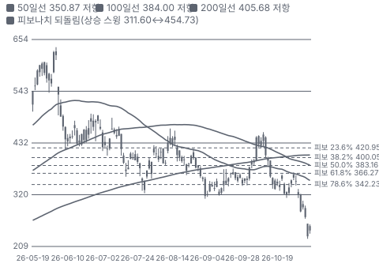

**주봉**

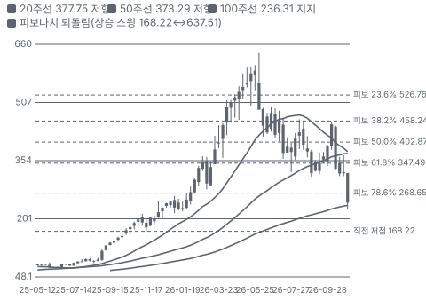

**월봉**

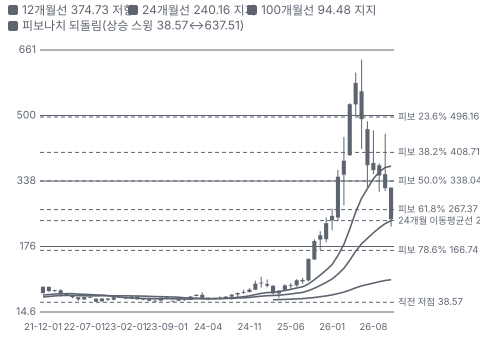

**분기 매출·EPS 실적과 컨센서스**

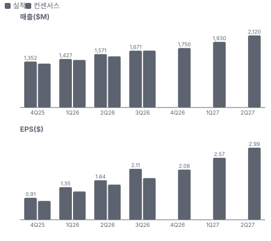

**4Q26 매출 — 지표 추세 vs 가이던스·컨센서스**

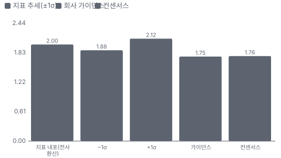

**최근 4개 분기 주가 변화 분석**

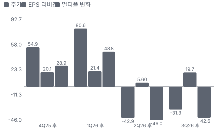

**EPS 리비전**

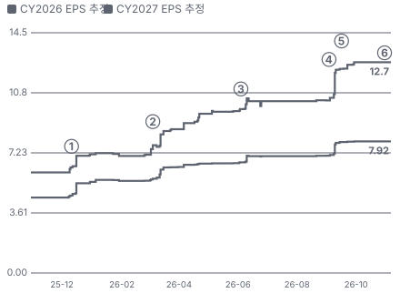

① 25-12-11 FQ4 FY25 실적 · EPS 리비전 +11%
② 26-03-05 FQ1 FY26 실적 · EPS 리비전 +15%
③ 26-06-04 FQ2 FY26 실적·FY26 \$6.3B 상향 · EPS 리비전 +5%
④ 26-09-03 FQ3 실적·FY27 예비 가이던스 · EPS 리비전 +18%
⑤ 26-09-16 투자자 포럼 FY29 목표 · 실적 창과 겹침
⑥ 26-11-05 네트워크 장비 업종 하향(Morgan Stanley의 Cisco 하향) · EPS 리비전 +0%

**밸류에이션 주가 시나리오**

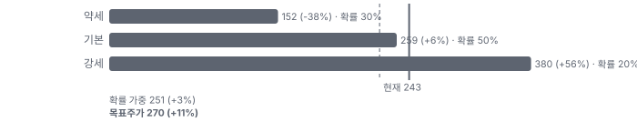

**주가별 업사이드**

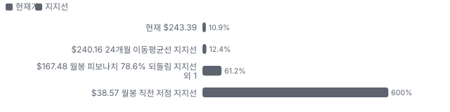

**제품·서비스 포트폴리오**

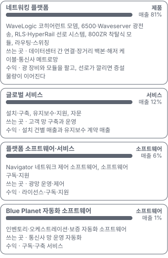

**고객 믹스(FQ3 FY26, 매출 대비)**

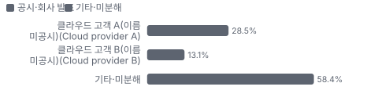

**공급 병목(10점, 낮을수록 병목)**

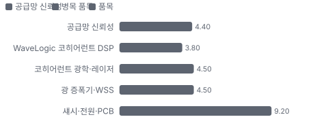

**CAPEX의 매출 대비 비중**

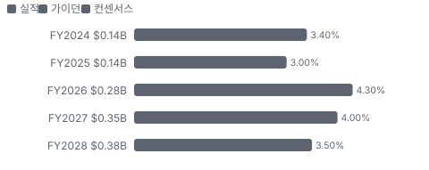

**어닝콜 변화별 주주가치 영향**

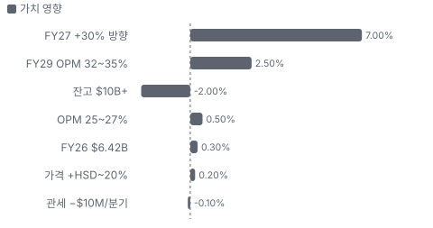

**멀티플 프리미엄(Fwd 1Y P/E, 최근 4개 분기말)**

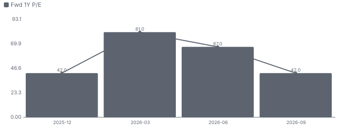

**합리적 멀티플**

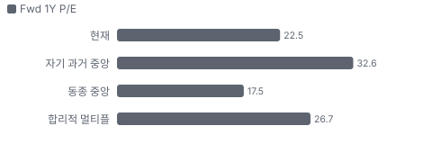

**수주·파이프라인 확실성 사다리**

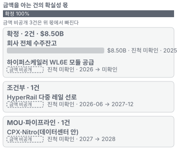

**매출 → 매출총이익 → 영업이익(매출 = 100, 최근 4분기)**

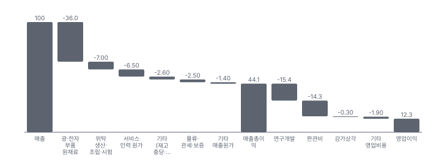

**1년 전 대비 마진 기여(비용 비중 변화의 반대)**

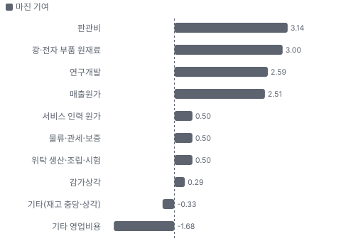

**분기 비용 비중 추이(매출 대비, 공시)**

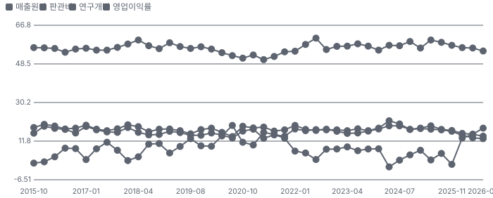

**비용 요인별 매출 대비 비중과 1년 변화**

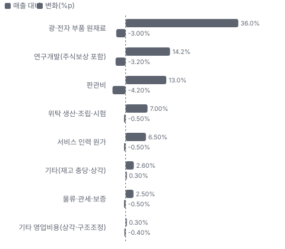

**BOM 항목 가격 +10% 시 OPM 변화**

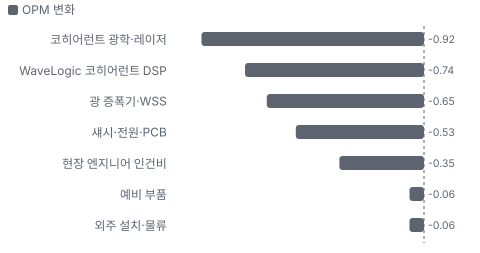

**네트워킹 플랫폼 BOM 원가 몫과 가격 +10% 시 OPM**

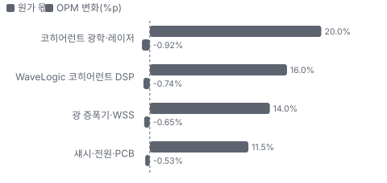

**글로벌 서비스 BOM 원가 몫과 가격 +10% 시 OPM**

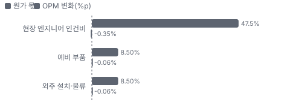

**매출·PPI·수출입 — 최근 16개 분기 같은 축(4Q22 = 100) + 다음 분기 추정**

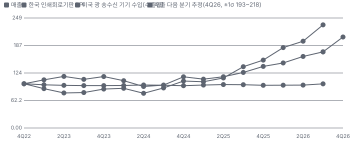

**매출과 미국 광 송수신 기기 수입 증가율(전년 대비, 최근 16개 분기 + 다음 분기 추정)**

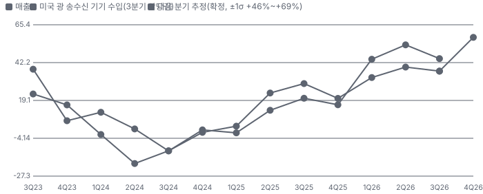

**목표주가 산정 — 기본과 강세 사이(강세 쪽 9%), 도달 확률 약 42%**

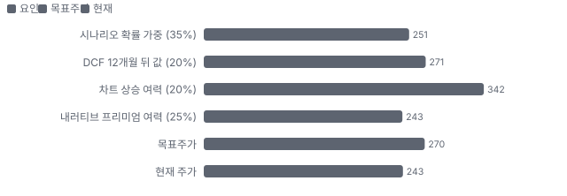

**PEG — 성장 대비 멀티플(낮을수록 성장 대비 쌈)**

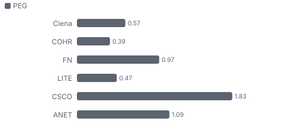

**일봉 지지·저항과 목표주가**

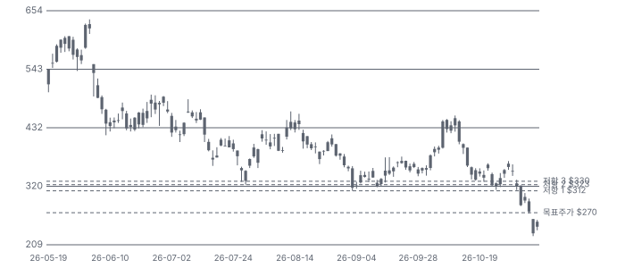

**커뮤니티 언급 수(최근 30일, 채널별)**

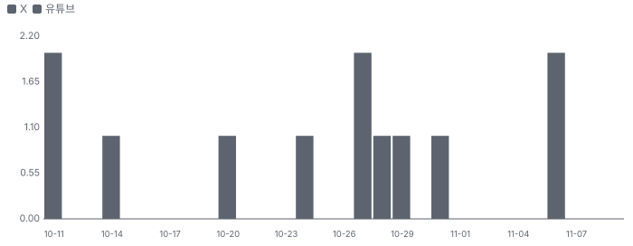

**커뮤니티 게시 수(월, 최근 9개월 — 이번 달은 진행 중)**

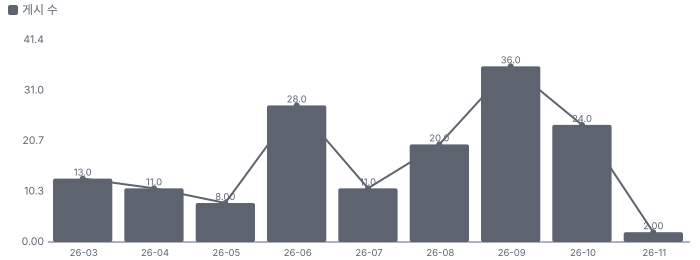

**일별 거래량 분해**

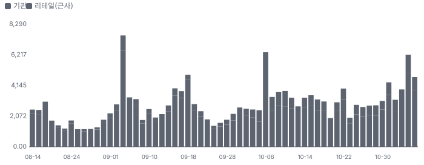

**기관 자금 흐름**

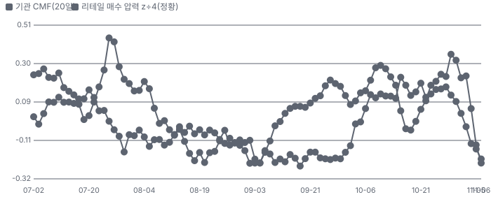

**몬테카를로**

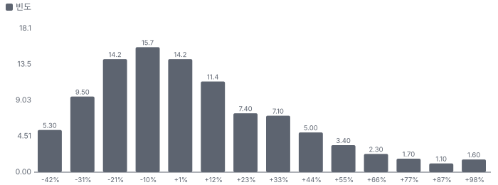

해석: 3,000번 중 1,483번(49%)에서 가치가 지금 주가 이상이었다. 지금 주가를 뒷받침하는 경우와 그렇지 않은 경우가 반반에 가깝다. 가운데 값은 1.00배이고, 열 번 중 여덟 번은 0.70~1.50배 사이에 든다.

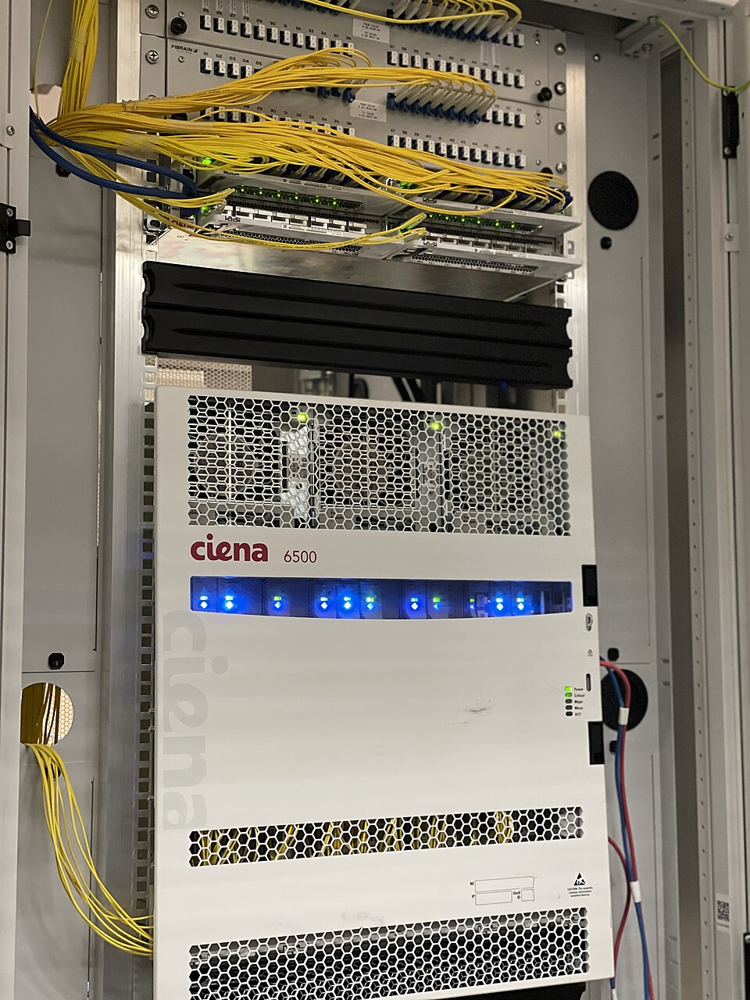
**네트워킹 플랫폼** — Ciena 6500 패킷-광 플랫폼 실물(위키미디어 공용, CC BY-SA 4.0)
_사진: C0pMer · CC BY-SA 4.0 · Wikimedia Commons_

## 내러티브

> **기업가치를 결정하는 이야기:** 가치 논리는 단순하다. 매출 = AI 데이터센터 간 연결 물량 × Ciena 점유율 × 가격이고, 지금은 부품 공급이 물량을 정한다. 회사가 2029년까지 부품 공급과 고객 약정을 잡아 두었으니 물량은 공급 계획을 따라간다. 이익률은 가격 인상과 HyperRail 믹스가 끌어올린다. 위험은 고객 두 곳이 매출의 42%라는 점과 잔고의 대부분이 취소 가능한 주문이라는 점이다.

> **멀티플·EPS 프리미엄**
> **멀티플:** 지금 Fwd 1Y P/E 22.5배는 동종 중앙값 17.5배보다 29% 높다. 월말 기준으로 5월 80배, 9월 35배, 10월 32배였다. 선행 매출 성장 +34%와 이익률 확장이 동종 상위라 프리미엄 자체는 근거가 있다.
> **EPS:** EPS에는 기대가 크게 쌓였다. FY27 EPS 컨센서스는 직전 콜 전 \$8.90에서 \$11.60(셀사이드)~\$12.50(자체 추정)으로 30% 이상 올랐다. 다음 4개 분기 EPS \$10.99는 지난 4개 분기 \$6.01의 1.8배다.

### 투자자들은 왜 열광했나

열광의 정점은 6월과 10월 초였다. 6월에는 매출 +40%와 연간 상향, 10월 6일에는 Marvell 투자자의 날이 코히어런트 수요를 확인해 하루 +13.8%였다. 9월 투자자 포럼의 FY29 \$14B 목표가 기대를 숫자로 만들었다. 식은 이유는 세 가지다. 실적 날마다 주가가 빠졌고(6/4 −13.7%, 9/3 −10.4%), 11월 첫 주 AI 하드웨어 업종 매도와 Cisco 하향이 겹쳤으며, 고객 두 곳 집중이 다시 부각됐다.

### 무엇이 기업가치를 바꾸나

> **구조적 체질 변화**
> **변화:** 통신사 장비 회사에서 클라우드 회사 매출이 절반 넘는 회사로 바뀌었다. 직접 하이퍼스케일러 매출이 약 50%(CEO), 데이터센터 안팎 매출 비중은 올해 4배가 됐다.
> **증거:** FQ3 콜·10-Q 고객 집중 주석
> **반증:** 하이퍼스케일러 2027 설비투자가 줄어 통신사 비중이 다시 커지면 체질 변화가 아니라 사이클이다.

> **고부가 믹스 확장**
> **변화:** 조정 총이익률이 1년 새 41.9%에서 46.4%로 올랐다(관세 환급 0.7%p 포함). HyperRail은 회사 평균보다 높은 마진이라고 했다.
> **증거:** FQ3 콜 CFO
> **반증:** 플러그·인터커넥트 같은 저마진 제품 비중이 빠르게 커져 총이익률이 45% 아래로.

> **기술 혁신**
> **변화:** 1.6T 모뎀 WL6E, 다중 레일 선로 HyperRail(2026년 말 표준화, 2027년 수억 달러), 데이터센터 안 CPX(Ciena의 교체형 근접 패키징 광 엔진)·Nitro(2027년 매출 시작).
> **증거:** FQ2·FQ3 콜·ECOC(유럽 광통신 학회) 수상(보도)
> **반증:** HyperRail 표준화가 2027년으로 밀리거나 CPX 샘플이 수주로 이어지지 않는다.

> **실행 속도**
> **변화:** 주문이 매출의 약 1.5배라 리드타임이 길어졌다. 경영진은 매출이 수요가 아니라 부품 공급에 묶여 있고 2028년 전 균형은 없다고 했다. **납품 리드타임 15.3개월(수주잔고 ÷ 월매출, 추정).** 피어 비교 미확인. 2026-05(FQ2 말) 14.7개월(수주잔고 ÷ 월매출, 추정)보다 4% 길다.
> **증거:** FQ3 콜
> **반증:** 잔고 증가가 멈추고 리드타임이 짧아지면 수요 둔화 신호다.

> **M&A**
> **변화:** 2025-10 Nubis Communications 인수로 데이터센터 안 광·전기 연결(CPX·Nitro(Ciena의 능동 구리 케이블용 선형 리드라이버 칩)) 인력을 얻었다. 금액은 대형이 아니다.
> **증거:** 10-K FY2025·10-Q R&D 비용 증가 설명
> **반증:** CPX·Nitro 매출이 2027년에 나오지 않는다.

> **정책·입법 연관성**
> **재정정책:** 해당 없음(Ciena에 직접 닿는 연방 재정 지출 공시가 없다). 광대역 보조(BEAD(미국 연방 광대역 보급 보조 사업)) 같은 통신사 쪽 지출은 간접이다. 10-K·10-Q 반증: 연방 광대역 지출이 대폭 삭감된다 의회 동의 2/10 — 하원 1/5(Ciena 직접 지원 법안 논의 없음) · 상원 1/5(Ciena 직접 지원 법안 논의 없음).
> **행정명령:** 관세: 위탁 생산이 캐나다·멕시코·태국·베트남에 있다. 회사는 관세를 원가 그대로 넘긴다고 했고, 새 캐나다 관세는 분기 약 \$10M 영향 가능. FQ3 콜 Q&A·10-K 위탁 생산 지역 반증: 멕시코·동남아 관세가 크게 오르고 고객이 전가를 거부한다 의회 동의 0/10 — 하원 0/5(행정부 관세 — 의회 표결 없음) · 상원 0/5(행정부 관세 — 의회 표결 없음).
> **연관입법:** 연방 데이터센터 법안은 비용 전가 위주다. 노션 추적표 기준 하원 통과 1건, 상원 표결 실패 1건. 노션 데이터센터 법안 추적표 요지 반증: 데이터센터 건설 유예 법안이 위원회를 통과한다

> **CAPEX 낙수효과**
> **변화:** 하이퍼스케일러·네오클라우드의 데이터센터 투자와 전력 부족이 AI 학습을 여러 부지로 흩어 놓아 데이터센터 간 연결이 늘었다. 고객 약정이 2029년까지 이어진다.
> **증거:** FQ3 콜·노션 IB 자료(데이터센터 용량 2030년 273~316GW 전망)
> **반증:** 하이퍼스케일러 설비투자 가이던스가 2027년에 꺾인다(1~2월 실적).

### 내러티브 근거

> 'AI 데이터센터 간 연결(scale-across(여러 데이터센터를 하나의 AI 학습 클러스터처럼 잇는 연결))의 1위 광전송 회사'라는 이야기는 실적으로 확인되는데(FQ3 매출 +37%, 잔고 \$8.5B), 주가는 6월 종가 고점 \$627.00(6/2)에서 −61%다. 하락은 이익 추정이 아니라 업종 배수와 고객 집중 우려가 만들었다. 동종 대비 멀티플 차이 +28% 중 회사 고유 몫은 -16%다. 단계는 과밀, 쏠림은 높음 → 해소 중이다.

> **scale-across 광 연결** · 강화
> **논리:** 전력 부족으로 AI 학습이 여러 부지로 흩어지면 같은 컴퓨팅에 더 많은 광전송이 필요하다
> **숫자:** 광 네트워킹 매출 Q3 \$1,191.3M(+46% YoY)
> **반증:** 하이퍼스케일러 설비투자 가이던스가 2027년에 꺾인다

> **가격 인상·이익률 확장** · 강화
> **논리:** 공급이 모자라 가격을 올리고, HyperRail 같은 고마진 제품이 늘어 영업이익률이 20%에서 25~27%로 간다
> **숫자:** FY27 조정 영업이익률 가이던스 25~27%(FY26 20~21%)
> **반증:** FQ4 가이던스에서 FY27 영업이익률 하단이 25% 아래로

> **FY29 목표 \$14B** · 유지
> **논리:** 회사가 3년 연 30% 성장·영업이익률 32~35%를 목표로 걸었다
> **숫자:** FY29 매출 약 \$14B 목표 vs 컨센서스 FY28 \$10.8B
> **반증:** FY27 실제 성장이 25% 아래

> **데이터센터 안 광(CPX·Nitro)** · 태동
> **논리:** 데이터센터 밖에서 안으로 시장이 넓어진다
> **숫자:** 매출 2027년 시작(회사), 샘플 주문 확보
> **반증:** 2027년 CPX 매출 공시가 없다

> **반대 — 고객 집중·사이클 정점** · 확산
> **논리:** 두 클라우드 고객이 매출의 42%이고, 잔고 대부분이 취소 가능하다. 2001년 광 버블처럼 공급이 풀리면 가격이 무너진다
> **숫자:** 상위 두 고객 Q3 41.6%, 잔고 \$8.5B 중 RPO \$2.5B
> **반증:** FQ4에 고객 다변화(10% 고객 감소)와 RPO 증가가 확인된다

> **반대 — 업종 배수 하락** · 확산
> **논리:** AI 하드웨어 업종 전체의 배수가 내려가는 국면이고 Ciena는 베타가 높다
> **숫자:** 나스닥 100 20거래일 −12.6%, Ciena 같은 기간 −46%
> **반증:** 업종 반등 때 Ciena가 동종보다 덜 오른다면 고유 문제

이미지 없음(검수 실패) — 글로벌 서비스

## 포트폴리오

| 제품·서비스 | 구분 | 무엇 | 쓰는 곳 | 돈 버는 방식 | Mix | Mix 변화(전 분기 대비) |
|---|---|---|---|---|---|---|
| 네트워킹 플랫폼 | 제품 | WaveLogic 코히어런트 모뎀, 6500(Ciena의 패킷-광 통합 전송 플랫폼)·Waveserver(Ciena의 데이터센터 간 연결 전용 소형 광전송 장비) 광전송, RLS(Ciena의 재구성형 광 회선 시스템, 광 신호를 증폭·분기하는 선로 장비)·HyperRail 선로 시스템, 800ZR(데이터센터 사이 수십~수백 km 연결용 800Gb/s 착탈식 광 모듈 규격) 착탈식 모듈, 라우팅·스위칭 | 데이터센터 간 연결·장거리 백본·해저 케이블·통신사 메트로망 | 광 장비와 모듈을 팔고, 선로가 깔리면 증설 물량이 이어진다 | 81% | +0.0%p |
| 글로벌 서비스 | 서비스 | 설치·구축, 유지보수·지원, 자문 | 고객 망 구축과 운영 | 설치 건별 매출과 유지보수 계약 매출 | 12% | +0.2%p |
| 플랫폼 소프트웨어·서비스 | 소프트웨어 | Navigator(Ciena의 네트워크 제어 소프트웨어) 네트워크 제어 소프트웨어, 소프트웨어 구독·지원 | 광망 운영·제어 | 라이선스·구독·지원 | 6% | -0.1%p |
| Blue Planet(Ciena의 네트워크 자동화·운영 소프트웨어) 자동화 소프트웨어 | 소프트웨어 | 인벤토리·오케스트레이션·보증 자동화 소프트웨어 | 통신사 망 운영 자동화 | 구독·구축 서비스 | 1% | -0.1%p |

**Mix 변화가 가장 큰 쪽은 글로벌 서비스(+0.2%p, 전 분기 대비).** 계절성 판정: 분기 매출 계절 지수 기준 없음 → 직전 분기와 비교.

## 고객

> **FQ3 FY26 최대 고객 클라우드 고객 A(이름 미공시, Cloud provider A) 28%, 상위 3곳 42%, 집중도 분산.** 공시·회사 발표로 확인한 몫은 매출의 42%이고, 나머지 고객 몫은 추정이거나 미분해다. FQ3 매출의 41.6%가 두 클라우드 고객이다(A 28.5%·B 13.1%). 1년 전에는 A 17.9%와 통신사 한 곳 10.9%였다. 회사는 직접 하이퍼스케일러 매출이 약 50%라고 했다. 나머지 약 58%는 그 밖의 하이퍼스케일러·네오클라우드(직접 하이퍼스케일러 약 50% − 두 고객 41.6% ≈ 8~12%, 추정)와 통신사·기타 사업자다.

**고객별 매출 몫(FQ3 FY26)**
| 고객 | 몫 | 변화 | 근거 |
|---|---|---|---|
| 클라우드 고객 A(이름 미공시, Cloud provider A) | 28% | +11%p | 공시 |
| 클라우드 고객 B(이름 미공시, Cloud provider B) | 13% | 미확인 | 공시 |
| 기타·미분해 | 58% | - | - |

> **클라우드 고객 A(이름 미공시, Cloud provider A)** · 공시
> **사는 것:** 네트워킹 플랫폼·소프트웨어·서비스
> **추정 근거:** 10-Q 10% 고객 표 — \$476.6M

> **클라우드 고객 B(이름 미공시, Cloud provider B)** · 공시
> **사는 것:** 네트워킹 플랫폼
> **추정 근거:** 10-Q 10% 고객 표 — \$219.6M(1년 전 10% 미만)

## 수주·파이프라인

> **2026-09-03 기준 4건.** 확정 \$8.50B. 공시 수주잔고 \$8.50B.

**실행 속도와 방해 요인**
| 항목 | 상태 | 실행 속도 | 방해 요인 |
|---|---|---|---|
| 회사 전체 수주잔고 | 확정 | 잔고 ÷ 월매출 15.3개월 | 광 부품 공급 · DSP·모뎀 제약 |
| HyperRail 다중 레일 선로 | 조건부 | 2027년 수억 달러 램프(경영진) | 부품 공급 · 표준화 일정 |
| 하이퍼스케일러 WL6E 모듈 공급 | 확정 | 미확인 | DSP 공급 |
| CPX·Nitro(데이터센터 안) | 파이프라인 | 2027년 매출 시작, 2028년 램프(경영진) | CPO(공동 패키징 광학) 표준·생태계 |

## 마진 구조

> **GPM 45.4%, OPM 18.0%.** 3Q FY25(2Q25) 대비 GPM +4.2%p, OPM +12.0%p. 변동비는 매출의 54%이고, 매출이 10% 늘면 OPM은 +2.5%p 움직인다. FQ3 매출원가는 매출의 54.6%로 1년 전 58.7%보다 4.1%p 낮다. 원가 절감·가격 인상·믹스와 관세 환급이 함께 마진을 올렸다.

> **매출 100 중 매출원가 55.9, 매출총이익 44.1(최근 4분기, 공시).** 매출원가 요인 중 광·전자 부품 원재료이 매출의 36.0%로 가장 무겁고, 단가가 +10% 오르면 GPM이 -3.60%p 움직인다. 분기 회귀로 매출 1이 늘 때 매출원가는 0.57 늘고, 매출원가의 고정비 몫은 -1%다.

**비용 요인 강도 — 비중·추세·충격(+10%)·탄력**
| 비용 | 구분 | 매출 대비 | 1년 변화 | 마진 기여 | 충격 시 마진 | 매출 탄력 | 고정비 몫 |
|---|---|---|---|---|---|---|---|
| 광·전자 부품 원재료 | 매출원가 요인 | 36.0% | -3.0%p | +3.0%p | -3.60%p | 미확인 | 0% |
| 위탁 생산·조립·시험 | 매출원가 요인 | 7.0% | -0.5%p | +0.5%p | -0.70%p | 미확인 | 30% |
| 서비스 인력 원가 | 매출원가 요인 | 6.5% | -0.5%p | +0.5%p | -0.65%p | 미확인 | 60% |
| 기타(재고 충당·상각) | 매출원가 요인 | 2.6% | +0.3%p | -0.3%p | -0.26%p | 미확인 | 50% |
| 물류·관세·보증 | 매출원가 요인 | 2.5% | -0.5%p | +0.5%p | -0.25%p | 미확인 | 0% |
| 매출원가 | 공시 항목 | 55.9% | -2.5%p | +2.5%p | -5.59%p | 0.57 | -1% |
| 연구개발 | 공시 항목 | 15.4% | -2.6%p | +2.6%p | 미확인 | 0.15 | 11% |
| 판관비 | 공시 항목 | 14.3% | -3.1%p | +3.1%p | 미확인 | 0.11 | 33% |
| 기타 영업비용 | 공시 항목 | 1.9% | +1.7%p | -1.7%p | 미확인 | 0.01 | -38% |
| 감가상각 | 공시 항목 | 0.3% | -0.3%p | +0.3%p | 미확인 | -0.01 | 100% |

매출 탄력 = 분기 비용을 매출에 회귀한 기울기(매출 1당 변동비), 고정비 몫 = 절편 ÷ 평균 비용. 표본이 8분기 미만이면 미확인. 매출원가 요인 비중은 margin 재료의 추정이 섞여 있고, 공시 매출원가와의 차이는 '기타 매출원가'로 둔다.

**GPM에서 OPM까지(GAAP)**
| 기간 | GPM | 연구개발 | 판관비 | 기타 | OPM |
|---|---|---|---|---|---|
| 3Q FY25(2Q25) | 41.3% | 17.4% | 17.2% | 0.7% | 6.0% |
| 3Q FY26(3Q26) | 45.4% | 14.2% | 13.0% | 0.3% | 18.0% |

**GPM·OPM 최근 4개 분기**
| 분기 | GPM | OPM |
|---|---|---|
| 2025-11 | 42.7% | 0.8% |
| 2026-01 | 43.8% | 13.3% |
| 2026-05 | 44.0% | 15.1% |
| 2026-08 | 45.4% | 18.0% |

**마진을 결정하는 비용 요인 — 비용 +10% 시 OPM**
| 비용 | 매출 대비 | 변화 | 고정비 | OPM |
|---|---|---|---|---|
| 광·전자 부품 원재료 | 36.0% | -3.0%p | 0% | -3.60%p |
| 연구개발(주식보상 포함) | 14.2% | -3.2%p | 80% | -1.42%p |
| 판관비 | 13.0% | -4.2%p | 70% | -1.30%p |
| 위탁 생산·조립·시험 | 7.0% | -0.5%p | 30% | -0.70%p |
| 서비스 인력 원가 | 6.5% | -0.5%p | 60% | -0.65%p |
| 기타(재고 충당·상각) | 2.6% | +0.3%p | 50% | -0.26%p |
| 물류·관세·보증 | 2.5% | -0.5%p | 0% | -0.25%p |
| 기타 영업비용(상각·구조조정) | 0.3% | -0.4%p | 100% | -0.03%p |

**비용을 움직이는 요인**
| 비용 | 요인 |
|---|---|
| 광·전자 부품 원재료(매출원가) | 부품 단가와 가격 인상 · 근거 추정 |
| 연구개발(주식보상 포함, 연구개발) | WaveLogic·HyperRail·CPX 개발 인력 · 근거 공시 |
| 판관비(판관비) | 영업 인력·변동 보상 · 근거 공시 |
| 위탁 생산·조립·시험(매출원가) | 물량 · 근거 추정 |
| 서비스 인력 원가(매출원가) | 설치·유지보수 인력 · 근거 추정 |
| 기타(재고 충당·상각, 매출원가) | 재고·무형자산 상각 · 근거 추정 |
| 물류·관세·보증(매출원가) | 관세 환급(Q3 +0.7%p) · 근거 추정 |
| 기타 영업비용(상각·구조조정, 기타) | 무형자산 상각·구조조정 · 근거 공시 |

**네트워킹 플랫폼 BOM — 매출의 81%, GPM 43%(FY2025 부문 총이익 \$1,445.4M ÷ 부문 매출 \$3,410.0M = 42.4%(10-K) — FY26 개선분 추정), 항목 가격 +10% 시**
| 항목 | 원가 몫 | 전가 | 제품 GPM | OPM |
|---|---|---|---|---|
| 코히어런트 광학·레이저 | 15~25% | 미확인 | -1.1%p | -0.92%p |
| WaveLogic 코히어런트 DSP | 12~20% | 미확인 | -0.9%p | -0.74%p |
| 광 증폭기·WSS(파장 선택 스위치, 광 신호를 파장별로 나눠 보내는 부품) | 10~18% | 미확인 | -0.8%p | -0.65%p |
| 섀시·전원·PCB | 8~15% | 미확인 | -0.7%p | -0.53%p |
| 미분해 | 38% | - | - | - |

**글로벌 서비스 BOM — 매출의 12%, GPM 36%(FY2025 부문 총이익 \$218.4M ÷ 매출 \$613.8M = 35.6%(10-K)), 항목 가격 +10% 시**
| 항목 | 원가 몫 | 전가 | 제품 GPM | OPM |
|---|---|---|---|---|
| 현장 엔지니어 인건비 | 40~55% | 미확인 | -3.0%p | -0.35%p |
| 예비 부품 | 5~12% | 미확인 | -0.5%p | -0.06%p |
| 외주 설치·물류 | 5~12% | 미확인 | -0.5%p | -0.06%p |
| 미분해 | 36% | - | - | - |

코히어런트 광학·레이저 가격이 +10% 오르면 영업이익은 -5.1% 움직인다. 판매가 전가를 모르는 항목은 전가 0%로 계산했다.

**BOM 항목 가격을 움직이는 것**
| 항목 | 요인 |
|---|---|
| WaveLogic 코히어런트 DSP | 첨단 공정 칩, 공급 제약 · 근거 추정 |
| 코히어런트 광학·레이저 | InP(인화인듐, 레이저·변조기 칩의 기판 소재) 레이저 부족 · 근거 추정 |
| 광 증폭기·WSS | 펌프 레이저 부족 · 근거 추정 |
| 섀시·전원·PCB | 범용 부품 · 근거 추정 |
| 현장 엔지니어 인건비 | 인력 단가 · 근거 추정 |
| 예비 부품 | 부품 단가 · 근거 추정 |
| 외주 설치·물류 | 외주 단가 · 근거 추정 |

**BOM 투입 물가 — PPI 전년비, 2026-11-09 수집**
| 항목 | 미국 | 일본 | 한국 | 대만 |
|---|---|---|---|---|
| WaveLogic 코히어런트 DSP | -2.2%* | 미확인 | 미확인 | 미확인 |
| 광 증폭기·WSS | -2.2%* | 미확인 | 미확인 | 미확인 |
| 섀시·전원·PCB | +45.8% | +11.3% | +4.5% | +12.1% |

별표는 품목보다 넓은 업종 지수다. 지난 1년 투입 물가를 판매가 전가 뒤 원가에 그대로 넣으면 OPM은 -0.47%p 움직인다(매출원가의 52% 기준).

## 공급망 병목

> **공급망 신뢰성 4.4/10, 병목 주의.** 가장 약한 고리는 WaveLogic 코히어런트 DSP 3.8점이고, 품목 평균은 5.2점이다. 병목은 회사 밖 광 부품(레이저·펌프·WSS)과 DSP 공정에 있다. 경영진은 2029년까지 장기 공급을 잡았지만 2028년 전 수급 균형은 없다고 봤다.

**병목과 마진 — 품목 가격 +10% 시 OPM**
| 품목 | 점수 | 판정 | 구분 | OPM |
|---|---|---|---|---|
| WaveLogic 코히어런트 DSP(필수) | 3.8 | 병목 심각 | 핵심 통제 품목 | -0.74%p |
| 코히어런트 광학·레이저(필수) | 4.5 | 병목 주의 | 핵심 통제 품목 | -0.92%p |
| 광 증폭기·WSS(필수) | 4.5 | 병목 주의 | 핵심 통제 품목 | -0.65%p |
| 섀시·전원·PCB | 9.2 | 병목 낮음 | 가격 위험 | -0.53%p |

> **WaveLogic 코히어런트 DSP** · 3.8/10
> **왜:** 모뎀 전부의 바탕 — 끊기면 출하가 멈춘다
> **병목 요인:** 인증 공급사 1곳 · 캐파 빠듯 · 리드타임 미확인 · 재인증 12개월 · 1위 점유율 미확인 · 지역 집중 미확인 · 물량 확보 장기계약
> **풀리는 조건:** 미확인

> **코히어런트 광학·레이저** · 4.5/10
> **왜:** 레이저가 모자라면 모뎀·플러그 출하가 멈춘다. 자체 광학과 외부 공급사 두 갈래(FQ2 콜 '가장 수직계열화된 공급자', 외부사는 미공시)
> **병목 요인:** 인증 공급사 2곳 · 캐파 부족 · 리드타임 미확인 · 재인증 9개월 · 1위 점유율 미확인 · 지역 집중 미확인 · 물량 확보 선급금
> **풀리는 조건:** 미확인

> **광 증폭기·WSS** · 4.5/10
> **왜:** RLS·HyperRail 출하를 정한다. WSS·펌프 레이저 세계 공급은 소수 업체가 나눠 갖는다(1위 몫 약 50%는 업계 추정)
> **병목 요인:** 인증 공급사 미확인 · 캐파 부족 · 리드타임 미확인 · 재인증 9개월 · 1위 점유율 50% · 지역 집중 미확인 · 물량 확보 장기계약
> **풀리는 조건:** 미확인

> **섀시·전원·PCB** · 9.2/10
> **왜:** 지역 관세 영향
> **병목 요인:** 인증 공급사 4곳 · 캐파 여유 · 리드타임 미확인 · 재인증 6개월 · 1위 점유율 미확인 · 지역 집중 미확인 · 물량 확보 복수구매
> **풀리는 조건:** 증설 가동(회사 발표)

**공급사**
| 품목 | 공급사 | 몫 | 근거 |
|---|---|---|---|
| WaveLogic 코히어런트 DSP | 파운드리(업체 미공시, DSP 위탁 생산) | 미확인 | 추정 |
| 코히어런트 광학·레이저 | Ciena 자체 광학(일부 광학) | 미확인 | 회사 발표 |
| 코히어런트 광학·레이저 | Lumentum(레이저·광 부품(추정)) | 미확인 | 추정 |
| 광 증폭기·WSS | 외부 공급사(미공시, 펌프 레이저·WSS) | 미확인 | 추정 |
| 섀시·전원·PCB | 위탁 생산사(캐나다·멕시코·태국·베트남·미국, 이름 미공시, 조립·시험·출하) | 미확인 | 공시 |

**무역 통계로 본 공급 지역**
| 품목 | EU 수입처 | 일본 수입처 | EU 1위 전년비 |
|---|---|---|---|
| WaveLogic 코히어런트 DSP | CN(중국) 36% · VN 26% · TW(대만) 19% | 中華人民共和国 33% · ベトナム 18% | -8.5% |
| 코히어런트 광학·레이저 | CN 41% · MY(말레이시아) 23% · JP 19% | 中華人民共和国 32% · マレーシア 21% | -10.7% |
| 광 증폭기·WSS | CN 41% · MY 23% · JP 19% | 中華人民共和国 32% · マレーシア 21% | -10.7% |
| 섀시·전원·PCB | CN 85% · TW 4% · KR(한국) 4% | 中華人民共和国 62% · 台湾 11% | +25.2% |

## 생산능력

> **현재 명목 캐파 미확인, 가동률 미확인.** 착공 이상 증설은 0 출하 증가율(회사 표현), 발표까지 합치면 0 출하 증가율(회사 표현)이다. FY2025 CAPEX는 \$0.14B로 매출의 3.0%다. 회사는 캐파를 수치로 공시하지 않는다. FY26 CAPEX(\$250~275M 상단)로 RLS·플러그·Waveserver 매출 60% 이상 성장을 감당했다는 것이 회사가 밝힌 숫자다. 제조는 위탁 생산사가 한다.

**생산시설 9곳**(10-K FY2025 Item 2 — 모든 시설은 임차(소유 부동산 없음). 이름·면적을 밝힌 시설 4건(오타와 2·구르가온 2) + 위탁 생산 국가 5곳(캐나다·멕시코·태국·베트남·미국 — 위탁처 이름·캐파 미공시, 국가당 1곳 이상이라 최소치로 센다). 메릴랜드 본사는 면적 미공시) — 이름·위치를 밝힌 곳 5곳, 임차 4곳 · 위탁 1곳. 시설별 생산능력은 공개되지 않았다 — 회사 전체 캐파만 위에 적었다.

**생산시설 9곳 — 명칭·위치·생산능력**
| 시설 | 위치 | 용도 | 생산능력 | 소유·상태 |
|---|---|---|---|---|
| 오타와 R&D 캠퍼스(18년 임차 건물) | 캐나다 오타와 | 연구개발·시제품 | 미확인 — 연구 시설 — 생산 캐파 해당 없음 · 면적 170,000 sq ft | 임차 · 가동 |
| 오타와 R&D 캠퍼스(15년 임차 건물 2동) | 캐나다 오타와 | 연구개발 | 미확인 — 연구 시설 · 면적 255,000 sq ft | 임차 · 가동 |
| 구르가온 R&D 센터(기존 2동) | 인도 구르가온 | 연구개발 | 미확인 — 연구 시설 — FY2026 임차 만료 · 면적 282,000 sq ft | 임차 · 매각·폐쇄 예정 |
| 구르가온 R&D 센터(신규 2동) | 인도 구르가온 | 연구개발 | 미확인 — 연구 시설 · 면적 177,000 sq ft | 임차 · 가동 |
| 위탁 생산 거점(5개국) | 캐나다·멕시코·태국·베트남·미국 | 제조·조립·시험 | 미확인 — 위탁처 이름·캐파 미공시(10-K) | 위탁 · 가동 |

**생산능력 확충 계획**
| 계획 | 단계 | 증설 | 가동 시점 | CAPEX |
|---|---|---|---|---|
| 핵심 광 부품 장기 공급 계약·선급 | 발표 | 미확인 | 2027~2029 | 미확인 |
| HyperRail 양산 | 발표 | 미확인 | 2027 | 미확인 |

남은 계획의 CAPEX 합계는 \$0.00B(금액 미확인 2건 제외)다. 합계는 FY2028 매출의 0%다.

**증설 방해 요인**
| 계획 | 방해 요인 |
|---|---|
| 핵심 광 부품 장기 공급 계약·선급 | 공급사 증설 속도 |
| HyperRail 양산 | 표준화·부품 |

**CAPEX와 매출 대비**
| 기간 | CAPEX | 매출 | 매출 대비 | 구분 |
|---|---|---|---|---|
| FY2024 | \$0.14B | \$4.01B | 3.4% | 실적 |
| FY2025 | \$0.14B | \$4.77B | 3.0% | 실적 |
| FY2026 | \$0.28B | \$6.42B | 4.3% | 가이던스 |
| FY2027 | \$0.35B | \$8.70B | 4.0% | 컨센서스 |
| FY2028 | \$0.38B | \$10.80B | 3.5% | 컨센서스 |

## 해자

> 장거리 코히어런트 모뎀의 세대 선점과 선로 시스템 설치 기반이 경쟁을 막는다 — 다만 고객 두 곳이 매출의 42%라 협상력은 양방향이다

> **코히어런트 모뎀 세대 선점(자체 DSP)** · 강함
> **해자:** WaveLogic 6 Extreme(Ciena의 1.6Tb/s 장거리 코히어런트 모뎀)은 출시 18개월 뒤에도 유일한 1.6Tb/s 고성능 모뎀이라고 회사가 말한다. DSP를 직접 설계해 세대마다 먼저 낸다.
> **근거:** FQ3 콜 CEO 발언 — WL6E 램프가 직전 세대보다 빠르다
> **숫자:** 광 네트워킹 매출 Q3 \$1,191.3M(+46% YoY, 10-Q)
> **깨지는 조건:** Nokia(Infinera 포함)·Cisco가 1.6T 고성능 모뎀을 양산 출하한다

> **선로 시스템 설치 기반(RLS)** · 강함
> **해자:** 분리형 광 회선 시스템 RLS의 설치 기반 점유율이 약 70%라고 회사가 말한다. 선로가 깔리면 증폭기·모뎀 증설이 같은 회사로 간다.
> **근거:** FQ3 콜 CEO 발언(회사 주장, 독립 확인 미확인)·ABI Research DCI(데이터센터 간 연결) 선로 시스템 리더 선정(11/05)
> **숫자:** RLS 점유율 약 70%(회사 주장)
> **깨지는 조건:** 하이퍼스케일러가 HyperRail 대신 다른 회사 다중 레일 시스템을 표준으로 고른다

> **공동 설계·서비스 관계** · 보통
> **해자:** HyperRail은 하이퍼스케일러와 함께 설계했고, 전 세계 설치·사전 구성 서비스를 10년 넘게 해 왔다. 장비만 바꾸기 어렵다.
> **근거:** FQ2·FQ3 콜
> **숫자:** 설치 서비스 매출 +35%(FQ3 콜)·기간 인식 서비스 매출 Q3 \$243.9M(14.6%)
> **깨지는 조건:** 고객이 자체 광 플랫폼으로 모뎀만 사 간다 — 이미 한 하이퍼스케일러가 WL6E를 자체 플랫폼에 넣었다

> **공급 확보(장기 계약·선급)** · 보통
> **해자:** 부품이 모자란 국면에서 2029년까지 핵심 광 부품 장기 공급을 확보했다. 공급을 쥔 쪽이 점유율을 가져간다.
> **근거:** FQ3 콜 CFO·10-Q MD&A(확정 구매 약정·선급)
> **숫자:** 금액 미공시(미확인)
> **깨지는 조건:** 부품 공급이 풀려 경쟁사도 물량을 낸다(경영진은 2028년 전 균형 없다고 봄)

## 경영진·네트워크

> CEO는 2001년부터 25년째다. 회사 밖 가장 큰 연결은 하이퍼스케일러와의 공동 설계 관계다. 경영진 장내 매수는 없고 10b5-1(미리 정한 일정으로 내부자가 주식을 파는 계획) 계획 매도가 이어진다.

> **Gary B. Smith** · 사장 겸 CEO·이사 · 2001
> **프로필:** Ciena 영업·전략 임원을 거쳐 2001년 CEO가 됐다(공개 경력)
> **비즈니스:** 하이퍼스케일러 경영진과 장기 약정을 직접 논의한다(FQ3 콜)
> **정계:** 공개 기록상 공직·정치 활동 미확인
> **동문:** 미확인
> **사모임:** 미확인

> **Marc D. Graff** · EVP·CFO · 미확인
> **프로필:** 공개 경력 미확인
> **비즈니스:** 가격·공급 '가치 교환' 협상을 이끈다(FQ3 콜)
> **정계:** 미확인
> **동문:** 미확인
> **사모임:** 미확인

> **Scott McFeely** · 경영 고문(전 글로벌 제품·서비스 총괄) · 미확인
> **프로필:** Ciena 제품 총괄 출신(콜 소개)
> **비즈니스:** 하이퍼스케일러 기술 관계
> **정계:** 미확인
> **동문:** 미확인
> **사모임:** 미확인

**네트워크 정량화**
| 연결 | 강도 | 닿는 매출 | 가중 노출 | 매출 대비 | 근거 |
|---|---|---|---|---|---|
| 비즈니스: 하이퍼스케일러 공동 설계(HyperRail)·장기 고객 약정(2029년까지) | 4/5 | \$0.42B | \$0.33B | 6% | 10% 고객 두 곳 Q3 41.6%(10-Q). 연결이 매출을 만들었다고 쓰지 않는다 — 노출 몫만 적는다 https://www.sec.gov/Archives/edgar/data/936395/000162828026060361/cien-20260801.htm |
| 정계: 로비 공시 — 하원 LD(미국 의회 로비 공개 보고) 분기 집계 상위 목록에 없음 | 1/5 | \$0.00B | \$0.00B | 0% | 공개 로비 지출 미확인 하원 LD 분기 로비 공개 집계(2026-11-08) |

가중 노출은 연결이 닿는 매출의 크기다. 연결이 그 매출을 만들었다는 뜻이 아니며, 인과는 공개 자료로 입증하지 못한다.

## 약세 논리 및 셀온 조건

| 약세 논리 | 근거 | 가를 자료 |
|---|---|---|
| 고객 집중 | Q3 클라우드 A 28.5%·B 13.1%, 1년 전 A 17.9%(10-Q) | 12월 10-K 10% 고객 표(2026-12 중순) |
| 잔고의 질 | 잔고 \$8.5B 중 취소 불가 RPO \$2.5B(10-Q) | 10-K RPO와 FQ4 잔고 발표(2026-12) |
| 공급이 풀리면 가격이 되돌려진다 | 경영진: 2028년 전 수급 균형 없음. 2001년 광 버블 비교(딘스티커 3/16) | 2028년 이후 장기 약정 가격 조건 공시 |
| 고객의 내재화 | 한 하이퍼스케일러가 WL6E를 자체 광 플랫폼에 탑재(FQ2 콜) — 장비 대신 모듈만 산다 | 다음 콜의 모듈 vs 시스템 매출 비중 |
| 업종 배수 하락 | 나스닥 100 20거래일 −12.6%, VIX 28, 11/5 고유 공시 없이 −15.2% | 하이퍼스케일러 2027 설비투자 가이던스(2027-01~02) |
| 내부자 매도 | 장내 매수 0·매도 169건, CEO 10b5-1 매도 반복(Form 4) | 10b5-1 계획 변경·종료 공시 |

> **셀온 조건**
> **조건 1:** FQ4 실적에서 FY27 매출 가이던스가 \$8.3B 아래로 내려간다.
> **조건 2:** 조정 총이익률 가이던스가 45% 아래로 내려간다.
> **조건 3:** 10-K에서 RPO가 \$2.5B보다 줄거나 상위 고객 비중이 더 커진다.
> **조건 4:** 하이퍼스케일러가 2027 설비투자를 2026년보다 낮게 제시한다.

## 어닝콜 변화

**직전 콜 대비 새로 나오거나 바뀐 내용 → 가치 영향**
| 항목 | 내용 | 직전 콜 | 최신 콜 | 모델 동인 이동 | 확신도 | 가치 영향 |
|---|---|---|---|---|---|---|
| 업데이트 | FY26 매출 가이던스 | \$6.3B ±\$0.1B | \$6.42B(4Q \$1.75B ±\$0.05B) | 기준연도 매출 +\$0.02B | 0.8 | +0.3% |
| 신규 | FY27 예비 매출 | 없음 | \$8.3~8.4B, 공급 늘면 위 | 1년차 성장률 +4.0% | 0.8 | +7.0% |
| 신규 | FY27 영업이익률 | FY26 19% ±0.5%p | FY27 25~27% | 출발 이익률 +3.0% | 0.8 | +0.5% |
| 업데이트 | 수주잔고 | 2Q 말 \$7.7B | 3Q 말 \$8.5B, FY26 말 \$10B 초과 예상 | 성장 지속(감속 계수) -2.0% | 0.8 | -2.0% |
| 신규 | 가격 인상 | '가치 교환' 논의 시작 | 한 자릿수 후반~20% 초반, 일부 잔고 적용 | 출발 이익률 +1.0% | 0.5 | +0.2% |
| 신규 | FY29 장기 목표 | 중반 40%대 총이익률 경유지 | 매출 약 \$14B·조정 영업이익률 32~35% | 목표 이익률 +3.0% | 0.5 | +2.5% |
| 부정 | 캐나다 관세 | 관세 영향 중립 | 새 캐나다 관세 체계로 분기 약 \$10M 가능 | 출발 이익률 -0.50% | 0.5 | -0.1% |
| **합계** | 단독 합 |  |  | 동시 적용 +8.8% |  | **+8.4%** |

**사건별 EPS 리비전**
| # | 날짜 | 구분 | 사건 | CY2026 EPS 전→후 | CY2027 EPS 전→후 | 리비전 | 주가 반응 |
|---|---|---|---|---|---|---|---|
| ① | 25-12-11 | 실적 | FQ4 FY25 실적 | \$4.66 → \$5.40 | \$6.35 → \$7.05 | +11.0% | +9.2% |
| ② | 26-03-05 | 실적 | FQ1 FY26 실적 | \$5.63 → \$6.35 | \$7.45 → \$8.54 | +14.7% | -12.9% |
| ③ | 26-06-04 | 실적 | FQ2 FY26 실적·FY26 \$6.3B 상향 | \$6.66 → \$7.03 | \$9.86 → \$10.34 | +4.8% | -13.7% |
| ④ | 26-09-03 | 실적 | FQ3 실적·FY27 예비 가이던스 | \$7.06 → \$7.88 | \$10.38 → \$12.28 | +18.3% | -10.4% |
| ⑤ | 26-09-16 | 내러티브 | 투자자 포럼 FY29 목표 | \$7.88 → \$7.92 | \$12.28 → \$12.68 | 실적 창과 겹침 | +1.8% |
| ⑥ | 26-11-05 | 내러티브 | 네트워크 장비 업종 하향(Morgan Stanley의 Cisco 하향) | \$7.92 → \$7.92 | \$12.68 → \$12.68 | +0.0% | -15.2% |

**해석:** 4개 구간 누적 주가 +10% = EPS 리비전 +84% × 멀티플 -40%. 더 크게 움직인 쪽은 **EPS 리비전**이다.

## 거시 지표 싱크로율

> **미국 광 송수신 기기 수입과 네트워킹 플랫폼 싱크로율 86%(3분기 = 약 9개월 선행, 전년 대비, 표본 12개·t 5.4·유의·신뢰 보통).** 이 지표가 내포하는 4Q26 네트워킹 플랫폼은 1.65B(±1σ 1.53B~1.77B, 확정)다. 표본 밖 검증(최근 6개 분기)에서 지표 모델 오차는 12.7%p, 기준선(직전 증가율 지속)은 12.3%p다 — **지표가 기준선을 이기지 못해(예측력 없음) 추정은 대부분 기준선이다(지표 가중 44%).** 기준선은 인수·환율 효과의 소멸을 모르므로 회사 가이던스와 차이가 크면 가이던스 쪽 설명을 먼저 본다. 세그먼트 추정에 나머지 사업(직전 증가율 지속)을 더한 전사 매출은 2.00B(1.88B~2.12B)다. 가이던스는 이보다 -12.4%(범위 아래), 컨센서스는 -12.0%(범위 아래)다. Ciena 제품은 HS(국제 통일 상품 분류 코드) 8517.62(데이터 송수신 기기)에 들어가고, 미국 수입이 위탁 생산지(멕시코·동남아)에서 들어오는 장비의 거울이다. 광 레이저 부품은 HS 8541.41. 광 장비 전용 PPI(생산자물가지수)가 없어 반도체 업종 PPI를 대용으로 쓴다

**지표별 싱크로율(상관계수 × 100) — 위 두 줄이 제품 연관성 × 싱크로율로 고른 PPI·수출입 세부 지표**
| 지표 | 비교 대상 | 증가율 기준 | 지표 선행 | 매출(t값) | 영업이익 | 방향 일치 | 표본·신뢰 | 표본 밖 오차(지표/기준선) | 4Q26 추정 매출 |
|---|---|---|---|---|---|---|---|---|---|
| 한국 인쇄회로기판 PPI | 네트워킹 플랫폼 | 전년 대비 | 2분기(6개월) | 59%(t 2.3) | -11%(0분기) | 75% | 12·보통 | 27.5/12.3%p ✘ | +35.7% → 1.42B(확정) |
| 미국 광 송수신 기기 수입 | 네트워킹 플랫폼 | 전년 대비 | 3분기(9개월) | 86%(t 5.4) | 60%(4분기) | 67% | 12·보통 | 12.7/12.3%p ✘ | +57.7% → 1.65B(확정) |
| 미국 레이저 다이오드 수입 | 네트워킹 플랫폼 | 전년 대비 | 0분기(0개월) | -47%(t -1.7) | -82%(2분기) | 17% | 12·보통 | 26.8/12.3%p ✘ | +36.8% → 1.43B(나우캐스트 2개월) |
| 미국 반도체 PPI | 네트워킹 플랫폼 | 전년 대비 | 4분기(12개월) | -79%(t -4.1) | -18%(4분기) | 8% | 12·보통 | 16.1/12.3%p ✘ | +40.1% → 1.47B(확정) |

**지표 후보 14개 — 연관성(제품 품목 일치 × 대용 감점 × 매출 비중) × 싱크로율로 고른다. 후보가 많을수록 최대 상관은 우연히 부풀 수 있다**
| 후보 | 종류 | 연관성 | 매출 분기 일치 | 싱크로율(선행) | 점수 | 출처 |
|---|---|---|---|---|---|---|
| 미국 광 송수신 기기 수입 ✔ | 수출입 | 1.00 | 100% | 86%(3분기) | 0.86 | 모델 지정 |
| EU(유럽연합) 광 송수신 모듈·통신 기기 부분품 수출(HS 851762) | 수출입 | 1.00 | 100% | 85%(1분기) | 0.85 | 자동 |
| EU 광 송수신 모듈·통신 기기 부분품 수입(HS 851762) | 수출입 | 1.00 | 100% | 85%(1분기) | 0.85 | 자동 |
| 미국 광 송수신 모듈·통신 기기 부분품 수출(HS 851762) | 수출입 | 1.00 | 100% | 82%(0분기) | 0.82 | 자동 |
| 한국 인쇄회로기판 PPI ✔ | PPI | 1.00 | 100% | 59%(2분기) | 0.59 | 자동 |
| 미국 인쇄회로기판 PPI | PPI | 1.00 | 100% | 57%(0분기) | 0.57 | 자동 |
| 대만 인쇄회로기판 PPI | PPI | 1.00 | 100% | 23%(0분기) | 0.18 | 자동 |
| 미국 레이저 다이오드 수입 | 수출입 | 1.00 | 100% | -47%(0분기) | 0.00 | 모델 지정 |
| 미국 반도체 PPI | PPI | 1.00 | 100% | -79%(4분기) | 0.00 | 모델 지정 |
| 일본 인쇄회로기판 PPI | PPI | 1.00 | 100% | -89%(4분기) | 0.00 | 자동 |
| 미국 광 송수신 모듈·통신 기기 부분품 PPI(업종 대용) | PPI | 0.60 | 100% | -79%(4분기) | 0.00 | 자동 |
| EU 인쇄회로기판 PPI(업종 대용) | PPI | 0.60 | 100% | -47%(0분기) | 0.00 | 자동 |

**선행 지표로 본 향후 분기 매출 전망(이미 나온 지표 값 기준, ±1σ)**
| 지표 | 대상 | 분기 | 지표 증가율 | 내포 매출 증가율 | 내포 매출 |
|---|---|---|---|---|---|
| 미국 광 송수신 기기 수입 | 네트워킹 플랫폼 | 4Q26 | +73.9% | +74.9% | 1.83B(1.70B~1.97B) |
| 미국 광 송수신 기기 수입 | 네트워킹 플랫폼 | 1Q27 | +73.3% | +74.2% | 2.00B(1.85B~2.15B) |
| 미국 광 송수신 기기 수입 | 네트워킹 플랫폼 | 2Q27 | +68.3% | +69.0% | 2.15B(1.99B~2.32B) |
| 미국 반도체 PPI | 네트워킹 플랫폼 | 4Q26 | -3.5% | +33.7% | 1.40B(1.24B~1.57B) |
| 미국 반도체 PPI | 네트워킹 플랫폼 | 1Q27 | -2.7% | +29.6% | 1.49B(1.31B~1.67B) |
| 미국 반도체 PPI | 네트워킹 플랫폼 | 2Q27 | +0.2% | +13.9% | 1.45B(1.25B~1.65B) |
| 미국 반도체 PPI | 네트워킹 플랫폼 | 3Q27 | -0.6% | +18.1% | 1.60B(1.39B~1.82B) |
| EU 광 송수신 모듈·통신 기기 부분품 수출(HS 851762) | 네트워킹 플랫폼 | 4Q26 | +10.3% | +27.1% | 1.33B(1.19B~1.48B) |
| EU 광 송수신 모듈·통신 기기 부분품 수입(HS 851762) | 네트워킹 플랫폼 | 4Q26 | +13.9% | +38.5% | 1.45B(1.31B~1.60B) |
| 일본 인쇄회로기판 PPI | 네트워킹 플랫폼 | 4Q26 | +2.9% | +8.9% | 1.14B(1.02B~1.26B) |
| 일본 인쇄회로기판 PPI | 네트워킹 플랫폼 | 1Q27 | +4.9% | -10.7% | 1.03B(891M~1.16B) |
| 일본 인쇄회로기판 PPI | 네트워킹 플랫폼 | 2Q27 | +6.5% | -26.2% | 940M(791M~1.09B) |
| 일본 인쇄회로기판 PPI | 네트워킹 플랫폼 | 3Q27 | +7.4% | -35.2% | 878M(719M~1.04B) |
| 한국 인쇄회로기판 PPI | 네트워킹 플랫폼 | 4Q26 | -1.3% | +3.7% | 1.09B(868M~1.31B) |
| 한국 인쇄회로기판 PPI | 네트워킹 플랫폼 | 1Q27 | +2.0% | +29.4% | 1.49B(1.25B~1.73B) |
| 미국 광 송수신 모듈·통신 기기 부분품 PPI(업종 대용) | 네트워킹 플랫폼 | 4Q26 | -3.5% | +33.7% | 1.40B(1.24B~1.57B) |
| 미국 광 송수신 모듈·통신 기기 부분품 PPI(업종 대용) | 네트워킹 플랫폼 | 1Q27 | -2.7% | +29.6% | 1.49B(1.31B~1.67B) |
| 미국 광 송수신 모듈·통신 기기 부분품 PPI(업종 대용) | 네트워킹 플랫폼 | 2Q27 | +0.2% | +13.9% | 1.45B(1.25B~1.65B) |
| 미국 광 송수신 모듈·통신 기기 부분품 PPI(업종 대용) | 네트워킹 플랫폼 | 3Q27 | -0.6% | +18.1% | 1.60B(1.39B~1.82B) |

지표가 k분기 앞서면 이미 발표된 지표로 k분기 뒤까지의 매출 증가율을 회귀식으로 읽는다. 표본이 작거나 t값이 2 미만이면 전망은 참고용이다.

**지표를 고른 이유**
| 지표 | 이유 |
|---|---|
| 한국 인쇄회로기판 PPI | 네트워킹 플랫폼 ↔ 인쇄회로기판 생산자물가 |
| 미국 광 송수신 기기 수입 | 위탁 생산 장비 반입 |
| 미국 레이저 다이오드 수입 | 광 부품 반입 |
| 미국 반도체 PPI | 부품 가격 대용 |

다음 분기 추정 = 지표 회귀와 기준선(직전 증가율 지속)을 표본 밖 오차의 역제곱으로 가중 결합한 값이다(예측 결합). 지표가 회귀에 쓴 범위를 벗어나면 범위 끝으로 자르고(외삽 제한), 세그먼트 추정은 나머지 사업을 기준선으로 더해 전사로 바꾼다. 싱크로율은 증가율의 상관계수이며 인과가 아니다. 지표 단위·통화는 원자료 그대로이고 나라끼리 더하지 않는다(EU 수입만 상대국 합계). ±1σ는 회귀 잔차 표준편차이고, 지표를 예측한 분기는 지표 예측 오차까지 더해 넓혔다.

## 밸류에이션

> **목표주가 \$270, 업사이드 +11%.** 자리는 기본과 강세 사이(강세 쪽 9%)이고 도달 확률은 약 42%다. 기본 \$259, 강세 \$380(+56%), 약세 \$152(-38%). DCF 기준 업사이드는 기본 +2%, 강세 +45%, 약세 -20%다(WACC 8.8%).

약세 확률을 어닝콜 톤 규칙의 20%에서 30%로 올렸다. 상위 두 고객이 Q3 매출의 41.6%이고, 잔고 대부분이 취소 가능한 주문이다(자체추론).

EPS는 다음 4개 분기 조정 EPS 기준 추정이고 멀티플은 선정 규칙이 고른다. DCF는 장기 이익률을 22%(GAAP)로 회사 목표보다 낮게 둬 시나리오 주가보다 보수적으로 나올 수 있다 — 차이는 공급이 풀린 뒤 가격이 되돌려질 위험을 DCF가 더 크게 할인하기 때문이다.

> **약세 \$152 (-38%)** · 확률 30%
> **가정:** 16.9배 × EPS \$9.00
> **근거:** 상위 고객 한 곳의 주문 이연과 업종 배수 하락이 겹쳐 FY27 매출 약 \$7.6B·조정 영업이익률 23%

> **기본 \$259 (+6%)** · 확률 50%
> **가정:** 22.5배 × EPS \$11.50
> **근거:** FY27 가이던스 경로 — 매출 약 \$8.5B·조정 영업이익률 26%, 가격 인상이 잔고에 일부 반영

> **강세 \$380 (+56%)** · 확률 20%
> **가정:** 28.1배 × EPS \$13.50
> **근거:** 공급 확대로 FY27 매출 \$9B 이상, HyperRail 램프가 앞당겨져 영업이익률 27% 상단

**멀티플 선정 — Fwd 1Y P/E**
| 단계 | 조정 | 근거 |
|---|---|---|
| 동종 중앙값 | 17.5배 | 범위 16.7~30.4배, 6곳 |
| 펀더멘털 | +20% | 성장·이익률·ROIC로 본 합리적 멀티플 26.7배와의 차이의 일부만 인정 |
| 해자 | +11% | 코히어런트 모뎀 세대 선점(자체 DSP) 강함 · 선로 시스템 설치 기반(RLS) 강함 · 공동 설계·서비스 관계 보통 · 공급 확보(장기 계약·선급) 보통 |
| 반복 매출 | -2% | 반복 매출 15%(동종 20%) · 유지보수·지원·소프트웨어 구독·관리형 서비스(기간 인식) · 이미 반복 단계 · 기반 설치 기반 — RLS 점유율 약 70%(회사 주장), 대수 미공시 |
| 수주 전환·가시성 | +4% | 잔고 커버리지 0.86 · book-to-bill 1.00 → 가시성 0.89(감점 0.03) · 전환 15.3개월(동종 12) |
| 내러티브 | -5% | 단계 과밀 |
| 사이클·실행 판단 | +0% | 선행 성장(+35%)과 이익률 확장은 동종 상위인데, 상위 두 고객 41.6%와 취소 가능한 잔고 비중이 이를 상쇄한다 — 동종 중앙값을 그대로 쓴다 |
| **선정** | **22.5배** | 지금 22.5배 |

**동종 레인지**
| 회사 | Fwd 1Y P/E | Fwd 2Y P/E | Fwd 3Y P/E | 성장 | 영업이익률 | ROIC |
|---|---|---|---|---|---|---|
| COHR | 16.7 | 11.7 | 9.0 | 52% | 26% | 12% |
| FN | 17.2 | 14.6 | 12.8 | 34% | 11% | 24% |
| LITE | 17.3 | 12.6 | 10.0 | 113% | 48% | 35% |
| CSCO | 18.3 | 16.6 | 15.3 | 17% | 35% | 28% |
| ANET | 30.4 | 23.8 | 19.1 | 52% | 49% | 220% |
| NOK | 17.8 | - | - | 7% | 8% | 7% |
| **Ciena** | 22.5 | 16.1 | 12.4 |  |  |  |

> **PEG 0.57** — Fwd 1Y P/E 22.5배를 다음 해 EPS 성장 40%로 나눈 값, 동종 중앙 0.97(성장 대비 싸다). 성장률은 Fwd 1Y·2Y P/E에서 역산한 컨센서스라 다음 해 한 해 성장만 반영하고, 성장 지속 기간은 담지 않는다.

**PEG — Fwd 1Y P/E ÷ 다음 해 EPS 성장률**
| 회사 | Fwd 1Y P/E | 다음 해 EPS 성장 | PEG |
|---|---|---|---|
| **Ciena** | 22.5 | +40% | 0.57 |
| COHR | 16.7 | +43% | 0.39 |
| FN | 17.2 | +18% | 0.97 |
| LITE | 17.3 | +37% | 0.47 |
| CSCO | 18.3 | +10% | 1.83 |
| ANET | 30.4 | +28% | 1.09 |
| NOK | 17.8 | - | - |

지금 주가가 요구하는 5년 매출 CAGR 19%, 기본 시나리오 20%. 몬테카를로 중앙값 업사이드 0%.

> 의사결정 보조(투자자문 아님): ① 매수 매력: 5년 보유 가정 연 기대수익 +9.7% — 주주가 요구하는 수익률(자기자본비용) 8.9%보다 +0.9%p · 요구수익률을 넘을 확률 48% · 안전마진 0.70(비관적 경우의 기업가치가 지금 시가총액의 70%) → 정량 신호 약함 / ② 위험 예산 지표(이론): 켈리 기준(수익·손실 확률로 계산한 이론상 최대 노출)의 1/4만 반영 10.0% (상한 10%) · 5년 뒤 나쁜 경우(하위 10%) +6% · 30% 넘게 잃을 확률 0% / ③ 상방(5년): 평균 1.59배 · 2배 이상 확률 19% · 3배 이상 1% · 10배 이상 0% · 잘 풀린 경우(상위 10%) 2.26배 이상

투입 물가 점검: 지난 1년 PPI를 BOM에 넣으면 OPM -0.47%p다(매출원가의 52% 기준).

## 매수 위치(일봉)

> **현재가 \$243는 '지지선 미확인'.** 이 자리에서 목표주가까지 +10.9%, 첫 일봉 저항까지 +28.0%, 다음 지지까지 하방 미확인.

**가격대별 업사이드(일봉 기준)**
| 가격대 | 가격 | 목표주가까지 | 첫 저항까지 | 다음 지지까지 | 손익비 | 근거 기법(강도) |
|---|---|---|---|---|---|---|
| 현재가 | \$243 | +10.9% | +28.0% | 미확인 | 미확인 | - |

**일봉 저항**
| 저항 | 가격 | 현재가 대비 | 근거 기법(강도) |
|---|---|---|---|
| 저항 1 | \$312 | +28.0% | 120일 지그재그 저점 · 스윙 저점(1.8) |
| 저항 2 | \$323 | +32.8% | 120일 지그재그 저점(0.8) |
| 저항 3 | \$330 | +35.5% | 20일선(0.5) |

일봉만 쓴다(주봉·월봉 제외). 손익비 = 목표주가까지 업사이드 ÷ 다음 지지까지 하방. 가격대별 기대값 참고표이며 매수·매도 시점 지시가 아니다.

## 애널리스트 토론

> **토론 결론 Neutral(규칙 등급 Neutral).** 이익 추정이 오르는 동안 배수만 무너졌다는 강세 논리는 살아남았다. 그러나 목표주가 \$270(+11%) 대비 약세 주가 \$152(−38%)로 손익비가 1.5에 그치고, 고객 집중·취소 가능 잔고는 12월 10-K 전까지 확인할 수 없다 — 규칙 등급 Neutral을 유지한다

**패널 — 등급별 자리**
| 자리 | 핵심 논리 | 틀리는 조건 | 최종 투표 |
|---|---|---|---|
| Strong Buy | 이익 추정은 30% 넘게 올랐는데 주가는 −61%다 — 배수 붕괴가 과했고 잔고 \$8.5B가 FY27을 덮는다 | FQ4에서 FY27 매출 가이던스가 \$8.3B 아래로 내려간다 | Buy |
| Buy | FY27 영업이익률 25~27%가 확인되면 EPS가 1년에 1.8배 — 지금 배수는 성장 대비 싸다 | 가격 인상이 잔고에 적용되지 않아 총이익률이 45% 아래로 | Neutral |
| Neutral | 펀더멘털은 좋지만 업종 배수 하락이 끝났다는 증거가 없다 — FQ4 가이던스를 보고 판단할 자리 | 업종이 반등할 때 Ciena가 동종보다 크게 오른다 | Neutral |
| Sell | 두 고객이 매출의 42%이고 잔고의 70%가 취소 가능한 주문이다 — 수요가 꺾이면 잔고가 먼저 줄어든다 | FQ4 10-K에서 RPO가 크게 늘고 10% 고객 비중이 줄어든다 | Neutral |
| Strong Sell | 광 장비는 공급이 풀리면 가격이 무너지는 업종이다 — 지금 이익률은 부족 국면 가격이다 | 2028년 이후 장기 약정 가격이 유지된다는 계약 공시 | Sell |

**투표**
| Strong Buy | Buy | Neutral | Sell | Strong Sell |
|---|---|---|---|---|
| 0 | 1 | 3 | 1 | 0 |

> **개회 · Strong Buy**
> **발언:** FY27 EPS 컨센서스는 6월 이후 30% 넘게 올랐고 주가는 같은 기간 −61%다. 이익이 아니라 배수가 무너졌다. Fwd 1Y P/E 22.5배는 매출 +35% 회사에 싸다.

> **개회 · Buy**
> **발언:** 가이던스만 봐도 FY27 영업이익률은 25~27%로 FY26보다 5%p 이상 높다. 다음 4개 분기 EPS \$10.99는 지난 4개 분기의 1.8배다.

> **개회 · Neutral**
> **발언:** 숫자는 맞다. 다만 실적 날마다 주가가 빠졌고 11/5에는 고유 공시 없이 −15%였다. 시장은 숫자가 아니라 업종 배수를 사고판다.

> **개회 · Sell**
> **발언:** Q3 매출의 41.6%가 두 고객이다. 잔고 \$8.5B 중 취소할 수 없는 주문은 \$2.5B다. 고객 한 곳이 주문을 미루면 FY27 가이던스가 흔들린다.

> **개회 · Strong Sell**
> **발언:** 이익률 확장의 원천이 가격 인상이다. 경영진 스스로 2028년 전 균형이 없다고 했다 — 균형이 오면 가격이 되돌려진다.

> **반박1 · Sell → Strong Buy**
> **발언:** EPS 추정이 올랐다는 것은 셀사이드 숫자다. 목표가 평균 \$515는 주가의 2.1배인데 하향이 한 건도 없다 — 추정이 늦게 따라오는 중일 수 있다.

> **반박1 · Strong Buy → Sell**
> **발언:** 잔고가 취소 가능해도 경영진은 고객 희망 인도일이 FY27이라고 했다. 6월·9월 두 분기 연속 잔고가 늘었고 COVID 때의 재고 과잉 신호는 없다고 했다.

> **반박1 · Strong Sell → Buy**
> **발언:** 가격 인상은 일부 잔고에만 적용된다. 관세 환급 0.7%p를 빼면 Q3 총이익률은 45.7%로 가이던스 상단이다. 확장 폭이 생각보다 좁다.

> **반박1 · Buy → Strong Sell**
> **발언:** HyperRail은 회사 평균보다 높은 마진이고 2027년 수억 달러로 커진다. 믹스만으로도 이익률이 오른다.

> **반박1 · Neutral → Strong Buy**
> **발언:** 22.5배가 싸다는 말은 동종 중앙값 17.5배보다 29% 높다는 사실을 빼먹었다. 동종도 같이 내려왔다.

> **반박2 · Strong Buy → Neutral**
> **발언:** 동종보다 높은 배수는 동종보다 높은 성장 때문이다. Fwd 2Y P/E 16.1배는 동종 중앙 14.6배와 10% 차이다.

> **반박2 · Sell → Buy**
> **발언:** HyperRail 표준화는 2026년 말 예정이고 매출은 아직 0이다. 확인 전 숫자로 지금 배수를 정당화할 수 없다.

> **반박2 · Buy → Sell**
> **발언:** 고객 집중은 1년 전에도 있었다(A 17.9%). 그 사이 매출은 +37%였다. 집중은 위험이지만 새 사실은 아니다.

> **반박2 · Strong Sell → Strong Buy**
> **발언:** −61%는 6월 종가 고점 기준이다. 1년 전보다는 여전히 높다. 바닥이라는 근거는 없다.

> **반박2 · Neutral → Sell**
> **발언:** RPO \$2.5B는 정의상 좁은 숫자다. 다만 12월 10-K에서 잔고와 RPO가 함께 늘어야 걱정이 풀린다.

> **최종 · Strong Buy** · Buy
> **발언:** 배수가 이익을 따라 올라올 여지가 가장 크다. 다만 12월 가이던스 확인 전이라 한 단계 낮춰 Buy에 표를 준다.

> **최종 · Buy** · Neutral
> **발언:** 이익 경로는 확인됐다. 다만 목표주가 \$270까지 +11%인데 약세 주가 \$152까지는 −38%다. 손익비 1.5로는 Buy를 지키기 어렵다 — 12월 가이던스 확인까지 Neutral로 옮긴다.

> **최종 · Neutral**
> **발언:** 업종 배수 바닥 증거가 없고, 확률 가중 업사이드는 +3%다. 지금 가격이 FY27 가이던스 하단 실패를 상당 부분 반영했다는 점은 인정하지만 Neutral을 유지한다.

> **최종 · Sell** · Neutral
> **발언:** 고객 집중과 취소 가능 잔고는 그대로다. Neutral까지만 올린다.

> **최종 · Strong Sell**
> **발언:** 공급이 풀리는 2028년 가격이 핵심이다. Sell을 유지한다.

남은 반대 의견: Strong Buy 자리는 FY27 EPS가 1.8배가 되는 경로에서 지금 배수가 싸다며 Buy를 유지했고, Strong Sell 자리는 2028년 공급이 풀리면 가격 인상분이 되돌려진다며 Sell을 유지했다

패널은 등급별 논리를 대표하는 자리이고 실존 IB의 의견이 아니다.

## 커뮤니티 내러티브

> **커뮤니티는 9월 'scale-across 병목 수혜'로 정점을 찍었고 11월에는 거의 말이 없다. 남은 글은 다른 회사 콜에서 광 수요를 읽어 내는 간접 글이다** 관심 급증 0.0/10(결합 Z -1.1), 최근 7일 신뢰 가중 감성 +0.40(관측 전체 +0.43).

**채널별 내러티브와 기대 소화**
| 채널 | 주된 이야기 | 기대 | 1차 자료 대조 | 비중 |
|---|---|---|---|---|
| X | 전력 부족이 AI 학습을 여러 부지로 흩어 광전송 수요가 늘어난다 | 상향 | 확인 — FQ3 콜 CEO 발언과 같다(수치 근거는 회사 주장) | 35% |
| X | 선로 시스템이 2028년 플러그 지출을 넘는다(업계 조사 인용) | 상향 | 미확인 — 조사기관 전망, 회사 공시 아님 | 15% |
| 유튜브 | 숨은 AI 수혜주 — 변동성을 견딜 만하다 | 상향 | 과장 — 근거는 일반론 | 15% |
| 서브스택 | Marvell 투자자의 날이 코히어런트 수요를 확인했다 | 상향 | 확인 — 10/6 주가 +13.8%와 같은 날 | 15% |
| X | 고점 과열 — 대형 반도체 공매도 1순위·'모두가 몰려든다' | 하향 | 확인 — 이후 −61% | 20% |

**채널별 급증 측정(음이항 Z·CUSUM, 사건형은 포아송 꼬리확률)**
| 채널 | 최근 | 평소 | 급증 | 지속 |
|---|---|---|---|---|
| X | 3일 0건 | 하루 0.4건 | Z -1.1 | - |
| 유튜브 | 3일 0건 | 하루 0.1건 | Z -0.4 | - |
| 서브스택 | 3일 0건 | 하루 0.1건 | Z -0.4 | - |

**기대가 바뀐 시점:** 9월 실적·포럼 뒤 Strong(89점) → 10월 Marvell 투자자의 날 반짝 뒤 Moderate(72점) → 11월 Weak(50점, 글 2건). 기대가 식은 시점은 10월 중순 고점 이후다

원천: Quantral(X·레딧·유튜브·서브스택 언급 집계, 작성자 적중률로 신뢰 가중). 커뮤니티 의견은 시장 기대의 증거이지 사실이 아니며, 관심 급증은 주가·펀더멘털 변화가 아니다.

## 시장 평가

> **셀사이드(IB 애널리스트)**
> **한 줄:** 셀사이드는 이익 추정을 계속 올렸다 — 목표가 평균은 주가의 2.1배인데 하향 의견은 아직 없다. 목표가가 늦게 따라 내려올 수 있다
> **애널리스트 의견:** 20명 — 강력 매수 14·매수 2·보유 4·매도 0 — 2026-11-06
> **목표가 평균·범위:** \$514.84 (\$313~\$660, 20명) — 대부분 10월 고점 부근에 설정
> **FY27 EPS 컨센서스:** \$11.60~\$12.50 — 6/2 \$8.90에서 상향
> **직전 콜 질문 초점:** 가격 인상·고객 구성·잔고·HyperRail — Wolfe Research·BofA·Morgan Stanley·JPMorgan·Stifel·Needham·Barclays

> **바이사이드(기관 투자자)**
> **한 줄:** 기관은 2분기에 소폭 덜어냈다. 3분기 13F(11/14 마감)가 고점 구간 손바뀜을 보여 줄 것이다
> **13F 기관(2Q26):** 1,142곳 · 순 −3.55M주 · 증가 434·감소 358 — American Century·JPMorgan 증가
> **내부자:** 장내 매수 0·매도 169건 — CEO 10b5-1 계획 매도 2,952주씩 반복

> **언론·업계**
> **한 줄:** 언론은 낙폭과 업종 하향을 다루고, 회사 고유 악재는 보도되지 않았다
> **언론:** 'Cisco 하향에 Ciena −15%'(11/05)·'Ciena 40% 더 빠질 수 있나'(11/05) — 가격 기사 위주

## 체크리스트

| 시점 | 무엇 | 의미 |
|---|---|---|
| 2026-11-14 | 3Q 13F 마감 | 6~10월 고점 구간에 기관이 사고팔았는가 |
| 2026-12-10(예상) | FQ4 FY26 실적·FY27 가이던스 갱신 | 매출 \$8.3~8.4B·영업이익률 25~27% 유지, 잔고 \$10B 초과 확인 |
| 2026-12 중순(예상) | 10-K FY2026 | RPO·10% 고객 표·공급 계약 금액 |
| 2026년 말 | HyperRail 첫 고객 표준화 | 2027년 수억 달러 램프의 출발점 |
| 2027-01~02 | 하이퍼스케일러 4분기 실적 | 2027 설비투자 방향 |
| 2027-03(예상) | FQ1 FY27 실적 | 새 보고 부문(광 시스템·인터커넥트) 첫 공개 |

## 출처
- Ciena 10-Q FQ3 FY26(2026-08-01): https://www.sec.gov/Archives/edgar/data/936395/000162828026060361/cien-20260801.htm
- Ciena 10-K FY2025: https://www.sec.gov/Archives/edgar/data/936395/000162828025056698/cien-20251101.htm
- Ciena FQ3 FY26 실적 8-K(2026-09-03): https://www.sec.gov/Archives/edgar/data/936395/000162828026060245/cien-20260903.htm
- FQ3 FY26(2026-09-03)·FQ2 FY26(2026-06-04) 어닝콜 — 요지만 자기 말로
- 24/7 Wall St.(2026-11-05) — 'Cisco 하향에 Ciena −15%' 제목·요지만: https://247wallst.com/investing/2026/11/05/cisco-falls-7-on-morgan-stanley-downgrade-ciena-plunges-15-arista-networks-tumbles-10/
- Trefis(2026-11-05) 제목만: https://www.trefis.com/stock/cien/articles/622822/can-ciena-stock-fall-40/2026-11-05
- 마스터 노션 IB 자료 요지 포함 — 라이선스 자료, 외부 공유 금지
- 마스터 노션 자료: 미확인 When_AI_cannibalises_hyperscalers.pdf (요지만, 외부 공유 금지)
- 마스터 노션 자료: 미확인 Bernstein_-_US_Networking_-_Connecting_the_dots..._A_primer_on_networking_equipment_in_the_age_of_AI_-_8_Oct_2026.pdf (요지만, 외부 공유 금지)
- 마스터 노션 자료: 미확인 Bernstein_-_U.S._Data_Center_Capacity_-_Your_seat_is_skewing_your_numbers._Five_ways_to_forecast_DC_capacity_(and_our_definitive_view)_-_2_Oct_2026.pdf (요지만, 외부 공유 금지)
- 마스터 노션 자료: 미확인 Bernstein_-_Decoding_Datacenter_Contracts_-_Key_takeaways_and_transcript_from_our_discussion_with_a_legal_expert_-_30_Oct_2026.pdf (요지만, 외부 공유 금지)
- 마스터 노션 자료: 미확인 AI_Adoption_Tracker__October_2026__Adoption_Rises_to_24.6_.pdf (요지만, 외부 공유 금지)
- 마스터 노션 자료: MS MS_-_Data_Center_Capacity_Model_20_CAGR_to_Over_300_GW_by_2030E.pdf (요지만, 외부 공유 금지)
- 마스터 노션 자료: MS MS_-_Following_AIs_1.6_trillion_Money_Trail_-_Mapping_the_Revenue_Generated_by_the_Capex_Boom(1).pdf (요지만, 외부 공유 금지)
- 마스터 노션 자료: 미확인 Global_Technology__Global_Data_Center_Capacity_update__Increasing_capacity_.pdf (요지만, 외부 공유 금지)
- 마스터 노션 자료: 미확인 US_Data_Center_Bills_Tracker.xlsx (요지만, 외부 공유 금지)
- 마스터 노션 자료: 미확인 2026-11-02 BofA - Savita Subramanian- Equity Strategy Theme Screens There will be no moment of clarity. Investment ideas for the here and now_20261102.pdf (요지만, 외부 공유 금지)
- 마스터 노션 자료: 미확인 Barclays_Data_centers_US_midterm_results_demonstrate_growing_NIMBYism.pdf (요지만, 외부 공유 금지)
- https://www.sec.gov/Archives/edgar/data/936395/000162828026060361/cien-20260801.htm
- FQ2 콜 — 대형 하이퍼스케일러가 WL6E를 자체 광 플랫폼에 탑재
- FQ2·FQ3 콜
- FQ3 콜
- FQ3 콜 — 3Q 말 \$8.5B, 대부분 FY27 희망 인도일. 10-Q RPO \$2.5B(취소 불가)
- 10-K 부문 총이익(글로벌 서비스 총이익률 약 36%)
- 10-K 위탁 생산 의존 문구
- 10-Q 손익계산서
- 10-Q는 매출원가 총액만 공시
- FQ3 콜 관세 발언
- 공시 없음
- 공시 없음 — 업계 구조
- 매출원가 잔여
- 서비스 원가 구조
- 10-K Item 1
- 10-K — 반도체는 단일·제한 공급원 문구
- 10-K 단일·제한 공급원 문구
- 10-K·FQ3 콜
- 10-Q MD&A·FQ3 콜
- FQ2 콜 — 가장 수직계열화된 공급자
- 보도 제목 — 'Marvell-Lumentum 거래로 Ciena·Cisco가 광 공급을 다변화할 수 있다'(SA 11/03). 공급 관계는 1차 미확인
- FQ3 콜 — CAPEX 범위 상단 \$275M
- FQ3 콜·10-Q MD&A
- https://www.sec.gov/Archives/edgar/data/936395/000162828025056698/cien-20251101.htm

_구매 등급·목표주가 모두 규칙이 계산한 모델 값으로, 개인의 보유 종목·자금 사정을 반영하지 않는다 · 공개 자료 기반 분석이며 투자 권유가 아님 · 1차 판정, 미검증 · Chiip ten-bagger_