# 텐배거 리포트 2026-11-09 — 잔고는 두 배, 주가는 60% 하락 — 배수는 업종이 깎았고 4Q 실적이 이익의 질을 가른다

> 2026-11-09 · IES Holdings(IESC) · 기업: 데이터센터·산업 시설의 전기·통신 공사, 주택 전기·설비 공사, 버스덕트·발전기 외함 제조를 하는 미국 지주회사

## Chiip View

8/17 종가 고점 \$396.98에서 11/6 \$158.45까지 −60%다. 같은 기간 공시된 숫자는 꺾이지 않았다 — 6월 말 수주잔고 \$4.53B(전년 +119%), 6월 분기 매출 +40%, 통신 영업이익률 18.5%다. **하락의 대부분은 배수다: 동종 Fwd 1Y P/E가 6월 말 38~45배에서 9~17배로 내려왔고, IES는 11.2배로 동종 중앙 15.0배보다 25% 낮다.** 할인의 근거는 세 가지다 — 커버리지 1명·어닝콜·가이던스 없음(가를 자료: 4Q FY26 실적, 11월 하순 예상), 처음 진 차입 \$525M으로 산 DBM의 이익률 미공시(가를 자료: DBM 편입 첫 분기 실적, 2027-01 말~02 초), 지배주주 Tontine의 매도 약 \$213M(가를 자료: Form 4 공시). 텍사스 데이터센터 규제는 아직 정책 0단계(선거 결과) 가설이다(가를 자료: 2026-12-10 ERCOT(텍사스 전력망 운영 기구) 결정). **11월 하순 4Q 실적의 잔고·C&I(상업·산업 시설 전기·기계 공사 부문) 이익률이 값을 가른다.**

## 대시보드
| 항목 | 값 | 설명 |
|---|---|---|
| 주가 | \$158.45 | 고점 대비 -60% · 1년 -20% |
| 시가총액 | \$6.56B | 완전 희석 기준 · EV \$6.79B |
| 업사이드 | +25% | 목표주가 \$198 · 다운사이드 -35% · 손익비(강세÷약세) 1.8 |
| 구매등급 | Buy | 애널리스트 1명: Strong Buy 1 · Buy 0 · Neutral 0 · Sell 0 · Strong Sell 0 |
| 멀티플 | Fwd 1Y P/E 11.2배 | 동종 중앙값 14.9배 |
| 가이던스 4Q FY26(9월 분기) |  | 컨센서스 \$1,285M · \$3.52 |
| 알파 | 6.6/10 | 텐배거 가능성 점수 |
| 이벤트 | 4Q FY26 실적(예상 — 회사 미발표, 지난해 11/21 기준 추정) | 2026-11-20 |

## 한 장 요약
- **기업가치를 결정하는 내러티브** **시장이 산 이야기는 '데이터센터 전기·통신 공사를 가장 빨리 늘리는 작은 시공사'였다.** 3Q FY26 매출 +40%·잔고 +119%로 이야기는 숫자로 확인됐지만, 8월 17일 종가 고점 \$396.98 이후 주가는 −60%다. 동종 배수가 함께 꺼졌고, 선거 뒤 텍사스 데이터센터 규제 우려가 마지막 하락을 만들었다.
- **밸류에이션 모델로 본 주가 상방은 어디까지인가?** **목표주가 \$198(+25%), 기본과 강세 사이(강세 쪽 25%)다.** 강세 \$258(+63%)는 Fwd 1Y P/E 15.7배를 강세 EPS에 적용한 값이다. 기본 \$178, 약세 \$103. 손익비 1.8, DCF 기준 업사이드 +41%.
- **수주는 어디까지 왔나?** 잔여 이행의무(RPO(잔여 이행의무, 확정 계약 잔액)) 미확인, 100% 매출 \$2.80B · MSA(반복 공사를 단가로 묶은 기본 계약)·단기 공사 추정 잔고 미확인, 100% 매출 \$1.72B · DBM Global 잔고 미확인, 100% 매출 미확인. 잔고 \$4.53B 중 확정 RPO는 \$2.80B이고 \$2.29B가 12개월 안에 매출이 된다. 나머지 \$1.72B는 MSA·단기 공사 추정이다. DBM 잔고는 6월 말 숫자에 없다.
- **마진과 공급망은 어디가 약한가?** GPM 26.3%, OPM 12.4%. OPM을 가장 흔드는 BOM(제품 원가를 이루는 부품·재료 명세) 항목은 현장 숙련 인력(통신·전기공)이고 가격 +10%에 -1.46%p다. 공급망 신뢰성은 3.5/10(병목 심각)이고 가장 약한 고리는 현장 숙련 인력(전기공)이다.
- **생산능력은 얼마나 늘어나나?** 현재 명목 캐파 10,262 명(직원), 착공 이상 증설 0 명(직원). FY2027 CAPEX는 매출의 2.7%다.
- **지금 가격은 무엇을 가정하나?** Fwd 1Y P/E 11.2배, Fwd 2Y 10.2배다. 동종 중앙 15.0배보다 25% 낮다. 다음 4개 분기 EPS 컨센서스 \$14.15를 믿으면 싸고, 시장은 그 추정이 1명짜리이고 DBM 편입분이 섞였다는 점을 할인한다.
- **왜 움직였나?** 8월 고점 이후 −60%다. 10월에 AI 인프라 시공 업종이 함께 꺼졌고(동종 배수 6월 말 대비 절반 이하), 11/4~5 선거 뒤 이틀에 −28%가 더 났다. 회사 공시 중 악재는 없었다. 하락은 EPS가 아니라 배수가 만들었다.
- **무엇이 바뀌었나?** 숫자는 좋아졌다 — 잔고 3월 말 \$3.86B → 6월 말 \$4.53B, C&I 분기 매출 +91%. 구조가 바뀌었다 — DBM을 \$691M에 사며 순현금 \$311M에서 순차입 약 \$234M으로 돌아섰다. 쟁점인 DBM 이익률에 회사 답변은 없다(어닝콜 없음, 인수 8-K에 이익 자료 없음).
- **무엇이 바뀌면 판단이 바뀌나?** 강세로는 4Q 잔고 \$4.5B 이상 유지, C&I 영업이익률 20% 안팎, DBM 포함 합산 이익률 12% 이상이다. 약세로는 잔고 감소, 통신 매출 성장 20% 아래, 텍사스 데이터센터 규제가 법안 단계로 가는 것, Tontine 추가 매도다.

## 한눈에 보기

**일봉**

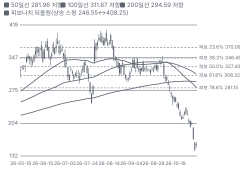

**주봉**

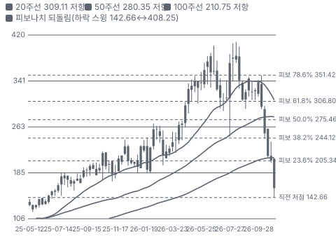

**월봉**

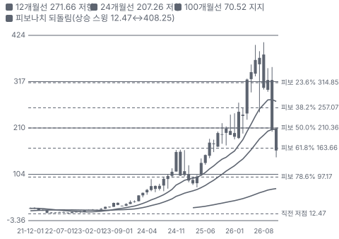

**분기 매출·EPS 실적과 컨센서스**

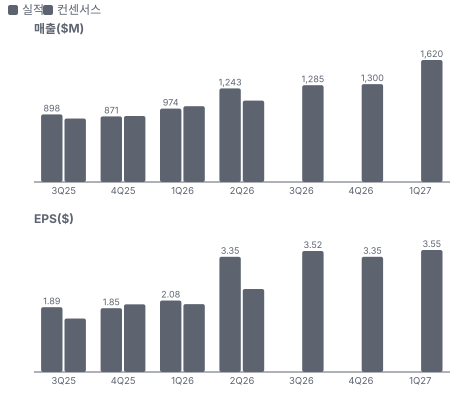

**3Q26 매출 — 지표 추세 vs 가이던스·컨센서스**

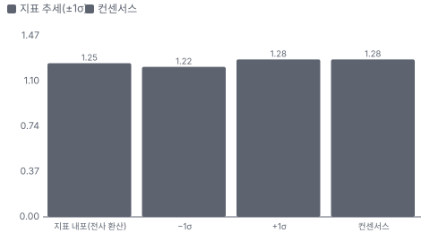

**밸류에이션 주가 시나리오**

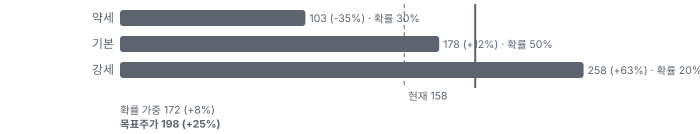

**주가별 업사이드**

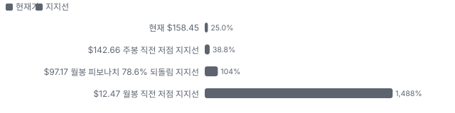

**제품·서비스 포트폴리오**

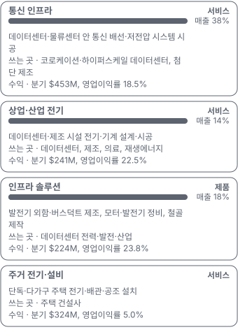

**공급 병목(10점, 낮을수록 병목)**

**생산능력 현재와 확충 계획(명(직원))**

**CAPEX의 매출 대비 비중**

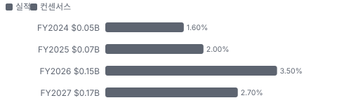

**어닝콜 변화별 주주가치 영향**

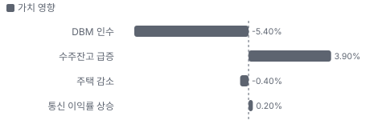

**멀티플 프리미엄(현재값 — 최근 4개 분기 추이 재료 없음)**

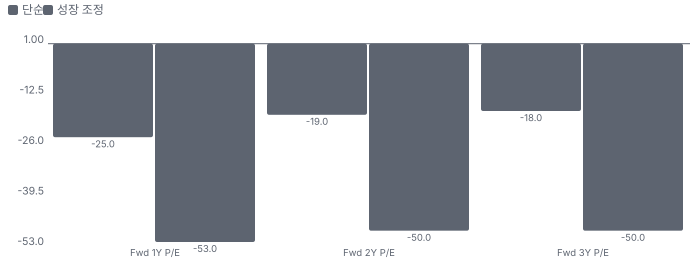

**합리적 멀티플**

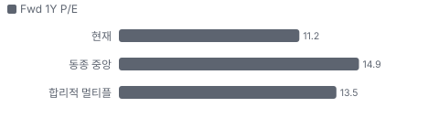

**수주·파이프라인 확실성 사다리**

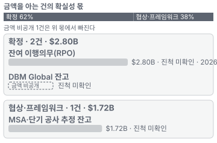

**매출 → 매출총이익 → 영업이익(매출 = 100, 최근 4분기)**

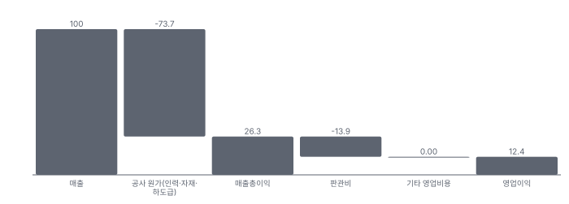

**1년 전 대비 마진 기여(비용 비중 변화의 반대)**

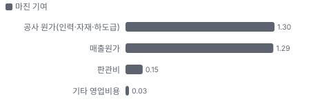

**분기 비용 비중 추이(매출 대비, 공시)**

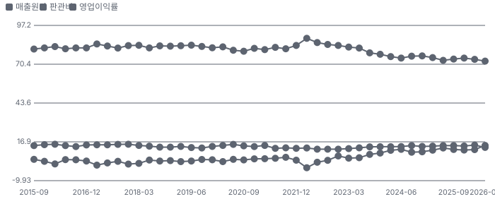

**비용 요인별 매출 대비 비중과 1년 변화**

**BOM 항목 가격 +10% 시 OPM 변화**

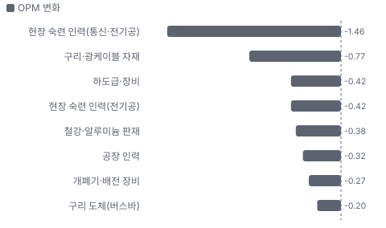

**통신 인프라 BOM 원가 몫과 가격 +10% 시 OPM**

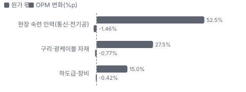

**상업·산업 전기 BOM 원가 몫과 가격 +10% 시 OPM**

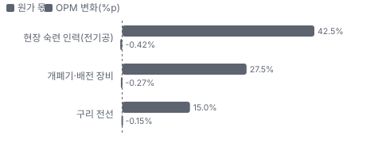

**인프라 솔루션 BOM 원가 몫과 가격 +10% 시 OPM**

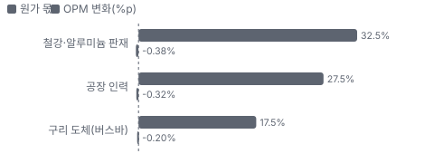

**매출·PPI·수출입 — 최근 16개 분기 같은 축(3Q22 = 100) + 다음 분기 추정**

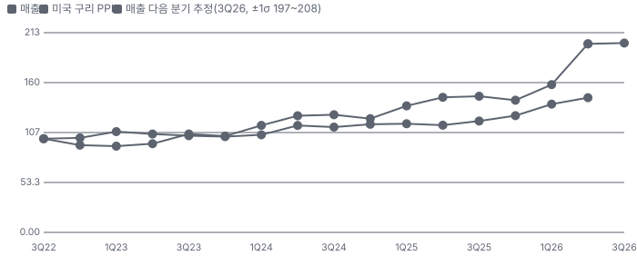

**매출과 미국 구리 PPI 증가율(전년 대비, 최근 16개 분기 + 다음 분기 추정)**

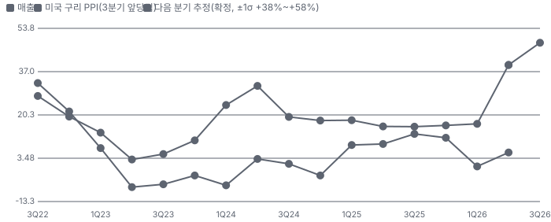

**10년 P·Q 사이클 — 추세(HP 필터) 대비 갭과 8분기 전망**

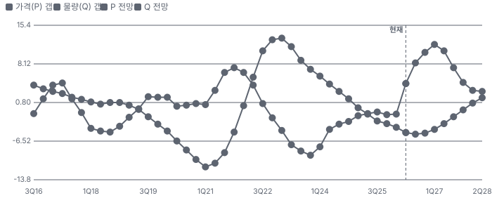

**매출 증가율의 가격·물량 분해와 8분기 전망(전년 대비)**

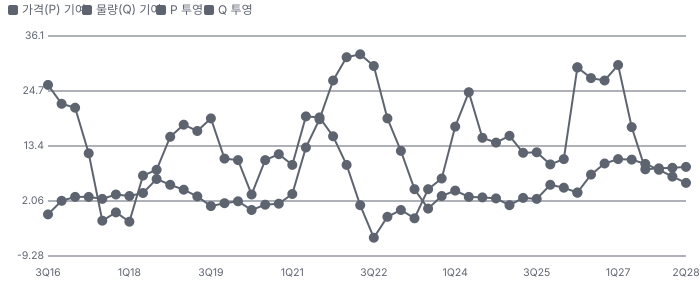

**분기별 매출 증가율 분해**

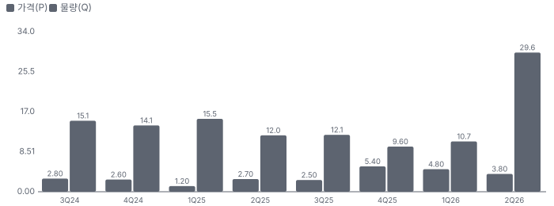

**목표주가 산정 — 기본과 강세 사이(강세 쪽 25%), 도달 확률 약 36%**

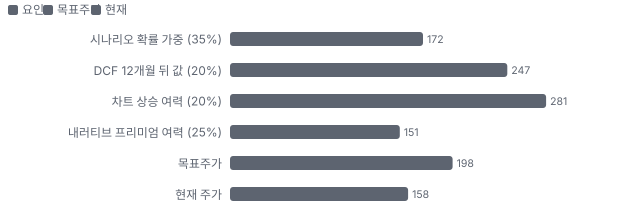

**일봉 지지·저항과 목표주가**

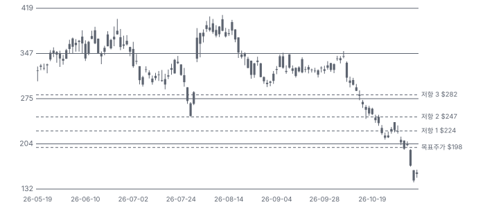

**커뮤니티 언급 수(최근 30일, 채널별)**

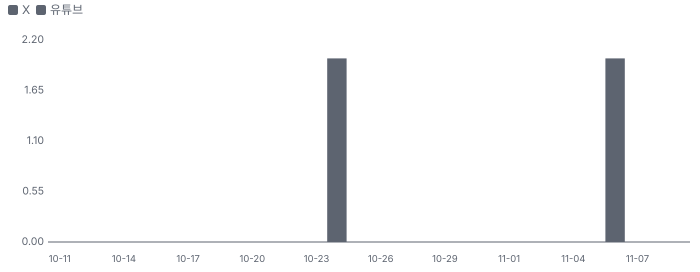

**일별 거래량 분해**

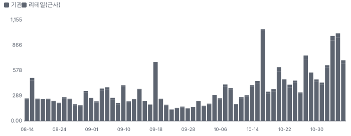

**기관 자금 흐름**

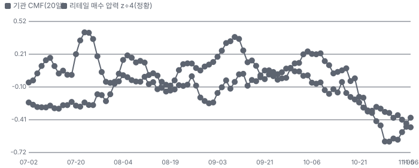

**몬테카를로**

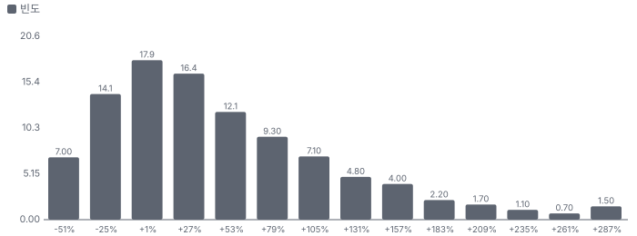

해석: 3,000번 중 2,132번(71%)에서 가치가 지금 주가 이상이었다. 가정을 흔들어도 지금 주가를 뒷받침하는 경우가 더 많다. 가운데 값은 1.32배이고, 열 번 중 여덟 번은 0.70~2.51배 사이에 든다.

## 내러티브

> **기업가치를 결정하는 이야기:** 값은 세 층이다. 데이터센터 통신·C&I 공사(분기 매출 약 \$695M, 영업이익률 15~19%)가 성장을 끌고, 주택 공사(분기 \$324M)가 현금을 대며, 인수한 제작 공장(인프라 솔루션 + DBM)이 공사 범위를 넓힌다. 결정 변수는 잔고 \$4.53B가 얼마나 빨리, 어떤 이익률로 매출이 되느냐다.

> **멀티플·EPS 프리미엄**
> **멀티플:** Fwd 1Y P/E 11.2배는 동종 중앙 15.0배보다 25% 낮다. 6월 말에는 동종이 38~45배였다 — 배수 하락은 업종 전체의 일이다.
> **EPS:** 지난 네 분기 중 세 번 EPS가 컨센서스를 넘었고 6월 분기는 +39%였다. 커버리지가 1명이라 리비전 이력은 없다.

### 투자자들은 왜 열광했나

7/31 3Q 실적 날 종가 +30.3%로 뛰었다. C&I 매출이 한 분기에 두 배가 되고 잔고가 \$4.5B를 넘었다. 식은 이유는 회사 숫자가 아니라 10월 AI 인프라 업종 매도와 11/4 선거다 — 원인을 가를 회사 자료(4Q 실적)는 아직 없다.

### 무엇이 기업가치를 바꾸나

> **구조적 체질 변화**
> **변화:** 주택 시공사에서 데이터센터·산업 시공사로 바뀌었다. 주택 매출 비중이 2023년 3월 분기 54%에서 2026년 6월 분기 26%로 줄었다
> **증거:** 10-Q 부문 매출
> **반증:** 데이터센터 부문 매출이 2분기 연속 감소

> **고부가 믹스 확장**
> **변화:** 통신 영업이익률이 2년 전 10.9%에서 18.5%, C&I가 13.5%에서 22.5%로 올랐다
> **증거:** 10-Q 부문 영업이익
> **반증:** 통신 이익률 15% 아래

> **기술 혁신**
> **변화:** 해당 없음(공법보다 인력·제작 역량이 경쟁력이다). 공장 제작 외함·버스덕트(큰 전류를 나르는 금속 외함 막대형 배전 도체)로 현장 시간을 줄이는 것이 가장 가깝다
> **증거:** 10-K 사업 설명
> **반증:** 제작 부문 이익률 하락

> **실행 속도**
> **변화:** 해당 없음(시공업이라 납품 리드타임 공시가 없다). RPO \$2.80B 중 \$2.29B(82%)가 12개월 안에 매출이 된다 **납품 리드타임 미확인.** 피어 비교 미확인. 이전 대비 미확인.
> **증거:** 3Q FY26 10-Q
> **반증:** 12개월 비중 70% 아래

> **M&A**
> **변화:** 1년 사이 Gulf Island(\$152M), Broadwind 공장(\$19.5M), DBM(\$691M)을 샀다. DBM은 차입 \$525M으로 처음으로 순차입이 됐다
> **증거:** 10-Q·8-K
> **반증:** 영업권 손상, 합산 이익률 희석

> **정책·입법 연관성**
> **재정정책:** 해당 없음(IES 매출에 연결된 연방 재정 사업이 공시되지 않았다). 연방 세액공제를 사서(\$52.6M, 9M FY26) 세금을 줄인 것이 재정정책과 닿는 유일한 고리다 3Q FY26 10-Q 현금흐름 반증: 양도형 세액공제 축소 의회 동의 10/10 — 하원 5/5(IRA(미국 인플레이션 감축법) 양도형 세액공제는 2022 본회의 통과 법) · 상원 5/5(IRA 본회의 통과).
> **행정명령:** 해당 없음(IES 매출에 직접 닿는 행정명령이 공시·보도에서 확인되지 않았다) 10-K·10-Q 위험 요인 반증: 데이터센터 인허가 제한 행정명령 의회 동의 2/10 — 하원 1/5(해당 행정명령 없음) · 상원 1/5(해당 행정명령 없음).
> **연관입법:** 주 단위가 핵심이다 — 텍사스 주 의회(2027-01-12 개회)가 데이터센터 송전·수자원 규제 법안을 다룰 것으로 Citi가 전망했다. 발의 전 단계 Citi 2026-11-04 요지(마스터 노션) 반증: 법안이 발의되지 않거나 위원회에서 멈춘다

> **CAPEX 낙수효과**
> **변화:** 하이퍼스케일러 데이터센터 투자가 통신·C&I 잔고로 들어왔다. 금지표대로 IES 몫은 계약으로만 센다 — 10% 넘는 고객이 없고 고객별 매출은 미공시
> **증거:** FY25 10-K 고객 절
> **반증:** 데이터센터 착공 지연이 잔고 감소로 번짐

### 내러티브 근거

> 프리미엄은 '데이터센터 전기·통신 공사의 작은 승자'에서 나왔다. 8월 고점 이후 −60%로 프리미엄이 사라졌고, 숫자(잔고 +119%)는 아직 꺾이지 않았다. 동종 대비 멀티플 차이 -25% 중 회사 고유 몫은 -17%다. 단계는 소멸, 쏠림은 낮음이다.

> **데이터센터 전기·통신 공사의 숙련 인력 병목** · 유지
> **논리:** 하이퍼스케일 데이터센터 착공이 전기 시공 인력에 막혀 있고 IES 통신·C&I가 그 공사를 받는다
> **숫자:** 통신 분기 매출 \$299.2M → \$453.1M(+51%), C&I \$115.4M → \$241.4M(+109%), 잔고 \$2.07B → \$4.53B
> **반증:** 4Q FY26 잔고가 \$4.5B 아래로 줄거나 통신 매출 성장이 20% 아래

> **인수로 넓히는 제작·전력 장비** · 태동
> **논리:** Gulf Island·Broadwind 공장·DBM으로 철골·외함 제작을 키워 데이터센터·발전 공사의 더 큰 몫을 잡는다
> **숫자:** 인수 대가 Gulf Island \$152M + Broadwind 공장 \$19.5M + DBM \$691M = 약 \$863M
> **반증:** DBM 편입 첫 분기 합산 영업이익률이 10% 아래

> **높은 자본 수익률과 순현금에 가까운 재무** · 약화
> **논리:** ROE 40%대·차입 거의 없는 성장이 프리미엄을 받쳤다
> **숫자:** 6/30 순현금 \$311M → DBM 뒤 순차입 약 \$234M(근사)
> **반증:** 순차입이 EBITDA 1배를 넘거나 신용한도 약정 위반

> **반대 내러티브: 데이터센터 규제·업종 디레이팅** · 확산
> **논리:** 중간선거로 텍사스 등 데이터센터 핵심 주의 규제가 강해지고 AI 투자 지속성 의심이 겹쳐 시공 업종 배수가 꺼진다
> **숫자:** 동종 Fwd 1Y P/E 6월 말 → 지금: FIX 44.3 → 16.0배, STRL 38.4 → 9.4배, MYRG 45.5 → 16.9배. IES 11/4~5 이틀 −28.4%
> **반증:** 2026-12-10 ERCOT 결정이 일정대로 나오고 4Q 잔고가 유지된다

> **반대 내러티브: 지배주주 매도** · 유지
> **논리:** Tontine이 고점 부근에서 매도를 이어 가 유통 물량이 늘고 프리미엄을 누른다
> **숫자:** 2025-12~2026-06 Form 4 매도 약 \$213M
> **반증:** Tontine 매도 중단 또는 자사주 매입 재개

이미지 없음(눈 검수 대기) — 통신 인프라

## 포트폴리오

| 제품·서비스 | 구분 | 무엇 | 쓰는 곳 | 돈 버는 방식 | Mix | Mix 변화(전 분기 대비) |
|---|---|---|---|---|---|---|
| 통신 인프라 | 서비스 | 데이터센터·물류센터 안 통신 배선·저전압 시스템 시공 | 코로케이션·하이퍼스케일 데이터센터, 첨단 제조 | 분기 \$453M, 영업이익률 18.5% | 36% | -1.3%p |
| 상업·산업 전기 | 서비스 | 데이터센터·제조 시설 전기·기계 설계·시공 | 데이터센터, 제조, 의료, 재생에너지 | 분기 \$241M, 영업이익률 22.5% | 19% | +6.4%p |
| 인프라 솔루션 | 제품 | 발전기 외함·버스덕트 제조, 모터·발전기 정비, 철골 제작 | 데이터센터 전력·발전·산업 | 분기 \$224M, 영업이익률 23.8% | 18% | -1.7%p |
| 주거 전기·설비 | 서비스 | 단독·다가구 주택 전기·배관·공조 설치 | 주택 건설사 | 분기 \$324M, 영업이익률 5.0% | 26% | -3.4%p |

**Mix 변화가 가장 큰 쪽은 상업·산업 전기(+6.4%p, 전 분기 대비).** 계절성 판정: 분기 매출 계절 지수 기준 없음 → 직전 분기와 비교.

## 수주·파이프라인

> **2026-06-30 기준 3건.** 확정 \$2.80B, 미확정 \$1.72B. 공시 수주잔고 \$4.53B.

**실행 속도와 방해 요인**
| 항목 | 상태 | 실행 속도 | 방해 요인 |
|---|---|---|---|
| 잔여 이행의무(RPO) | 확정 | 82%가 12개월 안에 매출 | 데이터센터 착공 일정 · 고정가 원가 |
| MSA·단기 공사 추정 잔고 | 프레임워크 | 미확인 | 물량 약정 없음 |
| DBM Global 잔고 | 확정 | 미확인 | 인수 뒤 첫 공시 전 |

## 마진 구조

> **GPM 26.3%, OPM 12.4%.** TTM 2Q25 대비 GPM +1.3%p, OPM +1.5%p. TTM 매출원가가 매출의 73.7%로 1년 전 75.0%보다 1.3%p 낮아졌다. 데이터센터 공사 비중이 늘며 주택 저마진 몫이 줄었다.

> **매출 100 중 매출원가 73.7, 매출총이익 26.3(최근 4분기, 공시).** 매출원가 요인 중 공사 원가(인력·자재·하도급)이 매출의 73.7%로 가장 무겁고, 단가가 +10% 오르면 GPM이 -7.37%p 움직인다. 분기 회귀로 매출 1이 늘 때 매출원가는 0.73 늘고, 매출원가의 고정비 몫은 8%다.

**비용 요인 강도 — 비중·추세·충격(+10%)·탄력**
| 비용 | 구분 | 매출 대비 | 1년 변화 | 마진 기여 | 충격 시 마진 | 매출 탄력 | 고정비 몫 |
|---|---|---|---|---|---|---|---|
| 공사 원가(인력·자재·하도급) | 매출원가 요인 | 73.7% | -1.3%p | +1.3%p | -7.37%p | 미확인 | 미확인 |
| 매출원가 | 공시 항목 | 73.7% | -1.3%p | +1.3%p | -7.37%p | 0.73 | 8% |
| 판관비 | 공시 항목 | 13.9% | -0.1%p | +0.1%p | 미확인 | 0.14 | 0% |
| 기타 영업비용 | 공시 항목 | 0.0% | -0.0%p | +0.0%p | 미확인 | -0.00 | -100% |

매출 탄력 = 분기 비용을 매출에 회귀한 기울기(매출 1당 변동비), 고정비 몫 = 절편 ÷ 평균 비용. 표본이 8분기 미만이면 미확인. 매출원가 요인 비중은 margin 재료의 추정이 섞여 있고, 공시 매출원가와의 차이는 '기타 매출원가'로 둔다.

**GPM에서 OPM까지(GAAP)**
| 기간 | GPM | 연구개발 | 판관비 | 기타 | OPM |
|---|---|---|---|---|---|
| TTM 2Q25 | 25.0% | 0.0% | 14.1% | 0.0% | 10.9% |
| TTM 2Q26 | 26.3% | 0.0% | 13.9% | 0.0% | 12.4% |

**GPM·OPM 최근 4개 분기**
| 분기 | GPM | OPM |
|---|---|---|
| 2025-09 | 26.0% | 11.6% |
| 2025-12 | 25.3% | 11.2% |
| 2026-03 | 26.2% | 11.5% |
| 2026-06 | 27.4% | 14.4% |

**마진을 결정하는 비용 요인 — 비용 +10% 시 OPM**
| 비용 | 매출 대비 | 변화 | 고정비 | OPM |
|---|---|---|---|---|
| 공사 원가(인력·자재·하도급) | 73.7% | -1.3%p | 미확인 | -7.37%p |
| 판관비 | 13.9% | -0.2%p | 60% | -1.39%p |
| 기타 | 0.0% | +0.0%p | 미확인 | -0.00%p |

**비용을 움직이는 요인**
| 비용 | 요인 |
|---|---|
| 공사 원가(인력·자재·하도급, 매출원가) | 숙련공 임금·구리·철강 가격·고정가 원가 추정 · 근거 공시 |
| 판관비(판관비) | 인수 회사 간접비·성과급 · 근거 공시 |
| 기타(기타) | 자산 처분 손익 · 근거 공시 |

**통신 인프라 BOM — 매출의 38%, GPM 26%(부문 매출총이익 3Q FY26 \$118.8M ÷ 매출 \$453.1M(10-Q)), 항목 가격 +10% 시**
| 항목 | 원가 몫 | 전가 | 제품 GPM | OPM |
|---|---|---|---|---|
| 현장 숙련 인력(통신·전기공) | 45~60% | 미확인 | -3.9%p | -1.46%p |
| 구리·광케이블 자재 | 20~35% | 미확인 | -2.0%p | -0.77%p |
| 하도급·장비 | 10~20% | 미확인 | -1.1%p | -0.42%p |
| 미분해 | 5% | - | - | - |

**상업·산업 전기 BOM — 매출의 14%, GPM 30%(부문 매출총이익 \$73.6M ÷ 매출 \$241.4M(10-Q)), 항목 가격 +10% 시**
| 항목 | 원가 몫 | 전가 | 제품 GPM | OPM |
|---|---|---|---|---|
| 현장 숙련 인력(전기공) | 35~50% | 미확인 | -3.0%p | -0.42%p |
| 개폐기·배전 장비 | 20~35% | 미확인 | -1.9%p | -0.27%p |
| 구리 전선 | 10~20% | 미확인 | -1.0%p | -0.15%p |
| 미분해 | 15% | - | - | - |

**인프라 솔루션 BOM — 매출의 18%, GPM 34%(부문 매출총이익 \$76.1M ÷ 매출 \$224.1M(10-Q)), 항목 가격 +10% 시**
| 항목 | 원가 몫 | 전가 | 제품 GPM | OPM |
|---|---|---|---|---|
| 철강·알루미늄 판재 | 25~40% | 미확인 | -2.1%p | -0.38%p |
| 공장 인력 | 20~35% | 미확인 | -1.8%p | -0.32%p |
| 구리 도체(버스바) | 10~25% | 미확인 | -1.2%p | -0.20%p |
| 미분해 | 22% | - | - | - |

현장 숙련 인력(통신·전기공) 가격이 +10% 오르면 영업이익은 -11.8% 움직인다. 판매가 전가를 모르는 항목은 전가 0%로 계산했다.

**BOM 항목 가격을 움직이는 것**
| 항목 | 요인 |
|---|---|
| 현장 숙련 인력(통신·전기공) | 저전압 배선 공사는 인건비가 원가의 대부분 · 근거 추정 |
| 구리·광케이블 자재 | 배선 자재 · 근거 추정 |
| 하도급·장비 | 부분 하도급 · 근거 추정 |
| 현장 숙련 인력(전기공) | 전기 시공 인건비 · 근거 추정 |
| 개폐기·배전 장비 | 회사가 조달하는 전력 장비 · 근거 추정 |
| 구리 전선 | 배선 자재 · 근거 추정 |
| 철강·알루미늄 판재 | 외함·버스덕트·철골 소재 · 근거 추정 |
| 구리 도체(버스바) | 버스덕트 도체 · 근거 추정 |
| 공장 인력 | 용접·조립 · 근거 추정 |

**BOM 투입 물가 — PPI 전년비, 2026-11-09 수집**
| 항목 | 미국 | 일본 | 한국 | 대만 |
|---|---|---|---|---|
| 구리 도체(버스바) | +30.0% | +54.2% | +25.8% | +40.1% |
| 개폐기·배전 장비 | +12.3% | +14.8% | +1.6% | +10.6%* |

별표는 품목보다 넓은 업종 지수다. 지난 1년 투입 물가를 판매가 전가 뒤 원가에 그대로 넣으면 OPM은 -4.43%p 움직인다(매출원가의 19% 기준).

## 공급망 병목

> **공급망 신뢰성 3.5/10, 병목 심각.** 가장 약한 고리는 현장 숙련 인력(전기공) 3.5점이고, 품목 평균은 3.5점이다. 근거가 부족한 2건(개폐기·배전 장비 · 구리 전선)은 점수에서 뺐다. 10-K는 원자재가 여러 국내 공급사에서 경쟁 가격으로 나오고 납기가 짧다고 적는다. 병목은 개폐기·발전기 같은 장비 납기(수개월)와 숙련 인력이다.

**병목과 마진 — 품목 가격 +10% 시 OPM**
| 품목 | 점수 | 판정 | 구분 | OPM |
|---|---|---|---|---|
| 현장 숙련 인력(전기공, 필수) | 3.5 | 병목 심각 | 출하 차질 위험 | -0.42%p |

> **현장 숙련 인력(전기공)** · 3.5/10
> **왜:** 데이터센터 공사의 착공 속도를 정한다
> **병목 요인:** 인증 공급사 1곳 · 캐파 빠듯 · 리드타임 미확인 · 재인증 미확인 · 1위 점유율 미확인 · 미국 집중 100% · 물량 확보 내재화
> **풀리는 조건:** 미확인

**공급사**
| 품목 | 공급사 | 몫 | 근거 |
|---|---|---|---|
| 현장 숙련 인력(전기공) | 자체 직원 약 10,262명(자체 시공) | 미확인 | 공시 |
| 개폐기·배전 장비 | 외부 장비 제조사(미공시, 개폐기·발전기) | 미확인 | 공시 |
| 구리 전선 | 국내 다수 공급사(미공시, 전선·도체) | 미확인 | 공시 |

**무역 통계로 본 공급 지역**
| 품목 | EU 수입처 | 일본 수입처 | EU 1위 전년비 |
|---|---|---|---|
| 개폐기·배전 장비 | CN(중국) 55% · US 24% · KR(한국) 6% | 中華人民共和国 47% · アメリカ合衆国 10% | +26.6% |
| 구리 전선 | MY(말레이시아) 69% · KR 10% · US 7% | マレーシア 58% · タイ 36% | 미확인 |

## 생산능력

> **현재 명목 캐파 10,262 명(직원), 가동률 미확인.** FY2025 CAPEX는 \$0.07B로 매출의 2.0%다. 시공업이라 공장 캐파 대신 인력이 캐파다. 직원 약 10,262명(회사 개요). 제작 시설은 인프라 솔루션 15개 거점 + Gulf Island + Broadwind 공장 + DBM이다.

**생산시설 174곳**(FY25 10-K Item 2 — 지점·창고·영업·사무 174곳, 대부분 임차. 제조 용도는 인프라 솔루션 15곳(본부 Massillon, Ohio)이며 시설별 이름·캐파는 공시되지 않는다) — 이름·위치를 밝힌 곳 3곳, 미확인 2곳 · 소유 1곳. 시설별 생산능력은 공개되지 않았다 — 회사 전체 캐파만 위에 적었다.

**생산시설 174곳 — 명칭·위치·생산능력**
| 시설 | 위치 | 용도 | 생산능력 | 소유·상태 |
|---|---|---|---|---|
| 인프라 솔루션 본부 | 미국 Massillon, Ohio | 제조·정비 본부 | 미확인 — 시설별 캐파 미공시 | 미확인 · 가동 |
| Broadwind Heavy Fabrications 공장(인수) | 미국 Abilene, Texas | 제조(철골·중제작) | 미확인 — 인수 자산만 공시(\$19.5M) | 소유 · 가동 |
| Gulf Island Fabrication(인수) | 미국 Louisiana(10-Q에 위치 미기재) | 제조(철강 제작) | 미확인 — 인수 공시에 캐파 없음 | 미확인 · 가동 |

공개된 증설 계획은 확인되지 않았다.

**CAPEX와 매출 대비**
| 기간 | CAPEX | 매출 | 매출 대비 | 구분 |
|---|---|---|---|---|
| FY2024 | \$0.05B | \$2.88B | 1.6% | 실적 |
| FY2025 | \$0.07B | \$3.37B | 2.0% | 실적 |
| FY2026 | \$0.15B | \$4.37B | 3.5% | 컨센서스 |
| FY2027 | \$0.17B | \$6.38B | 2.7% | 컨센서스 |

## 해자

> 해자는 숙련 인력과 지역 거점이다. 인수한 제작 공장이 그 위에 쌓이지만 아직 숫자로 검증되지 않았다.

> **데이터센터 통신·전기 시공 인력** · 보통
> **해자:** 데이터센터 저전압·전기 공사 숙련공을 대량으로 가진 회사가 적다
> **근거:** 통신 부문 41개 사무소(FY25 10-K), 통신 영업이익률 18.5%(3Q FY26)
> **숫자:** 통신 이익률 2년 10.9% → 18.5%
> **깨지는 조건:** 통신 이익률이 15% 아래로 내려오면 가격 결정력이 경쟁에 밀린 것

> **공장 제작 전력 장비** · 보통
> **해자:** 버스덕트·발전기 외함을 직접 만들어 공급 병목 때 납기 우위를 갖는다
> **근거:** 인프라 솔루션 15개 거점(FY25 10-K), 영업이익률 23.8%(3Q FY26)
> **숫자:** 부문 매출 2년 \$102M → \$224M(분기)
> **깨지는 조건:** 인프라 솔루션 이익률 18% 아래

> **인수 통합 실행력** · 약함
> **해자:** 작은 시공사를 사서 붙이는 롤업 기록이 있다
> **근거:** Gulf Island·Broadwind·DBM 1년 사이 인수 — 성과는 미확인
> **숫자:** 미확인
> **깨지는 조건:** DBM 편입 뒤 합산 영업이익률 하락

## 경영진·네트워크

> 지배주주 Tontine(약 54%)의 Jeffrey Gendell이 Executive Chairman이다. 연결이 매출을 만들었다는 공개 증거는 없다.

> **Jeffrey L. Gendell** · Executive Chairman(이전 CEO) · 미확인
> **프로필:** 투자회사 Tontine 운영자. Form 4 직함이 2024-12 'CEO' → 2025-12 'Executive Chairman'으로 바뀌었다
> **비즈니스:** Tontine 계열 펀드
> **정계:** 미확인
> **동문:** 미확인
> **사모임:** 미확인

> **Matthew J. Simmes** · President·CEO · 미확인(2025 Form 4부터 CEO 직함)
> **프로필:** Form 4 직함 2024-12 President·COO → 2025-12 President·CEO
> **비즈니스:** 미확인
> **정계:** 미확인
> **동문:** 미확인
> **사모임:** 미확인

**네트워크 정량화**
| 연결 | 강도 | 닿는 매출 | 가중 노출 | 매출 대비 | 근거 |
|---|---|---|---|---|---|
| 비즈니스: 지배주주 Tontine의 자본 배분 — 인수 대금·지분 매각 결정 | 4/5 | \$0.69B | \$0.55B | 14% | DBM 인수가 \$691M(8-K) FY25 10-K 지배주주 절·8-K 2026-10-06 |
| 정계: 로비 공시 없음(하원 로비 공시 분기 집계 유니버스 밖) | 0/5 | 미확인 | 미확인 | 미확인 | 공개 기록 없음 Easyconomics lobbying |

가중 노출은 연결이 닿는 매출의 크기다. 연결이 그 매출을 만들었다는 뜻이 아니며, 인과는 공개 자료로 입증하지 못한다.

## 약세 논리 및 셀온 조건

| 약세 논리 | 근거 | 가를 자료 |
|---|---|---|
| 업종 배수가 더 내려간다 | 동종 Fwd 1Y P/E가 6월 말 38~45배에서 9~17배로 왔다. 바닥 근거는 없다 | 동종 4Q 실적·데이터센터 착공 지표 |
| 텍사스 데이터센터 규제 | Citi는 미국 데이터센터의 30~40%가 텍사스로 올 것으로 봐 왔고, 새 주지사 아래 승인 지연을 전망했다. IES 지역별 매출은 미공시 | 2026-12-10 ERCOT 결정, 2027-01 주 의회 법안 |
| 인수 이익률 희석 | DBM은 철골 제작·설치 회사이고 이익률이 공개되지 않았다. 인수 대금 대부분(\$525M)을 차입했다 | DBM 편입 첫 분기 실적(2027-01 말~02 초) |
| 지배주주 매도 | Tontine이 2025-12~2026-06 약 \$213M을 팔았다(Form 4). 지분 약 54%라 물량 부담이 크다 | Form 4 추가 매도 여부 |
| 추정의 질 | 컨센서스는 1명 수준이고 회사 조정 EPS 추정이 분할 전 기준과 섞여 있다. 어닝콜이 없어 질문으로 가를 수 없다 | 4Q 실적 보도자료·10-K |
| C&I 이익률 일회성 | C&I 영업이익률 22.5%는 한 분기 값이다. 1년 전은 11.2%였다 | 4Q·1Q FY27 C&I 이익률 |
| 유가증권 평가익 | 6월 분기 순이익에 유가증권 이익 \$26.2M이 들어 있다. 반복되지 않는 몫이다 | 4Q 영업 외 손익 |
| 구리 원가 상승 | 미국 구리 PPI(생산자물가지수)가 전년 대비 +30%(2026-09)다. 10-K는 원자재 가격 전가 능력을 위험 요인으로 적었고, 계약별 전가 조항은 미공시다 | 4Q 매출총이익률(10-K) |

> **셀온 조건**
> **조건 1:** 4Q FY26 잔고가 6월 말 \$4.53B보다 줄어든다.
> **조건 2:** 통신 매출 성장이 전년 대비 20% 아래로 내려온다.
> **조건 3:** DBM 포함 합산 영업이익률이 10%를 밑돈다.
> **조건 4:** 텍사스 데이터센터 규제가 법안으로 발의되고 IES가 지연을 공시한다.
> **조건 5:** Tontine이 지금 가격대에서 대량 매도를 다시 공시한다.

## 어닝콜 변화

**직전 콜 대비 새로 나오거나 바뀐 내용 → 가치 영향**
| 항목 | 내용 | 직전 콜 | 최신 콜 | 모델 동인 이동 | 확신도 | 가치 영향 |
|---|---|---|---|---|---|---|
| 업데이트 | 수주잔고 3월 말 → 6월 말 | \$3.86B | \$4.53B | 1년차 성장률 +3.0% | 1.0 | +3.9% |
| 업데이트 | Communications(데이터센터·물류센터 안 통신·저전압 배선 공사 부문) 영업이익률 | 16.6%(1~3월) | 18.5%(4~6월) | 출발 이익률 +0.40% | 1.0 | +0.2% |
| 신규 | DBM Global 약 91% 인수 계약(8/7) → 완료(10/5) | 없음 | \$691M, 차입 \$525M | 순차입 +\$0.53B | 1.0 | -5.4% |
| 부정 | Residential(단독·다가구 주택 전기·배관·공조 공사 부문) 분기 매출 | \$346.0M(전년 4~6월) | \$324.1M | 장기 성장 수렴값 -0.20% | 1.0 | -0.4% |
| **합계** | 단독 합 |  |  | 동시 적용 -2.0% |  | **-1.6%** |

## 거시 지표 싱크로율

> **미국 구리 PPI와 통신 인프라 싱크로율 74%(3분기 = 약 9개월 선행, 전년 대비, 표본 10개·t 3.1·유의·신뢰 낮음).** 이 지표가 내포하는 3Q26 통신 인프라은 497M(±1σ 464M~530M, 확정)다. 표본 밖 검증(최근 5개 분기)에서 지표 모델 오차는 7.4%p, 기준선(직전 증가율 지속)은 10.4%p다 — 지표가 기준선을 이겨 지표 63%·기준선 37%로 결합했다. 세그먼트 추정에 나머지 사업(직전 증가율 지속)을 더한 전사 매출은 1.25B(1.22B~1.28B)다. 컨센서스는 +2.9%(범위 위)다. 통신·C&I 공사는 데이터센터·산업 전기 설비 투자를 따라가고, 그 투자는 개폐기 가격과 구리 가격에 먼저 나타난다

**지표별 싱크로율(상관계수 × 100) — 위 두 줄이 제품 연관성 × 싱크로율로 고른 PPI·수출입 세부 지표**
| 지표 | 비교 대상 | 증가율 기준 | 지표 선행 | 매출(t값) | 영업이익 | 방향 일치 | 표본·신뢰 | 표본 밖 오차(지표/기준선) | 3Q26 추정 매출 |
|---|---|---|---|---|---|---|---|---|---|
| 미국 구리 PPI | 통신 인프라 | 전년 대비 | 3분기(9개월) | 74%(t 3.1) | -18%(4분기) | 80% | 10·낮음 | 7.4/10.4%p ✔ | +48.2% → 497M(확정) |
| 미국 개폐기 PPI | 상업·산업 전기 | 전년 대비 | 3분기(9개월) | 62%(t 2.2) | -33%(2분기) | 100% | 10·낮음 | 25.2/27.3%p ✔ | +81.7% → 179M(확정) |

**지표 후보 14개 — 연관성(제품 품목 일치 × 대용 감점 × 매출 비중) × 싱크로율로 고른다. 후보가 많을수록 최대 상관은 우연히 부풀 수 있다**
| 후보 | 종류 | 연관성 | 매출 분기 일치 | 싱크로율(선행) | 점수 | 출처 |
|---|---|---|---|---|---|---|
| 미국 구리 PPI ✔ | PPI | 1.00 | 100% | 74%(3분기) | 0.74 | 모델 지정 |
| 미국 개폐기 PPI | PPI | 1.00 | 100% | 62%(3분기) | 0.62 | 모델 지정 |
| 일본 개폐기·배전반 PPI | PPI | 0.76 | 100% | 69%(0분기) | 0.53 | 자동 |
| EU(유럽연합) 개폐기·배전반 PPI(업종 대용) | PPI | 0.46 | 100% | 86%(0분기) | 0.40 | 자동 |
| 대만 구리 PPI | PPI | 0.76 | 100% | 56%(1분기) | 0.34 | 자동 |
| 대만 개폐기·배전반 PPI(업종 대용) | PPI | 0.46 | 100% | 64%(0분기) | 0.29 | 자동 |
| 한국 구리 PPI | PPI | 0.76 | 100% | 42%(1분기) | 0.26 | 자동 |
| EU 구리 PPI(업종 대용) | PPI | 0.46 | 100% | 35%(0분기) | 0.13 | 자동 |
| 영국 개폐기·배전반 PPI(업종 대용) | PPI | 0.46 | 100% | 17%(0분기) | 0.06 | 자동 |
| 한국 개폐기·배전반 PPI | PPI | 0.76 | 100% | -55%(3분기) | 0.00 | 자동 |
| 일본 구리 PPI | PPI | 0.76 | 100% | -71%(4분기) | 0.00 | 자동 |
| 영국 구리 PPI | PPI | 0.76 | 100% | -61%(4분기) | 0.00 | 자동 |

**선행 지표로 본 향후 분기 매출 전망(이미 나온 지표 값 기준, ±1σ)**
| 지표 | 대상 | 분기 | 지표 증가율 | 내포 매출 증가율 | 내포 매출 |
|---|---|---|---|---|---|
| 미국 개폐기 PPI | 상업·산업 전기 | 3Q26 | +11.8% | +64.5% | 162M(135M~189M) |
| 미국 개폐기 PPI | 상업·산업 전기 | 4Q26 | +14.9% | +94.7% | 185M(159M~210M) |
| 미국 개폐기 PPI | 상업·산업 전기 | 1Q27 | +12.1% | +66.6% | 211M(177M~245M) |
| 미국 구리 PPI | 통신 인프라 | 3Q26 | +7.9% | +46.4% | 491M(469M~514M) |
| 미국 구리 PPI | 통신 인프라 | 4Q26 | +18.0% | +57.2% | 553M(529M~577M) |
| 미국 구리 PPI | 통신 인프라 | 1Q27 | +25.6% | +65.2% | 607M(583M~632M) |
| 한국 개폐기·배전반 PPI | 상업·산업 전기 | 3Q26 | -1.8% | +65.6% | 163M(135M~191M) |
| 한국 개폐기·배전반 PPI | 상업·산업 전기 | 4Q26 | +1.0% | +30.6% | 124M(97M~151M) |
| 한국 개폐기·배전반 PPI | 상업·산업 전기 | 1Q27 | +1.7% | +20.6% | 153M(116M~189M) |
| 일본 구리 PPI | 상업·산업 전기 | 3Q26 | +5.2% | +33.6% | 132M(108M~156M) |
| 일본 구리 PPI | 상업·산업 전기 | 4Q26 | +21.6% | -0.5% | 94M(71M~117M) |
| 일본 구리 PPI | 상업·산업 전기 | 1Q27 | +42.6% | -44.1% | 71M(40M~101M) |
| 일본 구리 PPI | 상업·산업 전기 | 2Q27 | +55.5% | -70.8% | 70M(12M~129M) |
| 영국 구리 PPI | 상업·산업 전기 | 3Q26 | +2.4% | +24.9% | 123M(96M~150M) |
| 영국 구리 PPI | 상업·산업 전기 | 4Q26 | +11.4% | -19.9% | 76M(50M~102M) |
| 영국 구리 PPI | 상업·산업 전기 | 1Q27 | +24.6% | -85.3% | 19M(-16M~53M) |
| 영국 구리 PPI | 상업·산업 전기 | 2Q27 | +31.8% | -120.8% | -50M(-116M~15M) |
| 한국 구리 PPI | 상업·산업 전기 | 3Q26 | +28.1% | +61.5% | 159M(128M~190M) |
| 대만 구리 PPI | 상업·산업 전기 | 3Q26 | +32.5% | +81.2% | 178M(150M~207M) |

지표가 k분기 앞서면 이미 발표된 지표로 k분기 뒤까지의 매출 증가율을 회귀식으로 읽는다. 표본이 작거나 t값이 2 미만이면 전망은 참고용이다.

**지표를 고른 이유**
| 지표 | 이유 |
|---|---|
| 미국 구리 PPI | 배선 자재 원가 |
| 미국 개폐기 PPI | 전기 설비 수요의 가격 신호 |

다음 분기 추정 = 지표 회귀와 기준선(직전 증가율 지속)을 표본 밖 오차의 역제곱으로 가중 결합한 값이다(예측 결합). 지표가 회귀에 쓴 범위를 벗어나면 범위 끝으로 자르고(외삽 제한), 세그먼트 추정은 나머지 사업을 기준선으로 더해 전사로 바꾼다. 싱크로율은 증가율의 상관계수이며 인과가 아니다. 지표 단위·통화는 원자료 그대로이고 나라끼리 더하지 않는다(EU 수입만 상대국 합계). ±1σ는 회귀 잔차 표준편차이고, 지표를 예측한 분기는 지표 예측 오차까지 더해 넓혔다.

## P·Q 사이클

> **10년 위치: P형 기업(매출 갭 분산의 87%가 가격) — 가격은 추세 대비 -4.9%(수축, 10년 분위 18%), 물량은 +4.4%(확장, 분위 90%). P 프리미엄 -28%, Q 프리미엄 +6%(매출총이익이 정상(추세) 수준보다 요인별로 이만큼 높거나 낮다).** 전망으로 가격 갭은 4분기 뒤 -3.2%·8분기 뒤 +1.7%, 물량 갭은 +10.6%·+2.9%(물량은 컨센서스 몫 25%를 섞었다). 이익이 정상보다 낮다 — 바닥 이익 기준 멀티플은 높아 보여도 정상 이익 기준으로는 낮을 수 있다.

**10년 P·Q 사이클 위치·프리미엄**
| 항목 | 가격(P) | 물량(Q) |
|---|---|---|
| 추세 대비 갭(현재) | -4.9% | +4.4% |
| 사이클 시계 | 수축 | 확장 |
| 10년 분위 | 18% | 90% |
| 프리미엄(현재) | -28% | +6% |
| 프리미엄 4분기 뒤 | -19% | +15% |
| 프리미엄 8분기 뒤 | +10% | +4% |
| 갭 반감기 | 5분기 | 미확인 |
| 갭 4분기 뒤(80% 범위) | -3.2% (-7.7%~+1.5%) | +10.6% (+5.3%~+16.2%) |
| 갭 8분기 뒤(80% 범위) | +1.7% (-5.0%~+8.9%) | +2.9% (-2.7%~+8.8%) |
| 전망 모형 | 자기회귀모델(과거 2개 시점) 정상성 보정 | 자기회귀모델(과거 2개 시점) + 컨센서스(분기 컨센서스 4개 + 연간 컨센서스 성장률 FY2027→FY2028 +15%, 4분기 뒤 몫 25%) |

방법: P = 가격 지수 4분기 평균(미국 PPI 변압기·배전 기기 대용 — 회사 판매가가 아니라 업종 가격), Q = TTM 매출 ÷ P. 추세는 로그 레벨의 HP(호드릭-프레스콧 추세 필터) 필터(λ 1600)로 정상(mid-cycle) 수준을 잡는다. 프리미엄 = 요인별 매출총이익 증분 ÷ 정상 매출총이익(정상 GPM 18.2% = 10년 중앙값, 물량 증분 마진 26.4% = 전년 대비 ΔGP÷ΔRev 회귀, 가격은 전액 이익 반영). 표본 40개 TTM 분기. 전망: 가격 갭은 BIC(모형 차수를 고르는 정보 기준)로 차수를 고른 자기회귀모델(정상성 보정), 물량은 통계 갭 자기회귀모델과 컨센서스 매출 ÷ 가격 전망(매출 = P × Q)을 분산 역수로 섞는다(Bates·Granger 1969). 끝점 편향을 줄이려고 전망 경로를 이어 붙인 뒤 HP 필터를 다시 건다(Kaiser·Maravall 1999). 80% 범위는 예측 오차(TTM이 4분기씩 겹쳐 생기는 자기상관을 뉴이·웨스트 장기 분산으로 반영)와 애널리스트 범위에서 낸다. 모형 산출이며 가이던스가 아니다.

> **Q 사이클 — 최근 4분기 평균 가격 기여 +4.1%, 물량 기여 +15.5%(전년 대비 로그 증가율).** P 강도 4.4/10, Q 강도 6.0/10, 최근 8분기 중 100%가 같은 요인 우세(구조적). 전망으로는 5분기 뒤(3Q27) P 사이클로 전환(물량은 컨센서스를 섞었다).

**P·Q 사이클 정량**
| 항목 | 가격(P) | 물량(Q) |
|---|---|---|
| 최근 4분기 평균 기여 | +4.1% | +15.5% |
| 강도(0~10, 자기 이력 z) | 4.4 | 6.0 |
| 고유 주기(자기회귀모델 과거 2개 시점일 때) | 17.1분기 | 미확인 |
| 다음 4분기 투영 평균 | +9.7% | +25.4% |
| 4분기 뒤 투영(80% 범위) | +10.6% (+1.7%~+19.5%) | +17.3% (+8.7%~+26.0%) |
| 장기 평균(표본 → 기저율 수축) | +7.0% → +5.1% | +11.6% → +8.7% |
| 투영 모형 | 자기회귀모델(과거 2개 시점) · 3Q26 월간 가격 3개월 반영 | 자기회귀모델(과거 1개 시점) + 컨센서스(분기 컨센서스 4개 + 연간 컨센서스 성장률 FY2027→FY2028 +15%) |

가격 근거: 미국 PPI 변압기·배전 기기 대용 — 회사 판매가가 아니라 업종 가격. PPI를 쓰면 회사 판매가가 아니라 업종 가격 대용이다. 로그 증가율이라 가격·물량 기여의 합이 매출 증가율이다. 전망: 가격은 BIC로 차수를 고른 자기회귀모델에 이미 발표된 월간 가격을 먼저 넣고(나우캐스트), 물량은 자기회귀모델과 '컨센서스 매출 증가율 − 가격 전망'을 분산 역수로 섞는다. 장기 평균은 표본 평균을 장기 기저율(가격 연 2%·물량 연 4%) 쪽으로 줄인다 — 고성장 구간만 담긴 표본이 그 성장을 끝없이 잇지 않게. 범위는 4분기 겹친 표본의 자기상관을 반영한다. 모형 산출이며 가이던스가 아니다. 회사 판매가로 잴 수 없는 이유: 시공업이라 단가·물량을 공시하지 않는다

## 밸류에이션

> **목표주가 \$198, 업사이드 +25%.** 자리는 기본과 강세 사이(강세 쪽 25%)이고 도달 확률은 약 36%다. 기본 \$178, 강세 \$258(+63%), 약세 \$103(-35%). DCF 기준 업사이드는 기본 +41%, 강세 +124%, 약세 -7%다(WACC 10.1%).

약세 확률을 30%로 둔다. 커버리지 1명이라 추정의 오차가 크고, DBM 이익률이 공개되지 않았으며, 텍사스 데이터센터 규제 위험이 남는다(자체추론).

EPS는 다음 12개월 GAAP 기준(분할 반영) Chiip 추정이고 멀티플은 선정 규칙이 고른다. DCF는 DBM 편입분을 1년차 성장으로 받고 빨리 줄이므로, 인수 이익률이 낮게 나오는 약세 꼬리는 시나리오 쪽이 더 크게 본다.

> **약세 \$103 (-35%)** · 확률 30%
> **가정:** 9.4배 × EPS \$11.00
> **근거:** 데이터센터 착공 지연으로 통신·C&I 성장 둔화, DBM 저마진 편입으로 합산 영업이익률 10%대 초반

> **기본 \$178 (+12%)** · 확률 50%
> **가정:** 12.5배 × EPS \$14.20
> **근거:** FY27 매출 약 \$6.4B·영업이익률 13.7%, 컨센서스 경로

> **강세 \$258 (+63%)** · 확률 20%
> **가정:** 15.7배 × EPS \$16.50
> **근거:** 잔고 전환이 빨라지고 C&I·통신 이익률 유지, DBM 이익률 10% 이상

**멀티플 선정 — Fwd 1Y P/E**
| 단계 | 조정 | 근거 |
|---|---|---|
| 동종 중앙값 | 14.9배 | 범위 9.4~16.9배, 5곳 |
| 펀더멘털 | -5% | 성장·이익률·ROIC로 본 합리적 멀티플 13.5배와의 차이의 일부만 인정 |
| 해자 | +2% | 데이터센터 통신·전기 시공 인력 보통 · 공장 제작 전력 장비 보통 · 인수 통합 실행력 약함 |
| 반복 매출 | +0% | 재료 없음 |
| 수주 전환·가시성 | +2% | 잔고 커버리지 0.09 · RPO 12개월 1.00 · RPO·ACV(연간 계약 가치) 성장 − 매출 성장 1.00 → 가시성 0.70 · 전환 13.6개월(동종 12) |
| 내러티브 | -10% | 단계 소멸 |
| 사이클·실행 판단 | -5% | 커버리지 1명·어닝콜 없음·가이던스 없음으로 정보가 적고, DBM 이익률이 미확인이라 동종 대비 약간 할인한다 |
| **선정** | **12.5배** | 지금 11.2배 |

**동종 레인지**
| 회사 | Fwd 1Y P/E | Fwd 2Y P/E | Fwd 3Y P/E | 성장 | 영업이익률 | ROIC |
|---|---|---|---|---|---|---|
| FIX | 16.0 | 14.0 | 12.6 | 37% | 17% | 130% |
| EME | 14.9 | 12.5 | 10.9 | 21% | 10% | 43% |
| MYRG | 16.9 | 14.4 | 12.7 | 22% | 7% | 25% |
| PRIM | 13.2 | 12.1 | 10.5 | 10% | 4% | 14% |
| STRL | 9.4 | 8.0 | 6.8 | 37% | 19% | 47% |
| **IES Holdings** | 11.2 | 10.2 | 9.0 |  |  |  |

지금 주가가 요구하는 5년 매출 CAGR 11%, 기본 시나리오 21%. 몬테카를로 중앙값 업사이드 +32%.

> 의사결정 보조(투자자문 아님): ① 매수 매력: 연 기대수익 +18.9% (자기자본비용 10.3% 대비 +8.6%p) · 자본비용 초과 확률 69% · 안전마진 0.70 → 정량 신호 중립 / ② 위험 예산 지표(이론): 1/4 켈리 10.0% (상한 10%) · 5년 하위10% +12% · 30%+ 손실 확률 2% / ③ 상방(5년): 기대 2.37배 · 2배 54% · 3배 25% · 10배 0% · 상위10% 4.02배

투입 물가 점검: 지난 1년 PPI를 BOM에 넣으면 OPM -4.43%p다(매출원가의 19% 기준).

## 매수 위치(일봉)

> **현재가 \$158는 '지지선 미확인'.** 이 자리에서 목표주가까지 +25.0%, 첫 일봉 저항까지 +41.5%, 다음 지지까지 하방 미확인.

**가격대별 업사이드(일봉 기준)**
| 가격대 | 가격 | 목표주가까지 | 첫 저항까지 | 다음 지지까지 | 손익비 | 근거 기법(강도) |
|---|---|---|---|---|---|---|
| 현재가 | \$158 | +25.0% | +41.5% | 미확인 | 미확인 | - |

**일봉 저항**
| 저항 | 가격 | 현재가 대비 | 근거 기법(강도) |
|---|---|---|---|
| 저항 1 | \$224 | +41.5% | 20일선(0.5) |
| 저항 2 | \$247 | +55.6% | 120일 지그재그 저점 · 스윙 저점(1.8) |
| 저항 3 | \$282 | +77.7% | 50일선 · 피보 78.6%(2.0) |

일봉만 쓴다(주봉·월봉 제외). 손익비 = 목표주가까지 업사이드 ÷ 다음 지지까지 하방. 가격대별 기대값 참고표이며 매수·매도 시점 지시가 아니다.

## 애널리스트 토론

> **토론 결론 Buy(규칙 등급 Buy).** 살아남은 반박은 둘이다 — 동종 대비 25% 할인과 계약 잔고는 사실이지만, C&I 이익률 지속성과 유기 성장은 4Q 실적 전에는 확인되지 않는다.

**패널 — 등급별 자리**
| 자리 | 핵심 논리 | 틀리는 조건 | 최종 투표 |
|---|---|---|---|
| Strong Buy | 잔고 +119%·매출 +40%인데 주가는 −60%다 — 배수 하락은 업종 전체의 일이고 회사 숫자는 아직 하나도 꺾이지 않았다 | 4Q FY26 잔고가 줄거나 통신 매출 성장이 20% 아래 | Buy |
| Buy | 동종보다 25% 싼 배수는 정보 부족 할인을 넘는다 | DBM 편입 뒤 합산 영업이익률 10% 아래 | Buy |
| Neutral | 숫자는 좋지만 4Q 실적·텍사스 결정 전에는 가를 자료가 없다 | 4Q 실적이 잔고·이익률 둘 다 확인 | Buy |
| Sell | 지배주주가 고점 부근에서 \$213M을 팔았고, 처음으로 차입을 지며 저마진 철골 제작을 샀다 | Tontine 매도 중단·DBM 이익률 공시가 10% 이상 | Neutral |
| Strong Sell | 텍사스 데이터센터 규제가 현실이 되면 잔고 전환이 늦어지고 배수가 더 내려간다 | ERCOT 12/10 결정이 일정대로 나온다 | Sell |

**투표**
| Strong Buy | Buy | Neutral | Sell | Strong Sell |
|---|---|---|---|---|
| 0 | 3 | 1 | 1 | 0 |

> **개회 · Strong Buy**
> **발언:** 8/17 \$396.98에서 11/6 \$158.45까지 −60%다. 같은 기간 공시된 잔고는 \$4.53B로 사상 최대다.

> **개회 · Buy**
> **발언:** Fwd 1Y P/E 11.2배는 동종 중앙 15.0배보다 25% 낮다. 이익률은 동종보다 높다.

> **개회 · Neutral**
> **발언:** 4Q 실적이 11월 하순에 나온다. 그 전에는 잔고가 매출로 바뀌는 속도를 확인할 수 없다.

> **개회 · Sell**
> **발언:** 지배주주가 2025-12~2026-06에 약 \$213M을 팔았다. 내부자가 가장 잘 안다.

> **개회 · Strong Sell**
> **발언:** 텍사스 주지사 교체로 데이터센터 승인이 늦어질 위험이 크다는 IB 분석이 나왔다.

> **반박1 · Buy → Sell**
> **발언:** Tontine 매도는 고점 전 5~6월에 몰렸고 분할 전 주당 \$694~706이었다. 지금 가격에서의 매도 공시는 없다.

> **반박1 · Sell → Strong Buy**
> **발언:** 잔고 증가의 일부는 인수 효과다. Gulf Island 편입 분기와 겹쳐 유기 증가를 가를 수 없다.

> **반박1 · Neutral → Strong Sell**
> **발언:** 텍사스 노출은 회사가 지역별 매출을 공시하지 않아 크기를 모른다. 규제는 아직 발의 전이다.

> **반박1 · Strong Sell → Buy**
> **발언:** 동종 배수도 같이 내려가는 중이다. 15배 동종이 다음 분기 10배가 되면 할인 폭은 사라진다.

> **반박1 · Strong Buy → Neutral**
> **발언:** 실적을 기다리는 동안 가격이 이미 업종 저점 배수에 왔다.

> **반박2 · Strong Buy → Sell**
> **발언:** Gulf Island는 인프라 솔루션 부문이다. 잔고를 끌어올린 건 통신·C&I다 — 그 둘의 매출이 각각 +51%·+109%다.

> **반박2 · Sell → Buy**
> **발언:** C&I 이익률 22.5%는 한 분기 값이다. 1년 전은 11.2%였다 — 지속성을 증명한 적이 없다.

> **반박2 · Neutral → Strong Buy**
> **발언:** 업종 저점 배수라는 말은 동종이 더 안 내려간다는 가정이다. 그 가정의 근거가 없다.

> **반박2 · Buy → Strong Sell**
> **발언:** ERCOT 결정 지연은 착공 지연이지 취소가 아니다. RPO는 계약된 금액이다.

> **반박2 · Strong Sell → Neutral**
> **발언:** 착공 지연이면 12개월 매출 전환 82%가 깨진다. 그게 컨센서스 FY27 매출을 낮춘다.

> **최종 · Strong Buy** · Buy
> **발언:** 숫자가 꺾이지 않은 −60%는 과잉 반응이다.

> **최종 · Buy** · Buy
> **발언:** 동종 대비 할인은 남는다. 다만 C&I 이익률 지속성은 4Q에서 확인해야 한다.

> **최종 · Neutral** · Buy
> **발언:** 가를 자료(4Q 실적)가 2주 안에 나온다.

> **최종 · Sell** · Neutral
> **발언:** 인수 효과를 뺀 유기 성장이 확인되기 전까지 반대한다.

> **최종 · Strong Sell** · Sell
> **발언:** 규제 위험은 남지만 RPO가 계약이라는 반박은 받아들인다.

남은 반대 의견: Strong Sell 자리 — 텍사스 규제로 잔고 전환이 늦어지면 FY27 컨센서스가 내려간다

패널은 등급별 논리를 대표하는 자리이고 실존 IB의 의견이 아니다.

## 커뮤니티 내러티브

> **커뮤니티는 작다. 내부자 매도 공시가 언급의 다수이고, 남은 해석 글은 선거 뒤 하락을 과잉 반응으로 본다.** 관심 급증 0.0/10(결합 Z -0.6), 최근 7일 신뢰 가중 감성 +0.50(관측 전체 +0.40).

**채널별 내러티브와 기대 소화**
| 채널 | 주된 이야기 | 기대 | 1차 자료 대조 | 비중 |
|---|---|---|---|---|
| 유튜브 | 선거 뒤 하락은 과잉 반응이고 숙련 인력 희소성이 가격을 받친다 | 상향 | 미확인 — 4Q 실적 전이라 1차 자료로 가를 수 없다 | 60% |
| X | 동종(Comfort Systems) 3Q 콜에서 데이터센터 공사가 수요가 아니라 시공 능력에 막혀 있다는 연결 해석 | 상향 | 과장 가능 — 다른 회사 콜을 IES 매출로 바로 옮기는 것은 금지표 | 30% |
| X | 어닝콜·커버리지가 없는 숨은 회사라는 관찰 | 혼재 | 확인 — 어닝콜 없음, 커버리지 1명 | 10% |

**채널별 급증 측정(음이항 Z·CUSUM, 사건형은 포아송 꼬리확률)**
| 채널 | 최근 | 평소 | 급증 | 지속 |
|---|---|---|---|---|
| X | 3일 0건 | 하루 0.1건 | Z -0.4 | - |
| 유튜브 | 3일 0건 | 하루 0.1건 | Z -0.4 | 지속 상승 |

**기대가 바뀐 시점:** 5~6월 내부자 매도 공시가 몰렸고, 11/5 선거 뒤 하락을 과잉 반응으로 보는 해석이 나왔다

원천: Quantral(X·레딧·유튜브·서브스택 언급 집계, 작성자 적중률로 신뢰 가중). 커뮤니티 의견은 시장 기대의 증거이지 사실이 아니며, 관심 급증은 주가·펀더멘털 변화가 아니다.

## 시장 평가

> **셀사이드(IB 애널리스트)**
> **한 줄:** 셀사이드 가격 발견이 없다. 컨센서스는 모형 추정에 가깝고 실적이 곧 정보다.
> **등급:** Strong Buy 1명(커버리지 사실상 없음) — ·yfinance
> **목표가:** \$440 1명 — 분할 반영 여부 미확인 — 
> **어닝콜:** 열지 않는다 — Easyconomics 실적 정리

> **바이사이드(기관 투자자)**
> **한 줄:** 유통 주식이 적고 지배주주가 고점 부근에서 꾸준히 팔았다. 기관 매수 여력보다 지배주주 매도 속도가 수급을 정한다.
> **지배주주:** Tontine 약 54%(FY25 10-K) — 10-K
> **기관 보유:** 약 97%(yfinance, 지배주주 포함) — Easyconomics
> **내부자 매도:** Tontine 2025-12~2026-06 약 \$213M 매도(Form 4 합산, 분할 전 가격) — Quantral 내부자 공시 집계

> **언론·업계**
> **한 줄:** 언론은 IES를 AI 전력·데이터센터 시공 테마로 묶는다. 주가도 테마와 함께 움직였다.
> **Barron's:** 'AI 전력 근육' 업종 기사(11/2), 선거 뒤 데이터센터 반발 기사(11/4) — Google News 색인
> **Seeking Alpha:** '투자 사이클이 생각보다 길다'(7/16) — 제목 기준

## 체크리스트

| 시점 | 무엇 | 의미 |
|---|---|---|
| 2026-11-14 | 3Q 13F 마감 | 고점 뒤 기관 매도가 이어졌나 |
| 2026-11 하순(예상) | IES 4Q FY26 실적·10-K | 잔고, C&I·통신 이익률, DBM 잔고 첫 공시, 10-K 고객·구매 약정 |
| 2026-12-10 | ERCOT·PUCT(텍사스 공익사업위원회) 대형 부하 결정 | 텍사스 데이터센터 착공 일정 |
| 2027-01-12 | 텍사스 주 의회 개회 | 데이터센터 규제 법안 발의 여부 |
| 2027-01 말~02 초(예상) | IES 1Q FY27 실적 | DBM 편입 첫 분기 합산 이익률 |
| 수시 | Tontine Form 4 | 지배주주 매도 재개 여부 |

## 출처
- IES 10-Q 3Q FY26: https://www.sec.gov/Archives/edgar/data/1048268/000104826826000130/iesc-20260630.htm
- IES 3Q FY26 실적 8-K(Item 2.02): https://www.sec.gov/Archives/edgar/data/1048268/000104826826000131/iesc-20260731.htm
- DBM 인수 계약 8-K(2026-08-11): https://www.sec.gov/Archives/edgar/data/1048268/000149315226036976/form8-k.htm
- DBM 인수 완료·신용한도 8-K(2026-10-06): https://www.sec.gov/Archives/edgar/data/1048268/000149315226045939/form8-k.htm
- IES 10-K FY2025: https://www.sec.gov/Archives/edgar/data/1048268/000104826825000174/iesc-20250930.htm
- Tontine 등 내부자 매도: SEC Form 4(2025-12~2026-06)
- 라이선스 자료 요지 포함 — 외부 공유 금지: Citi 2026-11-04 텍사스 데이터센터, BofA 2026-11-04 중간선거
- 마스터 노션 자료: 미확인 Americas_Utilities__US_Power_Pipeline__September_capacity_additions_accelerate_led_by_solar_and_storage.pdf (요지만, 외부 공유 금지)
- 마스터 노션 자료: 미확인 When_AI_cannibalises_hyperscalers.pdf (요지만, 외부 공유 금지)
- 마스터 노션 자료: 미확인 Bernstein_-_U.S._Data_Center_Capacity_-_Your_seat_is_skewing_your_numbers._Five_ways_to_forecast_DC_capacity_(and_our_definitive_view)_-_2_Oct_2026.pdf (요지만, 외부 공유 금지)
- 마스터 노션 자료: 미확인 Bernstein_-_Decoding_Datacenter_Contracts_-_Key_takeaways_and_transcript_from_our_discussion_with_a_legal_expert_-_30_Oct_2026.pdf (요지만, 외부 공유 금지)
- 마스터 노션 자료: 미확인 Energy_Utilities__Mining_Pulse__Investors_Asking__What_Has_Been_the_Strongest__Weakest_Mid_Large_Cap_Performer_Over_the_Pa.pdf (요지만, 외부 공유 금지)
- 마스터 노션 자료: 미확인 US_Data_Center_Bills_Tracker.xlsx (요지만, 외부 공유 금지)
- 마스터 노션 자료: 미확인 US_Electric_Utilities_New_Texas_Democrat_Governor_Reduces_Texas.pdf (요지만, 외부 공유 금지)
- 마스터 노션 자료: 미확인 APAC Conviction List - Directors_ Cut_ October Update_ Adding Panasonic, CATL, Zijin Mining, Weichai Power, Food & Life, Hanw...(1).pdf (요지만, 외부 공유 금지)
- 마스터 노션 자료: 미확인 The great electrification_ Can Europe_s grids..-압축됨.pdf (요지만, 외부 공유 금지)
- 마스터 노션 자료: 미확인 Barclays_Data_centers_US_midterm_results_demonstrate_growing_NIMBYism.pdf (요지만, 외부 공유 금지)
- 마스터 노션 자료: 미확인 BOFA Blue Sweep, Gridlock Risks.pdf (요지만, 외부 공유 금지)
- 3Q FY26 10-Q
- 8-K 2026-10-06 — 잔고 미공시
- 잔고 \$4.525B − RPO \$2.802B
- 10-K 원자재 절
- 10-K 원자재 절(철강·알루미늄)
- 10-Q
- FY25 10-K — 개폐기·발전기 납기 수개월
- FY25 10-K 원자재 절(구리·알루미늄·플라스틱)
- 버스덕트 구조
- 업계
- 업계 공사 원가 구조
- FY25 10-K
- FY25 10-K 공급 절
- FY25 10-K·3Q FY26 10-Q
- yfinance 회사 개요(직원 수)
- 8-K 2026-10-06
- Easyconomics company_profile(yfinance)
- https://www.sec.gov/Archives/edgar/data/1048268/000104826825000174/iesc-20250930.htm

_구매 등급·목표주가 모두 규칙이 계산한 모델 값으로, 개인의 보유 종목·자금 사정을 반영하지 않는다 · 공개 자료 기반 분석이며 투자 권유가 아님 · 1차 판정, 미검증 · Chiip ten-bagger_