# 텐배거 리포트 2026-11-09 — 인수 서명 가치의 절반에 거래된다 — LITE는 이제 'MRVL 4.5주 + 무산 옵션'이다

> 2026-11-09 · Lumentum(LITE) · 기업: AI 데이터센터·통신망용 InP 레이저 칩, 광 트랜시버, 광 회로 스위치(OCS)를 만드는 광 부품 회사

## Chiip View

회사 숫자는 최고치다. 1Q FY27 매출 \$1.26B(+136.5%), 비GAAP 영업이익률 42.3%, 2Q 가이던스 \$1.575~1.625B, 두 번째 CPO(공동 패키징 광학, 스위치·가속기 칩 패키지 안에 광 엔진을 붙이는 방식) 수주 구매 약정 \$5B 초과. 그런데 11/2 Marvell이 LITE 1주당 MRVL 4.500주(칼라 없음)로 인수하기로 하면서 주가는 MRVL을 따라 10/28 대비 −41% 빠졌다. **11/6 종가 \$538.59는 인수 조건 환산 가치 \$635.40보다 15% 낮고, 서명 당시 가치 \$1,132의 48%다.** 우리가 다르게 보는 곳은 이 18% 차익의 성격이다 — 시장은 거래 무산과 MRVL 추가 하락을 함께 할인하지만, 무산 경로에서도 단독 회사의 이익(FY28 EPS 컨센서스 \$39~43)이 남는다. 회사는 11/6 CNBC 인터뷰에서 '수요는 이보다 강할 수 없다'고 답했지만 주주 표결·규제 일정에는 답하지 않았다(11/2 콜 전문 미게재). 경쟁 가설: ① MRVL 주주 부결 위험 — 가를 자료: S-4(합병 신주 발행 등록 서류) 공동 위임장과 주주총회 일정(회사 미공지 — 11/2 공동 보도자료는 거래 완료를 2028년 상반기로 예상) ② 규제 장기화 — 가를 자료: HSR(미국 기업결합 사전 신고 제도) 대기 기간 만료·2차 자료 요청 여부(서명 후 약 30~60일). **가를 것은 S-4 제출, HSR 결과, 2027-02 2Q 실적의 가이던스 달성이다.**

## 대시보드
| 항목 | 값 | 설명 |
|---|---|---|
| 주가 | \$538.59 | 고점 대비 -52% · 1년 +125% |
| 시가총액 | \$55.37B | 완전 희석 기준 · EV \$54.82B |
| 업사이드 | -1% | 목표주가 \$531 · 다운사이드 -55% · 손익비(강세÷약세) 0.7 |
| 구매등급 | Neutral | 애널리스트 25명: Strong Buy 17 · Buy 1 · Neutral 7 · Sell 0 · Strong Sell 0 |
| 멀티플 | Fwd 1Y P/E 17.1배 | 동종 중앙값 16.7배 |
| 가이던스 2Q FY27(12월 분기) | \$1,600M · \$6.05 | 컨센서스 \$1,624M · \$6.22 |
| 알파 | 6.8/10 | 텐배거 가능성 점수 |
| 이벤트 | FQ2 FY27 실적(예상일 — 전년 발표 2/3, 회사 미공지) | 2027-02-02 |

## 한 장 요약
- **기업가치를 결정하는 내러티브** LITE의 기업가치는 이제 **MRVL 주가, 교환비율 4.5, 거래 성사 확률** 세 숫자로 정해진다. 회사 숫자는 좋다 — 1Q 매출 \$1.26B(+136.5%), 비GAAP 영업이익률 42.3%, 2Q 가이던스 \$1.575~1.625B다. 그러나 11/2 Marvell 전액 주식 인수 합의 뒤 주가는 MRVL을 따라 −41% 빠졌다. 11/6 종가 \$538.59는 인수 조건 환산 가치 \$635.40보다 15% 낮다. 시장은 거래가 깨질 위험과 MRVL 추가 하락을 함께 할인한다.
- **밸류에이션 모델로 본 주가 상방은 어디까지인가?** **목표주가 \$531(-1%), 기본과 강세 사이(강세 쪽 24%)다.** 강세 \$732(+36%)는 Fwd 1Y P/E 18.3배를 강세 EPS에 적용한 값이다. 기본 \$468, 약세 \$242. 손익비 0.7, DCF 기준 업사이드 -30%.
- **수주는 어디까지 왔나?** 두 번째 대형 NPO/CPO 수주 미확인, 100% 매출 \$5.00B · 첫 CPO 초고출력 레이저 수주 미확인, 100% 매출 미확인 · OCS(광 회로 스위치, 빛을 전기로 바꾸지 않고 경로를 바꾸는 스위치) 다년 구매 계약 미확인, 100% 매출 미확인. 확정 수주는 회사 발표 기준이다. 금액을 밝힌 건은 두 번째 NPO/CPO 수주(구매 약정 \$5B 초과)뿐이고, 진척은 공개하지 않는다.
- **누가 사 주나?** 최대 고객 Google(추정, Customer A) 27%, 상위 3곳 63%. 공시·회사 발표로 확인한 몫은 36%다.
- **마진과 공급망은 어디가 약한가?** GPM 51.0%, OPM 28.5%. OPM을 가장 흔드는 BOM(제품 원가를 이루는 부품·재료 명세) 항목은 InP(인화인듐, 데이터센터 레이저 칩의 기판 소재) 팹 감가상각·인건비이고 가격 +10%에 -1.24%p다. 공급망 신뢰성은 3.4/10(병목 심각)이고 가장 약한 고리는 InP 팹 다이 캐파(EML(전계흡수 변조 레이저, 데이터센터 광 신호를 내는 레이저 칩)·CW(연속파, 끊기지 않고 계속 나오는 레이저 빛))다.
- **생산능력은 얼마나 늘어나나?** 현재 명목 캐파 미확인, 착공 이상 증설 0 InP 팹 수·출하 증가율(회사 표현). FY2028 CAPEX는 매출의 10.6%다.
- **지금 가격은 무엇을 가정하나?** 인수가 성사된다는 가정을 다 믿지 않는다. 인수 조건으로 환산한 가치 \$635.40보다 15% 낮고, 서명 당시 가치 \$1,132의 48%다. 단독 기준 Fwd 1Y P/E는 17.1배로 동종 중앙값 약 16.7배와 같다 — 매출 성장과 이익률이 동종의 두 배 이상인데 프리미엄이 없다.
- **왜 움직였나?** 10/28 이후 −41%다. 인수 보도(10/29)와 합의 발표(11/2)가 첫 하락을, 11/4~11/5 AI 하드웨어 업종 매도가 두 번째 하락을 만들었다. 같은 기간 MRVL은 −44%, 동종 중앙은 −31%였다. 11/5 하루 −18.7%의 날 회사 공시는 합병 관련 자료뿐이었다. 하락은 이익 추정이 아니라 인수 조건과 업종 배수가 만들었다 — FY27 EPS 컨센서스는 8월 콜 전보다 35% 높다.
- **무엇이 바뀌었나?** 세 가지다. 첫째, 소유 구조 — LITE 주주는 합병 회사의 33%가 된다. 둘째, 수주 — 두 번째 대형 NPO/CPO 수주가 구매 약정 \$5B를 넘었다. 셋째, 현금 — 전환사채 정리로 현금이 한 분기에 \$759M 줄었다. 핵심 쟁점(주주 표결·규제)에 대해 회사는 답하지 않았다. 11/2 콜 전문은 아직 없고, CEO는 11/6 방송에서 수요가 강하다는 말만 했다.
- **무엇이 바뀌면 판단이 바뀌나?** 강세로는 HSR 대기 기간 만료, S-4 제출과 MRVL 주주 표결 일정 확정, MRVL 반등, 2Q 매출이 가이던스 상단을 넘는 것이다. 약세로는 2차 자료 요청이나 해외 심사 지연, MRVL 주주 반대 움직임, 하이퍼스케일러의 2027 설비투자 축소, 펌프 레이저·OCS 공급 차질로 2Q 하단 미달이다.

## 한눈에 보기

**일봉**

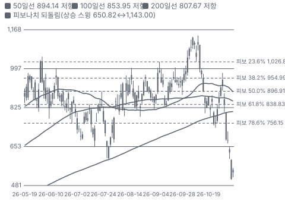

**주봉**

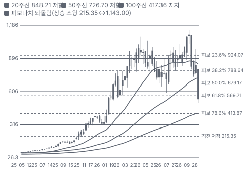

**월봉**

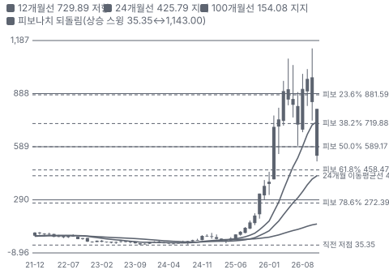

**분기 매출·EPS 실적과 컨센서스**

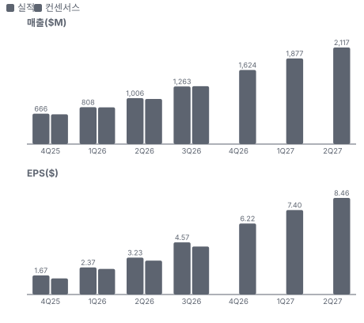

**4Q26 매출 — 지표 추세 vs 가이던스·컨센서스**

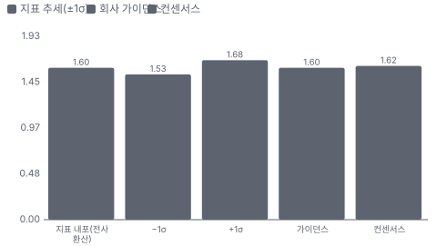

**최근 4개 분기 주가 변화 분석**

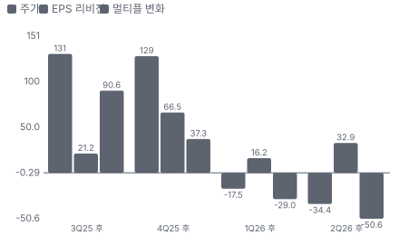

**EPS 리비전**

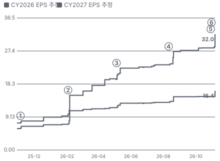

① 25-11-04 FQ1 FY26 실적 · EPS 리비전 +7%
② 26-02-03 FQ2 FY26 실적·EPS 추정 급등 · EPS 리비전 +61%
③ 26-05-05 FQ3 FY26 실적·OCS 다년 계약 · EPS 리비전 +16%
④ 26-08-11 FQ4 FY26 실적·매출 \$1B 돌파 · EPS 리비전 +16%
⑤ 26-10-29 Marvell 인수 협상 보도 · EPS 리비전 +0%
⑥ 26-11-02 인수 합의·FQ1 FY27 실적 · EPS 리비전 +13%

**밸류에이션 주가 시나리오**

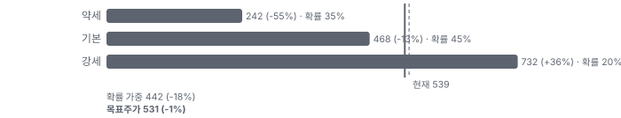

**주가별 업사이드**

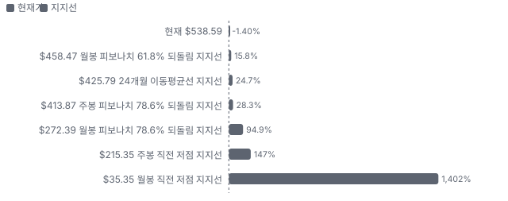

**제품·서비스 포트폴리오**

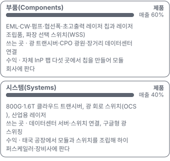

**고객 믹스(FY2026, 매출 대비)**

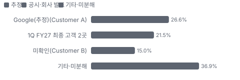

**공급 병목(10점, 낮을수록 병목)**

**CAPEX의 매출 대비 비중**

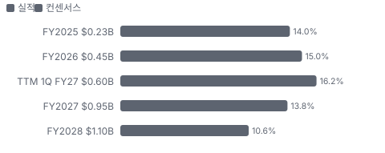

**어닝콜 변화별 주주가치 영향**

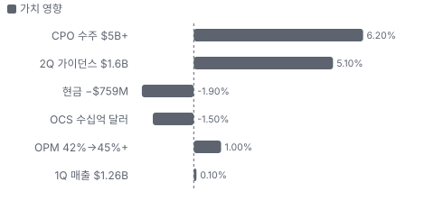

**멀티플 프리미엄(Fwd 1Y P/E, 최근 4개 분기말)**

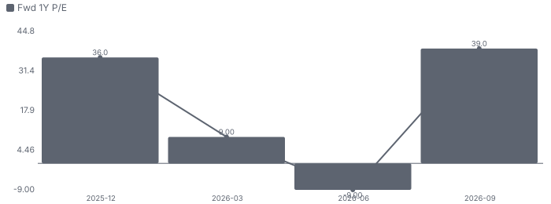

**합리적 멀티플**

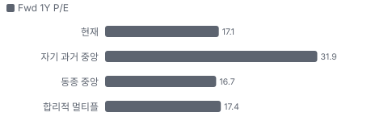

**수주·파이프라인 확실성 사다리**

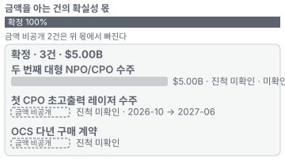

**매출 → 매출총이익 → 영업이익(매출 = 100, 최근 4분기)**

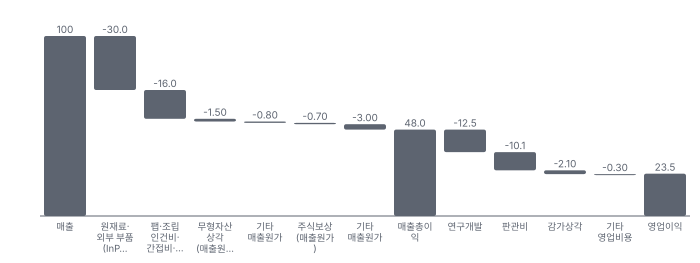

**1년 전 대비 마진 기여(비용 비중 변화의 반대)**

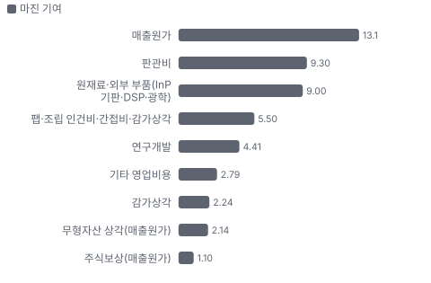

**분기 비용 비중 추이(매출 대비, 공시)**

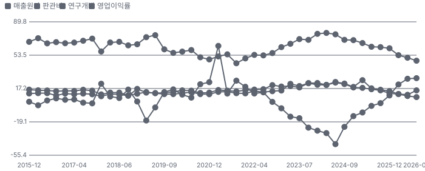

**비용 요인별 매출 대비 비중과 1년 변화**

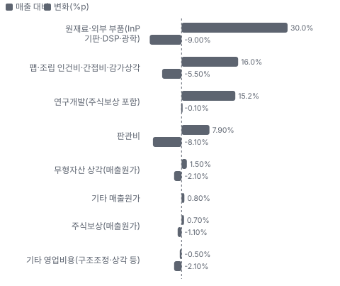

**BOM 항목 가격 +10% 시 OPM 변화**

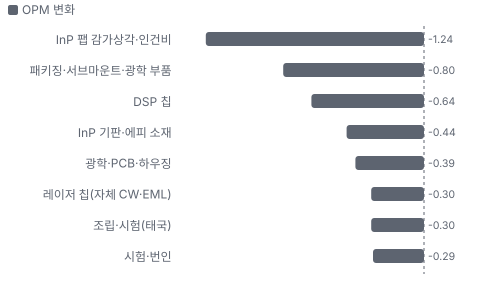

**부품(Components) BOM 원가 몫과 가격 +10% 시 OPM**

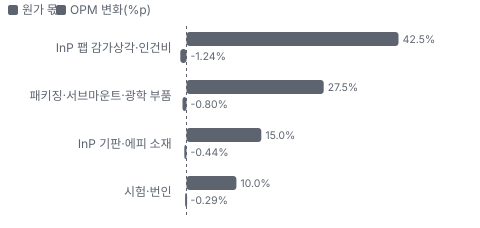

**시스템(Systems) BOM 원가 몫과 가격 +10% 시 OPM**

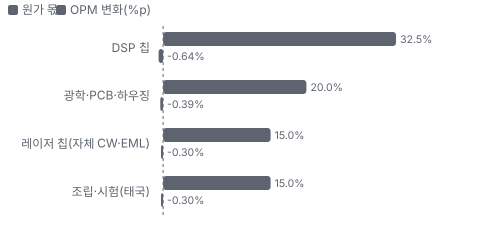

**생산시설별 면적(sq ft, 큰 순) — 생산능력 미공시라 면적을 대용으로**

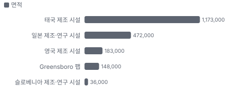

**매출·PPI·수출입 — 최근 16개 분기 같은 축(4Q22 = 100) + 다음 분기 추정**

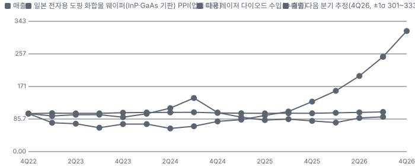

**매출과 미국 레이저 다이오드 수입 증가율(전년 대비, 최근 16개 분기 + 다음 분기 추정)**

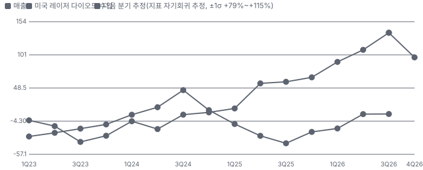

**10년 P·Q 사이클 — 추세(HP 필터) 대비 갭과 8분기 전망**

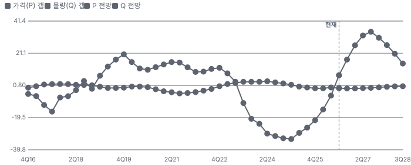

**매출 증가율의 가격·물량 분해와 8분기 전망(전년 대비)**

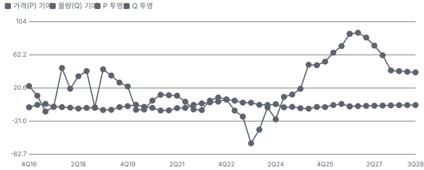

**분기별 매출 증가율 분해**

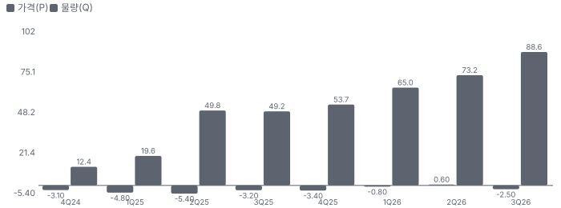

**목표주가 산정 — 기본과 강세 사이(강세 쪽 24%), 도달 확률 약 35%**

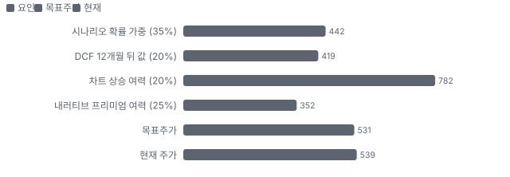

**PEG — 성장 대비 멀티플(낮을수록 성장 대비 쌈)**

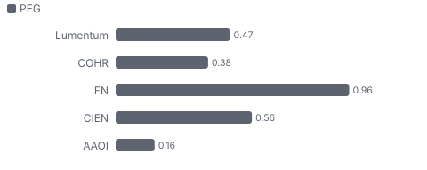

**일봉 지지·저항과 목표주가**

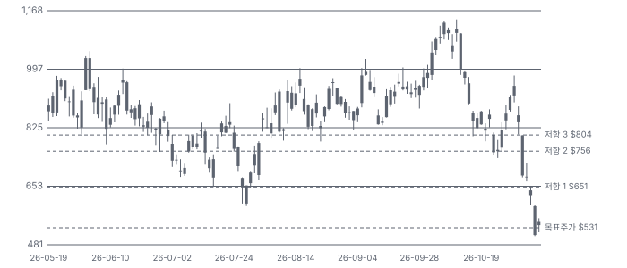

**커뮤니티 언급 수(최근 30일, 채널별)**

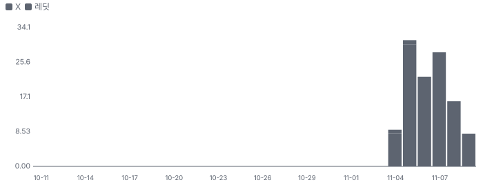

**커뮤니티 게시 수(월, 최근 11개월 — 이번 달은 진행 중)**

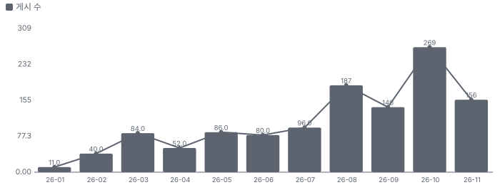

**일별 거래량 분해**

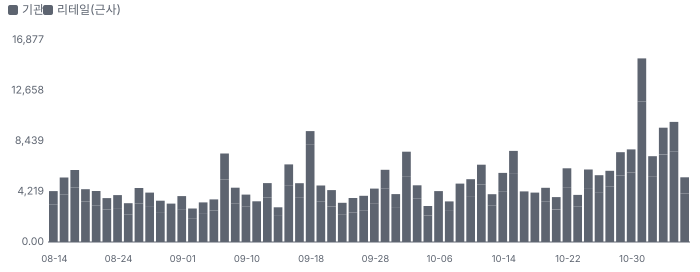

**기관 자금 흐름**

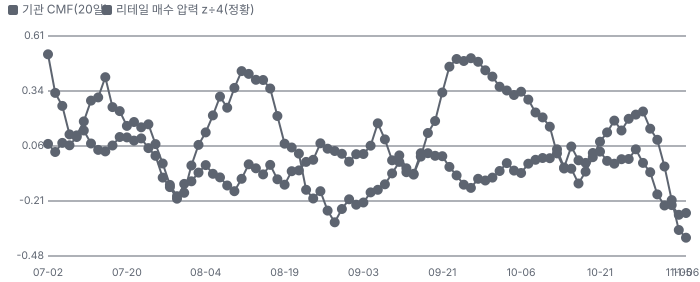

**몬테카를로**

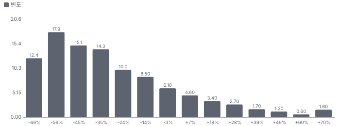

해석: 3,000번 중 503번(17%)에서 가치가 지금 주가 이상이었다. 가정을 흔들어도 지금 주가를 뒷받침하지 못하는 경우가 더 많다. 가운데 값은 0.63배이고, 열 번 중 여덟 번은 0.37~1.16배 사이에 든다.

## 내러티브

> **기업가치를 결정하는 이야기:** 인수 전 가치 논리는 단순했다. 매출 = AI 광 연결 수요 × InP 레이저 점유 × 가격이고, 레이저 공급이 수요보다 모자라 가격과 이익률이 함께 올랐다. 인수 뒤에는 두 갈래다. 거래가 성사되면 LITE 1주는 MRVL 4.5주다(칼라 없음). 깨지면 LITE는 단독 회사로 돌아가고 Marvell이 사정에 따라 \$5.8B 또는 규제 위약금 \$3.2B(주당 약 \$34)를 낸다.

> **멀티플·EPS 프리미엄**
> **멀티플:** 지금 배수는 동종과 비슷하다. Fwd 1Y P/E 17.1배는 동종 중앙값 약 16.7배와 거의 같다. 매출 성장(TTM +103%)과 영업이익률이 동종의 두 배 이상인데 프리미엄이 없다 — 인수 조건이 단독 재평가를 막고 있다.
> **EPS:** EPS에는 기대가 크게 쌓였다. FY27 EPS 컨센서스는 8/11 직전 \$18.16에서 \$24.55로 35% 올랐다. 이 이익을 누가 갖느냐가 문제다 — 성사되면 합병 회사 주주의 33%가 나눠 갖는다.

### 투자자들은 왜 열광했나

열광의 정점은 10월 초였다. 첫째, 공급 부족이 가격을 만들었다. CEO는 협선폭·펌프 레이저가 '당분간 매진'이라고 했고 EML 출하를 1년 새 50% 늘린다고 했다. 둘째, CPO가 숫자로 들어왔다. 첫 수주(수억 달러, 2027년 상반기 납품)에 이어 두 번째 수주가 구매 약정 \$5B를 넘었다. 셋째, NVIDIA가 3월 우선주 \$2.0B를 주당 \$695.31에 샀다. 식은 이유는 회사 밖에서 왔다. 10/28 종가 \$913.95 다음 날 인수 보도가 나왔고, 11/2 합의가 발표된 뒤 11/4~11/5 AI 하드웨어 업종 매도가 MRVL을 −44% 끌어내렸다.

### 무엇이 기업가치를 바꾸나

> **구조적 체질 변화**
> **변화:** 통신 부품 회사에서 AI 데이터센터 레이저·모듈 회사로 바뀌었다. 미주 배송 매출이 1년 새 33.0%에서 42.0%로 늘었고 시스템 매출 비중이 29%에서 40%로 올랐다.
> **증거:** 10-Q 지역·제품 유형 매출(2026-09-26)
> **반증:** AI 매출 둔화로 산업·통신 비중이 다시 커지면 체질 변화가 아니라 사이클이다.

> **고부가 믹스 확장**
> **변화:** 협선폭·펌프 레이저(scale-across(여러 데이터센터를 하나로 잇는 장거리 연결))와 200G EML이 마진을 끌어올렸다. 비GAAP 총이익률은 1년 새 39.4%에서 53.2%로 올랐다.
> **증거:** 1Q 보도자료 비GAAP 총이익률, 5월 콜 CEO 발언
> **반증:** 트랜시버(낮은 마진) 비중이 커지며 총이익률이 50% 아래로 내려간다.

> **기술 혁신**
> **변화:** CPO용 초고출력 레이저와 OCS가 새 제품군이다. 두 번째 NPO/CPO 수주가 구매 약정 \$5B를 넘었다.
> **증거:** 1Q 보도자료(8-K EX-99.1)
> **반증:** CPO 고객 양산이 2028년 이후로 밀리거나 실리콘 포토닉스 광원이 InP를 대체한다.

> **실행 속도**
> **변화:** 해당 없음(납기를 공시하지 않아 잴 수 없다) — 수요가 공급을 앞선다. 펌프 레이저와 OCS는 공급망이 출하를 막고, 협선폭·펌프 레이저는 '당분간 매진'이라고 했다(5월 콜).
> **증거:** 5월 콜 CEO — 펌프 레이저 부족이 가장 크다
> **반증:** 2Q 매출이 가이던스 하단 아래면 공급 제약이 수요보다 크다.

> **M&A**
> **변화:** Marvell이 LITE를 전액 주식으로 인수한다(1주 = MRVL 4.500주). 합병 회사 지분은 Marvell 67%·LITE 33%다. 경영진은 원가 시너지 연 \$1B 이상과 2030 합산 시장 \$550B를 말한다.
> **증거:** 8-K 2026-11-02 Item 1.01, 공동 보도자료
> **반증:** 규제 승인이 막히거나 어느 한쪽 주주 표결이 부결된다.

> **정책·입법 연관성**
> **재정정책:** 해당 없음(LITE에 직접 닿는 재정 지출 공시가 없다). Greensboro(노스캐롤라이나주의 LITE 다섯 번째 InP 팹 소재지) InP 팹은 회사 자금으로 인수했고 CHIPS(미국 반도체지원법) 지원 공시는 10-K·10-Q에서 찾지 못했다(미확인). 10-K Item 2·10-Q 반증: 미국 데이터센터 착공이 연방·지방 규제로 늦어진다
> **행정명령:** 8월 행정부의 중국산 데이터센터 광 부품 금지 초안이 커뮤니티에서 거론됐다(1차 미확인). 확정 조치는 확인되지 않았다. 커뮤니티 월간 요약 — 1차 문서 미확인 반증: 금지 조치가 철회되거나 미국산 부품까지 관세가 넓어진다 의회 동의 2/10 — 하원 1/5(행정 조치 초안 — 표결 없음) · 상원 1/5(행정 조치 초안 — 표결 없음).
> **연관입법:** 연방 데이터센터 법안은 비용 전가 위주이고 물량을 막지 않는다는 평가다. 2029년까지 의무적 비용 전가가 법이 될 가능성을 작성자는 약 60%로 봤다. 노션 데이터센터 법안 추적표(2026-10-23 기준) — 하원 통과 1건(417-3), 상원 표결 실패(57-43) 반증: 모라토리엄 법안이 위원회를 통과한다

> **CAPEX 낙수효과**
> **변화:** 하이퍼스케일러 설비투자가 광 부품 수요의 상류다. 노션 IB 자료는 2027~2028년 미국 데이터센터가 연 19~25 IT-GW씩 늘어난다고 본다(작성처 추정).
> **증거:** 노션 IB 자료 요지(데이터센터 용량 2026-10-01)
> **반증:** 하이퍼스케일러가 2027 설비투자를 줄인다고 밝힌다(1~2월 실적).

### 내러티브 근거

> 'AI 광 연결의 InP 레이저 병목을 쥔 회사'라는 이야기는 실적으로 확인되는데(1Q 매출 +136.5%), 11/2 Marvell 전액 주식 인수 합의로 주가가 MRVL 4.5주에 묶이며 독자 내러티브가 멈췄다. 동종 대비 멀티플 차이 +2% 중 회사 고유 몫은 -2%다. 단계는 붕괴, 쏠림은 높음이다.

> **InP 레이저 병목(EML·CW·초고출력)** · 강화
> **논리:** AI 광 연결이 늘수록 InP 레이저 칩이 가장 먼저 모자라고, 자체 팹을 가진 LITE가 가격과 물량을 정한다
> **숫자:** 부품 매출 1Q \$754.2M(+98.9% YoY), 비GAAP 총이익률 53.2%
> **반증:** 경쟁사 InP 증설 가동으로 EML 가격이 내려가 부품 총이익률이 50% 아래로

> **CPO·NPO(근접 패키징 광학, 칩 패키지 바로 옆에 광 엔진을 두는 방식) 레이저 수주** · 강화
> **논리:** 칩 옆에 광 엔진을 붙이는 CPO가 열리면 외부 광원 레이저가 새 시장이 된다
> **숫자:** 두 번째 NPO/CPO 수주 구매 약정 \$5B 초과
> **반증:** CPO 고객 양산 일정이 2028년 이후로 밀린다

> **OCS(광 회로 스위치)** · 유지
> **논리:** 구글형 광 스위칭이 다른 고객으로 넓어지며 연 수십억 달러 사업이 된다
> **숫자:** 시스템 매출 1Q \$508.4M(+228.8% YoY)
> **반증:** OCS 공급망 제약으로 시스템 매출이 2분기 연속 정체

> **Marvell 인수(고정 교환비율 4.5주)** · 신규
> **논리:** LITE 주주는 MRVL 주주가 된다 — 주가 = 4.5 × MRVL − 합병 무산 위험 할인
> **숫자:** 11/6 기준 내포 가치 \$635.40 vs 주가 \$538.59 — 차익 18.0%
> **반증:** 규제·주주 표결로 거래가 깨지거나 다른 인수 제안이 나온다

> **반대 내러티브 — AI 설비투자 정점** · 확산
> **논리:** 하이퍼스케일러 본업(광고)이 흔들리고 신용 시장이 투자 수익을 묻기 시작했다 — 광 부품 수요의 상류가 꺾일 수 있다
> **숫자:** LITE −41%·MRVL −44%(10/28→11/6), 동종 중앙 −31%
> **반증:** 하이퍼스케일러 2027 설비투자 가이던스가 다시 오른다(1~2월 실적)

## 포트폴리오

| 제품·서비스 | 구분 | 무엇 | 쓰는 곳 | 돈 버는 방식 | Mix | Mix 변화(전년 대비) |
|---|---|---|---|---|---|---|
| 부품(Components(LITE 부품 제품군, 레이저 칩·조립품)) | 제품 | EML·CW·펌프·협선폭·초고출력 레이저 칩과 레이저 조립품, 파장 선택 스위치(WSS(파장 선택 스위치, 광 신호를 파장별로 나눠 보내는 통신 장비 부품)) | 광 트랜시버·CPO 광원·장거리 데이터센터 연결 | 자체 InP 팹 다섯 곳에서 칩을 만들어 모듈 회사에 판다 | 60% | -11.3%p |
| 시스템(Systems(LITE 시스템 제품군, 트랜시버·OCS·산업용 레이저)) | 제품 | 800G(초당 800기가비트 광 모듈 세대)·1.6T(초당 1.6테라비트 광 모듈 세대) 클라우드 트랜시버, 광 회로 스위치(OCS), 산업용 레이저 | 데이터센터 서버·스위치 연결, 구글형 광 스위칭 | 태국 공장에서 모듈과 스위치를 조립해 하이퍼스케일러·장비사에 판다 | 40% | +11.3%p |

**Mix 변화가 가장 큰 쪽은 시스템(Systems, +11.3%p, 전년 대비).** 계절성 판정: 분기 매출 계절 지수 기준 있음 → 전년 같은 분기와 비교.

## 고객

> **FY2026 최대 고객 Google(추정, Customer A) 27%, 상위 3곳 63%, 집중도 분산.** 공시·회사 발표로 확인한 몫은 매출의 36%이고, 나머지 고객 몫은 추정이거나 미분해다. FY2026 매출의 41.6%가 두 최종 고객이다(Customer A 26.6%·B 15.0%). 1Q FY27에는 두 최종 고객이 22%·21%로 더 고르게 나뉘었다.

**고객별 매출 몫(FY2026)**
| 고객 | 몫 | 변화 | 근거 |
|---|---|---|---|
| Google(추정, Customer A) | 27% | +11%p | 추정 |
| 1Q FY27 최종 고객 2곳 | 21~22% | 미확인 | 공시 |
| 미확인(Customer B) | 15% | -1%p | 공시 |
| 기타·미분해 | 37% | - | - |

> **Google(추정, Customer A)** · 추정
> **사는 것:** OCS·트랜시버·레이저
> **추정 근거:** 10-K는 익명 표기다. CEO가 5월 콜에서 Google을 '가장 큰 고객 중 하나'라고 했다 — A가 Google이라는 것은 가설

> **1Q FY27 최종 고객 2곳** · 공시
> **사는 것:** 미확인
> **추정 근거:** 10-Q 각각 22%·21% — A·B와 같은 회사인지 공시가 밝히지 않는다

> **미확인(Customer B)** · 공시
> **사는 것:** 미확인
> **추정 근거:** 익명 공시 — 회사 특정 근거 없음

## 수주·파이프라인

> **2026-11-02 기준 3건.** 확정 \$5.00B.

**실행 속도와 방해 요인**
| 항목 | 상태 | 실행 속도 | 방해 요인 |
|---|---|---|---|
| 두 번째 대형 NPO/CPO 수주 | 확정 | 미확인 — 납품 일정 미공개 | 초고출력 InP 레이저 캐파 · 고객 CPO 양산 일정 |
| 첫 CPO 초고출력 레이저 수주 | 확정 | 12월 분기 의미 있는 매출, 2027년 상반기 납품(5월 콜) | 초고출력 레이저 수율 램프 |
| OCS 다년 구매 계약 | 확정 | 공급망 제약으로 속도 제한(5월 콜) | OCS 부품 공급망 |

## 마진 구조

> **GPM 51.0%, OPM 28.5%.** 1Q FY26(3Q25) 대비 GPM +17.0%p, OPM +27.2%p. 1Q FY27 매출원가는 매출의 49.0%로 1년 전 66.0%보다 17%p 낮다. 고정비가 큰 InP 팹이 꽉 차며 레이저 가격과 가동률이 함께 마진을 올렸다.

> **매출 100 중 매출원가 52.0, 매출총이익 48.0(최근 4분기, 공시).** 매출원가 요인 중 원재료·외부 부품(InP 기판·DSP(디지털 신호 처리 칩, 광 모듈의 신호를 복원하는 칩)·광학)이 매출의 30.0%로 가장 무겁고, 단가가 +10% 오르면 GPM이 -3.00%p 움직인다. 분기 회귀로 매출 1이 늘 때 매출원가는 0.43 늘고, 매출원가의 고정비 몫은 28%다.

**비용 요인 강도 — 비중·추세·충격(+10%)·탄력**
| 비용 | 구분 | 매출 대비 | 1년 변화 | 마진 기여 | 충격 시 마진 | 매출 탄력 | 고정비 몫 |
|---|---|---|---|---|---|---|---|
| 원재료·외부 부품(InP 기판·DSP·광학) | 매출원가 요인 | 30.0% | -9.0%p | +9.0%p | -3.00%p | 미확인 | 0% |
| 팹·조립 인건비·간접비·감가상각 | 매출원가 요인 | 16.0% | -5.5%p | +5.5%p | -1.60%p | 미확인 | 60% |
| 무형자산 상각(매출원가) | 매출원가 요인 | 1.5% | -2.1%p | +2.1%p | -0.15%p | 미확인 | 100% |
| 기타 매출원가 | 매출원가 요인 | 0.8% | 미확인 | 미확인 | -0.08%p | 미확인 | 미확인 |
| 주식보상(매출원가) | 매출원가 요인 | 0.7% | -1.1%p | +1.1%p | -0.07%p | 미확인 | 100% |
| 매출원가 | 공시 항목 | 52.0% | -13.1%p | +13.1%p | -5.20%p | 0.43 | 28% |
| 연구개발 | 공시 항목 | 12.5% | -4.4%p | +4.4%p | 미확인 | 0.12 | 18% |
| 판관비 | 공시 항목 | 10.1% | -9.3%p | +9.3%p | 미확인 | 0.08 | 45% |
| 감가상각 | 공시 항목 | 2.1% | -2.2%p | +2.2%p | 미확인 | 0.02 | 36% |
| 기타 영업비용 | 공시 항목 | 0.3% | -2.8%p | +2.8%p | 미확인 | -0.00 | 100% |

매출 탄력 = 분기 비용을 매출에 회귀한 기울기(매출 1당 변동비), 고정비 몫 = 절편 ÷ 평균 비용. 표본이 8분기 미만이면 미확인. 매출원가 요인 비중은 margin 재료의 추정이 섞여 있고, 공시 매출원가와의 차이는 '기타 매출원가'로 둔다.

**GPM에서 OPM까지(GAAP)**
| 기간 | GPM | 연구개발 | 판관비 | 기타 | OPM |
|---|---|---|---|---|---|
| 1Q FY26(3Q25) | 34.0% | 15.2% | 15.9% | 1.6% | 1.3% |
| 1Q FY27(3Q26) | 51.0% | 15.2% | 7.9% | -0.5% | 28.5% |

**GPM·OPM 최근 4개 분기**
| 분기 | GPM | OPM |
|---|---|---|
| 2025-12 | 39.0% | 9.7% |
| 2026-03 | 46.5% | 21.6% |
| 2026-06 | 49.3% | 27.8% |
| 2026-09 | 52.5% | 28.5% |

**마진을 결정하는 비용 요인 — 비용 +10% 시 OPM**
| 비용 | 매출 대비 | 변화 | 고정비 | OPM |
|---|---|---|---|---|
| 원재료·외부 부품(InP 기판·DSP·광학) | 30.0% | -9.0%p | 0% | -3.00%p |
| 팹·조립 인건비·간접비·감가상각 | 16.0% | -5.5%p | 60% | -1.60%p |
| 연구개발(주식보상 포함) | 15.2% | -0.1%p | 70% | -1.52%p |
| 판관비 | 7.9% | -8.1%p | 80% | -0.79%p |
| 무형자산 상각(매출원가) | 1.5% | -2.1%p | 100% | -0.15%p |
| 기타 매출원가 | 0.8% | 미확인 | 미확인 | -0.08%p |
| 주식보상(매출원가) | 0.7% | -1.1%p | 100% | -0.07%p |
| 기타 영업비용(구조조정·상각 등) | -0.5% | -2.1%p | 미확인 | +0.06%p |

**비용을 움직이는 요인**
| 비용 | 요인 |
|---|---|
| 원재료·외부 부품(InP 기판·DSP·광학, 매출원가) | 기판·DSP 단가와 트랜시버 비중 · 근거 추정 |
| 팹·조립 인건비·간접비·감가상각(매출원가) | InP 팹 가동률·태국 조립 램프 · 근거 추정 |
| 연구개발(주식보상 포함, 연구개발) | CPO·1.6T·OCS 개발, 1Q 주식보상 급증 · 근거 공시 |
| 판관비(판관비) | 인수 자문·법률비 · 근거 공시 |
| 무형자산 상각(매출원가, 매출원가) | 과거 인수 상각 · 근거 공시 |
| 기타 매출원가(매출원가) | 재고 평가·기타 · 근거 추정 |
| 주식보상(매출원가, 매출원가) | 주가·부여 · 근거 공시 |
| 기타 영업비용(구조조정·상각 등, 기타) | 일회성 항목 · 근거 공시 |

**부품(Components) BOM — 매출의 60%, GPM 51%(제품군 총이익률 미공시 — 회사 GAAP 총이익률 51.0%), 항목 가격 +10% 시**
| 항목 | 원가 몫 | 전가 | 제품 GPM | OPM |
|---|---|---|---|---|
| InP 팹 감가상각·인건비 | 35~50% | 미확인 | -2.1%p | -1.24%p |
| 패키징·서브마운트·광학 부품 | 20~35% | 미확인 | -1.3%p | -0.80%p |
| InP 기판·에피 소재 | 10~20% | 미확인 | -0.7%p | -0.44%p |
| 시험·번인 | 5~15% | 미확인 | -0.5%p | -0.29%p |
| 미분해 | 5% | - | - | - |

**시스템(Systems) BOM — 매출의 40%, GPM 51%(제품군 총이익률 미공시 — 회사 GAAP 총이익률. 경영진은 트랜시버 마진이 회사 평균보다 낮다고 했다(5월 콜)), 항목 가격 +10% 시**
| 항목 | 원가 몫 | 전가 | 제품 GPM | OPM |
|---|---|---|---|---|
| DSP 칩 | 25~40% | 미확인 | -1.6%p | -0.64%p |
| 광학·PCB·하우징 | 15~25% | 미확인 | -1.0%p | -0.39%p |
| 레이저 칩(자체 CW·EML) | 10~20% | 미확인 | -0.7%p | -0.30%p |
| 조립·시험(태국) | 10~20% | 미확인 | -0.7%p | -0.30%p |
| 미분해 | 17% | - | - | - |

InP 팹 감가상각·인건비 가격이 +10% 오르면 영업이익은 -4.4% 움직인다. 판매가 전가를 모르는 항목은 전가 0%로 계산했다.

**BOM 항목 가격을 움직이는 것**
| 항목 | 요인 |
|---|---|
| InP 기판·에피 소재 | 인듐 가격·중국 수출 통제 · 근거 추정 |
| InP 팹 감가상각·인건비 | 가동률 · 근거 추정 |
| 패키징·서브마운트·광학 부품 | 부품 단가·수율 · 근거 추정 |
| 시험·번인 | 신뢰성 요구 · 근거 추정 |
| DSP 칩 | DSP 공급 부족 · 근거 추정 |
| 레이저 칩(자체 CW·EML) | 내부 이전가 · 근거 추정 |
| 광학·PCB·하우징 | 부품 단가 · 근거 추정 |
| 조립·시험(태국) | 수율·스크랩 · 근거 추정 |

**BOM 투입 물가 — PPI 전년비, 2026-11-09 수집**
| 항목 | 미국 | 일본 | 한국 | 대만 |
|---|---|---|---|---|
| InP 기판·에피 소재 | -2.2%* | +3.9%* | 미확인 | 미확인 |

별표는 품목보다 넓은 업종 지수다. 지난 1년 투입 물가를 판매가 전가 뒤 원가에 그대로 넣으면 OPM은 -0.12%p 움직인다(매출원가의 9% 기준).

## 공급망 병목

이미지 없음(아직 생성 전) — 시스템(Systems)

이미지 없음(검수 실패) — 부품(Components)

> **공급망 신뢰성 3.4/10, 병목 심각.** 가장 약한 고리는 InP 팹 다이 캐파(EML·CW) 3.0점이고, 품목 평균은 4.0점이다. 근거가 부족한 3건(InP 기판·에피 소재 · 펌프 레이저 캐파 · OCS 부품 공급망)은 점수에서 뺐다. 병목은 회사 안(InP 팹·펌프 레이저 캐파)과 밖(InP 기판·DSP·OCS 부품)에 모두 있다. 경영진은 펌프 레이저 부족이 가장 크다고 했다.

**병목과 마진 — 품목 가격 +10% 시 OPM**
| 품목 | 점수 | 판정 | 구분 | OPM |
|---|---|---|---|---|
| InP 팹 다이 캐파(EML·CW, 필수) | 3.0 | 병목 심각 | 출하 차질 위험 | 미확인 |
| DSP 칩(필수) | 5.0 | 병목 주의 | 핵심 통제 품목 | -0.64%p |

> **InP 팹 다이 캐파(EML·CW)** · 3.0/10
> **왜:** 자체 생산이라 공급사 위험은 없지만 캐파가 출하 상한이다
> **병목 요인:** 인증 공급사 1곳 · 캐파 부족 · 리드타임 미확인 · 재인증 12개월 · 1위 점유율 미확인 · 지역 집중 미확인 · 물량 확보 내재화
> **풀리는 조건:** Greensboro InP 전환(장비 반입·공정 인증 단계, 가동 시점 미공개)

> **DSP 칩** · 5.0/10
> **왜:** 트랜시버마다 들어가고 대체가 어렵다. 인수 성사 시 Marvell 몫은 내부 조달이 된다
> **병목 요인:** 인증 공급사 2곳 · 캐파 빠듯 · 리드타임 미확인 · 재인증 6개월 · 1위 점유율 60% · 대만(TSMC 생산, 추정) 집중 90% · 물량 확보 미확인
> **풀리는 조건:** 미확인

**공급사**
| 품목 | 공급사 | 몫 | 근거 |
|---|---|---|---|
| InP 기판·에피 소재 | AXT(InP 기판) | 미확인 | 추정 |
| InP 기판·에피 소재 | Sumitomo Electric(InP 기판) | 미확인 | 추정 |
| InP 팹 다이 캐파(EML·CW) | LITE 자체 InP 팹 5곳(레이저 웨이퍼) | 미확인 | 회사 발표 |
| 펌프 레이저 캐파 | LITE 자체(펌프 레이저) | 미확인 | 회사 발표 |
| DSP 칩 | Marvell(광 DSP) | 미확인 | 추정 |
| DSP 칩 | Broadcom(광 DSP) | 미확인 | 추정 |
| OCS 부품 공급망 | 미공개(OCS 부품) | 미확인 | 회사 발표 |

**무역 통계로 본 공급 지역**
| 품목 | EU 수입처 | 일본 수입처 | EU 1위 전년비 |
|---|---|---|---|
| InP 기판·에피 소재 | JP 37% · CN(중국) 20% · US 19% | 中華人民共和国 31% · 台湾 18% | -0.3% |

## 생산능력

> **현재 명목 캐파 미확인, 가동률 미확인.** 착공 이상 증설은 0 InP 팹 수·출하 증가율(회사 표현), 발표까지 합치면 0 InP 팹 수·출하 증가율(회사 표현)이다. TTM 1Q FY27 CAPEX는 \$0.60B로 매출의 16.2%다. 회사는 캐파를 수치로 공시하지 않는다. InP 팹 다섯 곳, EML 출하 1년 +50%(12월 분기 기준)가 회사가 밝힌 숫자다.

**생산시설 6곳**(10-K FY2026 Item 2 — 이름·면적을 밝힌 소유 제조·연구 시설 6곳. 임차 시설(캐나다·중국·홍콩·이탈리아·일본·스위스·대만·미국·한국)은 수를 밝히지 않아 세지 않았다), 소유 6곳. 시설별 생산능력은 공개되지 않았다 — 회사 전체 캐파만 위에 적었다.

**생산시설 6곳 — 명칭·위치·생산능력**
| 시설 | 위치 | 용도 | 생산능력 | 소유·상태 |
|---|---|---|---|---|
| 태국 제조 시설 | 태국(시 단위 미공시) | 트랜시버·모듈 조립 | 미확인 — 시설별 캐파 미공시 · 면적 1,173,000 sq ft | 소유 · 가동 |
| 일본 제조·연구 시설 | 일본 사가미하라(웨이퍼 팹 소재지) | InP 웨이퍼 팹·연구 | 미확인 — 5월 콜 — 캐파 완전 배정, 수치 미공시 · 면적 472,000 sq ft | 소유 · 가동 |
| 영국 제조 시설 | 영국(시 단위 미공시) | 제조 | 미확인 — 시설별 캐파 미공시 · 면적 183,000 sq ft | 소유 · 가동 |
| Greensboro 팹 | 미국 노스캐롤라이나 Greensboro | InP 웨이퍼 팹(GaAs(갈륨비소, 3D 센싱 레이저 등에 쓰는 화합물 반도체 기판)에서 전환 중) | 미확인 — 2026-03 인수, 전환 진행 — 캐파 미공시 · 면적 148,000 sq ft | 소유 · 증설 중 |
| San Jose 본사 캠퍼스 | 미국 캘리포니아 San Jose | 본사·연구 | 미확인 — 본사 · 면적 124,000 sq ft | 소유 · 가동 |
| 슬로베니아 제조·연구 시설 | 슬로베니아(시 단위 미공시) | 제조·연구 | 미확인 — 시설별 캐파 미공시 · 면적 36,000 sq ft | 소유 · 가동 |

**생산능력 확충 계획**
| 계획 | 단계 | 증설 | 가동 시점 | CAPEX |
|---|---|---|---|---|
| Greensboro 팹 GaAs→InP 전환 | 장비 반입 | 미확인 | 미확인 | 미확인 |
| 펌프 레이저 증설 | 발표 | 미확인 | 미확인 | 미확인 |

남은 계획의 CAPEX 합계는 \$0.00B(금액 미확인 2건 제외)다. 합계는 FY2028 매출의 0%다.

**증설 방해 요인**
| 계획 | 방해 요인 |
|---|---|
| Greensboro 팹 GaAs→InP 전환 | 공정 인증(1Q에 인증 비용 \$1.2M 발생) |
| 펌프 레이저 증설 | 고객 선급금·take-or-pay 협상 |

**CAPEX와 매출 대비**
| 기간 | CAPEX | 매출 | 매출 대비 | 구분 |
|---|---|---|---|---|
| FY2025 | \$0.23B | \$1.65B | 14.0% | 실적 |
| FY2026 | \$0.45B | \$3.01B | 15.0% | 실적 |
| TTM 1Q FY27 | \$0.60B | \$3.74B | 16.2% | 실적 |
| FY2027 | \$0.95B | \$6.88B | 13.8% | 컨센서스 |
| FY2028 | \$1.10B | \$10.40B | 10.6% | 컨센서스 |

## 해자

> InP 레이저 팹과 고객 인증이 진입을 막고, 지금은 공급 부족이 가격 결정력을 만든다 — 다만 해자는 인수 뒤 Marvell 몫이 된다

> **InP 레이저 팹(수직계열화)** · 강함
> **해자:** EML·CW·펌프 레이저를 자체 InP 팹 다섯 곳에서 만든다. 팹 증설·인증에 수년이 걸려 신규 진입이 어렵다.
> **근거:** 5월 콜 — 다섯 번째 InP 팹(Greensboro) 인수, 일본 팹 '완전 배정'
> **숫자:** 비GAAP 총이익률 53.2%(동종 영업이익률 10~13%)
> **깨지는 조건:** 경쟁사 InP 팹 증설 가동으로 EML 가격이 내린다

> **고객 인증·장기 계약** · 보통
> **해자:** 트랜시버·CPO 고객은 레이저를 수개월 인증한 뒤 쓴다. 회사는 장기 공급 계약 연장을 협상 중이다.
> **근거:** 5월 콜 CEO — 고객과 LTA(장기 공급 계약) 연장 논의
> **숫자:** 두 번째 NPO/CPO 수주 구매 약정 \$5B 초과
> **깨지는 조건:** 고객이 실리콘 포토닉스 외부 광원 공급사를 이원화한다

> **OCS 선점** · 보통
> **해자:** 광 회로 스위치는 구글형 구조에서 검증됐고 고객 세 곳과 일한다.
> **근거:** 5월 콜 — 고객 3곳 중 2곳이 물량 대부분
> **숫자:** 시스템 매출 1Q +228.8% YoY
> **깨지는 조건:** MEMS(미세 전자기계 시스템)·액정 방식 경쟁사가 다른 하이퍼스케일러를 가져간다

## 경영진·네트워크

> CEO는 광 부품 경쟁사 Finisar의 CEO 출신이다. 회사 밖 가장 큰 연결은 우선주 \$2.0B를 산 NVIDIA다. 이사회 의장 등 다른 이사는 위임장 대조 전이라 미확인이다.

> **Michael Hurlston** · 사장 겸 CEO · 2025
> **프로필:** Synaptics CEO, Finisar CEO, Broadcom 사업부 임원을 지냈다(공개 경력 — 위임장 대조 전)
> **비즈니스:** Finisar(현 Coherent 소속) 경력이 광 부품 업계와 닿는다. 인수 성사 뒤 거취는 공시되지 않았다
> **정계:** 공개 기록상 공직·정치 활동 미확인
> **동문:** 미확인
> **사모임:** 미확인

> **Wajid Ali** · EVP·CFO · 미확인
> **프로필:** OCS 공급망을 직접 맡았다(5월 콜 CEO 발언)
> **비즈니스:** 10/1 장내 매도 24,542주(\$25.7M)
> **정계:** 공개 기록상 공직·정치 활동 미확인
> **동문:** 미확인
> **사모임:** 미확인

> **Wupen Yuen** · President, Global Business Units · 미확인
> **프로필:** 고객 영업·사업부 총괄(콜 참석)
> **비즈니스:** 9월 일별 500주 장내 매도
> **정계:** 공개 기록상 공직·정치 활동 미확인
> **동문:** 미확인
> **사모임:** 미확인

**네트워크 정량화**
| 연결 | 강도 | 닿는 매출 | 가중 노출 | 매출 대비 | 근거 |
|---|---|---|---|---|---|
| 비즈니스: NVIDIA — Series A 전환우선주 2.9M주(\$2.0B, 주당 \$695.31) 보유 | 5/5 | \$0.00B | \$0.00B | 0% | 투자 관계로 공시 확인. NVIDIA가 매출 고객인지는 공시되지 않아 노출 매출을 0으로 둔다 10-K FY2026 |
| 비즈니스: Google — CEO가 '가장 큰 고객 중 하나'라고 언급 | 4/5 | \$1.00B | \$0.80B | 21% | TTM 매출 \$3.74B × FY2026 Customer A 26.6%(A = Google은 가설) 5월 콜·10-K |
| 비즈니스: Hurlston — Finisar CEO 출신(경쟁사 경력) | 2/5 | \$0.00B | \$0.00B | 0% | 매출 연결 없음 공개 경력 |
| 정계: Greensboro 팹 — 미국 제조·고용 행사 | 1/5 | \$0.00B | \$0.00B | 0% | 정부 지원 공시 미확인 5월 콜 |

가중 노출은 연결이 닿는 매출의 크기다. 연결이 그 매출을 만들었다는 뜻이 아니며, 인과는 공개 자료로 입증하지 못한다.

## 약세 논리 및 셀온 조건

| 약세 논리 | 근거 | 가를 자료 |
|---|---|---|
| MRVL 주주가 부결하거나 조건을 다시 쓴다 | MRVL 주가가 10/28 \$251.65에서 \$141.20으로 내려와 신주 발행 승인 부담이 커졌다. 합병은 MRVL 주주 승인이 조건이다(8-K) | S-4 공동 위임장·주주총회 일정(회사 미공지 — 11/2 공동 보도자료는 거래 완료를 2028년 상반기로 예상) |
| 규제 심사가 길어진다 | 시한은 2027-11-01이고 최장 2028-08-01까지 늘 수 있다. 1Q 배송 매출의 12.8%가 중국이다(10-Q) | HSR 대기 기간 만료 또는 2차 자료 요청(서명 후 30~60일) |
| 무산 위약금이 차익보다 작다 | 규제 위약금 \$3.2B는 주당 약 \$34로, 지금 차익 약 \$97보다 작다 | 무산 사유가 규제인지 표결인지 |
| AI 설비투자 정점 | 노션 IB 자료(크레딧 전략)는 하이퍼스케일러 광고 둔화와 신용 시장의 투자 수익 질문을 경고한다 | 하이퍼스케일러 2027 설비투자 가이던스(2027-01~02) |
| 공급 제약이 매출을 막는다 | 경영진은 펌프 레이저 부족이 가장 크고 OCS 공급망이 빠듯하다고 했다(5월 콜) | 2Q 매출이 가이던스 하단 \$1.575B 이상인지(2027-02) |
| 고객 집중 | FY2026 두 최종 고객이 41.6%(26.6%·15.0%), 1Q는 22%·21%다 | 10-Q 고객 집중 주석(2027-02) |
| 내부자 매도 | 최근 장내 매도 92건·매수 0건, 10/1 CFO \$25.7M 매도(Form 4) | 인수 뒤 경영진 지분 처리 공시 |

> **셀온 조건**
> **조건 1:** HSR 2차 자료 요청이나 해외 심사 지연으로 시한 연장이 공시된다.
> **조건 2:** MRVL 주요 주주가 인수 반대를 공개하거나 조건 재협상이 보도된다.
> **조건 3:** 2Q 매출이 가이던스 하단 \$1.575B를 밑돈다.
> **조건 4:** 하이퍼스케일러가 2027 설비투자를 2026년보다 낮게 제시한다.

## 어닝콜 변화

**직전 콜 대비 새로 나오거나 바뀐 내용 → 가치 영향**
| 항목 | 내용 | 직전 콜 | 최신 콜 | 모델 동인 이동 | 확신도 | 가치 영향 |
|---|---|---|---|---|---|---|
| 업데이트 | 1Q 매출 | 가이던스 중간값 약 \$1.25B | \$1.2626B | 기준연도 매출 +\$0.01B | 1.0 | +0.1% |
| 업데이트 | 2Q 매출 가이던스 | 1Q 가이던스 약 \$1.25B | \$1.575~1.625B | 1년차 성장률 +5.0% | 0.8 | +5.1% |
| 업데이트 | 비GAAP 영업이익률 | 4Q 36.6% | 1Q 42.3%, 2Q 가이던스 45~46% | 출발 이익률 +5.0% | 0.8 | +1.0% |
| 신규 | 두 번째 NPO/CPO 수주 | 첫 CPO 수주(수억 달러, 1H CY27 납품) | 구매 약정 \$5B 초과 | 장기 성장 수렴값 +3.0% | 0.8 | +6.2% |
| 업데이트 | OCS 가시성 | 다년·수십억 달러 구매 계약(5월 콜) | 연 수십억 달러 매출 흐름이 될 것 | 성장 지속(감속 계수) -2.0% | 0.5 | -1.5% |
| 부정 | 현금 감소 | 4Q 말 \$2.74B | 1Q 말 \$1.98B(전환사채 정리) | 순차입 +\$0.76B | 1.0 | -1.9% |
| **합계** | 단독 합 |  |  | 동시 적용 +9.1% |  | **+9.1%** |

**사건별 EPS 리비전**
| # | 날짜 | 구분 | 사건 | CY2026 EPS 전→후 | CY2027 EPS 전→후 | 리비전 | 주가 반응 |
|---|---|---|---|---|---|---|---|
| ① | 25-11-04 | 실적 | FQ1 FY26 실적 | \$5.92 → \$6.55 | \$7.47 → \$8.02 | +7.3% | +23.6% |
| ② | 26-02-03 | 실적 | FQ2 FY26 실적·EPS 추정 급등 | \$7.14 → \$10.87 | \$9.42 → \$15.13 | +60.7% | +7.0% |
| ③ | 26-05-05 | 실적 | FQ3 FY26 실적·OCS 다년 계약 | \$11.72 → \$12.94 | \$19.53 → \$22.63 | +15.9% | -5.1% |
| ④ | 26-08-11 | 실적 | FQ4 FY26 실적·매출 \$1B 돌파 | \$13.17 → \$14.73 | \$23.56 → \$27.23 | +15.6% | +13.6% |
| ⑤ | 26-10-29 | 내러티브 | Marvell 인수 협상 보도 | \$14.79 → \$14.79 | \$28.24 → \$28.24 | +0.0% | +0.6% |
| ⑥ | 26-11-02 | 실적 | 인수 합의·FQ1 FY27 실적 | \$14.79 → \$16.37 | \$28.24 → \$32.02 | +13.4% | -0.6% |

**해석:** 4개 구간 누적 주가 +186% = EPS 리비전 +211% × 멀티플 -8%. 더 크게 움직인 쪽은 **EPS 리비전**이다.

## 거시 지표 싱크로율

> **미국 레이저 다이오드 수입과 부품(Components) 싱크로율 97%(0분기 = 약 0개월 선행, 전년 대비, 표본 5개·t 6.6·유의·신뢰 참고용).** 이 지표가 내포하는 4Q26 부품(Components)은 875M(±1σ 796M~955M, 지표 자기회귀 추정)다. 세그먼트 추정에 나머지 사업(직전 증가율 지속)을 더한 전사 매출은 1.60B(1.53B~1.68B)다. 가이던스는 이보다 -0.3%(범위 안), 컨센서스는 +1.2%(범위 안)다. 레이저 칩은 HS(국제 통일 상품 분류 코드) 8541.41(레이저 다이오드 포함), 트랜시버는 HS 8517.62에 들어간다. 미국 수입이 고객 쪽 반입의 거울이다. 광 모듈 전용 PPI(생산자물가지수)가 없어 반도체 업종 PPI를 대용으로 쓴다

**지표별 싱크로율(상관계수 × 100) — 위 두 줄이 제품 연관성 × 싱크로율로 고른 PPI·수출입 세부 지표**
| 지표 | 비교 대상 | 증가율 기준 | 지표 선행 | 매출(t값) | 영업이익 | 방향 일치 | 표본·신뢰 | 표본 밖 오차(지표/기준선) | 4Q26 추정 매출 |
|---|---|---|---|---|---|---|---|---|---|
| 일본 전자용 도핑 화합물 웨이퍼(InP·GaAs 기판) PPI(업종 대용) | 부품(Components) | 전년 대비 | 0분기(0개월) | 94%(t 5.0) | -10%(4분기) | 60% | 5·참고용 | 미확인 | +101.1% → 892M(지표 자기회귀 추정) |
| 미국 레이저 다이오드 수입 | 부품(Components) | 전년 대비 | 0분기(0개월) | 97%(t 6.6) | 25%(1분기) | 40% | 5·참고용 | 미확인 | +97.3% → 875M(지표 자기회귀 추정) |
| 미국 광 송수신 기기 수입 | 시스템(Systems) | 전년 대비 | 3분기(9개월) | 92%(t 3.9) | 30%(3분기) | 100% | 5·참고용 | 미확인 | +210.6% → 689M(확정) |

**지표 후보 11개 — 연관성(제품 품목 일치 × 대용 감점 × 매출 비중) × 싱크로율로 고른다. 후보가 많을수록 최대 상관은 우연히 부풀 수 있다**
| 후보 | 종류 | 연관성 | 매출 분기 일치 | 싱크로율(선행) | 점수 | 출처 |
|---|---|---|---|---|---|---|
| 미국 레이저 다이오드 수입 ✔ | 수출입 | 1.00 | 100% | 97%(0분기) | 0.97 | 모델 지정 |
| 미국 광 송수신 기기 수입 | 수출입 | 1.00 | 100% | 92%(3분기) | 0.92 | 모델 지정 |
| EU(유럽연합) 발광 다이오드·레이저 다이오드 수출(HS 854141) | 수출입 | 0.60 | 94% | 84%(3분기) | 0.50 | 자동 |
| EU 광 송수신 모듈·통신 기기 부분품 수입(HS 851762) | 수출입 | 0.40 | 94% | 95%(4분기) | 0.38 | 자동 |
| EU 광 송수신 모듈·통신 기기 부분품 수출(HS 851762) | 수출입 | 0.40 | 94% | 94%(4분기) | 0.38 | 자동 |
| 일본 전자용 도핑 화합물 웨이퍼(InP·GaAs 기판) PPI(업종 대용) ✔ | PPI | 0.36 | 100% | 94%(0분기) | 0.34 | 자동 |
| 미국 전자용 도핑 화합물 웨이퍼(InP·GaAs 기판) PPI(업종 대용) | PPI | 0.36 | 100% | 93%(1분기) | 0.33 | 자동 |
| EU 발광 다이오드·레이저 다이오드 수입(HS 854141) | 수출입 | 0.60 | 94% | 68%(1분기) | 0.33 | 자동 |
| 미국 발광 다이오드·레이저 다이오드 수출(HS 854141) | 수출입 | 0.60 | 100% | 68%(2분기) | 0.32 | 자동 |
| 미국 광 송수신 모듈·통신 기기 부분품 수출(HS 851762) | 수출입 | 0.40 | 100% | 77%(3분기) | 0.31 | 자동 |
| EU 전자용 도핑 화합물 웨이퍼(InP·GaAs 기판) PPI(업종 대용) | PPI | 0.36 | 100% | -95%(4분기) | 0.00 | 자동 |

**선행 지표로 본 향후 분기 매출 전망(이미 나온 지표 값 기준, ±1σ)**
| 지표 | 대상 | 분기 | 지표 증가율 | 내포 매출 증가율 | 내포 매출 |
|---|---|---|---|---|---|
| 미국 광 송수신 기기 수입 | 시스템(Systems) | 4Q26 | +70.6% | +210.6% | 689M(615M~763M) |
| 미국 광 송수신 기기 수입 | 시스템(Systems) | 1Q27 | +74.3% | +223.4% | 890M(798M~982M) |
| 미국 광 송수신 기기 수입 | 시스템(Systems) | 2Q27 | +80.4% | +244.1% | 1.23B(1.11B~1.35B) |
| EU 발광 다이오드·레이저 다이오드 수출(HS 854141) | 부품(Components) | 4Q26 | +14.1% | +80.9% | 803M(753M~853M) |
| EU 발광 다이오드·레이저 다이오드 수출(HS 854141) | 부품(Components) | 1Q27 | +9.2% | +75.9% | 938M(878M~998M) |
| 미국 발광 다이오드·레이저 다이오드 수출(HS 854141) | 부품(Components) | 4Q26 | -3.9% | +84.1% | 817M(750M~884M) |
| 미국 발광 다이오드·레이저 다이오드 수출(HS 854141) | 부품(Components) | 1Q27 | +3.7% | +92.3% | 1.03B(945M~1.11B) |
| EU 광 송수신 모듈·통신 기기 부분품 수출(HS 851762) | 시스템(Systems) | 4Q26 | +11.5% | +121.7% | 492M(429M~554M) |
| EU 광 송수신 모듈·통신 기기 부분품 수출(HS 851762) | 시스템(Systems) | 1Q27 | +8.3% | +102.7% | 558M(480M~635M) |
| EU 광 송수신 모듈·통신 기기 부분품 수출(HS 851762) | 시스템(Systems) | 2Q27 | +10.2% | +113.6% | 762M(662M~863M) |
| EU 광 송수신 모듈·통신 기기 부분품 수입(HS 851762) | 시스템(Systems) | 4Q26 | +16.5% | +270.7% | 822M(765M~879M) |
| EU 광 송수신 모듈·통신 기기 부분품 수입(HS 851762) | 시스템(Systems) | 1Q27 | +12.7% | +231.5% | 912M(841M~982M) |
| EU 광 송수신 모듈·통신 기기 부분품 수입(HS 851762) | 시스템(Systems) | 2Q27 | +24.9% | +358.2% | 1.64B(1.54B~1.73B) |
| 미국 광 송수신 모듈·통신 기기 부분품 수출(HS 851762) | 시스템(Systems) | 4Q26 | +12.3% | +102.4% | 449M(331M~567M) |
| 미국 광 송수신 모듈·통신 기기 부분품 수출(HS 851762) | 시스템(Systems) | 1Q27 | +22.6% | +166.2% | 732M(586M~879M) |
| 미국 광 송수신 모듈·통신 기기 부분품 수출(HS 851762) | 시스템(Systems) | 2Q27 | +34.0% | +237.3% | 1.20B(1.01B~1.39B) |
| 미국 전자용 도핑 화합물 웨이퍼(InP·GaAs 기판) PPI(업종 대용) | 부품(Components) | 4Q26 | -2.5% | +81.1% | 804M(769M~838M) |
| EU 전자용 도핑 화합물 웨이퍼(InP·GaAs 기판) PPI(업종 대용) | 부품(Components) | 4Q26 | -3.0% | +109.6% | 930M(903M~957M) |
| EU 전자용 도핑 화합물 웨이퍼(InP·GaAs 기판) PPI(업종 대용) | 부품(Components) | 1Q27 | -2.1% | +102.5% | 1.08B(1.05B~1.11B) |
| EU 전자용 도핑 화합물 웨이퍼(InP·GaAs 기판) PPI(업종 대용) | 부품(Components) | 2Q27 | +2.2% | +69.5% | 1.10B(1.06B~1.14B) |
| EU 전자용 도핑 화합물 웨이퍼(InP·GaAs 기판) PPI(업종 대용) | 부품(Components) | 3Q27 | +6.3% | +38.2% | 1.04B(996M~1.09B) |

지표가 k분기 앞서면 이미 발표된 지표로 k분기 뒤까지의 매출 증가율을 회귀식으로 읽는다. 표본이 작거나 t값이 2 미만이면 전망은 참고용이다.

**지표를 고른 이유**
| 지표 | 이유 |
|---|---|
| 일본 전자용 도핑 화합물 웨이퍼(InP·GaAs 기판) PPI(업종 대용) | 부품(Components) ↔ 전자용 도핑 화합물 웨이퍼(InP·GaAs 기판) 생산자물가 — 품목보다 넓은 업종 지수 |
| 미국 레이저 다이오드 수입 | 레이저 칩 반입 |
| 미국 광 송수신 기기 수입 | 트랜시버 반입 |

다음 분기 추정 = 지표 회귀와 기준선(직전 증가율 지속)을 표본 밖 오차의 역제곱으로 가중 결합한 값이다(예측 결합). 지표가 회귀에 쓴 범위를 벗어나면 범위 끝으로 자르고(외삽 제한), 세그먼트 추정은 나머지 사업을 기준선으로 더해 전사로 바꾼다. 싱크로율은 증가율의 상관계수이며 인과가 아니다. 지표 단위·통화는 원자료 그대로이고 나라끼리 더하지 않는다(EU 수입만 상대국 합계). ±1σ는 회귀 잔차 표준편차이고, 지표를 예측한 분기는 지표 예측 오차까지 더해 넓혔다.

## P·Q 사이클

> **10년 위치: Q형 기업(매출 갭 분산의 0%가 가격) — 가격은 추세 대비 -0.9%(회복, 10년 분위 28%), 물량은 +7.2%(확장, 분위 60%). P 프리미엄 -3%, Q 프리미엄 +12%(매출총이익이 정상(추세) 수준보다 요인별로 이만큼 높거나 낮다).** 전망으로 가격 갭은 4분기 뒤 -0.7%·8분기 뒤 +0.3%, 물량 갭은 +34.6%·+14.6%(물량은 컨센서스 몫 75%를 섞었다).

**10년 P·Q 사이클 위치·프리미엄**
| 항목 | 가격(P) | 물량(Q) |
|---|---|---|
| 추세 대비 갭(현재) | -0.9% | +7.2% |
| 사이클 시계 | 회복 | 확장 |
| 10년 분위 | 28% | 60% |
| 프리미엄(현재) | -3% | +12% |
| 프리미엄 4분기 뒤 | -3% | +59% |
| 프리미엄 8분기 뒤 | +1% | +25% |
| 갭 반감기 | 5분기 | 미확인 |
| 갭 4분기 뒤(80% 범위) | -0.7% (-2.6%~+1.2%) | +34.6% (+18.9%~+52.4%) |
| 갭 8분기 뒤(80% 범위) | +0.3% (-2.1%~+2.8%) | +14.6% (-3.9%~+36.6%) |
| 전망 모형 | 자기회귀모델(과거 2개 시점) | 자기회귀모델(과거 2개 시점) + 컨센서스(분기 컨센서스 4개 + 연간 컨센서스 성장률 FY2027→FY2028 +51%, 4분기 뒤 몫 75%) |

방법: P = 가격 지수 4분기 평균(미국 PPI 반도체·관련 소자 대용 — 회사 판매가가 아니라 업종 가격), Q = TTM 매출 ÷ P. 추세는 로그 레벨의 HP(추세와 순환을 나누는 통계 필터) 필터(λ 1600)로 정상(mid-cycle) 수준을 잡는다. 프리미엄 = 요인별 매출총이익 증분 ÷ 정상 매출총이익(정상 GPM 34.9% = 10년 중앙값, 물량 증분 마진 59.1% = 전년 대비 ΔGP÷ΔRev 회귀, 가격은 전액 이익 반영). 표본 40개 TTM 분기. 전망: 가격 갭은 BIC(모형 차수를 고르는 정보 기준)로 차수를 고른 자기회귀모델(정상성 보정), 물량은 통계 갭 자기회귀모델과 컨센서스 매출 ÷ 가격 전망(매출 = P × Q)을 분산 역수로 섞는다(Bates·Granger 1969). 끝점 편향을 줄이려고 전망 경로를 이어 붙인 뒤 HP 필터를 다시 건다(Kaiser·Maravall 1999). 80% 범위는 예측 오차(TTM이 4분기씩 겹쳐 생기는 자기상관을 뉴이·웨스트 장기 분산으로 반영)와 애널리스트 범위에서 낸다. 모형 산출이며 가이던스가 아니다.

> **Q 사이클 — 최근 4분기 평균 가격 기여 -1.5%, 물량 기여 +70.2%(전년 대비 로그 증가율).** P 강도 5.4/10, Q 강도 8.8/10, 최근 8분기 중 100%가 같은 요인 우세(구조적). 전망으로는 8분기 안에 전환 신호가 없다(물량은 컨센서스를 섞었다).

**P·Q 사이클 정량**
| 항목 | 가격(P) | 물량(Q) |
|---|---|---|
| 최근 4분기 평균 기여 | -1.5% | +70.2% |
| 강도(0~10, 자기 이력 z) | 5.4 | 8.8 |
| 고유 주기(자기회귀모델 과거 2개 시점일 때) | 미확인 | 미확인 |
| 다음 4분기 투영 평균 | -1.7% | +77.4% |
| 4분기 뒤 투영(80% 범위) | -1.4% (-5.9%~+3.2%) | +61.7% (+47.8%~+75.6%) |
| 장기 평균(표본 → 기저율 수축) | -1.9% → -0.5% | +26.3% → +17.4% |
| 투영 모형 | 자기회귀모델(과거 1개 시점) | 자기회귀모델(과거 1개 시점) + 컨센서스(분기 컨센서스 4개 + 연간 컨센서스 성장률 FY2027→FY2028 +51%) |

가격 근거: 미국 PPI 반도체·관련 소자 대용 — 회사 판매가가 아니라 업종 가격. PPI를 쓰면 회사 판매가가 아니라 업종 가격 대용이다. 로그 증가율이라 가격·물량 기여의 합이 매출 증가율이다. 전망: 가격은 BIC로 차수를 고른 자기회귀모델에 이미 발표된 월간 가격을 먼저 넣고(나우캐스트), 물량은 자기회귀모델과 '컨센서스 매출 증가율 − 가격 전망'을 분산 역수로 섞는다. 장기 평균은 표본 평균을 장기 기저율(가격 연 2%·물량 연 4%) 쪽으로 줄인다 — 고성장 구간만 담긴 표본이 그 성장을 끝없이 잇지 않게. 범위는 4분기 겹친 표본의 자기상관을 반영한다. 모형 산출이며 가이던스가 아니다. 회사 판매가로 잴 수 없는 이유: 출하량·ASP를 공시하지 않는다 — 업종 PPI(반도체) 대용으로 잰다

## 밸류에이션

> **목표주가 \$531, 업사이드 -1%.** 자리는 기본과 강세 사이(강세 쪽 24%)이고 도달 확률은 약 35%다. 기본 \$468, 강세 \$732(+36%), 약세 \$242(-55%). DCF 기준 업사이드는 기본 -30%, 강세 +14%, 약세 -57%다(WACC 11.6%).

약세 확률을 어닝콜 톤 규칙의 20%에서 35%로 올렸다. 고정 교환비율로 주가가 MRVL에 묶였고, 11/4~11/5 업종 매도가 MRVL을 −44% 끌어내렸다(자체추론).

EPS는 단독 회사 기준 Chiip 추정이고 멀티플은 선정 규칙이 고른다. 이 시나리오와 DCF는 모두 '단독 가치'다. 인수가 성사되면 LITE 1주의 가치는 MRVL 4.5주로 정해지므로, 성사 경로의 실제 값은 이 표가 아니라 MRVL 주가가 정한다.

> **약세 \$242 (-55%)** · 확률 35%
> **가정:** 11.0배 × EPS \$22.00
> **근거:** 인수 무산 또는 MRVL 추가 하락에 AI 설비투자 둔화가 겹쳐 CY2027 매출 약 \$6B·비GAAP 영업이익률 38%

> **기본 \$468 (-13%)** · 확률 45%
> **가정:** 14.6배 × EPS \$32.00
> **근거:** CY2027 매출 약 \$8B·영업이익률 45%로 컨센서스 경로, 인수는 2027년 중 절차 진행

> **강세 \$732 (+36%)** · 확률 20%
> **가정:** 18.3배 × EPS \$40.00
> **근거:** CPO·OCS 램프가 앞당겨져 FY28 컨센서스(\$39~43) 수준을 1년 먼저 달성

**멀티플 선정 — Fwd 1Y P/E**
| 단계 | 조정 | 근거 |
|---|---|---|
| 동종 중앙값 | 16.7배 | 범위 14.6~22.1배, 4곳 |
| 펀더멘털 | +2% | 성장·이익률·ROIC로 본 합리적 멀티플 17.4배와의 차이의 일부만 인정 |
| 해자 | +7% | InP 레이저 팹(수직계열화) 강함 · 고객 인증·장기 계약 보통 · OCS 선점 보통 |
| 반복 매출 | +0% | 재료 없음 |
| 수주 전환·가시성 | +0% | 재료 없음 |
| 내러티브 | -20% | 단계 붕괴 |
| 사이클·실행 판단 | -10% | 인수 계약(고정 교환비율 4.5)이 단독 재평가를 막고, 상위 두 최종 고객이 매출의 43%다 — 동종 중앙값에서 조금 낮춘다 |
| **선정** | **14.6배** | 지금 17.1배 |

**동종 레인지**
| 회사 | Fwd 1Y P/E | Fwd 2Y P/E | Fwd 3Y P/E | 성장 | 영업이익률 | ROIC |
|---|---|---|---|---|---|---|
| COHR | 16.5 | 11.5 | 8.9 | 52% | 26% | 12% |
| FN | 17.0 | 14.4 | 12.6 | 34% | 11% | 24% |
| CIEN | 22.1 | 15.8 | 12.2 | 34% | 24% | 32% |
| AAOI | 14.6 | 7.7 | 5.6 | 223% | 14% | 4% |
| **Lumentum** | 17.1 | 12.5 | 9.9 |  |  |  |

> **PEG 0.47** — Fwd 1Y P/E 17.1배를 다음 해 EPS 성장 37%로 나눈 값, 동종 중앙 0.47(동종과 비슷하다). 성장률은 Fwd 1Y·2Y P/E에서 역산한 컨센서스라 다음 해 한 해 성장만 반영하고, 성장 지속 기간은 담지 않는다.

**PEG — Fwd 1Y P/E ÷ 다음 해 EPS 성장률**
| 회사 | Fwd 1Y P/E | 다음 해 EPS 성장 | PEG |
|---|---|---|---|
| **Lumentum** | 17.1 | +37% | 0.47 |
| COHR | 16.5 | +43% | 0.38 |
| FN | 17.0 | +18% | 0.96 |
| CIEN | 22.1 | +40% | 0.56 |
| AAOI | 14.6 | +89% | 0.16 |

지금 주가가 요구하는 5년 매출 CAGR 30%, 기본 시나리오 20%. 몬테카를로 중앙값 업사이드 -37%.

> 의사결정 보조(투자자문 아님): ① 매수 매력: 연 기대수익 +3.1% (자기자본비용 11.6% 대비 -8.6%p) · 자본비용 초과 확률 15% · 안전마진 0.37 → 정량 신호 약함 / ② 위험 예산 지표(이론): 0% — 기대수익이 자기자본비용에 못 미침(무위험 대비 켈리 0%는 참고) · 5년 하위10% -40% · 30%+ 손실 확률 21% / ③ 상방(5년): 기대 1.16배 · 2배 9% · 3배 1% · 10배 0% · 상위10% 1.92배

투입 물가 점검: 지난 1년 PPI를 BOM에 넣으면 OPM -0.12%p다(매출원가의 9% 기준).

## 매수 위치(일봉)

> **현재가 \$539는 '지지선 미확인'.** 이 자리에서 목표주가까지 -1.4%, 첫 일봉 저항까지 +20.8%, 다음 지지까지 하방 미확인.

**가격대별 업사이드(일봉 기준)**
| 가격대 | 가격 | 목표주가까지 | 첫 저항까지 | 다음 지지까지 | 손익비 | 근거 기법(강도) |
|---|---|---|---|---|---|---|
| 현재가 | \$539 | -1.4% | +20.8% | 미확인 | 미확인 | - |

**일봉 저항**
| 저항 | 가격 | 현재가 대비 | 근거 기법(강도) |
|---|---|---|---|
| 저항 1 | \$651 | +20.8% | 120일 지그재그 저점 · 스윙 저점(1.8) |
| 저항 2 | \$756 | +40.4% | 피보 78.6%(1.0) |
| 저항 3 | \$804 | +49.2% | 200일선 · 20일선(1.5) |

일봉만 쓴다(주봉·월봉 제외). 손익비 = 목표주가까지 업사이드 ÷ 다음 지지까지 하방. 가격대별 기대값 참고표이며 매수·매도 시점 지시가 아니다.

## 애널리스트 토론

> **토론 결론 Neutral(규칙 등급 Neutral).** 인수 조건 환산 가치보다 18% 싸다는 논리는 살아남았지만, 단독 기본값(\$468)이 지금 가격 아래이고 규제 위약금(주당 약 \$34)이 차익보다 작다는 반박도 살아남았다. 차익은 측정할 수 없는 무산 위험의 값이라 중립으로 모였다.

**패널 — 등급별 자리**
| 자리 | 핵심 논리 | 틀리는 조건 | 최종 투표 |
|---|---|---|---|
| Strong Buy | 주가가 MRVL 4.5주 가치보다 18% 싸다 — 성사만 되면 차익과 MRVL 반등을 함께 얻는다 | 규제 심사가 2단계로 넘어가 시한이 2028년으로 밀린다 | Buy |
| Buy | 단독으로도 FY28 EPS 컨센서스 약 \$40의 15배 아래다 — 무산돼도 바닥이 있다 | 2Q 매출이 가이던스 하단 \$1.575B 아래 | Neutral |
| Neutral | 가격은 MRVL이 정한다 — LITE 숫자로 판단할 수 있는 몫이 작다 | MRVL과 LITE의 주가 비율이 4.5에 수렴하며 MRVL이 독자적으로 반등 | Neutral |
| Sell | AI 하드웨어 업종 매도가 MRVL을 더 누르면 LITE도 따라간다 — 실적이 방어하지 못한다 | 하이퍼스케일러 2027 설비투자 가이던스 상향 | Neutral |
| Strong Sell | Marvell 주주가 −44% 뒤 인수를 부결하거나 조건을 다시 쓰면 차익은 손실이 된다 | MRVL 주주 표결 통과·HSR 대기 기간 만료 | Sell |

**투표**
| Strong Buy | Buy | Neutral | Sell | Strong Sell |
|---|---|---|---|---|
| 0 | 1 | 3 | 1 | 0 |

> **개회 · Strong Buy**
> **발언:** 4.5주 가치 \$635.40과 주가 \$538.59의 차이 18%는 대형 기술 인수에서 보기 드문 폭이다. Marvell이 등을 돌리면 \$5.8B, 규제로 깨지면 \$3.2B를 낸다.

> **개회 · Buy**
> **발언:** 무산돼도 단독 회사가 남는다. 2Q 가이던스 \$1.6B를 연환산하면 \$6.4B이고 비GAAP 영업이익률은 45%를 넘는다.

> **개회 · Neutral**
> **발언:** 지금 LITE를 사는 것은 MRVL을 4.5배로 사는 것과 거의 같다. LITE 실적은 MRVL 값에 33%로 섞인다.

> **개회 · Sell**
> **발언:** 11/5 하루 −18.7%는 회사 소식이 없던 날이었다. 업종 자금 이탈이 끝났다는 근거가 없다.

> **개회 · Strong Sell**
> **발언:** MRVL 주가가 44% 빠진 상태에서 MRVL 주주가 이 가격의 신주 발행을 그대로 승인할지 묻게 된다.

> **반박1 · Sell → Strong Buy**
> **발언:** 차익 18%는 공짜가 아니다. 규제 시한은 2027-11-01이고 최장 2028-08-01까지 늘 수 있다. 1년 반 묶이면 연 환산 차익은 약 12%로 3분의 2가 된다.

> **반박1 · Strong Buy → Sell**
> **발언:** MRVL이 −44%면 LITE 단독 가치도 같이 빠졌다는 뜻이 아니다. 동종 중앙은 −31%다. LITE는 동종보다 10%p 더 빠졌다.

> **반박1 · Strong Sell → Buy**
> **발언:** 단독 바닥론은 무산 경로를 가정한다. 그런데 무산의 가장 흔한 길이 업종 악화라면 그때 FY28 EPS \$40도 같이 내려간다.

> **반박1 · Buy → Strong Sell**
> **발언:** MRVL 이사회는 만장일치로 승인했다. 부결 시 Marvell이 위약금을 낼 수 있는 구조라 조건 재협상도 Marvell 비용이다.

> **반박1 · Neutral → Strong Buy**
> **발언:** 위약금 \$3.2B는 주당 약 \$34다. 무산 시 보상으로는 지금 차익 \$97보다 작다.

> **반박2 · Strong Buy → Neutral**
> **발언:** 그래서 차익의 대부분은 무산 확률이 아니라 MRVL 하락 위험 값이다. MRVL 자체 이익 추정은 이번 매도에서 내려가지 않았다(미확인).

> **반박2 · Sell → Buy**
> **발언:** 2Q 가이던스 연환산 \$6.4B는 공급이 막히지 않을 때다. 경영진은 펌프 레이저와 OCS가 공급에 막힌다고 했다.

> **반박2 · Buy → Sell**
> **발언:** 공급 제약은 가격을 지탱한다. 1Q 총이익률이 1년 새 14%p 오른 이유다.

> **반박2 · Strong Sell → Neutral**
> **발언:** MRVL을 4.5배로 사는 것이 맞다면, MRVL을 직접 사는 것보다 나은 점은 차익뿐이고 그 차익이 무산 위험의 가격이다.

> **반박2 · Neutral → Strong Sell**
> **발언:** 부결 위험을 숫자로 가를 자료는 S-4와 주주총회 일정이다. 아직 나오지 않았다.

> **최종 · Strong Buy** · Buy
> **발언:** 차익과 단독 바닥이 함께 있다. 다만 시한이 길다는 반박은 인정한다.

> **최종 · Buy** · Neutral
> **발언:** 단독 기본값이 지금 가격 아래라는 반박을 인정한다. 차익은 S-4·HSR 일정이 나온 뒤에야 값을 매길 수 있다.

> **최종 · Neutral** · Neutral
> **발언:** S-4와 HSR 일정이 나오기 전에는 무산 확률을 잴 수 없다.

> **최종 · Sell** · Neutral
> **발언:** 업종 자금 이탈이 끝났다는 근거가 나오면 판단을 바꾸겠다.

> **최종 · Strong Sell** · Sell
> **발언:** MRVL 주주 표결이 가장 큰 변수라는 주장은 남긴다.

남은 반대 의견: Strong Buy 자리는 MRVL 반등과 차익 수렴을 함께 얻을 수 있다며 매수를 유지했다. Strong Sell 자리는 MRVL 주주 부결 위험을 끝까지 남겼다.

패널은 등급별 논리를 대표하는 자리이고 실존 IB의 의견이 아니다.

## 커뮤니티 내러티브

> **커뮤니티는 인수를 '헐값·칼라 없는 주식 교환'으로 비판하고, 낙폭 뒤에는 합병 차익과 무산 시 급등 시나리오를 함께 말한다**

**채널별 내러티브와 기대 소화**
| 채널 | 주된 이야기 | 기대 | 1차 자료 대조 | 비중 |
|---|---|---|---|---|
| X | Marvell 주식 인수가 시총을 반토막 냈다 — 서명 가치 \$1,132 대비 지금 가격이 말이 안 된다 | 혼재 | 확인 — 고정 교환비율 4.5·칼라 없음(8-K). 서명 가치는 MRVL 10/28 종가 기준 | 35% |
| X | 실적과 수주는 최고 — 1Q 매출 두 배, CPO 구매 약정 \$5B | 상향 | 확인 — 1Q 보도자료 | 30% |
| 레딧 | 합병 무산 시 LITE가 얼마나 오르나·차익 거래 | 혼재 | 미확인 — 무산 확률을 가를 규제 일정 미공개 | 20% |
| X | CEO가 업종 악재를 알고 인수를 서둘렀다 | 하향 | 미확인 — 근거 없는 추측 | 15% |

**기대가 바뀐 시점:** 10월 '부품 2029년까지 매진' → 10월 말 인수 협상 보도와 대형 풋옵션 거래 → 11/2 합의 뒤 조건 비판·차익 거래로 바뀌었다

원천: Quantral(X·레딧·유튜브·서브스택 언급 집계, 작성자 적중률로 신뢰 가중). 커뮤니티 의견은 시장 기대의 증거이지 사실이 아니며, 관심 급증은 주가·펀더멘털 변화가 아니다.

## 시장 평가

> **셀사이드(IB 애널리스트)**
> **한 줄:** 셀사이드는 실적과 이익 추정을 계속 올렸지만 목표가는 단독 가치 기준이라 인수 조건(4.5주)과 맞지 않는다 — 앞으로는 MRVL 목표가가 LITE 값을 정한다
> **애널리스트 의견:** 25명 — 강력 매수 17·매수 1·보유 7·매도 0 — 2026-11-03
> **목표가 평균·범위:** \$1,094.72 (\$685~\$1,500, 25명) — 대부분 인수 발표 전
> **FY27 EPS 컨센서스:** \$24.55~\$26.65 — 8/11 전 \$18.16에서 상향
> **직전 콜 질문 초점:** 레이저 공급·OCS 공급망·CPO — Needham·JP Morgan·Mizuho·Citi·Stifel·Susquehanna

> **바이사이드(기관 투자자)**
> **한 줄:** 바이사이드는 7월 급락 때 새로 샀고, 일부는 '모두가 아는 AI 트레이드'가 됐다며 팔았다 — 인수 뒤에는 합병 차익 거래 자금이 주가를 정한다
> **13F 기관(2Q26):** 1,225곳 · 순 −0.61M주 · 증가 490·감소 298 — BlackRock·JPMorgan 증가
> **펀드 레터(3Q26~Q4):** 신규 편입 3곳·추가 2곳 vs 매도·청산 2곳 — '컨센서스 AI 트레이드가 됐다'는 매도 사유
> **내부자:** 장내 매수 0·매도 92건 — 10/1 CFO \$25.7M 매도

> **언론·업계**
> **한 줄:** 언론은 실적보다 인수 조건과 낙폭을 다룬다
> **언론:** CNBC CEO 인터뷰(11/6)·The Information '대안 인수자' 보도(11/4) — Seeking Alpha 인수 비판 글 다수

## 체크리스트

| 시점 | 무엇 | 의미 |
|---|---|---|
| 2026-11-14 | 3Q 13F 마감 | 인수 발표 전후 기관이 합병 차익 쪽으로 옮겼나 |
| 2026-11~12 | 11/2 어닝콜 전문 게재 | 주주 표결·규제·시너지에 대한 경영진 답변 |
| 2026-12(예상) | HSR 대기 기간 만료 또는 2차 요청 | 규제 경로가 짧은지 긴지 |
| 2027 1분기(예상) | S-4 공동 위임장 제출 | 주주총회 일정, 공정성 의견 범위, 경영진 전망 |
| 2027-02-02(예상) | LITE 2Q FY27 실적 | 가이던스 \$1.575~1.625B·영업이익률 45% 달성 |
| 2027-11-01 | 인수 시한(최장 2028-08-01) | 규제 승인 지연 시 위약금 \$3.2B 조건 |

## 정정 기록 — Chiip Proviser 23:19

| 무엇을(전 → 후) | 왜 | 근거 |
|---|---|---|
| '주주총회 일정(2027 상반기 예상)' → '주주총회 일정(회사 미공지 — 거래 완료 예상 2028년 상반기)'(판단 문장·반대 논리 표) | 회사·보도자료 어디에도 2027 상반기 주총 일정이 없다. 차익의 기간을 정하는 공식 일정은 '2028년 상반기 거래 완료 예상'인데 본문에 빠져 있었다 | Marvell·Lumentum 공동 보도자료 8-K EX-99.1(0001193125-26-442758): 고정 교환비율 4.500주, 주당 약 \$1,132(10/28 미영향 종가 기준 프리미엄 23.9%), 양사 주주 승인·규제 승인 조건, 2028년 상반기 완료 예상 |
| 토론 발언 '1년 반 묶이면 연 환산 차익은 절반이다' → '약 12%로 3분의 2가 된다' | 산술 오류: 차익 18% ÷ 1.5년 = 연 12%(복리 연 11.7%) — 절반(9%)이 아니다 | 재계산: 635.40 ÷ 538.59 − 1 = 18.0%, MRVL 11/6 종가 \$141.20 × 4.5 = \$635.40(TradingView 일봉) |

## 출처
- LITE 10-Q FQ1 FY27: https://www.sec.gov/Archives/edgar/data/1633978/000162828026069615/lite-20260926.htm
- LITE 1Q FY27 실적 8-K(Item 2.02) EX-99.1: https://www.sec.gov/Archives/edgar/data/1633978/000162828026068655/lite_ex991xq1fy27.htm
- Marvell 인수 합의 8-K(Item 1.01): https://www.sec.gov/Archives/edgar/data/1633978/000119312526442758/d163169d8k.htm
- Marvell·Lumentum 공동 보도자료(8-K EX-99.1): https://www.sec.gov/Archives/edgar/data/1633978/000119312526442758/d163169dex991.htm
- LITE 10-K FY2026: https://www.sec.gov/Archives/edgar/data/1633978/000162828026057358/lite-20260627.htm
- FQ4 FY26(2026-08-11)·FQ3 FY26(2026-05-05) 어닝콜 — 요지만 자기 말로. 11/2 콜 전문은 미게재
- CEO CNBC 인터뷰(2026-11-06) — 제목만 참조
- 마스터 노션 IB 자료 요지 포함 — 라이선스 자료, 외부 공유 금지
- 마스터 노션 자료: 미확인 When_AI_cannibalises_hyperscalers.pdf (요지만, 외부 공유 금지)
- 마스터 노션 자료: 미확인 Bernstein_-_US_Networking_-_Connecting_the_dots..._A_primer_on_networking_equipment_in_the_age_of_AI_-_8_Oct_2026.pdf (요지만, 외부 공유 금지)
- 마스터 노션 자료: 미확인 Bernstein_-_U.S._Data_Center_Capacity_-_Your_seat_is_skewing_your_numbers._Five_ways_to_forecast_DC_capacity_(and_our_definitive_view)_-_2_Oct_2026.pdf (요지만, 외부 공유 금지)
- 마스터 노션 자료: 미확인 Bernstein_-_Decoding_Datacenter_Contracts_-_Key_takeaways_and_transcript_from_our_discussion_with_a_legal_expert_-_30_Oct_2026.pdf (요지만, 외부 공유 금지)
- 마스터 노션 자료: MS MS_-_Following_AIs_1.6_trillion_Money_Trail_-_Mapping_the_Revenue_Generated_by_the_Capex_Boom(1).pdf (요지만, 외부 공유 금지)
- 마스터 노션 자료: 미확인 Marvell_Technology_Inc._(MRVL)__Announces_definitive_agreement_to_acquire_Lumentum.pdf (요지만, 외부 공유 금지)
- 마스터 노션 자료: 미확인 US_Data_Center_Bills_Tracker.xlsx (요지만, 외부 공유 금지)
- 마스터 노션 자료: 미확인 Barclays_Data_centers_US_midterm_results_demonstrate_growing_NIMBYism.pdf (요지만, 외부 공유 금지)
- https://www.sec.gov/Archives/edgar/data/1633978/000162828026057358/lite-20260627.htm
- https://www.sec.gov/Archives/edgar/data/1633978/000162828026069615/lite-20260926.htm
- 1Q 보도자료(8-K EX-99.1, 2026-11-02) — '구매 약정 \$5B 초과'
- FQ3 FY26 콜 — '다년·수십억 달러 구매 계약'
- FQ3 FY26 콜(2026-05-05) — '수억 달러 규모 구매 주문'
- 10-K — 태국 제조 시설
- 10-Q 손익
- 10-Q 손익 잔여
- 10-Q는 매출원가 총액만 공시
- 1Q 보도자료 조정표 \$19.1M
- 1Q 보도자료 조정표 \$8.9M
- 5월 콜 — 자체 CW 레이저 사용 시작
- 감가상각 TTM \$281.2M(현금흐름표) 중 매출원가 몫 추정
- 업계 구조 — 공시 없음
- 잔여
- 10-K 원재료 단일·제한 공급원 문구
- 5월 콜
- 5월 콜 Susquehanna 질문
- 5월 콜·1Q 보도자료
- 업계 구조
- 업계 구조 — LITE 공시 없음
- 커뮤니티 월간 요약 — 2031년까지 공급 계약·선급금 언급, 1차 문서 미확인
- 10-K Item 2·1Q 보도자료 조정표
- FQ3 FY26 콜

_구매 등급·목표주가 모두 규칙이 계산한 모델 값으로, 개인의 보유 종목·자금 사정을 반영하지 않는다 · 공개 자료 기반 분석이며 투자 권유가 아님 · 1차 판정, 미검증 · Chiip ten-bagger_