# 텐배거 리포트 2026-11-09 — 2027 이익 추정은 67% 올랐는데 주가는 제자리 — 잔고 \$16B의 질(편의 해지·고객 집중)이 배수를 붙잡고 있다

> 2026-11-09 · Solaris Energy Infrastructure(SEI) · 기업: 데이터센터·산업 현장에 가스 터빈 발전 용량을 장기 임대하고 BoP 판매·설치·운영까지 맡는 현장 전력 회사(유전 물류 장비 사업 병행)

## Chiip View

3Q 매출 \$341M(전 분기 +55%), 조정 EBITDA \$136M, 4Q·1Q27 EBITDA 가이던스 상향, 10/29 900MW·15년 계약까지 회사 숫자는 모두 좋아졌다. **2027 조정 EPS 컨센서스는 2Q 콜 직전 \$1.91에서 \$3.19로 67% 올랐는데 같은 기간 주가는 +4%다 — 이익이 오른 만큼 배수가 줄었다.** Fwd 1Y EV/EBITDA 7.8배는 계약형 압축 임대 동종(KGS·AROC 8.3~8.4배)과 비슷하다. 시장이 성장 프리미엄을 주지 않는 근거는 세 가지다. 고객 1곳이 매출의 59%(가를 자료: 계약 D 배치 뒤 4Q·1Q27 10-Q 고객 비중, 2027-05), 계약에 편의 해지 조항이 있다는 것(가를 자료: 10-K 계약 조건 공시, 2027-02 하순), 총차입 약 \$3.9B(가를 자료: 4Q 영업현금흐름·CAPEX, 2027-02 하순)다. 11/4~5 이틀 −27%는 선거 결과 뒤 에너지·AI 동반 매도와 겹쳤고 회사 공시는 오히려 좋았다. **값을 가르는 것은 2027 상반기 계약 D 첫 배치와 4Q EBITDA \$165~185M 달성이다.**

## 대시보드
| 항목 | 값 | 설명 |
|---|---|---|
| 주가 | \$57.77 | 고점 대비 -30% · 1년 +8% |
| 시가총액 | \$4.97B | 완전 희석 기준 · EV \$7.07B |
| 업사이드 | +33% | 목표주가 \$77 · 다운사이드 -29% · 손익비(강세÷약세) 5.3 |
| 구매등급 | Buy | 애널리스트 17명: Strong Buy 16 · Buy 1 · Neutral 0 · Sell 0 · Strong Sell 0 |
| 멀티플 | Fwd 1Y EV/EBITDA 7.8배 | 동종 중앙값 8.3배 |
| 가이던스 4Q26 | EBITDA \$175M | 컨센서스 EBITDA \$167M |
| 알파 | 7.0/10 | 텐배거 가능성 점수 |
| 이벤트 | 4Q26 실적(예상 — 작년 2/24 발표, 날짜 미공시) | 2027-02-23 |

## 한 장 요약
- **기업가치를 결정하는 내러티브** Solaris는 휴스턴의 현장 전력 인프라 회사다. 원래 프랙 모래 저장·운송 장비를 빌려주던 회사가 2024년 발전기 임대 회사(MER)를 인수한 뒤 데이터센터에 가스 터빈 전력을 공급한다. 주가를 정하는 것은 '확보한 3.5GW가 언제, 어떤 조건의 장기 계약으로 돌아가느냐'다.
- **밸류에이션 모델로 본 주가 상방은 어디까지인가?** **목표주가 \$77(+33%), 약세와 기본 사이(약세 쪽 18%)다.** 강세 \$146(+153%)는 Fwd 1Y EV/EBITDA 11.7배를 강세 EBITDA에 적용한 값이다. 기본 \$85, 약세 \$41. 손익비 5.3, DCF 기준 업사이드 -25%.
- **수주는 어디까지 왔나?** 장기 계약 전체 잔고 6%, 100% 매출 \$16.00B · 계약 D 900MW·15년 0%, 100% 매출 미확인 · Stateline 합작(MZX 장기 리스) 미확인, 100% 매출 미확인. 장기 계약 4건 3.2GW, 잔고 \$16B 이상(평균 11년)이다. 건별 금액은 공시되지 않아 회사 전체 잔고를 한 행으로 두고, 확인된 건은 MW(메가와트)·기간만 적는다
- **누가 사 주나?** 최대 고객 데이터센터 고객 1곳(이름 미공시)(one data center customer (including its affiliated entities)) 59%, 상위 3곳 72%. 공시·회사 발표로 확인한 몫은 59%다.
- **마진과 공급망은 어디가 약한가?** GPM 48.0%, OPM 19.6%. OPM을 가장 흔드는 BOM(제품 원가를 이루는 부품·재료 명세) 항목은 현장 인건비이고 가격 +10%에 -1.22%p다. 공급망 신뢰성은 5.6/10(병목 주의)이고 가장 약한 고리는 가스 터빈 발전기다.
- **생산능력은 얼마나 늘어나나?** 현재 명목 캐파 1,000 MW(발전 용량), 착공 이상 증설 0 MW(발전 용량). FY2028 CAPEX는 매출의 40.0%다.
- **지금 가격은 무엇을 가정하나?** Fwd 1Y EV/EBITDA 7.8배, Fwd 2Y 5.6배다. 회사가 말한 배치 완료 run-rate EBITDA \$1.6B 기준으로는 약 4.4배다(EV \$7.07B, 완전 희석 기준). 시장은 run-rate까지 가는 길(2027~2028 배치·계약 유지·자금)에 큰 할인을 넣었다. 2027 매출 컨센서스는 \$1.64B~\$2.34B로 넓게 갈린다.
- **왜 움직였나?** 2Q 콜 직전 이후 주가는 +4%, 같은 기간 2027 EPS 추정은 +67%다. 상승분은 거의 없고 배수가 그만큼 줄었다. 11/4~5 이틀 −27%는 중간선거 결과 뒤 에너지·AI 동반 매도와 겹쳤고, 11/6에는 +14% 반등했다. 6/18 종가 고점 \$82.88 대비 −30%다.
- **무엇이 바뀌었나?** 숫자는 좋아졌다 — 4Q EBITDA 가이던스 \$165~185M, 1Q27 \$220~260M로 둘 다 올렸고, 잔고 \$16B·평균 11년을 처음 밝혔다. 쟁점인 정치·계약 지속성에 회사는 '텍사스 가동은 아주 적고 계약 구조상 전력을 옮길 수 있다'고 답했다. 편의 해지 조항이 있다는 것은 인정했고 보상 조건은 밝히지 않았다.
- **무엇이 바뀌면 판단이 바뀌나?** 강세로는 계약 D 첫 배치(2027 상반기), 4Q EBITDA 가이던스 상단, 새 15년 계약, 고객 1곳 비중 하락이다. 약세로는 배치 지연, 편의 해지 행사나 약한 보상 조건 공개, 추가 증자, 주 단위 데이터센터 규제가 법안·시행 단계로 가는 것이다.

## 한눈에 보기

**일봉**

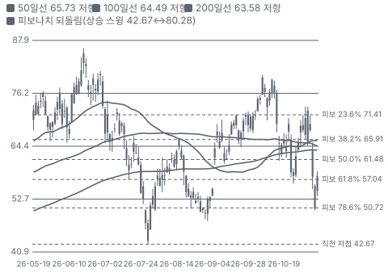

**주봉**

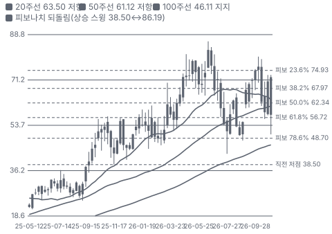

**월봉**

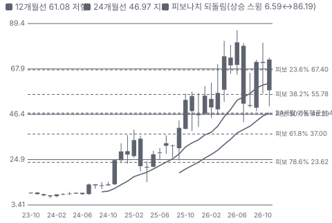

**분기 매출·EPS 실적과 컨센서스**

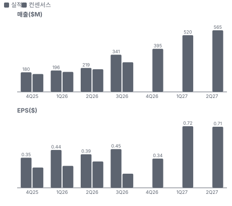

**4Q26 매출 — 지표 추세 vs 가이던스·컨센서스**

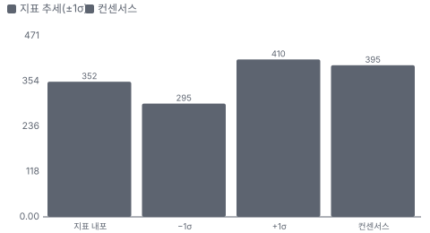

**최근 4개 분기 주가 변화 분석**

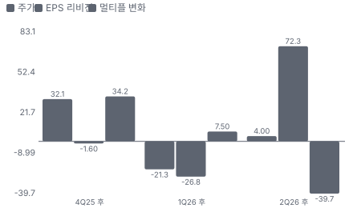

**EPS 리비전**

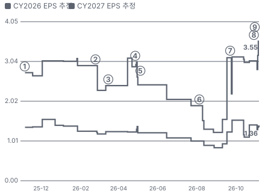

① 25-11-04 3Q25 실적 · EPS 리비전 -
② 26-02-24 4Q25 실적 · EPS 리비전 -22%
③ 26-03-16 Genco 인수(발전 장비) · EPS 리비전 +0%
④ 26-04-27 1Q26 실적 · EPS 리비전 -16%
⑤ 26-05-05 2031 채권 \$1.3B · 실적 창과 겹침
⑥ 26-08-05 2Q26 실적·EPS 하회 · EPS 리비전 -31%
⑦ 26-09-22 2032 채권 \$1.25B · EPS 리비전 +0%
⑧ 26-10-29 900MW 15년 계약 · EPS 리비전 -7%
⑨ 26-11-04 3Q26 실적·가이던스 상향 · EPS 리비전 +25%

**밸류에이션 주가 시나리오**

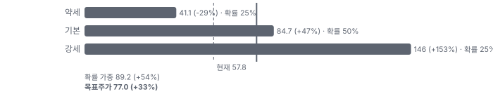

**주가별 업사이드**

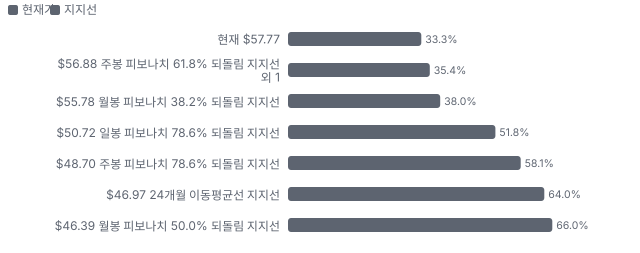

**제품·서비스 포트폴리오**

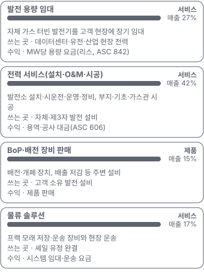

**고객 믹스(3Q26, 매출 대비)**

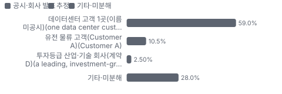

**공급 병목(10점, 낮을수록 병목)**

**생산능력 현재와 확충 계획(MW(발전 용량))**

**CAPEX의 매출 대비 비중**

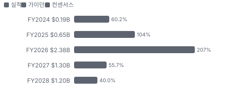

**어닝콜 변화별 주주가치 영향**

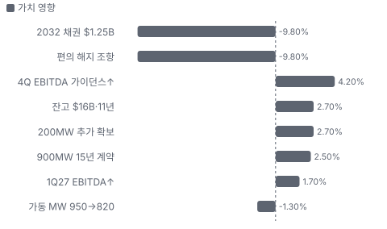

**멀티플 프리미엄(Fwd 1Y EV/EBITDA, 최근 4개 분기말)**

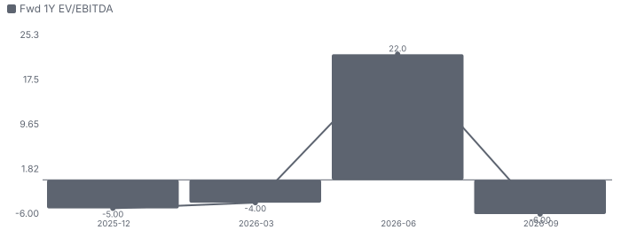

**합리적 멀티플**

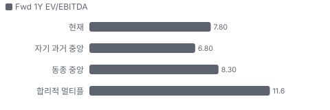

**수주·파이프라인 확실성 사다리**

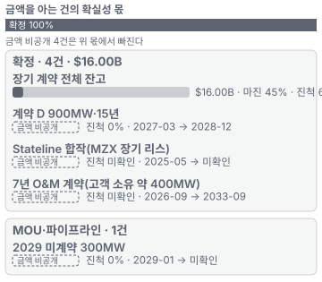

**매출 → 매출총이익 → 영업이익(매출 = 100, 최근 4분기)**

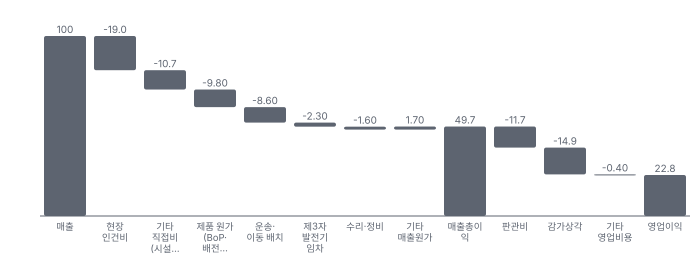

**1년 전 대비 마진 기여(비용 비중 변화의 반대)**

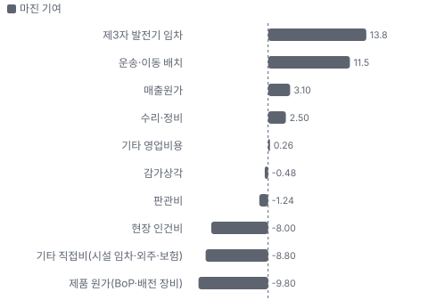

**분기 비용 비중 추이(매출 대비, 공시)**

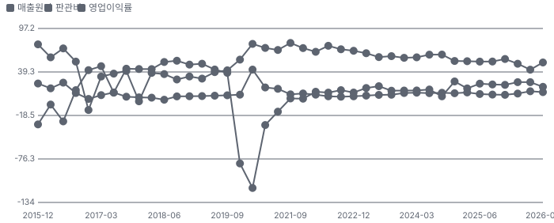

**비용 요인별 매출 대비 비중과 1년 변화**

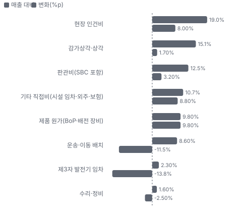

**BOM 항목 가격 +10% 시 OPM 변화**

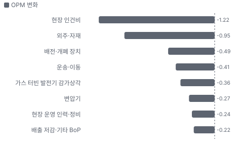

**발전 용량 임대 BOM 원가 몫과 가격 +10% 시 OPM**

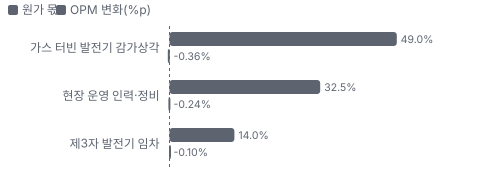

**전력 서비스(설치·O&M·시공) BOM 원가 몫과 가격 +10% 시 OPM**

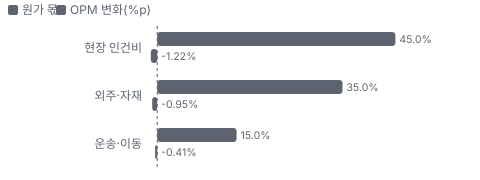

**BoP·배전 장비 판매 BOM 원가 몫과 가격 +10% 시 OPM**

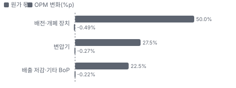

**GESA(설치·O&M) 시너지 램프(종류별, 확률 가중)**

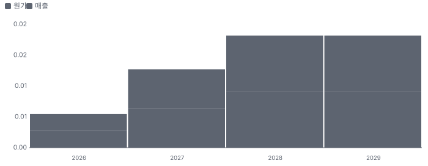

**시너지 가치 vs 웃돈**

**EPS 효과(인수 기업, 기존 대비)**

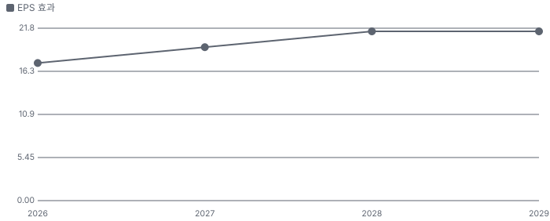

**Omega(부지·기초·가스관 시공) 시너지 램프(종류별, 확률 가중)**

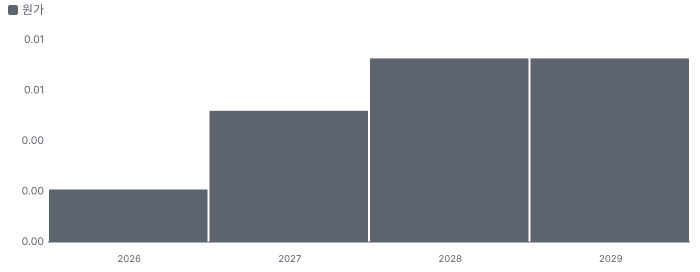

**매출·PPI·수출입 — 최근 16개 분기 같은 축(4Q22 = 100) + 다음 분기 추정**

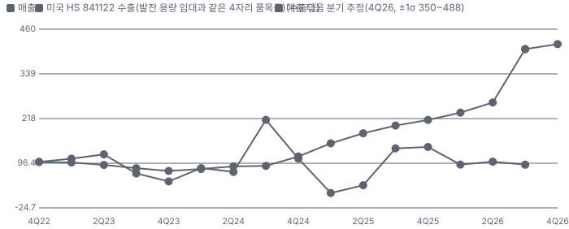

**매출과 미국 HS 841122 수출(발전 용량 임대과 같은 4자리 품목군) 증가율(전년 대비, 최근 16개 분기 + 다음 분기 추정)**

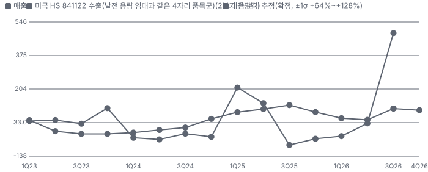

**매출 증가율의 가격·물량 분해와 8분기 전망(전년 대비)**

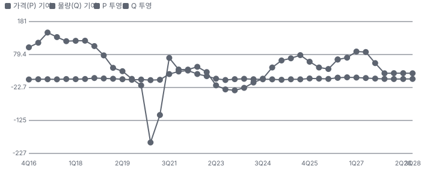

**분기별 매출 증가율 분해**

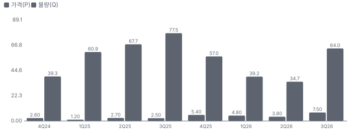

**목표주가 산정 — 약세와 기본 사이(약세 쪽 18%), 도달 확률 약 57%**

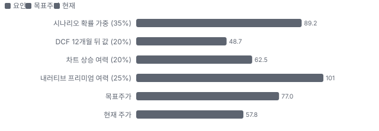

**일봉 지지·저항과 목표주가**

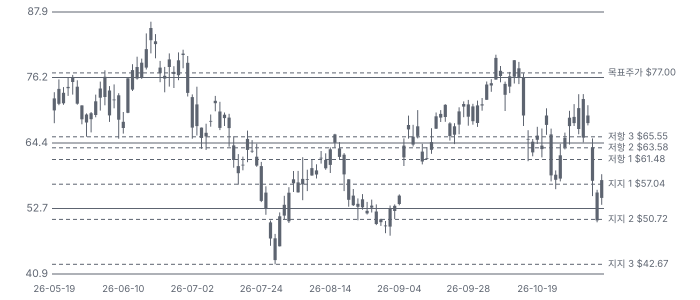

**일별 거래량 분해**

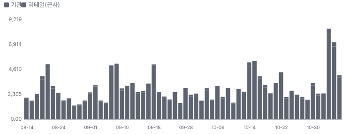

**기관 자금 흐름**

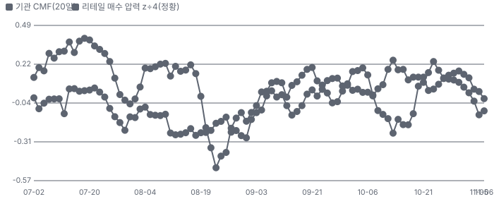

**몬테카를로**

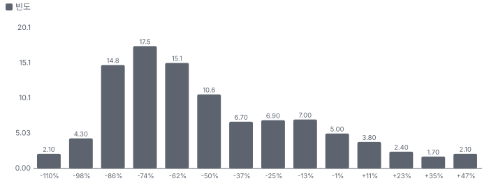

해석: 3,000번 중 360번(12%)에서 가치가 지금 주가 이상이었다. 가정을 흔들어도 지금 주가를 뒷받침하지 못하는 경우가 더 많다. 가운데 값은 0.41배이고, 열 번 중 여덟 번은 0.12~1.05배 사이에 든다.

## 내러티브

> **기업가치를 결정하는 이야기:** 전력 매출은 발전 용량 임대(MW당 요금) + BoP(발전기 외 주변 설비, 배전·배출 저감·연료 공급) 판매 + 설치·운영 서비스다. 장기 계약 3.2GW와 미계약 300MW가 다 돌면 회사는 연 조정 EBITDA \$1.6B 이상이라고 말한다. 지금 EV(완전 희석 기준 \$7.07B)는 그 값의 약 4.4배다. 그 사이에 2027~2028 배치 실행, \$3.9B 차입의 이자, 그리고 계약이 끝까지 가느냐가 있다.

> **멀티플·EPS 프리미엄**
> **멀티플:** Fwd 1Y EV/EBITDA 7.8배로 동종 6곳 중앙값(약 8.3배)보다 약간 낮다. 계약형 압축 임대 KGS(8.2배)·AROC(8.4배)와 비슷하고, 성장은 그들보다 훨씬 빠르다(NTM 매출 +123% vs +3~19%).
> **EPS:** 2027 조정 EPS 컨센서스는 2Q 콜 직전 \$1.91에서 11/4 \$3.19로 67% 올랐다. 이 기간 주가는 +4%다 — 이익은 올랐는데 배수가 그만큼 줄었다.

### 투자자들은 왜 열광했나

2025-11-21 장중 저점 \$38.50에서 2026-06-18 장중 고점 \$86.19까지 올랐다. 하이퍼스케일러 현장 발전, Stateline 합작, 장비 확보, 연속 인수가 '유전 장비 회사가 AI 전력 회사가 됐다'는 이야기를 만들었다. 식은 이유는 세 가지다. 7~8월 2Q EPS 하회와 임시 장비 비용, 대규모 채권 발행, 그리고 11/4 선거 결과 뒤 데이터센터 반발 우려다.

### 무엇이 기업가치를 바꾸나

> **구조적 체질 변화**
> **변화:** 전력 매출 비중이 3Q 83%(9M 75%)로 유전 물류 회사에서 전력 회사가 됐다. 물류는 3Q 매출 \$56.9M로 전년보다 8% 줄었다
> **증거:** https://www.sec.gov/Archives/edgar/data/1697500/000162828026071604/sei-20260930.htm 부문 표
> **반증:** 2027년 전력 매출 성장이 계약 MW 증가보다 느리다

> **고부가 믹스 확장**
> **변화:** 임대만 하던 회사가 BoP·설치·O&M(발전 설비 운영·유지보수)·시공까지 판다. 3Q 서비스·제품 매출 \$193.6M가 리스 \$90.6M의 두 배다. 다만 서비스 마진은 임대보다 낮다(리스 원가율 28% vs 서비스·제품 원가율 약 63%, 자체 계산)
> **증거:** https://www.sec.gov/Archives/edgar/data/1697500/000162828026071604/sei-20260930.htm 손익계산서
> **반증:** 조정 EBITDA 이익률이 40% 아래로 내려간다(3Q 39.9%)

> **기술 혁신**
> **변화:** 기술보다 조합이다. 이동식 가스 터빈을 묶어 데이터센터 전용 '맞춤형 전력망'을 만들고, 앞으로 효율 높은 발전소로 진화시키겠다고 했다(회사 주장)
> **증거:** 3Q26 콜(2026-11-05) 전문 요지
> **반증:** 고객이 대형 복합화력·계통 전력으로 옮겨 간다

> **실행 속도**
> **변화:** 계약 D는 계약(10/29)에서 첫 배치(2027 상반기)까지 약 6개월, 전량(2028)까지 약 14개월이다. 동종 PUMP의 Targa 계약은 전량 배치까지 약 17개월이다 **납품 리드타임 14개월.** 피어 중앙값 14개월보다 같다(PUMP 17개월 · AESI 11개월). 이전 대비 미확인.
> **증거:** https://www.sec.gov/Archives/edgar/data/1697500/000119312526437755/d157948d8k.htm, PUMP 3Q 보도자료
> **반증:** 계약 D 첫 배치가 2027 하반기로 밀린다

> **M&A**
> **변화:** 2025-08 HVMVLV(배전), 2026-03 Genco(발전 장비·고객, \$483.2M), 2026-07 GESA(설치·O&M, \$263.1M), 2026-09 Omega(시공, \$275.2M). 대부분 주식을 섞어 냈다. 시너지 금액은 공시되지 않았다
> **증거:** https://www.sec.gov/Archives/edgar/data/1697500/000162828026071604/sei-20260930.htm 주석 4
> **반증:** 인수분을 뺀 서비스 매출이 줄거나 영업권 손상

> **정책·입법 연관성**
> **재정정책:** 해당 없음(보조금·세액공제 수령 공시 없음 — 가스 발전은 청정에너지 세액공제 대상이 아니다) https://www.sec.gov/Archives/edgar/data/1697500/000162828026071604/sei-20260930.htm 반증: 현장 가스 발전 세제 변경 의회 동의 2/10 — 하원 1/5(SEI 관련 하원 의결 기록을 찾지 못했다) · 상원 1/5(같음).
> **행정명령:** 연방 데이터센터 인허가 가속 행정명령이 현장 발전 수요의 배경이다. 11/3 중간선거 뒤 주 단위 데이터센터 반발이 쟁점이 됐고, 회사는 텍사스 노출이 작다고 답했다 3Q26 콜(2026-11-05) 전문 요지 Q&A 반증: 주 정부가 대형 부하·현장 발전 규제를 시행한다 의회 동의 2/10 — 하원 1/5(관련 의결 기록 미확인) · 상원 1/5(같음).
> **연관입법:** 해당 없음(회사를 직접 겨냥한 연방 법안을 찾지 못했다. 하원 로비 집계 대상 밖이라 로비는 미확인) 하원 LD(미국 하원 로비 공개 신고) 집계·SEC 검색 반증: 현장 가스 발전 배출 규제 강화 법안

> **CAPEX 낙수효과**
> **변화:** AI 데이터센터 투자가 현장 발전 수요로 온다. 확인된 것은 장기 계약 3.2GW와 잔고 \$16B까지다 — 고객 투자 발표를 SEI 매출로 바로 옮기지 않는다
> **증거:** 3Q26 콜(2026-11-05) 전문 요지
> **반증:** 고객이 전력망 연결을 앞당겨 현장 발전을 줄인다

### 내러티브 근거

> 유전 물류 장비 회사가 데이터센터 현장 발전(Power-as-a-Service(발전 설비를 소유한 채 전기 용량을 장기 임대하는 사업)) 회사로 바뀌었다는 이야기다. 3Q 매출의 83%가 전력이다. 900MW·15년 계약으로 계약 잔고가 \$16B(평균 11년)가 됐지만, 11/4 선거 결과 뒤 이틀 동안 −27%가 났다. 동종 대비 멀티플 차이 -6% 중 회사 고유 몫은 -33%다. 단계는 확산, 쏠림은 중간(셀사이드 17명 중 16명 Strong Buy, 공매도 유동주식의 26%)이다.

> **데이터센터 현장 발전(BTM(전력망을 거치지 않는 현장 자가 발전, behind-the-meter))** · 강화
> **논리:** 전력망 연결이 수년 걸려 데이터센터가 현장 가스 발전을 산다. SEI는 장비·BoP·설치·운영을 한 번에 판다
> **숫자:** 3Q 전력 매출 \$284.2M(전년 +171%), 장기 계약 3.2GW
> **반증:** 2027 상반기 계약 D 첫 배치 지연

> **장기 계약 = 인프라형 현금흐름** · 강화
> **논리:** 15년 계약과 투자등급 고객이 쌓이면 유틸리티식 할인율로 재평가된다
> **숫자:** 잔고 \$16B, 가중 평균 11년, 리스 수취 예정액 \$6.75B(10-Q)
> **반증:** 편의 해지 보상 조건이 약하다고 공개된다

> **설치·O&M 플랫폼(GESA·Omega)** · 강화
> **논리:** 장비 다음 병목은 사람이다. 인수로 600명 이상 현장 인력과 제3자 3GW 운영을 얻었다
> **숫자:** 3Q 전력 서비스 매출 \$142.3M(전년 \$22.2M), GESA 3Q 매출 \$89.9M
> **반증:** 서비스 매출이 인수분 빼고 늘지 않는다

> **발전 장비 선점** · 유지
> **논리:** 터빈 납기가 수년인 시장에서 1년 동안 1GW를 더 확보했다
> **숫자:** 2029년 3.5GW 이상, 미계약 300MW
> **반증:** 추가 확보 장비 단가가 MW당 계약 가격을 넘는다

> **반대: 선거 뒤 데이터센터 반발·브리지 수요** · 강화
> **논리:** 정치 지형이 바뀌면 인허가·규제가 늦어지고, 2029년 계통 공급이 늘면 현장 발전 수요가 꺾인다
> **숫자:** 11/4~5 이틀 −27%
> **반증:** 2027년 신규 장기 계약 1건 이상

> **반대: 차입·CAPEX** · 강화
> **논리:** 2026년 CAPEX가 매출의 두 배이고 총차입이 \$3.9B다. FCF는 2027년까지 음수로 추정된다
> **숫자:** 9M CAPEX \$1.38B + 4Q 약 \$1B, 구매 약정 \$1.32B
> **반증:** 2027년 영업현금흐름이 CAPEX를 넘는다

> **반대: 고객 집중** · 약화
> **논리:** 데이터센터 고객 1곳이 매출의 59%다
> **숫자:** 3Q 59%, 매출채권 67%
> **반증:** 계약 D 배치 뒤에도 1곳 비중 50% 이상

이미지 없음(검수 실패) — BoP·배전 장비 판매·발전 용량 임대

## 포트폴리오

| 제품·서비스 | 구분 | 무엇 | 쓰는 곳 | 돈 버는 방식 | Mix | Mix 변화(3Q26 리스 매출 \$90.6M ÷ \$341.1M(전년 \$82.4M ÷ \$166.8M)) |
|---|---|---|---|---|---|---|
| 발전 용량 임대 | 서비스 | 자체 가스 터빈 발전기를 고객 현장에 장기 임대 | 데이터센터·유전·산업 현장 전력 | MW당 용량 요금(리스, ASC 842(미국 리스 회계 기준)) | 27% | -22.8%p |
| 전력 서비스(설치·O&M·시공) | 서비스 | 발전소 설치·시운전·운영·정비, 부지·기초·가스관 시공 | 자체·제3자 발전 설비 | 용역·공사 대금(ASC 606(미국 수익 인식 기준)) | 42% | +28.4%p |
| BoP·배전 장비 판매 | 제품 | 배전·개폐 장치, 배출 저감 등 주변 설비 | 고객 소유 발전 설비 | 제품 판매 | 15% | +14.8%p |
| 물류 솔루션 | 서비스 | 프랙 모래 저장·운송 장비와 현장 운송 | 셰일 유정 완결 | 시스템 임대·운송 요금 | 17% | -20.4%p |

**Mix 변화가 가장 큰 쪽은 전력 서비스(설치·O&M·시공)(+28.4%p, 3Q26 리스 매출 \$90.6M ÷ \$341.1M(전년 \$82.4M ÷ \$166.8M)).** 계절성 판정: 분기 매출 계절 지수 기준 없음 → 직전 분기와 비교.

## 고객

> **3Q26 최대 고객 데이터센터 고객 1곳(이름 미공시)(one data center customer (including its affiliated entities)) 59%, 상위 3곳 72%, 집중도 집중.** 공시·회사 발표로 확인한 몫은 매출의 59%이고, 나머지 고객 몫은 추정이거나 미분해다. 데이터센터 고객 1곳(계열사 포함)이 3Q 매출의 59%, 매출채권의 67%다(10-Q). FY2025에는 같은 성격의 고객이 47.3%였다. 계약 D 고객(투자등급 산업·기술 회사)은 기존 고객이지만 몫은 공시되지 않았다

**고객별 매출 몫(3Q26)**
| 고객 | 몫 | 변화 | 근거 |
|---|---|---|---|
| 데이터센터 고객 1곳(이름 미공시)(one data center customer (including its affiliated entities)) | 59% | +12%p | 공시 |
| 유전 물류 고객(Customer A, Customer A) | 8~13% | -2%p | 추정 |
| 투자등급 산업·기술 회사(계약 D, a leading, investment-grade, diversified industrial and technology company) | 0~5% | 미확인 | 추정 |
| 기타·미분해 | 28% | - | - |

> **데이터센터 고객 1곳(이름 미공시)(one data center customer (including its affiliated entities))** · 공시
> **사는 것:** 발전 용량 임대·BoP·서비스
> **추정 근거:** prior는 FY2025 10-K Customer C(전력 부문). Stateline 리스 상대 MZX Tech와 같은 고객인지는 공시가 없어 미확인 — 언론이 거론하는 회사 이름은 가설로도 적지 않는다

> **유전 물류 고객(Customer A, Customer A)** · 추정
> **사는 것:** 모래 저장·운송 시스템
> **추정 근거:** FY2025 12.8%. 3Q 물류 매출 비중 16.7%를 감안한 범위

> **투자등급 산업·기술 회사(계약 D, a leading, investment-grade, diversified industrial and technology company)** · 추정
> **사는 것:** 900MW·15년(2027 상반기 배치)
> **추정 근거:** 기존 고객이라 지금도 일부 매출이 있으나 몫 미공시

## 수주·파이프라인

> **2026-11-05 기준 5건.** 확정 \$16.00B.

**실행 속도와 방해 요인**
| 항목 | 상태 | 실행 속도 | 방해 요인 |
|---|---|---|---|
| 장기 계약 전체 잔고 | 확정 | 지연(계획 14%, -8%p), 이대로면 2055-08 완료, 212개월 지연 | 편의 해지 조항 · 장비 인도 · 현장 인력 |
| 계약 D 900MW·15년 | 확정 | 계약→첫 배치 약 6개월 | BoP 장비 인도 · 현장 인허가 |
| Stateline 합작(MZX 장기 리스) | 확정 | 미확인 | Stateline 대출 약정(2027년부터 고정비 보상 1.35배) |
| 7년 O&M 계약(고객 소유 약 400MW) | 확정 | 미확인 | 인력 |
| 2029 미계약 300MW | 파이프라인 | 미확인 | 재계약 가격 · 브리지 수요 |

## 마진 구조

> **GPM 48.0%, OPM 19.6%.** 3Q25 대비 GPM +1.2%p, OPM -3.1%p. 3Q 매출원가(감가상각 제외)는 매출의 52.0%로 1년 전 53.2%와 비슷하다. 구성은 크게 바뀌었다 — 제3자 발전기 임차(16.1% → 2.3%)가 줄고 인건비(11.0% → 19.0%)와 제품 원가(0 → 9.8%)가 늘었다. 임대에서 서비스·판매로 믹스가 옮겨 간 결과다

> **매출 100 중 매출원가 50.3, 매출총이익 49.7(최근 4분기, 공시).** 매출원가 요인 중 현장 인건비이 매출의 19.0%로 가장 무겁고, 단가가 +10% 오르면 GPM이 -1.90%p 움직인다. 분기 회귀로 매출 1이 늘 때 매출원가는 0.52 늘고, 매출원가의 고정비 몫은 3%다.

**비용 요인 강도 — 비중·추세·충격(+10%)·탄력**
| 비용 | 구분 | 매출 대비 | 1년 변화 | 마진 기여 | 충격 시 마진 | 매출 탄력 | 고정비 몫 |
|---|---|---|---|---|---|---|---|
| 현장 인건비 | 매출원가 요인 | 19.0% | +8.0%p | -8.0%p | -1.90%p | 미확인 | 50% |
| 기타 직접비(시설 임차·외주·보험) | 매출원가 요인 | 10.7% | +8.8%p | -8.8%p | -1.07%p | 미확인 | 30% |
| 제품 원가(BoP·배전 장비) | 매출원가 요인 | 9.8% | +9.8%p | -9.8%p | -0.98%p | 미확인 | 0% |
| 운송·이동 배치 | 매출원가 요인 | 8.6% | -11.5%p | +11.5%p | -0.86%p | 미확인 | 0% |
| 제3자 발전기 임차 | 매출원가 요인 | 2.3% | -13.8%p | +13.8%p | -0.23%p | 미확인 | 30% |
| 수리·정비 | 매출원가 요인 | 1.6% | -2.5%p | +2.5%p | -0.16%p | 미확인 | 40% |
| 매출원가 | 공시 항목 | 50.3% | -3.1%p | +3.1%p | -5.03%p | 0.52 | 3% |
| 감가상각 | 공시 항목 | 14.9% | +0.5%p | -0.5%p | 미확인 | 0.15 | -7% |
| 판관비 | 공시 항목 | 11.7% | +1.2%p | -1.2%p | 미확인 | 0.12 | -16% |
| 기타 영업비용 | 공시 항목 | 0.4% | -0.3%p | +0.3%p | 미확인 | 0.00 | 84% |

매출 탄력 = 분기 비용을 매출에 회귀한 기울기(매출 1당 변동비), 고정비 몫 = 절편 ÷ 평균 비용. 표본이 8분기 미만이면 미확인. 매출원가 요인 비중은 margin 재료의 추정이 섞여 있고, 공시 매출원가와의 차이는 '기타 매출원가'로 둔다.

**GPM에서 OPM까지(GAAP)**
| 기간 | GPM | 연구개발 | 판관비 | 기타 | OPM |
|---|---|---|---|---|---|
| 3Q25 | 46.8% | 0.0% | 9.3% | 14.7% | 22.7% |
| 3Q26 | 48.0% | 0.0% | 12.5% | 15.9% | 19.6% |

**GPM·OPM 최근 4개 분기**
| 분기 | GPM | OPM |
|---|---|---|
| 2025-12 | 43.4% | 22.2% |
| 2026-03 | 49.7% | 25.8% |
| 2026-06 | 57.6% | 25.8% |
| 2026-09 | 48.0% | 19.6% |

**마진을 결정하는 비용 요인 — 비용 +10% 시 OPM**
| 비용 | 매출 대비 | 변화 | 고정비 | OPM |
|---|---|---|---|---|
| 현장 인건비 | 19.0% | +8.0%p | 50% | -1.90%p |
| 감가상각·상각 | 15.1% | +1.7%p | 100% | -1.51%p |
| 판관비(SBC 포함) | 12.5% | +3.2%p | 80% | -1.25%p |
| 기타 직접비(시설 임차·외주·보험) | 10.7% | +8.8%p | 30% | -1.07%p |
| 제품 원가(BoP·배전 장비) | 9.8% | +9.8%p | 0% | -0.98%p |
| 운송·이동 배치 | 8.6% | -11.5%p | 0% | -0.86%p |
| 제3자 발전기 임차 | 2.3% | -13.8%p | 30% | -0.23%p |
| 수리·정비 | 1.6% | -2.5%p | 40% | -0.16%p |
| 기타 영업비용 | 0.8% | -0.6%p | 미확인 | -0.08%p |

**비용을 움직이는 요인**
| 비용 | 요인 |
|---|---|
| 현장 인건비(매출원가) | GESA·Omega 인수, 설치·O&M 인력 · 근거 공시 |
| 감가상각·상각(기타) | 터빈·엔진 코어(3만 운전시간 단위) · 근거 공시 |
| 판관비(SBC 포함, 판관비) | 인수 통합·조직 확장 · 근거 공시 |
| 기타 직접비(시설 임차·외주·보험, 매출원가) | Omega 시공 외주 등 · 근거 공시 |
| 제품 원가(BoP·배전 장비, 매출원가) | 스위치기어·변압기 구매 단가 · 근거 공시 |
| 운송·이동 배치(매출원가) | 물류 활동량, 발전기 이동 · 근거 공시 |
| 제3자 발전기 임차(매출원가) | 임시 장비, 자체 장비로 교체 · 근거 공시 |
| 수리·정비(매출원가) | 운전 시간·부품 · 근거 공시 |
| 기타 영업비용(기타) | 기타 · 근거 공시 |

**발전 용량 임대 BOM — 매출의 27%, GPM 72%(3Q 리스 매출 \$90.6M − 리스 원가 \$25.3M(감가상각 전, 공시). 리스 장비 감가상각 \$24.1M 차감 뒤 46%), 항목 가격 +10% 시**
| 항목 | 원가 몫 | 전가 | 제품 GPM | OPM |
|---|---|---|---|---|
| 가스 터빈 발전기 감가상각 | 49% | 미확인 | -1.4%p | -0.36%p |
| 현장 운영 인력·정비 | 25~40% | 미확인 | -0.9%p | -0.24%p |
| 제3자 발전기 임차 | 14% | 미확인 | -0.4%p | -0.10%p |
| 미분해 | 4% | - | - | - |

**전력 서비스(설치·O&M·시공) BOM — 매출의 42%, GPM 35%(추정(범위 30~40%) — 서비스 원가 \$118.7M에 물류 서비스가 섞여 부문별 원가 미공시), 항목 가격 +10% 시**
| 항목 | 원가 몫 | 전가 | 제품 GPM | OPM |
|---|---|---|---|---|
| 현장 인건비 | 40~50% | 미확인 | -2.9%p | -1.22%p |
| 외주·자재 | 30~40% | 미확인 | -2.3%p | -0.95%p |
| 운송·이동 | 10~20% | 미확인 | -1.0%p | -0.41%p |
| 미분해 | 5% | - | - | - |

**BoP·배전 장비 판매 BOM — 매출의 15%, GPM 35%(3Q 제품 매출 \$51.3M − 제품 원가 \$33.4M(공시)), 항목 가격 +10% 시**
| 항목 | 원가 몫 | 전가 | 제품 GPM | OPM |
|---|---|---|---|---|
| 배전·개폐 장치 | 40~60% | 미확인 | -3.2%p | -0.49%p |
| 변압기 | 20~35% | 미확인 | -1.8%p | -0.27%p |
| 배출 저감·기타 BoP | 15~30% | 미확인 | -1.5%p | -0.22%p |

현장 인건비 가격이 +10% 오르면 영업이익은 -6.2% 움직인다. 판매가 전가를 모르는 항목은 전가 0%로 계산했다.

**BOM 항목 가격을 움직이는 것**
| 항목 | 요인 |
|---|---|
| 가스 터빈 발전기 감가상각 | 엔진 코어는 운전시간 비례 상각 · 근거 공시 |
| 현장 운영 인력·정비 | 운영 인력 · 근거 추정 |
| 제3자 발전기 임차 | 임시 장비 — 줄어드는 중 · 근거 추정 |
| 현장 인건비 | 용역 원가의 중심 · 근거 추정 |
| 외주·자재 | Omega 시공 외주 · 근거 추정 |
| 운송·이동 | 장비 이동 · 근거 추정 |
| 배전·개폐 장치 | HVMVLV 제작분 · 근거 추정 |
| 변압기 | 외부 구매 · 근거 추정 |
| 배출 저감·기타 BoP | 계약 D 범위 · 근거 추정 |

**BOM 투입 물가 — PPI 전년비, 2026-11-09 수집**
| 항목 | 미국 | 일본 | 한국 | 대만 |
|---|---|---|---|---|
| 제3자 발전기 임차 | +3.6%* | 미확인 | 미확인 | 미확인 |
| 운송·이동 | +115.2% | 미확인 | 미확인 | 미확인 |
| 배전·개폐 장치 | +12.3% | +14.8% | +1.6% | +10.6%* |
| 변압기 | +7.8% | +0.7% | +16.0% | +10.6%* |

별표는 품목보다 넓은 업종 지수다. 지난 1년 투입 물가를 판매가 전가 뒤 원가에 그대로 넣으면 OPM은 -5.54%p 움직인다(매출원가의 31% 기준).

## 공급망 병목

> **공급망 신뢰성 5.6/10, 병목 주의.** 가장 약한 고리는 가스 터빈 발전기 5.6점이고, 품목 평균은 5.6점이다. 근거가 부족한 3건(BoP(배전·개폐 장치·변압기·배출 저감) · 변압기 · 설치·정비 인력)은 점수에서 뺐다. 약한 고리는 가스 터빈과 BoP 장비다. 3Q 구매의 38%가 공급사 한 곳이고, 회사도 '발전·BoP 장비가 계속 모자란다'고 했다. 그다음 병목은 설치·정비 인력이다

**병목과 마진 — 품목 가격 +10% 시 OPM**
| 품목 | 점수 | 판정 | 구분 | OPM |
|---|---|---|---|---|
| 가스 터빈 발전기(필수) | 5.6 | 병목 주의 | 출하 차질 위험 | 미확인 |

> **가스 터빈 발전기** · 5.6/10
> **왜:** 발전 용량 자체가 매출이다. 3Q 구매의 38%가 공급사 1곳(10-Q)
> **병목 요인:** 인증 공급사 3곳 · 캐파 부족 · 리드타임 미확인 · 재인증 미확인 · 1위 점유율 38% · 지역 집중 미확인 · 물량 확보 장기계약
> **풀리는 조건:** 미확인 — 계약 주문 기준 2029년 3.5GW, 인도 확인 전

**공급사**
| 품목 | 공급사 | 몫 | 근거 |
|---|---|---|---|
| 가스 터빈 발전기 | 분산 발전 장비 선도 공급사(이름 미공시)(주력 이동식 터빈 공급(MER 인수로 얻은 관계)) | 미확인 | 공시 |
| 가스 터빈 발전기 | Baker Hughes(NovaLT16(Baker Hughes의 약 16MW급 가스 터빈) 30기(비해지 \$364.9M)) | 미확인 | 공시 |
| 가스 터빈 발전기 | 민간 보유자(중고·재정비 터빈 7기 \$163M) | 미확인 | 공시 |
| BoP(배전·개폐 장치·변압기·배출 저감) | HVMVLV(자회사, 전력 제어·배전) | 미확인 | 공시 |
| BoP(배전·개폐 장치·변압기·배출 저감) | 외부 공급사(미공시, 변압기·배출 저감) | 미확인 | 추정 |
| 변압기 | 미공시(승압·배전 변압기) | 미확인 | 추정 |
| 설치·정비 인력 | 자체(GESA 포함 600명 이상, 설치·시운전·O&M) | 미확인 | 회사 발표 |

**무역 통계로 본 공급 지역**
| 품목 | EU 수입처 | 일본 수입처 | EU 1위 전년비 |
|---|---|---|---|
| 가스 터빈 발전기 | US 94% · JP(일본) 4% · VN(베트남) 1% | アメリカ合衆国 100% | +57.3% |
| BoP(배전·개폐 장치·변압기·배출 저감) | CN(중국) 55% · US 24% · KR(한국) 6% | 中華人民共和国 47% · アメリカ合衆国 10% | +26.6% |
| 변압기 | CN 82% · KR 11% · VN 4% | 中華人民共和国 65% · 大韓民国 19% | +18.1% |

## 생산능력

> **현재 명목 캐파 1,000 MW(발전 용량), 가동률 82%.** 착공 이상 증설은 0 MW(발전 용량), 발표까지 합치면 3,600 MW(발전 용량)이다. 다 가동하면 지금보다 +360%, 착공 이상만이면 +0%다. FY2025 CAPEX는 \$0.65B로 매출의 104.0%다. 자체 소유 약 1GW를 운영하고(3Q 콜), 3Q 평균 수익 발생 용량은 약 820MW다. 계약 주문 기준 2029년 말 3.5GW 이상이 된다. 9M CAPEX \$1.38B에 4Q 약 \$1B가 더 든다

**생산시설 7곳**(FY2025 10-K Item 1 'Our Properties' — 본사(휴스턴)와 전력 부문 정비 1·야적 3곳, 물류 부문 정비 1·제조 1곳. GESA·Omega 인수 시설은 이름 미공시라 세지 않았다), 미확인 7곳. 시설별 생산능력은 공개되지 않았다 — 회사 전체 캐파만 위에 적었다.

**생산시설 7곳 — 명칭·위치·생산능력**
| 시설 | 위치 | 용도 | 생산능력 | 소유·상태 |
|---|---|---|---|---|
| 본사(Houston) | 미국 텍사스 휴스턴 | 본사 | 미확인 — 사무 시설 | 미확인 · 가동 |
| 전력 정비 시설(Buffalo) | 미국 텍사스 Buffalo | 발전 장비 수리·정비 | 미확인 — 시설별 캐파 미공시 | 미확인 · 가동 |
| 야적·보관(Southaven) | 미국 미시시피 Southaven | 발전 장비 보관 | 미확인 — 시설별 캐파 미공시 | 미확인 · 가동 |
| 야적·보관(Memphis) | 미국 테네시 멤피스 | 발전 장비 보관 | 미확인 — 시설별 캐파 미공시 | 미확인 · 가동 |
| 야적·보관(Hobbs) | 미국 뉴멕시코 Hobbs | 발전 장비 보관 | 미확인 — 시설별 캐파 미공시 | 미확인 · 가동 |
| 물류 정비 시설(Monahans) | 미국 텍사스 Monahans | 물류 장비 수리·정비 | 미확인 — 시설별 캐파 미공시 | 미확인 · 가동 |
| 물류 장비 제조(Early) | 미국 텍사스 Early | 모래 저장·운송 시스템 제조 | 미확인 — 시설별 캐파 미공시 | 미확인 · 가동 |

**생산능력 확충 계획**
| 계획 | 단계 | 증설 | 가동 시점 | CAPEX |
|---|---|---|---|---|
| 계약 D 배치 | 발표 | 900 MW(발전 용량) | 2028-12 | 미확인 |
| NovaLT16 30기(Baker Hughes) | 발표 | 미확인 | 2028-12 | \$0.50B |
| 터빈 7기 매입(200MW 이상) | 발표 | 200 MW(발전 용량) | 2027-03 | \$0.16B |
| 2029년 말 총 3.5GW | 발표 | 2,500 MW(발전 용량) | 2029-12 | 미확인 |

남은 계획의 CAPEX 합계는 \$0.66B(금액 미확인 2건 제외)다. 금액을 아는 계획의 단위당 CAPEX는 \$0.00B/MW(발전 용량)이다. 합계는 FY2028 매출의 22%다.

**증설 방해 요인**
| 계획 | 방해 요인 |
|---|---|
| 계약 D 배치 | BoP 장비·현장 인허가 |
| NovaLT16 30기(Baker Hughes) | 제조·인도 일정(지연 시 위약금) |
| 터빈 7기 매입(200MW 이상) | 설치 인력 |
| 2029년 말 총 3.5GW | 장비 인도·계약 전환 |

**CAPEX와 매출 대비**
| 기간 | CAPEX | 매출 | 매출 대비 | 구분 |
|---|---|---|---|---|
| FY2024 | \$0.19B | \$0.31B | 60.2% | 실적 |
| FY2025 | \$0.65B | \$0.62B | 104.0% | 실적 |
| FY2026 | \$2.38B | \$1.15B | 206.7% | 가이던스 |
| FY2027 | \$1.30B | \$2.33B | 55.7% | 컨센서스 |
| FY2028 | \$1.20B | \$3.00B | 40.0% | 컨센서스 |

## M&A 시너지

> **GESA(설치·O&M) 인수(2026-07-01, \$0.26B): 시너지가 다 나면 연 \$0.02B(확률 가중 이익 기여), 인수 배수 EV/EBITDA 3.3배 → 시너지 반영 2.6배.** 세후 시너지 가치는 통합 비용을 빼고 \$0.16B. EPS 효과는 2026년 +17.4%에서 2029년 +21.4%.

**GESA(설치·O&M) 시너지가 생기는 길**
| 종류 | 시너지 | 연 규모 | 완성 | 확률 | 어떻게 생기나 | 근거 |
|---|---|---|---|---|---|---|
| 원가 | 설치·정비 내재화 | \$0.02B | 2028 | 50% | 외주 시공·제3자 정비비를 자체 인력으로 바꾸고 일부는 자본화(콜: 내부 공사는 프로젝트 원가로 들어간다) | 3Q 콜 — 금액 미공시, 추정 |
| 매출 | 제3자 발전 설비 O&M 교차판매 | \$0.10B(이익률 20%) | 2028 | 50% | 제3자 소유 3GW 운영 고객에 정비·재정비 계약을 판다(7년 400MW O&M 계약 사례) | 3Q 콜 — 금액 미공시, 추정 |

> **Omega(부지·기초·가스관 시공) 인수(2026-09-01, \$0.28B): 시너지가 다 나면 연 \$0.01B(확률 가중 이익 기여), 인수 배수 EV/EBITDA 5.5배 → 시너지 반영 4.8배.** 세후 시너지 가치는 통합 비용을 빼고 \$0.06B. EPS 효과는 2026년 +12.5%에서 2029년 +14.0%.

**Omega(부지·기초·가스관 시공) 시너지가 생기는 길**
| 종류 | 시너지 | 연 규모 | 완성 | 확률 | 어떻게 생기나 | 근거 |
|---|---|---|---|---|---|---|
| 원가 | 현장 준비 내재화 | \$0.01B | 2028 | 50% | 계약 D 같은 대형 현장의 부지·가스관 공사를 외주 없이 직접(대가 구성 미공시 — 현금으로 둠) | 10-Q 주석 4 — 시너지 금액 미공시, 추정 |

시너지 가치 = 세후 이익 기여 5년 + 말기 가치(할인율 9%, 성장 0) − 통합 비용. 매출 시너지는 그 매출의 이익률만 반영하고, 모든 시너지에 실현 확률을 곱했다.

## 해자

> 해자는 '장비를 먼저 잡은 순서'와 '장기 계약의 길이'다. 둘 다 숫자로 보이지만, 편의 해지 조항과 고객 집중이 그 길이를 깎는다

> **발전 장비 선점** · 강함
> **해자:** 터빈 납기가 긴 시장에서 2029년까지 3.5GW 이상을 계약 주문으로 확보했다
> **근거:** 10-Q: NovaLT16 30기 비해지 의무 \$364.9M, 구매 약정 \$1,323.9M, 4Q 터빈 7기 \$163M(200MW 이상)
> **숫자:** 1년 동안 1GW 추가 확보(3Q 콜)
> **깨지는 조건:** OEM 납기가 1년 이내로 짧아진다

> **장기 계약·투자등급 고객** · 보통
> **해자:** 장기 고객은 모두 투자등급이고 계약 4건 가중 평균 약 11년이다
> **근거:** 3Q 콜: 잔고 \$16B, 10-Q 리스 수취 예정액 \$6.75B(할인 전)
> **숫자:** 15년(+15년) 계약 D
> **깨지는 조건:** 편의 해지가 실제로 행사된다

> **설치·운영 일괄(인력)** · 보통
> **해자:** 현장 인력 600명 이상과 제3자 3GW 운영 경험이 '전력까지 걸리는 시간'을 줄인다
> **근거:** 2Q 콜: GESA 인수 뒤 600명 이상, 3Q 콜: 제3자 3GW 운영
> **숫자:** 7년 O&M 계약 400MW(3Q)
> **깨지는 조건:** 동종(PUMP·AESI·LBRT)이 같은 일괄 계약을 따낸다

> **이동 가능한 설비** · 보통
> **해자:** 트레일러형 설비라 정치·규제가 바뀐 지역에서 다른 곳으로 옮길 수 있다
> **근거:** 3Q 콜 공동 CEO 답변: 계약 구조상 전력을 다른 곳으로 옮길 수 있다
> **숫자:** 텍사스 가동 '아주 적음'(숫자 미공개)
> **깨지는 조건:** 고객이 이전 비용을 SEI에 넘기는 조항이 공개된다

## 경영진·네트워크

> 회장·공동 CEO Bill Zartler(창업자), 공동 CEO Amanda Brock, 사장 Kyle Ramachandran, CFO Stephan Tompsett이 콜을 이끈다. 11월 최고회계책임자가 바뀐다(3Q 콜). 정계·동문 연결은 공개 자료로 확인하지 못했다

> **Bill Zartler** · 회장·공동 CEO(창업자) · 2014
> **프로필:** 2014년 회사 설립(회사 개요). 3Q 콜에서 정치 위험·발전소 진화 방향을 답했다
> **비즈니스:** 미확인
> **정계:** 공개 기록상 공직·정치 활동 미확인
> **동문:** 미확인
> **사모임:** 미확인

> **Amanda Brock** · 공동 CEO·이사 · 미확인
> **프로필:** 계약 D·고객 관계를 설명(3Q 콜)
> **비즈니스:** 미확인
> **정계:** 미확인
> **동문:** 미확인
> **사모임:** 미확인

> **Kyle Ramachandran** · 사장 · 미확인
> **프로필:** 장비 확보·인수 통합 담당(콜)
> **비즈니스:** 미확인
> **정계:** 미확인
> **동문:** 미확인
> **사모임:** 미확인

> **Stephan Tompsett** · CFO · 미확인
> **프로필:** 8-K 서명자, 2032 채권·리볼버 증액 설명
> **비즈니스:** 미확인
> **정계:** 미확인
> **동문:** 미확인
> **사모임:** 미확인

**네트워크 정량화**
| 연결 | 강도 | 닿는 매출 | 가중 노출 | 매출 대비 | 근거 |
|---|---|---|---|---|---|
| 비즈니스: 기존 투자등급 고객과의 반복 계약(계약 D는 경쟁 입찰이 아니었다) | 3/5 | \$0.00B | \$0.00B | 0% | 경영진 개인 연결이 매출을 만든 증거는 없다 — 회사 관계일 뿐 3Q26 콜(2026-11-05) 전문 요지 |

가중 노출은 연결이 닿는 매출의 크기다. 연결이 그 매출을 만들었다는 뜻이 아니며, 인과는 공개 자료로 입증하지 못한다.

## 약세 논리 및 셀온 조건

| 약세 논리 | 근거 | 가를 자료 |
|---|---|---|
| 현장 발전은 계통이 올 때까지의 다리다 | 2029년 이후 계통 신규 공급이 늘면 브리지 수요와 재계약 가격이 약해진다는 업계 논쟁이 있다. 2029 미계약 300MW가 첫 시험대다 | 2029 미계약분 계약 공시, 신규 15년 계약 여부 |
| 편의 해지 조항 | 회사가 계약 4건에 편의 해지 조항이 있다고 인정했다. 보상 조건은 밝히지 않았다 | 10-K(2027-02 하순) 계약 조건·위험 요인 |
| 고객 집중 | 데이터센터 고객 1곳이 3Q 매출의 59%, 매출채권의 67%다(10-Q) | 계약 D 배치 뒤 분기 고객 비중 |
| 차입·CAPEX | 2026 CAPEX 약 \$2.4B로 매출의 두 배, 2032 채권 7.0%, 구매 약정 \$1,323.9M. 리볼버는 주요 계약이 조기 종료되면 한도가 줄어든다 | 4Q 영업현금흐름·2027 CAPEX 가이던스 |
| 정치·규제 | 11/4~5 이틀 −27%. 아직 정책 0단계(선거 결과) 가설이고 법안은 없다 | 주 단위 대형 부하 규제 발의·시행 |
| 이익의 질 | 3Q 서비스·제품 매출이 리스의 두 배다. Omega 시공은 회사도 '들쭉날쭉하다'고 했다 | 인수분을 뺀 서비스 매출 추이 |
| 희석 | 2031 전환사채 \$747.5M(전환가 \$57.20)은 현재가 부근이다. 캡드콜이 \$88까지 막는다 | 주가 \$88 이상에서의 희석 |

> **셀온 조건**
> **조건 1:** 계약 D 첫 배치가 2027 하반기 이후로 밀린다.
> **조건 2:** 어느 장기 계약이든 편의 해지가 행사되거나 보상 조건이 약하다고 공개된다.
> **조건 3:** 4Q 조정 EBITDA가 가이던스 하단 \$165M에 못 미친다.
> **조건 4:** 추가 증자나 2026~2027년 신규 차입이 발표된다.
> **조건 5:** 고객 1곳 비중이 계약 D 배치 뒤에도 50%를 넘는다.

## 어닝콜 변화

**직전 콜 대비 새로 나오거나 바뀐 내용 → 가치 영향**
| 항목 | 내용 | 직전 콜 | 최신 콜 | 모델 동인 이동 | 확신도 | 가치 영향 |
|---|---|---|---|---|---|---|
| 신규 | 계약 D 900MW·15년 | 2Q 콜: 수 GW 협상 중(숫자 없음) | 10/29 900MW·15년(+15년), 2027 상반기~2028 배치 | 1년차 성장률 +3.0% | 1.0 | +2.5% |
| 업데이트 | 4Q26 EBITDA 가이던스 | \$145~180M(2Q) | \$165~185M | 기준연도 매출 +\$0.03B | 0.8 | +4.2% |
| 업데이트 | 1Q27 EBITDA 가이던스 | \$200~240M(2Q) | \$220~260M | 1년차 성장률 +2.0% | 0.8 | +1.7% |
| 신규 | 계약 잔고·평균 기간 | 숫자 없음 | \$16B 이상, 가중 평균 약 11년 | 성장 지속(감속 계수) +2.0% | 0.8 | +2.7% |
| 신규 | 추가 발전 장비 200MW | 미계약 약 800MW(2Q) | 터빈 7기 \$163M 매입, 1Q27 투입 | 장기 성장 수렴값 +1.0% | 1.0 | +2.7% |
| 부정 | 수익 발생 용량 | 2Q 평균 약 950MW | 3Q 평균 약 820MW(임시 제3자 발전기 반납) | 기준연도 매출 -\$0.01B | 1.0 | -1.3% |
| 업데이트 | 차입 확대 | 2031 채권 \$1.3B(5월) | 10/1 2032 채권 \$1.25B(7.0%), 리볼버 \$850M | 할인율(WACC) +0.30% | 1.0 | -9.8% |
| 부정 | 편의 해지 조항 | 언급 없음 | 계약에 편의 해지 조항이 있다(Q&A) | 할인율(WACC) +0.30% | 0.5 | -9.8% |
| **합계** | 단독 합 |  |  | 동시 적용 -7.9% |  | **-7.1%** |

**사건별 EPS 리비전**
| # | 날짜 | 구분 | 사건 | CY2026 EPS 전→후 | CY2027 EPS 전→후 | 리비전 | 주가 반응 |
|---|---|---|---|---|---|---|---|
| ① | 25-11-04 | 실적 | 3Q25 실적 | - → \$1.37 | - → \$2.67 | - | -0.5% |
| ② | 26-02-24 | 실적 | 4Q25 실적 | \$1.26 → \$1.19 | \$2.93 → \$2.30 | -21.7% | +3.3% |
| ③ | 26-03-16 | 내러티브 | Genco 인수(발전 장비) | \$1.25 → \$1.25 | \$2.42 → \$2.42 | +0.0% | +9.6% |
| ④ | 26-04-27 | 실적 | 1Q26 실적 | \$1.24 → \$1.22 | \$2.90 → \$2.44 | -15.7% | +5.4% |
| ⑤ | 26-05-05 | 내러티브 | 2031 채권 \$1.3B | \$1.22 → \$1.22 | \$2.44 → \$2.44 | 실적 창과 겹침 | +1.6% |
| ⑥ | 26-08-05 | 실적 | 2Q26 실적·EPS 하회 | \$1.01 → \$0.90 | \$1.91 → \$1.31 | -31.3% | +2.6% |
| ⑦ | 26-09-22 | 내러티브 | 2032 채권 \$1.25B | \$1.24 → \$1.54 | \$3.13 → \$3.15 | +0.4% | -5.0% |
| ⑧ | 26-10-29 | 내러티브 | 900MW 15년 계약 | \$1.42 → \$1.30 | \$3.05 → \$2.83 | -7.2% | +0.2% |
| ⑨ | 26-11-04 | 실적 | 3Q26 실적·가이던스 상향 | \$1.30 → \$1.36 | \$2.83 → \$3.55 | +25.4% | -12.3% |

**해석:** 3개 구간 누적 주가 +8% = EPS 리비전 +24% × 멀티플 -13%. 더 크게 움직인 쪽은 **EPS 리비전**이다.

## 거시 지표 싱크로율

> **미국 HS(국제 통일 상품 분류 코드) 841122 수출(발전 용량 임대과 같은 4자리 품목군)와 전사 매출 싱크로율 32%(2분기 = 약 6개월 선행, 전년 대비, 표본 15개·t 1.2·유의 아님·신뢰 보통).** 이 지표가 내포하는 4Q26 전사 매출은 352M(±1σ 295M~410M, 확정)다. 표본 밖 검증(최근 6개 분기)에서 지표 모델 오차는 58.8%p, 기준선(직전 증가율 지속)은 28.2%p다 — **지표가 기준선을 이기지 못해(예측력 없음) 추정은 대부분 기준선이다(지표 가중 17%).** 기준선은 인수·환율 효과의 소멸을 모르므로 회사 가이던스와 차이가 크면 가이던스 쪽 설명을 먼저 본다. 컨센서스는 +12.1%(범위 안)다. 회사 매출의 핵심 자산은 가스 터빈 발전기이고, BoP 판매는 배전 장비다. 미국 터빈·발전기 PPI(생산자물가지수)와 배전반 PPI가 장비 가격(곧 MW당 임대 가격·CAPEX)을 대변하는지 본다

**지표별 싱크로율(상관계수 × 100) — 위 두 줄이 제품 연관성 × 싱크로율로 고른 PPI·수출입 세부 지표**
| 지표 | 비교 대상 | 증가율 기준 | 지표 선행 | 매출(t값) | 영업이익 | 방향 일치 | 표본·신뢰 | 표본 밖 오차(지표/기준선) | 4Q26 추정 매출 |
|---|---|---|---|---|---|---|---|---|---|
| 미국 HS 841122 수출(발전 용량 임대과 같은 4자리 품목군) | 전사 매출 | 전년 대비 | 2분기(6개월) | 32%(t 1.2) | 31%(4분기) | 47% | 15·보통 | 58.8/28.2%p ✘ | +96.1% → 352M(확정) |
| 미국 터빈·발전기 세트 PPI | 전사 매출 | 전년 대비 | 1분기(3개월) | -82%(t -7.8) | 13%(0분기) | 48% | 31·보통 | 56.2/28.2%p ✘ | +87.9% → 338M(확정) |
| 미국 개폐기·배전반 PPI | 전사 매출 | 전년 대비 | 3분기(9개월) | -60%(t -3.9) | 24%(0분기) | 69% | 29·보통 | 32.6/28.2%p ✘ | +61.3% → 290M(확정) |

**지표 후보 26개 — 연관성(제품 품목 일치 × 대용 감점 × 매출 비중) × 싱크로율로 고른다. 후보가 많을수록 최대 상관은 우연히 부풀 수 있다**
| 후보 | 종류 | 연관성 | 매출 분기 일치 | 싱크로율(선행) | 점수 | 출처 |
|---|---|---|---|---|---|---|
| 미국 가스 터빈(출력 5,000kW 초과) 수입(HS 841182) | 수출입 | 0.64 | 94% | 61%(1분기) | 0.39 | 자동 |
| EU(유럽연합) HS 841112 수출(발전 용량 임대과 같은 4자리 품목군) | 수출입 | 0.45 | 94% | 65%(0분기) | 0.29 | 자동 |
| EU HS 841112 수입(발전 용량 임대과 같은 4자리 품목군) | 수출입 | 0.45 | 94% | 61%(0분기) | 0.27 | 자동 |
| EU HS 841121 수출(발전 용량 임대과 같은 4자리 품목군) | 수출입 | 0.45 | 94% | 42%(4분기) | 0.19 | 자동 |
| EU HS 841181 수입(발전 용량 임대과 같은 4자리 품목군) | 수출입 | 0.45 | 94% | 33%(2분기) | 0.12 | 자동 |
| 미국 HS 841122 수출(발전 용량 임대과 같은 4자리 품목군) ✔ | 수출입 | 0.45 | 100% | 32%(2분기) | 0.11 | 자동 |
| 일본 HS 8411 수입(발전 용량 임대과 같은 4자리 품목군) | 수출입 | 0.45 | 44% | 24%(1분기) | 0.09 | 자동 |
| 일본 HS 8411 수출(발전 용량 임대과 같은 4자리 품목군) | 수출입 | 0.45 | 44% | 15%(1분기) | 0.05 | 자동 |
| EU HS 841122 수입(발전 용량 임대과 같은 4자리 품목군) | 수출입 | 0.45 | 94% | 15%(3분기) | 0.05 | 자동 |
| 미국 터빈·발전기 세트 PPI | PPI | 1.00 | 100% | -82%(1분기) | 0.00 | 모델 지정 |
| 미국 개폐기·배전반 PPI | PPI | 1.00 | 100% | -60%(3분기) | 0.00 | 모델 지정 |
| EU 가스 터빈(출력 5,000kW 초과) 수출(HS 841182) | 수출입 | 0.64 | 94% | -13%(4분기) | 0.00 | 자동 |

**선행 지표로 본 향후 분기 매출 전망(이미 나온 지표 값 기준, ±1σ)**
| 지표 | 대상 | 분기 | 지표 증가율 | 내포 매출 증가율 | 내포 매출 |
|---|---|---|---|---|---|
| 미국 터빈·발전기 세트 PPI | 전사 매출 | 4Q26 | +4.7% | +21.1% | 218M(103M~332M) |
| 미국 개폐기·배전반 PPI | 전사 매출 | 4Q26 | +14.9% | -6.7% | 168M(5M~330M) |
| 미국 개폐기·배전반 PPI | 전사 매출 | 1Q27 | +12.1% | +26.4% | 248M(70M~426M) |
| 미국 개폐기·배전반 PPI | 전사 매출 | 2Q27 | +11.5% | +32.9% | 292M(93M~490M) |
| EU 가스 터빈(출력 5,000kW 초과) 수출(HS 841182) | 전사 매출 | 4Q26 | +39.4% | +35.3% | 243M(131M~355M) |
| EU 가스 터빈(출력 5,000kW 초과) 수출(HS 841182) | 전사 매출 | 1Q27 | -21.0% | +43.0% | 281M(158M~403M) |
| EU 가스 터빈(출력 5,000kW 초과) 수출(HS 841182) | 전사 매출 | 2Q27 | -0.8% | +40.4% | 308M(171M~445M) |
| EU 가스 터빈(출력 5,000kW 초과) 수입(HS 841182) | 전사 매출 | 4Q26 | -42.0% | +68.9% | 303M(205M~402M) |
| EU 가스 터빈(출력 5,000kW 초과) 수입(HS 841182) | 전사 매출 | 1Q27 | -25.4% | +57.3% | 309M(201M~416M) |
| 미국 가스 터빈(출력 5,000kW 초과) 수출(HS 841182) | 전사 매출 | 4Q26 | -15.4% | +70.8% | 307M(222M~392M) |
| 미국 가스 터빈(출력 5,000kW 초과) 수출(HS 841182) | 전사 매출 | 1Q27 | -2.7% | +59.6% | 313M(221M~406M) |
| 미국 가스 터빈(출력 5,000kW 초과) 수출(HS 841182) | 전사 매출 | 2Q27 | -1.0% | +58.1% | 347M(243M~450M) |
| 미국 가스 터빈(출력 5,000kW 초과) 수출(HS 841182) | 전사 매출 | 3Q27 | -9.3% | +65.4% | 564M(403M~725M) |
| 미국 가스 터빈(출력 5,000kW 초과) 수입(HS 841182) | 전사 매출 | 4Q26 | +99.7% | +48.4% | 267M(194M~339M) |
| EU HS 841111 수출(발전 용량 임대과 같은 4자리 품목군) | 전사 매출 | 4Q26 | +4.0% | +58.2% | 284M(188M~381M) |
| EU HS 841121 수출(발전 용량 임대과 같은 4자리 품목군) | 전사 매출 | 4Q26 | -3.1% | +28.5% | 231M(128M~334M) |
| EU HS 841121 수출(발전 용량 임대과 같은 4자리 품목군) | 전사 매출 | 1Q27 | +49.0% | +56.7% | 308M(195M~420M) |
| EU HS 841121 수출(발전 용량 임대과 같은 4자리 품목군) | 전사 매출 | 2Q27 | +68.5% | +67.3% | 367M(241M~493M) |
| EU HS 841122 수출(발전 용량 임대과 같은 4자리 품목군) | 전사 매출 | 4Q26 | +80.6% | +24.7% | 224M(128M~320M) |
| EU HS 841122 수출(발전 용량 임대과 같은 4자리 품목군) | 전사 매출 | 1Q27 | -20.5% | +55.8% | 306M(201M~411M) |
| EU HS 841122 수출(발전 용량 임대과 같은 4자리 품목군) | 전사 매출 | 2Q27 | -20.5% | +55.8% | 342M(224M~460M) |
| EU HS 841181 수출(발전 용량 임대과 같은 4자리 품목군) | 전사 매출 | 4Q26 | +9.1% | +44.0% | 259M(150M~368M) |
| EU HS 841181 수출(발전 용량 임대과 같은 4자리 품목군) | 전사 매출 | 1Q27 | -22.7% | +63.8% | 321M(203M~440M) |
| EU HS 841181 수출(발전 용량 임대과 같은 4자리 품목군) | 전사 매출 | 2Q27 | +7.1% | +45.3% | 319M(186M~452M) |
| EU HS 841191 수출(발전 용량 임대과 같은 4자리 품목군) | 전사 매출 | 4Q26 | +12.6% | +45.8% | 262M(170M~354M) |
| EU HS 841191 수출(발전 용량 임대과 같은 4자리 품목군) | 전사 매출 | 1Q27 | +1.0% | +64.3% | 322M(222M~423M) |
| EU HS 841191 수출(발전 용량 임대과 같은 4자리 품목군) | 전사 매출 | 2Q27 | +17.7% | +37.9% | 303M(190M~415M) |
| EU HS 841199 수출(발전 용량 임대과 같은 4자리 품목군) | 전사 매출 | 4Q26 | +6.7% | +49.9% | 269M(181M~357M) |
| EU HS 841111 수입(발전 용량 임대과 같은 4자리 품목군) | 전사 매출 | 4Q26 | +12.9% | +41.5% | 254M(151M~357M) |
| EU HS 841111 수입(발전 용량 임대과 같은 4자리 품목군) | 전사 매출 | 1Q27 | +8.0% | +43.7% | 282M(170M~394M) |
| EU HS 841111 수입(발전 용량 임대과 같은 4자리 품목군) | 전사 매출 | 2Q27 | -26.0% | +59.5% | 350M(224M~476M) |
| EU HS 841122 수입(발전 용량 임대과 같은 4자리 품목군) | 전사 매출 | 4Q26 | +5.4% | +35.9% | 244M(139M~349M) |
| EU HS 841122 수입(발전 용량 임대과 같은 4자리 품목군) | 전사 매출 | 1Q27 | +18.9% | +38.5% | 272M(157M~387M) |
| EU HS 841181 수입(발전 용량 임대과 같은 4자리 품목군) | 전사 매출 | 4Q26 | -14.5% | +13.2% | 203M(91M~315M) |
| EU HS 841191 수입(발전 용량 임대과 같은 4자리 품목군) | 전사 매출 | 4Q26 | +14.8% | +47.2% | 264M(166M~363M) |
| EU HS 841191 수입(발전 용량 임대과 같은 4자리 품목군) | 전사 매출 | 1Q27 | -0.7% | +67.7% | 329M(221M~437M) |
| EU HS 841191 수입(발전 용량 임대과 같은 4자리 품목군) | 전사 매출 | 2Q27 | +5.1% | +60.0% | 351M(230M~472M) |
| EU HS 841199 수입(발전 용량 임대과 같은 4자리 품목군) | 전사 매출 | 4Q26 | +5.8% | +40.1% | 252M(163M~340M) |
| EU HS 841199 수입(발전 용량 임대과 같은 4자리 품목군) | 전사 매출 | 1Q27 | +13.2% | +25.4% | 246M(149M~343M) |
| 일본 HS 8411 수출(발전 용량 임대과 같은 4자리 품목군) | 전사 매출 | 4Q26 | -3.1% | +19.9% | 409M(330M~488M) |
| 일본 HS 8411 수입(발전 용량 임대과 같은 4자리 품목군) | 전사 매출 | 4Q26 | -2.9% | +19.8% | 409M(331M~486M) |
| 미국 HS 841111 수출(발전 용량 임대과 같은 4자리 품목군) | 전사 매출 | 4Q26 | -64.8% | +127.3% | 409M(341M~476M) |
| 미국 HS 841111 수출(발전 용량 임대과 같은 4자리 품목군) | 전사 매출 | 1Q27 | -87.2% | +146.9% | 485M(411M~558M) |
| 미국 HS 841111 수출(발전 용량 임대과 같은 4자리 품목군) | 전사 매출 | 2Q27 | -54.5% | +118.3% | 479M(397M~561M) |
| 미국 HS 841112 수출(발전 용량 임대과 같은 4자리 품목군) | 전사 매출 | 4Q26 | -12.7% | +71.6% | 308M(222M~394M) |
| 미국 HS 841112 수출(발전 용량 임대과 같은 4자리 품목군) | 전사 매출 | 1Q27 | +14.1% | +65.4% | 325M(231M~419M) |
| 미국 HS 841112 수출(발전 용량 임대과 같은 4자리 품목군) | 전사 매출 | 2Q27 | -2.1% | +69.1% | 371M(266M~476M) |
| 미국 HS 841112 수출(발전 용량 임대과 같은 4자리 품목군) | 전사 매출 | 3Q27 | -21.2% | +73.5% | 592M(429M~755M) |
| 미국 HS 841121 수출(발전 용량 임대과 같은 4자리 품목군) | 전사 매출 | 4Q26 | +77.4% | +46.4% | 263M(175M~351M) |
| 미국 HS 841121 수출(발전 용량 임대과 같은 4자리 품목군) | 전사 매출 | 1Q27 | +28.4% | +54.3% | 303M(207M~398M) |
| 미국 HS 841121 수출(발전 용량 임대과 같은 4자리 품목군) | 전사 매출 | 2Q27 | +64.7% | +48.4% | 326M(219M~433M) |
| 미국 HS 841121 수출(발전 용량 임대과 같은 4자리 품목군) | 전사 매출 | 3Q27 | -38.2% | +65.0% | 563M(396M~729M) |
| 미국 HS 841122 수출(발전 용량 임대과 같은 4자리 품목군) | 전사 매출 | 4Q26 | +174.6% | +55.6% | 280M(189M~370M) |
| 미국 HS 841122 수출(발전 용량 임대과 같은 4자리 품목군) | 전사 매출 | 1Q27 | -32.3% | +32.5% | 260M(161M~359M) |

지표가 k분기 앞서면 이미 발표된 지표로 k분기 뒤까지의 매출 증가율을 회귀식으로 읽는다. 표본이 작거나 t값이 2 미만이면 전망은 참고용이다.

**지표를 고른 이유**
| 지표 | 이유 |
|---|---|
| 미국 HS 841122 수출(발전 용량 임대과 같은 4자리 품목군) | 발전 용량 임대 품목 같은 4자리 |
| 미국 터빈·발전기 세트 PPI | 장비 가격 = 임대 단가·CAPEX |
| 미국 개폐기·배전반 PPI | BoP 판매 가격 |

다음 분기 추정 = 지표 회귀와 기준선(직전 증가율 지속)을 표본 밖 오차의 역제곱으로 가중 결합한 값이다(예측 결합). 지표가 회귀에 쓴 범위를 벗어나면 범위 끝으로 자르고(외삽 제한), 세그먼트 추정은 나머지 사업을 기준선으로 더해 전사로 바꾼다. 싱크로율은 증가율의 상관계수이며 인과가 아니다. 지표 단위·통화는 원자료 그대로이고 나라끼리 더하지 않는다(EU 수입만 상대국 합계). ±1σ는 회귀 잔차 표준편차이고, 지표를 예측한 분기는 지표 예측 오차까지 더해 넓혔다.

## P·Q 사이클

> **Q 사이클 — 최근 4분기 평균 가격 기여 +5.4%, 물량 기여 +48.7%(전년 대비 로그 증가율).** P 강도 4.9/10, Q 강도 5.3/10, 최근 8분기 중 100%가 같은 요인 우세(구조적). 전망으로는 8분기 안에 전환 신호가 없다(물량은 컨센서스를 섞었다).

**P·Q 사이클 정량**
| 항목 | 가격(P) | 물량(Q) |
|---|---|---|
| 최근 4분기 평균 기여 | +5.4% | +48.7% |
| 강도(0~10, 자기 이력 z) | 4.9 | 5.3 |
| 고유 주기(자기회귀모델 과거 2개 시점일 때) | 10.5분기 | 미확인 |
| 다음 4분기 투영 평균 | +7.1% | +74.6% |
| 4분기 뒤 투영(80% 범위) | +5.0% (-4.5%~+14.5%) | +52.8% (+41.5%~+64.1%) |
| 장기 평균(표본 → 기저율 수축) | +6.5% → +4.6% | +40.9% → +24.3% |
| 투영 모형 | 자기회귀모델(과거 2개 시점) | 자기회귀모델(과거 1개 시점) + 컨센서스(분기 컨센서스 4개 + 연간 컨센서스 성장률 FY2027→FY2028 +28%) |

가격 근거: 미국 PPI 변압기·배전 기기 대용 — 회사 판매가가 아니라 업종 가격. PPI를 쓰면 회사 판매가가 아니라 업종 가격 대용이다. 로그 증가율이라 가격·물량 기여의 합이 매출 증가율이다. 전망: 가격은 BIC(모형 차수를 고르는 정보 기준)로 차수를 고른 자기회귀모델에 이미 발표된 월간 가격을 먼저 넣고(나우캐스트), 물량은 자기회귀모델과 '컨센서스 매출 증가율 − 가격 전망'을 분산 역수로 섞는다. 장기 평균은 표본 평균을 장기 기저율(가격 연 2%·물량 연 4%) 쪽으로 줄인다 — 고성장 구간만 담긴 표본이 그 성장을 끝없이 잇지 않게. 범위는 4분기 겹친 표본의 자기상관을 반영한다. 모형 산출이며 가이던스가 아니다. 회사 판매가로 잴 수 없는 이유: MW당 임대 가격·출하 MW를 분기별로 공시하지 않는다(평균 수익 발생 MW만 2Q 950·3Q 820). 가격·물량 분해 재료가 2개 분기뿐이다

10년 위치·프리미엄: 구조 단절(3Q20 전후 분기 매출 급변·되돌림(재작성·분리 자료가 섞인 것으로 보임) — 그 뒤만 쓴다) 뒤 TTM 표본이 18개로 20개에 못 미쳐 10년 비교를 하지 않는다 — 단절 전후 매출은 같은 회사 범위가 아니다.

## 밸류에이션

> **목표주가 \$77, 업사이드 +33%.** 자리는 약세와 기본 사이(약세 쪽 18%)이고 도달 확률은 약 57%다. 기본 \$85, 강세 \$146(+153%), 약세 \$41(-29%). DCF 기준 업사이드는 기본 -25%, 강세 -62%, 약세 -82%다(WACC 9.8%).

주요 지표는 조정 EBITDA(FY27, 단위 \$B)다. 회사는 EBITDA로만 가이던스를 낸다. 약세 확률을 톤 규칙보다 한 칸 올렸다 — 선거 뒤 데이터센터 반발, 총차입 \$3.9B, 편의 해지 조항이 하방 꼬리를 키운다(자체추론).

시나리오(배수 기준)와 DCF가 크게 다르다 — 기본 시나리오 \$85(+47%) vs DCF 기본 −25%다. 원인은 CAPEX다. EV/EBITDA는 설비 투자를 보지 않는데, 이 회사는 2026년에만 매출의 두 배(약 \$2.4B)를 쓰고 매출÷투하자본이 0.55다. DCF에서는 장기 EBIT 이익률 27%·WACC 9.8%로 투하자본 수익률이 자본비용을 크게 넘지 못해 성장의 가치가 작다. 배수는 계약이 다 돌고 CAPEX가 멈춘 뒤의 현금흐름을, DCF는 그 전 몇 년의 투자 부담을 더 무겁게 본다. 목표·장기 EBIT 이익률 가정을 30%·22%에서 33%·27%로 바꾸면 선정 배수가 7.4배에서 9.4배로 바뀔 만큼 민감하다 — 목표주가는 이 가정의 범위 안에서 읽는다(자체추론).

> **약세 \$41 (-29%)** · 확률 25%
> **가정:** 7.0배 × EBITDA \$0.80B
> **근거:** 계약 D 배치가 2027 하반기로 밀리고 서비스 매출이 인수분 이상 늘지 않아 FY27 조정 EBITDA 약 \$0.8B

> **기본 \$85 (+47%)** · 확률 50%
> **가정:** 9.4배 × EBITDA \$1.00B
> **근거:** 회사 문구 '2027 EBITDA는 2026의 두 배 이상' 하단, 1Q27 가이던스 중간(\$240M) × 4 수준

> **강세 \$146 (+153%)** · 확률 25%
> **가정:** 11.7배 × EBITDA \$1.25B
> **근거:** 계약 D가 2027 상반기부터 순조롭게 늘고 200MW 추가분·O&M 계약이 붙어 FY27 약 \$1.25B

**멀티플 선정 — Fwd 1Y EV/EBITDA**
| 단계 | 조정 | 근거 |
|---|---|---|
| 동종 중앙값 | 8.3배 | 범위 3.8~39.6배, 6곳 |
| 펀더멘털 | +20% | 성장·이익률·ROIC로 본 합리적 멀티플 11.6배와의 차이의 일부만 인정 |
| 해자 | +8% | 발전 장비 선점 강함 · 장기 계약·투자등급 고객 보통 · 설치·운영 일괄(인력) 보통 · 이동 가능한 설비 보통 |
| 반복 매출 | -6% | 반복 매출 66%(동종 85%) · 장기 용량 임대·O&M(계약형) — 시공·장비 판매는 일회성 · 이미 반복 단계 · 기반 자체 약 1GW 운영 + 제3자 3GW O&M(3Q 콜) |
| 수주 전환·가시성 | -5% | 가시성 재료 없음 |
| 내러티브 | +5% | 단계 확산 |
| 사이클·실행 판단 | -10% | 고객 1곳 59%·편의 해지 조항·총차입 \$3.9B는 계약형 압축 임대 동종(KGS·AROC)보다 위험이 크다. 반대로 성장(NTM 매출 +123%)은 동종 어디보다 빠르다 — 둘을 상쇄하고 집중 위험만큼 10% 낮춘다 |
| **선정** | **9.4배** | 지금 7.8배 |

**동종 레인지**
| 회사 | Fwd 1Y EV/EBITDA | Fwd 2Y EV/EBITDA | Fwd 3Y EV/EBITDA | 성장 | 영업이익률 | ROIC |
|---|---|---|---|---|---|---|
| KGS | 8.2 | 7.5 | 6.8 | 19% | 32% | 7% |
| AROC | 8.4 | 7.6 | 7.1 | 3% | 36% | 11% |
| LBRT | 6.1 | 4.2 | 3.0 | 7% | 3% | 3% |
| PUMP | 3.8 | 2.6 | 2.0 | 19% | 2% | 2% |
| BE | 39.6 | 29.1 | 21.8 | 59% | 24% | 32% |
| GNRC | 9.6 | 6.6 | 5.7 | 34% | 16% | 14% |
| **Solaris Energy Infrastructure** | 7.8 | 5.6 | 4.4 |  |  |  |

지금 주가가 요구하는 5년 매출 CAGR 36%, 기본 시나리오 29%. 몬테카를로 중앙값 업사이드 -59%.

> 의사결정 보조(투자자문 아님): ① 매수 매력: 연 기대수익 -4.2% (자기자본비용 11.8% 대비 -16.0%p) · 자본비용 초과 확률 8% · 안전마진 0.12 → 정량 신호 약함 / ② 위험 예산 지표(이론): 0% — 기대수익이 자기자본비용에 못 미침(무위험 대비 켈리 0%는 참고) · 5년 하위10% -81% · 30%+ 손실 확률 54% / ③ 상방(5년): 기대 0.81배 · 2배 4% · 3배 0% · 10배 0% · 상위10% 1.68배

투입 물가 점검: 지난 1년 PPI를 BOM에 넣으면 OPM -5.54%p다(매출원가의 31% 기준).

## 매수 위치(일봉)

> **현재가 \$57.77는 '지지 근접'(가장 가까운 일봉 지지 \$57.04에서 ATR 0.1배 위).** 이 자리에서 목표주가까지 +33.3%, 첫 일봉 저항까지 +6.4%, 다음 지지까지 하방 -1.3%, 손익비 26.3배.

**가격대별 업사이드(일봉 기준)**
| 가격대 | 가격 | 목표주가까지 | 첫 저항까지 | 다음 지지까지 | 손익비 | 근거 기법(강도) |
|---|---|---|---|---|---|---|
| 현재가 | \$57.77 | +33.3% | +6.4% | -1.3% | 26.3 | - |
| 지지 1 | \$57.04 | +35.0% | +7.8% | -11.1% | 3.2 | 피보 61.8%(1.0) |
| 지지 2 | \$50.72 | +51.8% | +12.5% | -15.9% | 3.3 | 피보 78.6%(1.0) |
| 지지 3 | \$42.67 | +80.4% | +18.9% | 미확인 | 미확인 | 120일 지그재그 저점 · 스윙 저점(1.8) |

**일봉 저항**
| 저항 | 가격 | 현재가 대비 | 근거 기법(강도) |
|---|---|---|---|
| 저항 1 | \$61.48 | +6.4% | 피보 50.0%(1.0) |
| 저항 2 | \$63.58 | +10.1% | 200일선(1.0) |
| 저항 3 | \$65.55 | +13.5% | 120일 지그재그 저점 · 20일선 · 50일선 · 피보 38.2%(3.3) |

일봉만 쓴다(주봉·월봉 제외). 손익비 = 목표주가까지 업사이드 ÷ 다음 지지까지 하방. 가격대별 기대값 참고표이며 매수·매도 시점 지시가 아니다.

## 애널리스트 토론

> **토론 결론 Buy(규칙 등급 Buy).** 잔고 \$16B·평균 11년과 2027 EPS 추정 +67%에 비해 배수는 동종 수준으로 줄었다. 할인 근거는 고객 집중·편의 해지·차입이고, 4Q EBITDA와 계약 D 첫 배치가 가른다

**패널 — 등급별 자리**
| 자리 | 핵심 논리 | 틀리는 조건 | 최종 투표 |
|---|---|---|---|
| Strong Buy | 계약 잔고 \$16B(평균 11년)와 run-rate EBITDA \$1.6B가 있는데 EV(\$7.07B)는 그 4.4배다. 선거 급락은 계약과 무관하다 | 계약 D 첫 배치가 2027 하반기로 밀린다 | Buy |
| Buy | 2027 EPS 추정이 2Q 콜 뒤 67% 올랐는데 주가는 4% 올랐다. 이익이 배수를 따라잡았다 | 4Q EBITDA \$165M 하단 미달 | Buy |
| Neutral | 싸지 않다. 동종과 같은 배수인데 고객 1곳이 59%이고 계약에 편의 해지가 있다 | 계약 D 배치 뒤 1곳 비중 50% 아래 | Buy |
| Sell | 2026 CAPEX가 매출의 두 배이고 총차입이 \$3.9B다. 이익은 이자와 감가상각이 먹는다 | 2027 영업현금흐름이 CAPEX를 넘는다 | Neutral |
| Strong Sell | 현장 발전은 계통이 늦는 동안의 다리다. 2029년 계통 공급이 늘면 재계약 가격이 꺾인다 | 2027년 15년 이상 신규 계약 1건 더 | Sell |

**투표**
| Strong Buy | Buy | Neutral | Sell | Strong Sell |
|---|---|---|---|---|
| 0 | 3 | 1 | 1 | 0 |

> **개회 · Strong Buy**
> **발언:** 잔고 \$16B, 평균 11년이다. 이건 숫자로 있는 매출이다.

> **개회 · Buy**
> **발언:** 2027 EPS 추정은 67% 올랐는데 주가는 거의 그대로다.

> **개회 · Neutral**
> **발언:** 배수는 동종 수준이다. 할인도 프리미엄도 아니면 고객 집중을 따져야 한다.

> **개회 · Sell**
> **발언:** 올해 CAPEX가 약 \$2.4B로 매출의 두 배다.

> **개회 · Strong Sell**
> **발언:** 현장 발전은 다리다. 다리는 계통이 오면 쓸모가 줄어든다.

> **반박1 · Neutral → Strong Buy**
> **발언:** 잔고에는 편의 해지 조항이 붙어 있다. 해지 보상 조건을 회사가 밝히지 않았다.

> **반박1 · Strong Buy → Neutral**
> **발언:** 장기 고객은 모두 투자등급이고 계약 D는 기존 고객의 재주문이다. 해지할 고객이 더 산다.

> **반박1 · Sell → Buy**
> **발언:** EPS가 오른 만큼 차입도 늘었다. 2032 채권 이자 7%가 2027 EPS에 들어가 있는지 봐야 한다.

> **반박1 · Buy → Strong Sell**
> **발언:** 15년 계약은 다리 계약이 아니다. 고객이 계통보다 길게 쓰겠다는 뜻이다.

> **반박2 · Strong Sell → Buy**
> **발언:** 15년은 1건이다. 나머지 3건의 기간을 합친 평균이 11년이다 — 짧은 계약도 있다.

> **반박2 · Sell → Strong Buy**
> **발언:** run-rate \$1.6B는 배치 완료 시점의 숫자다. 그때까지 이자와 CAPEX는 매 분기 나간다.

> **반박2 · Neutral → Sell**
> **발언:** 자금은 '발표한 것은 모두 확보'라고 했다. 리볼버 \$850M도 비어 있다.

> **반박2 · Strong Buy → Strong Sell**
> **발언:** 공매도가 유동주식의 26%다. 11/6 하루 +14%가 그 연료를 보여줬다.

> **최종 · Strong Buy** · Buy
> **발언:** 편의 해지 조건이 공개되지 않은 만큼 확신을 낮춘다. 한 단계 내린다.

> **최종 · Buy**
> **발언:** 이익 추정이 오른 만큼 배수가 줄었다. Buy를 지킨다.

> **최종 · Neutral** · Buy
> **발언:** 확인 사건(4Q 가이던스·계약 D 배치)이 2027 상반기에 있다. 한 단계 올린다.

> **최종 · Sell** · Neutral
> **발언:** 자금은 확보됐다는 답이 있다. 한 단계 올린다.

> **최종 · Strong Sell** · Sell
> **발언:** 15년 계약이 다리 논리를 일부 깬다. 한 단계 올린다.

남은 반대 의견: Sell 자리: 2032 채권 7% 이자와 CAPEX \$2.4B가 FCF를 2027년까지 음수로 묶는다

패널은 등급별 논리를 대표하는 자리이고 실존 IB의 의견이 아니다.

## 커뮤니티 내러티브

커뮤니티 집계 없음 — Quantral 미수록(최근 7일 추적 언급 없음·월간 요약 없음)

## 시장 평가

> **셀사이드(IB 애널리스트)**
> **한 줄:** 셀사이드는 거의 전원 긍정이지만 목표가 범위가 두 배 차이다. 갈리는 지점은 계약 기간의 질(편의 해지)과 차입이다
> **의견 분포:** Strong Buy 16·Buy 1·Hold 0 — 17명 전원 긍정
> **목표가:** 평균 \$98.69, 범위 \$60~\$120(16명) — 현재가보다 +71%
> **의견 변경:** Barclays \$116 → \$140 · Wells Fargo \$72 → \$65 — 같은 날 정반대
> **콜 질문 초점:** 계약 D·텍사스 정치·2029 미계약 300MW·장비 확보 — 5개 증권사

> **바이사이드(기관 투자자)**
> **한 줄:** 2Q까지 장기 기관이 늘렸다. 11월 급락의 기관 움직임은 3Q 13F(11월 중순) 전까지 모른다
> **13F 기관(2Q26):** 401곳, 증가 146·감소 114 — 순매수 우위
> **매수 상위:** BlackRock +1.08M, Clearbridge +1.03M, T. Rowe +0.75M — 롱 온리 위주
> **내부자 장내:** 매수 16·매도 16건 — 9/8 이사 7,800주 매수

> **언론·업계**
> **한 줄:** 언론은 SEI를 회사 단독보다 '선거·데이터센터 반발' 묶음으로 다룬다. 같은 티커의 SEI Investments·가상자산 Sei 기사는 걸렀다
> **보도 초점:** '블루 웨이브가 에너지주를 끌어내렸다'(Barron's 11/4) — 업종 묶음 기사
> **업계 논쟁:** 2029 계통 공급 뒤 브리지 전력 수요 약화 가능성(SEI·VOLTAG(현장 발전 업체, 노션 텔레그램 피드 거론) 거론) — 노션 텔레그램 피드

## 체크리스트

| 시점 | 무엇 | 의미 |
|---|---|---|
| 2026-11-14 | 3Q 13F 마감 | 6월 고점 뒤 기관이 줄였나 |
| 2026-11-15 | 2031 채권 첫 이자 지급 | 이자 부담이 손익에 들어오는 시점 |
| 2026-12-18 | 4Q 배당 \$0.12 지급 | 33번째 연속 배당 — 현금 여력 신호 |
| 2027-02-23(예상) | 4Q26 실적·10-K | EBITDA \$165~185M, 영업현금, 2027 CAPEX, 계약 조건·고객 비중 |
| 2027 상반기 | 계약 D 첫 배치 | 잔고가 매출로 바뀌는 첫 증거 |
| 2027-03 | 터빈 7기(200MW) 투입 | 추가 확보분의 계약 전환 |
| 2027-05(예상) | 1Q27 실적 | EBITDA \$220~260M 달성 |

## 출처
- SEI 10-Q 3Q26: https://www.sec.gov/Archives/edgar/data/1697500/000162828026071604/sei-20260930.htm
- SEI 3Q26 실적 보도자료(8-K Item 2.02, EX-99.1): https://www.sec.gov/Archives/edgar/data/1697500/000162828026070286/sei-ex99x9302026.htm
- SEI 900MW·15년 계약 8-K(Item 8.01, 2026-10-29): https://www.sec.gov/Archives/edgar/data/1697500/000119312526437755/d157948d8k.htm
- SEI 2032 채권 \$1.25B 8-K(Item 1.01, 2026-09-23): https://www.sec.gov/Archives/edgar/data/1697500/000119312526399432/d61421d8k.htm
- SEI GESA 인수 8-K(2026-07-06): https://www.sec.gov/Archives/edgar/data/1697500/000162828026047296/sei-20260701.htm
- SEI Omega 인수 8-K(2026-09-08): https://www.sec.gov/Archives/edgar/data/1697500/000119312526385257/d441137d8k.htm
- SEI 10-K FY2025: https://www.sec.gov/Archives/edgar/data/1697500/000162828026012501/sei-20251231.htm
- 3Q26 어닝콜(2026-11-05)·2Q26 어닝콜(2026-08-06) — 요지만 자기 말로
- 마스터 노션 자료: MS MS_-_Following_AIs_1.6_trillion_Money_Trail_-_Mapping_the_Revenue_Generated_by_the_Capex_Boom(1).pdf (요지만, 외부 공유 금지)
- https://www.sec.gov/Archives/edgar/data/1697500/000119312526437755/d157948d8k.htm
- https://www.sec.gov/Archives/edgar/data/1697500/000162828026012501/sei-20251231.htm
- https://www.sec.gov/Archives/edgar/data/1697500/000162828026071604/sei-20260930.htm
- 3Q26 콜(2026-11-05) 전문 요지
- https://www.sec.gov/Archives/edgar/data/1697500/000162828026070286/sei-ex99x9302026.htm
- 10-Q 리스 장비 감가상각 \$24.1M ÷ (리스 원가 + 감가상각)
- 10-Q 손익계산서 Other operating expenses \$2.6M
- 3Q 콜 BoP 범위
- https://www.sec.gov/Archives/edgar/data/1697500/000162828026071604/sei-20260930.htm 부문 비용 표
- https://www.sec.gov/Archives/edgar/data/1697500/000162828026071604/sei-20260930.htm 부문 비용 표 '기타' — 매출원가 합과의 차이 포함
- https://www.sec.gov/Archives/edgar/data/1697500/000162828026071604/sei-20260930.htm 부문 비용 표(전력 \$47.8M + 물류 \$17.1M)
- https://www.sec.gov/Archives/edgar/data/1697500/000162828026071604/sei-20260930.htm 손익계산서 제품 원가 \$33.4M
- 부문 '기타' \$46.1M
- 부문 비용 표에서 배분(자체 추정)
- 업계 구성
- 전력 부문 운송 \$18.2M
- 전력 부문 인건비 \$47.8M
- 전력 부문 장비 임차 \$7.1M ÷ 49.4
- 제품 원가 \$33.4M 내 구성 미공시
- 2Q 콜 2026-08-06
- 업계 구성(추정)
- https://www.sec.gov/Archives/edgar/data/1697500/000162828026071604/sei-20260930.htm — 비해지 의무 \$364.9M + Colusa 추가 대가 최대 \$130.2M

_구매 등급·목표주가 모두 규칙이 계산한 모델 값으로, 개인의 보유 종목·자금 사정을 반영하지 않는다 · 공개 자료 기반 분석이며 투자 권유가 아님 · 1차 판정, 미검증 · Chiip ten-bagger_