# 텐배거 리포트 2026-11-09 — 이익 추정은 그대로, 배수만 반도체 급락에 휩쓸렸다 — 4Q 영업현금이 할인의 정당성을 가른다

> 2026-11-09 · Ultra Clean Holdings(UCTT) · 기업: 반도체 장비사(Lam·AMAT 등)에 가스·화학 공급 모듈과 서브시스템을 위탁 설계·생산하고, 팹 부품 초정밀 세정 서비스를 제공하는 회사

## Chiip View

10/30 이후 주가는 −17%인데 회사 소식은 없었다. 11/5 중간선거 결과 뒤 AI 트레이드가 무너지며 반도체 지수가 하루 −12% 빠진 날 UCTT도 −15.5%였다. 3Q 매출 +48.8%, 4Q 가이던스 \$800~860M, CY2027 EPS 컨센서스 \$5.85~\$6.63은 그대로다. **Fwd 1Y P/E는 7.3배로 동종 중앙값 11.0배보다 33% 낮다 — 업종 배수가 함께 줄었는데 UCTT가 더 낮다.** 그 차이의 근거는 여전히 재고 구매 약정 \$1,111M과 3분기 연속 음수인 영업현금이다(가를 자료: 4Q 실적의 영업현금·재고, 2027-02 하순). 고객 집중 할인은 Lam 38.8%·AMAT 22.3%로 숫자가 정해져 있다(가를 자료: 10-K 고객 비중, 2027-02). **2027년 2월 4Q 영업현금 전환과 Lam·AMAT의 2027 WFE 발언이 값을 가른다.**

## 대시보드
| 항목 | 값 | 설명 |
|---|---|---|
| 주가 | \$41.13 | 고점 대비 -71% · 1년 +57% |
| 시가총액 | \$2.01B | 완전 희석 기준 · EV \$2.38B |
| 업사이드 | +31% | 목표주가 \$54 · 다운사이드 -42% · 손익비(강세÷약세) 2.2 |
| 구매등급 | Buy | 애널리스트 7명: Strong Buy 5 · Buy 1 · Neutral 1 · Sell 0 · Strong Sell 0 |
| 멀티플 | Fwd 1Y P/E 7.3배 | 동종 중앙값 11.0배 |
| 가이던스 4Q26 | \$830M · \$1.23 | 컨센서스 \$851M · \$1.30 |
| 알파 | 7.2/10 | 텐배거 가능성 점수 |
| 이벤트 | 4Q26 실적(예상일 — 전년 발표 2/23, 회사 미공지) | 2027-02-23 |

## 한 장 요약
- **기업가치를 결정하는 내러티브** UCTT의 기업가치는 **WFE(반도체 장비 투자) × 점유 약 2% × 이익률** 세 숫자로 정해진다. 주가는 1/2 \$27.32에서 6/30 종가 고점 \$142.59로 5.2배 올랐고, 11/6 \$41.13으로 고점 대비 −71%다. 이익 추정은 내려가지 않았다 — CY2027 EPS 컨센서스는 \$5.85~\$6.63으로 3Q 실적 뒤 그대로다. **빠진 것은 멀티플이다.** 11/5 중간선거 결과 뒤 AI 트레이드가 무너지며 반도체 지수가 하루 −12% 빠졌고, UCTT도 그날 −15.5%였다. 회사 소식은 없었다.
- **밸류에이션 모델로 본 주가 상방은 어디까지인가?** **목표주가 \$54(+31%), 기본 시나리오다.** 강세 \$80(+94%)는 Fwd 1Y P/E 11.4배를 강세 EPS에 적용한 값이다. 기본 \$53, 약세 \$24. 손익비 2.2, DCF 기준 업사이드 +78%.
- **수주는 어디까지 왔나?** 연 \$4B 캐파 76%, 100% 매출 \$4.00B · 신규 프로그램 8건 미확인, 100% 매출 미확인. 회사는 의미 있는 수주잔고가 없다고 공시한다. 건별 확정 수주가 없어 캐파와 신규 프로그램으로 잰다.
- **누가 사 주나?** 최대 고객 Lam Research 39%, 상위 3곳 61%. 공시·회사 발표로 확인한 몫은 61%다.
- **마진과 공급망은 어디가 약한가?** GPM 16.9%, OPM 7.1%. OPM을 가장 흔드는 BOM(제품 원가를 이루는 부품·재료 명세) 항목은 초고순도 밸브·피팅·레귤레이터이고 가격 +10%에 -1.89%p다. 공급망 신뢰성은 4.6/10(병목 주의)이고 가장 약한 고리는 질량유량제어기(MFC(질량유량제어기, 공정 가스 유량을 재는 핵심 부품))다.
- **생산능력은 얼마나 늘어나나?** 현재 명목 캐파 미확인, 착공 이상 증설 0 연 매출 환산 캐파(\$B). FY2027 CAPEX는 매출의 2.7%다.
- **지금 가격은 무엇을 가정하나?** Fwd 1Y P/E 7.3배, Fwd 2Y 6.0배다. 동종 중앙값 11.0배보다 33% 낮다. 선행 EPS \$5.59를 믿으면 싸고, 시장은 그 EPS의 지속성을 믿지 않는다. FY27 EPS 컨센서스는 \$5.85~\$6.63이고 표본이 얇다.
- **왜 움직였나?** 10/30 이후 −17%다. 거의 전부가 11/4~11/5 업종 매도에서 나왔다. 11/5 중간선거 결과 뒤 데이터센터 규제 우려로 반도체 지수가 하루 −12% 빠졌고 UCTT는 −15.5%, Lam −16%, Ichor −17%였다. 회사 공시는 없었다. 6/30 종가 고점 대비로는 −71%이고, 이 하락은 EPS가 아니라 배수가 만들었다.
- **무엇이 바뀌었나?** 회사 숫자는 바뀌지 않았다. 바뀐 것은 업종 배수다 — 동종 Fwd 1Y P/E 중앙값이 9월 말 약 21배에서 11.0배로 내려왔다. 쟁점인 증설의 고객 약정에 대해 회사는 3Q 콜에서 '\$5B 캐파는 WFE 약 \$250B에 해당하고 애널리스트의 2028 전망과 맞는다'고 답했다. 고객 장기 약정이 있는지에는 답하지 않았다.
- **무엇이 바뀌면 판단이 바뀌나?** 강세로는 4Q 영업현금 플러스, 재고 정체, 총이익률 17.5% 이상, Lam·AMAT의 2027 WFE 상향이다. 약세로는 2027 WFE 감소 시사, 영업현금 음수에 ATM 추가 매도, 상위 고객의 이원화, 데이터센터 규제가 법안 단계로 가는 것이다.

## 한눈에 보기

**일봉**

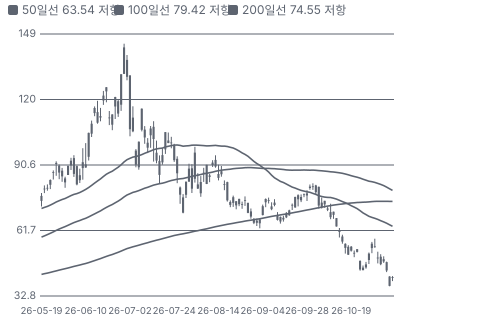

**주봉**

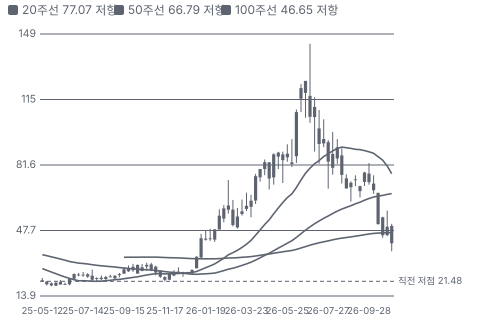

**월봉**

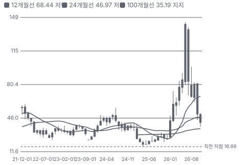

**분기 매출·EPS 실적과 컨센서스**

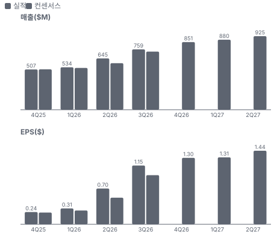

**4Q26 매출 — 지표 추세 vs 가이던스·컨센서스**

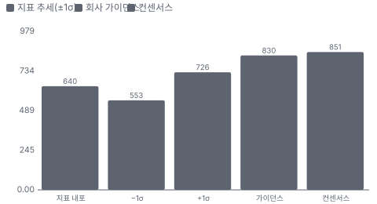

**최근 4개 분기 주가 변화 분석**

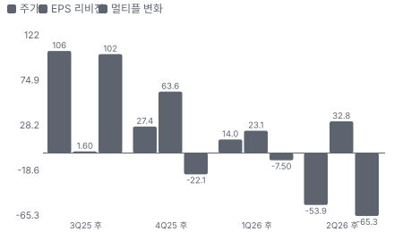

**EPS 리비전**

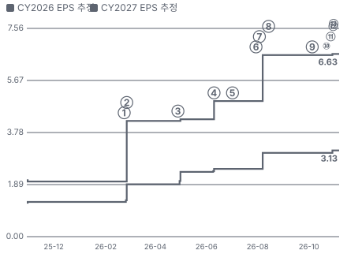

① 26-02-23 4Q25 실적·상승 사이클 확인 · EPS 리비전 +110%
② 26-02-26 0% 전환사채 가격 결정(옵션 포함 \$600M) · 실적 창과 겹침
③ 26-04-28 1Q26 실적·AI 다년 사이클 초기 언급 · EPS 리비전 +1%
④ 26-06-10 EPS 추정 상향 후 6/11 증권사 WFE 전망 상향·장비주 급등 · EPS 리비전 +15%
⑤ 26-07-02 메모리 우려로 장비주 동반 급락 · EPS 리비전 +0%
⑥ 26-07-30 Lam 6월 분기 실적·9월 분기 가이던스 강세 · EPS 리비전 +0%
⑦ 26-08-03 2Q26 실적·WFE \$200B 언급 · EPS 리비전 +34%
⑧ 26-08-14 ATM \$400M 등록(AMAT 실적 약세와 같은 날) · 실적 창과 겹침
⑨ 26-10-05 UBS 증설 사유 목표가 하향 · EPS 리비전 +0%
⑩ 26-10-22 Lam 전망 실망(CY27 WFE \$200B 초과 제시에도) · EPS 리비전 +0%
⑪ 26-10-27 3Q26 실적·ATM 220만 주 공개 · EPS 리비전 +1%
⑫ 26-10-30 장비주 동반 −6~−8%(회사 공시 없음) · 실적 창과 겹침
⑬ 26-11-05 중간선거 뒤 AI 트레이드 급락(업종 전체) · 실적 창과 겹침

**밸류에이션 주가 시나리오**

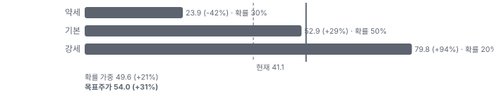

**주가별 업사이드**

**제품·서비스 포트폴리오**

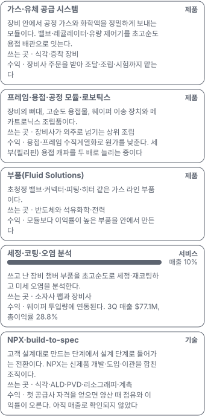

**고객 믹스(3Q26, 매출 대비)**

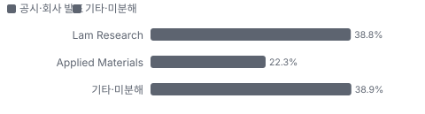

**공급 병목(10점, 낮을수록 병목)**

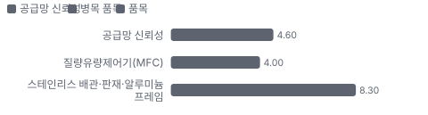

**CAPEX의 매출 대비 비중**

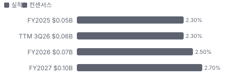

**어닝콜 변화별 주주가치 영향**

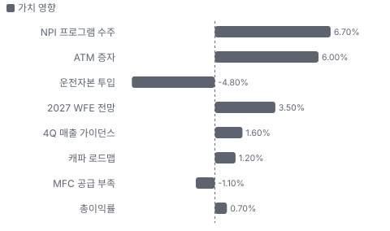

**멀티플 프리미엄(Fwd 1Y P/E, 최근 4개 분기말)**

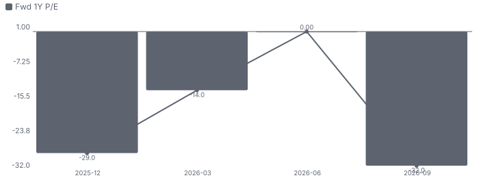

**합리적 멀티플**

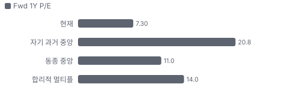

**수주·파이프라인 확실성 사다리**

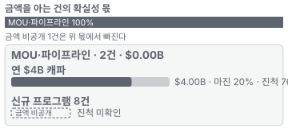

**매출 → 매출총이익 → 영업이익(매출 = 100, 최근 4분기)**

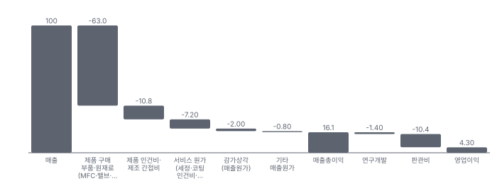

**1년 전 대비 마진 기여(비용 비중 변화의 반대)**

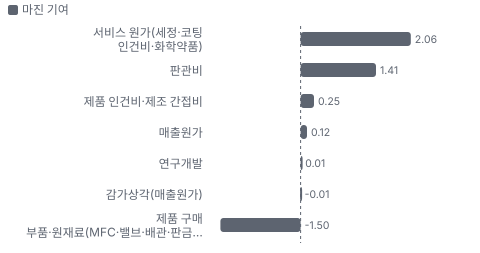

**분기 비용 비중 추이(매출 대비, 공시)**

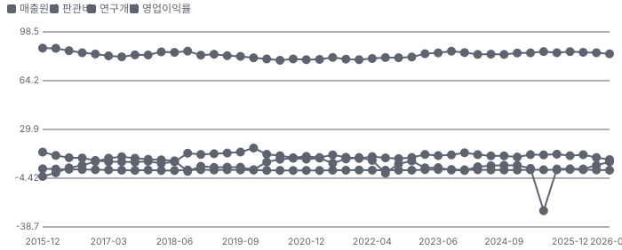

**비용 요인별 매출 대비 비중과 1년 변화**

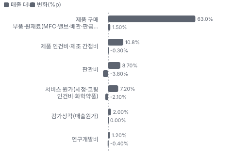

**BOM 항목 가격 +10% 시 OPM 변화**

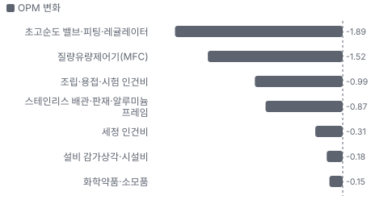

**제품(Products) 부문 — 가스 공급 시스템·모듈·부품 BOM 원가 몫과 가격 +10% 시 OPM**

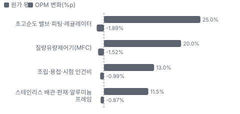

**세정·코팅·오염 분석 BOM 원가 몫과 가격 +10% 시 OPM**

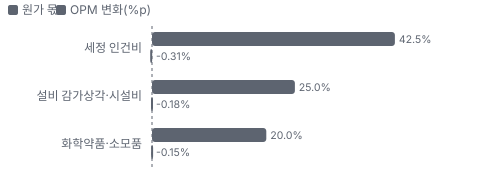

**매출·PPI·수출입 — 최근 16개 분기 같은 축(4Q22 = 100) + 다음 분기 추정**

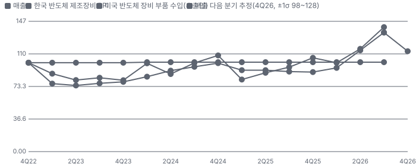

**매출과 미국 반도체 장비 부품 수입 증가율(전년 대비, 최근 16개 분기 + 다음 분기 추정)**

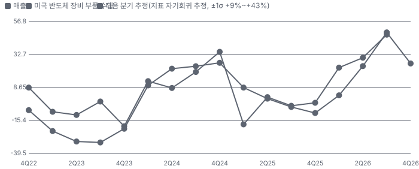

**10년 P·Q 사이클 — 추세(HP 필터) 대비 갭과 8분기 전망**

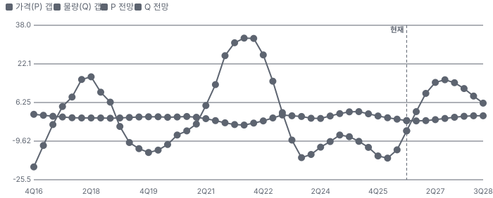

**매출 증가율의 가격·물량 분해와 8분기 전망(전년 대비)**

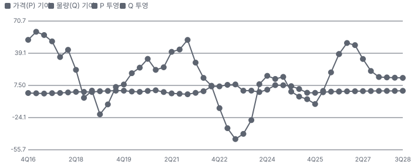

**분기별 매출 증가율 분해**

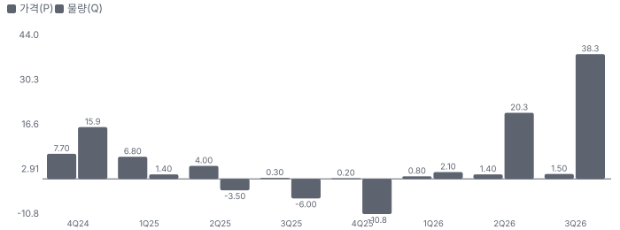

**목표주가 산정 — 기본 시나리오, 도달 확률 약 44%**

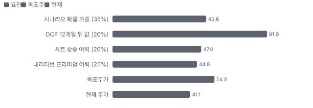

**PEG — 성장 대비 멀티플(낮을수록 성장 대비 쌈)**

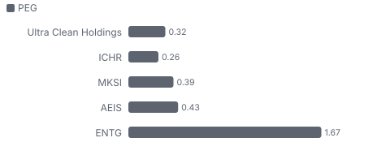

**일봉 지지·저항과 목표주가**

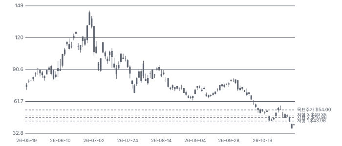

**커뮤니티 언급 수(최근 30일, 채널별)**

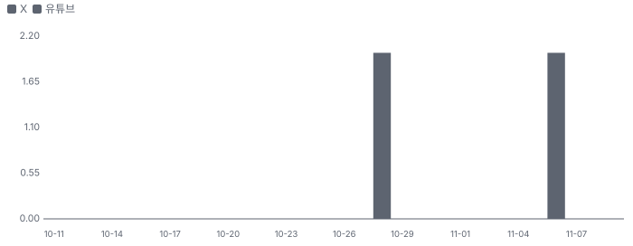

**일별 거래량 분해**

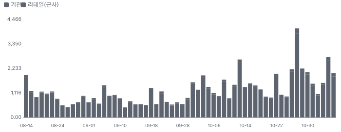

**기관 자금 흐름**

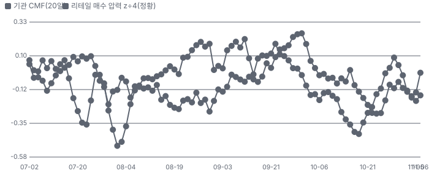

**몬테카를로**

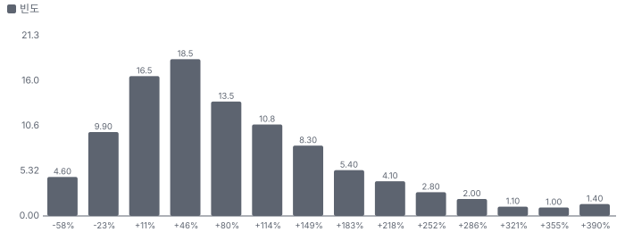

해석: 3,000번 중 2,502번(83%)에서 가치가 지금 주가 이상이었다. 가정을 흔들어도 지금 주가를 뒷받침하는 경우가 더 많다. 가운데 값은 1.64배이고, 열 번 중 여덟 번은 0.81~3.20배 사이에 든다.

## 내러티브

> **기업가치를 결정하는 이야기:** 매출 = WFE × 점유 약 2%(회사 환산 \$5B ÷ \$250B). 이익 = 매출 × 이익률이고, 총이익률은 3Q 17.3%에서 매출 \$4B 시 20%가 목표다. 멀티플은 사이클이 몇 년 가느냐에 대한 시장의 판단이다. UCTT는 고객 설계대로 만드는 비중이 커서 기술 희소성 프리미엄이 작다. 그래서 배수는 업종 사이클과 함께 움직이고, EPS는 가동률과 함께 움직인다.

> **멀티플·EPS 프리미엄**
> **멀티플:** 지금은 프리미엄이 아니라 할인이다. Fwd 1Y P/E 7.3배는 동종 중앙값 11.0배보다 33% 낮고, 2/23 고점 44.8배에서 내려왔다. 동종도 같은 주에 배수가 크게 줄었는데(MKSI 9.1배·ICHR 9.7배), UCTT는 그 아래다. 고점 프리미엄은 'WFE 다년 사이클 + 외주 확대'가 만들었고, 7월 이후 장비 업종 디레이팅·증설 자금 조달·11/5 AI 트레이드 붕괴가 지웠다.
> **EPS:** EPS에는 기대가 남아 있다. CY2027 EPS 컨센서스 \$5.85~\$6.63은 1년 전 \$2.05의 약 3배이고 11/5 급락 뒤에도 내려가지 않았다. 일부는 사업이 아니라 재무 구조에서 왔다 — 분기 이자비용이 1년 새 \$9.9M에서 \$1.5M로 줄었다(전환사채 0% 쿠폰 차환).

### 투자자들은 왜 열광했나

열광의 정점은 6월이었다. 첫째, 규모가 커졌다. 회사가 인용한 고객의 2026년 WFE 전망은 4월 \$140~145B였고, 10월 Lam은 2026년 약 \$155B, 2027년 \$200B 초과를 제시했다. 둘째, 레버리지다. 회사는 매출 \$4B에서 총이익률 20%를 목표로 말했고, 상승기에 고객이 서브시스템(장비 안에 들어가는 모듈 조립품)을 외주로 넘긴다고 설명했다. 셋째, 가시성이다. 2Q 콜에서 경영진은 고객이 예측 기간을 늘려 주고 있다고 말했다. 넷째, 리비전이다. CY2027 EPS 추정이 2월에 2배가 됐고 8월에 다시 34% 올랐다. 식은 이유도 같은 곳에 있다. 7월에 장비 업종이 AI 트레이드 재평가로 급락했고, 8/14 ATM 등록, 10/5 UBS의 증설 사유 목표가 하향, 10/21 Lam 전망 실망이 이어졌다.

### 무엇이 기업가치를 바꾸나

> **구조적 체질 변화**
> **변화:** 부채 구조와 운영 체계가 바뀌었다. 2026년 3월 0% 전환사채 \$600M으로 term loan \$481M을 전액 갚아 분기 이자비용이 \$9.9M에서 \$1.5M로 줄었다. 경영진의 'UCT 3.0(램프 준비·NPX·디지털 전환을 묶은 경영진의 사업 계획)'은 램프 준비·NPX(차세대 공정 부품을 고객과 함께 개발·시험하는 UCT 센터 프로그램)·디지털 전환 세 축이고, CFO도 8월에 바뀌었다.
> **증거:** 10-Q 2026-09-25 부채 주석, 전환가 \$84.75·capped call 상한 \$104.07·만기 2031년 3월.
> **반증:** 이자 절감을 증자 희석이 상쇄하거나, 사이클 하강기에 늘어난 캐파가 고정비로 드러나면 체질 변화가 아니라 재무 설계에 그친다.

> **고부가 믹스 확장**
> **변화:** 가스 패널 같은 모듈 조립에서 설계 단계 참여(build-to-spec(고객 사양을 받아 설계부터 맡는 방식))와 부품 내재화로 옮기는 중이다. 회사 설명으로 제품별 총이익률은 10%에서 50~60%까지 벌어져 있어 믹스가 곧 이익률이다. 서비스는 매출의 10%지만 3Q 총이익률 28.8%로 제품 15.6%의 약 2배다.
> **증거:** 3Q 제품 매출 \$681.9M·원가 \$575.7M, 서비스 매출 \$77.1M·원가 \$54.9M(10-Q). 비GAAP 총이익률 2Q 16.7% → 3Q 17.3%.
> **반증:** 매출 \$850M 분기에도 총이익률 17.5% 미만이면 믹스 이야기가 숫자로 바뀌지 않은 것이다.

> **기술 혁신**
> **변화:** UCTT의 기술은 소재 발명이 아니라 초고순도 유체 제어와 오염 관리다. GAA(게이트 올 어라운드 트랜지스터)·HBM(고대역폭 메모리)으로 식각·증착 집약도가 오르면 장비당 가스 계통과 세정 난도가 함께 오른다. 2Q에 힐스보로 NPX 센터를 열었고, 3Q에 식각·ALD(원자층 증착)·PVD(물리 기상 증착)·리소그래피에서 8건을 수주했다. 회사는 이 제품들이 2~3년 뒤 다음 노드에서 상용화된다고 설명했다.
> **증거:** 연구개발비 3Q \$8.8M(매출의 1.2%), 특허 100건 이상, 고객을 위해 개발한 IP는 대체로 고객 소유(10-K).
> **반증:** 2028년까지 NPX 프로그램의 양산 매출이 확인되지 않으면 기술 프리미엄의 근거가 없다.

> **실행 속도**
> **변화:** 해당 없음(주문→인도 기간을 회사도 피어도 공개하지 않는다). 10-K는 주문 대부분을 같은 분기 안에 받아 처리하고 의미 있는 수주잔고가 없다고 적었다. 대신 물량 속도를 본다. 분기 매출은 2Q \$644.9M → 3Q \$759.0M → 4Q 가이던스 \$800~860M이다.
> **증거:** 병목은 UCTT 조립이 아니라 부품이다. 경영진은 MFC 부족이 1~2분기 더 간다고 말했고, 10-K는 공급사 납기가 고객 납기보다 길 수 있다고 적었다.
> **반증:** MFC 부족이 풀린 뒤에도 4Q 매출이 \$800M에 못 미친다

> **M&A**
> **변화:** M&A는 지금 성장 동력이 아니다. 2018년 Quantum Global(세정 서비스), 2020년 말 합의한 Ham-Let(밸브·피팅), 2023년 HIS 이노베이션스(서브팹(장비 아래층의 배기·가스 설비))로 사업을 넓혔지만, 2025년 2분기에 Fluid Solutions(UCT 유체 부품 사업부) \$77.6M·Services \$73.5M, 합계 \$151.1M의 영업권을 상각했다. 3Q 콜까지 새 인수 계획은 나오지 않았다.
> **증거:** 10-K 2025 영업권 주석. 남은 영업권 \$114.2M. 2025년 순손실의 주된 원인이 이 상각이다.
> **반증:** 자체 IP가 있는 부품·계측 회사를 합리적 가격에 사면 긍정으로 바뀐다. 증자 자금으로 하는 대형 인수는 반대 방향이다.

> **정책·입법 연관성**
> **재정정책:** 해당 없음(UCTT에 직접 닿는 재정 지출이 없다). CHIPS(미국 반도체 지원법) 보조금은 고객 팹에 가고, 회사가 공시한 정부 보조금은 2025년 \$2.2M뿐이다. 10-Q·10-K에 전략 계약이나 CHIPS 지원 공시가 없다. 반증: 미국 팹 보조금 지급이 끊겨 착공이 밀린다
> **행정명령:** 2026년 1월 232조 조치는 좁은 범위의 첨단 로직 칩이 대상이었고 장비에는 즉시 관세를 매기지 않았다. 그 뒤 변화는 확인하지 못했다. 법무법인 해설 기준이다. UCTT 2025년 해외 매출은 75.9%다. 반증: 광범위 관세가 장비·부품까지 넓어진다 의회 동의 2/10 — 하원 1/5(대통령 조치라 표결 없음) · 상원 1/5(대통령 조치라 표결 없음).
> **연관입법:** 48D 세액공제는 2025년 법으로 35%가 됐지만 2026년 12월 31일 뒤 착공분은 받지 못한다. 연장안 BASIC Act(H.R. 3204)와 상원 SEMI Investment Act(반도체 장비·소재 공급망까지 세액공제를 넓히는 상원 법안)가 있고, 통과는 확인되지 않았다. SEMI(국제반도체장비재료협회)는 8월에도 연장을 요청 중이었다. Crapo·Wyden 상원의원이 연장 지지를 밝혔다. 간접 효과라 고객 착공 일정으로만 닿는다. 반증: 연장 없이 일몰되고 2027년 미국 착공 계획이 줄어든다

> **CAPEX 낙수효과**
> **변화:** 돈은 하이퍼스케일러 → 메모리·파운드리 → 장비사 → UCTT로 내려온다. TSMC는 2026년 CAPEX를 \$52~56B에서 7월 \$60~64B로 올렸고, Lam은 WFE를 2026년 약 \$155B, 2027년 \$200B 초과로 제시했다. UCTT는 3Q 매출의 61.1%가 Lam(38.8%)과 AMAT(22.3%)에서 나와 이 경로의 마지막 고리에 있다.
> **증거:** 3Q 매출 +48.8% YoY, 4Q 가이던스 \$800~860M, 재고 구매 약정 \$1,111M. Lam 수치는 예비 전망이다.
> **반증:** Lam·AMAT가 2027 WFE를 낮추거나 하이퍼스케일러 CAPEX 둔화가 확인되면 경로 전체가 꺾인다.

### 내러티브 근거

> '2027~28 WFE 증설 사이클의 서브시스템 아웃소싱 수혜'는 실적으로 확인되는데(3Q 매출 +49%), 주가는 6/30 고점 대비 −65% — 시장은 증설 대가(재고·증자)와 장비주 디레이팅을 먼저 가격에 넣었다. 동종 대비 멀티플 차이 -33% 중 회사 고유 몫은 -47%다. 단계는 소멸, 쏠림은 낮음이다.

> **WFE 2027~28 다년 증설(AI 메모리·GAA·HBM)** · 강화
> **논리:** 2027 WFE \$200B 이상, 고객이 서브시스템을 외부로 넘겨 UCTT가 업종보다 빨리 큰다
> **숫자:** 3Q 매출 +48.8% YoY·4Q 가이던스 중간값 +9.4% QoQ, 메모리 비중 34%
> **반증:** 대형 장비사(AMAT·LRCX) 2027 WFE 전망 하향(2027-01~02 실적)

> **이익률 레버리지(가동률·고부가 NPI(신제품 도입))** · 유지
> **논리:** \$4B에서 총이익률 20% — 가동률과 build-to-spec 제품 믹스로 마진이 오른다
> **숫자:** 총이익률 2Q 16.7% → 3Q 17.3%, NPI 8건
> **반증:** 매출 \$850M 이상 분기에 총이익률 17% 미만

> **증설의 대가 — 재고·증자(약세)** · 강화
> **논리:** 고객 약정 없이 캐파·재고를 먼저 사고, 그 돈을 증자로 메운다 — 사이클이 꺾이면 ROIC가 무너진다
> **숫자:** 재고 \$723M(+\$93M), 영업현금 3분기 연속 음수, ATM 약 \$203M(주식 +5.6%)
> **반증:** 4Q 영업현금흐름 플러스 전환·재고 회전 개선(2027-02 4Q 실적)

> **장비주 디레이팅(AI 심리 냉각, 약세)** · 확산
> **논리:** AI 투자 지속성 의심이 장비 업종 배수를 누른다
> **숫자:** Fwd 1Y P/E 2/23 44.8배 → 10/30 8.9배, 같은 기간 선행 EPS 추정은 상향
> **반증:** 장비 업종 배수 회복과 함께 UCTT Fwd 1Y P/E 12배 회복

> **고객 집중(상위 2사 61%)** · 유지
> **논리:** AMAT·LRCX 내부 생산 전환 또는 이원화 시 물량이 빠진다
> **숫자:** 상위 2고객 61%(3Q)
> **반증:** 상위 2고객 비중 55% 미만으로 분산(10-K)

이미지 없음(검수 실패) — 세정·코팅·오염 분석

## 포트폴리오

| 제품·서비스 | 구분 | 무엇 | 쓰는 곳 | 돈 버는 방식 | Mix | Mix 변화(10-Q 서비스 매출 ÷ 총매출, 3Q26 vs 3Q25(계절성 낮음 — 전년 같은 분기 대비)) |
|---|---|---|---|---|---|---|
| 가스·유체 공급 시스템 | 제품 | 장비 안에서 공정 가스와 화학액을 정밀하게 보내는 모듈이다. 밸브·레귤레이터·유량 제어기를 초고순도 용접 배관으로 잇는다. | 식각·증착 장비 | 장비사 주문을 받아 조달·조립·시험까지 맡는다 | 미확인 | 미확인 |
| 프레임·용접·공정 모듈·로보틱스 | 제품 | 장비의 뼈대, 고순도 용접물, 웨이퍼 이송 장치와 메카트로닉스 조립품이다. | 장비사가 외주로 넘기는 상위 조립 | 용접·프레임 수직계열화로 원가를 낮춘다. 세부(필리핀) 용접 캐파를 두 배로 늘리는 중이다 | 미확인 | 미확인 |
| 부품(Fluid Solutions) | 제품 | 초청정 밸브·커넥터·피팅·히터 같은 가스 라인 부품이다. | 반도체와 석유화학·전력 | 모듈보다 이익률이 높은 부품을 안에서 만든다 | 미확인 | 미확인 |
| 세정·코팅·오염 분석 | 서비스 | 쓰고 난 장비 챔버 부품을 초고순도로 세정·재코팅하고 미세 오염을 분석한다. | 소자사 팹과 장비사 | 웨이퍼 투입량에 연동된다. 3Q 매출 \$77.1M, 총이익률 28.8% | 10% | -2.5%p |
| NPX·build-to-spec | 기술 | 고객 설계대로 만드는 단계에서 설계 단계로 들어가는 전환이다. NPX는 신제품 개발·도입·이관을 합친 조직이다. | 식각·ALD·PVD·리소그래피·계측 | 첫 공급사 자격을 얻으면 양산 때 점유와 이익률이 오른다. 아직 매출로 확인되지 않았다 | 미확인 | 미확인 |

**Mix 변화가 가장 큰 쪽은 세정·코팅·오염 분석(-2.5%p, 10-Q 서비스 매출 ÷ 총매출, 3Q26 vs 3Q25(계절성 낮음 — 전년 같은 분기 대비)).** 계절성 판정: 분기 매출 계절 지수 기준 없음 → 직전 분기와 비교.

## 고객

> **3Q26 최대 고객 Lam Research 39%, 상위 3곳 61%, 집중도 보통.** 공시·회사 발표로 확인한 몫은 매출의 61%이고, 나머지 고객 몫은 추정이거나 미분해다. 3Q 매출의 61.1%가 두 고객이다 — Lam Research 38.8%, Applied Materials 22.3%(10-Q). 2025년에는 Lam 37.0%, 상위 2곳 58.7%였다. 장비사가 외주를 늘리는 상승기라 집중이 오히려 커졌다.

**고객별 매출 몫(3Q26)**
| 고객 | 몫 | 변화 | 근거 |
|---|---|---|---|
| Lam Research | 39% | +2%p | 공시 |
| Applied Materials | 22% | +1%p | 공시 |
| 기타·미분해 | 39% | - | - |

> **Lam Research** · 공시
> **사는 것:** 식각·증착 장비용 가스 공급 시스템·모듈
> **추정 근거:** 10-Q 10% 초과 고객 공시. prior는 2025년 연간(10-K)

> **Applied Materials** · 공시
> **사는 것:** 증착·식각 장비용 서브시스템
> **추정 근거:** 10-Q 공시. prior는 2025년 상위 2곳 58.7% − Lam 37.0%

## 수주·파이프라인

> **2026-10-27 기준 2건.** 건별 확정 금액은 공개되지 않았다. 서로 겹치는 항목은 합계에서 뺐다.

**실행 속도와 방해 요인**
| 항목 | 상태 | 실행 속도 | 방해 요인 |
|---|---|---|---|
| 연 \$4B 캐파 | 파이프라인 | 1H27 목표, 이후 \$5B 이상 단계적 | 고객 장기 약정 없음 · 재고 구매 약정 \$1,111M · ATM 희석 |
| 신규 프로그램 8건 | 파이프라인 | 회사 설명으로 2~3년 뒤 다음 노드에서 상용화 | 고객 노드 일정 · 고객 소유 IP |

## 마진 구조

> **GPM 16.9%, OPM 7.1%.** 3Q25 대비 GPM +0.8%p, OPM +5.0%p. 변동비는 매출의 75%이고, 매출이 10% 늘면 OPM은 +1.7%p 움직인다. 3Q26 매출원가는 매출의 83.1%로 1년 전 83.9%보다 0.8%p 낮다. 제품 부문 원가율이 85.5% → 84.4%, 판관비율이 12.5% → 8.7%로 내려 영업이익률이 2.1% → 7.1%가 됐다. 이익률 개선의 대부분은 원가가 아니라 고정비 레버리지다.

> **매출 100 중 매출원가 83.9, 매출총이익 16.1(최근 4분기, 공시).** 매출원가 요인 중 제품 구매 부품·원재료(MFC·밸브·배관·판금)이 매출의 63.0%로 가장 무겁고, 단가가 +10% 오르면 GPM이 -6.30%p 움직인다. 분기 회귀로 매출 1이 늘 때 매출원가는 0.82 늘고, 매출원가의 고정비 몫은 1%다.

**비용 요인 강도 — 비중·추세·충격(+10%)·탄력**
| 비용 | 구분 | 매출 대비 | 1년 변화 | 마진 기여 | 충격 시 마진 | 매출 탄력 | 고정비 몫 |
|---|---|---|---|---|---|---|---|
| 제품 구매 부품·원재료(MFC·밸브·배관·판금) | 매출원가 요인 | 63.0% | +1.5%p | -1.5%p | -6.30%p | 미확인 | 0% |
| 제품 인건비·제조 간접비 | 매출원가 요인 | 10.8% | -0.3%p | +0.3%p | -1.08%p | 미확인 | 50% |
| 서비스 원가(세정·코팅 인건비·화학약품) | 매출원가 요인 | 7.2% | -2.1%p | +2.1%p | -0.72%p | 미확인 | 50% |
| 감가상각(매출원가) | 매출원가 요인 | 2.0% | +0.0%p | -0.0%p | -0.20%p | 미확인 | 100% |
| 매출원가 | 공시 항목 | 83.9% | -0.1%p | +0.1%p | -8.39%p | 0.82 | 1% |
| 판관비 | 공시 항목 | 10.4% | -1.4%p | +1.4%p | 미확인 | 0.10 | 4% |
| 연구개발 | 공시 항목 | 1.4% | -0.0%p | +0.0%p | 미확인 | 0.01 | 8% |

매출 탄력 = 분기 비용을 매출에 회귀한 기울기(매출 1당 변동비), 고정비 몫 = 절편 ÷ 평균 비용. 표본이 8분기 미만이면 미확인. 매출원가 요인 비중은 margin 재료의 추정이 섞여 있고, 공시 매출원가와의 차이는 '기타 매출원가'로 둔다.

**GPM에서 OPM까지(GAAP)**
| 기간 | GPM | 연구개발 | 판관비 | 기타 | OPM |
|---|---|---|---|---|---|
| 3Q25 | 16.1% | 1.5% | 12.5% | 0.0% | 2.1% |
| 3Q26 | 16.9% | 1.2% | 8.7% | 0.0% | 7.1% |

**GPM·OPM 최근 4개 분기**
| 분기 | GPM | OPM |
|---|---|---|
| 2025-12 | 15.3% | 2.2% |
| 2026-03 | 15.8% | 2.1% |
| 2026-06 | 16.1% | 4.6% |
| 2026-09 | 16.9% | 7.1% |

**마진을 결정하는 비용 요인 — 비용 +10% 시 OPM**
| 비용 | 매출 대비 | 변화 | 고정비 | OPM |
|---|---|---|---|---|
| 제품 구매 부품·원재료(MFC·밸브·배관·판금) | 63.0% | +1.5%p | 0% | -6.30%p |
| 제품 인건비·제조 간접비 | 10.8% | -0.3%p | 50% | -1.08%p |
| 판관비 | 8.7% | -3.8%p | 70% | -0.87%p |
| 서비스 원가(세정·코팅 인건비·화학약품) | 7.2% | -2.1%p | 50% | -0.72%p |
| 감가상각(매출원가) | 2.0% | +0.0%p | 100% | -0.20%p |
| 연구개발비 | 1.2% | -0.4%p | 90% | -0.12%p |

**비용을 움직이는 요인**
| 비용 | 요인 |
|---|---|
| 제품 구매 부품·원재료(MFC·밸브·배관·판금, 매출원가) | 부품 단가·MFC 수급·고객 지정 부품 · 근거 추정 |
| 제품 인건비·제조 간접비(매출원가) | 가동률·세부·말레이시아 램프 · 근거 추정 |
| 판관비(판관비) | 인건비·주식보상·무형자산 상각 · 근거 공시 |
| 서비스 원가(세정·코팅 인건비·화학약품, 매출원가) | 팹 가동률·웨이퍼 투입 · 근거 공시 |
| 감가상각(매출원가, 매출원가) | 증설 설비 · 근거 추정 |
| 연구개발비(연구개발) | NPX 개발 · 근거 공시 |

**제품(Products) 부문 — 가스 공급 시스템·모듈·부품 BOM — 매출의 90%, GPM 16%(10-Q 부문 원가율 84.4%), 항목 가격 +10% 시**
| 항목 | 원가 몫 | 전가 | 제품 GPM | OPM |
|---|---|---|---|---|
| 초고순도 밸브·피팅·레귤레이터 | 20~30% | 미확인 | -2.1%p | -1.89%p |
| 질량유량제어기(MFC) | 15~25% | 미확인 | -1.7%p | -1.52%p |
| 조립·용접·시험 인건비 | 10~16% | 미확인 | -1.1%p | -0.99%p |
| 스테인리스 배관·판재·알루미늄 프레임 | 8~15% | 미확인 | -1.0%p | -0.87%p |
| 미분해 | 30% | - | - | - |

**세정·코팅·오염 분석 BOM — 매출의 10%, GPM 29%(10-Q 서비스 원가율 71.2%), 항목 가격 +10% 시**
| 항목 | 원가 몫 | 전가 | 제품 GPM | OPM |
|---|---|---|---|---|
| 세정 인건비 | 35~50% | 미확인 | -3.0%p | -0.31%p |
| 설비 감가상각·시설비 | 20~30% | 0% | -1.8%p | -0.18%p |
| 화학약품·소모품 | 15~25% | 미확인 | -1.4%p | -0.15%p |
| 미분해 | 12% | - | - | - |

초고순도 밸브·피팅·레귤레이터 가격이 +10% 오르면 영업이익은 -26.8% 움직인다. 판매가 전가를 모르는 항목은 전가 0%로 계산했다.

**BOM 항목 가격을 움직이는 것**
| 항목 | 요인 |
|---|---|
| 질량유량제어기(MFC) | 공급 부족 시 단가 상승, 장비사 지정 부품이면 원가 연동(추정) · 근거 추정 |
| 초고순도 밸브·피팅·레귤레이터 | 일부 자체 생산(Ham-Let) · 근거 추정 |
| 스테인리스 배관·판재·알루미늄 프레임 | 니켈·알루미늄 가격 · 근거 추정 |
| 조립·용접·시험 인건비 | 아시아 인건비·숙련 용접공 · 근거 추정 |
| 세정 인건비 | 지역 인건비 · 근거 추정 |
| 화학약품·소모품 | 산·용제 가격 · 근거 추정 |
| 설비 감가상각·시설비 | 고정비 · 근거 추정 |

**BOM 투입 물가 — PPI 전년비, 2026-11-09 수집**
| 항목 | 미국 | 일본 | 한국 | 대만 |
|---|---|---|---|---|
| 초고순도 밸브·피팅·레귤레이터 | +6.8%* | 미확인 | 미확인 | 미확인 |

별표는 품목보다 넓은 업종 지수다. 지난 1년 투입 물가를 판매가 전가 뒤 원가에 그대로 넣으면 OPM은 -2.32%p 움직인다(매출원가의 41% 기준).

## 공급망 병목

이미지 없음(검수 실패) — 가스·유체 공급 시스템

> **공급망 신뢰성 4.6/10, 병목 주의.** 가장 약한 고리는 질량유량제어기(MFC) 4.0점이고, 품목 평균은 5.6점이다. 근거가 부족한 1건(초고순도 밸브·피팅·레귤레이터)은 점수에서 뺐다. 가스 공급 시스템의 핵심 구매 부품은 질량유량제어기(MFC)·초고순도 밸브·레귤레이터다. 3Q 콜에서 경영진은 MFC 부족이 1~2분기 이어질 수 있다고 말했다. 회사는 공급사 이름을 공시하지 않는다.

**병목과 마진 — 품목 가격 +10% 시 OPM**
| 품목 | 점수 | 판정 | 구분 | OPM |
|---|---|---|---|---|
| 질량유량제어기(MFC, 필수) | 4.0 | 병목 심각 | 핵심 통제 품목 | -1.52%p |
| 스테인리스 배관·판재·알루미늄 프레임 | 8.3 | 병목 낮음 | 가격 위험 | -0.87%p |

> **질량유량제어기(MFC)** · 4.0/10
> **왜:** 가스 라인마다 들어가고, 장비사가 공급사를 지정하는 경우가 많아 UCTT가 대체하기 어렵다(추정)
> **병목 요인:** 인증 공급사 2곳 · 캐파 부족 · 리드타임 미확인 · 재인증 9개월 · 1위 점유율 60% · 지역 집중 미확인 · 물량 확보 미확인
> **풀리는 조건:** 미확인 — MFC 제조사 증설 가동 확인 전

> **스테인리스 배관·판재·알루미늄 프레임** · 8.3/10
> **왜:** 범용 소재
> **병목 요인:** 인증 공급사 3곳 · 캐파 여유 · 리드타임 미확인 · 재인증 3개월 · 1위 점유율 미확인 · 지역 집중 미확인 · 물량 확보 현물
> **풀리는 조건:** 해당 없음

**공급사**
| 품목 | 공급사 | 몫 | 근거 |
|---|---|---|---|
| 질량유량제어기(MFC) | MKS Inc.(MFC·압력 계측) | 미확인 | 추정 |
| 질량유량제어기(MFC) | Horiba(MFC) | 미확인 | 추정 |
| 초고순도 밸브·피팅·레귤레이터 | UCTT 자체(Ham-Let·Fluid Solutions, 밸브·피팅 내재화) | 미확인 | 공시 |
| 초고순도 밸브·피팅·레귤레이터 | 외부 공급사(미공시, 밸브·레귤레이터) | 미확인 | 공시 |
| 스테인리스 배관·판재·알루미늄 프레임 | 다수 공급사(미공시, 금속 원재료) | 미확인 | 공시 |

**무역 통계로 본 공급 지역**
| 품목 | EU 수입처 | 일본 수입처 | EU 1위 전년비 |
|---|---|---|---|
| 질량유량제어기(MFC) | CN(중국) 63% · US 27% · JP 4% | 中華人民共和国 28% · アメリカ合衆国 25% | +2.7% |
| 초고순도 밸브·피팅·레귤레이터 | CN 63% · US 27% · JP 4% | 中華人民共和国 28% · アメリカ合衆国 25% | +2.7% |

## 생산능력

> **현재 명목 캐파 미확인, 가동률 미확인.** 착공 이상 증설은 0 연 매출 환산 캐파(\$B), 발표까지 합치면 0 연 매출 환산 캐파(\$B)이다. TTM 3Q26 CAPEX는 \$0.06B로 매출의 2.3%다. 회사는 캐파를 '연 매출 환산 금액'으로 말한다. 1H27까지 연 \$4B, 이후 \$5B 이상을 단계적으로 짓는다(3Q 콜). 3Q 매출 연환산은 \$3.04B다. 시설별 캐파·가동률은 공시하지 않는다.

**생산시설 24곳**(FY2025 10-K Item 2 — 시설 수를 밝히지 않는다. 제조·엔지니어링 시설이 있는 12개 지역(캘리포니아·텍사스·애리조나·이스라엘·오리건·중국·말레이시아·싱가포르·영국·태국·필리핀·체코)과 세정·분석 시설 12개 지역(콜로라도·애리조나·캘리포니아·오리건·메인·텍사스·아일랜드·이스라엘·대만·한국·싱가포르·중국)을 지역당 1곳으로 센 하한) — 이름·위치를 밝힌 곳 10곳, 임차 1곳 · 미확인 6곳 · 소유·임차 1곳 · 소유 2곳. 시설별 생산능력은 공개되지 않았다 — 회사 전체 캐파만 위에 적었다.

**생산시설 24곳 — 명칭·위치·생산능력**
| 시설 | 위치 | 용도 | 생산능력 | 소유·상태 |
|---|---|---|---|---|
| 본사·제조(Hayward) | 미국 캘리포니아 Hayward | 본사·엔지니어링·제조 | 미확인 — 시설별 캐파 미공시 — 임차는 2027년 만료(10-K) | 임차 · 가동 |
| 세부 용접 공장 | 필리핀 세부 | 용접·프레임 제조 | 미확인 — 3Q 콜에서 캐파 2배 계획만 밝혔다 | 미확인 · 가동 |
| 말레이시아 제조 시설 | 말레이시아 | 가스 공급 시스템·모듈 제조 | 미확인 — 시설별 캐파 미공시 | 미확인 · 가동 |
| 싱가포르 제조·세정 시설 | 싱가포르 | 모듈 제조·세정 | 미확인 — 시설별 캐파 미공시 | 미확인 · 가동 |
| 중국 제조·세정 시설 | 중국 | 모듈 제조·세정 | 미확인 — 10-K — 중국에 건물·토지를 소유. 시설별 캐파 미공시 | 소유·임차 · 가동 |
| 체코 제조 시설 | 체코 | 유럽 고객용 모듈 제조 | 미확인 — 시설별 캐파 미공시 | 미확인 · 가동 |
| 태국 제조 시설 | 태국 | 부품·수직계열화 제조 | 미확인 — 3Q 콜에서 수직계열화 캐파 2배 계획만 밝혔다 | 미확인 · 가동 |
| 이스라엘 제조·세정 시설(Ham-Let) | 이스라엘 | 유체 부품(밸브·피팅) 제조·세정 | 미확인 — 시설별 캐파 미공시 | 미확인 · 가동 |
| 한국 세정 시설 | 한국 | 부품 세정·분석 | 미확인 — 10-K — 한국에 건물·토지 소유. 캐파 미공시 | 소유 · 가동 |
| 영국 제조 시설 | 영국 | 제조 | 미확인 — 10-K — 영국에 건물·토지 소유. 캐파 미공시 | 소유 · 가동 |

**생산능력 확충 계획**
| 계획 | 단계 | 증설 | 가동 시점 | CAPEX |
|---|---|---|---|---|
| 연 \$4B 캐파(1H27) | 발표 | 미확인 | 2027-06 | 미확인 |
| 필리핀 세부 용접 캐파 2배 | 발표 | 미확인 | 2027 | 미확인 |
| 말레이시아·태국 수직계열화 캐파 2배 | 발표 | 미확인 | 2027 | 미확인 |
| 연 \$5B 이상 단계적 확장 | 발표 | 미확인 | 미확인 | 미확인 |

남은 계획의 CAPEX 합계는 \$0.00B(금액 미확인 4건 제외)다. 합계는 FY2027 매출의 0%다.

**증설 방해 요인**
| 계획 | 방해 요인 |
|---|---|
| 연 \$4B 캐파(1H27) | MFC 등 외부 부품 부족, 고객 장기 약정 없음 |
| 필리핀 세부 용접 캐파 2배 | 숙련 용접 인력·고객 인증 |
| 말레이시아·태국 수직계열화 캐파 2배 | 장비 반입·고객 인증 미확인 |
| 연 \$5B 이상 단계적 확장 | 2027 WFE 실현·자금 조달(ATM 잔여 \$193M) |

**CAPEX와 매출 대비**
| 기간 | CAPEX | 매출 | 매출 대비 | 구분 |
|---|---|---|---|---|
| FY2025 | \$0.05B | \$2.10B | 2.3% | 실적 |
| TTM 3Q26 | \$0.06B | \$2.44B | 2.3% | 실적 |
| FY2026 | \$0.07B | \$2.79B | 2.5% | 컨센서스 |
| FY2027 | \$0.10B | \$3.75B | 2.7% | 컨센서스 |

## 해자

> 고객 승인과 규모가 신규 진입은 막지만, 총이익률 17%가 말하듯 가격 결정력으로 이어지지 않는다

> **장비사 승인 라인** · 보통
> **해자:** Lam·AMAT 장비에 들어가는 가스 계통은 고객 승인을 받은 설계·공정으로 만들어 쉽게 바꾸지 못한다.
> **근거:** 3Q 매출의 61.1%가 두 고객이다. 다만 10-K는 고객 내재화와 Ichor·Fujikin·Foxsemicon·VDL(네덜란드 장비 위탁 생산사) ETG·Jabil·Celestica를 경쟁으로 적었고, 고객을 위해 개발한 IP는 대체로 고객 소유다.
> **숫자:** 3Q 제품 총이익률 15.6%
> **깨지는 조건:** 상위 고객이 물량을 이원화하거나 내재화해 어느 한쪽 비중이 5%p 이상 준다

> **세정·분석 서비스 현장망** · 보통
> **해자:** 팹 가까이에 인증된 세정·코팅·오염 분석 설비를 두어야 해서 지역 밀착이 진입 장벽이다.
> **근거:** 서비스는 3Q 매출 \$77.1M으로 10%지만 총이익률이 제품의 약 2배다. 미국 신규 팹 가동이 2027~28년 수요로 이어진다는 건 회사 설명이고 계약은 공시되지 않았다.
> **숫자:** 3Q 서비스 총이익률 28.8%
> **깨지는 조건:** 서비스 총이익률이 25% 아래로 내려가거나 미국 신규 팹 인증이 경쟁사로 간다

> **규모와 상승기 캐파** · 약함
> **해자:** 상승기에 물량을 받아낼 캐파가 곧 점유율이다. 다만 고객 약정 없이 지은 캐파라 사이클이 꺾이면 해자가 아니라 고정비다.
> **근거:** 회사는 2027년 상반기 연 \$4B 캐파를 제시했다. 동종 Ichor TTM 매출은 \$1.0B다. 재고 구매 약정 \$1,111M은 구속력 없는 고객 예측을 근거로 잡혀 있다.
> **숫자:** TTM 매출 \$2.44B vs Ichor \$1.01B
> **깨지는 조건:** 경쟁사 증설이 겹쳐 매출 \$850M 분기에도 총이익률이 17%를 밑돈다

## 경영진·네트워크

> CEO는 2대 고객 AMAT 출신이고 의장도 AMAT 임원을 지냈다. 두 사람 모두 AMAT이 2006년 사들인 Applied Films 출신이다. 연결이 수주를 만들었다는 증거는 없다.

> **James Xiao** · CEO · 2025-09
> **프로필:** 55세. AMAT에서 19년 일했고 마지막은 ALD 제품군 총괄 부사장이었다. 2006년 Applied Films 인수로 합류했고 그 전에는 중국 법인 대표였다.
> **비즈니스:** AMAT ALD 제품군을 맡았던 경력이 2대 고객과 직접 닿는다. 위임장은 고객·업계·정부 네트워크를 선임 사유로 적었다. 다른 상장사 이사직은 확인하지 못했다.
> **정계:** 공개 기록상 공직·정치 활동 미확인
> **동문:** 대련이공대 응용물리, 인디애나대 켈리 MBA
> **사모임:** 미확인

> **Thomas T. Edman** · 독립 의장 · 2026-05(이사 2015)
> **프로필:** 63세. TTM Technologies CEO(2014~2025년 9월)를 지냈다. 그 전 AMAT에서 AKT(AMAT의 디스플레이 장비 사업) 디스플레이 사업 총괄과 사업개발 부사장을 맡았고, Applied Films CEO였다.
> **비즈니스:** Jabil·Materion 이사(2026년 1월부터), TTM 이사(2004년부터), 전자 제조 협회(Global Electronics Association) 명예 의장. Jabil은 10-K가 적은 서브시스템 경쟁사다.
> **정계:** 공개 기록상 공직·정치 활동 미확인
> **동문:** 예일대 동아시아학, 와튼 MBA
> **사모임:** 미확인

> **Clarence L. Granger** · 이사(전 CEO·전 의장) · 2002
> **프로필:** 77세. 12년간 CEO를 지냈고 2025년 3~9월 임시 CEO로 돌아왔다. 2026년 5월 의장에서 물러났다. 창업자가 아니고, 창업자는 공개 자료에서 현 경영진에 없다.
> **비즈니스:** Seagate·HMT 테크놀로지 경영진 출신
> **정계:** 미확인
> **동문:** UC(캘리포니아대) 버클리·스탠퍼드 산업공학
> **사모임:** 미확인

**네트워크 정량화**
| 연결 | 강도 | 닿는 매출 | 가중 노출 | 매출 대비 | 근거 |
|---|---|---|---|---|---|
| 비즈니스: Xiao — AMAT ALD 제품군 총괄 출신, AMAT은 2대 고객 | 4/5 | \$0.55B | \$0.44B | 18% | TTM 매출 \$2.44B × 3Q AMAT 비중 22.3% 2026 위임장, 10-Q |
| 비즈니스: Edman — AMAT 부사장·Applied Films CEO 출신, Xiao와 같은 회사 경력 | 3/5 | \$0.55B | \$0.33B | 13% | TTM 매출 \$2.44B × 3Q AMAT 비중 22.3%. 위와 같은 매출이라 합산하지 않는다 2026 위임장 |
| 비즈니스: Edman — Jabil 이사 겸임. Jabil은 경쟁사 명단에 있어 판로보다 이해상충 점검 대상 | 3/5 | \$0.00B | \$0.00B | 0% | 연결이 닿는 UCTT 매출 없음 2026 위임장, 10-K 경쟁 절 |
| 정계: 로비·공직 연결 미확인 | 0/5 | \$0.00B | \$0.00B | 0% | 공개 기록에서 찾지 못함 2026 위임장 |

가중 노출은 연결이 닿는 매출의 크기다. 연결이 그 매출을 만들었다는 뜻이 아니며, 인과는 공개 자료로 입증하지 못한다.

## 약세 논리 및 셀온 조건

| 약세 논리 | 근거 | 가를 자료 |
|---|---|---|
| 약정이 예측 위에 있다 | 재고 구매 약정 \$1,111M은 12월 말 \$443.6M(유형자산 포함, 범위가 다르다)의 2.5배다. 10-K는 고객 예측이 구속력이 없다고 적었다 | 4Q 재고·영업현금(2027-02), 10-K 약정 |
| AI 트레이드 붕괴가 수요로 번진다 | 11/5 매도의 이유는 데이터센터 규제·건설 둔화 우려였다. 아직 정책 0단계(선거 결과)이고 법안은 없다 | 의회 법안 발의·주 단위 인허가 변화 |
| 정점 패턴 | 서브시스템 회사가 재고를 쌓고 증자로 캐파를 늘리는 모습은 과거 정점과 닮았다(추정) | Lam·AMAT 2027 WFE 발언(2027-01~02) |
| 희석 | ATM 잔여 \$193.2M은 지금 가격이면 약 470만 주, 기본 주식의 약 10%다. 2031 전환사채 \$600M(전환가 \$84.75)도 있다 | ATM 추가 매도 공시(10-K) |
| 고객 집중 | Lam 38.8%·AMAT 22.3%로 두 곳이 61.1%다 | 10-K 고객 비중 |
| 부품 병목 | 경영진은 MFC 부족이 1~2분기 이어질 수 있다고 했다. 매출 인식이 밀릴 수 있다 | 4Q 매출이 가이던스 하단인지 |
| 리비전 표본이 얇다 | 연간 EPS 추정은 1명뿐이고 컨센서스 범위는 \$5.85~\$6.63이다 | 표본 증가 여부 |

> **셀온 조건**
> **조건 1:** Lam·AMAT가 2027 WFE를 2026년보다 낮게 시사한다.
> **조건 2:** 4Q 영업현금이 다시 음수이고 ATM 추가 매도가 나온다.
> **조건 3:** 매출 \$850M 이상 분기에도 총이익률이 17%를 밑돈다.
> **조건 4:** 상위 2고객 중 한 곳이 이원화나 내재화를 밝힌다.

## 어닝콜 변화

**직전 콜 대비 새로 나오거나 바뀐 내용 → 가치 영향**
| 항목 | 내용 | 직전 콜 | 최신 콜 | 모델 동인 이동 | 확신도 | 가치 영향 |
|---|---|---|---|---|---|---|
| 업데이트 | 4Q 매출 가이던스 | 3Q 가이던스 \$700~750M | 3Q 실적 \$759M, 4Q \$800~860M | 기준연도 매출 +\$0.04B | 0.8 | +1.6% |
| 업데이트 | 2027 WFE 전망 | mid-2027 \$200B 런레이트 | 2027년 \$200B 이상(고객 가시성 기반) | 1년차 성장률 +3.0% | 0.5 | +3.5% |
| 업데이트 | 캐파 로드맵 | \$4B(1H27)·\$5B 계획 중 | \$5B 이상 단계적, 세부·말레이시아·태국 2배 | 성장 지속(감속 계수) +2.0% | 0.5 | +1.2% |
| 업데이트 | 총이익률 | 2Q 16.7% | 3Q 17.3%(비GAAP 영업이익률 9.0%) | 출발 이익률 +0.60% | 1.0 | +0.7% |
| 반복 | 장기 이익률 목표 | \$4B에서 총이익률 20% | \$4B에서 총이익률 20%(유지) | 목표 이익률 — | 0.5 | +0.0% |
| 신규 | NPI 프로그램 수주 | 수치 없음 | 8건(식각·ALD·PVD·리소), 비슷한 수가 인증 중 | 장기 이익률 +0.50% | 0.3 | +6.7% |
| 부정 | 운전자본 투입 | 재고 \$630M·영업현금 −\$41M | 재고 \$723M·영업현금 −\$42M | 매출÷투하자본 -20.0% | 1.0 | -4.8% |
| 신규 | ATM 증자 | 없음 | 약 \$203M 순조달(주식 약 +5.6%) | 순차입 -\$0.20B | 1.0 | +6.0% |
| 부정 | MFC 공급 부족 | 질문 없음 | 1~2분기 지속 가능(경영진) | 1년차 성장률 -1.0% | 0.3 | -1.1% |
| **합계** | 단독 합 |  |  | 동시 적용 +14.3% |  | **+13.8%** |

**사건별 EPS 리비전**
| # | 날짜 | 구분 | 사건 | CY2026 EPS 전→후 | CY2027 EPS 전→후 | 리비전 | 주가 반응 |
|---|---|---|---|---|---|---|---|
| ① | 26-02-23 | 실적 | 4Q25 실적·상승 사이클 확인 | \$1.26 → \$1.90 | \$2.00 → \$4.20 | +110.0% | +17.2% |
| ② | 26-02-26 | 내러티브 | 0% 전환사채 가격 결정(옵션 포함 \$600M) | \$1.32 → \$1.90 | \$2.00 → \$4.20 | 실적 창과 겹침 | -11.7% |
| ③ | 26-04-28 | 실적 | 1Q26 실적·AI 다년 사이클 초기 언급 | \$1.90 → \$2.35 | \$4.20 → \$4.26 | +1.4% | -8.0% |
| ④ | 26-06-10 | 내러티브 | EPS 추정 상향 후 6/11 증권사 WFE 전망 상향·장비주 급등 | \$2.38 → \$2.46 | \$4.26 → \$4.92 | +15.5% | +15.3% |
| ⑤ | 26-07-02 | 내러티브 | 메모리 우려로 장비주 동반 급락 | \$2.46 → \$2.46 | \$4.92 → \$4.92 | +0.0% | -17.8% |
| ⑥ | 26-07-30 | 내러티브 | Lam 6월 분기 실적·9월 분기 가이던스 강세 | \$2.46 → \$2.46 | \$4.92 → \$4.92 | +0.0% | +19.6% |
| ⑦ | 26-08-03 | 실적 | 2Q26 실적·WFE \$200B 언급 | \$2.46 → \$3.04 | \$4.92 → \$6.59 | +33.9% | -5.2% |
| ⑧ | 26-08-14 | 내러티브 | ATM \$400M 등록(AMAT 실적 약세와 같은 날) | \$3.04 → \$3.04 | \$6.59 → \$6.59 | 실적 창과 겹침 | -8.6% |
| ⑨ | 26-10-05 | 내러티브 | UBS 증설 사유 목표가 하향 | \$3.04 → \$3.04 | \$6.59 → \$6.59 | +0.0% | +1.8% |
| ⑩ | 26-10-22 | 내러티브 | Lam 전망 실망(CY27 WFE \$200B 초과 제시에도) | \$3.04 → \$3.04 | \$6.59 → \$6.59 | +0.0% | -14.9% |
| ⑪ | 26-10-27 | 실적 | 3Q26 실적·ATM 220만 주 공개 | \$3.04 → \$3.13 | \$6.59 → \$6.63 | +0.6% | +8.5% |
| ⑫ | 26-10-30 | 내러티브 | 장비주 동반 −6~−8%(회사 공시 없음) | \$3.13 → \$3.13 | \$6.63 → \$6.63 | 실적 창과 겹침 | -9.1% |
| ⑬ | 26-11-05 | 내러티브 | 중간선거 뒤 AI 트레이드 급락(업종 전체) | \$3.13 → \$3.13 | \$6.63 → \$6.63 | 실적 창과 겹침 | -15.5% |

**해석:** 4개 구간 누적 주가 +38% = EPS 리비전 +172% × 멀티플 -49%. 더 크게 움직인 쪽은 **EPS 리비전**이다.

## 거시 지표 싱크로율

> **미국 반도체 장비 부품 수입과 전사 매출 싱크로율 80%(0분기 = 약 0개월 선행, 전년 대비, 표본 16개·t 5.1·유의·신뢰 보통).** 이 지표가 내포하는 4Q26 전사 매출은 640M(±1σ 553M~726M, 지표 자기회귀 추정)다. 표본 밖 검증(최근 6개 분기)에서 지표 모델 오차는 6.9%p, 기준선(직전 증가율 지속)은 12.9%p다 — 지표가 기준선을 이겨 지표 76%·기준선 24%로 결합했다. 가이던스는 이보다 +29.7%(범위 위), 컨센서스는 +33.0%(범위 위)다. 회사 제품은 반도체 장비 부품(HS(국제 통일 상품 분류 코드) 8486.90)이고 매출은 장비사 출하를 따른다. 미국 반도체 장비 PPI(생산자물가지수)를 가격 대용, 미국 반도체 장비 수입을 수요 대용, 밸브 PPI를 원가 대용으로 쓴다

**지표별 싱크로율(상관계수 × 100) — 위 두 줄이 제품 연관성 × 싱크로율로 고른 PPI·수출입 세부 지표**
| 지표 | 비교 대상 | 증가율 기준 | 지표 선행 | 매출(t값) | 영업이익 | 방향 일치 | 표본·신뢰 | 표본 밖 오차(지표/기준선) | 4Q26 추정 매출 |
|---|---|---|---|---|---|---|---|---|---|
| 한국 반도체 제조장비 PPI | 전사 매출 | 전년 대비 | 0분기(0개월) | 74%(t 6.3) | -31%(4분기) | 83% | 35·보통 | 18.9/12.9%p ✘ | +36.6% → 692M(지표 자기회귀 추정) |
| 미국 반도체 장비 부품 수입 | 전사 매출 | 전년 대비 | 0분기(0개월) | 80%(t 5.1) | 58%(0분기) | 88% | 16·보통 | 6.9/12.9%p ✔ | +26.2% → 640M(지표 자기회귀 추정) |
| 미국 반도체 장비 PPI | 전사 매출 | 전년 대비 | 2분기(6개월) | -63%(t -5.0) | 10%(0분기) | 60% | 40·보통 | 17.9/12.9%p ✘ | +40.6% → 712M(확정) |
| 미국 반도체 장비 수입 | 전사 매출 | 전년 대비 | 0분기(0개월) | 63%(t 3.1) | -57%(2분기) | 75% | 16·보통 | 15.9/12.9%p ✘ | +35.3% → 685M(지표 자기회귀 추정) |
| 미국 산업용 밸브 PPI | 전사 매출 | 전년 대비 | 2분기(6개월) | -65%(t -5.2) | 7%(4분기) | 75% | 40·보통 | 29.2/12.9%p ✘ | +41.1% → 715M(확정) |

**지표 후보 28개 — 연관성(제품 품목 일치 × 대용 감점 × 매출 비중) × 싱크로율로 고른다. 후보가 많을수록 최대 상관은 우연히 부풀 수 있다**
| 후보 | 종류 | 연관성 | 매출 분기 일치 | 싱크로율(선행) | 점수 | 출처 |
|---|---|---|---|---|---|---|
| 미국 반도체 장비 부품 수입 ✔ | 수출입 | 1.00 | 100% | 80%(0분기) | 0.80 | 모델 지정 |
| 미국 HS 848690 수출(가스·유체 공급 시스템 대용) | 수출입 | 0.90 | 100% | 87%(0분기) | 0.78 | 자동 |
| 한국 반도체 제조장비 PPI ✔ | PPI | 0.90 | 100% | 74%(0분기) | 0.67 | 자동 |
| 미국 반도체 장비 수입 | 수출입 | 1.00 | 100% | 63%(0분기) | 0.63 | 모델 지정 |
| 미국 HS 848620 수출(가스·유체 공급 시스템과 같은 4자리 품목군) | 수출입 | 0.63 | 100% | 81%(0분기) | 0.51 | 자동 |
| 미국 HS 848640 수입(가스·유체 공급 시스템과 같은 4자리 품목군) | 수출입 | 0.63 | 100% | 50%(0분기) | 0.32 | 자동 |
| 미국 HS 848610 수출(가스·유체 공급 시스템과 같은 4자리 품목군) | 수출입 | 0.63 | 100% | 46%(2분기) | 0.29 | 자동 |
| EU(유럽연합) HS 848630 수입(가스·유체 공급 시스템과 같은 4자리 품목군) | 수출입 | 0.63 | 94% | 19%(3분기) | 0.10 | 자동 |
| EU HS 848620 수출(가스·유체 공급 시스템과 같은 4자리 품목군) | 수출입 | 0.63 | 94% | 19%(0분기) | 0.10 | 자동 |
| 미국 반도체 장비 PPI | PPI | 1.00 | 100% | -63%(2분기) | 0.00 | 모델 지정 |
| 미국 산업용 밸브 PPI | PPI | 1.00 | 100% | -65%(2분기) | 0.00 | 모델 지정 |
| EU HS 848690 수출(가스·유체 공급 시스템 대용) | 수출입 | 0.90 | 94% | -7%(4분기) | 0.00 | 자동 |

**선행 지표로 본 향후 분기 매출 전망(이미 나온 지표 값 기준, ±1σ)**
| 지표 | 대상 | 분기 | 지표 증가율 | 내포 매출 증가율 | 내포 매출 |
|---|---|---|---|---|---|
| 미국 반도체 장비 PPI | 전사 매출 | 4Q26 | +1.5% | +26.1% | 639M(521M~757M) |
| 미국 반도체 장비 PPI | 전사 매출 | 1Q27 | +1.5% | +25.8% | 671M(547M~796M) |
| 미국 산업용 밸브 PPI | 전사 매출 | 4Q26 | +8.2% | +2.8% | 521M(404M~637M) |
| 미국 산업용 밸브 PPI | 전사 매출 | 1Q27 | +6.9% | +9.9% | 586M(464M~709M) |
| EU HS 848690 수출(가스·유체 공급 시스템 대용) | 전사 매출 | 4Q26 | +59.4% | +9.6% | 556M(425M~686M) |
| EU HS 848690 수출(가스·유체 공급 시스템 대용) | 전사 매출 | 1Q27 | +24.2% | +12.3% | 600M(462M~737M) |
| EU HS 848690 수출(가스·유체 공급 시스템 대용) | 전사 매출 | 2Q27 | +2.5% | +14.0% | 735M(569M~901M) |
| EU HS 848690 수입(가스·유체 공급 시스템 대용) | 전사 매출 | 4Q26 | +16.7% | +6.9% | 542M(426M~658M) |
| EU HS 848690 수입(가스·유체 공급 시스템 대용) | 전사 매출 | 1Q27 | +16.2% | +7.3% | 573M(450M~695M) |
| EU HS 848690 수입(가스·유체 공급 시스템 대용) | 전사 매출 | 2Q27 | +32.6% | -7.2% | 598M(451M~746M) |
| 일본 반도체 제조장비 PPI | 전사 매출 | 4Q26 | +2.1% | +7.6% | 545M(415M~676M) |
| 일본 반도체 제조장비 PPI | 전사 매출 | 1Q27 | +0.6% | +9.6% | 585M(448M~723M) |
| 일본 반도체 제조장비 PPI | 전사 매출 | 2Q27 | +4.6% | +4.1% | 672M(505M~838M) |
| EU HS 848610 수출(가스·유체 공급 시스템과 같은 4자리 품목군) | 전사 매출 | 4Q26 | -0.4% | +17.8% | 597M(472M~722M) |
| EU HS 848610 수출(가스·유체 공급 시스템과 같은 4자리 품목군) | 전사 매출 | 1Q27 | -47.5% | +27.6% | 681M(549M~813M) |
| EU HS 848610 수출(가스·유체 공급 시스템과 같은 4자리 품목군) | 전사 매출 | 2Q27 | -29.7% | +23.9% | 799M(640M~958M) |
| EU HS 848630 수출(가스·유체 공급 시스템과 같은 4자리 품목군) | 전사 매출 | 4Q26 | -32.9% | +19.7% | 607M(492M~722M) |
| EU HS 848630 수출(가스·유체 공급 시스템과 같은 4자리 품목군) | 전사 매출 | 1Q27 | -34.3% | +19.9% | 640M(519M~761M) |
| EU HS 848630 수출(가스·유체 공급 시스템과 같은 4자리 품목군) | 전사 매출 | 2Q27 | +71.1% | +8.3% | 698M(552M~845M) |
| EU HS 848640 수출(가스·유체 공급 시스템과 같은 4자리 품목군) | 전사 매출 | 4Q26 | -19.3% | +19.5% | 606M(484M~727M) |
| EU HS 848610 수입(가스·유체 공급 시스템과 같은 4자리 품목군) | 전사 매출 | 4Q26 | +25.6% | +13.7% | 576M(453M~698M) |
| EU HS 848610 수입(가스·유체 공급 시스템과 같은 4자리 품목군) | 전사 매출 | 1Q27 | -52.3% | +22.7% | 655M(526M~784M) |
| EU HS 848610 수입(가스·유체 공급 시스템과 같은 4자리 품목군) | 전사 매출 | 2Q27 | -37.2% | +20.9% | 780M(624M~936M) |
| EU HS 848620 수입(가스·유체 공급 시스템과 같은 4자리 품목군) | 전사 매출 | 4Q26 | -24.2% | +20.4% | 610M(498M~722M) |
| EU HS 848620 수입(가스·유체 공급 시스템과 같은 4자리 품목군) | 전사 매출 | 1Q27 | +32.9% | +13.7% | 607M(489M~725M) |
| EU HS 848620 수입(가스·유체 공급 시스템과 같은 4자리 품목군) | 전사 매출 | 2Q27 | +283.2% | -15.7% | 543M(401M~686M) |
| EU HS 848630 수입(가스·유체 공급 시스템과 같은 4자리 품목군) | 전사 매출 | 4Q26 | +107.2% | +12.8% | 571M(445M~698M) |
| EU HS 848630 수입(가스·유체 공급 시스템과 같은 4자리 품목군) | 전사 매출 | 1Q27 | +40.3% | +11.7% | 596M(463M~729M) |
| EU HS 848640 수입(가스·유체 공급 시스템과 같은 4자리 품목군) | 전사 매출 | 4Q26 | -16.4% | +19.0% | 603M(480M~726M) |
| EU HS 848640 수입(가스·유체 공급 시스템과 같은 4자리 품목군) | 전사 매출 | 1Q27 | -13.7% | +18.5% | 633M(503M~762M) |
| EU HS 848640 수입(가스·유체 공급 시스템과 같은 4자리 품목군) | 전사 매출 | 2Q27 | +70.5% | +5.3% | 679M(522M~836M) |
| 일본 HS 8486 수출(가스·유체 공급 시스템과 같은 4자리 품목군) | 전사 매출 | 4Q26 | +26.1% | +1.2% | 768M(699M~838M) |
| 일본 HS 8486 수입(가스·유체 공급 시스템과 같은 4자리 품목군) | 전사 매출 | 4Q26 | +5.1% | +7.3% | 815M(738M~891M) |
| 미국 HS 848610 수출(가스·유체 공급 시스템과 같은 4자리 품목군) | 전사 매출 | 4Q26 | -49.1% | -15.5% | 428M(323M~534M) |
| 미국 HS 848610 수출(가스·유체 공급 시스템과 같은 4자리 품목군) | 전사 매출 | 1Q27 | -23.1% | -6.4% | 500M(389M~611M) |
| 미국 HS 848630 수출(가스·유체 공급 시스템과 같은 4자리 품목군) | 전사 매출 | 4Q26 | -53.2% | +8.6% | 550M(435M~666M) |
| 미국 HS 848630 수출(가스·유체 공급 시스템과 같은 4자리 품목군) | 전사 매출 | 1Q27 | -31.5% | +6.8% | 570M(448M~691M) |
| 미국 HS 848630 수출(가스·유체 공급 시스템과 같은 4자리 품목군) | 전사 매출 | 2Q27 | -8.1% | +4.8% | 676M(529M~823M) |
| 미국 HS 848630 수출(가스·유체 공급 시스템과 같은 4자리 품목군) | 전사 매출 | 3Q27 | +0.5% | +4.1% | 790M(617M~963M) |
| 미국 HS 848640 수출(가스·유체 공급 시스템과 같은 4자리 품목군) | 전사 매출 | 4Q26 | +27.0% | -5.9% | 477M(370M~584M) |
| 미국 HS 848640 수출(가스·유체 공급 시스템과 같은 4자리 품목군) | 전사 매출 | 1Q27 | -7.1% | +7.2% | 572M(459M~685M) |
| 미국 HS 848640 수출(가스·유체 공급 시스템과 같은 4자리 품목군) | 전사 매출 | 2Q27 | +8.8% | +1.1% | 652M(516M~788M) |
| 미국 HS 848610 수입(가스·유체 공급 시스템과 같은 4자리 품목군) | 전사 매출 | 4Q26 | -53.9% | +18.3% | 600M(515M~684M) |
| 미국 HS 848610 수입(가스·유체 공급 시스템과 같은 4자리 품목군) | 전사 매출 | 1Q27 | -27.1% | +17.6% | 627M(538M~717M) |
| 미국 HS 848610 수입(가스·유체 공급 시스템과 같은 4자리 품목군) | 전사 매출 | 2Q27 | -42.4% | +18.0% | 761M(653M~869M) |
| 미국 HS 848610 수입(가스·유체 공급 시스템과 같은 4자리 품목군) | 전사 매출 | 3Q27 | +415.0% | +4.8% | 795M(668M~922M) |
| 미국 HS 848630 수입(가스·유체 공급 시스템과 같은 4자리 품목군) | 전사 매출 | 4Q26 | -81.9% | +24.6% | 631M(529M~733M) |
| 미국 HS 848630 수입(가스·유체 공급 시스템과 같은 4자리 품목군) | 전사 매출 | 1Q27 | -51.9% | +20.6% | 644M(536M~751M) |
| EU 반도체 제조장비 PPI(업종 대용) | 전사 매출 | 4Q26 | +0.9% | +24.6% | 631M(533M~729M) |
| EU 반도체 제조장비 PPI(업종 대용) | 전사 매출 | 1Q27 | +1.7% | +20.3% | 642M(539M~745M) |
| EU 반도체 제조장비 PPI(업종 대용) | 전사 매출 | 2Q27 | +2.2% | +17.3% | 757M(632M~881M) |
| 대만 반도체 제조장비 PPI(업종 대용) | 전사 매출 | 4Q26 | -1.6% | +26.6% | 641M(565M~717M) |
| 대만 반도체 제조장비 PPI(업종 대용) | 전사 매출 | 1Q27 | -1.8% | +27.9% | 683M(603M~763M) |
| 대만 반도체 제조장비 PPI(업종 대용) | 전사 매출 | 2Q27 | +1.4% | +8.3% | 698M(602M~795M) |
| 대만 반도체 제조장비 PPI(업종 대용) | 전사 매출 | 3Q27 | +3.8% | -5.7% | 716M(602M~830M) |

지표가 k분기 앞서면 이미 발표된 지표로 k분기 뒤까지의 매출 증가율을 회귀식으로 읽는다. 표본이 작거나 t값이 2 미만이면 전망은 참고용이다.

**지표를 고른 이유**
| 지표 | 이유 |
|---|---|
| 한국 반도체 제조장비 PPI | 가스·유체 공급 시스템 ↔ 반도체 제조장비 생산자물가 |
| 미국 반도체 장비 부품 수입 | 같은 품목(장비 부품)의 수입 |
| 미국 반도체 장비 PPI | 고객 제품 가격 |
| 미국 반도체 장비 수입 | 미국 팹 장비 반입 |
| 미국 산업용 밸브 PPI | 핵심 원가 |

다음 분기 추정 = 지표 회귀와 기준선(직전 증가율 지속)을 표본 밖 오차의 역제곱으로 가중 결합한 값이다(예측 결합). 지표가 회귀에 쓴 범위를 벗어나면 범위 끝으로 자르고(외삽 제한), 세그먼트 추정은 나머지 사업을 기준선으로 더해 전사로 바꾼다. 싱크로율은 증가율의 상관계수이며 인과가 아니다. 지표 단위·통화는 원자료 그대로이고 나라끼리 더하지 않는다(EU 수입만 상대국 합계). ±1σ는 회귀 잔차 표준편차이고, 지표를 예측한 분기는 지표 예측 오차까지 더해 넓혔다.

## P·Q 사이클

> **10년 위치: Q형 기업(매출 갭 분산의 0%가 가격) — 가격은 추세 대비 -1.2%(수축, 10년 분위 18%), 물량은 -5.4%(회복, 분위 55%). P 프리미엄 -6%, Q 프리미엄 -7%(매출총이익이 정상(추세) 수준보다 요인별로 이만큼 높거나 낮다).** 전망으로 가격 갭은 4분기 뒤 -0.3%·8분기 뒤 +0.8%, 물량 갭은 +15.6%·+6.0%(물량은 컨센서스 몫 71%를 섞었다).

**10년 P·Q 사이클 위치·프리미엄**
| 항목 | 가격(P) | 물량(Q) |
|---|---|---|
| 추세 대비 갭(현재) | -1.2% | -5.4% |
| 사이클 시계 | 수축 | 회복 |
| 10년 분위 | 18% | 55% |
| 프리미엄(현재) | -6% | -7% |
| 프리미엄 4분기 뒤 | -2% | +20% |
| 프리미엄 8분기 뒤 | +5% | +8% |
| 갭 반감기 | 4분기 | 1분기 |
| 갭 4분기 뒤(80% 범위) | -0.3% (-1.8%~+1.3%) | +15.6% (+7.5%~+24.4%) |
| 갭 8분기 뒤(80% 범위) | +0.8% (-0.9%~+2.5%) | +6.0% (-3.7%~+16.7%) |
| 전망 모형 | 자기회귀모델(과거 2개 시점) | 자기회귀모델(과거 2개 시점) + 컨센서스(분기 컨센서스 4개 + 연간 컨센서스 성장률 FY2027→FY2028 +20%, 4분기 뒤 몫 71%) |

방법: P = 가격 지수 4분기 평균(미국 PPI 반도체 제조 장비 대용 — 회사 판매가가 아니라 업종 가격), Q = TTM 매출 ÷ P. 추세는 로그 레벨의 HP(추세와 순환을 나누는 통계 필터) 필터(λ 1600)로 정상(mid-cycle) 수준을 잡는다. 프리미엄 = 요인별 매출총이익 증분 ÷ 정상 매출총이익(정상 GPM 17.2% = 10년 중앙값, 물량 증분 마진 22.1% = 전년 대비 ΔGP÷ΔRev 회귀, 가격은 전액 이익 반영). 표본 40개 TTM 분기. 전망: 가격 갭은 BIC(모형 차수를 고르는 정보 기준)로 차수를 고른 자기회귀모델(정상성 보정), 물량은 통계 갭 자기회귀모델과 컨센서스 매출 ÷ 가격 전망(매출 = P × Q)을 분산 역수로 섞는다(Bates·Granger 1969). 끝점 편향을 줄이려고 전망 경로를 이어 붙인 뒤 HP 필터를 다시 건다(Kaiser·Maravall 1999). 80% 범위는 예측 오차(TTM이 4분기씩 겹쳐 생기는 자기상관을 뉴이·웨스트 장기 분산으로 반영)와 애널리스트 범위에서 낸다. 모형 산출이며 가이던스가 아니다.

> **Q 사이클 — 최근 4분기 평균 가격 기여 +1.0%, 물량 기여 +12.5%(전년 대비 로그 증가율).** P 강도 4.1/10, Q 강도 4.9/10, 최근 8분기 중 50%가 같은 요인 우세(순환적). 전망으로는 8분기 안에 전환 신호가 없다(물량은 컨센서스를 섞었다).

**P·Q 사이클 정량**
| 항목 | 가격(P) | 물량(Q) |
|---|---|---|
| 최근 4분기 평균 기여 | +1.0% | +12.5% |
| 강도(0~10, 자기 이력 z) | 4.1 | 4.9 |
| 고유 주기(자기회귀모델 과거 2개 시점일 때) | 미확인 | 15.6분기 |
| 다음 4분기 투영 평균 | +1.8% | +37.9% |
| 4분기 뒤 투영(80% 범위) | +2.0% (-1.8%~+5.8%) | +21.7% (+12.7%~+30.7%) |
| 장기 평균(표본 → 기저율 수축) | +2.4% → +2.3% | +11.8% → +8.8% |
| 투영 모형 | 자기회귀모델(과거 1개 시점) | 자기회귀모델(과거 2개 시점) + 컨센서스(분기 컨센서스 4개 + 연간 컨센서스 성장률 FY2027→FY2028 +20%) |

가격 근거: 미국 PPI 반도체 제조 장비 대용 — 회사 판매가가 아니라 업종 가격. PPI를 쓰면 회사 판매가가 아니라 업종 가격 대용이다. 로그 증가율이라 가격·물량 기여의 합이 매출 증가율이다. 전망: 가격은 BIC로 차수를 고른 자기회귀모델에 이미 발표된 월간 가격을 먼저 넣고(나우캐스트), 물량은 자기회귀모델과 '컨센서스 매출 증가율 − 가격 전망'을 분산 역수로 섞는다. 장기 평균은 표본 평균을 장기 기저율(가격 연 2%·물량 연 4%) 쪽으로 줄인다 — 고성장 구간만 담긴 표본이 그 성장을 끝없이 잇지 않게. 범위는 4분기 겹친 표본의 자기상관을 반영한다. 모형 산출이며 가이던스가 아니다. 회사 판매가로 잴 수 없는 이유: 출하 대수·ASP를 공시하지 않는다 — 업종 PPI(반도체 장비) 대용으로 잰다

## 밸류에이션

> **목표주가 \$54, 업사이드 +31%.** 자리는 기본 시나리오이고 도달 확률은 약 44%다. 기본 \$53, 강세 \$80(+94%), 약세 \$24(-42%). DCF 기준 업사이드는 기본 +78%, 강세 +170%, 약세 +22%다(WACC 10.8%).

약세 확률을 어닝콜 톤 규칙의 20%에서 30%로 올렸다. 11/5 업종 급락과 VIX 28 국면, 고객 약정 없는 증설, ATM 잔여분, 상위 2고객 61%가 하방 꼬리를 키운다(자체추론).

EPS는 FY27 기준 Chiip 추정이고 멀티플은 선정 규칙이 고른다. DCF는 사이클 하강을 명시하지 않고 성장을 부드럽게 줄이므로 약세 꼬리는 시나리오 쪽이 더 크게 본다.

> **약세 \$24 (-42%)** · 확률 30%
> **가정:** 6.8배 × EPS \$3.50
> **근거:** 2027 WFE 정체·고객 재고 조정으로 FY27 매출 약 \$3.0B, 총이익률 16%

> **기본 \$53 (+29%)** · 확률 50%
> **가정:** 9.1배 × EPS \$5.80
> **근거:** FY27 매출 \$3.6~3.8B·총이익률 18%, 컨센서스 하단 경로

> **강세 \$80 (+94%)** · 확률 20%
> **가정:** 11.4배 × EPS \$7.00
> **근거:** WFE가 2028년까지 오르고 \$4B 도달·총이익률 20%

**멀티플 선정 — Fwd 1Y P/E**
| 단계 | 조정 | 근거 |
|---|---|---|
| 동종 중앙값 | 11.0배 | 범위 9.1~23.3배, 5곳 |
| 펀더멘털 | +14% | 성장·이익률·ROIC로 본 합리적 멀티플 14.0배와의 차이의 일부만 인정 |
| 해자 | +2% | 장비사 승인 라인 보통 · 세정·분석 서비스 현장망 보통 · 규모와 상승기 캐파 약함 |
| 반복 매출 | -3% | 반복 매출 10%(동종 20%) · 서비스(부품 세정·코팅·분석) — 팹 가동·웨이퍼 투입 연동 · 이미 반복 단계 · 기반 미확인(고객 팹 수 미공시) |
| 수주 전환·가시성 | +0% | 재료 없음 |
| 내러티브 | -10% | 단계 소멸 |
| 사이클·실행 판단 | -20% | 영업이익률이 동종의 3분의 1 수준이고 영업현금이 3분기 연속 음수이며 EPS 표본이 얇아 동종 중앙값에서 할인을 유지한다 |
| **선정** | **9.1배** | 지금 7.3배 |

**동종 레인지**
| 회사 | Fwd 1Y P/E | Fwd 2Y P/E | Fwd 3Y P/E | 성장 | 영업이익률 | ROIC |
|---|---|---|---|---|---|---|
| ICHR | 9.7 | 7.1 | 5.9 | 39% | 10% | 11% |
| MKSI | 9.1 | 7.4 | 5.7 | 34% | 29% | 15% |
| AEIS | 11.0 | 8.8 | 7.4 | 39% | 27% | 29% |
| ENTG | 23.3 | 20.5 | 17.4 | 18% | 28% | 11% |
| KLIC | 11.2 | - | - | 59% | 23% | 40% |
| **Ultra Clean Holdings** | 7.3 | 6.0 | 4.6 |  |  |  |

> **PEG 0.32** — Fwd 1Y P/E 7.3배를 다음 해 EPS 성장 23%로 나눈 값, 동종 중앙 0.41(성장 대비 싸다). 성장률은 Fwd 1Y·2Y P/E에서 역산한 컨센서스라 다음 해 한 해 성장만 반영하고, 성장 지속 기간은 담지 않는다.

**PEG — Fwd 1Y P/E ÷ 다음 해 EPS 성장률**
| 회사 | Fwd 1Y P/E | 다음 해 EPS 성장 | PEG |
|---|---|---|---|
| **Ultra Clean Holdings** | 7.3 | +23% | 0.32 |
| ICHR | 9.7 | +38% | 0.26 |
| MKSI | 9.1 | +24% | 0.39 |
| AEIS | 11.0 | +25% | 0.43 |
| ENTG | 23.3 | +14% | 1.67 |
| KLIC | 11.2 | - | - |

지금 주가가 요구하는 5년 매출 CAGR -3%, 기본 시나리오 17%. 몬테카를로 중앙값 업사이드 +64%.

> 의사결정 보조(투자자문 아님): ① 매수 매력: 연 기대수익 +25.2% (자기자본비용 11.9% 대비 +13.3%p) · 자본비용 초과 확률 81% · 안전마진 0.81 → 정량 신호 강함 / ② 위험 예산 지표(이론): 1/4 켈리 10.0% (상한 10%) · 5년 하위10% +35% · 30%+ 손실 확률 2% / ③ 상방(5년): 기대 3.08배 · 2배 73% · 3배 43% · 10배 0% · 상위10% 5.27배

투입 물가 점검: 지난 1년 PPI를 BOM에 넣으면 OPM -2.32%p다(매출원가의 41% 기준).

## 매수 위치(일봉)

> **현재가 \$41.13는 '지지선 미확인'.** 이 자리에서 목표주가까지 +31.3%, 첫 일봉 저항까지 +6.9%, 다음 지지까지 하방 미확인.

**가격대별 업사이드(일봉 기준)**
| 가격대 | 가격 | 목표주가까지 | 첫 저항까지 | 다음 지지까지 | 손익비 | 근거 기법(강도) |
|---|---|---|---|---|---|---|
| 현재가 | \$41.13 | +31.3% | +6.9% | 미확인 | 미확인 | - |

**일봉 저항**
| 저항 | 가격 | 현재가 대비 | 근거 기법(강도) |
|---|---|---|---|
| 저항 1 | \$43.96 | +6.9% | 120일 지그재그 저점 · 스윙 저점(1.8) |
| 저항 2 | \$46.98 | +14.2% | 피보 78.6%(1.0) |
| 저항 3 | \$49.35 | +20.0% | 피보 61.8%(1.0) |

일봉만 쓴다(주봉·월봉 제외). 손익비 = 목표주가까지 업사이드 ÷ 다음 지지까지 하방. 가격대별 기대값 참고표이며 매수·매도 시점 지시가 아니다.

## 애널리스트 토론

> **토론 결론 Buy(규칙 등급 Buy).** 이익 추정이 유지된 채 배수가 업종과 함께 동종보다 더 줄었다는 반박이 살아남았다. Sell 쪽의 '표본 1명 EPS'와 'ATM 희석'은 확률을 낮추는 근거로 남았다.

**패널 — 등급별 자리**
| 자리 | 핵심 논리 | 틀리는 조건 | 최종 투표 |
|---|---|---|---|
| Strong Buy | 이익 추정이 그대로인데 배수만 업종과 함께 무너졌다 — 2027 EPS 약 6배는 사이클 정점 할인을 넘어섰다 | Lam·AMAT가 2027 WFE를 2026년 수준 이하로 시사 | Buy |
| Buy | 업종 매도가 회사 숫자를 앞질렀다 — 목표주가까지 업사이드가 하방보다 크다 | 4Q 영업현금이 다시 음수이고 ATM 추가 매도 | Buy |
| Neutral | 싸 보이지만 이익의 근거가 구속력 없는 고객 예측이다 — 4Q 현금 전환을 보고 판단해도 늦지 않다 | 4Q 영업현금 플러스 전환과 재고 정체 | Buy |
| Sell | 정점 패턴이다 — 서브시스템 회사가 재고를 쌓고 증자로 캐파를 늘릴 때가 사이클 꼭지였다 | 2027 상반기 WFE 상향과 재고 감소가 함께 나옴 | Neutral |
| Strong Sell | 고객 두 곳 61%에 MFC 부족까지 — 가격 결정력이 없는 위탁 생산자가 사이클 하강을 가장 먼저 맞는다 | 상위 고객이 다년 공급 약정을 공개 | Sell |

**투표**
| Strong Buy | Buy | Neutral | Sell | Strong Sell |
|---|---|---|---|---|
| 0 | 3 | 1 | 1 | 0 |

> **개회 · Strong Buy**
> **발언:** 11/5 SOX(필라델피아 반도체 지수) −12%에 UCTT도 −15.5%였지만 그날 회사 공시는 없었다. 이익 추정은 그대로이고 Fwd 2Y P/E는 6배다.

> **개회 · Buy**
> **발언:** DCF 기본값이 시가총액의 약 1.8배이고 컨센서스 목표가 중앙 \$107과의 거리도 크다. 하방 시나리오를 넣어도 기대값이 지금 가격 위다.

> **개회 · Neutral**
> **발언:** 재고 구매 약정 \$1,111M은 고객 예측 위에 있고, 10-K는 그 예측이 구속력이 없다고 적었다. 4Q 현금 흐름이 먼저다.

> **개회 · Sell**
> **발언:** 재고가 한 분기에 \$93M 늘었고 ATM으로 주식을 팔았다. 과거 정점에서 본 모습이다.

> **개회 · Strong Sell**
> **발언:** 두 고객이 61%이고 영업이익률은 7%다. 하강기에 장비사는 외주부터 회수한다.

> **반박1 · Sell → Strong Buy**
> **발언:** Fwd 2Y 6배의 분모는 애널리스트 1명의 2027 추정이다. 표본 1명의 EPS로 싸다고 말하기 어렵다.

> **반박1 · Strong Buy → Sell**
> **발언:** 재고 증가는 4Q 가이던스 +9%를 만들기 위한 선매입으로 본다(추정). 재고는 3Q 연환산 매출의 약 24%다.

> **반박1 · Neutral → Buy**
> **발언:** DCF 1.8배는 목표 영업이익률 10%를 깔고 있다. 3Q 비GAAP 9.0%에서 1%p만 비어도 값이 크게 준다.

> **반박1 · Strong Sell → Buy**
> **발언:** 11/5 매도는 데이터센터 규제 공포였다 — 메모리·로직 장비 수요로 이어지면 회사 숫자가 늦게 따라 내려온다.

> **반박2 · Buy → Strong Sell**
> **발언:** 선거 뒤 정책 채널은 오히려 CHIPS 폐지 위험을 낮췄다. 규제 공포는 아직 법안 단계도 아니다(정책 0단계 가설).

> **반박2 · Neutral → Strong Buy**
> **발언:** 고객 '2027 확정' 발언은 콜 발언이지 주문이 아니다. 회사는 UBS 질문에 고객 장기 약정 여부를 답하지 않았다.

> **반박2 · Sell → Buy**
> **발언:** ATM 잔여 \$193M은 주가가 낮을수록 희석이 크다. 지금 가격이면 약 470만 주, 약 10%다(Chiip 계산).

> **반박2 · Strong Buy → Neutral**
> **발언:** 영업현금 음수는 재고 선매입 몫이고, 판관비율이 12.5%에서 8.7%로 내려 고정비 레버리지는 이미 숫자로 확인됐다.

> **최종 · Strong Buy** · Buy
> **발언:** 이익이 깨지지 않는 한 지금 배수는 너무 낮다.

> **최종 · Buy** · Buy
> **발언:** 업사이드가 하방보다 크다. 다만 4Q 현금 전환은 확인 조건이다.

> **최종 · Neutral** · Buy
> **발언:** 할인은 과하다고 본다. 확인 조건을 붙여 한 단계 올린다.

> **최종 · Sell** · Neutral
> **발언:** 희석과 재고 위험은 남는다. 그래도 지금 가격은 그 위험의 상당 부분을 넣었다.

> **최종 · Strong Sell** · Sell
> **발언:** 고객 집중은 숫자가 바뀌지 않는다.

남은 반대 의견: 고객 두 곳 61%와 구속력 없는 예측 위의 재고 약정 — 하강기에 가장 먼저 맞는다.

패널은 등급별 논리를 대표하는 자리이고 실존 IB의 의견이 아니다.

## 커뮤니티 내러티브

> **커뮤니티는 하락을 '좋은 사업이 2027 이익 약 7배까지 싸졌다'로 소화하는 쪽이 늘었다. 다만 대화량이 적고(7일 Moderate 58, 24시간 언급 없음) 글 대부분이 유튜브·X 소수 계정과 내부자 매도 공시 피드다.** 관심 급증 0.0/10(결합 Z -3.9), 최근 7일 신뢰 가중 감성 +0.50(관측 전체 +0.41).

**채널별 내러티브와 기대 소화**
| 채널 | 주된 이야기 | 기대 | 1차 자료 대조 | 비중 |
|---|---|---|---|---|
| 유튜브 | 고점 대비 약 70% 빠져 2027 이익의 약 7배 — 싸졌다 | 상향 | 확인 — Fwd 2Y P/E 약 6배, 6/30 종가 고점 \$142.59 대비 −71%. 단 2027 EPS 표본이 얇다 | 35% |
| X | 3Q 제품 매출 급증은 AI 투자가 실제 장비 생산으로 이어진다는 증거 | 상향 | 확인 — 3Q 제품 매출 \$681.9M(전년 +53%, 10-Q) | 30% |
| X | 메모리 증설 투자가 장비 공급망 전체를 끌어올린다 | 상향 | 과장 — 업종 논리이고 UCTT 몫은 고객 장비 출하로만 확인된다(금지표: 고객 투자 → 공급사 매출) | 15% |
| 내부자 공시 | 5~7월 고점 부근 임원 매도 | 하향 | 확인 — Form 4(CFO \$2.7M 등) | 20% |

**채널별 급증 측정(음이항 Z·CUSUM, 사건형은 포아송 꼬리확률)**
| 채널 | 최근 | 평소 | 급증 | 지속 |
|---|---|---|---|---|
| X | 3일 0건 | 하루 0.2건 | Z -0.6 | - |
| 유튜브 | 3일 0건 | 하루 0.2건 | Z -0.7 | - |
| 의회 매매 | 30일 0건 | 30일당 0.5건 | p 1.000 | - |

**기대가 바뀐 시점:** 5월 '공급망 랠리(연초 대비 +200%)' → 6~7월 내부자 매도 집중 → 10/28 3Q 실적 긍정 → 11/5 업종 급락 뒤 '싸졌다'

원천: Quantral(X·레딧·유튜브·서브스택 언급 집계, 작성자 적중률로 신뢰 가중). 커뮤니티 의견은 시장 기대의 증거이지 사실이 아니며, 관심 급증은 주가·펀더멘털 변화가 아니다.

## 시장 평가

> **셀사이드(IB 애널리스트)**
> **한 줄:** 셀사이드는 실적은 인정하지만 '증설 대가'와 사이클 지속성에 질문이 몰린다 — 배수 확장을 막는 쪽
> **애널리스트 의견:** 7명 — 강력 매수 5·매수 1·보유 1·매도 0 — 의견은 강세 일색이나 매출 추정 제출은 2명(8/6 이후 미갱신)
> **목표가 평균·범위:** \$110.3 (\$80~\$150, 7명) — 10/30 종가 \$49.71 대비 평균 +122% — IB 기대의 증거(Chiip 목표가 아님), 범위가 약 2배로 분산 큼
> **3Q 콜 질문 증권사:** UBS·Needham·TD코웬·Oppenheimer·Craig-Hallum — 질문 초점 = 증설의 대가(장기 약정)·MFC 부족·공급망 차질
> **실적 후 목표가 조정:** Needham \$80로 하향(10/28, 밸류에이션 사유 — 제목 기준) — 이익이 아니라 배수 문제로 낮춤

> **바이사이드(기관 투자자)**
> **한 줄:** 바이사이드는 고점에서 줄였다 — 지금은 다시 살 근거(현금 전환)를 기다리는 단계
> **13F 기관(2Q26):** 409곳 · 순 −3.23백만 주 · 증가 87·감소 151 — 고점 직전 분기에 이미 기관 순매도(차익 실현)
> **펀드 레터(2Q26~Q3):** RAM 스미드 펀드 비중 축소(강세 유지)·Next Century 전량 매도(약세)·Nomura Small Cap 보유(고확신)·Liontrust 청산(목표 도달) — 바이사이드는 '사이클 초기'에 동의하면서도 3분기에 차익·장비주 이탈
> **내부자 장내 거래(누적):** 매수 4·매도 33 — 6~7월 전임 CFO·CAO(최고회계책임자) 장내 매도, 8월 이후는 세금 원천징수만
> **13F 3Q26 공개 진행:** 83곳만 공개(11/14 마감) — 아직 판단 불가

> **언론·업계**
> **한 줄:** 언론은 UCTT를 개별로 다루지 않고 장비 업종 흐름으로 묶는다
> **업종 기사:** SA·IBD·Barron's 장비주 기사 다수(10/21~26) — 'AI 심리 냉각 → 장비주 디레이팅' vs 'WFE 2028까지 성장'

## 체크리스트

| 시점 | 무엇 | 의미 |
|---|---|---|
| 2026-11-14 | 3Q 13F 마감 | 고점 뒤 기관 매도가 이어졌나 |
| 2026-11 중순 | AMAT 4Q 실적 | 2027 WFE, 공급 제약 해소, 선거 뒤 첫 장비사 발언 |
| 2026-12-31 | 48D 착공 시한·연장 입법 | 미국 팹 착공과 서비스 매출 가정 |
| 2027-01 말 | Lam 실적 | 최대 고객의 2027 WFE 발언 |
| 2027-02-23(예상) | UCTT 4Q 실적 | 매출 범위, 총이익률 17.5%, 영업현금, ATM 잔량 |
| 2027 상반기 | \$4B 캐파 완료 | 고객 약정과 함께 다음 단계에 들어가는지 |

## 출처
- UCTT 10-Q 3Q26: https://www.sec.gov/Archives/edgar/data/1275014/000162828026067880/uctt-20260925.htm
- UCTT 3Q26 실적 8-K(Item 2.02): https://www.sec.gov/Archives/edgar/data/1275014/000162828026067578/uctt-20261027.htm
- UCTT 10-K FY2025: https://www.sec.gov/Archives/edgar/data/1275014/000162828026010744/uctt-20251226.htm
- 2031 전환사채 8-K: https://www.sec.gov/Archives/edgar/data/1275014/000095010326003139/dp242585_8k.htm
- 3Q26 어닝콜(2026-10-27) — 요지만 자기 말로
- 11/5 반도체 급락: https://www.bloomberg.com/news/articles/2026-11-05/chips-selloff-worsens-as-fears-about-ai-trade-grip-stock-market
- 11/5 반도체 급락: https://www.benzinga.com/markets/equities/26/11/62961405/chip-stocks-worst-day-since-2020-soxx-bear-market
- 마스터 노션 자료: 미확인 Japan_Machinery__Automation__Trade_statistics__September_2026_robot_Robodrill_volume_trends.pdf (요지만, 외부 공유 금지)
- 마스터 노션 자료: 미확인 Japan_Machinery__Construction__September_2026_trade_statistics.pdf (요지만, 외부 공유 금지)
- 마스터 노션 자료: 미확인 Americas_Technology__Semiconductors__SIA_data_shows_mostly_below-seasonal_trends_in_September_following_a_strong_August.pdf (요지만, 외부 공유 금지)
- 마스터 노션 자료: UBS UBS_Memory_Semis_Monthly：October_'26_Edition：_Is_the_Wall_of_Worry.pdf (요지만, 외부 공유 금지)
- 마스터 노션 자료: 미확인 JP Morgan SemiconductorsSemi Cap Equipment 3Q26 Sector Preview.pdf (요지만, 외부 공유 금지)
- 마스터 노션 자료: 미확인 Bernstein - Global Memory & Storage - HBF Deep Dive - Could HBF be the solution to the Memory bottleneck - 27 Oct 2026.pdf (요지만, 외부 공유 금지)
- 마스터 노션 자료: 미확인 South Korea Tech_ Memory Pricing Tracker_ Oct. 2026_ 4Q26 DRAM ASP forecast for PC higher, server_mobile in-line, NAND lower ....pdf (요지만, 외부 공유 금지)
- 마스터 노션 자료: 미확인 South Korea Tech_ October 2026 export tracker_ Another record-high DRAM exports at US\$34bn (+595_ yoy).pdf (요지만, 외부 공유 금지)
- 마스터 노션 자료: JPM 2026-11-03 JPM_Memory_Market_Update_2026-11-03_5522344.pdf (요지만, 외부 공유 금지)
- 마스터 노션 자료: 미확인 Global_Semiconductors_2027E_Global_Memory_Supply_Demand_Projection.pdf (요지만, 외부 공유 금지)
- https://www.sec.gov/Archives/edgar/data/1275014/000162828026067880/uctt-20260925.htm
- 3Q 콜
- 3Q 콜·10-Q
- 10-Q 제품 원가 \$575.7M 총액만 공시 — 10-K '매출원가 대부분은 구매 부품'
- 공시 없음
- 서비스 원가 총액만 공시
- 업계 가스 박스 구성 — 공시 없음
- 업계 구성 — 공시 없음
- 제품 원가 − 구매 부품 추정 − 감가상각 추정
- 종업원 약 6,900명(회사 개요)
- 10-K·3Q26 콜
- 3Q26 콜 Q&A(Needham 질문)
- https://www.sec.gov/Archives/edgar/data/1275014/000162828026010744/uctt-20251226.htm
- 업계 구조 — UCTT 공시 없음
- 업계 구조(MFC 주요 제조사) — UCTT 공시 없음
- 3Q26 콜
- 3Q26 콜(2026-10-27)

_구매 등급·목표주가 모두 규칙이 계산한 모델 값으로, 개인의 보유 종목·자금 사정을 반영하지 않는다 · 공개 자료 기반 분석이며 투자 권유가 아님 · 1차 판정, 미검증 · Chiip ten-bagger_