# 텐배거 리포트 2026-11-10 — 수주는 분기 최대, 이익률은 −7.3%p — 산일전기 주가 −63%는 '수주가 이익이 되느냐'를 묻는다

> 2026-11-10 · 산일전기(062040) · 기업: 신재생·데이터센터·ESS용 특수 변압기와 배전 변압기를 만들어 매출의 97.5%를 수출(미국 66.5%·유럽 24.9%)하는 회사

## Chiip View

Neutral·목표주가 ₩143,872(+17%). 수요는 숫자로 확인됐다 — 3Q 수주 ₩278.9B, B/B(수주 ÷ 매출 비율) 1.9배, 미국 데이터센터 직접 고객 첫 계약. 주가 −63%가 묻는 것은 수요가 아니라 이익률이다. 영업이익률 37.9% → 30.6%의 원인(원화 강세·알루미늄·절연유 시차)이 4Q에도 남고, 회사는 회복 숫자를 내지 않았다. 규칙 등급은 Buy였지만 애널리스트 토론에서 '4Q 이익률 확인 전에는 가릴 수 없다'는 반박이 살아남아 Neutral로 한 단계 내렸다. 경쟁 가설 — ① 이익률 하락은 환율 시차일 뿐: 가를 자료 4Q26 영업이익률(2027-02 초 잠정실적) ② 고이익률은 일시적 부족의 몫: 가를 자료 Bloom Energy 외 고객 수주 비중(3Q 분기보고서 2026-11-14·4Q IR)

## 대시보드
| 항목 | 값 | 설명 |
|---|---|---|
| 주가 | ₩122,600 | 고점 대비 -63% · 1년 -23% |
| 시가총액 | ₩4T | 완전 희석 기준 · EV ₩4T |
| 업사이드 | +17% | 목표주가 ₩143,872 · 다운사이드 -27% · 손익비(강세÷약세) 2.9 |
| 구매등급 | Neutral | 애널리스트 11명: Strong Buy 10 · Buy 1 · Neutral 0 · Sell 0 · Strong Sell 0 |
| 멀티플 | Fwd 1Y P/E 17.4배 | 동종 중앙값 13.6배 |
| 가이던스 4Q26 |  | 컨센서스 ₩1761.00 |
| 알파 | 6.2/10 | 텐배거 가능성 점수 |
| 이벤트 | 4Q26 잠정실적(예상 — 회사 미발표, 지난해 패턴과 TradingView 다음 실적 3/25 사이) | 2027-02-05 |

## 한 장 요약
- **기업가치를 결정하는 내러티브** **시장이 산 이야기는 '미국 전력 부족이 특수 변압기를 모자라게 만들고, 산일전기가 그걸 35% 이익률로 판다'였다.** 3Q 수주는 ₩278.9B로 분기 최대이고 수주잔고는 ₩689.7B다. 그런데 이익률이 37.9%에서 30.6%로 꺾이자 주가는 5월 4일 종가 고점 ₩333,500에서 11월 10일 ₩122,600까지 −63%다. 시장은 이제 '수주가 이익이 되느냐'를 묻는다.
- **밸류에이션 모델로 본 주가 상방은 어디까지인가?** **목표주가 ₩143,872(+17%), 약세와 기본 사이(약세 쪽 12%)다.** 강세 ₩220,523(+80%)는 Fwd 1Y P/E 22.5배를 강세 EPS에 적용한 값이다. 기본 ₩151,216, 약세 ₩89,109. 손익비 2.9, DCF 기준 업사이드 -4%.
- **수주는 어디까지 왔나?** 미국 데이터센터용 변압기(직접 고객) 미확인, 100% 매출 KRW 32.60B · 미국 BESS(배터리 에너지 저장 장치) 변압기(6년) 미확인, 100% 매출 KRW 35.00B · TMEIC향 리액터 미확인, 100% 매출 KRW 51.20B. 수주잔고 ₩689.7B(TTM 매출의 1.1배, +66.5% 전년). 공시된 단일판매 계약은 상대방을 밝히지 않는다. 건별 진척은 공시되지 않는다.
- **누가 사 주나?** 최대 고객 미국 신재생·ESS(에너지 저장 장치) 개발사·EPC(공시 '계약상대 -'(비공개)) 32%, 상위 3곳 80%. 공시·회사 발표로 확인한 몫은 27%다.
- **마진과 공급망은 어디가 약한가?** GPM 40.8%, OPM 30.6%. OPM을 가장 흔드는 BOM(제품 원가를 이루는 부품·재료 명세) 항목은 전기강판(방향성) 코어이고 가격 +10%에 -1.40%p다. 공급망 신뢰성은 2.2/10(병목 심각)이고 가장 약한 고리는 생산 캐파(1·2공장)다.
- **생산능력은 얼마나 늘어나나?** 현재 명목 캐파 650 연 매출 환산 ₩B(회사·증권가가 금액으로 말한다), 착공 이상 증설 0 연 매출 환산 ₩B(회사·증권가가 금액으로 말한다). FY2026 CAPEX는 매출의 2.5%다.
- **지금 가격은 무엇을 가정하나?** Fwd 1Y P/E 17.4배(다음 분기 EPS 추정 × 4), Fwd 2Y 12.0배다. 동종 국내 변압기 5사 중앙 13.6배보다 28% 높고, 2027 EPS 추정을 섞은 다음 4개 분기 기준(14.5배)으로는 7% 높다. 고점 때 받던 할증은 대부분 사라졌다 — 시장은 35% 이익률이 계속된다고 보지 않는다. 쟁점인 이익률 회복에 회사 답변은 '물량 증가와 생산성 개선으로 수익성 강화'뿐이고 숫자는 없다(3Q IR).
- **왜 움직였나?** 5월 4일 종가 고점 ₩333,500에서 −63%다. 8/7 2Q 실적 다음 거래일은 +16.8%였다. 11/4 3Q 실적(영업이익 컨센서스 대비 −30%) 다음 날 −17.2%, 11/6 중간선거 뒤 국내 증시 급락으로 장중 ₩109,600 신저가를 찍었다. 같은 기간 2027 영업이익 추정은 크게 바뀌지 않았다 — 증권사 6곳의 목표가 하향은 대부분 배수 하향이다.
- **무엇이 바뀌었나?** 좋아진 곳: 수주 ₩243.5B → ₩278.9B, B/B 1.5 → 1.9배, 유럽 매출 비중 7.8% → 24.9%, 미국 데이터센터 직접 고객 첫 계약 ₩32.6B. 나빠진 곳: 영업이익률 37.9% → 30.6%(원화 강세·알루미늄·절연유), 선적 지연으로 ₩78B 이월, 전력망 매출 −24.8% 순차. 회사는 이익률 하락이 일시적이라는 근거 숫자를 내지 않았다(3Q IR).
- **무엇이 바뀌면 판단이 바뀌나?** 강세로는 4Q 매출 ₩200B 이상·영업이익률 34% 이상, 4Q 수주 B/B 1.2배 이상 유지, 3공장 착공 공시다. 약세로는 4Q 영업이익률 30% 미만, Bloom Energy 수주 공시 중단, 4Q 수주가 매출 아래로 내려가는 것이다.

## 한눈에 보기

**일봉**

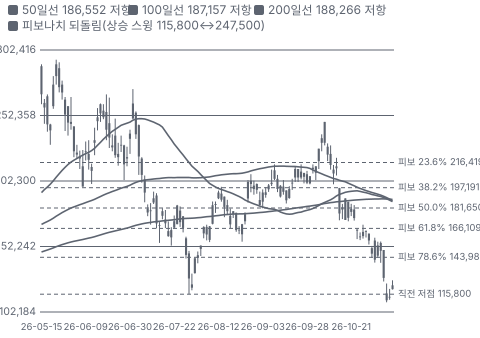

**주봉**

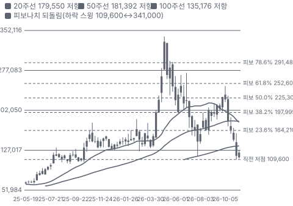

**월봉**

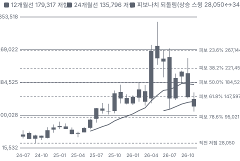

**분기 매출·EPS 실적과 컨센서스**

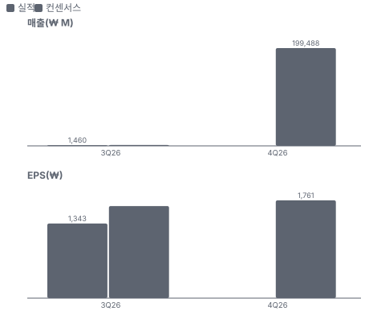

**밸류에이션 주가 시나리오**

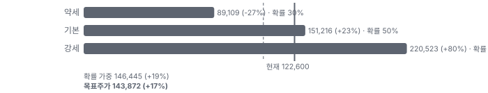

**주가별 업사이드**

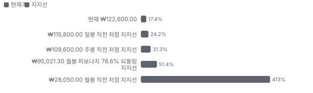

**제품·서비스 포트폴리오**

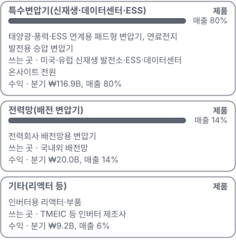

**고객 믹스(3Q26, 매출 대비)**

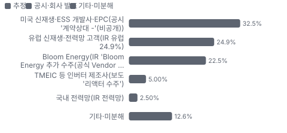

**공급 병목(10점, 낮을수록 병목)**

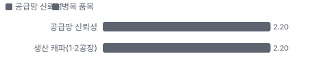

**생산능력 현재와 확충 계획(연 매출 환산 ₩B(회사·증권가가 금액으로 말한다))**

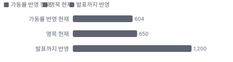

**CAPEX의 매출 대비 비중**

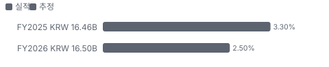

**어닝콜 변화별 주주가치 영향**

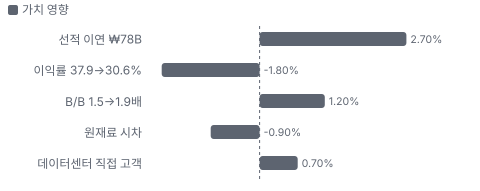

**멀티플 프리미엄(현재값 — 최근 4개 분기 추이 재료 없음)**

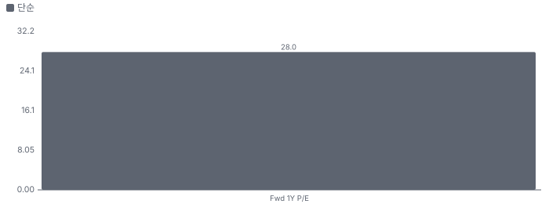

**합리적 멀티플**

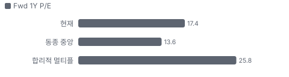

**수주·파이프라인 확실성 사다리**

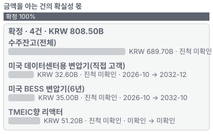

**매출 → 매출총이익 → 영업이익(매출 = 100, 최근 4분기)**

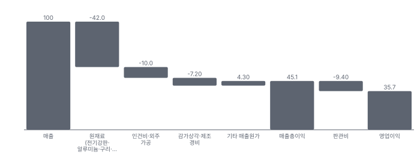

**1년 전 대비 마진 기여(비용 비중 변화의 반대)**

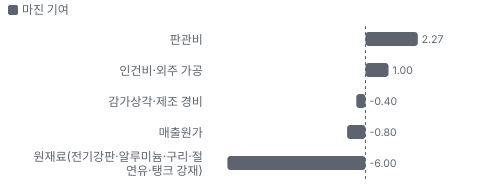

**분기 비용 비중 추이(매출 대비, 공시)**

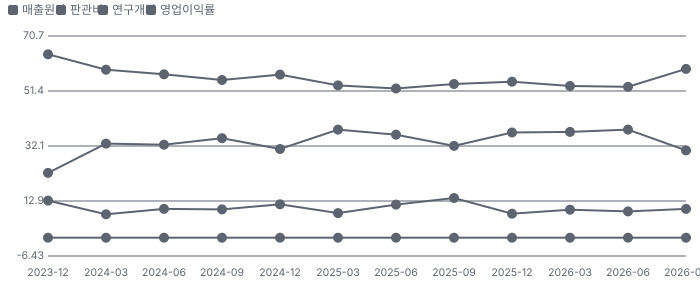

**비용 요인별 매출 대비 비중과 1년 변화**

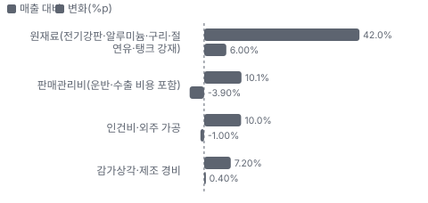

**BOM 항목 가격 +10% 시 OPM 변화**

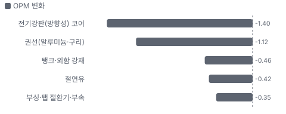

**특수변압기(신재생·데이터센터·ESS) BOM 원가 몫과 가격 +10% 시 OPM**

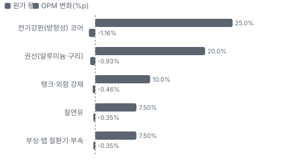

**전력망(배전 변압기) BOM 원가 몫과 가격 +10% 시 OPM**

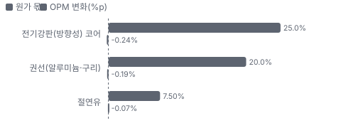

**시설별 생산능력(연 매출 환산 ₩B, 큰 순)**

**매출·PPI·수출입 — 최근 12개 분기 같은 축(4Q23 = 100) + 다음 분기 추정**

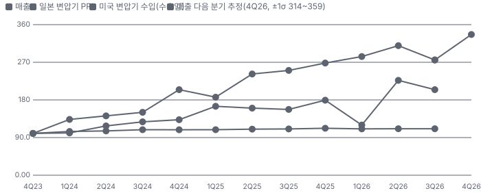

**매출과 미국 변압기 수입 증가율(전년 대비, 최근 16개 분기 + 다음 분기 추정)**

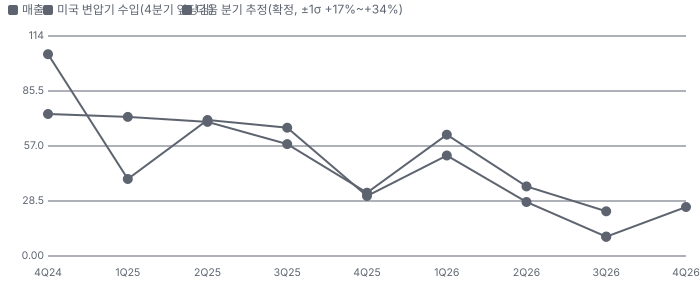

**매출 증가율의 가격·물량 분해와 8분기 전망(전년 대비)**

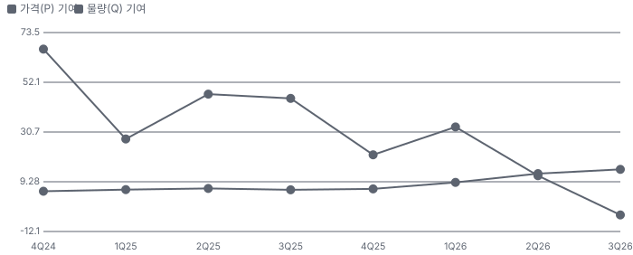

**분기별 매출 증가율 분해**

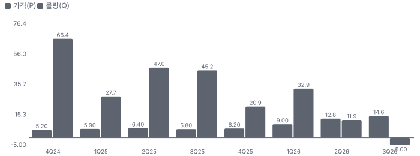

**목표주가 산정 — 약세와 기본 사이(약세 쪽 12%), 도달 확률 약 50%**

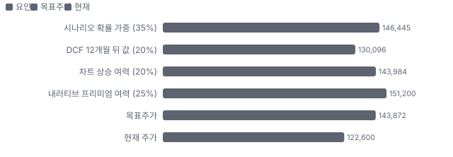

**PEG — 성장 대비 멀티플(낮을수록 성장 대비 쌈)**

**일봉 지지·저항과 목표주가**

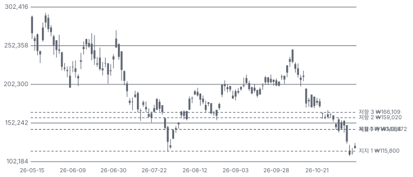

**몬테카를로**

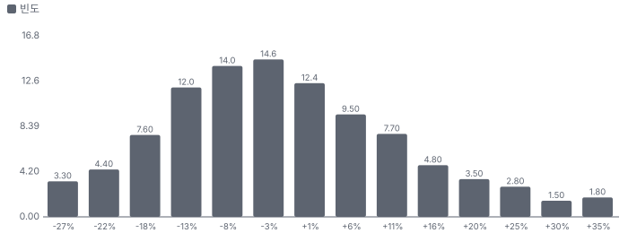

해석: 3,000번 중 1,234번(41%)에서 가치가 지금 주가 이상이었다. 지금 주가를 뒷받침하는 경우와 그렇지 않은 경우가 반반에 가깝다. 가운데 값은 0.97배이고, 열 번 중 여덟 번은 0.82~1.17배 사이에 든다.

## 내러티브

> **기업가치를 결정하는 이야기:** 값은 세 숫자가 정한다. ① 수주잔고가 얼마나 빨리 매출이 되나(캐파 연 ₩600~700B, 3공장 전) ② 그 매출의 이익률(원가 전가·환율 시차) ③ Bloom Energy 같은 고객이 계속 사 주나. 3Q는 ①이 선적 지연으로, ②가 원화 강세로 동시에 흔들렸다.

> **멀티플·EPS 프리미엄**
> **멀티플:** Fwd 1Y P/E 17.4배(다음 분기 EPS×4 근사)로 동종 중앙 13.6배보다 28% 높다. 2027 EPS 추정을 섞은 다음 4개 분기 기준으로는 14.5배다.
> **EPS:** 3Q 영업이익은 컨센서스보다 약 30% 낮았다(₩44.7B vs ₩63.6~67.6B). 9월 말 이후 2027년 영업이익 추정은 ₩327.7~352B 범위에 머물러 목표가 하향은 대부분 배수 하향이다.

### 투자자들은 왜 열광했나

8/7 2Q 실적(영업이익 ₩62.0B, OPM 37.9%) 다음 거래일 +16.8%, 10월 중순까지 ₩200,000대를 지켰다. 식은 이유는 세 가지다 — 10월 말 전력기기 업종 배수 하락, 11/4 3Q 실적 미달(다음 날 −17.2%), 11/6 중간선거 뒤 국내 증시 급락(₩109,600 장중 신저가).

### 무엇이 기업가치를 바꾸나

> **구조적 체질 변화**
> **변화:** 국내 배전 변압기 회사에서 미국 신재생·데이터센터용 특수 변압기 수출 회사로 바뀌었다. 수출 97.5%, 미국 66.5%
> **증거:** 3Q26 IR 지역별 매출
> **반증:** 미국 비중이 2분기 연속 55% 아래

> **고부가 믹스 확장**
> **변화:** 특수변압기 비중 76.6%(3Q25) → 80.0%(3Q26), 리액터 기타 매출 +92%
> **증거:** 3Q26 IR 전방 산업별 매출
> **반증:** 특수변압기 비중 75% 아래

> **기술 혁신**
> **변화:** 초고압 변압기(3공장 계획)로 제품군을 넓힌다 — 아직 계획 단계다
> **증거:** 보도(3공장 부지 확보)
> **반증:** 초고압 제품 수주·인증 발표가 2027년까지 없다

> **실행 속도**
> **변화:** 해당 없음(납기 수주→출하를 공시하지 않는다). 확인되는 건 수주잔고 ÷ 월평균 매출 약 14개월과 3Q 선적 지연 ₩78B다 **납품 리드타임 미확인.** 피어 비교 미확인. 이전 대비 미확인.
> **증거:** IR 수주잔고·출고 대기
> **반증:** 4Q에 이연분 ₩78B가 매출로 들어오지 않는다

> **M&A**
> **변화:** 해당 없음(최근 3년 인수 없음)
> **증거:** 공시 확인 범위
> **반증:** 대형 인수 발표

> **정책·입법 연관성**
> **재정정책:** 미국 태양광·ESS 세액공제는 2026-07-04 이후 착공분이 2027년 말까지 가동해야 받는다(OBBBA(2025년 미국 세제·재정 법안)) — 2026~2027년 설치가 앞당겨진다. 2028년 수요 공백 위험이 같이 있다 노션 IB 요지(라이선스)·미국 세법 반증: 2027년 하반기 신재생 수주가 급감 의회 동의 10/10 — 하원 5/5(OBBBA 본회의 통과(2025)) · 상원 5/5(같은 법 본회의 통과).
> **행정명령:** 한국산 변압기에 대한 미국 관세(232조 등) 확대 여부 — 회사 언급 없음 확인된 행정명령 없음 반증: 변압기 관세 포고문 의회 동의 2/10 — 하원 1/5(의회 논의 확인 안 됨) · 상원 1/5(같음).
> **연관입법:** Ratepayer Protection Act(하원 통과)·BAAJA(11/9 상원 표결)가 데이터센터 전력 비용 부담·인허가를 정리 중이라는 증권사 해석(공개 채널) — 원문 미확인 DS투자증권 공개 채널 요약(11/10) 반증: 법안이 본회의에서 멈춘다

> **CAPEX 낙수효과**
> **변화:** 하이퍼스케일러·연료전지 발전사 CAPEX가 변압기 수요로 내려온다. 금지표대로 산일전기 몫은 공시 계약과 IR 수주로만 센다 — 데이터센터 직접 계약 ₩32.6B(10/29)
> **증거:** DART(금융감독원 전자공시) 단일판매 공시
> **반증:** Bloom Energy·데이터센터 고객 수주 공시가 2분기 끊긴다

### 내러티브 근거

> 프리미엄은 '미국 신재생·데이터센터·ESS 전력 수요가 특수 변압기 부족을 만들고, 산일전기가 그 부족분을 35% 이익률로 판다'에서 나왔다. 수주는 사상 최대인데 3Q 이익률이 37.9%에서 30.6%로 내려앉자 주가는 5월 종가 고점 대비 −63%가 됐다. 동종 대비 멀티플 차이 +28% 중 회사 고유 몫은 -33%다. 단계는 컨센서스, 쏠림은 중간이다.

> **미국 전력 수요가 만든 변압기 부족** · 강화
> **논리:** 데이터센터·신재생·ESS 연계 수요가 변압기 공급을 넘어 납기·가격이 공급사 쪽으로 기운다
> **숫자:** 3Q 수주 ₩278.9B(+119%), B/B 1.2→1.5→1.9배, 수주잔고 ₩689.7B(+66.5%)
> **반증:** 4Q·1Q 수주가 2분기 연속 B/B 1.0배 아래

> **Bloom Energy 온사이트 발전(데이터센터 비전력망 전원)** · 유지
> **논리:** 전력망 접속을 기다리지 않는 연료전지 발전이 늘고, 그 승압 변압기를 산일전기가 공식 Vendor(등록 공급사)로 받는다
> **숫자:** 2Q 신규 수주의 약 30%가 Bloom 관련(보도). 2분기 연속 추가 수주(IR)
> **반증:** Bloom Energy 수주 공시가 끊기거나 2차 공급사 진입

> **고이익률 특수 변압기** · 약화
> **논리:** 표준 배전 변압기가 아니라 신재생·ESS용 특수 사양이라 이익률이 대형 변압기 3사보다 높다
> **숫자:** TTM OPM 35.7% vs 국내 동종 10~25%
> **반증:** OPM이 2개 분기 연속 30% 아래

> **캐파 두 배(3공장)** · 태동
> **논리:** 연 ₩600~700B 캐파가 2028년 ₩1.2T로 늘어 수주잔고를 매출로 바꾼다
> **숫자:** 3공장 부지 확보(2026-08), 착공·CAPEX 미공시
> **반증:** 2027년 상반기까지 착공 공시가 없다

> **반대 내러티브: 원가 전가가 늦는 수출업자** · 강화
> **논리:** 원재료를 원화 약세 때 사고 원화 강세 때 매출로 인식해, 환율·금속 가격이 이익률을 몇 분기씩 흔든다
> **숫자:** 3Q 원/달러 −5.5% 순차, 매출원가율 59.3%(+6.5%p), 원재료 시차 4~5개월(SK증권)
> **반증:** 4Q OPM 34% 이상 회복(한국투자 전망 34.8%)

## 포트폴리오

| 제품·서비스 | 구분 | 무엇 | 쓰는 곳 | 돈 버는 방식 | Mix | Mix 변화(전 분기 대비) |
|---|---|---|---|---|---|---|
| 특수변압기(신재생·데이터센터·ESS) | 제품 | 태양광·풍력·ESS 연계용 패드형 변압기, 연료전지 발전용 승압 변압기 | 미국·유럽 신재생 발전소·ESS·데이터센터 온사이트 전원 | 분기 ₩116.9B, 매출 80% | 85% | +2.1%p |
| 전력망(배전 변압기) | 제품 | 전력회사 배전망용 변압기 | 국내외 배전망 | 분기 ₩20.0B, 매출 14% | 15% | -2.1%p |
| 기타(리액터 등) | 제품 | 인버터용 리액터·부품 | TMEIC 등 인버터 제조사 | 분기 ₩9.2B, 매출 6% | 미확인 | 미확인 |

**Mix 변화가 가장 큰 쪽은 전력망(배전 변압기, -2.1%p, 전 분기 대비).** 계절성 판정: 분기 매출 계절 지수 기준 없음 → 직전 분기와 비교.

## 고객

> **3Q26 최대 고객 미국 신재생·ESS 개발사·EPC(공시 '계약상대 -'(비공개)) 32%, 상위 3곳 80%, 집중도 보통.** 공시·회사 발표로 확인한 몫은 매출의 27%이고, 나머지 고객 몫은 추정이거나 미분해다. 고객별 매출 몫은 공시되지 않는다. 확인되는 것은 지역(미국 66.5%·유럽 24.9%)과 Bloom Energy 반복 수주(공식 Vendor), 미국 데이터센터·BESS 직접 공급 계약이다. 고객별 몫은 모두 추정이다.

**고객별 매출 몫(3Q26)**
| 고객 | 몫 | 변화 | 근거 |
|---|---|---|---|
| 미국 신재생·ESS 개발사·EPC(공시 '계약상대 -'(비공개)) | 25~40% | 미확인 | 추정 |
| 유럽 신재생·전력망 고객(IR 유럽 24.9%) | 25% | -3%p | 공시 |
| Bloom Energy(IR 'Bloom Energy 추가 수주(공식 Vendor 진입 효과)') | 15~30% | 미확인 | 추정 |
| TMEIC 등 인버터 제조사(보도 '리액터 수주') | 3~7% | 미확인 | 추정 |
| 국내 전력망(IR 전력망) | 2% | +1%p | 공시 |
| 기타·미분해 | 13% | - | - |

> **미국 신재생·ESS 개발사·EPC(공시 '계약상대 -'(비공개))** · 추정
> **사는 것:** 태양광·ESS용 패드형 변압기
> **추정 근거:** 미국 비중 66.5%에서 Bloom·데이터센터 몫을 뺀 범위

> **유럽 신재생·전력망 고객(IR 유럽 24.9%)** · 공시
> **사는 것:** 신재생 연계 변압기
> **추정 근거:** 지역 비중은 공시, 고객 이름은 비공개

> **Bloom Energy(IR 'Bloom Energy 추가 수주(공식 Vendor 진입 효과)')** · 추정
> **사는 것:** SOFC(고체산화물 연료전지) 온사이트 발전용 승압 변압기(데이터센터향)
> **추정 근거:** 2Q 신규 수주의 약 30%가 Bloom 관련(보도). 매출 몫은 수주 몫보다 늦게 따라온다

> **TMEIC 등 인버터 제조사(보도 '리액터 수주')** · 추정
> **사는 것:** 리액터(기타 매출)
> **추정 근거:** 3Q 기타 매출 ₩9.2B(+92% 전년), TMEIC향 리액터 약 ₩51.2B 수주(SK증권)

> **국내 전력망(IR 전력망)** · 공시
> **사는 것:** 배전 변압기
> **추정 근거:** 내수 2.5%

## 수주·파이프라인

> **2026-09-30 기준 3건.** 확정 KRW 118.80B. 공시 수주잔고 KRW 689.70B.

**실행 속도와 방해 요인**
| 항목 | 상태 | 실행 속도 | 방해 요인 |
|---|---|---|---|
| 미국 데이터센터용 변압기(직접 고객) | 확정 | 6년 1개월 분할 공급 | 고객 데이터센터 착공 일정 |
| 미국 BESS 변압기(6년) | 확정 | 6년 분할 공급 | ESS 프로젝트 인허가 |
| TMEIC향 리액터 | 확정 | 후속 논의 중(SK증권) | 미국 FCC(미국 연방통신위원회) 규제에 따른 인버터 수요 지속성 |

## 마진 구조

> **GPM 40.8%, OPM 30.6%.** 3Q25 대비 GPM -5.4%p, OPM -1.6%p. 변동비는 매출의 50%이고, 매출이 10% 늘면 OPM은 +1.8%p 움직인다. 3Q26 매출총이익률 40.8%(2Q 47.2%), 영업이익률 30.6%(2Q 37.9%). 하락은 원가 쪽이다 — 원화 강세 때 인식한 매출과 원화 약세 때 산 알루미늄·절연유·전기강판의 시차(IR).

> **매출 100 중 매출원가 54.9, 매출총이익 45.1(최근 4분기, 공시).** 매출원가 요인 중 원재료(전기강판·알루미늄·구리·절연유·탱크 강재)이 매출의 42.0%로 가장 무겁고, 단가가 +10% 오르면 GPM이 -4.20%p 움직인다. 분기 회귀로 매출 1이 늘 때 매출원가는 0.51 늘고, 매출원가의 고정비 몫은 9%다.

**비용 요인 강도 — 비중·추세·충격(+10%)·탄력**
| 비용 | 구분 | 매출 대비 | 1년 변화 | 마진 기여 | 충격 시 마진 | 매출 탄력 | 고정비 몫 |
|---|---|---|---|---|---|---|---|
| 원재료(전기강판·알루미늄·구리·절연유·탱크 강재) | 매출원가 요인 | 42.0% | +6.0%p | -6.0%p | -4.20%p | 미확인 | 0% |
| 인건비·외주 가공 | 매출원가 요인 | 10.0% | -1.0%p | +1.0%p | -1.00%p | 미확인 | 70% |
| 감가상각·제조 경비 | 매출원가 요인 | 7.2% | +0.4%p | -0.4%p | -0.72%p | 미확인 | 100% |
| 매출원가 | 공시 항목 | 54.9% | +0.8%p | -0.8%p | -5.49%p | 0.51 | 9% |
| 판관비 | 공시 항목 | 9.4% | -2.3%p | +2.3%p | 미확인 | 0.10 | 5% |

매출 탄력 = 분기 비용을 매출에 회귀한 기울기(매출 1당 변동비), 고정비 몫 = 절편 ÷ 평균 비용. 표본이 8분기 미만이면 미확인. 매출원가 요인 비중은 margin 재료의 추정이 섞여 있고, 공시 매출원가와의 차이는 '기타 매출원가'로 둔다.

**GPM에서 OPM까지(K-IFRS 별도)**
| 기간 | GPM | 연구개발 | 판관비 | 기타 | OPM |
|---|---|---|---|---|---|
| 3Q25 | 46.2% | 0.0% | 14.0% | 0.0% | 32.2% |
| 3Q26 | 40.8% | 0.0% | 10.1% | 0.0% | 30.6% |

**GPM·OPM 최근 4개 분기**
| 분기 | GPM | OPM |
|---|---|---|
| 2025-12 | 45.3% | 36.9% |
| 2026-03 | 46.8% | 37.1% |
| 2026-06 | 47.1% | 37.9% |
| 2026-09 | 40.8% | 30.6% |

**마진을 결정하는 비용 요인 — 비용 +10% 시 OPM**
| 비용 | 매출 대비 | 변화 | 고정비 | OPM |
|---|---|---|---|---|
| 원재료(전기강판·알루미늄·구리·절연유·탱크 강재) | 42.0% | +6.0%p | 0% | -4.20%p |
| 판매관리비(운반·수출 비용 포함) | 10.1% | -3.9%p | 50% | -1.01%p |
| 인건비·외주 가공 | 10.0% | -1.0%p | 70% | -1.00%p |
| 감가상각·제조 경비 | 7.2% | +0.4%p | 100% | -0.72%p |

**비용을 움직이는 요인**
| 비용 | 요인 |
|---|---|
| 원재료(전기강판·알루미늄·구리·절연유·탱크 강재, 매출원가) | 국제 금속 시세·원/달러 · 근거 추정 |
| 판매관리비(운반·수출 비용 포함, 판관비) | 수출 운반비·대손 · 근거 공시 |
| 인건비·외주 가공(매출원가) | 2공장 자동화(40%)·물량 · 근거 추정 |
| 감가상각·제조 경비(매출원가) | 2공장 가동 · 근거 추정 |

**특수변압기(신재생·데이터센터·ESS) BOM — 매출의 80%, GPM 42%(추정 — 제품별 이익 미공시, 전사 GPM 40.8%보다 약간 높게), 항목 가격 +10% 시**
| 항목 | 원가 몫 | 전가 | 제품 GPM | OPM |
|---|---|---|---|---|
| 전기강판(방향성) 코어 | 20~30% | 미확인 | -1.5%p | -1.16%p |
| 권선(알루미늄·구리) | 15~25% | 미확인 | -1.2%p | -0.93%p |
| 탱크·외함 강재 | 8~12% | 미확인 | -0.6%p | -0.46%p |
| 절연유 | 5~10% | 미확인 | -0.4%p | -0.35%p |
| 부싱·탭 절환기·부속 | 5~10% | 미확인 | -0.4%p | -0.35%p |
| 미분해 | 30% | - | - | - |

**전력망(배전 변압기) BOM — 매출의 14%, GPM 30%(추정), 항목 가격 +10% 시**
| 항목 | 원가 몫 | 전가 | 제품 GPM | OPM |
|---|---|---|---|---|
| 전기강판(방향성) 코어 | 20~30% | 미확인 | -1.8%p | -0.24%p |
| 권선(알루미늄·구리) | 15~25% | 미확인 | -1.4%p | -0.19%p |
| 절연유 | 5~10% | 미확인 | -0.5%p | -0.07%p |
| 미분해 | 48% | - | - | - |

전기강판(방향성) 코어 가격이 +10% 오르면 영업이익은 -4.6% 움직인다. 판매가 전가를 모르는 항목은 전가 0%로 계산했다.

**BOM 항목 가격을 움직이는 것**
| 항목 | 요인 |
|---|---|
| 전기강판(방향성) 코어 | 철심 손실을 정하는 핵심 소재 — 공급사 소수 · 근거 추정 |
| 권선(알루미늄·구리) | IR이 짚은 원가 상승 품목 · 근거 추정 |
| 절연유 | 유입식 변압기 냉각·절연 · 근거 추정 |
| 탱크·외함 강재 | 패드형 외함 · 근거 추정 |
| 부싱·탭 절환기·부속 | 외부 조달 부품 · 근거 추정 |
| 전기강판(방향성) 코어 | 같은 소재 · 근거 추정 |
| 권선(알루미늄·구리) | 같은 소재 · 근거 추정 |
| 절연유 | 같은 소재 · 근거 추정 |

**BOM 투입 물가 — PPI 전년비, 2026-11-10 수집**
| 항목 | 미국 | 일본 | 한국 | 대만 |
|---|---|---|---|---|
| 권선(알루미늄·구리) | +30.0% | +54.2% | +25.8% | +40.1% |

별표는 품목보다 넓은 업종 지수다. 지난 1년 투입 물가를 판매가 전가 뒤 원가에 그대로 넣으면 OPM은 -4.18%p 움직인다(매출원가의 19% 기준).

## 공급망 병목

> **공급망 신뢰성 2.2/10, 병목 심각.** 가장 약한 고리는 생산 캐파(1·2공장) 2.2점이고, 품목 평균은 2.2점이다. 근거가 부족한 3건(전기강판(방향성) 코어 · 권선(알루미늄·구리) · 해상 운송(미국향 선적))은 점수에서 뺐다. 병목은 원료보다 자기 캐파와 운송이다. 3Q는 출고를 마친 ₩78B가 배를 못 타 매출이 밀렸다. 전기강판·알루미늄·절연유 공급사 이름은 공시되지 않았다.

**병목과 마진 — 품목 가격 +10% 시 OPM**
| 품목 | 점수 | 판정 | 구분 | OPM |
|---|---|---|---|---|
| 생산 캐파(1·2공장, 필수) | 2.2 | 병목 심각 | 출하 차질 위험 | 미확인 |

> **생산 캐파(1·2공장)** · 2.2/10
> **왜:** 수주가 캐파를 넘으면 납기가 길어진다
> **병목 요인:** 인증 공급사 1곳 · 캐파 빠듯 · 리드타임 미확인 · 재인증 미확인 · 1위 점유율 100% · 한국 집중 100% · 물량 확보 미확인
> **풀리는 조건:** 3공장 부지 확보(2026-08) — 착공·가동 전이라 풀렸다고 보지 않는다

**공급사**
| 품목 | 공급사 | 몫 | 근거 |
|---|---|---|---|
| 전기강판(방향성) 코어 | 미공시(국내외 철강사, 방향성 전기강판) | 미확인 | 추정 |
| 권선(알루미늄·구리) | 미공시(알루미늄·구리 도체) | 미확인 | 추정 |
| 해상 운송(미국향 선적) | 미공시(선사·포워더, 아시아→미국 선적) | 미확인 | 회사 발표 |
| 생산 캐파(1·2공장) | 자체(변압기 조립) | 미확인 | 회사 발표 |

**무역 통계로 본 공급 지역**
| 품목 | EU 수입처 | 일본 수입처 | EU 1위 전년비 |
|---|---|---|---|
| 권선(알루미늄·구리) | MY(말레이시아) 69% · KR(한국) 10% · US 7% | マレーシア 58% · タイ 36% | 미확인 |

## 생산능력

> **현재 명목 캐파 650 연 매출 환산 ₩B(회사·증권가가 금액으로 말한다), 가동률 93%.** 착공 이상 증설은 0 연 매출 환산 ₩B(회사·증권가가 금액으로 말한다), 발표까지 합치면 550 연 매출 환산 ₩B(회사·증권가가 금액으로 말한다)이다. 다 가동하면 지금보다 +85%, 착공 이상만이면 +0%다. FY2025 CAPEX는 KRW 16.46B로 매출의 3.3%다. 회사는 물량 캐파를 공시하지 않는다. 증권가는 1·2공장 합 연 ₩600~700B(2공장 약 ₩300B), 3공장 완공 시 2028년 최대 ₩1.2T로 본다. TTM 매출 ₩602.6B는 그 하단에 닿았다.

**생산시설 2곳**(보도 — 제1·제2공장(사업보고서 '생산설비' 원문 미대조). 3공장은 부지 확보 단계라 세지 않는다), 미확인 2곳.

**생산시설 2곳 — 명칭·위치·생산능력**
| 시설 | 위치 | 용도 | 생산능력 | 소유·상태 |
|---|---|---|---|---|
| 제1공장 | 미확인(경기도 — 사업보고서 미대조) | 제조(특수·배전 변압기) | 350 연 매출 환산 ₩B | 미확인 · 가동 |
| 제2공장 | 미확인(경기도 — 사업보고서 미대조) | 제조(특수변압기, 자동화율 40%) | 300 연 매출 환산 ₩B | 미확인 · 가동 |

**생산능력 확충 계획**
| 계획 | 단계 | 증설 | 가동 시점 | CAPEX |
|---|---|---|---|---|
| 제3공장(초고압 변압기) | 발표 | 550 연 매출 환산 ₩B(회사·증권가가 금액으로 말한다) | 2028 | 미확인 |

남은 계획의 CAPEX 합계는 KRW 0.00B(금액 미확인 1건 제외)다. 합계는 FY2026 매출의 0%다.

**증설 방해 요인**
| 계획 | 방해 요인 |
|---|---|
| 제3공장(초고압 변압기) | 착공·장비 반입 일정 미공시, 초고압 제품 인증 |

**CAPEX와 매출 대비**
| 기간 | CAPEX | 매출 | 매출 대비 | 구분 |
|---|---|---|---|---|
| FY2025 | KRW 16.46B | KRW 501.95B | 3.3% | 실적 |
| FY2026 | KRW 16.50B | KRW 660.00B | 2.5% | 추정 |

## 해자

> 해자는 미국 고객 인증·납품 실적과 높은 이익률을 만드는 특수 사양 변압기 경험이다. 숫자로 확인되는 것은 이익률과 수주 반복이고, 기술 우위는 미확인이다.

> **미국 고객 인증·공식 Vendor** · 보통
> **해자:** Bloom Energy 공식 Vendor 진입 뒤 반복 수주가 이어진다
> **근거:** IR '공식 Vendor 진입 효과' · 2Q·3Q 연속 Bloom 수주
> **숫자:** 분기 ₩10B 이상 수주 고객 수 최대(IR, 숫자 미공시)
> **깨지는 조건:** Bloom Energy가 2차 공급사 비중을 늘려 4Q 수주가 끊긴다

> **이익률(특수 사양·납기)** · 강함
> **해자:** 동종 국내 변압기 회사보다 영업이익률이 높다
> **근거:** TTM OPM 35.7% vs HD현대일렉트릭 25.5%·효성중공업 13.1%·LS ELECTRIC 10.5%
> **숫자:** TTM OPM 35.7%
> **깨지는 조건:** OPM이 2개 분기 연속 30% 아래

> **납기(리드타임)** · 미확인
> **해자:** 대형 변압기보다 짧은 납기로 미국 신재생·데이터센터 수요를 먼저 잡는다
> **근거:** 납기 공시 없음
> **숫자:** 미확인
> **깨지는 조건:** 고객이 납기 지연을 이유로 공급사를 바꾼다

## 경영진·네트워크

> 공개 자료로 확인되는 경영진 정보가 적다. 대표이사가 최대주주인 창업자 경영 회사다(공시 원문 미대조).

> **박동석** · 대표이사 · 미확인
> **프로필:** 창업자·최대주주(보도, 공시 원문 미대조)
> **비즈니스:** 미국 신재생·데이터센터 고객 개척
> **정계:** 미확인
> **동문:** 미확인
> **사모임:** 미확인

**네트워크 정량화**
| 연결 | 강도 | 닿는 매출 | 가중 노출 | 매출 대비 | 근거 |
|---|---|---|---|---|---|
| 비즈니스: 미국 고객(Bloom Energy·데이터센터·BESS) | 3/5 | ₩400.80B | ₩240.48B | 40% | TTM 매출 × 미국 비중 66.5%(IR) — 연결이 매출을 만들었다는 뜻이 아니다 지역 매출 공시 |

가중 노출은 연결이 닿는 매출의 크기다. 연결이 그 매출을 만들었다는 뜻이 아니며, 인과는 공개 자료로 입증하지 못한다.

## 약세 논리 및 셀온 조건

| 약세 논리 | 근거 | 가를 자료 |
|---|---|---|
| 이익률은 부족의 몫 | TTM 영업이익률 35.7% vs 국내 동종 10~25%. 3Q에 한 분기 만에 −7.3%p | 4Q26 영업이익률(2027-02 초 잠정실적) |
| 원가 전가 지연 | 원재료 매입과 매출 인식 사이 4~5개월(SK증권), 매출원가율 +6.5%p 순차. 전가 조항 공시 없음 | 4Q 매출원가율·회사의 판가 조정 언급 |
| Bloom Energy 집중 | 2Q 신규 수주의 약 30%가 Bloom 관련(보도). 고객별 매출 몫 미공시 | 분기보고서 주요 고객 항목·Bloom 수주 공시 |
| 세액공제 시한이 당긴 수요 | 2026-07-04 이후 착공 태양광은 2027년 말까지 가동해야 공제(노션 IB 요지) — 2028 수요 공백 가능성 | 2027년 하반기 신재생 수주·B/B |
| 선적·운송 | 출고 뒤 선적 전에는 매출이 안 된다. 3Q ₩78B 이월 | 4Q 매출에 이월분이 들어오는지 |
| 임원 매도 | 2025년 임원 장내 매도 공시 다수, 매수는 2024-10 1건(DART, 원문 미대조) | 추가 임원 매매 공시 |

> **셀온 조건**
> **조건 1:** 4Q26 영업이익률이 30% 아래로 내려가 2개 분기 연속 하락한다.
> **조건 2:** 4Q 수주가 매출보다 작아 B/B가 1.0배 아래로 내려간다.
> **조건 3:** Bloom Energy 수주 공시가 끊기거나 2차 공급사 진입이 보도된다.
> **조건 4:** 출고 대기 ₩78B 가운데 절반 이상이 4Q 매출로 들어오지 않는다.
> **조건 5:** 2027 영업이익 컨센서스가 ₩300B 아래로 내려간다.

## 어닝콜 변화

**직전 콜 대비 새로 나오거나 바뀐 내용 → 가치 영향**
| 항목 | 내용 | 직전 콜 | 최신 콜 | 모델 동인 이동 | 확신도 | 가치 영향 |
|---|---|---|---|---|---|---|
| 업데이트 | 3Q 영업이익률이 원화 강세·원자재로 7.3%p 하락 | 2Q26 OPM 37.9% | 3Q26 OPM 30.6% | 출발 이익률 -4.0% | 1.0 | -1.8% |
| 신규 | 출고 완료·매출 인식 대기 ₩78B가 4Q 이후 인식 | 정상 분기말 이연 약 ₩30B(보도) | ₩78B | 1년차 성장률 +3.0% | 0.8 | +2.7% |
| 업데이트 | 신규 수주 ₩278.9B, 수주잔고 ₩689.7B | 2Q 수주 ₩243.5B·잔고 ₩556.8B | 3Q 수주 ₩278.9B·잔고 ₩689.7B | 장기 성장 수렴값 +0.50% | 1.0 | +1.2% |
| 신규 | 미국 데이터센터용 변압기 ₩32.6B, 6년 1개월(공시) | 데이터센터는 Bloom Energy 경유 | 직접 고객 첫 수주 | 장기 성장 수렴값 +0.30% | 1.0 | +0.7% |
| 부정 | 원재료 매입과 매출 인식 사이 4~5개월 — 4Q에도 환율 영향 지속(SK증권) | 언급 없음 | 4Q까지 영향 | 목표 이익률 -1.0% | 0.5 | -0.9% |
| **합계** | 단독 합 |  |  | 동시 적용 +1.8% |  | **+1.9%** |

## 거시 지표 싱크로율

> **미국 변압기 수입과 전사 매출 싱크로율 80%(4분기 = 약 12개월 선행, 전년 대비, 표본 8개·t 3.3·유의·신뢰 낮음).** 이 지표가 내포하는 4Q26 전사 매출은 178.27B(±1σ 166.26B~190.28B, 확정)다. 표본 밖 검증(최근 3개 분기)에서 지표 모델 오차는 8.6%p, 기준선(직전 증가율 지속)은 21.0%p다 — 지표가 기준선을 이겨 지표 85%·기준선 15%로 결합했다.  제품은 미국으로 가는 유입식 변압기다. 미국 변압기 수입과 한국 변압기 PPI(생산자물가지수)가 가장 가까운 지표다

**지표별 싱크로율(상관계수 × 100) — 위 두 줄이 제품 연관성 × 싱크로율로 고른 PPI·수출입 세부 지표**
| 지표 | 비교 대상 | 증가율 기준 | 지표 선행 | 매출(t값) | 영업이익 | 방향 일치 | 표본·신뢰 | 표본 밖 오차(지표/기준선) | 4Q26 추정 매출 |
|---|---|---|---|---|---|---|---|---|---|
| 일본 변압기 PPI | 전사 매출 | 전년 대비 | 0분기(0개월) | 81%(t 3.4) | 97%(0분기) | 100% | 8·낮음 | 13.7/21.0%p ✔ | +24.7% → 177.26B(지표 자기회귀 추정) |
| 미국 변압기 수입 | 전사 매출 | 전년 대비 | 4분기(12개월) | 80%(t 3.3) | 69%(4분기) | 100% | 8·낮음 | 8.6/21.0%p ✔ | +25.4% → 178.27B(확정) |
| 한국 변압기 PPI | 전사 매출 | 전년 대비 | 2분기(6개월) | -82%(t -3.5) | -88%(2분기) | 100% | 8·낮음 | 8.0/21.0%p ✔ | -29.2% → 100.61B(확정) |

**지표 후보 26개 — 연관성(제품 품목 일치 × 대용 감점 × 매출 비중) × 싱크로율로 고른다. 후보가 많을수록 최대 상관은 우연히 부풀 수 있다**
| 후보 | 종류 | 연관성 | 매출 분기 일치 | 싱크로율(선행) | 점수 | 출처 |
|---|---|---|---|---|---|---|
| EU(유럽연합) 변압기 수입(HS(국제 상품 분류 코드) 850423) | 수출입 | 0.85 | 92% | 95%(4분기) | 0.81 | 자동 |
| 미국 변압기 수입 ✔ | 수출입 | 1.00 | 100% | 80%(4분기) | 0.80 | 모델 지정 |
| EU 변압기 수출(HS 850423) | 수출입 | 0.85 | 92% | 88%(4분기) | 0.75 | 자동 |
| 일본 변압기 PPI ✔ | PPI | 0.85 | 100% | 81%(0분기) | 0.69 | 자동 |
| EU HS 850422 수출(특수변압기과 같은 4자리 품목군) | 수출입 | 0.60 | 92% | 93%(0분기) | 0.56 | 자동 |
| EU HS 850431 수출(특수변압기과 같은 4자리 품목군) | 수출입 | 0.60 | 92% | 73%(3분기) | 0.44 | 자동 |
| EU HS 850422 수입(특수변압기과 같은 4자리 품목군) | 수출입 | 0.60 | 92% | 65%(4분기) | 0.39 | 자동 |
| EU HS 850433 수출(특수변압기과 같은 4자리 품목군) | 수출입 | 0.60 | 92% | 64%(3분기) | 0.38 | 자동 |
| EU HS 850421 수출(특수변압기과 같은 4자리 품목군) | 수출입 | 0.60 | 92% | 61%(1분기) | 0.29 | 자동 |
| EU HS 850450 수출(특수변압기과 같은 4자리 품목군) | 수출입 | 0.60 | 92% | 56%(3분기) | 0.27 | 자동 |
| EU HS 850432 수출(특수변압기과 같은 4자리 품목군) | 수출입 | 0.60 | 92% | 40%(1분기) | 0.19 | 자동 |
| 한국 변압기 PPI | PPI | 1.00 | 100% | -82%(2분기) | 0.00 | 모델 지정 |

**선행 지표로 본 향후 분기 매출 전망(이미 나온 지표 값 기준, ±1σ)**
| 지표 | 대상 | 분기 | 지표 증가율 | 내포 매출 증가율 | 내포 매출 |
|---|---|---|---|---|---|
| 미국 변압기 수입 | 전사 매출 | 4Q26 | +35.1% | +28.2% | 182.23B(154.77B~209.69B) |
| 미국 변압기 수입 | 전사 매출 | 1Q27 | -27.2% | -46.6% | 80.35B(51.30B~109.39B) |
| 미국 변압기 수입 | 전사 매출 | 2Q27 | +41.4% | +35.8% | 222.94B(191.22B~254.66B) |
| 미국 변압기 수입 | 전사 매출 | 3Q27 | +30.1% | +22.2% | 178.41B(150.20B~206.62B) |
| 한국 변압기 PPI | 전사 매출 | 4Q26 | +13.6% | -39.0% | 86.73B(60.42B~113.05B) |
| 한국 변압기 PPI | 전사 매출 | 1Q27 | +15.7% | -61.9% | 57.23B(29.40B~85.06B) |
| EU 변압기 수출(HS 850423) | 전사 매출 | 4Q26 | -34.5% | +4.5% | 148.54B(127.04B~170.04B) |
| EU 변압기 수출(HS 850423) | 전사 매출 | 1Q27 | +15.4% | +63.2% | 245.39B(222.65B~268.14B) |
| EU 변압기 수출(HS 850423) | 전사 매출 | 2Q27 | +106.8% | +170.7% | 444.51B(419.67B~469.35B) |
| EU 변압기 수입(HS 850423) | 전사 매출 | 4Q26 | +105.6% | +47.2% | 209.21B(195.11B~223.30B) |
| EU 변압기 수입(HS 850423) | 전사 매출 | 1Q27 | +24.9% | +28.9% | 193.76B(178.85B~208.67B) |
| EU 변압기 수입(HS 850423) | 전사 매출 | 2Q27 | +35.5% | +31.3% | 215.59B(199.31B~231.88B) |
| 미국 구리 PPI | 전사 매출 | 4Q26 | +24.4% | +21.1% | 172.10B(134.96B~209.24B) |
| 한국 구리 PPI | 전사 매출 | 4Q26 | +23.9% | -8.6% | 129.94B(96.49B~163.39B) |
| 한국 구리 PPI | 전사 매출 | 1Q27 | +28.1% | -23.4% | 115.16B(79.78B~150.54B) |
| 한국 구리 PPI | 전사 매출 | 2Q27 | +28.5% | -25.0% | 123.10B(84.46B~161.74B) |
| EU HS 850410 수출(특수변압기과 같은 4자리 품목군) | 전사 매출 | 4Q26 | -8.9% | +19.8% | 170.34B(148.31B~192.36B) |
| EU HS 850410 수출(특수변압기과 같은 4자리 품목군) | 전사 매출 | 1Q27 | -10.4% | +25.8% | 189.11B(165.81B~212.40B) |
| EU HS 850431 수출(특수변압기과 같은 4자리 품목군) | 전사 매출 | 4Q26 | +1.5% | +45.6% | 206.94B(175.90B~237.98B) |
| EU HS 850431 수출(특수변압기과 같은 4자리 품목군) | 전사 매출 | 1Q27 | +15.7% | +91.2% | 287.41B(254.57B~320.24B) |
| EU HS 850433 수출(특수변압기과 같은 4자리 품목군) | 전사 매출 | 4Q26 | +36.0% | +53.2% | 217.73B(182.73B~252.73B) |
| EU HS 850433 수출(특수변압기과 같은 4자리 품목군) | 전사 매출 | 1Q27 | +21.7% | +47.8% | 222.17B(185.15B~259.19B) |
| EU HS 850434 수출(특수변압기과 같은 4자리 품목군) | 전사 매출 | 4Q26 | +226.4% | -276.3% | -250.61B(-280.88B~-220.35B) |
| EU HS 850434 수출(특수변압기과 같은 4자리 품목군) | 전사 매출 | 1Q27 | +14.3% | +55.9% | 234.42B(202.41B~266.44B) |
| EU HS 850434 수출(특수변압기과 같은 4자리 품목군) | 전사 매출 | 2Q27 | -5.1% | +86.2% | 305.69B(270.73B~340.65B) |
| EU HS 850450 수출(특수변압기과 같은 4자리 품목군) | 전사 매출 | 4Q26 | -11.3% | +21.1% | 172.08B(134.24B~209.91B) |
| EU HS 850450 수출(특수변압기과 같은 4자리 품목군) | 전사 매출 | 1Q27 | +23.7% | +82.9% | 274.91B(234.89B~314.92B) |
| EU HS 850421 수입(특수변압기과 같은 4자리 품목군) | 전사 매출 | 4Q26 | -5.8% | +60.1% | 227.58B(184.15B~271.02B) |
| EU HS 850421 수입(특수변압기과 같은 4자리 품목군) | 전사 매출 | 1Q27 | +2.9% | +53.7% | 231.03B(185.09B~276.98B) |
| EU HS 850422 수입(특수변압기과 같은 4자리 품목군) | 전사 매출 | 4Q26 | +29.9% | +61.9% | 230.08B(195.14B~265.02B) |
| EU HS 850422 수입(특수변압기과 같은 4자리 품목군) | 전사 매출 | 1Q27 | +33.7% | +66.1% | 249.63B(212.67B~286.59B) |
| EU HS 850422 수입(특수변압기과 같은 4자리 품목군) | 전사 매출 | 2Q27 | +23.8% | +55.2% | 254.84B(214.48B~295.21B) |

지표가 k분기 앞서면 이미 발표된 지표로 k분기 뒤까지의 매출 증가율을 회귀식으로 읽는다. 표본이 작거나 t값이 2 미만이면 전망은 참고용이다.

**지표를 고른 이유**
| 지표 | 이유 |
|---|---|
| 일본 변압기 PPI | 특수변압기 ↔ 변압기 생산자물가 |
| 미국 변압기 수입 | 미국 고객이 들여오는 대형 변압기 금액 |
| 한국 변압기 PPI | 한국 변압기 생산자물가 — 가격 대용 |

다음 분기 추정 = 지표 회귀와 기준선(직전 증가율 지속)을 표본 밖 오차의 역제곱으로 가중 결합한 값이다(예측 결합). 지표가 회귀에 쓴 범위를 벗어나면 범위 끝으로 자르고(외삽 제한), 세그먼트 추정은 나머지 사업을 기준선으로 더해 전사로 바꾼다. 싱크로율은 증가율의 상관계수이며 인과가 아니다. 지표 단위·통화는 원자료 그대로이고 나라끼리 더하지 않는다(EU 수입만 상대국 합계). ±1σ는 회귀 잔차 표준편차이고, 지표를 예측한 분기는 지표 예측 오차까지 더해 넓혔다.

## P·Q 사이클

> **Q 사이클 — 최근 4분기 평균 가격 기여 +10.6%, 물량 기여 +15.2%(전년 대비 로그 증가율).** P 강도 6.4/10, Q 강도 3.6/10, 최근 8분기 중 75%가 같은 요인 우세(구조적). 회사는 물량·ASP를 공시하지 않는다 — 업종 PPI(한국 변압기) 대용

**P·Q 사이클 정량**
| 항목 | 가격(P) | 물량(Q) |
|---|---|---|
| 최근 4분기 평균 기여 | +10.6% | +15.2% |
| 강도(0~10, 자기 이력 z) | 6.4 | 3.6 |
| 고유 주기(자기회귀모델 과거 2개 시점일 때) | 미확인 | 미확인 |
| 다음 4분기 투영 평균 | 미확인 | 미확인 |

가격 근거: 제품 PPI. PPI를 쓰면 회사 판매가가 아니라 업종 가격 대용이다. 로그 증가율이라 가격·물량 기여의 합이 매출 증가율이다. 전망: 가격은 BIC(모형 차수를 고르는 정보 기준)로 차수를 고른 자기회귀모델에 이미 발표된 월간 가격을 먼저 넣고(나우캐스트), 물량은 자기회귀모델과 '컨센서스 매출 증가율 − 가격 전망'을 분산 역수로 섞는다. 장기 평균은 표본 평균을 장기 기저율(가격 연 2%·물량 연 4%) 쪽으로 줄인다 — 고성장 구간만 담긴 표본이 그 성장을 끝없이 잇지 않게. 범위는 4분기 겹친 표본의 자기상관을 반영한다. 모형 산출이며 가이던스가 아니다.

10년 위치·프리미엄: TTM 표본 9개로 20개에 못 미친다 — quarters.js로 분기 44개를 다시 받으면 나온다.

## 밸류에이션

> **목표주가 ₩143,872, 업사이드 +17%.** 자리는 약세와 기본 사이(약세 쪽 12%)이고 도달 확률은 약 50%다. 기본 ₩151,216, 강세 ₩220,523(+80%), 약세 ₩89,109(-27%). DCF 기준 업사이드는 기본 -4%, 강세 +13%, 약세 -9%다(WACC 10.1%).

EPS는 다음 12개월(₩) 기준이고 멀티플은 선정 규칙이 고른다. 약세 확률을 30%로 둔 것은 3Q 이익률 하락 원인 둘(원화 강세·원재료 시차)이 4Q에도 남는다고 증권사가 보기 때문이다. 약세 EPS ₩6,600은 영업이익률 30%·매출 +20% 가정의 자체추론이다.

DCF는 장기 영업이익률을 30%로 수렴시켜 시나리오(12개월 EPS × 배수)와 차이가 난다 — 차이는 지금의 35%대 이익률이 몇 년 가느냐에 대한 가정 차이다.

> **약세 ₩89,109 (-27%)** · 확률 30%
> **가정:** 13.5배 × EPS ₩6600.00
> **근거:** 원화 강세·금속 가격이 이어져 영업이익률이 30% 근처에 머물고, Bloom Energy 수주가 한 분기 끊겨 2027 매출이 +20%에 그친다

> **기본 ₩151,216 (+23%)** · 확률 50%
> **가정:** 18.0배 × EPS ₩8400.00
> **근거:** 4Q에 이연분이 들어와 영업이익률 33~35%로 돌아오고, 2027 매출 ₩893B·영업이익률 37% 컨센서스 경로를 따른다

> **강세 ₩220,523 (+80%)** · 확률 20%
> **가정:** 22.5배 × EPS ₩9800.00
> **근거:** B/B 1.5배 이상이 이어지고 데이터센터 직접 고객·유럽 수주가 늘어 2027 매출이 ₩935B를 넘고, 원가 전가 조항이 이익률을 38%로 되돌린다

**멀티플 선정 — Fwd 1Y P/E**
| 단계 | 조정 | 근거 |
|---|---|---|
| 동종 중앙값 | 13.6배 | 범위 10.3~27.7배, 5곳 |
| 펀더멘털 | +20% | 성장·이익률·ROIC로 본 합리적 멀티플 25.8배와의 차이의 일부만 인정 |
| 해자 | +6% | 미국 고객 인증·공식 Vendor 보통 · 이익률(특수 사양·납기) 강함 · 납기(리드타임) 미확인 |
| 반복 매출 | +0% | 재료 없음 |
| 수주 전환·가시성 | +7% | book-to-bill 1.00 → 가시성 1.00 · 전환 13.7개월(동종 12) |
| 내러티브 | +0% | 단계 컨센서스 |
| 사이클·실행 판단 | +0% | 단일 고객(Bloom Energy) 수주 비중과 원가 전가 지연은 할인 요인, 수주잔고 1.9배·미국 데이터센터 직접 고객 확보는 할증 요인으로 상쇄로 본다 |
| **선정** | **18.0배** | 지금 17.4배 |

**동종 레인지**
| 회사 | Fwd 1Y P/E | 성장 | 영업이익률 | ROIC |
|---|---|---|---|---|
| HD현대일렉트릭 | 13.6 | 21% | 26% | 80% |
| 효성중공업 | 14.2 | 13% | 13% | 27% |
| LS ELECTRIC | 27.7 | 32% | 10% | 21% |
| 일진전기 | 11.8 | 24% | 9% | 32% |
| 제룡전기 | 10.3 | -20% | 23% | 74% |
| **산일전기** | 17.4 |  |  |  |

> **PEG 0.38** — Fwd 1Y P/E 17.4배를 다음 해 EPS 성장 45%로 나눈 값. 성장률은 Fwd 1Y·2Y P/E에서 역산한 컨센서스라 다음 해 한 해 성장만 반영하고, 성장 지속 기간은 담지 않는다.

**PEG — Fwd 1Y P/E ÷ 다음 해 EPS 성장률**
| 회사 | Fwd 1Y P/E | 다음 해 EPS 성장 | PEG |
|---|---|---|---|
| **산일전기** | 17.4 | +45% | 0.38 |
| HD현대일렉트릭 | 13.6 | - | - |
| 효성중공업 | 14.2 | - | - |
| LS ELECTRIC | 27.7 | - | - |
| 일진전기 | 11.8 | - | - |
| 제룡전기 | 10.3 | - | - |

몬테카를로 중앙값 업사이드 -3%.

> 의사결정 보조(투자자문 아님): ① 매수 매력: 5년 보유 가정 연 기대수익 +8.7% — 주주가 요구하는 수익률(자기자본비용) 10.1%보다 -1.3%p · 요구수익률을 넘을 확률 29% · 안전마진 0.82(비관적 경우의 기업가치가 지금 시가총액의 82%) → 정량 신호 약함 / ② 위험 예산 지표(이론): 0% — 기대수익이 요구수익률에 못 미친다(켈리 기준 — 수익·손실 확률로 계산한 이론상 최대 노출 — 100%는 참고) · 5년 뒤 나쁜 경우(하위 10%) +27% · 30% 넘게 잃을 확률 0% / ③ 상방(5년): 평균 1.52배 · 2배 이상 확률 2% · 3배 이상 0% · 10배 이상 0% · 잘 풀린 경우(상위 10%) 1.80배 이상

투입 물가 점검: 지난 1년 PPI를 BOM에 넣으면 OPM -4.18%p다(매출원가의 19% 기준).

## 매수 위치(일봉)

> **현재가 ₩122,600는 '지지 근접'(가장 가까운 일봉 지지 ₩115,800에서 ATR 0.5배 위).** 이 자리에서 목표주가까지 +17.4%, 첫 일봉 저항까지 +17.4%, 다음 지지까지 하방 -5.5%, 손익비 3.1배.

**가격대별 업사이드(일봉 기준)**
| 가격대 | 가격 | 목표주가까지 | 첫 저항까지 | 다음 지지까지 | 손익비 | 근거 기법(강도) |
|---|---|---|---|---|---|---|
| 현재가 | ₩122,600 | +17.4% | +17.4% | -5.5% | 3.1 | - |
| 지지 1 | ₩115,800 | +24.2% | +24.3% | 미확인 | 미확인 | 120일 지그재그 저점 · 스윙 저점(1.8) |

**일봉 저항**
| 저항 | 가격 | 현재가 대비 | 근거 기법(강도) |
|---|---|---|---|
| 저항 1 | ₩143,984 | +17.4% | 피보 78.6%(1.0) |
| 저항 2 | ₩159,020 | +29.7% | 20일선(0.5) |
| 저항 3 | ₩166,109 | +35.5% | 피보 61.8%(1.0) |

일봉만 쓴다(주봉·월봉 제외). 손익비 = 목표주가까지 업사이드 ÷ 다음 지지까지 하방. 가격대별 기대값 참고표이며 매수·매도 시점 지시가 아니다.

## 애널리스트 토론

> **토론 결론 Neutral(규칙 등급 Buy).** 투표 중앙은 Neutral이다. 수요(수주 최대·직접 고객)는 숫자로 확인됐지만, 이익률 바닥과 Bloom 집중은 4Q 실적 전에는 가릴 수 없다.

**패널 — 등급별 자리**
| 자리 | 핵심 논리 | 틀리는 조건 | 최종 투표 |
|---|---|---|---|
| Strong Buy | 수주가 매출보다 1.9배 빨리 쌓이는데 주가는 고점 대비 −63%다 — 3Q는 배가 늦은 것이지 수요가 꺾인 게 아니다 | 4Q 매출 ₩190B 미만 | Buy |
| Buy | 2027 영업이익 추정 ₩327.7~352B는 그대로다 — Fwd 2Y P/E 12배는 동종보다 싸다 | 2027 영업이익 추정이 ₩300B 아래로 하향 | Buy |
| Neutral | 수주는 맞지만 이익률 바닥을 모른다 — 4Q OPM이 가른다 | 4Q OPM 34% 이상 | Neutral |
| Sell | Bloom Energy 한 곳 의존과 원가 전가 지연이 같이 있다 — 고이익률은 일시적 부족의 몫일 수 있다 | Bloom 외 고객 수주 비중 확대 공시 | Neutral |
| Strong Sell | 미국 세액공제 시한(2027년 말 가동)이 수요를 당겨 쓴다 — 2028년 수주 공백과 캐파 증설이 겹친다 | 2027년 하반기 수주 B/B 1.2배 이상 | Sell |

**투표**
| Strong Buy | Buy | Neutral | Sell | Strong Sell |
|---|---|---|---|---|
| 0 | 2 | 2 | 1 | 0 |

> **개회 · Strong Buy**
> **발언:** B/B가 1.2→1.5→1.9배다. 수주잔고 ₩689.7B는 TTM 매출의 1.1배다.

> **개회 · Buy**
> **발언:** 증권사 6곳이 모두 매수를 유지했고, 하향 이유는 이익이 아니라 배수였다.

> **개회 · Neutral**
> **발언:** 3Q 영업이익은 컨센서스보다 30% 낮았다. 원인 둘 중 환율은 4Q에도 남는다(SK증권).

> **개회 · Sell**
> **발언:** Bloom Energy가 2Q 수주의 약 30%였다(보도). 한 고객이 수주를 끊으면 B/B가 바로 꺾인다.

> **개회 · Strong Sell**
> **발언:** 미국 신재생 세액공제는 2027년 말 가동 시한이 있다. 지금 수주는 2028년 몫을 당겨 온 것일 수 있다.

> **반박1 · Strong Buy → Sell**
> **발언:** 10월에 데이터센터 직접 고객 ₩32.6B, BESS ₩35.0B 계약이 따로 나왔다. 분기 ₩10B 이상 수주 고객 수도 최대다.

> **반박1 · Sell → Strong Buy**
> **발언:** 두 계약은 6년 분할이다. 연 ₩11B 수준이라 Bloom 몫을 대신하지 못한다.

> **반박1 · Neutral → Buy**
> **발언:** 2027 추정이 그대로라는 건 아직 아무도 3Q 원가를 반영하지 않았다는 뜻일 수 있다.

> **반박1 · Buy → Strong Sell**
> **발언:** 데이터센터·ESS는 세액공제 시한과 무관한 수요다. 신재생만 당겨진다.

> **반박1 · Strong Sell → Buy**
> **발언:** 매출 80%가 신재생·데이터센터·ESS를 한 칸으로 묶어 공시한다. 그 안의 신재생 몫을 모르면 반박이 안 된다.

> **반박2 · Strong Buy → Neutral**
> **발언:** 4Q에 이연분 ₩78B 중 정상 수준을 넘는 약 ₩48B만 들어와도 매출은 ₩190B를 넘는다.

> **반박2 · Sell → Buy**
> **발언:** 목표가가 배수로 내려갔다는 건 시장이 이 이익률을 덜 믿는다는 뜻이다.

> **반박2 · Neutral → Strong Sell**
> **발언:** 2028 공백은 가설이다. 가를 자료는 2027년 하반기 수주다 — 지금은 결론으로 쓸 수 없다.

> **반박2 · Buy → Sell**
> **발언:** 국내 동종 이익률과 비교하면 할인 이유가 되지만, 산일전기는 2년 연속 30% 이상을 냈다.

> **반박2 · Strong Sell → Strong Buy**
> **발언:** 출고 대기는 매출이 늦을 뿐 이익률을 고치지 않는다. 4Q 원가도 원화 약세 때 산 재료다.

> **최종 · Strong Buy** · Buy
> **발언:** 수요는 확인됐다. 이익률 회복은 4Q로 확인해야 한다.

> **최종 · Buy** · Buy
> **발언:** 2027 추정이 유지되면 지금 배수는 싸다.

> **최종 · Neutral** · Neutral
> **발언:** 가를 자료는 2월 초 4Q 실적이다.

> **최종 · Sell** · Neutral
> **발언:** 직접 고객 확보는 받아들인다. Bloom 집중은 남는다.

> **최종 · Strong Sell** · Sell
> **발언:** 2028 공백은 가설이라는 반박을 받아들인다.

남은 반대 의견: Buy 두 표 — 2027 영업이익 추정이 유지되면 Fwd 2Y P/E 12배는 동종보다 싸다

패널은 등급별 논리를 대표하는 자리이고 실존 IB의 의견이 아니다.

## 커뮤니티 내러티브

> **최근 7일 커뮤니티 언급은 없다(점수 없음 — 낮은 점수가 아니다). 8~10월 유튜브·블로그의 강세 이야기와 실적 뒤 증권사 '매수 유지·목표가 하향'이 기록의 전부다.** 관심 급증 0.0/10(결합 Z -0.4).

**채널별 내러티브와 기대 소화**
| 채널 | 주된 이야기 | 기대 | 1차 자료 대조 | 비중 |
|---|---|---|---|---|
| 유튜브 | 전력기기 주도주 — 대형 변압기 진입·이평선 정배열 | 상향 | 과장 — '대형 변압기 진입'은 3공장 계획 단계(착공 미공시) | 45% |
| 블로그 | ₩200,000 → ₩500,000 경로 | 상향 | 미확인 — 근거 숫자 없음 | 15% |
| 증권사 공개 채널 | 3Q 미달은 일시적, 수주 최대 — 목표가만 하향 | 혼재 | 확인 — IR 수주 ₩278.9B·출고 대기 ₩78B와 일치 | 40% |

**채널별 급증 측정(음이항 Z·CUSUM, 사건형은 포아송 꼬리확률)**
| 채널 | 최근 | 평소 | 급증 | 지속 |
|---|---|---|---|---|
| 유튜브 | 3일 0건 | 하루 0.1건 | Z -0.4 | - |

**기대가 바뀐 시점:** 9월(강세 영상 3건) 전력기기 주도주 → 10월 말 업종 배수 하락 → 11/4 실적 미달 뒤 강세 글이 사라지고 급락 알림만 남았다

원천: Quantral(X·레딧·유튜브·서브스택 언급 집계, 작성자 적중률로 신뢰 가중). 커뮤니티 의견은 시장 기대의 증거이지 사실이 아니며, 관심 급증은 주가·펀더멘털 변화가 아니다.

## 시장 평가

> **셀사이드(IB 애널리스트)**
> **한 줄:** 셀사이드는 매수를 유지했지만 목표가를 이익 추정이 아니라 배수로 낮췄다. 2027년 영업이익 추정(₩327.7~352B)은 크게 바뀌지 않았다는 뜻이다.
> **등급:** Strong Buy 10·Overweight 1(11명) — TradingView
> **목표가:** ₩240,000~300,000, 평균 ₩263,667(11/5~7 6곳, 전원 하향·매수 유지) — 보도·공개 채널
> **하향 이유:** 자기자본비용 상승(NH)·동종 배수 하락(KB)·글로벌 동종 대비 할인율(신한) — 보도

> **바이사이드(기관 투자자)**
> **한 줄:** 기관 수급은 이번 회차에 재지 못했다. 임원들은 상장 뒤 1년간 팔기만 했다 — 보호예수 해제 뒤 매도로 볼 수 있어 신호 강도는 낮다.
> **외국인·기관:** 미확인(KRX 투자자별 매매 미수집) — —
> **임원 매도:** 2025-02~08 임원 장내 매도 공시 다수(₩0.3B~6.8B 건별, 매수는 2024-10 1건) — DART(커뮤니티 집계 경유, 원문 미대조)

> **언론·업계**
> **한 줄:** 언론은 '숨은 반전(온사이트 발전)'처럼 수주 쪽으로 기울었다.
> **보도 논조:** '어닝 쇼크'와 '분기 최대 수주'가 같이 나온다 — 리드경제·아시아타임즈·핀포인트뉴스

## 체크리스트

| 시점 | 무엇 | 의미 |
|---|---|---|
| 2026-11-14 | 3Q26 분기보고서(DART) | 주요 고객·원재료 매입·현금·구매 약정 원문 확인 |
| 2026-11~12월 | 단일판매·공급계약 공시 | Bloom Energy·데이터센터·BESS 추가 수주 여부 |
| 2026-12월 | Bloom Energy 수주·가이던스 발표 | 온사이트 발전 수요의 선행 확인 |
| 2027-01 중순 | 원/달러·알루미늄 가격 | 4Q·1Q 원가 시차의 방향 |
| 2027-02 초(예상) | 4Q26 잠정실적 | 이월분 ₩78B 인식·영업이익률 34% 회복·4Q 수주 |
| 2027 상반기 | 3공장 착공 공시 | 2028 캐파 ₩1.2T 경로의 첫 단계 |

## 출처
- 마스터 노션 자료: 미확인 Americas_Utilities_Power_IPPs_Updating__into_3Q_pullback_presents_compelling_opportunity_f.pdf (요지만, 외부 공유 금지)
- 마스터 노션 자료: 미확인 Americas_Utilities__US_Power_Pipeline__September_capacity_additions_accelerate_led_by_solar_and_storage.pdf (요지만, 외부 공유 금지)
- 마스터 노션 자료: BofA 2026-10-30 BofA_-_US_Power__Utilities_-_Watts_On_Tap_Next_Week_-_2026-10-30.pdf (요지만, 외부 공유 금지)
- 마스터 노션 자료: 미확인 When_AI_cannibalises_hyperscalers.pdf (요지만, 외부 공유 금지)
- 마스터 노션 자료: 미확인 Bernstein_-_U.S._Data_Center_Capacity_-_Your_seat_is_skewing_your_numbers._Five_ways_to_forecast_DC_capacity_(and_our_definitive_view)_-_2_Oct_2026.pdf (요지만, 외부 공유 금지)
- 마스터 노션 자료: 미확인 Bernstein_-_Americas_Power__Energy_Transition_-_How_much_power_will_the_US_need_-_our_power_demand_forecast_through_2030_-_6_Oct_2026.pdf (요지만, 외부 공유 금지)
- 마스터 노션 자료: 미확인 Bernstein_-_Decoding_Datacenter_Contracts_-_Key_takeaways_and_transcript_from_our_discussion_with_a_legal_expert_-_30_Oct_2026.pdf (요지만, 외부 공유 금지)
- 마스터 노션 자료: 미확인 Americas_Clean_Technology__Solar__A_quick_snapshot_of_potential_implications_of_2026_midterm_elections(1).pdf (요지만, 외부 공유 금지)
- 마스터 노션 자료: 미확인 AI_Adoption_Tracker__October_2026__Adoption_Rises_to_24.6_.pdf (요지만, 외부 공유 금지)
- 마스터 노션 자료: 미확인 Energy_Utilities__Mining_Pulse__Investors_Asking__What_Has_Been_the_Strongest__Weakest_Mid_Large_Cap_Performer_Over_the_Pa.pdf (요지만, 외부 공유 금지)
- 마스터 노션 자료: MS MS_-_Data_Center_Capacity_Model_20_CAGR_to_Over_300_GW_by_2030E.pdf (요지만, 외부 공유 금지)
- 마스터 노션 자료: 미확인 Global_Technology__Global_Data_Center_Capacity_update__Increasing_capacity_.pdf (요지만, 외부 공유 금지)
- 마스터 노션 자료: GS GS_Utilities_Daily__Fortum_takes_full_ownership_of_Elmera_Group____Enel_9M26_operating_data__Output_up_c.5__driven_by_strong_(1).pdf (요지만, 외부 공유 금지)
- 마스터 노션 자료: 미확인 US_Data_Center_Bills_Tracker.xlsx (요지만, 외부 공유 금지)
- 마스터 노션 자료: 미확인 US_Electric_Utilities_New_Texas_Democrat_Governor_Reduces_Texas.pdf (요지만, 외부 공유 금지)
- 마스터 노션 자료: 미확인 APAC Conviction List - Directors_ Cut_ October Update_ Adding Panasonic, CATL, Zijin Mining, Weichai Power, Food & Life, Hanw...(1).pdf (요지만, 외부 공유 금지)
- 마스터 노션 자료: 미확인 The great electrification_ Can Europe_s grids..-압축됨.pdf (요지만, 외부 공유 금지)
- 마스터 노션 자료: 미확인 Barclays_Data_centers_US_midterm_results_demonstrate_growing_NIMBYism.pdf (요지만, 외부 공유 금지)
- 마스터 노션 자료: 미확인 BOFA Blue Sweep, Gridlock Risks.pdf (요지만, 외부 공유 금지)
- https://dart.fss.or.kr/dsaf001/main.do?rcpNo=20261006800320
- https://file.irgo.co.kr/data/BOARD/ATTACH_PDF/US54MTAWQ4YUQAXFBZM8YDPHRQ2NPZZK2026111010828.pdf
- https://www.asiatime.co.kr/article/20261105500145
- https://dart.fss.or.kr/dsaf001/main.do?rcpNo=20261029800777
- IR '알루미늄' 원가 언급
- IR '절연유' 원가 언급
- IR 영업이익률 변동 요인 — 금액 미공시
- TradingView EBITDA−영업이익(감가상각 분기 약 ₩1.3B) + 제조 경비 추정
- 변압기 원가 구조 업계 통념(추정)
- 보도(핀포인트뉴스 2공장 자동화율)
- 업계 통념(추정)
- https://www.leadeconomy.co.kr/news/articleView.html?idxno=11033
- 업계

_구매 등급·목표주가 모두 규칙이 계산한 모델 값으로, 개인의 보유 종목·자금 사정을 반영하지 않는다 · 공개 자료 기반 분석이며 투자 권유가 아님 · 1차 판정, 미검증 · Chiip ten-bagger_