# 텐배거 리포트 2026-11-10 — 매출은 +62%, 주가는 고점 대비 −62% — 다음 대형 가스발전 수주가 배수를 가른다

> 2026-11-10 · Argan(AGX) · 기업: 자회사 Gemma·APC를 통해 미국·아일랜드·영국에서 가스복합화력 등 발전소를 설계·조달·시공하고, 배관·압력용기 제작과 통신 배선 공사를 하는 회사

## Chiip View

6/30 종가 고점 \$798.55에서 11/9 \$305.98까지 −62%다. 같은 기간 숫자는 꺾이지 않았다 — 2Q FY27 매출 \$384.0M(+62%), 발전 총이익률 22.4%, EPS는 네 분기 연속 컨센서스를 넘었고 FY27 EPS 컨센서스는 9월 실적 뒤 \$12.60에서 \$13.72로 올랐다. **하락의 대부분은 배수다: Fwd 1Y P/E가 6월 말 57.4배에서 19.9배로 내려왔다. 동종(PRIM·STRL·MYRG)도 6월 말 23~46배에서 11~18배로 함께 꺼졌다.** 그래도 Argan은 동종 중앙 13.2배보다 51% 높다. 순현금 \$1.03B(시가총액의 24%)와 그 이자 수익을 빼도 약 17.6배(추정)다. 목표주가 \$209(업사이드 −32%)는 기본 \$186(동종 레인지 안 선정 배수 12.1배 × 다음 12개월 EPS)과 강세 \$265 사이(강세 쪽 29%)에 놓인 값이고, 강세 시나리오(\$265)도 지금 가격 아래다. 할인 요인은 셋이다 — 백로그가 \$2.97B에서 \$2.52B로 세 분기 연속 줄었고 다음 대형 수주는 '7~15개월 안'이라는 회사 표현뿐이다(가를 자료: 3Q FY27 실적의 신규 FNTP(발주처의 전체 착공 지시), 12월 초 예상), 진행 중인 대형 가스발전 셋이 텍사스에 있어 선거 뒤 텍사스 데이터센터 규제 우려가 직접 닿는다(가를 자료: 텍사스 주 의회 법안 발의 여부, 2027-01 개회 뒤), 6월 고점 부근 내부자 장내 매도 약 \$84M(가를 자료: Form 4 추가 공시). **지금 가격은 동종보다 높은 배수로 신규 대형 수주를 먼저 사고 있다. 12월 초 3Q 실적의 신규 FNTP가 그 배수를 정당화할지 가른다.**

## 대시보드
| 항목 | 값 | 설명 |
|---|---|---|
| 주가 | \$305.98 | 고점 대비 -62% · 1년 -2% |
| 시가총액 | \$4.33B | 완전 희석 기준 · EV \$3.31B |
| 업사이드 | -32% | 목표주가 \$209 · 다운사이드 -64% · 손익비(강세÷약세) -0.2 |
| 구매등급 | Sell | 애널리스트 9명: Strong Buy 5 · Buy 0 · Neutral 3 · Sell 0 · Strong Sell 1 |
| 멀티플 | Fwd 1Y P/E 19.9배 | 동종 중앙값 13.2배 |
| 가이던스 3Q FY27(10월 분기) |  | 컨센서스 \$380M · \$3.62 |
| 알파 | 6.1/10 | 텐배거 가능성 점수 |
| 이벤트 | 3Q FY27 실적(예상 — 회사 미발표, 지난해 12/4 기준) | 2026-12-03 |

## 한 장 요약
- **기업가치를 결정하는 내러티브** **시장이 산 이야기는 'AI 데이터센터 전력 부족을 푸는 가스복합화력 EPC(설계·조달·시공 일괄 수행)'였다.** 2Q FY27 매출 +62%로 숫자는 아직 강하지만, 백로그가 \$2.97B에서 \$2.52B로 세 분기 연속 줄었고 다음 대형 수주는 '7~15개월 안'이라는 말뿐이다. 6월 30일 종가 고점 \$798.55에서 11월 9일 \$305.98까지 −62%다. 하락의 대부분은 이익 추정이 아니라 배수에서 나왔다.
- **밸류에이션 모델로 본 주가 상방은 어디까지인가?** **목표주가 \$209(-32%), 기본과 강세 사이(강세 쪽 29%)다.** 강세 \$265(-14%)는 Fwd 1Y P/E 15.1배를 강세 EPS에 적용한 값이다. 기본 \$186, 약세 \$109. 손익비 -0.2, DCF 기준 업사이드 -14%.
- **수주는 어디까지 왔나?** 전사 백로그(RUPO(잔여 미이행 의무, 확정 계약 잔액)) 미확인, 100% 매출 \$2.52B · 1.4GW 복합화력(Ward County, 텍사스) 미확인, 100% 매출 미확인 · 860MW 가스발전(ERCOT(텍사스 전력망 운영 기구)) 미확인, 100% 매출 미확인. 백로그 \$2.52B 대부분이 발전 EPC다. 회사는 프로젝트별 계약액을 공시하지 않는다 — 확정 프로젝트(FNTP)를 건별로 적고, 금액은 전사 백로그 한 줄로 잡는다. 대형 신규 수주는 '7~15개월 안 수 건'이 회사 표현이다.
- **누가 사 주나?** 최대 고객 그 밖의 고객(잔여) 44%, 상위 3곳 74%. 공시·회사 발표로 확인한 몫은 100%다.
- **마진과 공급망은 어디가 약한가?** GPM 20.9%, OPM 15.4%. OPM을 가장 흔드는 BOM(제품 원가를 이루는 부품·재료 명세) 항목은 현장 숙련 인력·하도급이고 가격 +10%에 -2.83%p다. 공급망 신뢰성은 3.7/10(병목 심각)이고 가장 약한 고리는 현장 숙련 인력·하도급이다.
- **생산능력은 얼마나 늘어나나?** 현재 명목 캐파 11 동시 수행 대형 프로젝트(건), 착공 이상 증설 0 동시 수행 대형 프로젝트(건). FY2028 CAPEX는 매출의 0.8%다.
- **지금 가격은 무엇을 가정하나?** Fwd 1Y P/E 19.9배, Fwd 2Y 18.3배다. 동종 중앙 13.2배보다 51% 높고, 순현금과 그 이자 수익을 빼도 약 17.6배(추정)다. 다음 4개 분기 EPS 컨센서스 \$15.38이 맞는 것에 더해, 백로그가 다시 채워져 FY29 이후에도 이익이 자란다는 가정이 들어 있다.
- **왜 움직였나?** 6월 말 고점 이후 −62%다. 6월 내부자 매도 집중 뒤 7월부터 꺾였고, 9월 실적의 백로그 감소 뒤 한 달간 약 13% 더 내렸으며, 11/4~5 선거 뒤 이틀에 −25%가 더 났다. 같은 날 동종 IESC도 −17%였다. 하락은 EPS가 아니라 배수가 만들었다.
- **무엇이 바뀌었나?** 숫자는 좋아졌다 — 발전 분기 매출 +53%, 발전 총이익률 1년 19.6% → 22.4%. 나빠진 곳도 생겼다 — 백로그 \$2.97B → \$2.52B, 산업 총이익률 7.3%(원가 추정 악화), 3Q 순차 성장 제한 예고. 쟁점인 다음 대형 수주 시점에 회사 답변은 '다음 분기일 수도, 1년 뒤일 수도 있다'다(2Q 콜).
- **무엇이 바뀌면 판단이 바뀌나?** 강세로는 3Q 실적의 신규 대형 FNTP와 백로그 \$3B 회복, 발전 총이익률 20% 이상 유지다. 약세로는 2027-04 결산까지 신규 대형 수주 없음, 발전 총이익률 18% 아래, 텍사스 대형 부하 규제 법안 발의다.

## 한눈에 보기

**일봉**

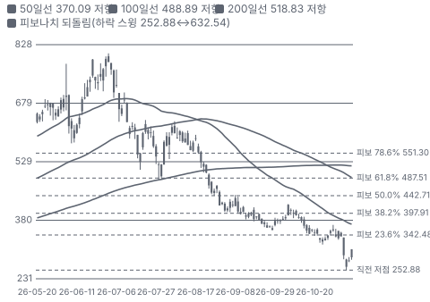

**주봉**

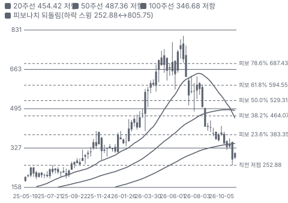

**월봉**

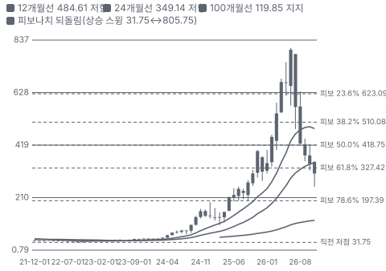

**분기 매출·EPS 실적과 컨센서스**

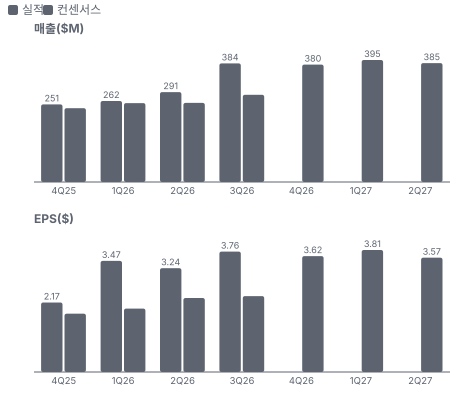

**4Q26 매출 — 지표 추세 vs 가이던스·컨센서스**

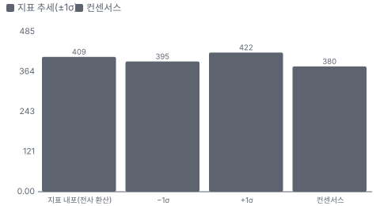

**최근 4개 분기 주가 변화 분석**

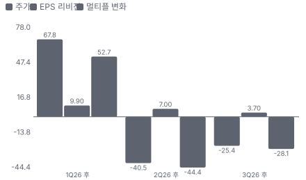

**EPS 리비전**

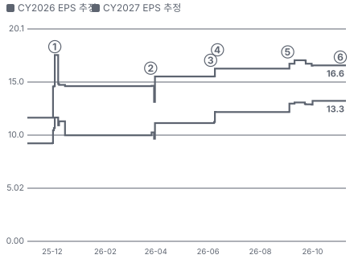

① 25-12-04 3Q FY26 실적(10월 분기), 다음 날 −12.0% · EPS 리비전 +0%
② 26-03-26 FY26 실적·백로그 \$2.9B, 다음 날 +37.9% · EPS 리비전 +6%
③ 26-06-04 1Q FY27 실적, 다음 날 +0.8% · EPS 리비전 +5%
④ 26-06-12 이사·CEO 장내 매도 집중(6/12~6/22 약 \$84M) · 실적 창과 겹침
⑤ 26-09-02 2Q FY27 실적·백로그 감소, 다음 날 +0.3% · EPS 리비전 +5%
⑥ 26-11-04 중간선거 뒤 업종 동반 급락 · EPS 리비전 +0%

**밸류에이션 주가 시나리오**

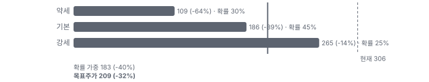

**주가별 업사이드**

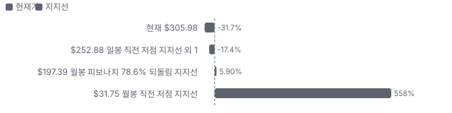

**제품·서비스 포트폴리오**

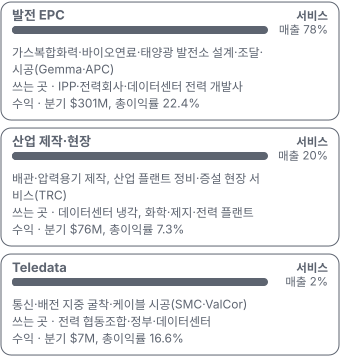

**고객 믹스(2Q FY27(2026-05~07), 매출 대비)**

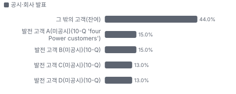

**공급 병목(10점, 낮을수록 병목)**

**생산능력 현재와 확충 계획(동시 수행 대형 프로젝트(건))**

**CAPEX의 매출 대비 비중**

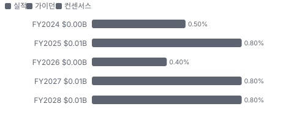

**어닝콜 변화별 주주가치 영향**

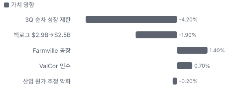

**멀티플 프리미엄(Fwd 1Y P/E, 최근 4개 분기말)**

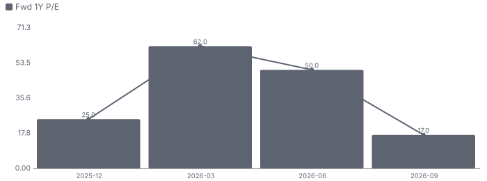

**합리적 멀티플**

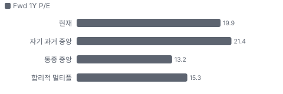

**수주·파이프라인 확실성 사다리**

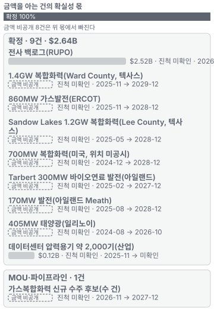

**매출 → 매출총이익 → 영업이익(매출 = 100, 최근 4분기)**

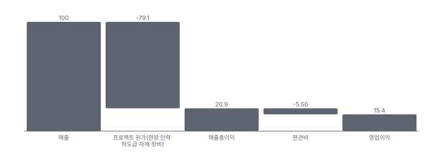

**1년 전 대비 마진 기여(비용 비중 변화의 반대)**

**분기 비용 비중 추이(매출 대비, 공시)**

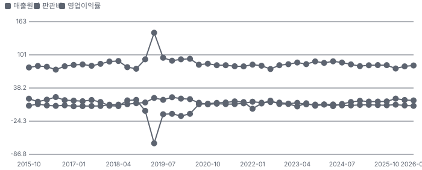

**비용 요인별 매출 대비 비중과 1년 변화**

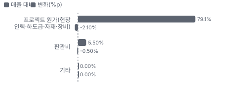

**BOM 항목 가격 +10% 시 OPM 변화**

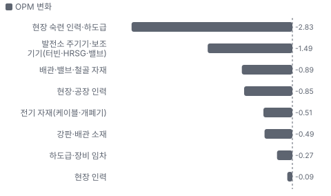

**발전 EPC BOM 원가 몫과 가격 +10% 시 OPM**

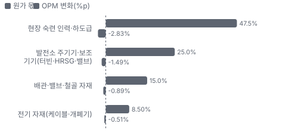

**산업 제작·현장 BOM 원가 몫과 가격 +10% 시 OPM**

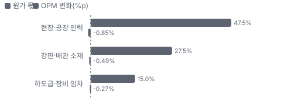

**Teledata BOM 원가 몫과 가격 +10% 시 OPM**

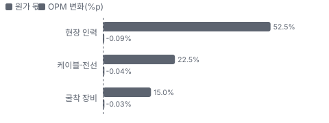

**생산시설별 면적(ft², 큰 순) — 생산능력 미공시라 면적을 대용으로**

**매출·PPI·수출입 — 최근 16개 분기 같은 축(4Q22 = 100) + 다음 분기 추정**

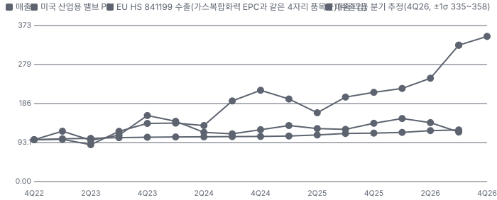

**매출과 미국 산업용 밸브 PPI 증가율(전년 대비, 최근 16개 분기 + 다음 분기 추정)**

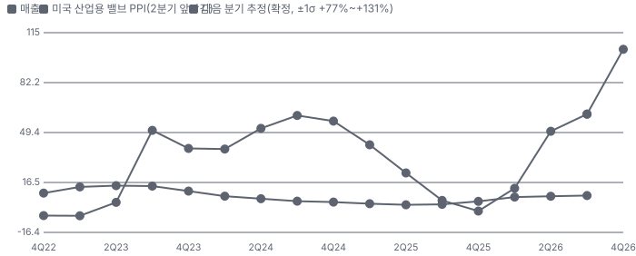

**10년 P·Q 사이클 — 추세(HP 필터) 대비 갭과 8분기 전망**

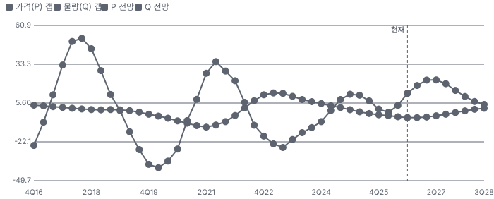

**매출 증가율의 가격·물량 분해와 8분기 전망(전년 대비)**

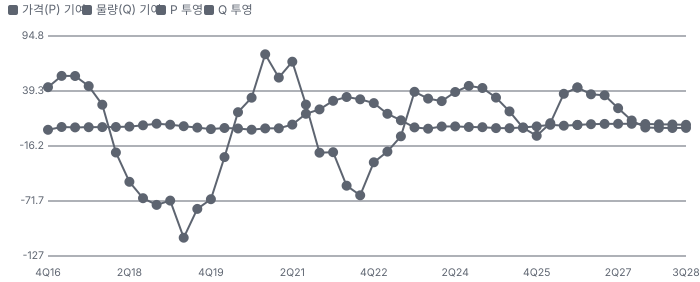

**분기별 매출 증가율 분해**

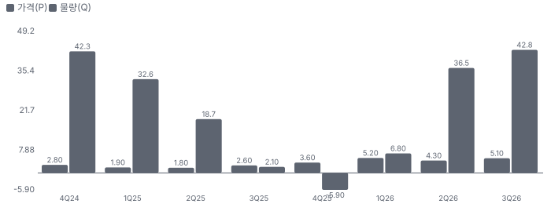

**목표주가 산정 — 기본과 강세 사이(강세 쪽 29%), 도달 확률 약 37%**

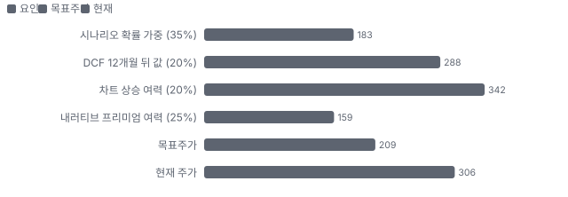

**일봉 지지·저항과 목표주가**

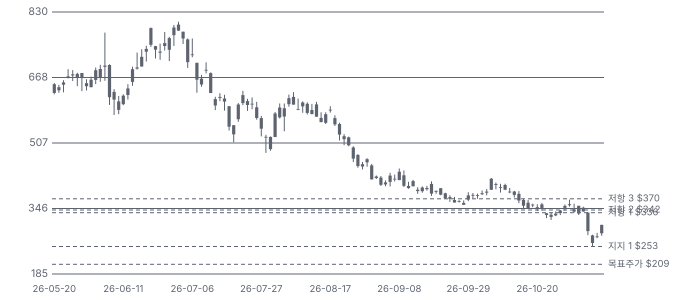

**커뮤니티 언급 수(최근 30일, 채널별)**

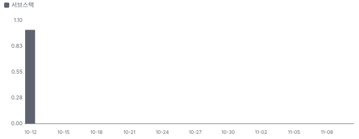

**일별 거래량 분해**

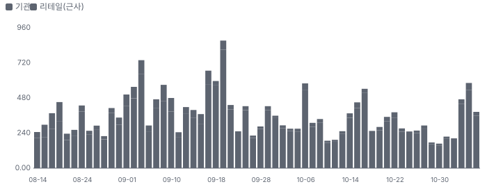

**기관 자금 흐름**

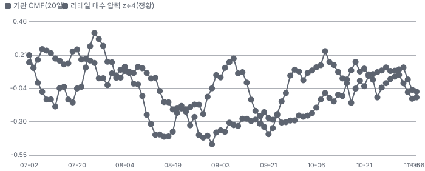

**몬테카를로**

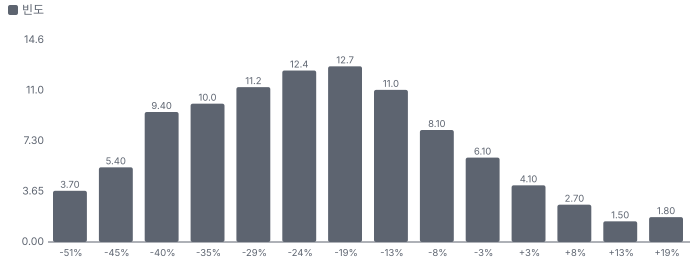

해석: 3,000번 중 302번(10%)에서 가치가 지금 주가 이상이었다. 가정을 흔들어도 지금 주가를 뒷받침하지 못하는 경우가 더 많다. 가운데 값은 0.78배이고, 열 번 중 여덟 번은 0.58~1.00배 사이에 든다.

## 내러티브

> **기업가치를 결정하는 이야기:** 값은 두 층이다. 발전 EPC(분기 매출 \$301M, 총이익률 22.4%)가 이익의 거의 전부를 만들고, 무차입 현금 \$1.03B가 보증 능력과 이자 수익(분기 \$10.1M)을 준다. 결정 변수는 백로그 \$2.52B를 22% 안팎 마진으로 소진하는 동안 새 대형 수주가 언제 들어오느냐다.

> **멀티플·EPS 프리미엄**
> **멀티플:** Fwd 1Y P/E 19.9배는 동종 중앙 13.2배보다 51% 높다. 6월 말 자기 배수는 57.4배였다 — 배수 하락은 업종 전체의 일이지만 Argan의 낙폭이 더 컸다.
> **EPS:** 지난 네 분기 모두 EPS가 컨센서스를 넘었고 7월 분기는 발표 직전 컨센서스보다 +42~59% 높았다. 9월 실적 뒤 FY27 EPS 컨센서스는 \$12.60 → \$13.72로 올랐다.

### 투자자들은 왜 열광했나

3/26 FY26 실적 다음 날 +37.9% 뛰었다. 백로그 \$2.9B와 텍사스 대형 가스발전 수주 두 건이 데이터센터 전력 이야기를 숫자로 만들었다. 식은 이유는 세 가지다 — 6월 내부자 매도 집중, 9월 실적의 백로그 감소·산업 원가 초과, 11/4 선거 뒤 업종 급락.

### 무엇이 기업가치를 바꾸나

> **구조적 체질 변화**
> **변화:** 재생에너지·해외 비중이 컸던 회사에서 미국 가스복합화력 중심 회사로 바뀌었다. 백로그의 약 80%가 천연가스 프로젝트다
> **증거:** 2Q FY27 콜·10-Q 백로그 절
> **반증:** 신규 수주가 2분기 연속 재생에너지만

> **고부가 믹스 확장**
> **변화:** 발전 총이익률이 2년 전(2024-07 분기) 13.5%에서 22.4%로 올랐다
> **증거:** 부문 총이익(부문 KPI)
> **반증:** 발전 총이익률 18% 아래

> **기술 혁신**
> **변화:** 해당 없음(EPC는 공법보다 실행 기록이 경쟁력이다). 데이터센터 냉각용 압력용기 제작이 가장 가깝다
> **증거:** 10-Q 산업 백로그 절
> **반증:** 후속 수주 없음

> **실행 속도**
> **변화:** 해당 없음(EPC라 납품 리드타임 공시가 없다). 대형 복합화력 공기는 FNTP 뒤 약 3년이고, RUPO의 48%가 12개월 안에 매출이 된다 **납품 리드타임 미확인.** 피어 비교 미확인. 이전 대비 미확인.
> **증거:** 2Q FY27 10-Q
> **반증:** 12개월 비중 40% 아래

> **M&A**
> **변화:** ValCor Communications(8월)로 Teledata(통신·배전 시공 부문)를 뉴잉글랜드로 넓혔다. 인수가 미공시, 규모는 작다
> **증거:** 8-K 2026-08-04·2Q 콜
> **반증:** Teledata 매출이 FY26 수준에 머문다

> **정책·입법 연관성**
> **재정정책:** IRA(미국 인플레이션 감축법) 청정에너지 세액공제가 태양광·BESS(배터리 에너지 저장 장치) 프로젝트(백로그 약 11%) 경제성을 받친다. 가스발전은 직접 수혜가 아니다 2Q 콜 백로그 구성 반증: 세액공제 축소 법 통과 의회 동의 10/10 — 하원 5/5(IRA는 2022 본회의 통과, 2025 축소 법도 본회의 통과) · 상원 5/5(같은 법 본회의 통과).
> **행정명령:** 해당 없음(Argan 매출에 직접 닿는 행정명령이 공시·보도에서 확인되지 않았다) 10-K·10-Q 위험 요인 반증: 가스발전 인허가 제한 행정명령 의회 동의 2/10 — 하원 1/5(해당 행정명령 없음) · 상원 1/5(해당 행정명령 없음).
> **연관입법:** 주 단위가 핵심이다 — 텍사스 대형 부하 감사·인허가 제한·송전 논쟁이 2027년 상반기까지 불확실성을 남긴다(BofA 10/30). 법안 발의 전 단계 BofA 2026-10-30 요지(마스터 노션)·2Q 콜 텍사스 질문 반증: 텍사스 주 의회에서 규제 법안이 발의되지 않는다

> **CAPEX 낙수효과**
> **변화:** 하이퍼스케일러·IPP(독립 발전 사업자)의 발전 투자가 가스복합화력 발주로 이어졌다. 금지표대로 Argan 몫은 FNTP 받은 계약으로만 센다 — 2Q 매출의 56%가 고객 4곳
> **증거:** 10-Q 고객 집중 절
> **반증:** 7~15개월 안 FNTP 없음

### 내러티브 근거

> 프리미엄은 'AI 데이터센터 전력 부족을 푸는 가스복합화력 EPC'에서 나왔다. 6월 말 종가 고점 이후 −62%로 프리미엄이 사라졌고, 숫자는 매출 +62%로 아직 강하지만 백로그는 세 분기 연속 줄었다. 동종 대비 멀티플 차이 +51% 중 회사 고유 몫은 +30%다. 단계는 소멸, 쏠림은 낮음이다.

> **가스복합화력 EPC의 희소성** · 유지
> **논리:** 데이터센터 전력 수요로 가스발전 신설이 늘고, 1GW급을 지을 EPC는 몇 곳뿐이다
> **숫자:** 발전 분기 매출 \$196.9M → \$301.2M(+53%), 발전 총이익률 19.6% → 22.4%
> **반증:** 3Q FY27 발전 총이익률 18% 아래 또는 발전 매출 전년 대비 감소

> **백로그 재확대 기대** · 약화
> **논리:** 7~15개월 안 대형 신규 수주가 백로그를 다시 \$3B 위로 올린다
> **숫자:** 백로그 \$2.97B(2025-10) → \$2.52B(2026-07), 3분기 연속 감소(\$2.93B·\$2.77B 거침)
> **반증:** 2027-04 결산 때까지 대형 신규 FNTP가 없다

> **무차입·주주 환원** · 유지
> **논리:** 현금 \$1.03B·차입 0에 배당 40% 인상·자사주 한도 \$200M
> **숫자:** 분기 배당 \$0.50 → \$0.70, 상반기 주주 환원 \$51.7M
> **반증:** 대형 인수로 순현금이 절반 아래

> **반대 내러티브: 데이터센터 전력 테마 디레이팅** · 확산
> **논리:** 중간선거 뒤 텍사스 등 데이터센터 규제 우려와 AI 투자 지속성 의심으로 전력 시공 업종 배수가 꺼진다
> **숫자:** 동종 Fwd 1Y P/E 6월 말 → 지금: STRL 38.4 → 10.9배, MYRG 45.5 → 18.0배, PRIM 23.1 → 14.3배. AGX 6월 말 57.4배 → 19.9배. 11/4~5 이틀 −25.0%
> **반증:** 텍사스 대형 부하 규제가 발의되지 않고 3Q 실적에서 신규 FNTP가 나온다

> **반대 내러티브: 내부자 매도와 피크 이익 의심** · 유지
> **논리:** 경영진·이사가 고점에서 대규모로 팔았고, 백로그가 줄어 FY28 이후 이익이 정점일 수 있다
> **숫자:** 2026-06 내부자 매도 약 \$84M. 컨센서스 1명 장기 추정 FY30 매출 \$1.61B·EPS \$14.61(FY29 \$18.06보다 낮음)
> **반증:** 신규 대형 수주로 FY29 매출 컨센서스가 \$2B 위로

## 포트폴리오

| 제품·서비스 | 구분 | 무엇 | 쓰는 곳 | 돈 버는 방식 | Mix | Mix 변화(전년 대비) |
|---|---|---|---|---|---|---|
| 발전 EPC | 서비스 | 가스복합화력·바이오연료·태양광 발전소 설계·조달·시공(Gemma·APC) | IPP·전력회사·데이터센터 전력 개발사 | 분기 \$301M, 총이익률 22.4% | 78% | -4.4%p |
| 산업 제작·현장 | 서비스 | 배관·압력용기 제작, 산업 플랜트 정비·증설 현장 서비스(TRC) | 데이터센터 냉각, 화학·제지·전력 플랜트 | 분기 \$76M, 총이익률 7.3% | 20% | +4.7%p |
| Teledata | 서비스 | 통신·배전 지중 굴착·케이블 시공(SMC·ValCor) | 전력 협동조합·정부·데이터센터 | 분기 \$7M, 총이익률 16.6% | 2% | -0.3%p |

**Mix 변화가 가장 큰 쪽은 산업 제작·현장(+4.7%p, 전년 대비).** 계절성 판정: 분기 매출 계절 지수 기준 있음 → 전년 같은 분기와 비교.

## 고객

> **2Q FY27(2026-05~07) 최대 고객 그 밖의 고객(잔여) 44%, 상위 3곳 74%, 집중도 집중.** 공시·회사 발표로 확인한 몫은 매출의 100%이고, 나머지 고객 몫은 추정이거나 미분해다. 2분기 매출의 56%가 발전 고객 4곳(15·15·13·13%)이다. 고객 이름은 공시되지 않는다 — 진행 중인 가스발전 프로젝트 발주처와의 연결은 가설이다.

**고객별 매출 몫(2Q FY27(2026-05~07))**
| 고객 | 몫 | 변화 | 근거 |
|---|---|---|---|
| 그 밖의 고객(잔여) | 44% | 미확인 | 공시 |
| 발전 고객 A(미공시, 10-Q 'four Power customers') | 15% | 미확인 | 공시 |
| 발전 고객 B(미공시, 10-Q) | 15% | 미확인 | 공시 |
| 발전 고객 C(미공시, 10-Q) | 13% | 미확인 | 공시 |
| 발전 고객 D(미공시, 10-Q) | 13% | 미확인 | 공시 |

> **그 밖의 고객(잔여)** · 공시
> **사는 것:** 발전·산업·통신 공사

> **발전 고객 A(미공시, 10-Q 'four Power customers')** · 공시
> **사는 것:** 발전소 EPC

> **발전 고객 B(미공시, 10-Q)** · 공시
> **사는 것:** 발전소 EPC

> **발전 고객 C(미공시, 10-Q)** · 공시
> **사는 것:** 발전소 EPC

> **발전 고객 D(미공시, 10-Q)** · 공시
> **사는 것:** 발전소 EPC

## 수주·파이프라인

> **2026-07-31 기준 10건.** 확정 \$2.64B. 공시 프로젝트 백로그 \$2.52B.

**실행 속도와 방해 요인**
| 항목 | 상태 | 실행 속도 | 방해 요인 |
|---|---|---|---|
| 전사 백로그(RUPO) | 확정 | 48%가 12개월 안 매출 | 발주처 착공 시점 · 고정가 인건비 |
| 1.4GW 복합화력(Ward County, 텍사스) | 확정 | 미확인 | ERCOT 대형 부하 규제 |
| 860MW 가스발전(ERCOT) | 확정 | 미확인 | 미확인 |
| Sandow Lakes 1.2GW 복합화력(Lee County, 텍사스) | 확정 | 미확인 | 미확인 |
| 700MW 복합화력(미국, 위치 미공시) | 확정 | 미확인 | 미확인 |
| Tarbert 300MW 바이오연료 발전(아일랜드) | 확정 | 미확인 | 미확인 |
| 170MW 발전(아일랜드 Meath) | 확정 | 미확인 | 미확인 |
| 405MW 태양광(일리노이) | 확정 | 10월 분기 실질 완공 예정(10-Q) | 없음 |
| 데이터센터 압력용기 약 2,000기(산업) | 확정 | Farmville 공장 3Q 완공 뒤 본격 | 신규 공장 가동 |
| 가스복합화력 신규 수주 후보(수 건) | 파이프라인 | 회사 표현 7~15개월 안 | PPA(전력 구매 계약)·대기 허가·가스·용수·터빈·자금 조달 |

## 마진 구조

> **GPM 20.9%, OPM 15.4%.** TTM 2Q FY26 대비 GPM +2.1%p, OPM +2.6%p. TTM 매출원가가 매출의 79.1%로 1년 전 81.2%보다 2.1%p 낮아졌다. 발전 EPC 총이익률이 22~24%로 올랐고 산업은 7.3%로 떨어졌다.

> **매출 100 중 매출원가 79.1, 매출총이익 20.9(최근 4분기, 공시).** 매출원가 요인 중 프로젝트 원가(현장 인력·하도급·자재·장비)이 매출의 79.1%로 가장 무겁고, 단가가 +10% 오르면 GPM이 -7.91%p 움직인다. 분기 회귀로 매출 1이 늘 때 매출원가는 0.78 늘고, 매출원가의 고정비 몫은 6%다.

**비용 요인 강도 — 비중·추세·충격(+10%)·탄력**
| 비용 | 구분 | 매출 대비 | 1년 변화 | 마진 기여 | 충격 시 마진 | 매출 탄력 | 고정비 몫 |
|---|---|---|---|---|---|---|---|
| 프로젝트 원가(현장 인력·하도급·자재·장비) | 매출원가 요인 | 79.1% | -2.1%p | +2.1%p | -7.91%p | 미확인 | 미확인 |
| 매출원가 | 공시 항목 | 79.1% | -2.1%p | +2.1%p | -7.91%p | 0.78 | 6% |
| 판관비 | 공시 항목 | 5.5% | -0.5%p | +0.5%p | 미확인 | 0.02 | 72% |

매출 탄력 = 분기 비용을 매출에 회귀한 기울기(매출 1당 변동비), 고정비 몫 = 절편 ÷ 평균 비용. 표본이 8분기 미만이면 미확인. 매출원가 요인 비중은 margin 재료의 추정이 섞여 있고, 공시 매출원가와의 차이는 '기타 매출원가'로 둔다.

**GPM에서 OPM까지(GAAP)**
| 기간 | GPM | 연구개발 | 판관비 | 기타 | OPM |
|---|---|---|---|---|---|
| TTM 2Q FY26 | 18.8% | 0.0% | 6.0% | 0.0% | 12.7% |
| TTM 2Q FY27 | 20.9% | 0.0% | 5.5% | 0.0% | 15.4% |

**GPM·OPM 최근 4개 분기**
| 분기 | GPM | OPM |
|---|---|---|
| 2025-10 | 18.7% | 13.0% |
| 2026-01 | 25.0% | 18.2% |
| 2026-04 | 21.0% | 15.6% |
| 2026-07 | 19.3% | 14.8% |

**마진을 결정하는 비용 요인 — 비용 +10% 시 OPM**
| 비용 | 매출 대비 | 변화 | 고정비 | OPM |
|---|---|---|---|---|
| 프로젝트 원가(현장 인력·하도급·자재·장비) | 79.1% | -2.1%p | 미확인 | -7.91%p |
| 판관비 | 5.5% | -0.5%p | 70% | -0.55%p |
| 기타 | 0.0% | +0.0%p | 미확인 | -0.00%p |

**비용을 움직이는 요인**
| 비용 | 요인 |
|---|---|
| 프로젝트 원가(현장 인력·하도급·자재·장비, 매출원가) | 숙련공 임금·고정가 원가 추정·철강·배관 자재 · 근거 공시 |
| 판관비(판관비) | 본사 인력·성과급 · 근거 공시 |
| 기타(기타) | 없음 · 근거 공시 |

**발전 EPC BOM — 매출의 78%, GPM 24%(TTM 부문 총이익 \$219.0M ÷ 매출 \$927.1M(10-Q·10-K 부문)), 항목 가격 +10% 시**
| 항목 | 원가 몫 | 전가 | 제품 GPM | OPM |
|---|---|---|---|---|
| 현장 숙련 인력·하도급 | 40~55% | 미확인 | -3.6%p | -2.83%p |
| 발전소 주기기·보조 기기(터빈·HRSG(가스터빈 배기열로 증기를 만드는 배열회수 보일러)·밸브) | 15~35% | 미확인 | -1.9%p | -1.49%p |
| 배관·밸브·철골 자재 | 10~20% | 미확인 | -1.1%p | -0.89%p |
| 전기 자재(케이블·개폐기) | 5~12% | 미확인 | -0.6%p | -0.51%p |
| 미분해 | 4% | - | - | - |

**산업 제작·현장 BOM — 매출의 20%, GPM 11%(TTM 부문 총이익 \$25.1M ÷ 매출 \$236.8M(10-Q 부문)), 항목 가격 +10% 시**
| 항목 | 원가 몫 | 전가 | 제품 GPM | OPM |
|---|---|---|---|---|
| 현장·공장 인력 | 40~55% | 미확인 | -4.2%p | -0.85%p |
| 강판·배관 소재 | 20~35% | 미확인 | -2.5%p | -0.49%p |
| 하도급·장비 임차 | 10~20% | 미확인 | -1.3%p | -0.27%p |
| 미분해 | 10% | - | - | - |

**Teledata BOM — 매출의 2%, GPM 16%(TTM 부문 총이익 \$3.85M ÷ 매출 \$24.3M), 항목 가격 +10% 시**
| 항목 | 원가 몫 | 전가 | 제품 GPM | OPM |
|---|---|---|---|---|
| 현장 인력 | 45~60% | 미확인 | -4.4%p | -0.09%p |
| 케이블·전선 | 15~30% | 미확인 | -1.9%p | -0.04%p |
| 굴착 장비 | 10~20% | 미확인 | -1.3%p | -0.03%p |
| 미분해 | 10% | - | - | - |

현장 숙련 인력·하도급 가격이 +10% 오르면 영업이익은 -18.4% 움직인다. 판매가 전가를 모르는 항목은 전가 0%로 계산했다.

**BOM 항목 가격을 움직이는 것**
| 항목 | 요인 |
|---|---|
| 현장 숙련 인력·하도급 | 고정가 계약 — 인건비 상승을 대개 회사가 진다(2Q 콜) · 근거 추정 |
| 발전소 주기기·보조 기기(터빈·HRSG·밸브) | 주기기를 발주처가 사면 Argan 원가에서 빠진다 · 근거 추정 |
| 배관·밸브·철골 자재 | 관세 영향 품목 · 근거 추정 |
| 전기 자재(케이블·개폐기) | 구리 가격 · 근거 추정 |
| 현장·공장 인력 | 현장 서비스·용접 · 근거 추정 |
| 강판·배관 소재 | 압력용기·배관 소재 · 근거 추정 |
| 하도급·장비 임차 | 현장 장비 · 근거 추정 |
| 현장 인력 | 굴착·배선 · 근거 추정 |
| 케이블·전선 | 자재 · 근거 추정 |
| 굴착 장비 | 연료·장비 · 근거 추정 |

**BOM 투입 물가 — PPI 전년비, 2026-11-10 수집**
| 항목 | 미국 | 일본 | 한국 | 대만 |
|---|---|---|---|---|
| 굴착 장비 | +115.2% | 미확인 | 미확인 | 미확인 |
| 발전소 주기기·보조 기기(터빈·HRSG·밸브) | +3.6%* | 미확인 | 미확인 | 미확인 |
| 강판·배관 소재 | +6.8%* | 미확인 | 미확인 | 미확인 |
| 케이블·전선 | +30.0% | +54.2% | +25.8% | +40.1% |

별표는 품목보다 넓은 업종 지수다. 지난 1년 투입 물가를 판매가 전가 뒤 원가에 그대로 넣으면 OPM은 -39.52%p 움직인다(매출원가의 83% 기준).

## 공급망 병목

> **공급망 신뢰성 3.7/10, 병목 심각.** 가장 약한 고리는 현장 숙련 인력·하도급 3.7점이고, 품목 평균은 3.7점이다. 근거가 부족한 2건(발전소 주기기·보조 기기(터빈·HRSG·밸브) · 배관·밸브·철골 자재)은 점수에서 뺐다. 병목은 회사 밖 장비(가스터빈 슬롯)와 회사 안 인력이다. 가스터빈은 대개 발주처가 OEM에서 확보하고, Argan이 동시에 돌릴 수 있는 대형 프로젝트는 10~12건이다(2Q 콜).

**병목과 마진 — 품목 가격 +10% 시 OPM**
| 품목 | 점수 | 판정 | 구분 | OPM |
|---|---|---|---|---|
| 현장 숙련 인력·하도급(필수) | 3.7 | 병목 심각 | 핵심 통제 품목 | -2.83%p |

> **현장 숙련 인력·하도급** · 3.7/10
> **왜:** 수주를 매출로 바꾸는 속도를 정한다
> **병목 요인:** 인증 공급사 1곳 · 캐파 빠듯 · 리드타임 미확인 · 재인증 미확인 · 1위 점유율 미확인 · 미국(텍사스 비중 큼) 집중 80% · 물량 확보 내재화
> **풀리는 조건:** 미확인

**공급사**
| 품목 | 공급사 | 몫 | 근거 |
|---|---|---|---|
| 현장 숙련 인력·하도급 | 자체 직원 1,409명(FY26 말) + 지역 하도급(자체 시공) | 미확인 | 공시 |
| 발전소 주기기·보조 기기(터빈·HRSG·밸브) | 가스터빈 OEM(GE Vernova·Siemens Energy·Mitsubishi Power — 프로젝트별 공급사 미공시, 가스터빈) | 미확인 | 추정 |
| 배관·밸브·철골 자재 | 다수 공급사(미공시, 자재) | 미확인 | 공시 |

**무역 통계로 본 공급 지역**
| 품목 | EU 수입처 | 일본 수입처 | EU 1위 전년비 |
|---|---|---|---|
| 현장 숙련 인력·하도급 | US 75% · CN(중국) 12% · KR(한국) 6% | 大韓民国 74% · シンガポール 7% | +133.6% |
| 발전소 주기기·보조 기기(터빈·HRSG·밸브) | US 94% · JP 4% · VN 1% | アメリカ合衆国 100% | +57.3% |
| 배관·밸브·철골 자재 | CN 63% · US 27% · JP 4% | 中華人民共和国 28% · アメリカ合衆国 25% | +2.7% |

## 생산능력

> **현재 명목 캐파 11 동시 수행 대형 프로젝트(건), 가동률 미확인.** 착공 이상 증설은 0 동시 수행 대형 프로젝트(건), 발표까지 합치면 0 동시 수행 대형 프로젝트(건)이다. 다 가동하면 지금보다 +0%, 착공 이상만이면 +0%다. FY2026 CAPEX는 \$0.00B로 매출의 0.4%다. EPC라 공장 캐파 대신 인력이 캐파다. 회사는 대형 발전 프로젝트를 동시에 10~12건 돌릴 수 있다고 밝혔다. 제작 시설은 Winterville 공장(약 90,000ft²)과 3Q 완공 예정인 Farmville 공장이다.

**생산시설 9곳**(FY26 10-K Item 2 — 본사·사무 6곳, 제작 공장 1곳(Winterville), 정비·창고 2곳 + 10-Q의 Farmville 신설 공장. 인근 임차 사무소 '여러 곳'은 이름이 없어 세지 않았다), 소유 4곳 · 소유·임차 1곳 · 임차 4곳. 시설별 생산능력은 1곳만 공개됐다.

**생산시설 9곳 — 명칭·위치·생산능력**
| 시설 | 위치 | 용도 | 생산능력 | 소유·상태 |
|---|---|---|---|---|
| Winterville 산업 제작·창고 시설(The Roberts Company 본부) | 미국 Winterville, North Carolina | 제조(배관·압력용기 제작) | 미확인 — 시설 캐파 미공시 · 면적 90,000 ft² | 소유 · 가동 |
| Farmville 제작 공장(신설) | 미국 Farmville, North Carolina | 제조(데이터센터 열저장·냉수 버퍼용 압력용기) | 10 분기 매출 \$M 이상(회사 표현) | 소유 · 건설 중 |
| Gemma Power Systems 미국 본사 | 미국 Glastonbury, Connecticut | 사무(발전 EPC 본부) | 미확인 — 사무 | 소유 · 가동 |
| APC 본사 | 아일랜드 Limerick | 사무 | 미확인 — 사무 | 소유·임차 · 가동 |
| APC 운영 지원 시설 | 아일랜드 Nenagh | 창고 | 미확인 — 창고 · 면적 10,663 ft² | 소유 · 가동 |
| 영국 사무소 | 영국 Derby | 사무 | 미확인 — 사무 | 임차 · 가동 |
| SMC 본부 | 미국 Tracys Landing, Maryland | 정비·사무(약 5에이커, 정비 시설 2,400ft²) | 미확인 — 정비 | 임차 · 가동 |
| Teledata 사무·창고 | 미국 Hampton, Virginia | 창고·사무 | 미확인 — 창고 · 면적 11,460 ft² | 임차 · 가동 |
| Argan 본사 | 미국 Arlington, Virginia | 사무 | 미확인 — 사무 | 임차 · 가동 |

**생산능력 확충 계획**
| 계획 | 단계 | 증설 | 가동 시점 | CAPEX |
|---|---|---|---|---|
| Farmville, North Carolina 제작 공장 신설 | 착공 | 미확인 | 2026-10 | 미확인 |

남은 계획의 CAPEX 합계는 \$0.00B(금액 미확인 1건 제외)다. 합계는 FY2028 매출의 0%다.

**증설 방해 요인**
| 계획 | 방해 요인 |
|---|---|
| Farmville, North Carolina 제작 공장 신설 | 완공·가동 |

**CAPEX와 매출 대비**
| 기간 | CAPEX | 매출 | 매출 대비 | 구분 |
|---|---|---|---|---|
| FY2024 | \$0.00B | \$0.57B | 0.5% | 실적 |
| FY2025 | \$0.01B | \$0.87B | 0.8% | 실적 |
| FY2026 | \$0.00B | \$0.94B | 0.4% | 실적 |
| FY2027 | \$0.01B | \$1.45B | 0.8% | 가이던스 |
| FY2028 | \$0.01B | \$1.65B | 0.8% | 컨센서스 |

## 해자

> 해자는 대형 복합화력을 정해진 일정에 끝내는 실행 기록과 무차입 재무가 주는 보증 능력이다. 둘 다 동시 수행 10~12건이라는 인력 한계 안에서만 작동한다.

> **대형 복합화력 EPC 실행 기록** · 강함
> **해자:** 1GW급 가스복합화력을 고정가로 끝내 본 미국 EPC가 적다
> **근거:** Trumbull 950MW 완공(FY26 4Q 실질 완공, 10-Q), 발전 총이익률 22.4~23.6%(1·2Q FY27)
> **숫자:** 발전 총이익률 1년 19.6% → 22.4%
> **깨지는 조건:** 발전 총이익률이 18% 아래로 내려오면 실행 우위가 원가에 밀린 것

> **무차입 대차대조표와 보증 능력** · 강함
> **해자:** 현금·투자 \$1.03B, 차입 0이 발주처에 이행 보증을 준다
> **근거:** 10-Q 유동성 절 — 보증 능력 유지를 위해 유동 자본을 크게 둔다
> **숫자:** 순유동성 \$440.4M, 자기자본 \$506.8M
> **깨지는 조건:** 대형 손실 프로젝트로 순유동성이 \$300M 아래

> **데이터센터 냉각용 압력용기 제작** · 약함
> **해자:** 데이터센터 열저장·냉수 버퍼 탱크를 직접 만든다
> **근거:** 약 \$125M 데이터센터 프로젝트, Farmville 공장 3Q 완공 예정
> **숫자:** 미확인
> **깨지는 조건:** 후속 수주 없이 공장 가동률이 낮다

## 경영진·네트워크

> CEO David Watson과 Gemma CEO Charles Collins IV가 실행을 이끈다. 경영진·이사가 1년 동안 장내 매도를 이어 갔다. 연결이 매출을 만들었다는 공개 증거는 없다.

> **David H. Watson** · President·CEO, 이사 · 미확인
> **프로필:** Form 4 직함 President and CEO
> **비즈니스:** 미확인
> **정계:** 미확인
> **동문:** 미확인
> **사모임:** 미확인

> **Charles E. Collins IV** · Gemma Power Systems CEO · 미확인
> **프로필:** Form 4 직함 CEO, GEMMA
> **비즈니스:** 미확인
> **정계:** 미확인
> **동문:** 미확인
> **사모임:** 미확인

> **Joshua S. Baugher** · CFO · 미확인
> **프로필:** Form 4 직함 CFO
> **비즈니스:** 미확인
> **정계:** 미확인
> **동문:** 미확인
> **사모임:** 미확인

> **William F. Griffin, Jr.** · 이사 · 미확인
> **프로필:** 2026-06 장내 매도 \$69.2M(10만 주, Form 4)
> **비즈니스:** 미확인
> **정계:** 미확인
> **동문:** 미확인
> **사모임:** 미확인

**네트워크 정량화**
| 연결 | 강도 | 닿는 매출 | 가중 노출 | 매출 대비 | 근거 |
|---|---|---|---|---|---|
| 비즈니스: 발주처(IPP·전력회사)와의 반복 거래 — 이름 미공시 | 3/5 | 미확인 | 미확인 | 미확인 | 10-Q 고객 이름 미공시 https://www.sec.gov/Archives/edgar/data/100591/000110465926104745/agx-20260731x10q.htm |
| 정계: 로비 공시 없음(하원 로비 분기 집계 대상 밖) | 0/5 | 미확인 | 미확인 | 미확인 | 공개 기록 없음 Easyconomics lobbying |

가중 노출은 연결이 닿는 매출의 크기다. 연결이 그 매출을 만들었다는 뜻이 아니며, 인과는 공개 자료로 입증하지 못한다.

## 약세 논리 및 셀온 조건

| 약세 논리 | 근거 | 가를 자료 |
|---|---|---|
| 백로그 소진 | 백로그 \$2.97B(2025-10) → \$2.52B(2026-07). 대형 신규 수주 없이 두 분기가 지났고, RUPO의 48%가 12개월 안에 매출이 된다 | 3Q FY27 실적의 신규 FNTP(12월 초 예상) |
| 텍사스 데이터센터 규제 | 진행 중인 대형 가스발전 셋(Ward County 1.4GW·ERCOT 860MW·Sandow Lakes 1.2GW)이 텍사스다. BofA는 텍사스 대형 부하 규제 불확실성이 2027년 상반기까지 간다고 봤다. 정책 0단계(선거 결과) 가설 | 텍사스 주 의회 법안 발의(2027-01 개회 뒤) |
| 업종 배수 하락 | 동종 Fwd 1Y P/E가 6월 말 23~46배에서 11~18배로 내려왔다. 바닥 근거는 없다 | 동종 4Q 실적·데이터센터 착공 지표 |
| 내부자 매도 | 2026-06 이사·CEO·CFO 장내 매도 약 \$84M, 이사 한 명이 10만 주 \$69.2M(Form 4) | Form 4 추가 매도 여부 |
| 산업 부문 원가 | 산업 총이익률 7.3%(2Q). 비데이터센터 프로젝트 원가 추정이 나빠져 1~2분기 저마진을 회사가 예고했다 | 3Q·4Q 산업 총이익률 |
| 피크 이익 의심 | 장기 추정 1명은 FY30 매출 \$1.61B·EPS \$14.61로 FY29보다 낮게 본다(표본 1명) | FY28 이후 컨센서스 추이 |
| 고정가 계약 인건비 | 회사는 대개 고정가로 계약한다(2Q 콜). 인력 시장이 빡빡한 지역에서 인건비 상승을 회사가 진다 | 발전 총이익률 추이 |
| 터빈 납기 | 10-Q는 대형 가스터빈·변압기 납기가 과거보다 크게 늘었다고 적었다. 발주처 터빈 확보가 착공 조건이다 | 발주처 터빈 계약 공시 |

> **셀온 조건**
> **조건 1:** 3Q FY27 백로그가 \$2.3B 아래로 내려가고 신규 대형 FNTP가 없다.
> **조건 2:** 발전 총이익률이 18%를 밑돈다.
> **조건 3:** 텍사스 대형 부하 규제 법안이 발의되고 회사가 진행 프로젝트 지연을 공시한다.
> **조건 4:** 내부자가 지금 가격대에서 대량 장내 매도를 다시 공시한다.
> **조건 5:** 대형 인수로 순현금이 절반 아래로 줄어든다.

## 어닝콜 변화

**직전 콜 대비 새로 나오거나 바뀐 내용 → 가치 영향**
| 항목 | 내용 | 직전 콜 | 최신 콜 | 모델 동인 이동 | 확신도 | 가치 영향 |
|---|---|---|---|---|---|---|
| 부정 | 2Q로 매출이 당겨져 3Q 순차 성장이 제한된다 |  |  | 1년차 성장률 -3.0% | 0.0 | -4.2% |
| 부정 | 비데이터센터 산업 프로젝트 원가 추정 악화로 1~2분기 저마진 |  |  | 출발 이익률 -0.50% | 0.0 | -0.2% |
| 업데이트 | 대형 신규 수주 없이 소진 |  |  | 장기 성장 수렴값 -1.0% | 0.0 | -1.9% |
| 신규 | 데이터센터 압력용기 공장 3Q 완공 뒤 분기 \$10M+ 매출 |  |  | 1년차 성장률 +1.0% | 0.0 | +1.4% |
| 신규 | Teledata 매출 FY26 대비 두 배 가능 |  |  | 1년차 성장률 +0.50% | 0.0 | +0.7% |
| 반복 | 가스복합화력 신규 프로젝트 수 건 |  |  | 장기 성장 수렴값 — | 0.0 | +0.0% |
| **합계** | 단독 합 |  |  | 동시 적용 -4.1% |  | **-4.1%** |

**사건별 EPS 리비전**
| # | 날짜 | 구분 | 사건 | CY2026 EPS 전→후 | CY2027 EPS 전→후 | 리비전 | 주가 반응 |
|---|---|---|---|---|---|---|---|
| ① | 25-12-04 | 실적 | 3Q FY26 실적(10월 분기), 다음 날 −12.0% | \$10.70 → \$10.02 | \$14.65 → \$14.66 | +0.1% | -12.0% |
| ② | 26-03-26 | 실적 | FY26 실적·백로그 \$2.9B, 다음 날 +37.9% | \$10.02 → \$11.17 | \$14.66 → \$15.57 | +6.2% | +37.9% |
| ③ | 26-06-04 | 실적 | 1Q FY27 실적, 다음 날 +0.8% | \$11.17 → \$12.21 | \$15.57 → \$16.32 | +4.8% | +0.8% |
| ④ | 26-06-12 | 내러티브 | 이사·CEO 장내 매도 집중(6/12~6/22 약 \$84M) | \$12.21 → \$12.21 | \$16.32 → \$16.32 | 실적 창과 겹침 | +2.9% |
| ⑤ | 26-09-02 | 실적 | 2Q FY27 실적·백로그 감소, 다음 날 +0.3% | \$12.21 → \$13.12 | \$16.32 → \$17.11 | +4.9% | +0.3% |
| ⑥ | 26-11-04 | 내러티브 | 중간선거 뒤 업종 동반 급락 | \$13.27 → \$13.27 | \$16.62 → \$16.62 | +0.0% | -16.5% |

**해석:** 3개 구간 누적 주가 -26% = EPS 리비전 +22% × 멀티플 -39%. 더 크게 움직인 쪽은 **멀티플**이다.

## 거시 지표 싱크로율

> **미국 산업용 밸브 PPI(생산자물가지수)와 산업 제작·현장 싱크로율 87%(2분기 = 약 6개월 선행, 전년 대비, 표본 12개·t 5.6·유의·신뢰 보통).** 이 지표가 내포하는 4Q26 산업 제작·현장은 101M(±1σ 87M~114M, 확정)다. 표본 밖 검증(최근 6개 분기)에서 지표 모델 오차는 26.2%p, 기준선(직전 증가율 지속)은 26.2%p다 — **지표가 기준선을 이기지 못해(예측력 없음) 추정은 대부분 기준선이다(지표 가중 52%).** 기준선은 인수·환율 효과의 소멸을 모르므로 회사 가이던스와 차이가 크면 가이던스 쪽 설명을 먼저 본다. 세그먼트 추정에 나머지 사업(직전 증가율 지속)을 더한 전사 매출은 409M(395M~422M)다. 컨센서스는 -7.0%(범위 아래)다. 발전 EPC 매출은 가스터빈·발전 설비 투자를 따라가고, 그 투자는 터빈·밸브 PPI에 먼저 나타난다

**지표별 싱크로율(상관계수 × 100) — 위 두 줄이 제품 연관성 × 싱크로율로 고른 PPI·수출입 세부 지표**
| 지표 | 비교 대상 | 증가율 기준 | 지표 선행 | 매출(t값) | 영업이익 | 방향 일치 | 표본·신뢰 | 표본 밖 오차(지표/기준선) | 4Q26 추정 매출 |
|---|---|---|---|---|---|---|---|---|---|
| 미국 산업용 밸브 PPI | 산업 제작·현장 | 전년 대비 | 2분기(6개월) | 87%(t 5.6) | -32%(1분기) | 75% | 12·보통 | 26.2/26.2%p ✘ | +104.1% → 101M(확정) |
| EU(유럽연합) HS(국제 통일 상품 분류 코드) 841199 수출(가스복합화력 EPC과 같은 4자리 품목군) | 발전 EPC | 전년 대비 | 4분기(12개월) | 80%(t 4.3) | 48%(4분기) | 92% | 12·보통 | 15.7/22.2%p ✔ | +41.6% → 277M(확정) |
| 미국 터빈·발전기 PPI | 발전 EPC | 전년 대비 | 4분기(12개월) | 50%(t 1.8) | 22%(4분기) | 92% | 12·보통 | 25.0/22.2%p ✘ | +45.6% → 285M(확정) |

**지표 후보 26개 — 연관성(제품 품목 일치 × 대용 감점 × 매출 비중) × 싱크로율로 고른다. 후보가 많을수록 최대 상관은 우연히 부풀 수 있다**
| 후보 | 종류 | 연관성 | 매출 분기 일치 | 싱크로율(선행) | 점수 | 출처 |
|---|---|---|---|---|---|---|
| 미국 산업용 밸브 PPI ✔ | PPI | 1.00 | 100% | 87%(2분기) | 0.87 | 모델 지정 |
| EU HS 841199 수출(가스복합화력 EPC과 같은 4자리 품목군) ✔ | 수출입 | 0.56 | 100% | 80%(4분기) | 0.45 | 자동 |
| EU HS 841181 수입(가스복합화력 EPC과 같은 4자리 품목군) | 수출입 | 0.56 | 100% | 72%(0분기) | 0.40 | 자동 |
| 미국 터빈·발전기 PPI | PPI | 1.00 | 100% | 50%(4분기) | 0.40 | 모델 지정 |
| EU HS 841111 수출(가스복합화력 EPC과 같은 4자리 품목군) | 수출입 | 0.56 | 100% | 62%(3분기) | 0.35 | 자동 |
| EU HS 841122 수출(가스복합화력 EPC과 같은 4자리 품목군) | 수출입 | 0.56 | 100% | 60%(4분기) | 0.33 | 자동 |
| 미국 HS 841111 수출(가스복합화력 EPC과 같은 4자리 품목군) | 수출입 | 0.56 | 100% | 50%(4분기) | 0.22 | 자동 |
| EU HS 841199 수입(가스복합화력 EPC과 같은 4자리 품목군) | 수출입 | 0.56 | 100% | 48%(1분기) | 0.21 | 자동 |
| EU HS 841121 수입(가스복합화력 EPC과 같은 4자리 품목군) | 수출입 | 0.56 | 100% | 39%(2분기) | 0.17 | 자동 |
| EU HS 841191 수출(가스복합화력 EPC과 같은 4자리 품목군) | 수출입 | 0.56 | 100% | 38%(0분기) | 0.17 | 자동 |
| 일본 HS 8411 수입(가스복합화력 EPC과 같은 4자리 품목군) | 수출입 | 0.56 | 38% | 36%(0분기) | 0.16 | 자동 |
| EU HS 841112 수입(가스복합화력 EPC과 같은 4자리 품목군) | 수출입 | 0.56 | 100% | 20%(2분기) | 0.09 | 자동 |

**선행 지표로 본 향후 분기 매출 전망(이미 나온 지표 값 기준, ±1σ)**
| 지표 | 대상 | 분기 | 지표 증가율 | 내포 매출 증가율 | 내포 매출 |
|---|---|---|---|---|---|
| 미국 터빈·발전기 PPI | 발전 EPC | 4Q26 | +3.9% | +35.0% | 264M(218M~310M) |
| 미국 터빈·발전기 PPI | 발전 EPC | 1Q27 | +3.6% | +32.0% | 269M(221M~317M) |
| 미국 터빈·발전기 PPI | 발전 EPC | 2Q27 | +3.1% | +23.8% | 281M(228M~334M) |
| 미국 터빈·발전기 PPI | 발전 EPC | 3Q27 | +4.6% | +44.6% | 436M(365M~506M) |
| 미국 산업용 밸브 PPI | 산업 제작·현장 | 4Q26 | +9.3% | +97.5% | 98M(85M~110M) |
| 미국 산업용 밸브 PPI | 산업 제작·현장 | 1Q27 | +7.4% | +68.4% | 89M(76M~102M) |
| EU 가스 터빈(출력 5,000kW 초과) 수출(HS 841182) | 발전 EPC | 4Q26 | -31.7% | +60.4% | 314M(281M~346M) |
| EU 가스 터빈(출력 5,000kW 초과) 수출(HS 841182) | 발전 EPC | 1Q27 | +5.2% | +50.4% | 306M(273M~340M) |
| EU 가스 터빈(출력 5,000kW 초과) 수입(HS 841182) | 발전 EPC | 4Q26 | -24.0% | +58.6% | 310M(271M~350M) |
| EU 가스 터빈(출력 5,000kW 초과) 수입(HS 841182) | 발전 EPC | 1Q27 | -49.5% | +72.1% | 351M(309M~392M) |
| EU 가스 터빈(출력 5,000kW 초과) 수입(HS 841182) | 발전 EPC | 2Q27 | +33.5% | +28.0% | 290M(244M~336M) |
| 미국 가스 터빈(출력 5,000kW 초과) 수출(HS 841182) | 발전 EPC | 4Q26 | -3.0% | +42.7% | 279M(232M~326M) |
| 미국 가스 터빈(출력 5,000kW 초과) 수출(HS 841182) | 발전 EPC | 1Q27 | -21.6% | +52.8% | 311M(263M~360M) |
| 미국 가스 터빈(출력 5,000kW 초과) 수입(HS 841182) | 발전 EPC | 4Q26 | +198.3% | +24.5% | 243M(205M~281M) |
| EU HS 841111 수출(가스복합화력 EPC과 같은 4자리 품목군) | 발전 EPC | 4Q26 | +43.2% | +41.0% | 276M(234M~317M) |
| EU HS 841111 수출(가스복합화력 EPC과 같은 4자리 품목군) | 발전 EPC | 1Q27 | +150.7% | +63.7% | 333M(290M~377M) |
| EU HS 841111 수출(가스복합화력 EPC과 같은 4자리 품목군) | 발전 EPC | 2Q27 | -18.2% | +28.1% | 290M(242M~338M) |
| EU HS 841121 수출(가스복합화력 EPC과 같은 4자리 품목군) | 발전 EPC | 4Q26 | -30.4% | +54.0% | 301M(257M~345M) |
| EU HS 841121 수출(가스복합화력 EPC과 같은 4자리 품목군) | 발전 EPC | 1Q27 | +5.4% | +43.5% | 292M(246M~338M) |
| EU HS 841121 수출(가스복합화력 EPC과 같은 4자리 품목군) | 발전 EPC | 2Q27 | +41.5% | +33.0% | 301M(250M~353M) |
| EU HS 841121 수출(가스복합화력 EPC과 같은 4자리 품목군) | 발전 EPC | 3Q27 | +32.2% | +35.7% | 409M(341M~477M) |
| EU HS 841122 수출(가스복합화력 EPC과 같은 4자리 품목군) | 발전 EPC | 4Q26 | -56.1% | +25.0% | 244M(202M~287M) |
| EU HS 841122 수출(가스복합화력 EPC과 같은 4자리 품목군) | 발전 EPC | 1Q27 | +174.3% | +54.7% | 315M(271M~359M) |
| EU HS 841122 수출(가스복합화력 EPC과 같은 4자리 품목군) | 발전 EPC | 2Q27 | -30.0% | +28.4% | 291M(242M~340M) |
| EU HS 841122 수출(가스복합화력 EPC과 같은 4자리 품목군) | 발전 EPC | 3Q27 | -37.0% | +27.5% | 384M(318M~449M) |
| EU HS 841181 수출(가스복합화력 EPC과 같은 4자리 품목군) | 발전 EPC | 4Q26 | -13.5% | +73.3% | 339M(314M~364M) |
| EU HS 841181 수출(가스복합화력 EPC과 같은 4자리 품목군) | 발전 EPC | 1Q27 | +2.3% | +59.2% | 324M(298M~350M) |
| EU HS 841199 수출(가스복합화력 EPC과 같은 4자리 품목군) | 발전 EPC | 4Q26 | +12.4% | +35.7% | 265M(234M~297M) |
| EU HS 841199 수출(가스복합화력 EPC과 같은 4자리 품목군) | 발전 EPC | 1Q27 | +12.5% | +35.8% | 277M(244M~310M) |
| EU HS 841199 수출(가스복합화력 EPC과 같은 4자리 품목군) | 발전 EPC | 2Q27 | +11.3% | +34.5% | 305M(268M~342M) |
| EU HS 841199 수출(가스복합화력 EPC과 같은 4자리 품목군) | 발전 EPC | 3Q27 | -5.1% | +17.7% | 355M(306M~403M) |
| EU HS 841111 수입(가스복합화력 EPC과 같은 4자리 품목군) | 발전 EPC | 4Q26 | -53.0% | +60.2% | 313M(273M~354M) |
| EU HS 841112 수입(가스복합화력 EPC과 같은 4자리 품목군) | 발전 EPC | 4Q26 | +0.9% | +34.2% | 262M(210M~314M) |
| EU HS 841112 수입(가스복합화력 EPC과 같은 4자리 품목군) | 발전 EPC | 1Q27 | +27.3% | +46.0% | 297M(243M~352M) |
| EU HS 841121 수입(가스복합화력 EPC과 같은 4자리 품목군) | 발전 EPC | 4Q26 | -26.5% | +22.8% | 240M(191M~289M) |
| EU HS 841121 수입(가스복합화력 EPC과 같은 4자리 품목군) | 발전 EPC | 1Q27 | +6.7% | +35.4% | 276M(225M~327M) |
| EU HS 841122 수입(가스복합화력 EPC과 같은 4자리 품목군) | 발전 EPC | 4Q26 | +38.2% | +27.2% | 249M(199M~298M) |
| EU HS 841122 수입(가스복합화력 EPC과 같은 4자리 품목군) | 발전 EPC | 1Q27 | +19.7% | +33.0% | 271M(220M~322M) |
| EU HS 841122 수입(가스복합화력 EPC과 같은 4자리 품목군) | 발전 EPC | 2Q27 | +35.2% | +28.1% | 290M(233M~348M) |
| EU HS 841122 수입(가스복합화력 EPC과 같은 4자리 품목군) | 발전 EPC | 3Q27 | +18.0% | +33.5% | 402M(326M~478M) |
| EU HS 841191 수입(가스복합화력 EPC과 같은 4자리 품목군) | 발전 EPC | 4Q26 | -0.1% | +78.0% | 348M(309M~387M) |
| EU HS 841191 수입(가스복합화력 EPC과 같은 4자리 품목군) | 발전 EPC | 1Q27 | +17.0% | +40.4% | 286M(245M~327M) |
| EU HS 841199 수입(가스복합화력 EPC과 같은 4자리 품목군) | 발전 EPC | 4Q26 | +17.0% | +58.4% | 310M(263M~356M) |
| 미국 HS 841111 수출(가스복합화력 EPC과 같은 4자리 품목군) | 발전 EPC | 4Q26 | +8.4% | +29.5% | 253M(207M~299M) |
| 미국 HS 841111 수출(가스복합화력 EPC과 같은 4자리 품목군) | 발전 EPC | 1Q27 | -28.1% | +18.3% | 241M(193M~289M) |
| 미국 HS 841111 수출(가스복합화력 EPC과 같은 4자리 품목군) | 발전 EPC | 2Q27 | -77.8% | +3.0% | 233M(180M~287M) |
| 미국 HS 841111 수출(가스복합화력 EPC과 같은 4자리 품목군) | 발전 EPC | 3Q27 | -80.0% | +2.3% | 308M(237M~379M) |
| 미국 HS 841112 수출(가스복합화력 EPC과 같은 4자리 품목군) | 발전 EPC | 4Q26 | -8.6% | +59.1% | 311M(271M~351M) |
| 미국 HS 841112 수출(가스복합화력 EPC과 같은 4자리 품목군) | 발전 EPC | 1Q27 | +2.1% | +54.5% | 315M(273M~356M) |
| 미국 HS 841121 수출(가스복합화력 EPC과 같은 4자리 품목군) | 발전 EPC | 4Q26 | +89.6% | +25.7% | 246M(200M~291M) |
| 미국 HS 841122 수출(가스복합화력 EPC과 같은 4자리 품목군) | 발전 EPC | 4Q26 | -56.1% | +54.0% | 301M(258M~344M) |
| 미국 HS 841122 수출(가스복합화력 EPC과 같은 4자리 품목군) | 발전 EPC | 1Q27 | +71.1% | +33.7% | 272M(227M~317M) |
| 미국 HS 841122 수출(가스복합화력 EPC과 같은 4자리 품목군) | 발전 EPC | 2Q27 | +360.1% | -12.4% | 198M(148M~249M) |
| 미국 HS 841122 수출(가스복합화력 EPC과 같은 4자리 품목군) | 발전 EPC | 3Q27 | -8.1% | +46.4% | 441M(374M~507M) |

지표가 k분기 앞서면 이미 발표된 지표로 k분기 뒤까지의 매출 증가율을 회귀식으로 읽는다. 표본이 작거나 t값이 2 미만이면 전망은 참고용이다.

**지표를 고른 이유**
| 지표 | 이유 |
|---|---|
| 미국 산업용 밸브 PPI | 배관·압력용기 수요 |
| EU HS 841199 수출(가스복합화력 EPC과 같은 4자리 품목군) | 가스복합화력 EPC 품목 같은 4자리 |
| 미국 터빈·발전기 PPI | 발전 설비 투자의 가격 신호 |

다음 분기 추정 = 지표 회귀와 기준선(직전 증가율 지속)을 표본 밖 오차의 역제곱으로 가중 결합한 값이다(예측 결합). 지표가 회귀에 쓴 범위를 벗어나면 범위 끝으로 자르고(외삽 제한), 세그먼트 추정은 나머지 사업을 기준선으로 더해 전사로 바꾼다. 싱크로율은 증가율의 상관계수이며 인과가 아니다. 지표 단위·통화는 원자료 그대로이고 나라끼리 더하지 않는다(EU 수입만 상대국 합계). ±1σ는 회귀 잔차 표준편차이고, 지표를 예측한 분기는 지표 예측 오차까지 더해 넓혔다.

## P·Q 사이클

> **10년 위치: Q형 기업(매출 갭 분산의 0%가 가격) — 가격은 추세 대비 -4.8%(수축, 10년 분위 20%), 물량은 +12.6%(확장, 분위 78%). P 프리미엄 -31%, Q 프리미엄 +16%(매출총이익이 정상(추세) 수준보다 요인별로 이만큼 높거나 낮다).** 전망으로 가격 갭은 4분기 뒤 -2.4%·8분기 뒤 +1.9%, 물량 갭은 +19.4%·+4.6%(물량은 컨센서스 몫 84%를 섞었다). 이익이 정상보다 낮다 — 바닥 이익 기준 멀티플은 높아 보여도 정상 이익 기준으로는 낮을 수 있다.

**10년 P·Q 사이클 위치·프리미엄**
| 항목 | 가격(P) | 물량(Q) |
|---|---|---|
| 추세 대비 갭(현재) | -4.8% | +12.6% |
| 사이클 시계 | 수축 | 확장 |
| 10년 분위 | 20% | 78% |
| 프리미엄(현재) | -31% | +16% |
| 프리미엄 4분기 뒤 | -17% | +24% |
| 프리미엄 8분기 뒤 | +11% | +6% |
| 갭 반감기 | 5분기 | 8분기 |
| 갭 4분기 뒤(80% 범위) | -2.4% (-6.9%~+2.3%) | +19.4% (+11.0%~+28.4%) |
| 갭 8분기 뒤(80% 범위) | +1.9% (-4.7%~+9.0%) | +4.6% (-5.2%~+15.4%) |
| 전망 모형 | 자기회귀모델(과거 2개 시점) 정상성 보정 | 자기회귀모델(과거 2개 시점) + 컨센서스(분기 컨센서스 4개 + 연간 컨센서스 성장률 FY2028→FY2029 +9%, 4분기 뒤 몫 84%) |

방법: P = 가격 지수 4분기 평균(미국 PPI 변압기·배전 기기 대용 — 회사 판매가가 아니라 업종 가격), Q = TTM 매출 ÷ P. 추세는 로그 레벨의 HP(호드릭-프레스콧 추세 필터) 필터(λ 1600)로 정상(mid-cycle) 수준을 잡는다. 프리미엄 = 요인별 매출총이익 증분 ÷ 정상 매출총이익(정상 GPM 17.3% = 10년 중앙값, 물량 증분 마진 21.5% = 전년 대비 ΔGP÷ΔRev 회귀, 가격은 전액 이익 반영). 표본 40개 TTM 분기. 전망: 가격 갭은 BIC(모형 차수를 고르는 정보 기준)로 차수를 고른 자기회귀모델(정상성 보정), 물량은 통계 갭 자기회귀모델과 컨센서스 매출 ÷ 가격 전망(매출 = P × Q)을 분산 역수로 섞는다(Bates·Granger 1969). 끝점 편향을 줄이려고 전망 경로를 이어 붙인 뒤 HP 필터를 다시 건다(Kaiser·Maravall 1999). 80% 범위는 예측 오차(TTM이 4분기씩 겹쳐 생기는 자기상관을 뉴이·웨스트 장기 분산으로 반영)와 애널리스트 범위에서 낸다. 모형 산출이며 가이던스가 아니다.

> **Q 사이클 — 최근 4분기 평균 가격 기여 +4.5%, 물량 기여 +20.0%(전년 대비 로그 증가율).** P 강도 4.5/10, Q 강도 5.8/10, 최근 8분기 중 75%가 같은 요인 우세(구조적). 전망으로는 5분기 뒤(4Q27) P 사이클로 전환(물량은 컨센서스를 섞었다).

**P·Q 사이클 정량**
| 항목 | 가격(P) | 물량(Q) |
|---|---|---|
| 최근 4분기 평균 기여 | +4.5% | +20.0% |
| 강도(0~10, 자기 이력 z) | 4.5 | 5.8 |
| 고유 주기(자기회귀모델 과거 2개 시점일 때) | 17.1분기 | 미확인 |
| 다음 4분기 투영 평균 | +6.1% | +25.6% |
| 4분기 뒤 투영(80% 범위) | +6.2% (-4.3%~+16.6%) | +9.5% (-2.5%~+21.5%) |
| 장기 평균(표본 → 기저율 수축) | +7.3% → +5.3% | -1.5% → +0.5% |
| 투영 모형 | 자기회귀모델(과거 2개 시점) | 자기회귀모델(과거 3개 시점) + 컨센서스(분기 컨센서스 4개 + 연간 컨센서스 성장률 FY2028→FY2029 +9%) |

가격 근거: 미국 PPI 변압기·배전 기기 대용 — 회사 판매가가 아니라 업종 가격. PPI를 쓰면 회사 판매가가 아니라 업종 가격 대용이다. 로그 증가율이라 가격·물량 기여의 합이 매출 증가율이다. 전망: 가격은 BIC로 차수를 고른 자기회귀모델에 이미 발표된 월간 가격을 먼저 넣고(나우캐스트), 물량은 자기회귀모델과 '컨센서스 매출 증가율 − 가격 전망'을 분산 역수로 섞는다. 장기 평균은 표본 평균을 장기 기저율(가격 연 2%·물량 연 4%) 쪽으로 줄인다 — 고성장 구간만 담긴 표본이 그 성장을 끝없이 잇지 않게. 범위는 4분기 겹친 표본의 자기상관을 반영한다. 모형 산출이며 가이던스가 아니다. 회사 판매가로 잴 수 없는 이유: EPC라 단가·물량(MW(메가와트, 발전 용량 단위)당 가격)을 공시하지 않는다

## 밸류에이션

> **목표주가 \$209, 업사이드 -32%.** 자리는 기본과 강세 사이(강세 쪽 29%)이고 도달 확률은 약 37%다. 기본 \$186, 강세 \$265(-14%), 약세 \$109(-64%). DCF 기준 업사이드는 기본 -14%, 강세 -19%, 약세 -37%다(WACC 10.1%).

약세 확률을 30%로 둔다. 백로그가 세 분기 연속 줄었고, 회사가 수치 가이던스를 내지 않으며(회사 가이던스 반영 항목 미확인), 텍사스 데이터센터 규제 위험이 진행 중인 프로젝트 지역과 겹친다(자체추론).

EPS는 다음 12개월 GAAP 기준 Chiip 추정이고 멀티플은 선정 규칙이 고른다. DCF는 FY27 컨센서스 매출에서 출발해 성장을 빠르게 줄이므로 신규 수주가 늦어지는 약세 꼬리를 시나리오 쪽이 더 크게 본다. 이자 수익(분기 \$10.1M)은 EPS에 들어 있어 순현금을 따로 더하면 두 번 센다 — 시나리오 주가는 EPS × 배수로만 본다.

> **약세 \$109 (-64%)** · 확률 30%
> **가정:** 9.1배 × EPS \$12.00
> **근거:** 신규 대형 수주가 2027년 하반기로 밀려 백로그 소진만 이어지고, 산업 저마진과 발전 마진 정상화(20% 안팎)로 이익이 줄어든다

> **기본 \$186 (-39%)** · 확률 45%
> **가정:** 12.1배 × EPS \$15.40
> **근거:** 다음 4개 분기 컨센서스 경로 — FY27 매출 약 \$1.45B, 발전 마진 22% 안팎, 신규 수주 1건 반영

> **강세 \$265 (-14%)** · 확률 25%
> **가정:** 15.1배 × EPS \$17.50
> **근거:** 3Q~4Q에 가스복합화력 신규 FNTP 2건 이상, 발전 마진 23% 유지, Farmville 공장과 ValCor가 산업·Teledata를 키운다

**멀티플 선정 — Fwd 1Y P/E**
| 단계 | 조정 | 근거 |
|---|---|---|
| 동종 중앙값 | 13.2배 | 범위 10.8~18.0배, 4곳 |
| 펀더멘털 | +8% | 성장·이익률·ROIC로 본 합리적 멀티플 15.3배와의 차이의 일부만 인정 |
| 해자 | +6% | 대형 복합화력 EPC 실행 기록 강함 · 무차입 대차대조표와 보증 능력 강함 · 데이터센터 냉각용 압력용기 제작 약함 |
| 반복 매출 | +0% | 재료 없음 |
| 수주 전환·가시성 | -8% | 잔고 커버리지 0.61 · RPO(잔여 이행의무, 확정 계약 잔액) 12개월 0.36 · RPO·ACV(연간 계약 가치) 성장 − 매출 성장 0.00 → 가시성 0.32 · 전환 25.4개월(동종 12) |
| 내러티브 | -10% | 단계 소멸 |
| 사이클·실행 판단 | -5% | 회사가 수치 가이던스를 내지 않고 백로그가 세 분기 연속 줄었으며, 대형 신규 수주 시점이 7~15개월로 열려 있어 동종 대비 약간 할인한다 |
| **선정** | **12.1배** | 지금 19.9배 |

**동종 레인지**
| 회사 | Fwd 1Y P/E | Fwd 2Y P/E | Fwd 3Y P/E | 성장 | 영업이익률 | ROIC |
|---|---|---|---|---|---|---|
| PRIM | 14.3 | 13.1 | 11.4 | 10% | 4% | 16% |
| STRL | 10.8 | 9.2 | 7.9 | 37% | 19% | 48% |
| MYRG | 18.0 | 15.3 | 13.4 | 22% | 7% | 27% |
| IESC | 12.2 | 11.1 | 9.7 | 48% | 14% | 42% |
| **Argan** | 19.9 | 18.3 | 16.9 |  |  |  |

지금 주가가 요구하는 5년 매출 CAGR 13%, 기본 시나리오 9%. 몬테카를로 중앙값 업사이드 -22%.

> 의사결정 보조(투자자문 아님): ① 매수 매력: 5년 보유 가정 연 기대수익 +3.5% — 주주가 요구하는 수익률(자기자본비용) 10.1%보다 -6.6%p · 요구수익률을 넘을 확률 6% · 안전마진 0.58(비관적 경우의 기업가치가 지금 시가총액의 58%) → 정량 신호 약함 / ② 위험 예산 지표(이론): 0% — 기대수익이 요구수익률에 못 미친다(켈리 기준 — 수익·손실 확률로 계산한 이론상 최대 노출 — 0%는 참고) · 5년 뒤 나쁜 경우(하위 10%) -13% · 30% 넘게 잃을 확률 1% / ③ 상방(5년): 평균 1.19배 · 2배 이상 확률 0% · 3배 이상 0% · 10배 이상 0% · 잘 풀린 경우(상위 10%) 1.52배 이상

투입 물가 점검: 지난 1년 PPI를 BOM에 넣으면 OPM -39.52%p다(매출원가의 83% 기준).

## 매수 위치(일봉)

> **현재가 \$306는 '중간'(가장 가까운 일봉 지지 \$253에서 ATR 2.2배 위).** 이 자리에서 목표주가까지 -31.7%, 첫 일봉 저항까지 +9.8%, 다음 지지까지 하방 -17.4%, 손익비 -1.8배.

**가격대별 업사이드(일봉 기준)**
| 가격대 | 가격 | 목표주가까지 | 첫 저항까지 | 다음 지지까지 | 손익비 | 근거 기법(강도) |
|---|---|---|---|---|---|---|
| 현재가 | \$306 | -31.7% | +9.8% | -17.4% | -1.8 | - |
| 지지 1 | \$253 | -17.4% | +32.9% | 미확인 | 미확인 | 120일 지그재그 저점 · 스윙 저점(1.8) |

**일봉 저항**
| 저항 | 가격 | 현재가 대비 | 근거 기법(강도) |
|---|---|---|---|
| 저항 1 | \$336 | +9.8% | 20일선(0.5) |
| 저항 2 | \$342 | +11.9% | 피보 23.6%(1.0) |
| 저항 3 | \$370 | +21.0% | 50일선(1.0) |

일봉만 쓴다(주봉·월봉 제외). 손익비 = 목표주가까지 업사이드 ÷ 다음 지지까지 하방. 가격대별 기대값 참고표이며 매수·매도 시점 지시가 아니다.

## 애널리스트 토론

> **토론 결론 Sell(규칙 등급 Strong Sell).** 살아남은 반박은 둘이다 — 순현금을 뺀 배수와 오르는 이익 추정은 사실이지만, 다음 대형 수주 시점과 텍사스 규제는 3Q 실적 전에는 가릴 수 없다. 토론은 Neutral를 냈지만 규칙 등급에서 1단계까지만 옮길 수 있어 Sell로 정했다.

**패널 — 등급별 자리**
| 자리 | 핵심 논리 | 틀리는 조건 | 최종 투표 |
|---|---|---|---|
| Strong Buy | 매출 +62%·EPS 4분기 연속 상회인데 배수는 57배에서 20배로 내려왔다 — 숫자가 아니라 테마가 꺾인 것이다 | 3Q 발전 총이익률 18% 아래 | Buy |
| Buy | 백로그 \$2.52B가 2년 치 매출이고 무차입이라 기다릴 여유가 있다 | 2027-04 결산까지 신규 FNTP 없음 | Buy |
| Neutral | 다음 대형 수주 시점을 회사도 모른다 — 3Q 실적(12월 초) 전에는 가를 자료가 없다 | 3Q에 신규 FNTP 공시 | Neutral |
| Sell | 동종보다 비싼 배수에 백로그는 줄고 내부자는 고점에서 팔았다 | 백로그가 \$3B 위로 회복 | Neutral |
| Strong Sell | 텍사스 대형 부하 규제가 현실이 되면 다음 가스발전 착공이 밀리고 FY28 이후 이익이 정점이 된다 | 텍사스 신규 착공 지시가 나온다 | Sell |

**투표**
| Strong Buy | Buy | Neutral | Sell | Strong Sell |
|---|---|---|---|---|
| 0 | 2 | 2 | 1 | 0 |

> **개회 · Strong Buy**
> **발언:** 6/30 \$798.55에서 11/9 \$305.98까지 −62%다. 같은 기간 공시된 분기 매출은 사상 최대 \$384.0M이다.

> **개회 · Buy**
> **발언:** 백로그 \$2.52B는 TTM 매출 \$1.19B의 2.1배다. 차입이 없어 수주 공백을 버틸 수 있다.

> **개회 · Neutral**
> **발언:** 회사는 다음 프로젝트가 다음 분기일 수도, 1년 뒤일 수도 있다고 했다. 시점이 값의 대부분이다.

> **개회 · Sell**
> **발언:** Fwd 1Y P/E 19.9배는 동종 중앙 13.2배보다 51% 비싸다. 백로그는 세 분기 연속 줄었다.

> **개회 · Strong Sell**
> **발언:** 진행 중인 대형 가스발전 셋이 텍사스다. 선거 뒤 텍사스 데이터센터 규제 우려가 업종을 이틀 만에 25% 끌어내렸다.

> **반박1 · Buy → Sell**
> **발언:** 순현금 \$1.03B(시가총액의 24%)와 그 이자 수익을 빼면 Argan의 영업 가치 배수는 약 17.6배(추정)다. 동종보다 이익률이 높고 차입이 없다.

> **반박1 · Sell → Strong Buy**
> **발언:** 2Q 매출이 강했던 건 3Q 몫을 당겨 쓴 것이라고 회사가 직접 말했다. 3Q 순차 성장은 제한된다.

> **반박1 · Neutral → Strong Sell**
> **발언:** 텍사스 규제는 발의 전이다. 이미 FNTP를 받은 세 프로젝트는 계약된 공사다.

> **반박1 · Strong Sell → Buy**
> **발언:** 백로그 2.1배는 신규 수주가 없으면 2028년 말에 바닥난다. 장기 추정 한 명은 FY30 매출을 \$1.61B로 낮게 본다.

> **반박1 · Strong Buy → Neutral**
> **발언:** 기다리는 동안 배당이 40% 올랐고 자사주 한도도 \$200M이다. 회사가 자기 주식이 싸다고 본다.

> **반박2 · Strong Buy → Sell**
> **발언:** 당겨 쓴 매출이어도 FY27 EPS 컨센서스는 \$12.60에서 \$13.72로 올랐다. 이익 추정은 내려간 적이 없다.

> **반박2 · Sell → Buy**
> **발언:** 순현금을 빼도 내부자 매도는 설명되지 않는다. 6월에 이사 한 명이 \$69M을 팔았다.

> **반박2 · Neutral → Strong Buy**
> **발언:** 자사주 한도는 있지만 상반기 실제 환원은 \$51.7M — 시가총액의 1.2%다.

> **반박2 · Buy → Strong Sell**
> **발언:** 장기 추정은 한 명뿐이고 나머지는 FY29 \$1.80B를 본다. 표본 1명을 결론으로 쓸 수 없다.

> **반박2 · Strong Sell → Neutral**
> **발언:** 계약된 공사는 남지만 배수는 다음 수주를 사는 값이다. 그게 늦어지면 배수가 더 내려간다.

> **최종 · Strong Buy** · Buy
> **발언:** 이익 추정이 오르는 동안 배수만 3분의 1이 됐다.

> **최종 · Buy** · Buy
> **발언:** 무차입 백로그 2년 치는 바닥을 받친다. 다만 3Q 신규 수주 확인이 필요하다.

> **최종 · Neutral** · Neutral
> **발언:** 가를 자료(3Q 실적)가 3주 뒤에 나온다.

> **최종 · Sell** · Neutral
> **발언:** 순현금 조정 배수는 받아들인다. 백로그 회복 전까지는 중립이다.

> **최종 · Strong Sell** · Sell
> **발언:** 텍사스 규제 위험은 남지만 FNTP 프로젝트가 계약이라는 반박은 받아들인다.

남은 반대 의견: Strong Sell 자리 — 신규 FNTP가 늦어지면 백로그가 2028년 말에 바닥나고 FY29 이후 컨센서스가 내려간다

패널은 등급별 논리를 대표하는 자리이고 실존 IB의 의견이 아니다.

## 커뮤니티 내러티브

> **커뮤니티는 작다. 최근 7일 언급이 없고, 1년 동안 언급의 대부분은 내부자 매도 공시다. 해석 글은 '일찍 판 것을 후회한다'는 레딧 댓글 정도다.** 관심 급증 0.0/10(결합 Z -3.4).

**채널별 내러티브와 기대 소화**
| 채널 | 주된 이야기 | 기대 | 1차 자료 대조 | 비중 |
|---|---|---|---|---|
| 공시 집계 | 이사·경영진 장내 매도가 1년 내내 이어졌다 | 하향 | 확인 — Form 4(2026-06 집중, 약 \$84M) | 80% |
| 레딧 | 일찍 판 것을 후회한다는 개인 투자자 댓글 | 상향 | 미확인 — 개인 의견 | 10% |
| 서브스택 | AI 전력 테마 포트폴리오 하락 속 보유 종목 | 혼재 | 미확인 | 10% |

**채널별 급증 측정(음이항 Z·CUSUM, 사건형은 포아송 꼬리확률)**
| 채널 | 최근 | 평소 | 급증 | 지속 |
|---|---|---|---|---|
| 레딧 | 3일 0건 | 하루 0.1건 | Z -0.4 | - |
| 유튜브 | 3일 0건 | 하루 0.1건 | Z -0.4 | - |
| 서브스택 | 3일 0건 | 하루 0.1건 | Z -0.4 | - |
| 의회 매매 | 30일 0건 | 30일당 0.5건 | p 1.000 | - |

**기대가 바뀐 시점:** 6월 내부자 매도 집중 뒤 7월부터 주가가 꺾였고, 10월 이후 언급이 끊겼다

원천: Quantral(X·레딧·유튜브·서브스택 언급 집계, 작성자 적중률로 신뢰 가중). 커뮤니티 의견은 시장 기대의 증거이지 사실이 아니며, 관심 급증은 주가·펀더멘털 변화가 아니다.

## 시장 평가

> **셀사이드(IB 애널리스트)**
> **한 줄:** 목표가가 10월 중순 기준이라 지금 가격과 거리가 크다. 질문은 '다음 대형 수주가 언제냐'에 몰렸다.
> **등급:** Strong Buy 5·Hold 3·Strong Sell 1(9명) — 
> **목표가:** 평균 \$548·범위 \$273~785(7명, 10월 중순) — 
> **콜 질문:** 파이프라인·인력·산업 마진·텍사스 규제·발전 마진 지속성 — 2Q 콜

> **바이사이드(기관 투자자)**
> **한 줄:** 펀드는 AI 전력 테마로 들어왔고, 9월 실적 뒤 백로그 감소를 보고 논조가 섞였다. 내부자는 고점 부근에서 팔았다.
> **펀드 레터:** 11개 펀드·26통, 최신(3Q26) 1곳 'mixed' — 백로그 감소·산업 원가 초과 — fund letters
> **신규 편입:** 2Q26 중소형 성장 펀드 2곳 신규 — fund letters
> **내부자 매도:** 2026-06 이사·CEO·CFO 장내 매도 약 \$84M — Form 4
> **13G:** 10/30 새 5% 보유 신고 — SEC

> **언론·업계**
> **한 줄:** 언론은 Argan을 AI 전력 테마의 대표 소형주로 묶었다. 주가도 테마와 함께 움직였다.
> **MarketWatch:** '12개월 +280%' 실적 전 기사(3/26) — Easyconomics 뉴스
> **:** 급등 해설 기사 다수(1~3월) — Easyconomics 뉴스

## 체크리스트

| 시점 | 무엇 | 의미 |
|---|---|---|
| 2026-11-14 | 3Q 13F 마감 | 고점 뒤 기관 매도가 이어졌나 |
| 2026-12-03(예상) | 3Q FY27 실적·10-Q | 신규 FNTP, 백로그, 발전·산업 총이익률, Farmville 가동 |
| 2026-12 이후 | 가스터빈 OEM 수주 공시 | 미국 가스발전 착공 수요의 선행 신호(금지표: OEM 수주 → Argan 매출 아님) |
| 2027-01 개회 뒤 | 텍사스 주 의회 | 데이터센터 대형 부하 규제 법안 발의 여부 |
| 2027-03 하순(예상) | FY27 실적·10-K | 연간 백로그, 10-K 고객·약정, 다음 해 매출 방향 |
| 수시 | Form 4 | 내부자 매도 재개 여부 |

## 정정 기록 — Chiip Proviser 23:25

| 무엇을(전 → 후) | 왜 | 근거 |
|---|---|---|
| 백로그 '두 분기 연속 감소'(판단 문장·요약·내러티브·시나리오·토론, 9곳): '두 분기 연속 줄었' → '세 분기 연속 줄었' | 분기말 백로그는 \$2.973B(2025-10) → \$2.929B(2026-01) → \$2.767B(2026-04) → \$2.518B(2026-07)로 세 분기 연속 줄었다. 리포트가 쓴 시작점(\$2.97B, 2025-10)부터 세면 세 번이다 | 3Q FY26 8-K EX-99.1(2025-12-04), 1Q FY27 8-K EX-99.1(0001104659-26-070517), 2Q FY27 8-K EX-99.1(0001104659-26-104735) 'Project backlog' 표 |
| 내러티브 근거 숫자 줄 '2분기 연속 감소': '\$2.52B(2026-07), 2분기 연속 감소' → '\$2.52B(2026-07), 3분기 연속 감소(\$2.93B·\$2.77B 거침)' | 위와 같음 | 위와 같음 |
| 판단 문장의 목표주가 산출 설명: '목표주가 \$209(업사이드 −32%)는 동종 레인지 안 선정 배수 12.1배에 다음 12개월 EPS를 곱한 ' → '목표주가 \$209(업사이드 −32%)는 기본 \$186(동종 레인지 안 선정 배수 12.1배 × 다음 12개월 EPS)과 강세 \$265 사이(강세' | 12.1배 × 다음 4개 분기 EPS \$15.38 = \$186으로 기본 시나리오 값이다. 목표주가 \$209는 target_price.py가 시나리오·DCF·차트·내러티브 요인으로 정한 기본~강세 사이 위치(186 + 0.29 × (265 − 186) = 209)라 설명이 숫자와 맞지 않았다 | 재계산: 12.1 × 15.38 = 186.1, 186 + 0.29 × 79 = 208.9 — 리포트 요약 '기본 \$186 · 강세 \$265 · 강세 쪽 29%' |

## 출처
- Argan 2Q FY27 10-Q(2026-09-02): https://www.sec.gov/Archives/edgar/data/100591/000110465926104745/agx-20260731x10q.htm
- Argan 2Q FY27 실적 8-K(Item 2.02, EX-99.1, 2026-09-02): https://www.sec.gov/Archives/edgar/data/100591/000110465926104735/0001104659-26-104735-index.htm
- Argan FY26 10-K(2026-03-26): https://www.sec.gov/Archives/edgar/data/100591/000110465926035216/agx-20260131x10k.htm
- 배당 인상 8-K(Item 8.01, 2026-09-09): https://www.sec.gov/Archives/edgar/data/100591/000110465926106321/0001104659-26-106321-index.htm
- ValCor 인수 8-K(Item 8.01, 2026-08-04): https://www.sec.gov/Archives/edgar/data/100591/000110465926090398/0001104659-26-090398-index.htm
- 내부자 매도: SEC Form 4(2026-04~07)
- 라이선스 자료 요지 포함(마스터 노션 IB 리포트) — 외부 공유 금지
- 마스터 노션 자료: 미확인 Americas_Utilities_Power_IPPs_Updating__into_3Q_pullback_presents_compelling_opportunity_f.pdf (요지만, 외부 공유 금지)
- 마스터 노션 자료: 미확인 Americas_Utilities__US_Power_Pipeline__September_capacity_additions_accelerate_led_by_solar_and_storage.pdf (요지만, 외부 공유 금지)
- 마스터 노션 자료: BofA 2026-10-30 BofA_-_US_Power__Utilities_-_Watts_On_Tap_Next_Week_-_2026-10-30.pdf (요지만, 외부 공유 금지)
- 마스터 노션 자료: 미확인 When_AI_cannibalises_hyperscalers.pdf (요지만, 외부 공유 금지)
- 마스터 노션 자료: 미확인 Bernstein_-_U.S._Data_Center_Capacity_-_Your_seat_is_skewing_your_numbers._Five_ways_to_forecast_DC_capacity_(and_our_definitive_view)_-_2_Oct_2026.pdf (요지만, 외부 공유 금지)
- 마스터 노션 자료: 미확인 Bernstein_-_Americas_Power__Energy_Transition_-_How_much_power_will_the_US_need_-_our_power_demand_forecast_through_2030_-_6_Oct_2026.pdf (요지만, 외부 공유 금지)
- 마스터 노션 자료: 미확인 Bernstein_-_Decoding_Datacenter_Contracts_-_Key_takeaways_and_transcript_from_our_discussion_with_a_legal_expert_-_30_Oct_2026.pdf (요지만, 외부 공유 금지)
- 마스터 노션 자료: 미확인 AI_Adoption_Tracker__October_2026__Adoption_Rises_to_24.6_.pdf (요지만, 외부 공유 금지)
- 마스터 노션 자료: 미확인 Energy_Utilities__Mining_Pulse__Investors_Asking__What_Has_Been_the_Strongest__Weakest_Mid_Large_Cap_Performer_Over_the_Pa.pdf (요지만, 외부 공유 금지)
- 마스터 노션 자료: MS MS_-_Data_Center_Capacity_Model_20_CAGR_to_Over_300_GW_by_2030E.pdf (요지만, 외부 공유 금지)
- 마스터 노션 자료: 미확인 Global_Technology__Global_Data_Center_Capacity_update__Increasing_capacity_.pdf (요지만, 외부 공유 금지)
- 마스터 노션 자료: GS GS_Utilities_Daily__Fortum_takes_full_ownership_of_Elmera_Group____Enel_9M26_operating_data__Output_up_c.5__driven_by_strong_(1).pdf (요지만, 외부 공유 금지)
- 마스터 노션 자료: 미확인 US_Data_Center_Bills_Tracker.xlsx (요지만, 외부 공유 금지)
- 마스터 노션 자료: 미확인 US_Electric_Utilities_New_Texas_Democrat_Governor_Reduces_Texas.pdf (요지만, 외부 공유 금지)
- 마스터 노션 자료: 미확인 APAC Conviction List - Directors_ Cut_ October Update_ Adding Panasonic, CATL, Zijin Mining, Weichai Power, Food & Life, Hanw...(1).pdf (요지만, 외부 공유 금지)
- 마스터 노션 자료: 미확인 The great electrification_ Can Europe_s grids..-압축됨.pdf (요지만, 외부 공유 금지)
- 마스터 노션 자료: 미확인 Barclays_Data_centers_US_midterm_results_demonstrate_growing_NIMBYism.pdf (요지만, 외부 공유 금지)
- 마스터 노션 자료: 미확인 BOFA Blue Sweep, Gridlock Risks.pdf (요지만, 외부 공유 금지)
- https://www.sec.gov/Archives/edgar/data/100591/000110465926104745/agx-20260731x10q.htm
- 2Q FY27 콜
- 2Q FY27 콜 — 약 \$125M 데이터센터 프로젝트, 10-Q 2025-11 수주
- https://www.sec.gov/Archives/edgar/data/100591/000110465926104745/agx-20260731x10q.htm — 2024-12 FNTP
- https://www.sec.gov/Archives/edgar/data/100591/000110465926104745/agx-20260731x10q.htm — 2025-04 착공 지시
- https://www.sec.gov/Archives/edgar/data/100591/000110465926104745/agx-20260731x10q.htm — 2025-10 FNTP
- 10-K — 터빈·보일러·대형 회전 장비 조달 서비스. 발주처 직접 구매 비중 미공시
- 10-K 사업 설명(배관·압력용기 제작)
- 10-Q
- 10-Q 관세 위험 절(철강·알루미늄)
- 업계
- 업계 복합화력 EPC 원가 구조
- 2Q FY27 콜·FY26 10-K
- https://www.sec.gov/Archives/edgar/data/100591/000110465926035216/agx-20260131x10k.htm
- 업계 — 대형 가스터빈 3사 과점
- 8-K 2026-08-04
- https://www.sec.gov/Archives/edgar/data/100591/000110465926104745/agx-20260731x10q.htm · 2Q 콜

_구매 등급·목표주가 모두 규칙이 계산한 모델 값으로, 개인의 보유 종목·자금 사정을 반영하지 않는다 · 공개 자료 기반 분석이며 투자 권유가 아님 · 1차 판정, 미검증 · Chiip ten-bagger_