# 텐배거 리포트 2026-11-10 — 이익은 사상 최대, 주가는 고점 대비 −62% — 시장은 SanDisk의 GM 85%를 사이클 정점으로 본다

> 2026-11-10 · SanDisk(SNDK) · 기업: Kioxia와의 합작 팹에서 NAND 플래시 웨이퍼를 받아 데이터센터용 SSD, 스마트폰·PC용 임베디드 저장장치, SanDisk 브랜드 메모리 카드를 만들어 파는 회사(2025-02 Western Digital에서 분사)

## Chiip View

임시 판단 문장

## 대시보드
| 항목 | 값 | 설명 |
|---|---|---|
| 주가 | \$886.51 | 고점 대비 -62% · 1년 +270% |
| 시가총액 | \$133.83B | 완전 희석 기준 · EV \$128.82B |
| 업사이드 | +79% | 목표주가 \$1,585 · 다운사이드 +6% · 손익비(강세÷약세) 0.0 |
| 구매등급 | Neutral | 애널리스트 25명: Strong Buy 20 · Buy 1 · Neutral 4 · Sell 0 · Strong Sell 0 |
| 멀티플 | Fwd 1Y P/E 3.4배 | 동종 중앙값 10.6배 |
| 가이던스 2Q FY27(12월 분기) |  | 컨센서스 \$12,400M · \$56.00 |
| 알파 | 6.0/10 | 텐배거 가능성 점수 |
| 이벤트 | 2Q FY27 실적(예상 — 회사 미발표, 지난해 1/29 기준) | 2027-01-28 |

## 한 장 요약
- **기업가치를 결정하는 내러티브** **시장이 산 이야기는 'AI 추론이 NAND를 데이터센터로 빨아들이는 메모리 슈퍼사이클'이었다.** 1Q FY27 매출 \$11.03B(+378% 전년)·GM 85%·데이터센터 매출 비중 44%로 숫자는 사상 최대지만, 주가는 6월 25일 종가 고점 \$2,335에서 11월 9일 \$886.51까지 −62%다. 시장은 이 이익을 사이클 정점으로 보고 Fwd 1Y P/E 3.4배만 준다.
- **밸류에이션 모델로 본 주가 상방은 어디까지인가?** **목표주가 \$1,585(+79%), 약세와 기본 사이(약세 쪽 35%)다.** 강세 \$2,775(+213%)는 Fwd 1Y P/E 9.2배를 강세 EPS에 적용한 값이다. 기본 \$1,924, 약세 \$943. 손익비 0.0, DCF 기준 업사이드 +39%.
- **수주는 어디까지 왔나?** NBM(SanDisk 다년 장기 공급 계약, 신규 사업 모델) 잔여 이행 의무(전체) 미확인, 100% 매출 \$88.90B · 기존 고객 NBM 연장·2차분 미확인, 100% 매출 미확인 · HBF(고대역폭 플래시) 제품 미확인, 100% 매출 미확인. 수주 산업이 아니지만 NBM이 사실상 잔고다. 잔여 이행 의무 \$88.9B는 전부 NBM이고 12개월 안 인식은 약 20%다. 고객별 계약액은 공시되지 않아 전사 RPO(잔여 이행의무, 확정 계약 잔액) 한 줄과 공시된 묶음만 적는다. 8/5 콜의 최소 약정 \$93.9B(최저 가격 기준, 이미 인식한 매출 포함)는 RPO와 겹쳐 따로 더하지 않는다.
- **누가 사 주나?** 최대 고객 그 밖의 고객(잔여) 76%, 상위 3곳 100%. 공시·회사 발표로 확인한 몫은 100%다.
- **마진과 공급망은 어디가 약한가?** GPM 80.0%, OPM 72.5%. OPM을 가장 흔드는 BOM(제품 원가를 이루는 부품·재료 명세) 항목은 NAND 웨이퍼(BiCS8(218단 3D NAND 세대) TLC(셀 하나에 3비트를 담는 NAND)·QLC(셀 하나에 4비트를 담는 고밀도 NAND))이고 가격 +10%에 -1.04%p다. 공급망 신뢰성은 2.2/10(병목 심각)이고 가장 약한 고리는 NAND 웨이퍼(BiCS8 TLC·QLC)다.
- **생산능력은 얼마나 늘어나나?** 현재 명목 캐파 미확인, 착공 이상 증설 0 비트 성장률(%/년). FY2027 CAPEX는 매출의 4.9%다.
- **지금 가격은 무엇을 가정하나?** Fwd 1Y P/E 3.4배, Fwd 2Y 3.0배, Fwd 3Y 2.5배다. 동종 중앙 10.6배보다 68% 낮고, DCF로 거꾸로 풀면 5년 매출 CAGR −5%를 요구한다. 다음 4개 분기 EPS 컨센서스 \$260이 맞더라도 그 뒤 이익이 사이클을 따라 크게 줄어든다는 가정이다. 쟁점인 하락기 이익 바닥에 회사 답변은 '최저 가격에서도 매력적 마진'뿐이고 최저 가격 수준은 밝히지 않았다(4Q 콜).
- **왜 움직였나?** 6월 25일 종가 고점 \$2,335 이후 −62%다. 8/5 4Q 실적 뒤 하루 −6.8%, 10/29 1Q 실적 뒤 하루 −13.5%(장기 계약 숫자가 그대로였다), 11/4~5 선거 뒤 이틀 −28.4%가 났다. 같은 기간 이익 추정은 올랐다 — 하락은 EPS가 아니라 배수가 만들었다.
- **무엇이 바뀌었나?** 좋아진 곳: 순차 매출 증가의 60%가 물량(직전 분기는 가격이 약 2/3), 잔여 이행 의무 \$59.8B → \$88.9B, 데이터센터 매출 +61% 순차. 나빠진 곳: 2Q 순차 성장 가이던스 +12%, 소비자 매출 −29%, CAPEX 비중 상승(한 자릿수 중반 %). 쟁점인 '가격이 꺾이면 이익이 얼마 남나'에 회사 답변은 '최저 가격에서도 매력적 마진'뿐이고 숫자는 없다(4Q 콜).
- **무엇이 바뀌면 판단이 바뀌나?** 강세로는 2Q 실적에서 가격 순차 상승·데이터센터 매출 \$5.5B 이상·재고 일수 140일 아래, 장기 계약 추가 체결이다. 약세로는 2Q 가격 순차 하락, 2Q 매출이 가이던스 하단(\$12.2B) 아래, 장기 계약 재협상 공시다.

## 한눈에 보기

**일봉**

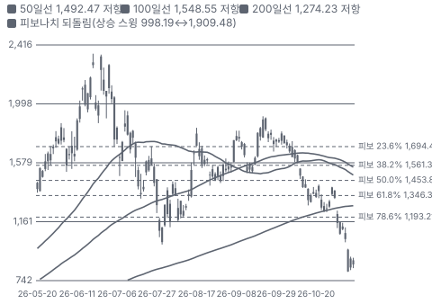

**주봉**

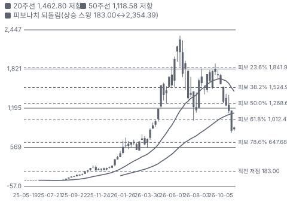

**월봉**

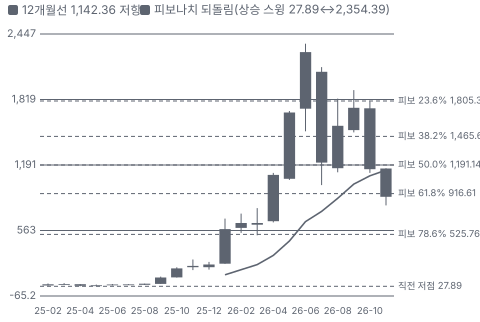

**분기 매출·EPS 실적과 컨센서스**

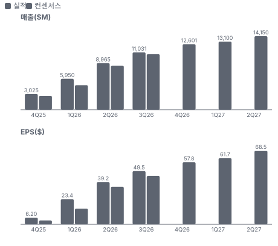

**4Q26 매출 — 지표 추세 vs 가이던스·컨센서스**

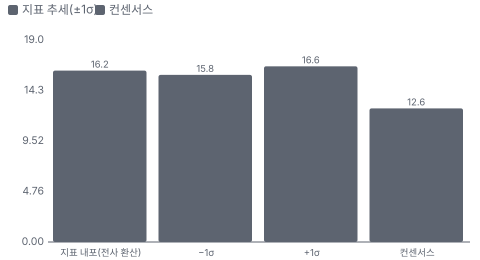

**최근 4개 분기 주가 변화 분석**

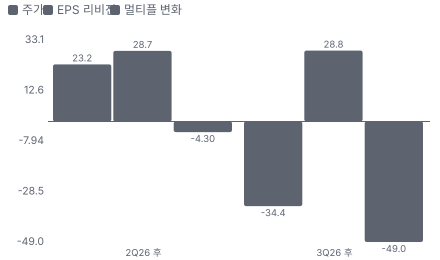

**EPS 리비전**

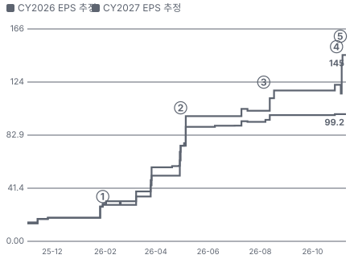

① 26-01-29 2Q FY26 실적, 다음 날 +6.9% · EPS 리비전 +6%
② 26-04-30 3Q FY26 실적·첫 NBM 5건, 다음 날 +8.3% · EPS 리비전 +55%
③ 26-08-05 4Q FY26 실적·NBM \$93.9B, 다음 날 −6.8% · EPS 리비전 +15%
④ 26-10-29 1Q FY27 실적·NBM 숫자 유지, 다음 날 −13.5% · EPS 리비전 +19%
⑤ 26-11-05 중간선거 뒤 데이터센터 규제 우려로 메모리 급락 · 실적 창과 겹침

**밸류에이션 주가 시나리오**

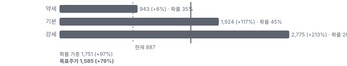

**주가별 업사이드**

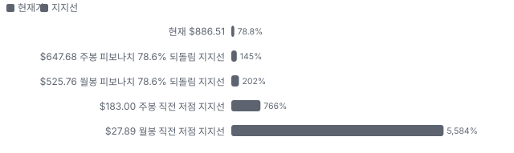

**제품·서비스 포트폴리오**

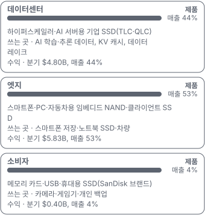

**고객 믹스(1Q FY27(2026-07~10), 매출 대비)**

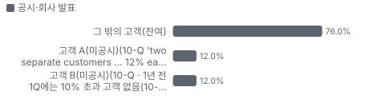

**공급 병목(10점, 낮을수록 병목)**

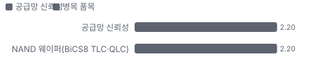

**CAPEX의 매출 대비 비중**

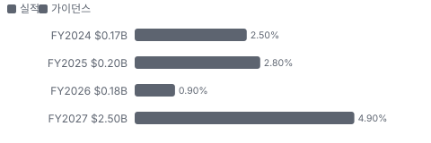

**어닝콜 변화별 주주가치 영향**

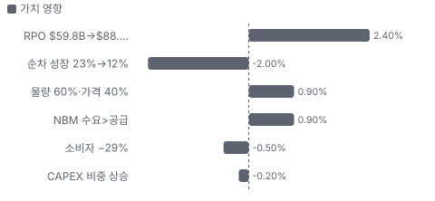

**멀티플 프리미엄(Fwd 1Y P/E, 최근 4개 분기말)**

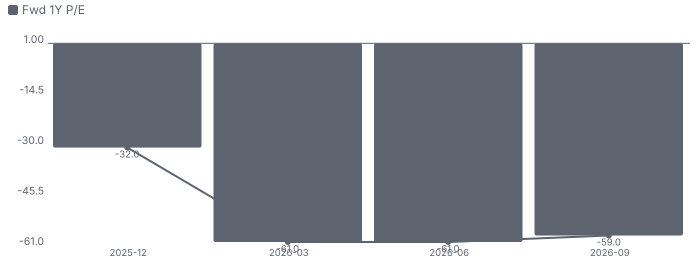

**합리적 멀티플**

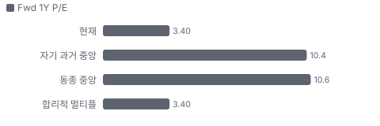

**수주·파이프라인 확실성 사다리**

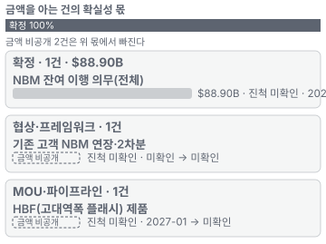

**매출 → 매출총이익 → 영업이익(매출 = 100, 최근 4분기)**

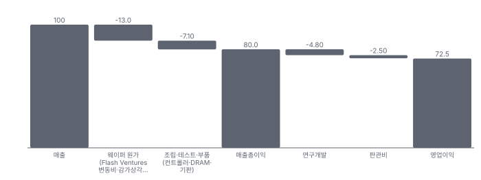

**1년 전 대비 마진 기여(비용 비중 변화의 반대)**

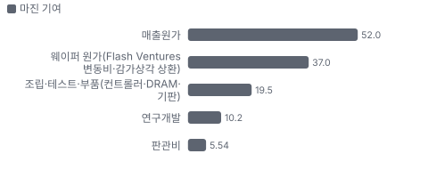

**분기 비용 비중 추이(매출 대비, 공시)**

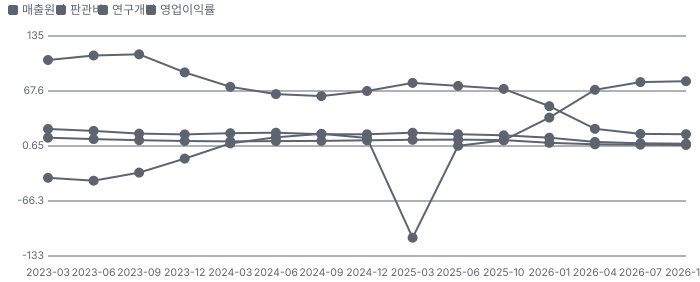

**비용 요인별 매출 대비 비중과 1년 변화**

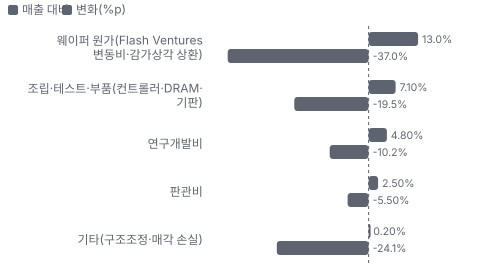

**BOM 항목 가격 +10% 시 OPM 변화**

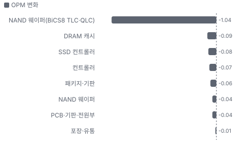

**데이터센터 BOM 원가 몫과 가격 +10% 시 OPM**

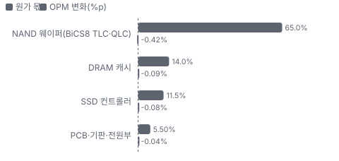

**엣지 BOM 원가 몫과 가격 +10% 시 OPM**

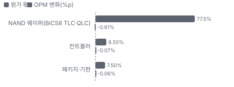

**소비자 BOM 원가 몫과 가격 +10% 시 OPM**

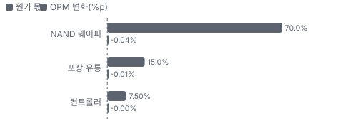

**생산시설별 면적(ft², 큰 순) — 생산능력 미공시라 면적을 대용으로**

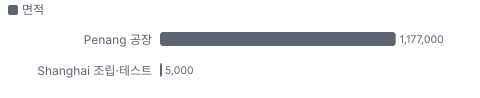

**매출·PPI·수출입 — 최근 15개 분기 같은 축(1Q23 = 100) + 다음 분기 추정**

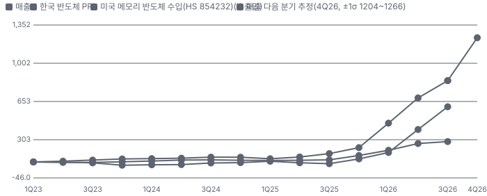

**매출과 한국 반도체 PPI 증가율(전년 대비, 최근 16개 분기 + 다음 분기 추정)**

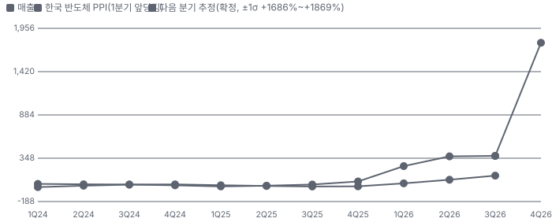

**매출 증가율의 가격·물량 분해와 8분기 전망(전년 대비)**

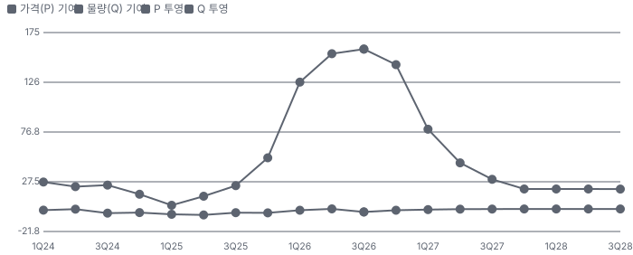

**분기별 매출 증가율 분해**

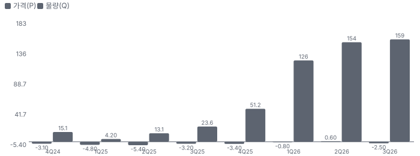

**목표주가 산정 — 약세와 기본 사이(약세 쪽 35%), 도달 확률 약 56%**

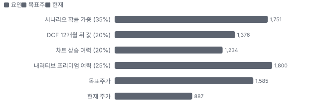

**일봉 지지·저항과 목표주가**

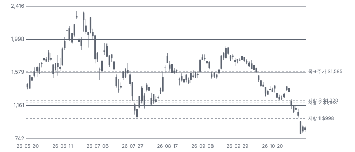

**커뮤니티 언급 수(최근 30일, 채널별)**

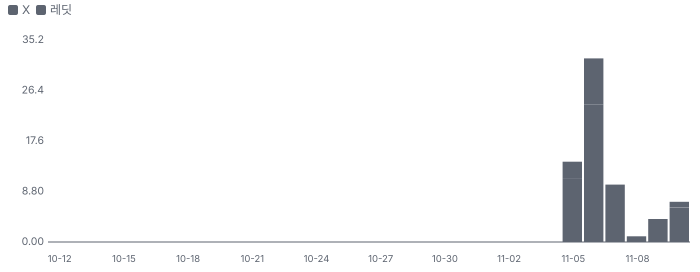

**커뮤니티 게시 수(월, 최근 12개월 — 이번 달은 진행 중)**

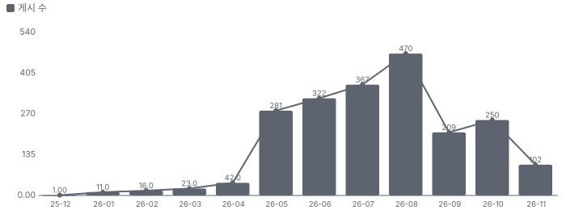

**일별 거래량 분해**

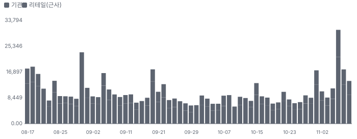

**기관 자금 흐름**

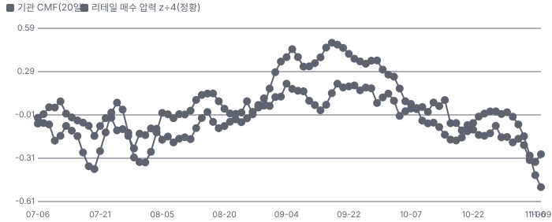

**몬테카를로**

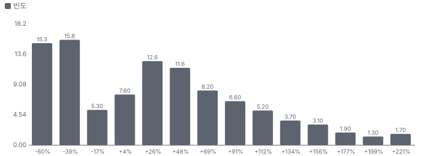

해석: 3,000번 중 1,857번(62%)에서 가치가 지금 주가 이상이었다. 가정을 흔들어도 지금 주가를 뒷받침하는 경우가 더 많다. 가운데 값은 1.26배이고, 열 번 중 여덟 번은 0.45~2.32배 사이에 든다.

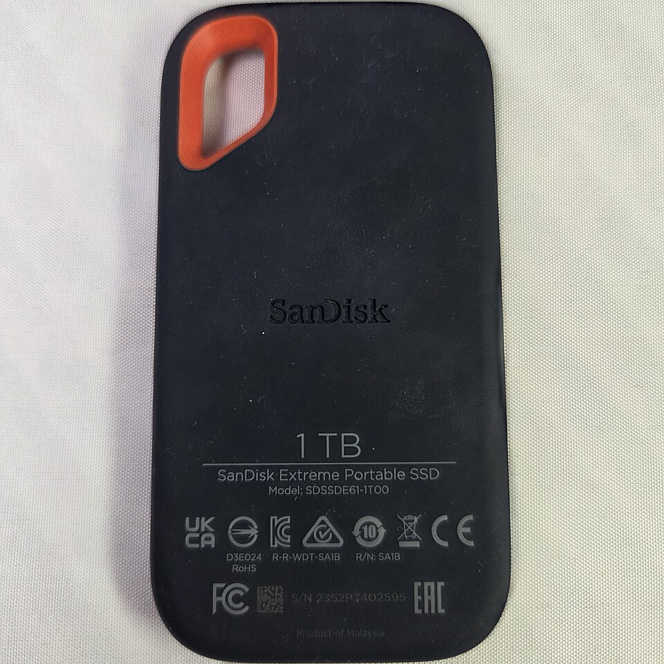
**소비자** — SanDisk Extreme 휴대용 SSD 1TB(소비자 제품) — 위키미디어 공용, CC BY-SA 4.0
_사진: ITEagle Europe - Sebastiaan Broekhoven · CC BY-SA 4.0 · Wikimedia Commons_

## 내러티브

> **기업가치를 결정하는 이야기:** 값은 두 층이다. ① 장기 계약(NBM)이 묶은 물량 — 잔여 이행 의무 \$88.9B, 비트의 절반 이상 ② 시장 가격에 파는 나머지 절반. 결정 변수는 가격이 꺾일 때 이익이 얼마나 남느냐다 — 회사는 '최저 가격에서도 매력적 마진'이라고만 하고 최저 가격 수준은 밝히지 않았다.

> **멀티플·EPS 프리미엄**
> **멀티플:** Fwd 1Y P/E 3.4배는 동종 중앙 10.6배보다 68% 낮다. 7월 말 자기 배수는 6.6배였다 — 이익 추정은 오르는데 배수는 반으로 줄었다.
> **EPS:** 지난 네 분기 모두 EPS가 컨센서스를 넘었다(2Q FY26 +71%, 3Q +60%, 4Q +12%, 1Q FY27 +6%). 초과 폭이 분기마다 줄었다. 8/5 이후 FY28 EPS 컨센서스는 \$181.88 → \$284.74(+57%)로 올랐다.

### 투자자들은 왜 열광했나

4/30 3Q FY26 실적(첫 장기 계약 5건) 다음 날 +8.3%, 이후 6월 25일 종가 \$2,335까지 올랐다. 식은 이유는 세 가지다 — 7~8월 '고점 이익' 논쟁, 10/29 실적에서 장기 계약 숫자가 그대로였던 것(다음 날 −13.5%), 11/4~5 선거 뒤 데이터센터 규제 우려와 레버리지 청산(이틀 −28.4%).

### 무엇이 기업가치를 바꾸나

> **구조적 체질 변화**
> **변화:** PC·스마트폰 위주 회사에서 데이터센터 회사로 바뀌고 있다. 데이터센터 매출 비중 1년 전 12% → 44%. 판매 방식도 분기 협상에서 다년 계약(NBM)으로 옮겼다
> **증거:** 10-Q 시장별 매출·NBM 주석
> **반증:** NBM 비트 비중이 FY28 2/3 아래로 내려온다

> **고부가 믹스 확장**
> **변화:** QLC 고용량 eSSD(데이터센터용 기업 SSD) 매출이 시작됐다(TLC:QLC 70:30). 데이터센터 GB(기가바이트)당 가격 +약 320%(전년)
> **증거:** 1Q 콜·10-Q
> **반증:** 데이터센터 GB당 가격 순차 하락

> **기술 혁신**
> **변화:** BiCS8(CBA(CMOS 웨이퍼와 셀 웨이퍼를 따로 만들어 붙이는 구조) 구조)이 주력이고, BiCS9(BiCS8 셀에 새 CMOS를 붙인 다음 세대)·10과 HBF(첫 다이 테이프아웃)가 다음 단계다
> **증거:** 1Q 콜
> **반증:** HBF 샘플이 2027년을 넘기거나 BiCS9 램프 지연

> **실행 속도**
> **변화:** 해당 없음(메모리 제품은 수주→출하 리드타임을 공시하지 않는다). 1Q 출하 엑사바이트는 +약 10%(전년)로 물량은 제한적이다 **납품 리드타임 미확인.** 피어 비교 미확인. 이전 대비 미확인.
> **증거:** 10-Q
> **반증:** 출하 비트 성장이 회사 계획(10%대 중후반)을 밑돈다

> **M&A**
> **변화:** 해당 없음(최근 3년 인수 없음, SDSS 지분 80% 처분만)
> **증거:** 10-Q
> **반증:** 대형 인수 발표

> **정책·입법 연관성**
> **재정정책:** CHIPS(미국 반도체 지원법)법 지원은 SanDisk와 직접 관련이 확인되지 않는다(미국 팹 없음). 관세 — 미국 판매 제품 대부분이 면제 상태이고 232조·301조 조사가 진행 중이다 10-Q 관세 절 반증: 메모리·SSD 관세 면제 철회 의회 동의 10/10 — 하원 5/5(CHIPS법 2022 본회의 통과(SanDisk 직접 수혜는 미확인)) · 상원 5/5(같은 법 본회의 통과).
> **행정명령:** 232조(국가 안보) 반도체 관세 조사가 진행 중이다 — 조사 단계이고 시행 전이다 10-Q 관세 절 반증: 232조 반도체 관세 포고문이 SSD를 포함 의회 동의 2/10 — 하원 1/5(행정부 조사 — 의회 논의 확인 안 됨) · 상원 1/5(같음).
> **연관입법:** 선거 뒤 데이터센터 규제(전력·용수·인허가) 우려가 커졌지만 연방 법안 발의는 확인되지 않았고, 주 단위 논의가 핵심이다(정황) TradingView 뉴스(Benzinga 11/5)·커뮤니티(IB 노트 인용, 원문 미확인) 반증: 주요 데이터센터 주에서 신설 제한 법안이 발의되지 않는다

> **CAPEX 낙수효과**
> **변화:** 하이퍼스케일러 AI CAPEX가 eSSD 수요로 이어졌다. 금지표대로 SanDisk 몫은 NBM 계약과 공시 매출로만 센다 — 고객 2곳이 각 12%
> **증거:** 10-Q 고객 집중 절
> **반증:** 하이퍼스케일러 CAPEX 가이던스 하향

### 내러티브 근거

> 프리미엄은 'AI 추론이 NAND를 데이터센터로 빨아들이는 메모리 슈퍼사이클'에서 나왔다. 숫자는 사상 최대(1Q 매출 \$11.03B, GM 85%)인데 주가는 6월 종가 고점 대비 −62%다. 시장은 이 이익을 정점으로 보고 Fwd 1Y P/E 3.4배만 준다. 동종 대비 멀티플 차이 -68% 중 회사 고유 몫은 -2%다. 단계는 과밀, 쏠림은 높음이다.

> **AI 추론의 NAND 수요(KV(추론 중 앞 토큰 계산값을 저장하는 캐시) 캐시·데이터 레이크)** · 유지
> **논리:** 추론 문맥이 길어질수록 KV 캐시와 검색 데이터가 SSD로 내려와 데이터센터 NAND 비트 수요가 CY27 +40%
> **숫자:** 데이터센터 매출 \$269M(1년 전) → \$4.80B(1Q), 매출 비중 44%. 회사 전망 CY27 데이터센터 비트 +40%·NAND 시장 55%+
> **반증:** 2Q 데이터센터 매출이 순차 감소하거나 고객이 KV 캐시를 DRAM·CXL(CPU와 메모리를 잇는 확장 연결 규격)로 돌린다

> **장기 계약(NBM)이 사이클을 줄인다** · 약화
> **논리:** 고객 8곳이 4년 이상 물량을 약정하고 보증을 걸어, 메모리 가격이 꺾여도 하방이 막힌다
> **숫자:** RPO \$88.9B(12개월 안 20%), 제3자 보증 \$12.8B, 최소 약정 \$93.9B(최저 가격 기준)
> **반증:** 고객 재협상으로 RPO가 줄거나 최저 가격이 영업 적자 구간

> **자사주 매입으로 주당 이익 압축** · 유지
> **논리:** 분기 FCF \$5.7B로 분기마다 시가총액의 4% 안팎을 산다
> **숫자:** 두 분기 6.0M주(약 4%) 매입, 남은 한도 \$10.5B
> **반증:** 매입 속도가 분기 \$3B 아래로 준다

> **HBF(고대역폭 플래시) 옵션** · 태동
> **논리:** HBM(GPU 옆에 쌓는 고대역폭 DRAM)급 대역폭에 NAND급 용량 — 추론 메모리 병목을 푸는 새 시장
> **숫자:** 첫 다이 테이프아웃(1Q), 샘플 2027년. 회사 장기 재무 모델 밖
> **반증:** 2027년 샘플 일정이 밀리거나 주요 GPU 업체 채택 발표가 없다

> **반대 내러티브: 메모리 사이클 고점** · 확산
> **논리:** GM 85%는 역사상 없던 숫자이고, 가격이 꺾이면 이익이 몇 분기 만에 절반 아래로 간다 — 그래서 배수 3배대
> **숫자:** GM 29.9%(1년 전) → 85.1%. 재고 일수 115일 → 166일. 2Q 가이던스 순차 +12%로 둔화. Fwd 1Y P/E 3.4배 vs 동종 중앙 10.6배
> **반증:** 2Q 가격이 순차 상승하고 재고 일수가 140일 아래로

> **반대 내러티브: 정책·중국 공급** · 확산
> **논리:** 선거 뒤 데이터센터 규제 우려와 YMTC 점유율 상승이 수요·가격 양쪽을 깎는다
> **숫자:** 11/4~5 이틀 −28.4%. Counterpoint 인용 2Q CY26 점유율 SanDisk 11%(직전 13%)·YMTC 14%(원문 미확인)
> **반증:** 연방·주 데이터센터 제한 법안이 발의되지 않고 YMTC eSSD 인증 소식이 없다

## 포트폴리오

| 제품·서비스 | 구분 | 무엇 | 쓰는 곳 | 돈 버는 방식 | Mix | Mix 변화(전 분기 대비) |
|---|---|---|---|---|---|---|
| 데이터센터 | 제품 | 하이퍼스케일러·AI 서버용 기업 SSD(TLC·QLC) | AI 학습·추론 데이터, KV 캐시, 데이터 레이크 | 분기 \$4.80B, 매출 44% | 44% | +10.3%p |
| 엣지 | 제품 | 스마트폰·PC·자동차용 임베디드 NAND·클라이언트 SSD | 스마트폰 저장·노트북 SSD·차량 | 분기 \$5.83B, 매출 53% | 53% | -7.7%p |
| 소비자 | 제품 | 메모리 카드·USB(범용 직렬 연결 규격)·휴대용 SSD(SanDisk 브랜드) | 카메라·게임기·개인 백업 | 분기 \$0.40B, 매출 4% | 4% | -2.6%p |

**Mix 변화가 가장 큰 쪽은 데이터센터(+10.3%p, 전 분기 대비).** 계절성 판정: 분기 매출 계절 지수 기준 없음 → 직전 분기와 비교.

## 고객

> **1Q FY27(2026-07~10) 최대 고객 그 밖의 고객(잔여) 76%, 상위 3곳 100%, 집중도 집중.** 공시·회사 발표로 확인한 몫은 매출의 100%이고, 나머지 고객 몫은 추정이거나 미분해다. 1Q 매출의 24%가 고객 2곳(각 12%)이다. 1년 전에는 10% 넘는 고객이 없었다. 이름은 공시되지 않는다 — 하이퍼스케일러·스마트폰 브랜드와의 연결은 가설이다.

**고객별 매출 몫(1Q FY27(2026-07~10))**
| 고객 | 몫 | 변화 | 근거 |
|---|---|---|---|
| 그 밖의 고객(잔여) | 76% | 미확인 | 공시 |
| 고객 A(미공시)(10-Q 'two separate customers … 12% each' · 1년 전 1Q에는 10% 초과 고객 없음(10-Q)) | 12% | 미확인 | 공시 |
| 고객 B(미공시)(10-Q · 1년 전 1Q에는 10% 초과 고객 없음(10-Q)) | 12% | 미확인 | 공시 |

> **그 밖의 고객(잔여)** · 공시
> **사는 것:** SSD·임베디드·카드

> **고객 A(미공시)(10-Q 'two separate customers … 12% each' · 1년 전 1Q에는 10% 초과 고객 없음(10-Q))** · 공시
> **사는 것:** SSD·NAND(미공시)

> **고객 B(미공시)(10-Q · 1년 전 1Q에는 10% 초과 고객 없음(10-Q))** · 공시
> **사는 것:** SSD·NAND(미공시)

## 수주·파이프라인

> **2026-10-02 기준 3건.** 확정 \$88.90B. 공시 NBM 잔여 이행 의무(RPO) \$88.90B.

**실행 속도와 방해 요인**
| 항목 | 상태 | 실행 속도 | 방해 요인 |
|---|---|---|---|
| NBM 잔여 이행 의무(전체) | 확정 | 20%가 12개월 안 매출 | 고객 수요 미달 시 보증 집행 분쟁 · 가격 변동분 하락 · 마진: 회사 '최저 가격에서도 매력적 마진'(4Q 콜) |
| 기존 고객 NBM 연장·2차분 | 협상 | 미확인 | 공급 여력 — 파이프라인이 공급 초과 |
| HBF(고대역폭 플래시) 제품 | 파이프라인 | 첫 다이 테이프아웃 · 2027년 샘플 | 고객 채택·표준·양산 준비 |

## 마진 구조

> **GPM 80.0%, OPM 72.5%.** TTM 1Q FY26 대비 GPM +56.5%p, OPM +96.3%p. TTM 매출원가가 매출의 20.1%로 1년 전 76.6%에서 56%p 떨어졌다. 원가가 줄어서가 아니라 가격이 올라서다 — 분기 매출원가는 \$1.3~1.7B로 거의 그대로인데 매출이 다섯 배가 됐다.

> **매출 100 중 매출원가 20.0, 매출총이익 80.0(최근 4분기, 공시).** 매출원가 요인 중 웨이퍼 원가(Flash Ventures 변동비·감가상각 상환)이 매출의 13.0%로 가장 무겁고, 단가가 +10% 오르면 GPM이 -1.30%p 움직인다. 분기 회귀로 매출 1이 늘 때 매출원가는 0.01 늘고, 매출원가의 고정비 몫은 97%다.

**비용 요인 강도 — 비중·추세·충격(+10%)·탄력**
| 비용 | 구분 | 매출 대비 | 1년 변화 | 마진 기여 | 충격 시 마진 | 매출 탄력 | 고정비 몫 |
|---|---|---|---|---|---|---|---|
| 웨이퍼 원가(Flash Ventures 변동비·감가상각 상환) | 매출원가 요인 | 13.0% | -37.0%p | +37.0%p | -1.30%p | 미확인 | 60% |
| 조립·테스트·부품(컨트롤러·DRAM·기판) | 매출원가 요인 | 7.1% | -19.5%p | +19.5%p | -0.71%p | 미확인 | 20% |
| 매출원가 | 공시 항목 | 20.0% | -52.0%p | +52.0%p | -2.00%p | 0.01 | 97% |
| 연구개발 | 공시 항목 | 4.8% | -10.2%p | +10.2%p | 미확인 | 0.01 | 88% |
| 판관비 | 공시 항목 | 2.5% | -5.5%p | +5.5%p | 미확인 | 0.01 | 81% |

매출 탄력 = 분기 비용을 매출에 회귀한 기울기(매출 1당 변동비), 고정비 몫 = 절편 ÷ 평균 비용. 표본이 8분기 미만이면 미확인. 매출원가 요인 비중은 margin 재료의 추정이 섞여 있고, 공시 매출원가와의 차이는 '기타 매출원가'로 둔다.

**GPM에서 OPM까지(GAAP)**
| 기간 | GPM | 연구개발 | 판관비 | 기타 | OPM |
|---|---|---|---|---|---|
| TTM 1Q FY26 | 23.5% | 15.0% | 8.0% | 24.3% | -23.8% |
| TTM 1Q FY27 | 80.0% | 4.8% | 2.5% | 0.2% | 72.5% |

**GPM·OPM 최근 4개 분기**
| 분기 | GPM | OPM |
|---|---|---|
| 2026-01 | 50.9% | 35.2% |
| 2026-04 | 78.4% | 69.1% |
| 2026-07 | 84.6% | 78.5% |
| 2026-10 | 85.0% | 79.6% |

**마진을 결정하는 비용 요인 — 비용 +10% 시 OPM**
| 비용 | 매출 대비 | 변화 | 고정비 | OPM |
|---|---|---|---|---|
| 웨이퍼 원가(Flash Ventures 변동비·감가상각 상환) | 13.0% | -37.0%p | 60% | -1.30%p |
| 조립·테스트·부품(컨트롤러·DRAM·기판) | 7.1% | -19.5%p | 20% | -0.71%p |
| 연구개발비 | 4.8% | -10.2%p | 90% | -0.48%p |
| 판관비 | 2.5% | -5.5%p | 80% | -0.25%p |
| 기타(구조조정·매각 손실) | 0.2% | -24.1%p | 미확인 | -0.02%p |

**비용을 움직이는 요인**
| 비용 | 요인 |
|---|---|
| 웨이퍼 원가(Flash Ventures 변동비·감가상각 상환, 매출원가) | Kioxia 합작 팹 감가상각·장비 리스·엔화 · 근거 추정 |
| 조립·테스트·부품(컨트롤러·DRAM·기판, 매출원가) | DRAM 가격(기업용 SSD 캐시)·기판 · 근거 추정 |
| 연구개발비(연구개발) | BiCS(Kioxia·SanDisk 공동 3D NAND 세대 이름) 세대 개발·Kioxia 공동 R&D 최소 분담 · 근거 공시 |
| 판관비(판관비) | 인력·SBC · 근거 공시 |
| 기타(구조조정·매각 손실, 기타) | 2025-03 분기 영업권 손상 \$1.83B · 근거 공시 |

**데이터센터 BOM — 매출의 44%, GPM 85%(시장별 총이익 미공시 — 전사 1Q GAAP GM 85.0%(EX-99.1)를 대용으로 쓴다(추정)), 항목 가격 +10% 시**
| 항목 | 원가 몫 | 전가 | 제품 GPM | OPM |
|---|---|---|---|---|
| NAND 웨이퍼(BiCS8 TLC·QLC) | 55~75% | 미확인 | -1.0%p | -0.42%p |
| DRAM 캐시 | 8~20% | 미확인 | -0.2%p | -0.09%p |
| SSD 컨트롤러 | 8~15% | 미확인 | -0.2%p | -0.08%p |
| PCB·기판·전원부 | 3~8% | 미확인 | -0.1%p | -0.04%p |
| 미분해 | 4% | - | - | - |

**엣지 BOM — 매출의 53%, GPM 85%(시장별 총이익 미공시 — 전사 1Q GAAP GM 85.0%(EX-99.1)를 대용으로 쓴다(추정)), 항목 가격 +10% 시**
| 항목 | 원가 몫 | 전가 | 제품 GPM | OPM |
|---|---|---|---|---|
| NAND 웨이퍼(BiCS8 TLC·QLC) | 70~85% | 미확인 | -1.2%p | -0.61%p |
| 컨트롤러 | 5~12% | 미확인 | -0.1%p | -0.07%p |
| 패키지·기판 | 5~10% | 미확인 | -0.1%p | -0.06%p |
| 미분해 | 7% | - | - | - |

**소비자 BOM — 매출의 4%, GPM 85%(시장별 총이익 미공시 — 전사 1Q GAAP GM 85.0%(EX-99.1)를 대용으로 쓴다(추정)), 항목 가격 +10% 시**
| 항목 | 원가 몫 | 전가 | 제품 GPM | OPM |
|---|---|---|---|---|
| NAND 웨이퍼 | 60~80% | 미확인 | -1.0%p | -0.04%p |
| 포장·유통 | 10~20% | 미확인 | -0.2%p | -0.01%p |
| 컨트롤러 | 5~10% | 미확인 | -0.1%p | -0.00%p |
| 미분해 | 7% | - | - | - |

NAND 웨이퍼(BiCS8 TLC·QLC) 가격이 +10% 오르면 영업이익은 -1.4% 움직인다. 판매가 전가를 모르는 항목은 전가 0%로 계산했다.

**BOM 항목 가격을 움직이는 것**
| 항목 | 요인 |
|---|---|
| NAND 웨이퍼(BiCS8 TLC·QLC) | NBM 가격 구조(4Q 콜) · 전가: 부분 — NBM 가격에 고정·변동 요소(바닥·상한) · 근거 추정 |
| SSD 컨트롤러 | 자체 설계·외부 생산(미공시) · 근거 추정 |
| DRAM 캐시 | DRAM 가격 급등기에 원가 압력 · 근거 추정 |
| PCB·기판·전원부 | 부품 · 근거 추정 |
| NAND 웨이퍼(BiCS8 TLC·QLC) | 4Q 콜 · 전가: 부분 — 비NBM 물량은 시장 가격 · 근거 추정 |
| 컨트롤러 | 부품 · 근거 추정 |
| 패키지·기판 | 부품 · 근거 추정 |
| NAND 웨이퍼 | 10-Q — 판매 GB당 가격 +110% · 전가: 있음 — 소매 가격 인상 · 근거 추정 |
| 포장·유통 | 소매 채널 · 근거 추정 |

**BOM 투입 물가 — PPI 전년비, 2026-11-10 수집**
| 항목 | 미국 | 일본 | 한국 | 대만 |
|---|---|---|---|---|
| NAND 웨이퍼 | -2.2%* | +3.9%* | +134.0% | +22.9%* |
| 패키지·기판 | +45.8% | +11.3% | +4.5% | +12.1% |

별표는 품목보다 넓은 업종 지수다. 지난 1년 투입 물가를 판매가 전가 뒤 원가에 그대로 넣으면 OPM은 -15.83%p 움직인다(매출원가의 63% 기준).

## 공급망 병목

> **공급망 신뢰성 2.2/10, 병목 심각.** 가장 약한 고리는 NAND 웨이퍼(BiCS8 TLC·QLC) 2.2점이고, 품목 평균은 2.2점이다. 근거가 부족한 3건(DRAM 캐시 · SSD 컨트롤러 · 조립·테스트)은 점수에서 뺐다. 병목은 회사 안이 아니라 합작 팹이다. 웨이퍼 거의 전부를 Kioxia와의 합작(Flash Ventures)이 요카이치·기타카미 팹에서 만들고, SanDisk 몫은 대개 생산의 50%다. 회사는 웨이퍼를 늘리기보다 세대 전환으로 비트를 연 10%대 중후반 늘린다.

**병목과 마진 — 품목 가격 +10% 시 OPM**
| 품목 | 점수 | 판정 | 구분 | OPM |
|---|---|---|---|---|
| NAND 웨이퍼(BiCS8 TLC·QLC, 필수) | 2.2 | 병목 심각 | 핵심 통제 품목 | -1.04%p |

> **NAND 웨이퍼(BiCS8 TLC·QLC)** · 2.2/10
> **왜:** 비트 공급 상한을 정한다
> **병목 요인:** 인증 공급사 1곳 · 캐파 빠듯 · 리드타임 미확인 · 재인증 미확인 · 1위 점유율 100% · 일본(요카이치·기타카미) 집중 100% · 물량 확보 미확인
> **풀리는 조건:** 미확인

**공급사**
| 품목 | 공급사 | 몫 | 근거 |
|---|---|---|---|
| NAND 웨이퍼(BiCS8 TLC·QLC) | Flash Ventures(Kioxia 합작 — Flash Partners·Flash Alliance·Flash Forward, 웨이퍼 생산) | 미확인 | 공시 |
| DRAM 캐시 | 외부 DRAM 업체(미공시) — Nanya 지분 보유(기업용 SSD 캐시) | 미확인 | 공시 |
| SSD 컨트롤러 | 자체 설계 + 외부 파운드리(미공시, 컨트롤러) | 미확인 | 추정 |
| 조립·테스트 | 자체 Penang 공장(조립·테스트) | 미확인 | 공시 |
| 조립·테스트 | SDSS(상하이, 20% 지분 — 공급 계약 5년, 조립) | 미확인 | 공시 |

**무역 통계로 본 공급 지역**
| 품목 | EU 수입처 | 일본 수입처 | EU 1위 전년비 |
|---|---|---|---|
| NAND 웨이퍼(BiCS8 TLC·QLC) | TW(대만) 45% · KR(한국) 21% · CN(중국) 16% | 台湾 52% · 大韓民国 28% | +365.5% |
| DRAM 캐시 | TW 45% · KR 21% · CN 16% | 台湾 52% · 大韓民国 28% | +365.5% |

## 생산능력

> **현재 명목 캐파 미확인, 가동률 미확인.** FY2026 CAPEX는 \$0.18B로 매출의 0.9%다. SanDisk는 웨이퍼 팹을 직접 갖지 않는다. 웨이퍼는 Kioxia 합작이 일본 요카이치·기타카미 팹에서 만들고, 회사 소유 대형 공장은 말레이시아 Penang 후공정 공장(약 117.7만 ft²)이다. 회사는 웨이퍼 증설보다 세대 전환으로 비트를 연 10%대 중후반 늘린다는 계획이다.

**생산시설 20곳**(FY26 10-K Item 2 — 표에 이름이 나온 18곳 + 웨이퍼 팹 2곳(요카이치·기타카미, Flash Ventures 임차, Kioxia 소유). 이름 없는 기타 임차 사무소는 세지 않았다) — 이름·위치를 밝힌 곳 11곳, 소유 4곳 · 임차 6곳 · 소유·임차 1곳. 시설별 생산능력은 공개되지 않았다 — 회사 전체 캐파만 위에 적었다.

**생산시설 20곳 — 명칭·위치·생산능력**
| 시설 | 위치 | 용도 | 생산능력 | 소유·상태 |
|---|---|---|---|---|
| Penang 공장 | 말레이시아 Penang | 제조(후공정·미디어 제조)·R&D | 미확인 — 캐파 미공시 · 면적 1,177,000 ft² | 소유 · 가동 |
| 요카이치 웨이퍼 팹(Flash Ventures) | 일본 미에현 요카이치 | 제조(NAND 웨이퍼) | 미확인 — 웨이퍼 캐파 미공시 — SanDisk 몫 대개 50% | 임차 · 가동 |
| 기타카미 웨이퍼 팹(Flash Ventures, K1·K2) | 일본 이와테현 기타카미 | 제조(NAND 웨이퍼) | 미확인 — 웨이퍼 캐파 미공시 | 임차 · 가동 |
| Milpitas 본사 | 미국 Milpitas, California | 사무·R&D | 미확인 — 사무 · 면적 578,000 ft² | 임차 · 가동 |
| Kfar Saba R&D | 이스라엘 Kfar Saba | R&D | 미확인 — R&D · 면적 204,000 ft² | 소유 · 가동 |
| Bangalore R&D | 인도 Bangalore | R&D·사무 | 미확인 — R&D · 면적 108,000 ft² | 소유·임차 · 가동 |
| Irvine 사무소 | 미국 Irvine, California | R&D·사무 | 미확인 — 사무 · 면적 105,000 ft² | 임차 · 가동 |
| Tefen R&D | 이스라엘 Tefen | R&D | 미확인 — R&D · 면적 58,000 ft² | 소유 · 가동 |
| Shanghai 조립·테스트 | 중국 상하이 | 제조(조립·테스트) | 미확인 — 캐파 미공시 · 면적 5,000 ft² | 임차 · 가동 |
| Hsinchu R&D | 대만 신주 | R&D | 미확인 — R&D · 면적 27,000 ft² | 임차 · 가동 |
| Fujisawa R&D | 일본 후지사와 | R&D·영업 | 미확인 — R&D · 면적 23,000 ft² | 소유 · 가동 |

공개된 증설 계획은 확인되지 않았다.

**CAPEX와 매출 대비**
| 기간 | CAPEX | 매출 | 매출 대비 | 구분 |
|---|---|---|---|---|
| FY2024 | \$0.17B | \$6.66B | 2.5% | 실적 |
| FY2025 | \$0.20B | \$7.36B | 2.8% | 실적 |
| FY2026 | \$0.18B | \$20.25B | 0.9% | 실적 |
| FY2027 | \$2.50B | \$50.88B | 4.9% | 가이던스 |

## 해자

> 해자는 Kioxia와 반씩 나눠 쓰는 세계 최대급 NAND 팹 접근권과 BiCS8 CBA 기술이다. 그 위에 장기 계약(NBM)이 고객을 4년 이상 묶는다. 다만 웨이퍼를 남의 팹에 의존하고 YMTC가 점유율을 올리고 있다.

> **Kioxia 합작 팹 접근권(규모)** · 강함
> **해자:** 요카이치·기타카미 팹 생산의 대개 50%를 원가로 받는다 — 단독 팹 없이 대형 NAND 규모
> **근거:** 10-Q Flash Ventures 주석, 합작 2034년까지 연장(2026-01)
> **숫자:** Flash Ventures 관련 약정 \$7.141B, 1Q 순지급 \$941M
> **깨지는 조건:** Kioxia가 합작 증설을 단독 투자로 돌리거나 몫이 50% 아래로

> **다년 장기 계약(NBM)과 보증** · 중간
> **해자:** 고객 8곳이 4년 이상 물량을 약정하고 보증금·보증 증서로 이행을 담보한다
> **근거:** RPO \$88.9B(10-Q), 제3자 보증 \$12.8B, 투자 등급 고객 95%(1Q 콜)
> **숫자:** FY27 비트 50% 이상·FY28 약 2/3
> **깨지는 조건:** 고객이 약정 물량을 줄이도록 재협상하거나 보증 집행 분쟁

> **BiCS8 CBA·QLC 기술** · 중간
> **해자:** CMOS(셀을 제어하는 논리 회로)와 셀 웨이퍼를 붙이는 구조로 성능·밀도가 업계 기준이라고 회사가 말한다
> **근거:** 1Q 콜 — QLC 매출 시작, TLC:QLC 70:30
> **숫자:** 미확인 — 경쟁사 대비 원가 공시 없음
> **깨지는 조건:** YMTC·Samsung이 같은 세대 원가로 eSSD 인증을 늘린다

## 경영진·네트워크

> CEO David Goeckeler(회장 겸)와 CFO Luis Visoso가 분사 뒤 장기 계약 전환과 자사주 매입을 이끈다. 연결이 매출을 만들었다는 공개 증거는 없다.

> **David Goeckeler** · 회장·CEO · 2025-02(분사)
> **프로필:** Western Digital CEO 출신(공개 이력)
> **비즈니스:** Western Digital
> **정계:** 미확인
> **동문:** 미확인
> **사모임:** 미확인

> **Luis Visoso** · CFO · 미확인
> **프로필:** 1Q 콜 재무 설명
> **비즈니스:** 미확인
> **정계:** 미확인
> **동문:** 미확인
> **사모임:** 미확인

**네트워크 정량화**
| 연결 | 강도 | 닿는 매출 | 가중 노출 | 매출 대비 | 근거 |
|---|---|---|---|---|---|
| 비즈니스: Kioxia 합작(1999년 시작, 2034년까지 연장) | 5/5 | 미확인 | 미확인 | 미확인 | 10-Q https://www.sec.gov/Archives/edgar/data/2023554/000162828026068601/sndk-20261002.htm |
| 정계: 하원 로비 분기 \$90K(무역·제조 쟁점, 외부 로비 회사) | 1/5 | 미확인 | 미확인 | 미확인 | 하원 로비 공시 분기 집계 Easyconomics lobbying(house_ld) |

가중 노출은 연결이 닿는 매출의 크기다. 연결이 그 매출을 만들었다는 뜻이 아니며, 인과는 공개 자료로 입증하지 못한다.

## 약세 논리 및 셀온 조건

| 약세 논리 | 근거 | 가를 자료 |
|---|---|---|
| 메모리 사이클 정점 | GM 29.9%(1년 전) → 85.1%. 2Q 순차 성장 가이던스 +12%로 1Q +23%의 절반. 과거 NAND 하강기(FY23) 매출 −38% | 2Q FY27 실적의 가격 방향(2027-01 말 예상) |
| 재고 증가 | 재고 일수 115일 → 166일, 재고 \$2.70B → \$3.02B(3개월). 다만 완제품은 \$447M → \$344M로 줄고 원재료·부품이 늘었다 | 2Q 재고 일수·완제품 재고 |
| 장기 계약 최저 가격 미공시 | 잔여 이행 의무 \$88.9B는 최저 가격 기준이고, 12개월 안 인식은 20%(\$17.8B)로 다음 4분기 매출 컨센서스 \$54.6B의 3분의 1이다 | 회사의 최저 가격 기준 이익률 공개 여부 |
| 중국 공급(YMTC) | Counterpoint 인용 2Q CY26 점유율 SanDisk 11%(직전 13%)·YMTC 14%(원문 미확인). YMTC 우한 4공장 증설 보도(11/6) | YMTC 기업용 SSD 인증·수출 통계 |
| 엣지 물량 감소 | 엣지 출하 엑사바이트 −20%(전년)를 가격(+450%)이 메웠다. JP Morgan은 PC 출하가 앞으로 몇 분기 −20~30%라고 본다 | 2Q 엣지 매출·스마트폰·PC 출하 |
| 데이터센터 규제 | 선거 뒤 데이터센터 신설 제한 우려로 11/5 하루 −22.3%. 연방 법안은 발의 전 — 정책 0단계(선거 결과) 가설 | 주 의회 데이터센터 법안 발의(2027-01 개회 뒤) |
| 내부자 매도 | 1년 장내 매수 0·매도 17건, CEO 9/17 약 \$53.3M(Form 4) | Form 4 추가 공시 |
| 레버리지 상품·리테일 쏠림 | SanDisk 2~3배 롱·숏 ETF 다수, 레딧 언급 순위 11위. 흐름이 펀더멘털보다 크게 움직인다 | 공매도·ETF 설정 잔고 |

> **셀온 조건**
> **조건 1:** 2Q FY27 매출이 가이던스 하단 \$12.2B를 밑돌거나 회사가 가격 하락을 언급한다.
> **조건 2:** 조정 GM이 2분기 연속 내려 80% 아래로 간다.
> **조건 3:** 장기 계약 고객이 물량을 줄이는 재협상을 공시한다(8-K·10-Q).
> **조건 4:** 재고 일수가 180일을 넘고 완제품 재고가 다시 늘어난다.
> **조건 5:** Kioxia가 합작 증설을 단독 투자로 돌리거나 SanDisk 몫이 50% 아래로 줄어든다.

## 어닝콜 변화

**직전 콜 대비 새로 나오거나 바뀐 내용 → 가치 영향**
| 항목 | 내용 | 직전 콜 | 최신 콜 | 모델 동인 이동 | 확신도 | 가치 영향 |
|---|---|---|---|---|---|---|
| 업데이트 | 2Q 가이던스 중간값 \$12.4B는 순차 +12% — 1Q 실적 +23%의 절반 |  |  | 1년차 성장률 -2.0% | 0.0 | -2.0% |
| 신규 | 순차 매출 증가의 60%가 비트 물량 |  |  | 장기 성장 수렴값 +0.50% | 0.0 | +0.9% |
| 반복 | FY27 비트 50% 이상·FY28 약 2/3 장기 계약 — 숫자 그대로, 신규 체결 없음 |  |  | 장기 성장 수렴값 — | 0.0 | +0.0% |
| 업데이트 | 8/5 이후 체결분이 반영된 잔여 이행 의무, 12개월 안 인식 약 20% |  |  | 장기 이익률 +1.0% | 0.0 | +2.4% |
| 신규 | NBM 파이프라인 수요가 2030년 무렵까지 공급을 넘는다 |  |  | 장기 성장 수렴값 +0.50% | 0.0 | +0.9% |
| 부정 | 소비자 매출 \$556M → \$397M, 가격 저항 |  |  | 1년차 성장률 -0.50% | 0.0 | -0.5% |
| 업데이트 | FY27 총 CAPEX 매출의 한 자릿수 중반 %(1Q 3.4%) |  |  | 매출÷투하자본 -5.0% | 0.0 | -0.2% |
| 신규 | HBF 첫 다이 테이프아웃, 2027년 샘플 |  |  | 장기 성장 수렴값 — | 0.0 | +0.0% |
| **합계** | 단독 합 |  |  | 동시 적용 +1.3% |  | **+1.4%** |

**사건별 EPS 리비전**
| # | 날짜 | 구분 | 사건 | CY2026 EPS 전→후 | CY2027 EPS 전→후 | 리비전 | 주가 반응 |
|---|---|---|---|---|---|---|---|
| ① | 26-01-29 | 실적 | 2Q FY26 실적, 다음 날 +6.9% | \$27.24 → \$31.29 | \$26.92 → \$28.45 | +5.7% | +6.9% |
| ② | 26-04-30 | 실적 | 3Q FY26 실적·첫 NBM 5건, 다음 날 +8.3% | \$69.89 → \$89.34 | \$63.14 → \$97.66 | +54.7% | +8.3% |
| ③ | 26-08-05 | 실적 | 4Q FY26 실적·NBM \$93.9B, 다음 날 −6.8% | \$93.21 → \$98.46 | \$101.89 → \$117.67 | +15.5% | -6.8% |
| ④ | 26-10-29 | 실적 | 1Q FY27 실적·NBM 숫자 유지, 다음 날 −13.5% | \$99.24 → \$99.24 | \$122.13 → \$145.36 | +19.0% | -13.5% |
| ⑤ | 26-11-05 | 내러티브 | 중간선거 뒤 데이터센터 규제 우려로 메모리 급락 | \$99.24 → \$99.24 | \$138.60 → \$145.36 | 실적 창과 겹침 | -22.3% |

**해석:** 2개 구간 누적 주가 -19% = EPS 리비전 +66% × 멀티플 -51%. 더 크게 움직인 쪽은 **EPS 리비전**이다.

## 거시 지표 싱크로율

> **한국 반도체 PPI(생산자물가지수)와 데이터센터 싱크로율 79%(1분기 = 약 3개월 선행, 전년 대비, 표본 9개·t 3.4·유의·신뢰 낮음).** 이 지표가 내포하는 4Q26 데이터센터은 8.26B(±1σ 7.86B~8.66B, 확정)다. 표본 밖 검증(최근 4개 분기)에서 지표 모델 오차는 564.1%p, 기준선(직전 증가율 지속)은 423.9%p다 — **지표가 기준선을 이기지 못해(예측력 없음) 추정은 대부분 기준선이다(지표 가중 37%).** 기준선은 인수·환율 효과의 소멸을 모르므로 회사 가이던스와 차이가 크면 가이던스 쪽 설명을 먼저 본다. 세그먼트 추정에 나머지 사업(직전 증가율 지속)을 더한 전사 매출은 16.16B(15.75B~16.56B)다. 컨센서스는 -22.0%(범위 아래)다. SanDisk 매출은 NAND 가격·물량을 따라가고, 메모리 PPI와 대만 메모리 수출이 그 가격 신호를 먼저 보인다

**지표별 싱크로율(상관계수 × 100) — 위 두 줄이 제품 연관성 × 싱크로율로 고른 PPI·수출입 세부 지표**
| 지표 | 비교 대상 | 증가율 기준 | 지표 선행 | 매출(t값) | 영업이익 | 방향 일치 | 표본·신뢰 | 표본 밖 오차(지표/기준선) | 4Q26 추정 매출 |
|---|---|---|---|---|---|---|---|---|---|
| 한국 반도체 PPI | 데이터센터 | 전년 대비 | 1분기(3개월) | 79%(t 3.4) | 67%(0분기) | 100% | 9·낮음 | 564.1/423.9%p ✘ | +1777.2% → 8.26B(확정) |
| 미국 메모리 반도체 수입(HS(국제 통일 상품 분류 코드) 854232) | 엣지 | 전년 대비 | 0분기(0개월) | 76%(t 3.1) | 50%(0분기) | 67% | 9·낮음 | 315.1/108.7%p ✘ | +331.9% → 7.25B(지표 자기회귀 추정 · 지표 범위 밖 → 범위 끝으로 제한) |

**지표 후보 25개 — 연관성(제품 품목 일치 × 대용 감점 × 매출 비중) × 싱크로율로 고른다. 후보가 많을수록 최대 상관은 우연히 부풀 수 있다**
| 후보 | 종류 | 연관성 | 매출 분기 일치 | 싱크로율(선행) | 점수 | 출처 |
|---|---|---|---|---|---|---|
| 한국 반도체 PPI ✔ | PPI | 1.00 | 100% | 79%(1분기) | 0.79 | 모델 지정 |
| EU(유럽연합) 메모리 반도체 수출(HS 854232) | 수출입 | 0.53 | 93% | 99%(0분기) | 0.53 | 자동 |
| EU 메모리 반도체 수입(HS 854232) | 수출입 | 0.53 | 93% | 98%(0분기) | 0.52 | 자동 |
| 미국 메모리 반도체 수입(HS 854232) ✔ | 수출입 | 0.53 | 100% | 76%(0분기) | 0.40 | 자동 |
| 미국 메모리 반도체 수출(HS 854232) | 수출입 | 0.53 | 100% | 75%(4분기) | 0.39 | 자동 |
| 미국 HS 847170 수입(데이터센터 SSD 대용) | 수출입 | 0.43 | 100% | 83%(0분기) | 0.36 | 자동 |
| 미국 HS 847170 수출(데이터센터 SSD 대용) | 수출입 | 0.43 | 100% | 74%(0분기) | 0.32 | 자동 |
| 일본 메모리 반도체 PPI(업종 대용) | PPI | 0.32 | 100% | 97%(0분기) | 0.31 | 자동 |
| 미국 메모리 반도체 PPI(업종 대용) | PPI | 0.32 | 100% | 94%(1분기) | 0.30 | 자동 |
| 대만 메모리 반도체 PPI(업종 대용) | PPI | 0.32 | 100% | 74%(0분기) | 0.23 | 자동 |
| EU HS 852351 수출(메모리 카드·USB 대용) | 수출입 | 0.25 | 93% | 84%(1분기) | 0.21 | 자동 |
| EU HS 852321 수출(메모리 카드·USB과 같은 4자리 품목군) | 수출입 | 0.17 | 93% | 92%(0분기) | 0.16 | 자동 |

**선행 지표로 본 향후 분기 매출 전망(이미 나온 지표 값 기준, ±1σ)**
| 지표 | 대상 | 분기 | 지표 증가율 | 내포 매출 증가율 | 내포 매출 |
|---|---|---|---|---|---|
| 한국 반도체 PPI | 데이터센터 | 4Q26 | +139.7% | +1932.8% | 8.94B(6.97B~10.92B) |
| 미국 메모리 반도체 수출(HS 854232) | 엣지 | 4Q26 | +41.6% | +301.0% | 6.73B(4.78B~8.68B) |
| 미국 메모리 반도체 수출(HS 854232) | 엣지 | 1Q27 | +66.5% | +424.1% | 19.20B(14.94B~23.45B) |
| 미국 메모리 반도체 수출(HS 854232) | 엣지 | 2Q27 | +22.0% | +204.4% | 16.54B(10.23B~22.85B) |
| 미국 메모리 반도체 수출(HS 854232) | 엣지 | 3Q27 | +76.9% | +475.7% | 33.57B(26.80B~40.35B) |
| EU HS 847170 수출(데이터센터 SSD 대용) | 데이터센터 | 4Q26 | +21.9% | +961.7% | 4.67B(1.74B~7.61B) |
| EU HS 847170 수출(데이터센터 SSD 대용) | 데이터센터 | 1Q27 | +49.3% | +1326.9% | 20.93B(11.15B~30.72B) |
| EU HS 847170 수출(데이터센터 SSD 대용) | 데이터센터 | 2Q27 | +29.0% | +1056.3% | 34.42B(14.57B~54.28B) |
| EU HS 847170 수입(데이터센터 SSD 대용) | 데이터센터 | 4Q26 | +20.5% | +521.8% | 2.74B(282M~5.19B) |
| EU HS 847170 수입(데이터센터 SSD 대용) | 데이터센터 | 1Q27 | +63.4% | -804.8% | -10.34B(-18.52B~-2.16B) |
| 미국 메모리 반도체 PPI(업종 대용) | 데이터센터 | 4Q26 | -2.5% | +661.7% | 3.35B(2.28B~4.42B) |
| EU 메모리 반도체 PPI(업종 대용) | 데이터센터 | 4Q26 | -3.0% | +1771.9% | 8.24B(6.82B~9.66B) |
| EU 메모리 반도체 PPI(업종 대용) | 데이터센터 | 1Q27 | -2.1% | +1481.4% | 23.20B(18.47B~27.93B) |
| EU 메모리 반도체 PPI(업종 대용) | 데이터센터 | 2Q27 | +2.2% | +134.5% | 6.98B(-2.62B~16.58B) |
| EU 메모리 반도체 PPI(업종 대용) | 데이터센터 | 3Q27 | +6.3% | -1147.9% | -50.32B(-65.80B~-34.84B) |
| 영국 메모리 반도체 PPI(업종 대용) | 데이터센터 | 4Q26 | -0.0% | +1795.5% | 8.34B(6.83B~9.85B) |
| 영국 메모리 반도체 PPI(업종 대용) | 데이터센터 | 1Q27 | +0.3% | +1642.3% | 25.56B(20.54B~30.58B) |
| 영국 메모리 반도체 PPI(업종 대용) | 데이터센터 | 2Q27 | +2.5% | +542.9% | 19.14B(8.94B~29.34B) |
| 영국 메모리 반도체 PPI(업종 대용) | 데이터센터 | 3Q27 | +3.1% | +238.5% | 16.25B(-192M~32.70B) |
| 미국 HS 852351 수출(메모리 카드·USB 대용) | 소비자 | 4Q26 | +175.8% | -97.0% | 27M(-134M~189M) |
| 미국 HS 852351 수입(메모리 카드·USB 대용) | 소비자 | 4Q26 | +507.0% | -94.4% | 51M(-46M~148M) |
| EU HS 852349 수출(메모리 카드·USB과 같은 4자리 품목군) | 소비자 | 4Q26 | +13.4% | -52.2% | 433M(281M~586M) |
| EU HS 852349 수출(메모리 카드·USB과 같은 4자리 품목군) | 소비자 | 1Q27 | -8.7% | +20.5% | 988M(850M~1.13B) |

지표가 k분기 앞서면 이미 발표된 지표로 k분기 뒤까지의 매출 증가율을 회귀식으로 읽는다. 표본이 작거나 t값이 2 미만이면 전망은 참고용이다.

**지표를 고른 이유**
| 지표 | 이유 |
|---|---|
| 한국 반도체 PPI | 메모리 비중이 큰 반도체 가격 지수 |
| 미국 메모리 반도체 수입(HS 854232) | 임베디드·클라이언트 NAND 품목 일치 |

다음 분기 추정 = 지표 회귀와 기준선(직전 증가율 지속)을 표본 밖 오차의 역제곱으로 가중 결합한 값이다(예측 결합). 지표가 회귀에 쓴 범위를 벗어나면 범위 끝으로 자르고(외삽 제한), 세그먼트 추정은 나머지 사업을 기준선으로 더해 전사로 바꾼다. 싱크로율은 증가율의 상관계수이며 인과가 아니다. 지표 단위·통화는 원자료 그대로이고 나라끼리 더하지 않는다(EU 수입만 상대국 합계). ±1σ는 회귀 잔차 표준편차이고, 지표를 예측한 분기는 지표 예측 오차까지 더해 넓혔다.

## P·Q 사이클

> **Q 사이클 — 최근 4분기 평균 가격 기여 -1.5%, 물량 기여 +122.7%(전년 대비 로그 증가율).** P 강도 5.9/10, Q 강도 7.2/10, 최근 8분기 중 100%가 같은 요인 우세(구조적). 전망으로는 8분기 안에 전환 신호가 없다(물량은 컨센서스를 섞었다).

**P·Q 사이클 정량**
| 항목 | 가격(P) | 물량(Q) |
|---|---|---|
| 최근 4분기 평균 기여 | -1.5% | +122.7% |
| 강도(0~10, 자기 이력 z) | 5.9 | 7.2 |
| 고유 주기(자기회귀모델 과거 2개 시점일 때) | 미확인 | 미확인 |
| 다음 4분기 투영 평균 | -0.1% | +74.8% |
| 4분기 뒤 투영(80% 범위) | +0.4% (-2.3%~+3.1%) | +29.9% (+23.0%~+36.9%) |
| 장기 평균(표본 → 기저율 수축) | -2.7% → +0.5% | +460.3% → +76.6% |
| 투영 모형 | 자기회귀모델(과거 1개 시점) | 자기회귀모델(과거 1개 시점) + 컨센서스(분기 컨센서스 4개 + 연간 컨센서스 성장률 FY2027→FY2028 +22%) |

가격 근거: 미국 PPI 반도체·관련 소자 대용 — 회사 판매가가 아니라 업종 가격. PPI를 쓰면 회사 판매가가 아니라 업종 가격 대용이다. 로그 증가율이라 가격·물량 기여의 합이 매출 증가율이다. 전망: 가격은 BIC(모형 차수를 고르는 정보 기준)로 차수를 고른 자기회귀모델에 이미 발표된 월간 가격을 먼저 넣고(나우캐스트), 물량은 자기회귀모델과 '컨센서스 매출 증가율 − 가격 전망'을 분산 역수로 섞는다. 장기 평균은 표본 평균을 장기 기저율(가격 연 2%·물량 연 4%) 쪽으로 줄인다 — 고성장 구간만 담긴 표본이 그 성장을 끝없이 잇지 않게. 범위는 4분기 겹친 표본의 자기상관을 반영한다. 모형 산출이며 가이던스가 아니다. 회사 판매가로 잴 수 없는 이유: 회사가 출하 비트와 GB당 가격을 전년 대비 %로만 공시한다(10-Q: 1Q 출하 엑사바이트 약 +10%, GB당 가격은 시장별 +110~450%) — 분기 시계열이 없어 업종 PPI 대용으로 잰다

10년 위치·프리미엄: TTM 표본 12개로 20개에 못 미친다 — quarters.js로 분기 44개를 다시 받으면 나온다.

## 밸류에이션

> **목표주가 \$1,585, 업사이드 +79%.** 자리는 약세와 기본 사이(약세 쪽 35%)이고 도달 확률은 약 56%다. 기본 \$1,924, 강세 \$2,775(+213%), 약세 \$943(+6%). DCF 기준 업사이드는 기본 +39%, 강세 +132%, 약세 -48%다(WACC 12.0%).

약세 확률을 35%로 둔다. GM이 1년 만에 29.9%에서 85.1%로 올랐고 재고 일수가 166일로 늘었으며, 회사가 회계연도 가이던스를 내지 않는다(회사 가이던스 반영 항목 미확인). 장기 계약의 최저 가격 수준이 공시되지 않아 약세 EPS \$170은 자체추론이다.

EPS는 다음 12개월 조정 기준(분할 전)이고 멀티플은 선정 규칙이 고른다. DCF는 3년 동안 이익률을 80%에서 45%로, 장기 22%로 내리는 사이클 경로라 시나리오(12개월 EPS × 배수)보다 낮게 나온다 — 차이는 이익률이 언제 꺾이느냐에 대한 가정 차이다.

> **약세 \$943 (+6%)** · 확률 35%
> **가정:** 5.5배 × EPS \$170.00
> **근거:** 2Q FY27을 정점으로 NAND 시장 가격이 하락으로 돌아 비계약 물량(비트의 절반) 가격이 분기마다 15~20% 내린다. 장기 계약 최저 가격이 하단을 받쳐 적자는 아니다

> **기본 \$1,924 (+117%)** · 확률 45%
> **가정:** 7.4배 × EPS \$260.00
> **근거:** 다음 4개 분기 컨센서스 경로 — 2Q 가이던스 \$12.4B 뒤 FY27 매출 약 \$51B, GM 80% 안팎, 분기 자사주 \$5B 안팎

> **강세 \$2,775 (+213%)** · 확률 20%
> **가정:** 9.2배 × EPS \$300.00
> **근거:** 데이터센터 비트 수요 +40%(CY27, 회사 전망)에 공급이 못 따라가 가격이 완만히 계속 오르고, 장기 계약 2차분이 추가된다

**멀티플 선정 — Fwd 1Y P/E**
| 단계 | 조정 | 근거 |
|---|---|---|
| 동종 중앙값 | 10.6배 | 범위 4.1~12.0배, 4곳 |
| 펀더멘털 | -20% | 성장·이익률·ROIC로 본 합리적 멀티플 3.4배와의 차이의 일부만 인정 |
| 해자 | +4% | Kioxia 합작 팹 접근권(규모) 강함 · 다년 장기 계약(NBM)과 보증 중간 · BiCS8 CBA·QLC 기술 중간 |
| 반복 매출 | +9% | 반복 매출 50%(동종 20%) · 다년 장기 공급 계약(NBM) — 약정 물량·최저 가격, 구독형 반복 매출은 아님 · 이미 반복 단계 · 기반 NBM 고객 8곳(4Q FY26 콜), 가중 평균 기간 4년 이상 |
| 수주 전환·가시성 | -13% | 잔고 커버리지 0.00 · RPO 12개월 0.00 · RPO·ACV(연간 계약 가치) 성장 − 매출 성장 0.00 → 가시성 0.00 · 전환 22개월(동종 12) |
| 내러티브 | -5% | 단계 과밀 |
| 사이클·실행 판단 | -5% | GM 85%는 사이클 고점 값이고 재고 일수가 166일로 늘었다. 장기 계약이 비트의 절반을 덮지만 가격 일부는 변동이라 동종보다 약간 할인한다 |
| **선정** | **7.4배** | 지금 3.4배 |

**동종 레인지**
| 회사 | Fwd 1Y P/E | Fwd 2Y P/E | Fwd 3Y P/E | 성장 | 영업이익률 | ROIC |
|---|---|---|---|---|---|---|
| MU | 4.1 | 3.2 | 2.9 | 111% | 84% | 101% |
| WDC | 9.9 | 7.9 | 7.0 | 65% | 55% | 86% |
| STX | 11.2 | 8.4 | 7.5 | 62% | 55% | 142% |
| SIMO | 12.0 | 12.5 | 10.5 | 59% | 23% | 23% |
| **SanDisk** | 3.4 | 3.0 | 2.5 |  |  |  |

지금 주가가 요구하는 5년 매출 CAGR -5%, 기본 시나리오 6%. 몬테카를로 중앙값 업사이드 +26%.

> 의사결정 보조(투자자문 아님): ① 매수 매력: 5년 보유 가정 연 기대수익 +15.5% — 주주가 요구하는 수익률(자기자본비용) 12.0%보다 +3.5%p · 요구수익률을 넘을 확률 57% · 안전마진 0.45(비관적 경우의 기업가치가 지금 시가총액의 45%) → 정량 신호 중립 / ② 위험 예산 지표(이론): 켈리 기준(수익·손실 확률로 계산한 이론상 최대 노출)의 1/4만 반영 10.0% (상한 10%) · 5년 뒤 나쁜 경우(하위 10%) -33% · 30% 넘게 잃을 확률 12% / ③ 상방(5년): 평균 2.06배 · 2배 이상 확률 50% · 3배 이상 21% · 10배 이상 0% · 잘 풀린 경우(상위 10%) 3.74배 이상

투입 물가 점검: 지난 1년 PPI를 BOM에 넣으면 OPM -15.83%p다(매출원가의 63% 기준).

## 매수 위치(일봉)

> **현재가 \$887는 '지지선 미확인'.** 이 자리에서 목표주가까지 +78.8%, 첫 일봉 저항까지 +12.6%, 다음 지지까지 하방 미확인.

**가격대별 업사이드(일봉 기준)**
| 가격대 | 가격 | 목표주가까지 | 첫 저항까지 | 다음 지지까지 | 손익비 | 근거 기법(강도) |
|---|---|---|---|---|---|---|
| 현재가 | \$887 | +78.8% | +12.6% | 미확인 | 미확인 | - |

**일봉 저항**
| 저항 | 가격 | 현재가 대비 | 근거 기법(강도) |
|---|---|---|---|
| 저항 1 | \$998 | +12.6% | 120일 지그재그 저점 · 스윙 저점(1.8) |
| 저항 2 | \$1,193 | +34.6% | 피보 78.6%(1.0) |
| 저항 3 | \$1,220 | +37.7% | 20일선(0.5) |

일봉만 쓴다(주봉·월봉 제외). 손익비 = 목표주가까지 업사이드 ÷ 다음 지지까지 하방. 가격대별 기대값 참고표이며 매수·매도 시점 지시가 아니다.

## 애널리스트 토론

> **토론 결론 Neutral(규칙 등급 Neutral).** 투표 중앙은 Neutral이다. 살아남은 반박은 둘이다 — 오르는 이익 추정과 완제품 재고 감소는 사실이지만, 장기 계약 최저 가격과 2Q 가격 방향은 1월 말 실적 전에는 가릴 수 없다.

**패널 — 등급별 자리**
| 자리 | 핵심 논리 | 틀리는 조건 | 최종 투표 |
|---|---|---|---|
| Strong Buy | 이익 추정은 8월 이후 57% 올랐는데 배수는 반으로 줄었다 — 이익이 아니라 흐름이 주가를 내렸다 | 2Q 가이던스 하회 | Buy |
| Buy | 장기 계약 \$88.9B와 보증 \$12.8B가 바닥을 받친다 — 사이클이 꺾여도 예전 메모리 회사처럼 적자로 가지 않는다 | NBM 재협상 공시 | Buy |
| Neutral | 최저 가격이 얼마인지 모르면 바닥도 모른다 — 2Q 실적(1월 말) 전에는 가를 자료가 없다 | 회사가 최저 가격 기준 이익률을 공개 | Neutral |
| Sell | 재고가 쌓이고 성장률이 반으로 줄었다 — 정점 신호다 | 2Q 재고 일수 140일 아래 | Neutral |
| Strong Sell | GM 85%는 평균 회귀한다. 메모리 하강기 이익은 수 분기 만에 사라지고, YMTC가 점유율을 가져간다 | 2Q NAND 가격 순차 상승 | Sell |

**투표**
| Strong Buy | Buy | Neutral | Sell | Strong Sell |
|---|---|---|---|---|
| 0 | 2 | 2 | 1 | 0 |

> **개회 · Strong Buy**
> **발언:** 8/5 이후 주가는 −34%, 같은 기간 FY28 EPS 컨센서스는 +57%다. 이익이 오르는데 주가가 빠진 건 배수다.

> **개회 · Buy**
> **발언:** 잔여 이행 의무 \$88.9B는 TTM 매출 \$29.0B의 3배다. 그중 \$12.8B는 은행 등 제3자가 보증한다.

> **개회 · Neutral**
> **발언:** 회사는 최저 가격에서도 마진이 '매력적'이라고만 했다. 그 숫자가 바닥이다.

> **개회 · Sell**
> **발언:** 재고 일수가 1년 새 115일에서 166일로 늘었다. 회사 설명은 '수요 대비 재고 축적'이다.

> **개회 · Strong Sell**
> **발언:** GM이 1년 만에 29.9%에서 85.1%가 됐다. 역사상 메모리에서 이 숫자가 유지된 적이 없다.

> **반박1 · Buy → Strong Sell**
> **발언:** 예전 하강기에는 장기 계약이 없었다. 지금은 FY28 비트의 2/3가 약정돼 있다.

> **반박1 · Sell → Strong Buy**
> **발언:** 이익 추정 상향은 과거 가격으로 한 것이다. 성장률이 반으로 준 가이던스가 먼저다.

> **반박1 · Neutral → Buy**
> **발언:** RPO의 12개월 안 인식은 20%, 약 \$17.8B로 다음 4분기 매출 컨센서스 \$54.6B의 3분의 1이다. 나머지 3분의 2는 시장 가격이다.

> **반박1 · Strong Sell → Buy**
> **발언:** RPO는 최저 가격 기준이다. 최저 가격이 원가 근처면 바닥은 이익이 아니라 매출만 받친다.

> **반박1 · Strong Buy → Sell**
> **발언:** 재고 증가의 대부분은 원재료·부품(\$1.94B → \$2.39B)이고 완제품은 \$447M → \$344M로 줄었다.

> **반박2 · Strong Buy → Neutral**
> **발언:** 최저 가격을 몰라도 Fwd 1Y P/E 3.4배는 이익이 2년 안에 3분의 1로 준다는 가정이다.

> **반박2 · Sell → Buy**
> **발언:** 보증 \$12.8B는 고객이 안 살 때의 보상이지 가격 하락 보상이 아니다.

> **반박2 · Neutral → Strong Sell**
> **발언:** YMTC 점유율 숫자는 원문을 확인하지 못한 인용이다. 결론으로 쓸 수 없다.

> **반박2 · Buy → Sell**
> **발언:** 완제품 재고가 줄었다는 반박을 받아들이면 '정점 재고'라는 근거가 약해진다.

> **반박2 · Strong Sell → Strong Buy**
> **발언:** 배수 3.4배는 과거 메모리 고점의 정상 배수다. 싸 보이는 게 고점의 특징이다.

> **최종 · Strong Buy** · Buy
> **발언:** 흐름 매도가 끝나면 이익이 다시 주가를 끌 것이다. 다만 2Q 가격 확인이 필요하다.

> **최종 · Buy** · Buy
> **발언:** 장기 계약 바닥은 매출을 받친다 — 이익 바닥은 최저 가격 공개가 있어야 확정된다.

> **최종 · Neutral** · Neutral
> **발언:** 가를 자료(2Q 실적·가격)는 1월 말이다.

> **최종 · Sell** · Neutral
> **발언:** 완제품 재고 감소는 받아들인다. 성장 둔화는 남는다.

> **최종 · Strong Sell** · Sell
> **발언:** 평균 회귀는 시점 문제다. 다만 장기 계약이 하강 폭을 줄인다는 반박은 받아들인다.

남은 반대 의견: Strong Sell 자리 — GM 85%는 평균 회귀하고 RPO는 최저 가격 기준이라 이익 바닥을 보장하지 않는다

패널은 등급별 논리를 대표하는 자리이고 실존 IB의 의견이 아니다.

## 커뮤니티 내러티브

> **커뮤니티 열기는 여전히 크다(7일 점수 69·Moderate, 레딧 순위 11위). 9월까지는 '메모리 슈퍼사이클·HBF'가 주된 이야기였고, 10월 실적 뒤 '좋은 실적에도 왜 빠지나', 11월에는 '사이클 고점'과 '과매도 저가 매수'가 맞선다.** 관심 급증 0.0/10(결합 Z -2.7), 최근 7일 신뢰 가중 감성 +0.04(관측 전체 +0.04).

**채널별 내러티브와 기대 소화**
| 채널 | 주된 이야기 | 기대 | 1차 자료 대조 | 비중 |
|---|---|---|---|---|
| X | 선거 뒤 낙폭은 과하다 — IB '하락 매수' 노트·데이터센터 연방 금지 없음 | 상향 | 미확인 — IB 노트 원문 미확인, 연방 규제 법안은 발의 전 | 40% |
| 레딧 | 메모리 사이클 고점이 왔다(숏 수익 인증) | 하향 | 과장 — 2Q 가이던스는 순차 +12%로 아직 성장 | 25% |
| X | YMTC 증설·점유율 상승이 가격 협상력을 깎는다 | 하향 | 확인(부분) — Counterpoint 인용 2Q CY26 점유율 SanDisk 11%·YMTC 14%, 원문 미확인 | 15% |
| 레딧 | 8:1 분할을 취소했다는 농담·소문 | 하향 | 과장 — 분할 취소 8-K 없음(11/10 기준), 회사 일정은 11/19 효력 | 10% |
| X | 자사주로 2028년까지 주식 절반 이상을 산다 | 상향 | 미확인 — 남은 한도 \$10.5B(10-Q)는 시가총액의 8% | 10% |

**채널별 급증 측정(음이항 Z·CUSUM, 사건형은 포아송 꼬리확률)**
| 채널 | 최근 | 평소 | 급증 | 지속 |
|---|---|---|---|---|
| X | 3일 11건 | 하루 13.6건 | Z -2.3 | - |
| 레딧 | 3일 1건 | 하루 3.7건 | Z -1.4 | - |

**기대가 바뀐 시점:** 9월(점수 86) HBF 테이프아웃·슈퍼사이클 → 10월(64) 실적 뒤 하락 혼란 → 11월(75) 급락과 저가 매수 논쟁

원천: Quantral(X·레딧·유튜브·서브스택 언급 집계, 작성자 적중률로 신뢰 가중). 커뮤니티 의견은 시장 기대의 증거이지 사실이 아니며, 관심 급증은 주가·펀더멘털 변화가 아니다.

## 시장 평가

> **셀사이드(IB 애널리스트)**
> **한 줄:** 셀사이드는 여전히 압도적 매수지만, 목표가 근거가 '피크 EPS × 배수'가 아니라 '정상화 EPS × 배수'로 옮겨 갔다. 지금 이익의 절반만 정상으로 본다는 뜻이다.
> **등급:** Strong Buy 20·Buy 1·Hold 4(25명) — 
> **목표가:** 평균 \$2,045·범위 \$1,300~3,000(24명, 11/9) — 
> **의견 변경:** Fox Advisors Equal-Weight 하향(11/2), Wells Fargo 목표가 \$1,300(10/30) — TradingView 뉴스
> **IB 정상 이익:** 정상화 EPS \$110 × 20배 = \$2,200(1곳) — 마스터 노션 IB 요지

> **바이사이드(기관 투자자)**
> **한 줄:** 기관은 3Q에 비중을 조금 늘렸다(종가 고점 이후 구간). 강세 펀드는 장기 계약을, 약세 펀드는 공급 증설·리테일 레버리지를 근거로 든다. 내부자는 팔기만 했다.
> **13F(3Q26):** 986곳, 늘림 419·줄임 259, 순증 2.13M주 — holders
> **펀드 레터:** 53개 펀드·60통 — 3Q26 강세 3곳(장기 계약 \$93.9B 근거)·약세 2곳(내러티브 의존·증설 위험) — fund letters
> **내부자:** 1년 장내 매수 0·매도 17건, CEO 9/17 약 \$53.3M 매도 — Form 4

> **언론·업계**
> **한 줄:** 언론 논조는 '메모리 거품 붕괴'로 넘어갔다. 실적 숫자를 다룬 기사보다 흐름·레버리지 기사가 많다.
> **Benzinga:** '메모리 마니아가 풀린다'·'숏 ETF 잭팟'(11/5) — TradingView 뉴스
> **Barron's:** '칩 주식 대학살 — 레버리지 ETF 위험의 사례'(11/6) — TradingView 뉴스

## 체크리스트

| 시점 | 무엇 | 의미 |
|---|---|---|
| 2026-11-14 | 3Q 13F 마감 | 고점 뒤 기관이 팔았나 샀나 |
| 2026-11-19~20 | 8:1 분할 효력·분할 반영 거래 | 주당 숫자가 8분의 1로 바뀐다 — 리테일 접근성 |
| 2026-12월 | Micron 1Q FY27 실적 | 메모리 가격·데이터센터 수요의 선행 확인 |
| 2027-01 중순 | 대만 메모리 수출(12월분) | NAND 가격 신호 |
| 2027-01-28(예상) | 2Q FY27 실적·10-Q | 가격 방향·재고 일수·장기 계약 추가·최저 가격 공개 |
| 2027-02 | Kioxia 3Q 결산 | 합작 팹 증설·가격 코멘트 |

## 출처
- 마스터 노션 자료: JPM 2026-10-30 JPM_Sandisk_Strong_Resul_2026-10-30_5515615.pdf (요지만, 외부 공유 금지)
- 마스터 노션 자료: 미확인 SanDisk_Corp._(SNDK)__First_Take__Solid_quarter_with_guidance_above_the_Street.pdf (요지만, 외부 공유 금지)
- 마스터 노션 자료: 미확인 SanDisk_Corp._(SNDK)__Tight_supply_demand_conditions_drive__as_datacenter_exposure_moves_higher.pdf (요지만, 외부 공유 금지)
- 마스터 노션 자료: MS MS_-_Following_AIs_1.6_trillion_Money_Trail_-_Mapping_the_Revenue_Generated_by_the_Capex_Boom(1).pdf (요지만, 외부 공유 금지)
- 마스터 노션 자료: 미확인 JP Morgan SemiconductorsSemi Cap Equipment 3Q26 Sector Preview.pdf (요지만, 외부 공유 금지)
- 마스터 노션 자료: 미확인 Bernstein - Global Memory & Storage - HBF Deep Dive - Could HBF be the solution to the Memory bottleneck - 27 Oct 2026.pdf (요지만, 외부 공유 금지)
- 마스터 노션 자료: JPM 2026-11-03 JPM_Memory_Market_Update_2026-11-03_5522344.pdf (요지만, 외부 공유 금지)
- 마스터 노션 자료: 미확인 Global_Semiconductors_2027E_Global_Memory_Supply_Demand_Projection.pdf (요지만, 외부 공유 금지)
- 마스터 노션 자료: 미확인 Marvell Technology Inc. (MRVL)_ Investor Day highlights diversifying opportunity set across connectivity and custom silicon s....pdf (요지만, 외부 공유 금지)
- 마스터 노션 자료: 미확인 Americas Technology_ IT Services_ 3Q Earnings Preview_ Expect macro pressures to result in unchanged guidance.pdf (요지만, 외부 공유 금지)
- 마스터 노션 자료: JPM 2026-11-05 JPM_Arm_Holdings_Plc_Lic_2026-11-05_5524008.pdf (요지만, 외부 공유 금지)
- 마스터 노션 자료: 미확인 aapl F4Q26 boa.pdf (요지만, 외부 공유 금지)
- 마스터 노션 자료: 미확인 Barclays_Intel_Corp_Large_Expectations_Checked_by_Near_Term_Setbacks.pdf (요지만, 외부 공유 금지)
- 마스터 노션 자료: JPM 2026-11-09 JPM_PCs_and_Servers_Near_2026-11-09_5531897.pdf (요지만, 외부 공유 금지)
- 마스터 노션 자료: JPM 2026-11-09 JPM_Semiconductors_Septe_2026-11-09_5521351.pdf (요지만, 외부 공유 금지)
- https://www.sec.gov/Archives/edgar/data/2023554/000162828026068601/sndk-20261002.htm
- 1Q FY27 콜
- 1Q FY27 콜 — 최대 고객 한 곳 2차분 체결, 다른 고객 논의 중
- 10-K — 기업용 SSD 다수가 DRAM 탑재, DRAM 공급 부족 위험
- 10-K — 컨트롤러는 외부 공급 기반에 의존
- 10-K 공급 위험 절 — DRAM 공급 부족
- 10-Q
- 10-Q Flash Ventures 주석 — 1Q 순지급 \$941M(웨이퍼 구매·대여)
- 업계
- 업계 SSD 원가 구조 — NAND가 원가 대부분
- 업계 — 메모리 카드·USB
- 업계 — 임베디드·클라이언트 SSD
- https://www.sec.gov/Archives/edgar/data/2023554/000162828026057406/sndk-20260703.htm
- https://www.sec.gov/Archives/edgar/data/2023554/000162828026068601/sndk-20261002.htm — SDT가 2026~29년 Kioxia에 \$1.2B 직접 지급

_구매 등급·목표주가 모두 규칙이 계산한 모델 값으로, 개인의 보유 종목·자금 사정을 반영하지 않는다 · 공개 자료 기반 분석이며 투자 권유가 아님 · 1차 판정, 미검증 · Chiip ten-bagger_