# 텐배거 리포트 2026-11-10 — Universal Technical Institute — 기술직 수요는 늘었는데 이익은 따라오지 않았다

> 2026-11-10 · Universal Technical Institute, Inc.(UTI) · 기업: 자동차·디젤·용접·HVAC·전기 등 숙련 기술직(UTI)과 간호·치위생 등 의료직(Concorde) 직업 교육 캠퍼스 35곳을 운영하는 미국 영리 직업교육 회사 — 매출의 63%가 UTI 사업부, 37%가 Concorde이고 수업료의 약 78%를 연방 학자금·보훈 프로그램이 낸다

## Chiip View

3Q FY26 매출 \$218.9M(+7.2%), 조정 EBITDA \$18.2M(−27.8%, 성장 투자 \$9.0M 포함)으로 회사는 FY26 가이던스를 매출 \$893~900M·조정 EBITDA \$100~103M으로 내렸다(5월 \$905~915M·\$114~119M). 수요는 꺾이지 않았다 — 신규 등록 +10.9%(UTI 사업부 +23.4%), 기말 재학생 24,408명(+9.1%), 3월·7월에 연 샌안토니오·애틀랜타는 첫 등록이 계획보다 30~40% 많았다. 꺾인 것은 '수요 → 이익' 연결이다. 수요가 몰린 용접·HVACR(냉난방·공조·냉동 설비 기술)·전기 과정은 짧고 수업료가 낮아 UTI 사업부 매출은 +5.0%에 그쳤고, 고교 채널(자동차·디젤) 4Q 등록은 영업 인력 부족으로 계획을 밑돌았다. 주가는 실적 다음 날 −34.2%였고 11/9 종가 \$21.95는 7/7 종가 고점 \$51.20의 43%다. 시가총액은 기본 주식 기준 \$1.21B, 완전 희석 기준 \$1.23B다. **우리가 다르게 보는 곳은 '숙련 인력 부족 → UTI 이익'이라는 연결이다.** 데이터센터·전력·리쇼어링이 기술자 수요를 늘린다는 이야기는 등록 숫자로는 맞지만, 같은 수요가 학생당 매출을 낮추는 쪽으로 들어와 이익으로 바로 이어지지 않는다(금지표 '산업 성장 → 기업 이익'). 'FY27 기대가 유지되느냐'는 질문에 CFO는 고교 부족분의 이월 영향이 약간 있지만 숙련 기술 수요가 상쇄한다고 답했고 숫자는 내지 않았다. 경쟁 가설은 셋이다. '믹스 이동은 구조적이다'는 4Q 학생 1인당 매출(11/18)이, '고교 채널은 일시적 실행 문제다'는 FY27 신규 등록 가이던스(11/18)와 1Q FY27 등록(2027-02 초)이, 'FY29 목표가 너무 멀다'는 FY27 가이던스의 기준 EBITDA·성장 투자 구분(11/18)이 가른다. **구매 등급은 Neutral, 목표주가 \$19(−14%)다.** 규칙 등급은 Sell이었고 애널리스트 토론이 한 단계 올렸다 — 배수와 DCF가 반대 방향을 가리키고 가를 자료가 8일 뒤에 나오기 때문이다. 목표주가는 선정 배수 Fwd 1Y EV/EBITDA 8.8배(지금 14.0배, 동종 중앙값 6.7배)에서 나온 기본 \$18과 강세 \$26 사이(강세 쪽 14%)다. DCF 내재가치(기본)는 +12%로 배수보다 높다 — DCF는 FY27~28 컨센서스 성장(8~10%)과 장기 영업이익률 15%를 쓰고, 배수는 성장 투자가 눌러 놓은 선행 EBITDA에 동종 할인을 그대로 건다. 정량 신호는 중립이다(연 기대수익 +12.2%, 자기자본비용 9.7% 대비 +2.5%p, 안전마진 0.75). 판단의 근거는 '수요는 확인됐고 이익 회복 시점은 미확인'이라는 한 고리이고, 가를 것은 11/18 4Q 실적과 FY27 첫 가이던스다.

## 대시보드
| 항목 | 값 | 설명 |
|---|---|---|
| 주가 | \$21.95 | 고점 대비 -57% · 1년 -22% |
| 시가총액 | \$1.23B | 완전 희석 기준 · EV \$1.22B |
| 업사이드 | -14% | 목표주가 \$19 · 다운사이드 -48% · 손익비(강세÷약세) 0.3 |
| 구매등급 | Neutral | 애널리스트 8명: Strong Buy 6 · Buy 0 · Neutral 2 · Sell 0 · Strong Sell 0 |
| 멀티플 | Fwd 1Y EV/EBITDA 14.0배 | 동종 중앙값 6.7배 |
| 가이던스 4Q FY26 | \$235M · \$0.33 | 컨센서스 \$236M · \$0.33 |
| 알파 | 5.0/10 | 텐배거 가능성 점수 |
| 이벤트 | 4Q FY26 실적·FY27 첫 가이던스(장 마감 후 4:30pm ET 콜, 10/28 회사 공지) | 2026-11-18 |

## 한 장 요약
- **기업가치를 결정하는 내러티브** UTI의 값은 **신규 등록 × 학생당 수업료 × 캠퍼스 성숙 속도** 세 가지로 정해진다. 수요(등록)는 늘고 있지만 학생이 짧고 싼 숙련 기술 과정으로 옮겨 학생당 매출이 줄고, 신규 캠퍼스 선행 비용(FY26 약 \$35M)이 이익을 누른다. 시장은 8월에 '수요 → 이익' 연결이 끊긴 것을 보고 주가를 고점의 43%로 낮췄다.
- **밸류에이션 모델로 본 주가 상방은 어디까지인가?** **목표주가 \$19(-14%), 기본과 강세 사이(강세 쪽 14%)다.** 강세 \$26(+17%)는 Fwd 1Y EV/EBITDA 10.9배를 강세 EBITDA에 적용한 값이다. 기본 \$18, 약세 \$11. 손익비 0.3, DCF 기준 업사이드 +12%.
- **누가 사 주나?** 최대 고객 연방 Direct Loan(학생·학부모 대출) 43%, 상위 3곳 88%. 공시·회사 발표로 확인한 몫은 77%다.
- **마진과 공급망은 어디가 약한가?** GPM 46.0%, OPM 1.5%. OPM을 가장 흔드는 BOM(제품 원가를 이루는 부품·재료 명세) 항목은 인건비(교수·입학·운영)이고 가격 +10%에 -4.16%p다. 공급망 신뢰성은 4.2/10(병목 주의)이고 가장 약한 고리는 연방 학자금(Title IV(미국 연방 학자금 지원 제도, 고등교육법 4편 — 연방 대출·Pell 장학금)·보훈 프로그램)이다.
- **생산능력은 얼마나 늘어나나?** 현재 명목 캐파 미확인, 착공 이상 증설 0 학생(성숙 정원). FY2028 CAPEX는 매출의 9.9%다.
- **지금 가격은 무엇을 가정하나?** 시가총액은 기본 주식 기준 \$1.21B, 완전 희석 기준 \$1.23B이고 EV는 \$1.22B다(캠퍼스 운용 리스 \$199M 제외). Fwd 1Y EV/EBITDA 14.0배는 성장 투자를 비용으로 넣은 선행 EBITDA 기준이고, 회사가 밝힌 기준 EBITDA(\$135M 초과)로 보면 약 9배다. 지금 가격이 내포한 5년 매출 성장은 연 5%로, 회사 FY29 계획(매출 \$1.2B 초과, 연 약 10%)의 절반이다. 시장은 FY29 조정 EBITDA 목표(약 \$220M)를 거의 믿지 않는 가격을 매기고 있다.
- **왜 움직였나?** 2Q 실적일(5/6) 이후 −41%다. 이 가운데 이익 추정 하향(FY27 EPS 컨센서스 −16%)이 일부이고, 나머지 약 −30%는 배수 축소다 — 이익보다 믿음이 더 크게 깎였다. 결정적인 하루는 3Q 실적 다음 날(8/6)의 −34.2%다. 9/28 종가 저점 \$18.47 뒤 반등했고, 11/5 −11.8%는 회사 사건이 없어 원인 미확인이다. 11/9 +10.1%는 같은 날 동종 LINC가 3Q 등록 +14%와 가이던스 상향을 낸 데 따른 동반 반응으로 보인다(추정).
- **3Q에서 무엇이 바뀌었나?** 가이던스가 2분기 만에 내려갔다 — FY26 매출 \$905~915M → \$893~900M, 조정 EBITDA \$114~119M → \$100~103M, 희석 EPS \$0.71~0.80 → \$0.57~0.64, 조정 FCF는 −\$20~0M이다. 이유는 둘이다. 4Q UTI 고교 채널(자동차·디젤) 등록이 계획 아래였다 — CEO는 리드가 +15%였는데 현장 영업 인력이 다 처리하지 못했다고 답했다. 그리고 수요가 용접·HVACR·전기처럼 짧고 수업료가 낮은 숙련 기술 과정으로 예상보다 빨리 옮겨 학생당 매출이 줄었다(CFO). 회사는 FY29 목표(매출 \$1.2B 초과·조정 EBITDA 약 \$220M)를 유지했고 CAPEX를 약 \$110M으로 앞당겼다. 'FY27 기대가 유지되느냐'는 Truist 질문에 CFO는 '고교 부족분의 이월 영향이 약간 있지만 숙련 기술 수요가 상쇄한다'고 답했다 — 숫자는 내지 않았다.
- **무엇이 바뀌면 판단이 달라지나?** 위로는 11/18 4Q 실적에서 신규 등록이 전년 이상으로 나오고 FY27 첫 가이던스가 매출 +8% 이상·조정 EBITDA \$115M 이상이면 FY29 목표 경로가 다시 믿을 만해진다. 아래로는 FY27 조정 EBITDA 가이던스가 \$110M 아래이거나, 학생당 매출 하락이 이어지거나, 교육부·의회가 연방 학자금 자격 기준을 바꾸면 약세 시나리오 쪽으로 간다.

## 한눈에 보기

**일봉**

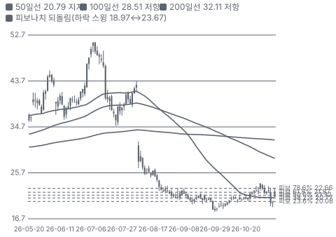

**주봉**

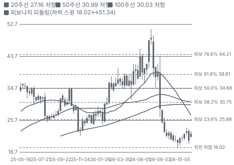

**월봉**

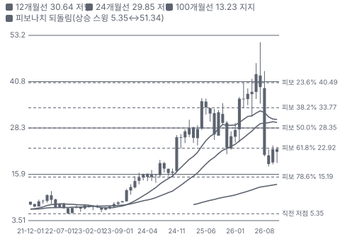

**분기 매출·EPS 실적과 컨센서스**

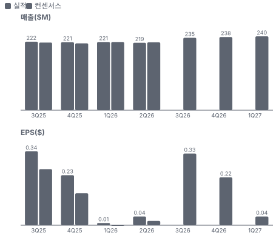

**최근 4개 분기 주가 변화 분석**

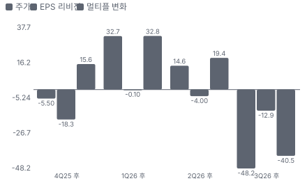

**EPS 리비전**

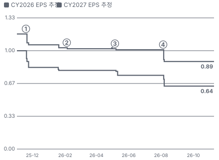

① 25-11-19 4Q FY25 실적·FY26 첫 가이던스, 다음 날 −20% · EPS 리비전 -9%
② 26-02-04 1Q FY26 실적, 다음 날 −11% · EPS 리비전 -1%
③ 26-05-06 2Q FY26 실적·가이던스 유지 · EPS 리비전 -1%
④ 26-08-05 3Q FY26 실적·FY26 가이던스 하향, 다음 날 −34% · EPS 리비전 -12%

**밸류에이션 주가 시나리오**

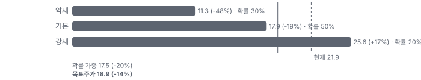

**주가별 업사이드**

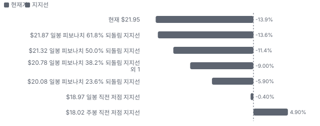

**제품·서비스 포트폴리오**

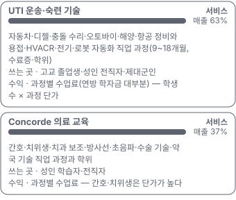

**고객 믹스(FY2025(현금 기준), 매출 대비)**

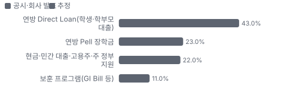

**공급 병목(10점, 낮을수록 병목)**

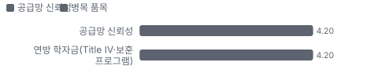

**CAPEX의 매출 대비 비중**

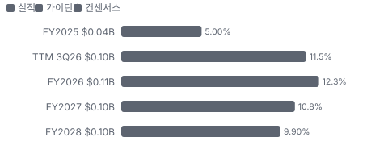

**어닝콜 변화별 주주가치 영향**

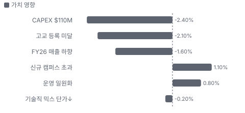

**멀티플 프리미엄(Fwd 1Y EV/EBITDA, 최근 4개 분기말)**

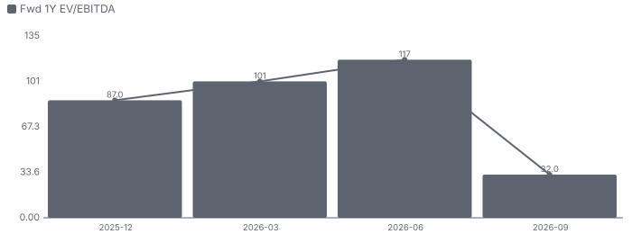

**합리적 멀티플**

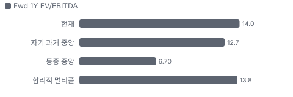

**매출 → 매출총이익 → 영업이익(매출 = 100, 최근 4분기)**

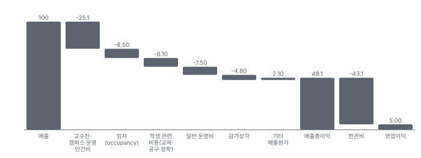

**1년 전 대비 마진 기여(비용 비중 변화의 반대)**

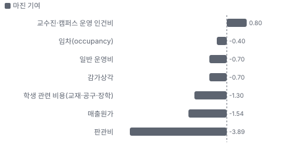

**분기 비용 비중 추이(매출 대비, 공시)**

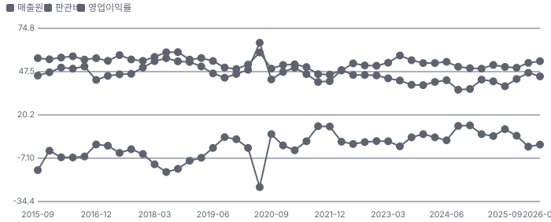

**비용 요인별 매출 대비 비중과 1년 변화**

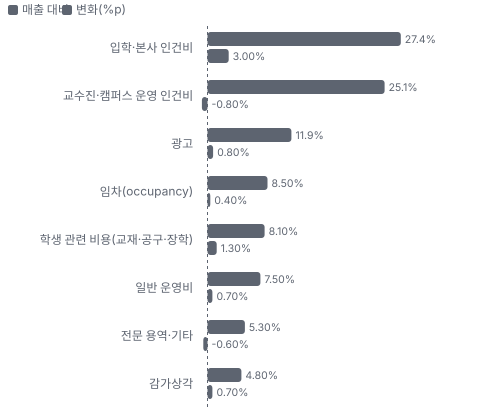

**BOM 항목 가격 +10% 시 OPM 변화**

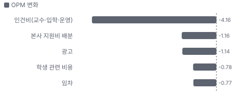

**UTI 운송·숙련 기술 BOM 원가 몫과 가격 +10% 시 OPM**

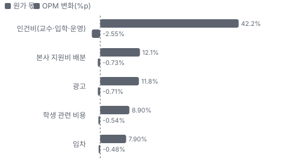

**Concorde 의료 교육 BOM 원가 몫과 가격 +10% 시 OPM**

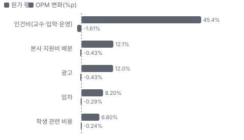

**시설별 생산능력(학생(성숙 정원), 큰 순)**

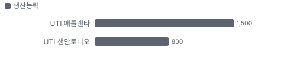

**목표주가 산정 — 기본과 강세 사이(강세 쪽 14%), 도달 확률 약 40%**

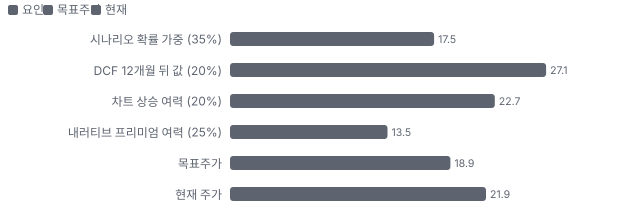

**PEG — 성장 대비 멀티플(낮을수록 성장 대비 쌈)**

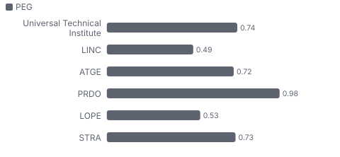

**일봉 지지·저항과 목표주가**

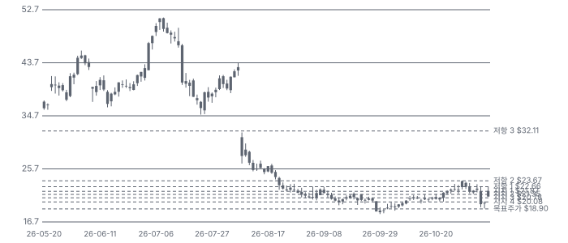

**일별 거래량 분해**

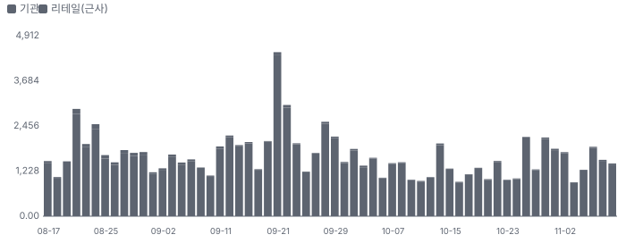

**기관 자금 흐름**

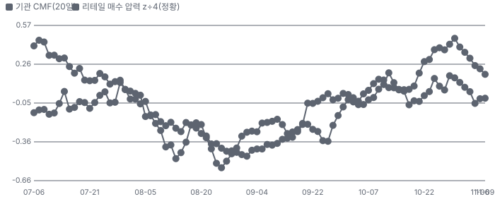

**몬테카를로**

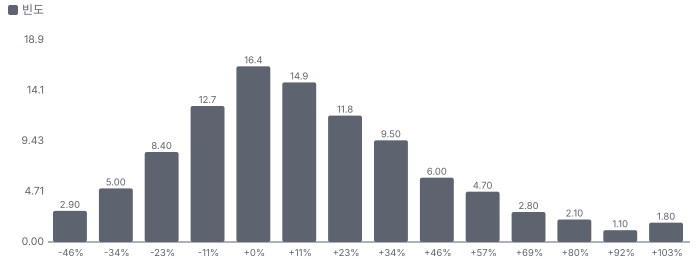

해석: 3,000번 중 1,873번(62%)에서 가치가 지금 주가 이상이었다. 가정을 흔들어도 지금 주가를 뒷받침하는 경우가 더 많다. 가운데 값은 1.09배이고, 열 번 중 여덟 번은 0.75~1.57배 사이에 든다.

## 내러티브

> **기업가치를 결정하는 이야기:** 성장축은 캠퍼스다 — 샌안토니오(3월)·애틀랜타(7월)가 계획보다 30~40% 많이 뽑았고 FY27에 4곳을 더 연다. 성숙 정원으로 약 7,000명이 더해지는 계획이다. 바닥은 기존 캠퍼스의 재학생이다 — 기말 재학생 24,408명(+9.1%)이 다음 2~3개 분기 매출을 미리 정한다. 가르는 변수는 학생당 매출과 성장 투자 회수 시점이다. 회사는 FY29 조정 EBITDA 약 \$220M(지금의 2배 남짓)을 유지했다.

> **멀티플·EPS 프리미엄**
> **멀티플:** Fwd 1Y EV/EBITDA 14.0배로 동종 중앙값 6.7배의 두 배다. 그러나 선행 EBITDA에 성장 투자(약 \$35M)가 비용으로 들어 있어 회사의 기준 EBITDA(\$135M 초과)로 보면 약 9배다. 자기 3년 레인지(약 6~19배)의 아래쪽이다.
> **EPS:** EPS 추정이 계속 내려갔다. FY2027 컨센서스는 5/7 \$0.87 → 11/10 \$0.73(−16%), FY2026은 \$0.78 → \$0.61이다. 3Q EPS(\$0.04)는 추정(\$0.01~0.02)을 넘었지만 FY26 가이던스 하향이 그것을 지웠다.

### 투자자들은 왜 열광했나

열광의 근거는 '숙련 기술 부족 + AI가 사무직을 줄인다'는 이야기와 숫자였다. 신규 등록이 2분기 연속 두 자릿수로 늘었고 신규 캠퍼스가 계획을 넘어 주가는 7/7 종가 \$51.20까지 갔다. 식은 이유는 8/5 3Q 콜이다 — 고교 채널 등록 부진으로 FY26 가이던스를 내렸고, 수요가 몰린 숙련 기술 과정이 '짧고 싸고 이익이 조금 낮다'는 설명이 나왔다. 다음 날 −34%였다.

### 무엇이 기업가치를 바꾸나

> **구조적 체질 변화**
> **변화:** 자동차·디젤 학교에서 숙련 기술·의료를 포함한 종합 직업교육으로 — Concorde(UTI의 의료·간호·치과 직업교육 사업부) 비중 35.7% → 37.0%, 숙련 기술 전용 캠퍼스 첫 개교
> **증거:** EX-99.1 사업부 표·10-Q
> **반증:** UTI 사업부 신규 등록 증가가 매출 증가로 이어지지 않는 상태가 FY27에도 이어진다

> **고부가 믹스 확장**
> **변화:** 반대로 움직인다 — 수요가 몰리는 숙련 기술 과정은 자동차·디젤보다 짧고 싸서 학생당 매출이 낮다. Concorde는 간호·치위생 같은 고단가 과정을 늘린다(12개 과정 복제)
> **증거:** 3Q 콜 CEO·CFO
> **반증:** 학생 1인당 매출(매출 ÷ 평균 재학생)이 2분기 연속 오른다

> **기술 혁신**
> **변화:** 자동차 과정에 배터리 하이브리드·전기차 교육을 13개 캠퍼스에 넣었고 로봇 자동화 과정을 연다 — 차별화보다는 커리큘럼 따라가기다
> **증거:** 10-Q
> **반증:** 해당 없음(매출 기여 미공시)

> **실행 속도**
> **변화:** 해당 없음(납품이 없는 교육 서비스 — 캠퍼스 발표에서 개교까지 기간을 숫자로 공시하지 않는다). 정성 근거: FY25에 발표한 2곳이 FY26에 개교했고, 고교 리드 +15%를 영업 인력(약 150명)이 다 처리하지 못했다
> **증거:** 10-K·3Q 콜
> **반증:** FY27 개교 4곳 중 지연이 나온다

> **M&A**
> **변화:** 해당 없음(최근 3년 인수 없음 — Concorde 인수는 2022-12). 성장은 직접 개교로 한다
> **증거:** 10-K
> **반증:** 해당 없음

> **정책·입법 연관성**
> **재정정책:** 연방 학자금 예산(Pell(저소득층 학생에게 주는 연방 무상 장학금)·Direct Loan)이 매출의 원천이다. 2025년 감세·지출 법(OBBBA(2025년 7월 제정된 미국 감세·지출 법, 공법 119-21))이 학부모 대출 한도와 졸업생 소득 기준을 바꿨지만 UTI 등록에 주는 영향은 회사가 정량화하지 않았다(미확인) 10-K 위험 요인 반증: 학부모 대출 한도 때문에 고교 채널 등록이 줄었다고 회사가 밝힌다 의회 동의 10/10 — 하원 5/5(OBBBA 하원 본회의 통과·제정(공법 119-21, 2025-07)) · 상원 5/5(OBBBA 상원 본회의 통과·제정(2025-07)).
> **행정명령:** 해당 없음(회사 매출에 닿는 행정명령을 확인하지 못했다). 교육부 규칙(90/10(영리 교육기관 매출 중 연방 교육 지원금이 90%를 넘으면 연방 학자금 자격을 잃는 규칙)·재무 책임·보증 의무)은 행정 규칙이고 최종 규칙 단계를 확인하지 않았다 미확인 반증: 교육부가 영리 직업학교 대상 새 제재 규칙을 최종 확정한다 의회 동의 2/10 — 하원 1/5(의회 절차 아님) · 상원 1/5(의회 절차 아님).
> **연관입법:** Workforce Pell(8~15주 단기 과정 Pell 지원, OBBBA, 2026-07-01 시행)은 단기 숙련 기술 과정 수요를 늘릴 수 있다. UTI 과정이 자격 대상인지는 회사가 밝히지 않았다(미확인) 공법 119-21 — 회사 공시 없음 반증: 회사가 Workforce Pell(8~15주 단기 직업 과정에도 Pell 장학금을 주는 새 제도) 자격 과정을 내놓지 않거나 등록 기여가 0으로 나온다

> **CAPEX 낙수효과**
> **변화:** 고객 CAPEX에 매출이 묶이지 않는다. 데이터센터·전력·제조 투자가 기술자 구인을 늘린다는 건 학생 수요의 배경일 뿐 — 회사 매출과의 연결(고용주 후원 매출 등)은 공시되지 않았다(미확인)
> **증거:** 2Q 콜(CEO 데이터센터 언급)
> **반증:** 해당 없음

### 내러티브 근거

> 'AI 시대에 숙련 기술직이 부족하다 — 그 인력을 키우는 회사'라는 이야기가 2026년 상반기 주가를 고점(\$51)까지 올렸다. 8월 3Q 실적에서 고교 채널 등록 부진과 기술직 믹스의 낮은 단가가 드러나 가이던스가 내려갔고, 주가는 다음 날 −34%, 지금은 고점의 43%다. 동종 대비 멀티플 차이 +109% 중 회사 고유 몫은 +2%다. 단계는 붕괴, 쏠림은 낮음이다.

> **숙련 기술 인력 부족(데이터센터·전력·리쇼어링)** · 약화
> **논리:** 데이터센터·전력망·제조 회귀가 용접·전기·HVACR 기술자를 대량으로 요구하고, AI가 사무직 초급 일자리를 줄여 학생 수요가 기술직으로 옮긴다
> **숫자:** 3Q UTI 사업부 신규 등록 +23.4%. 다만 매출은 +5.0%뿐 — 수요가 늘어도 학생당 매출이 줄어드는 믹스라 '산업 성장 → 기업 이익'이 그대로 이어지지 않는다
> **반증:** 숙련 기술 과정 비중이 오르는데 학생당 매출이 2분기 연속 떨어진다

> **North Star 캠퍼스 확장 → FY29 EBITDA \$220M** · 의심
> **논리:** 매년 캠퍼스 2~5곳과 과정 12~20개를 복제해 FY29 매출 \$1.2B·조정 EBITDA 약 \$220M에 간다
> **숫자:** FY26 조정 EBITDA 약 \$101.5M → FY29 약 \$220M(연 약 29%) vs 컨센서스 FY28 \$145~167M
> **반증:** FY27 가이던스 조정 EBITDA가 \$115M 아래

> **신규 캠퍼스 개교 모델 복제** · 강화
> **논리:** 샌안토니오·애틀랜타가 계획을 30~40% 넘었다 — 개교할수록 성숙 정원이 빨리 찬다
> **숫자:** 성숙 정원 800명·1,500명 이상, FY27 개교 4곳 약 3,300명
> **반증:** FY27 개교 캠퍼스 중 2곳 이상이 첫 해 계획 아래

> **반대 — 고교 채널 실행 실패·믹스 단가 하락** · 진행 중
> **논리:** 고교 자동차·디젤 등록이 4Q에 계획을 밑돌았고, 학생이 짧고 싼 숙련 기술 과정으로 옮겨 학생당 매출·이익이 줄어든다
> **숫자:** FY26 매출 가이던스 중간값 −1.5%, 조정 EBITDA −13%, FY27 EPS 컨센서스 −16%(5/7 → 11/10)
> **반증:** 11/18 4Q 신규 등록이 전년 이상이고 FY27 매출 가이던스가 +8% 이상

> **반대 — 연방 학자금 규제 노출** · 잠복
> **논리:** 매출 약 78%가 연방 학자금·보훈 프로그램이라 규제(90/10·졸업생 소득 기준·대출 한도)가 바뀌면 수요와 배수가 함께 흔들린다
> **숫자:** 90/10 비율 67~82%(FY25), 동종 Fwd 1Y EV/EBITDA 중앙값 6.7배
> **반증:** 교육부 최종 규칙이 UTI 과정을 제재 대상에 넣거나 학부모 대출 한도가 등록을 줄인다

## 포트폴리오

| 제품·서비스 | 구분 | 무엇 | 쓰는 곳 | 돈 버는 방식 | Mix | Mix 변화(공시 — 3Q FY26 사업부 매출(EX-99.1)) |
|---|---|---|---|---|---|---|
| UTI 운송·숙련 기술 | 서비스 | 자동차·디젤·충돌 수리·오토바이·해양·항공 정비와 용접·HVACR·전기·로봇 자동화 직업 과정(9~18개월, 수료증·학위) | 고교 졸업생·성인 전직자·제대군인 | 과정별 수업료(연방 학자금 대부분) — 학생 수 × 과정 단가 | 63% | -1.3%p |
| Concorde 의료 교육 | 서비스 | 간호·치위생·치과 보조·방사선·초음파·수술 기술·약국 기술 직업 과정과 학위 | 성인 학습자·전직자 | 과정별 수업료 — 간호·치위생은 단가가 높다 | 37% | +1.3%p |

**Mix 변화가 가장 큰 쪽은 UTI 운송·숙련 기술(-1.3%p, 공시 — 3Q FY26 사업부 매출(EX-99.1)).** 계절성 판정: 분기 매출 계절 지수 기준 없음 → 직전 분기와 비교.

## 고객

> **FY2025(현금 기준) 최대 고객 연방 Direct Loan(학생·학부모 대출) 43%, 상위 3곳 88%, 집중도 집중.** 공시·회사 발표로 확인한 몫은 매출의 77%이고, 나머지 고객 몫은 추정이거나 미분해다. 고객은 학생이고, 돈을 대는 쪽은 대부분 연방 정부다. 10%를 넘는 단일 고객은 없지만 FY25 현금 매출의 약 78%가 연방 학자금·보훈 프로그램에서 왔다. 매출 몫은 사업부로 보면 UTI 63%·Concorde 37%(3Q)다.

**고객별 매출 몫(FY2025(현금 기준))**
| 고객 | 몫 | 변화 | 근거 |
|---|---|---|---|
| 연방 Direct Loan(학생·학부모 대출) | 43% | 미확인 | 공시 |
| 연방 Pell 장학금 | 23% | 미확인 | 공시 |
| 현금·민간 대출·고용주·주 정부 지원 | 22% | 미확인 | 추정 |
| 보훈 프로그램(GI Bill(미국 제대군인 교육비 지원 제도) 등) | 11% | 미확인 | 공시 |

> **연방 Direct Loan(학생·학부모 대출)** · 공시
> **사는 것:** 수업료 대출
> **추정 근거:** FY25 현금 기준 매출 비중

> **연방 Pell 장학금** · 공시
> **사는 것:** 저소득 학생 장학금
> **추정 근거:** FY25 현금 기준

> **현금·민간 대출·고용주·주 정부 지원** · 추정
> **사는 것:** 본인 부담·회사 자체 대출·제조사 후원
> **추정 근거:** 100% − 연방·보훈 78%(FSEOG(연방 보충 교육 기회 장학금) 1% 미만 포함)

> **보훈 프로그램(GI Bill 등)** · 공시
> **사는 것:** 제대군인 교육비
> **추정 근거:** FY25 현금 기준

## 마진 구조

> **GPM 46.0%, OPM 1.5%.** 3Q25 대비 GPM -2.4%p, OPM -5.4%p. 변동비는 매출의 40%이고, 매출이 10% 늘면 OPM은 +5.3%p 움직인다. 교육 서비스라 원가는 사람·건물·광고다. 3Q FY26 영업비용은 매출의 98.5%로 1년 전 93.1%보다 5.4%p 높다. 인건비(+2.2%p)·학생 관련 비용(+1.3%p)·광고(+0.8%p)가 신규 캠퍼스 선행 비용으로 늘었고, 회사는 그 가운데 \$9.0M을 '성장 투자'로 따로 밝혔다.

> **매출 100 중 매출원가 51.9, 매출총이익 48.1(최근 4분기, 공시).** 매출원가 요인 중 교수진·캠퍼스 운영 인건비이 매출의 25.1%로 가장 무겁고, 단가가 +10% 오르면 GPM이 -2.51%p 움직인다. 분기 회귀로 매출 1이 늘 때 매출원가는 0.50 늘고, 매출원가의 고정비 몫은 5%다.

**비용 요인 강도 — 비중·추세·충격(+10%)·탄력**
| 비용 | 구분 | 매출 대비 | 1년 변화 | 마진 기여 | 충격 시 마진 | 매출 탄력 | 고정비 몫 |
|---|---|---|---|---|---|---|---|
| 교수진·캠퍼스 운영 인건비 | 매출원가 요인 | 25.1% | -0.8%p | +0.8%p | -2.51%p | 미확인 | 70% |
| 임차(occupancy) | 매출원가 요인 | 8.5% | +0.4%p | -0.4%p | -0.85%p | 미확인 | 100% |
| 학생 관련 비용(교재·공구·장학) | 매출원가 요인 | 8.1% | +1.3%p | -1.3%p | -0.81%p | 미확인 | 10% |
| 일반 운영비 | 매출원가 요인 | 7.5% | +0.7%p | -0.7%p | -0.75%p | 미확인 | 60% |
| 감가상각 | 매출원가 요인 | 4.8% | +0.7%p | -0.7%p | -0.48%p | 미확인 | 100% |
| 매출원가 | 공시 항목 | 51.9% | +1.5%p | -1.5%p | -5.19%p | 0.50 | 5% |
| 판관비 | 공시 항목 | 43.1% | +3.9%p | -3.9%p | 미확인 | 0.36 | 18% |

매출 탄력 = 분기 비용을 매출에 회귀한 기울기(매출 1당 변동비), 고정비 몫 = 절편 ÷ 평균 비용. 표본이 8분기 미만이면 미확인. 매출원가 요인 비중은 margin 재료의 추정이 섞여 있고, 공시 매출원가와의 차이는 '기타 매출원가'로 둔다.

**GPM에서 OPM까지(GAAP)**
| 기간 | GPM | 연구개발 | 판관비 | 기타 | OPM |
|---|---|---|---|---|---|
| 3Q25 | 48.3% | 0.0% | 41.4% | 0.0% | 7.0% |
| 3Q26 | 46.0% | 0.0% | 44.4% | 0.0% | 1.5% |

**GPM·OPM 최근 4개 분기**
| 분기 | GPM | OPM |
|---|---|---|
| 2025-09 | 49.5% | 11.2% |
| 2025-12 | 50.0% | 7.1% |
| 2026-03 | 47.0% | 0.2% |
| 2026-06 | 45.9% | 1.5% |

**마진을 결정하는 비용 요인 — 비용 +10% 시 OPM**
| 비용 | 매출 대비 | 변화 | 고정비 | OPM |
|---|---|---|---|---|
| 입학·본사 인건비 | 27.4% | +3.0%p | 60% | -2.74%p |
| 교수진·캠퍼스 운영 인건비 | 25.1% | -0.8%p | 70% | -2.51%p |
| 광고 | 11.9% | +0.8%p | 30% | -1.19%p |
| 임차(occupancy) | 8.5% | +0.4%p | 100% | -0.85%p |
| 학생 관련 비용(교재·공구·장학) | 8.1% | +1.3%p | 10% | -0.81%p |
| 일반 운영비 | 7.5% | +0.7%p | 60% | -0.75%p |
| 전문 용역·기타 | 5.3% | -0.6%p | 50% | -0.53%p |
| 감가상각 | 4.8% | +0.7%p | 100% | -0.48%p |

**비용을 움직이는 요인**
| 비용 | 요인 |
|---|---|
| 입학·본사 인건비(판관비) | 입학 상담·현장 영업 인력 · 근거 추정 |
| 교수진·캠퍼스 운영 인건비(매출원가) | 재학생 수·신규 캠퍼스 교수 채용 · 근거 추정 |
| 광고(판관비) | 리드 확보·신규 캠퍼스 홍보 · 근거 공시 |
| 임차(occupancy, 매출원가) | 신규 캠퍼스 임차 개시(개교 전부터 비용) · 근거 공시 |
| 학생 관련 비용(교재·공구·장학, 매출원가) | 신규 등록 수·과정 구성 · 근거 공시 |
| 일반 운영비(매출원가) | 캠퍼스 수 · 근거 공시 |
| 전문 용역·기타(판관비) | 법률·감사·IT(전산·정보 시스템) · 근거 공시 |
| 감가상각(매출원가) | 신규 캠퍼스·장비 투자 · 근거 공시 |

**UTI 운송·숙련 기술 BOM — 매출의 63%, GPM 4%(사업부 영업이익률 대용((138.0 − 132.2) ÷ 138.0, EX-99.1) — 사업부 매출원가 미공시), 항목 가격 +10% 시**
| 항목 | 원가 몫 | 전가 | 제품 GPM | OPM |
|---|---|---|---|---|
| 인건비(교수·입학·운영) | 42% | 미확인 | -4.0%p | -2.55%p |
| 본사 지원비 배분 | 12% | 0% | -1.2%p | -0.73%p |
| 광고 | 12% | 0% | -1.1%p | -0.71%p |
| 학생 관련 비용 | 9% | 미확인 | -0.9%p | -0.54%p |
| 임차 | 8% | 0% | -0.8%p | -0.48%p |
| 미분해 | 17% | - | - | - |

**Concorde 의료 교육 BOM — 매출의 37%, GPM 4%(사업부 영업이익률 대용((80.9 − 77.7) ÷ 80.9, EX-99.1)), 항목 가격 +10% 시**
| 항목 | 원가 몫 | 전가 | 제품 GPM | OPM |
|---|---|---|---|---|
| 인건비(교수·입학·운영) | 45% | 미확인 | -4.4%p | -1.61%p |
| 본사 지원비 배분 | 12% | 0% | -1.2%p | -0.43%p |
| 광고 | 12% | 0% | -1.2%p | -0.43%p |
| 임차 | 8% | 0% | -0.8%p | -0.29%p |
| 학생 관련 비용 | 7% | 미확인 | -0.7%p | -0.24%p |
| 미분해 | 16% | - | - | - |

인건비(교수·입학·운영) 가격이 +10% 오르면 영업이익은 -276.0% 움직인다. 판매가 전가를 모르는 항목은 전가 0%로 계산했다.

**BOM 항목 가격을 움직이는 것**
| 항목 | 요인 |
|---|---|
| 인건비(교수·입학·운영) | 교수 인력은 업계 기술자 임금과 경쟁한다 · 근거 공시 |
| 본사 지원비 배분 | 회계·IT·인사 중앙화 비용을 매출 비율로 배분 · 근거 공시 |
| 광고 | 고교·성인 리드 확보 · 근거 공시 |
| 학생 관련 비용 | 공구·교재 — 수업료에 일부 포함 · 근거 공시 |
| 임차 | 17개 캠퍼스 대부분 임차 · 근거 공시 |
| 인건비(교수·입학·운영) | 간호·치위생 교수는 면허 보유자 — 병원 임금과 경쟁 · 근거 공시 |
| 본사 지원비 배분 | 매출 비율 배분 · 근거 공시 |
| 광고 | 성인 학습자 리드 · 근거 공시 |
| 임차 | 18개 캠퍼스 모두 임차 · 근거 공시 |
| 학생 관련 비용 | 실습 재료 · 근거 공시 |

## 공급망 병목

> **공급망 신뢰성 4.2/10, 병목 주의.** 가장 약한 고리는 연방 학자금(Title IV·보훈 프로그램) 4.2점이고, 품목 평균은 4.2점이다. 근거가 부족한 4건(교수 인력(기술자·간호사 출신) · 캠퍼스 부지·임차 · 의료 임상 실습처 · 리드 유입(디지털 광고·고교 현장 영업))은 점수에서 뺐다. 교육 회사의 공급망은 부품이 아니라 돈(연방 학자금)·사람(교수)·건물(임차 캠퍼스)·실습처(의료 임상 현장)다. 가장 약한 고리는 대체할 곳이 없는 연방 학자금이고, 그다음이 교수 채용이다. 10-K는 단일 공급원·구매 약정을 공시하지 않는다.

**병목과 마진 — 품목 가격 +10% 시 OPM**
| 품목 | 점수 | 판정 | 구분 | OPM |
|---|---|---|---|---|
| 연방 학자금(Title IV·보훈 프로그램, 필수) | 4.2 | 병목 주의 | 출하 차질 위험 | 미확인 |

> **연방 학자금(Title IV·보훈 프로그램)** · 4.2/10
> **왜:** FY25 현금 매출의 약 78%(Direct Loan 43%·Pell 23%·보훈 11%)
> **병목 요인:** 인증 공급사 1곳 · 캐파 여유 · 리드타임 미확인 · 재인증 24개월 · 1위 점유율 78% · 미국 집중 100% · 물량 확보 미확인
> **풀리는 조건:** 해당 없음

**공급사**
| 품목 | 공급사 | 몫 | 근거 |
|---|---|---|---|
| 연방 학자금(Title IV·보훈 프로그램) | 미국 교육부(Direct Loan·Pell, 학자금 대출·장학금) | 미확인 | 공시 |
| 연방 학자금(Title IV·보훈 프로그램) | 미국 보훈부(GI Bill, 제대군인 교육비) | 미확인 | 공시 |
| 교수 인력(기술자·간호사 출신) | 숙련 기술직·의료 노동시장(미공시, 교수 채용) | 미확인 | 추정 |
| 캠퍼스 부지·임차 | 상업용 부동산 임대인(미공시, 34개 캠퍼스 중 32곳 임차) | 미확인 | 공시 |
| 의료 임상 실습처 | 병원·치과·클리닉(미공시, Concorde 학생 임상 실습) | 미확인 | 추정 |
| 의료 임상 실습처 | Heartland Dental(공동 브랜드 캠퍼스(포트마이어스)) | 미확인 | 공시 |
| 리드 유입(디지털 광고·고교 현장 영업) | 검색·소셜 광고 플랫폼(미공시, 성인 리드) | 미확인 | 추정 |
| 리드 유입(디지털 광고·고교 현장 영업) | 고교 현장 영업 인력(약 150명, 고교 리드 전환) | 미확인 | 회사 발표 |

## 생산능력

> **현재 명목 캐파 미확인, 가동률 미확인.** 착공 이상 증설은 0 학생(성숙 정원), 발표까지 합치면 3,300 학생(성숙 정원)이다. TTM 3Q26 CAPEX는 \$0.10B로 매출의 11.5%다. 생산능력은 캠퍼스와 정원이다. 6/30 평균 재학생 25,131명(전체 정원은 공시하지 않음). FY26에 샌안토니오·애틀랜타·덴버(이전)를 열었고 FY27에 4곳을 더 연다. 개교가 매출로 바뀌는 데 성숙까지 2~3년이 걸리고 그동안 선행 비용이 이익을 누른다.

**생산시설 35곳**(10-Q(6/30): 운영 캠퍼스 34곳(UTI 16·Concorde 18) + 7월 애틀랜타 개교 = 35곳. 10-K Item 2 표에 캠퍼스별 위치·면적·소유 여부가 있다) — 이름·위치를 밝힌 곳 8곳, 소유 4곳 · 소유·임차 1곳 · 임차 3곳. 시설별 생산능력은 2곳만 공개됐다.

**생산시설 35곳 — 명칭·위치·생산능력**
| 시설 | 위치 | 용도 | 생산능력 | 소유·상태 |
|---|---|---|---|---|
| UTI 애번데일·피닉스 | 미국 애리조나 | 자동차·디젤·용접 등 교육 캠퍼스 | 미확인 — 캠퍼스별 정원 미공시 · 면적 283,000 sq ft | 소유 · 가동 |
| UTI 리슬 | 미국 일리노이 | 교육 캠퍼스 | 미확인 — 캠퍼스별 정원 미공시 · 면적 187,000 sq ft | 소유 · 가동 |
| UTI 휴스턴 | 미국 텍사스 | 교육 캠퍼스 | 미확인 — 캠퍼스별 정원 미공시 · 면적 172,000 sq ft | 소유 · 가동 |
| UTI 올랜도 | 미국 플로리다 | 교육 캠퍼스(오토바이·해양 포함) | 미확인 — 캠퍼스별 정원 미공시 · 면적 154,000 sq ft | 소유 · 가동 |
| UTI 댈러스 | 미국 텍사스 | 교육 캠퍼스 | 미확인 — 캠퍼스 전체 정원 미공시 — 회사 공시는 증설분만(확장으로 약 +1,000명, 10-Q) · 면적 109,000 sq ft | 소유·임차 · 가동 |
| UTI 애틀랜타 | 미국 조지아 | 종합 기술 캠퍼스 | 1,500 학생(성숙 정원) · 면적 117,000 sq ft | 임차 · 가동 |
| UTI 샌안토니오 | 미국 텍사스 | 숙련 기술 전용 캠퍼스 | 800 학생(성숙 정원) · 면적 51,000 sq ft | 임차 · 가동 |
| Concorde 덴버 | 미국 콜로라도 | 의료 교육 캠퍼스 | 미확인 — 캠퍼스 전체 정원 미공시 — 회사 공시는 증설분만(이전으로 약 +200명, 10-Q) · 면적 60,000 sq ft | 임차 · 가동 |

**생산능력 확충 계획**
| 계획 | 단계 | 증설 | 가동 시점 | CAPEX |
|---|---|---|---|---|
| UTI 솔트레이크시티(종합) | 발표 | 1,500 학생(성숙 정원) | FY2027 | 미확인 |
| Concorde 휴스턴·애틀랜타·글렌데일 | 발표 | 1,800 학생(성숙 정원) | FY2027 | 미확인 |
| Concorde 버뱅크 이전(노스할리우드) | 발표 | 미확인 | FY2027 | 미확인 |

남은 계획의 CAPEX 합계는 \$0.00B(금액 미확인 3건 제외)다. 합계는 FY2028 매출의 0%다.

**증설 방해 요인**
| 계획 | 방해 요인 |
|---|---|
| UTI 솔트레이크시티(종합) | 인허가·인가 승인 대기 |
| Concorde 휴스턴·애틀랜타·글렌데일 | 인허가·인가 승인 대기(애틀랜타 리스 체결, 개시 전) |
| Concorde 버뱅크 이전(노스할리우드) | 인허가 |

**CAPEX와 매출 대비**
| 기간 | CAPEX | 매출 | 매출 대비 | 구분 |
|---|---|---|---|---|
| FY2025 | \$0.04B | \$0.84B | 5.0% | 실적 |
| TTM 3Q26 | \$0.10B | \$0.88B | 11.5% | 실적 |
| FY2026 | \$0.11B | \$0.90B | 12.3% | 가이던스 |
| FY2027 | \$0.10B | \$0.97B | 10.8% | 컨센서스 |
| FY2028 | \$0.10B | \$1.06B | 9.9% | 컨센서스 |

## 해자

> 해자는 기술보다 '자격과 관계'다. 연방 학자금(Title IV)을 받을 수 있는 인가·주 인허가를 갖춘 캠퍼스 네트워크는 새로 만드는 데 수년이 걸리고, 제조사·고용주 파트너십이 커리큘럼과 취업을 묶는다. 다만 이 자격은 규제가 주는 것이라 규제가 바뀌면 함께 흔들린다.

> **연방 학자금 자격·인가·주 인허가** · 강함
> **해자:** 새 캠퍼스·새 과정은 인가기관·주 정부·교육부 승인을 받아야 연방 학자금을 쓸 수 있다. 35개 캠퍼스가 이미 그 자격을 갖고 있다.
> **근거:** 10-K: 새 과정은 주 인허가·인가 후 교육부 승인, 캠퍼스 이전·신설도 승인 대상. 90/10 비율 67~82%로 기준(90%) 아래
> **숫자:** FY25 현금 매출의 약 78%가 Title IV·보훈 프로그램
> **깨지는 조건:** 어느 캠퍼스든 90/10이 85%를 넘거나 교육부가 조건부 인가·보증금(신용장)을 요구한다

> **제조사·고용주 파트너십(MSAT(제조사가 후원하는 브랜드별 심화 교육 과정))** · 보통
> **해자:** Ford·BMW·Cummins 같은 제조사가 장비·커리큘럼을 대고 졸업생을 뽑는다. 학생에게는 취업 경로, 경쟁 학교에는 따라 하기 어려운 브랜드 과정이다.
> **근거:** 10-K·회사 개요(제조사별 심화 과정, 딜러 후원 교육)
> **숫자:** 미확인(파트너 수·후원 매출 미공시)
> **깨지는 조건:** 주요 제조사 후원 과정이 철수하거나 경쟁 학교로 옮긴다

> **전국 캠퍼스·마케팅 규모** · 보통
> **해자:** 17개 기술 캠퍼스·18개 의료 캠퍼스와 연 \$100M대 광고로 리드를 모은다. 지역 학교가 따라오기 어려운 규모다.
> **근거:** 3Q 광고비 \$26.1M(매출의 11.9%), 9개월 \$82.8M(EX-99.1)
> **숫자:** 광고비 9개월 \$82.8M · 평균 재학생 25,131명
> **깨지는 조건:** 광고비 비중이 오르는데 신규 등록 증가율이 한 자릿수 아래로 내려간다(리드 단가 상승)

> **신규 캠퍼스 복제 능력** · 약함
> **해자:** 샌안토니오·애틀랜타가 계획보다 30~40% 많이 뽑았다 — 개교 모델이 복제된다는 첫 증거다. 아직 두 곳뿐이라 증명 중이다.
> **근거:** 3Q 콜(CEO)
> **숫자:** 성숙 정원 샌안토니오 약 800명·애틀랜타 1,500명 이상
> **깨지는 조건:** FY27 개교 4곳 중 2곳 이상이 첫 해 계획을 밑돈다

## 경영진·네트워크

> Jerome Grant CEO가 North Star 전략(캠퍼스 확장·의료 다각화)을 이끈다. 6월 말 주가 약 \$41에서 장내 매도 약 \$3.9M을 했고, 8월 급락 뒤에는 이사 한 명이 장내에서 소액을 샀다.

> **Jerome A. Grant** · CEO · 미확인
> **프로필:** North Star 2단계 목표(FY29 매출 \$1.2B·EBITDA 약 \$220M)를 제시하고 3Q 하향에도 유지했다. 2026-06-29 장내 매도 94,500주 약 \$3.9M(Form 4)
> **비즈니스:** 캠퍼스 확장·의료 다각화·운영 모델 통합
> **정계:** 미확인
> **동문:** 미확인
> **사모임:** 미확인

> **Bruce Schuman** · CFO · 미확인
> **프로필:** 4Q 부진을 '시점·믹스' 문제라고 설명하고 CAPEX 약 \$110M으로 앞당김을 밝혔다(3Q 콜)
> **비즈니스:** 재무·가이던스
> **정계:** 미확인
> **동문:** 미확인
> **사모임:** 미확인

> **Robert DeVincenzi** · 이사 · 미확인
> **프로필:** 8/10~9/28 장내 매수 6회 13,000주 약 \$0.33M(주당 \$19.7~28.2, Form 4)
> **비즈니스:** 이사회
> **정계:** 미확인
> **동문:** 미확인
> **사모임:** 미확인

**네트워크 정량화**
| 연결 | 강도 | 닿는 매출 | 가중 노출 | 매출 대비 | 근거 |
|---|---|---|---|---|---|
| 비즈니스: 제조사·고용주 파트너(Ford·BMW·Cummins 등), Heartland Dental(Concorde 포트마이어스 공동 브랜드 캠퍼스) | 3/5 | 미확인 | 미확인 | 미확인 | 파트너 후원 매출 미공시 10-K Item 2 주석·회사 개요 |
| 정계: 공개 기록에서 확인한 정계 연결 없음 | 0/5 | 미확인 | 미확인 | 미확인 | 하원 LD(미국 하원 로비 공시) 로비 공시 집계 범위 밖이라 확인하지 못했다 미확인 |

가중 노출은 연결이 닿는 매출의 크기다. 연결이 그 매출을 만들었다는 뜻이 아니며, 인과는 공개 자료로 입증하지 못한다.

## 약세 논리 및 셀온 조건

| 약세 논리 | 근거 | 반박 | 가를 자료 · 공개 시점 |
|---|---|---|---|
| 수요가 늘어도 이익은 안 는다(믹스 단가 하락) | 숙련 기술 과정은 짧고 싸고 이익이 조금 낮다(CEO·CFO). 3Q UTI 사업부 신규 등록 +23.4%인데 매출은 +5.0% | Concorde는 간호·치위생 같은 고단가 과정을 12개 복제했고 매출 +11.1%다. 짧은 과정은 정원 회전이 빠르다 | 4Q 실적의 학생 1인당 매출(매출 ÷ 평균 재학생, 3Q 약 \$8,710) — 2026-11-18 |
| 고교 채널 실행 실패는 하루에 안 고쳐진다 | 고교 리드 +15%인데 4Q 등록은 계획 아래, 현장 영업 인력 약 150명(3Q 콜) | CFO는 영업 인력 증원과 전환 개선을 이미 시작했다고 했다 — 고교 채널은 연 1회(여름 졸업) 주기가 크다 | FY27 신규 등록 가이던스와 1Q FY27 등록 — 2026-11-18 · 2027-02 초 |
| FY29 목표는 너무 멀다 | FY26 조정 EBITDA 약 \$101.5M → FY29 약 \$220M(연 약 29%). 애널리스트 FY28 추정 \$145~167M | 회사는 기준 EBITDA(\$135M 초과)와 성장 투자(\$35M)를 나눠 공시한다 — 투자가 줄면 이익이 바로 오른다는 설명 | FY27 가이던스의 기준 EBITDA·성장 투자 구분 — 2026-11-18 |
| 연방 학자금 의존·규제 | FY25 현금 매출의 약 78%가 Title IV·보훈 프로그램, 90/10 비율 67~82%(10-K) | 90/10 상한(90%)까지 여유가 있고, Workforce Pell(2026-07 시행)은 단기 과정 수요를 늘릴 수 있다(회사 자격 미확인) | 교육부 졸업생 소득 기준 규칙 단계·FY26 10-K 90/10 비율 — 2026-11 말 |
| 경영진이 고점에서 팔았다 | CEO 6/29 장내 매도 94,500주 약 \$3.9M(주가 약 \$41), 대주주 Coliseum Capital 2분기 3.0M주 매도 | 이사 한 명이 8~9월 \$20~28에서 6차례 장내 매수(약 \$0.33M) | 3Q 13F(2026-11 중순)와 다음 Form 4 |

**정책·거시.** 중간선거 영향 +0.0/10 — 영리 교육 규제는 정책 채널 표에 없고 업종 ETF 반응도 잴 대상이 없다. 정책 0단계(선거 결과) 가설이다. 민주 의회가 영리 교육 감독 법안을 낼 수는 있지만 분점 정부에서 입법은 미확인이다. **추가 원천(11/10).** 노션 자료실·게시글에 이 종목 자료가 없고, 커뮤니티 대화는 최근 7일 언급이 없으며 공매도 잔고는 유통 주식의 13.7%다. 공개 텔레그램 채널·딘스티커 언급은 없다. 교육 서비스라 제품 분해도는 해당 없음이다. **숙련 인력 수요와의 연결.** 데이터센터·전력·리쇼어링이 용접·전기·HVACR 기술자 수요를 늘린다는 이야기는 회사 설명(2Q 콜)과 3Q UTI 사업부 등록 +23.4%로 일부 확인된다. 그러나 금지표의 '산업 성장 → 기업 이익'은 성립하지 않았다 — 수요가 몰린 과정이 짧고 싸서 같은 기간 매출은 +5.0%에 그쳤고 고용주 후원 매출은 공시되지 않았다.

> **셀온 조건**
> **조건 1:** 11/18 FY27 첫 가이던스에서 조정 EBITDA가 \$110M 아래로 나온다
> **조건 2:** 4Q 신규 등록이 전년보다 줄고 FY27 등록 가이던스가 한 자릿수 초반 이하
> **조건 3:** 학생 1인당 매출이 2분기 연속 떨어진다
> **조건 4:** FY27 개교 예정 4곳 중 2곳 이상이 인허가 지연·첫 해 계획 미달
> **조건 5:** 교육부 최종 규칙이나 입법이 UTI 과정의 연방 학자금 자격을 제한한다

## 어닝콜 변화

**직전 콜 대비 새로 나오거나 바뀐 내용 → 가치 영향**
| 항목 | 내용 | 직전 콜 | 최신 콜 | 모델 동인 이동 | 확신도 | 가치 영향 |
|---|---|---|---|---|---|---|
| 업데이트 | FY26 가이던스 | 매출 \$905~915M·조정 EBITDA \$114~119M | 매출 \$893~900M·조정 EBITDA \$100~103M | 기준연도 매출 -\$0.01B | 0.8 | -1.6% |
| 부정 | 고교 채널 등록 | 2Q '고교는 좋아 보인다' | 4Q 자동차·디젤 고교 등록이 계획 아래, 영업 인력 부족 | 1년차 성장률 -1.0% | 0.8 | -2.1% |
| 신규 | 프로그램 믹스 | 언급 없음 | 숙련 기술 과정은 짧고 싸서 학생당 매출·이익이 낮다 | 출발 이익률 -0.50% | 0.5 | -0.2% |
| 업데이트 | CAPEX | 원래 FY26 계획(약 \$100M, 콜 '85%' 역산) | 약 \$110M — FY27 개교를 위해 앞당김 | 매출÷투하자본 -10.0% | 0.8 | -2.4% |
| 신규 | 운영 모델 통합 | 2Q '두 사업부 협업 확대' | UTI·Concorde를 한 운영 모델로, 다년 구조조정 1단계 | 목표 이익률 +0.50% | 0.5 | +0.8% |
| 업데이트 | 신규 캠퍼스 | 샌안토니오 첫 두 번 등록 계획 +60% | 샌안토니오 누적 +40%, 애틀랜타 첫 등록 +30% | 1년차 성장률 +0.50% | 1.0 | +1.1% |
| 반복 | FY29 목표 | 매출 \$1.2B 초과·조정 EBITDA 약 \$220M | 같음 — 'FY26 조정은 목표를 바꾸지 않는다' | 장기 성장 수렴값 — | 0.5 | +0.0% |
| **합계** | 단독 합 |  |  | 동시 적용 -4.6% |  | **-4.5%** |

**사건별 EPS 리비전**
| # | 날짜 | 구분 | 사건 | CY2026 EPS 전→후 | CY2027 EPS 전→후 | 리비전 | 주가 반응 |
|---|---|---|---|---|---|---|---|
| ① | 25-11-19 | 실적 | 4Q FY25 실적·FY26 첫 가이던스, 다음 날 −20% | \$1.00 → \$0.83 | \$1.17 → \$1.06 | -9.3% | -20.4% |
| ② | 26-02-04 | 실적 | 1Q FY26 실적, 다음 날 −11% | \$0.80 → \$0.80 | \$1.03 → \$1.02 | -0.7% | -11.2% |
| ③ | 26-05-06 | 실적 | 2Q FY26 실적·가이던스 유지 | \$0.80 → \$0.75 | \$1.02 → \$1.01 | -1.3% | -4.0% |
| ④ | 26-08-05 | 실적 | 3Q FY26 실적·FY26 가이던스 하향, 다음 날 −34% | \$0.75 → \$0.64 | \$1.01 → \$0.89 | -11.9% | -34.2% |

**해석:** 4개 구간 누적 주가 -26% = EPS 리비전 -32% × 멀티플 +9%. 더 크게 움직인 쪽은 **EPS 리비전**이다.

## 밸류에이션

> **목표주가 \$19, 업사이드 -14%.** 자리는 기본과 강세 사이(강세 쪽 14%)이고 도달 확률은 약 40%다. 기본 \$18, 강세 \$26(+17%), 약세 \$11(-48%). DCF 기준 업사이드는 기본 +12%, 강세 +31%, 약세 -2%다(WACC 9.7%).

기준 멀티플이 Fwd 1Y EV/EBITDA라 시나리오도 FY2027 조정 EBITDA로 둔다. 회사가 조정 EBITDA를 가이던스와 FY29 목표의 기준으로 쓰고, 신규 캠퍼스 선행 비용 약 \$35M이 순이익을 크게 눌러 P/E가 사업 수익력을 과장하기 때문이다. 확률은 어닝콜 톤 하향(가이던스 2분기 만의 하향)으로 약세를 30%에 둔다.

> **약세 \$11 (-48%)** · 확률 30%
> **가정:** 6.6배 × EBITDA \$0.10B
> **근거:** 고교 채널 부족분이 FY27 재학생에 이월되고 숙련 기술 믹스로 학생당 매출이 계속 줄어든다. 성장 투자를 줄이지 못해 FY27 조정 EBITDA가 FY26(\$101.5M)보다 낮다

> **기본 \$18 (-19%)** · 확률 50%
> **가정:** 8.8배 × EBITDA \$0.11B
> **근거:** 신규 등록이 높은 한 자릿수로 늘고 FY26 개교 캠퍼스가 차며 FY27 조정 EBITDA \$113M(+11%). 컨센서스(\$113~116M) 안이다

> **강세 \$26 (+17%)** · 확률 20%
> **가정:** 10.9배 × EBITDA \$0.13B
> **근거:** 현장 영업 증원으로 고교 채널이 회복하고 운영 모델 통합 효과가 나와 FY27 조정 EBITDA \$130M. FY29 \$220M 경로 위에 다시 선다

**멀티플 선정 — Fwd 1Y EV/EBITDA**
| 단계 | 조정 | 근거 |
|---|---|---|
| 동종 중앙값 | 6.7배 | 범위 3.8~10.8배, 4곳 |
| 펀더멘털 | +20% | 성장·이익률·ROIC로 본 합리적 멀티플 13.8배와의 차이의 일부만 인정 |
| 해자 | +6% | 연방 학자금 자격·인가·주 인허가 강함 · 제조사·고용주 파트너십(MSAT) 보통 · 전국 캠퍼스·마케팅 규모 보통 · 신규 캠퍼스 복제 능력 약함 |
| 반복 매출 | +0% | 재료 없음 |
| 수주 전환·가시성 | +0% | 재료 없음 |
| 내러티브 | -20% | 단계 붕괴 |
| 사이클·실행 판단 | +25% | 동종 Fwd 1Y EV/EBITDA 중앙값(6.7배)은 성장이 낮은 온라인 학위 회사(STRA·PRDO 3.8~5.1배)가 끌어내린다. UTI의 선행 EBITDA에는 신규 캠퍼스 선행 비용(FY26 약 \$35M, 기준 EBITDA의 약 26%)이 비용으로 들어 있어 기준 EBITDA로 보면 약 9배다. 가장 가까운 동종 LINC(10.8배)와 성장률(매출 +7~9%, FY29 EBITDA 목표 2배)을 감안해 위쪽으로 둔다 |
| **선정** | **8.8배** | 지금 14.0배 |

**동종 레인지**
| 회사 | Fwd 1Y EV/EBITDA | Fwd 2Y EV/EBITDA | Fwd 3Y EV/EBITDA | 성장 | 영업이익률 | ROIC |
|---|---|---|---|---|---|---|
| LINC | 10.8 | 8.4 | 8.0 | 10% | 7% | 16% |
| ATGE | 8.3 | 7.8 | 7.3 | 5% | 23% | 23% |
| PRDO | 3.8 | 3.7 | 3.5 | 3% | 28% | 17% |
| STRA | 5.1 | 4.8 | 4.3 | 0% | 14% | 9% |
| **Universal Technical Institute** | 14.0 | 9.3 | 8.0 |  |  |  |

> **PEG 0.74** — Fwd 1Y P/E 34.0배를 다음 해 EPS 성장 46%로 나눈 값, 동종 중앙 0.72(동종과 비슷하다). 성장률은 Fwd 1Y·2Y P/E에서 역산한 컨센서스라 다음 해 한 해 성장만 반영하고, 성장 지속 기간은 담지 않는다.

**PEG — Fwd 1Y P/E ÷ 다음 해 EPS 성장률**
| 회사 | Fwd 1Y P/E | 다음 해 EPS 성장 | PEG |
|---|---|---|---|
| **Universal Technical Institute** | 34.0 | +46% | 0.74 |
| LINC | 26.4 | +54% | 0.49 |
| ATGE | 12.3 | +17% | 0.72 |
| PRDO | 8.2 | +8% | 0.98 |
| LOPE | 10.7 | +20% | 0.53 |
| STRA | 8.2 | +11% | 0.73 |

지금 주가가 요구하는 5년 매출 CAGR 5%, 기본 시나리오 8%. 몬테카를로 중앙값 업사이드 +9%.

> 의사결정 보조(투자자문 아님): ① 매수 매력: 5년 보유 가정 연 기대수익 +12.2% — 주주가 요구하는 수익률(자기자본비용) 9.7%보다 +2.5%p · 요구수익률을 넘을 확률 60% · 안전마진 0.75(비관적 경우의 기업가치가 지금 시가총액의 75%) → 정량 신호 중립 / ② 위험 예산 지표(이론): 켈리 기준(수익·손실 확률로 계산한 이론상 최대 노출)의 1/4만 반영 10.0% (상한 10%) · 5년 뒤 나쁜 경우(하위 10%) +19% · 30% 넘게 잃을 확률 1% / ③ 상방(5년): 평균 1.78배 · 2배 이상 확률 30% · 3배 이상 2% · 10배 이상 0% · 잘 풀린 경우(상위 10%) 2.46배 이상

## 매수 위치(일봉)

> **현재가 \$21.95는 '지지 근접'(가장 가까운 일봉 지지 \$21.87에서 ATR 0.1배 위).** 이 자리에서 목표주가까지 -13.9%, 첫 일봉 저항까지 +3.3%, 다음 지지까지 하방 -2.7%, 손익비 -5.1배. 손익비는 지지 3 \$20.78에서 -2.7배로 가장 높다(목표주가까지 -9.0%).

**가격대별 업사이드(일봉 기준)**
| 가격대 | 가격 | 목표주가까지 | 첫 저항까지 | 다음 지지까지 | 손익비 | 근거 기법(강도) |
|---|---|---|---|---|---|---|
| 현재가 | \$21.95 | -13.9% | +3.3% | -2.7% | -5.1 | - |
| 지지 1 | \$21.87 | -13.6% | +3.6% | -2.4% | -5.7 | 피보 61.8%(1.0) |
| 지지 2 | \$21.35 | -11.5% | +2.4% | -2.7% | -4.3 | 20일선 · 피보 50.0%(1.5) |
| 지지 3 | \$20.78 | -9.0% | +2.8% | -3.4% | -2.7 | 50일선 · 피보 38.2%(2.0) |
| 지지 4 | \$20.08 | -5.9% | +3.5% | 미확인 | 미확인 | 피보 23.6%(1.0) |

**일봉 저항**
| 저항 | 가격 | 현재가 대비 | 근거 기법(강도) |
|---|---|---|---|
| 저항 1 | \$22.66 | +3.3% | 피보 78.6%(1.0) |
| 저항 2 | \$23.67 | +7.8% | 120일 지그재그 고점 · 스윙 고점(1.8) |
| 저항 3 | \$32.11 | +46.3% | 200일선(1.0) |

일봉만 쓴다(주봉·월봉 제외). 손익비 = 목표주가까지 업사이드 ÷ 다음 지지까지 하방. 가격대별 기대값 참고표이며 매수·매도 시점 지시가 아니다.

## 애널리스트 토론

> **토론 결론 Neutral(규칙 등급 Sell).** 수요(신규 등록 +11%, 재학생 +9%)와 재무 여력은 확인됐지만, 학생당 매출 하락·고교 채널 실행·FY27 이익률이 11/18 가이던스 전까지 확인되지 않았다

**패널 — 등급별 자리**
| 자리 | 핵심 논리 | 틀리는 조건 | 최종 투표 |
|---|---|---|---|
| Strong Buy | 일시적 실행 실패로 주가가 고점의 43%까지 왔다 — FY29 목표의 일부만 믿어도 싸다 | 11/18 FY27 가이던스가 조정 EBITDA \$115M 아래 | Buy |
| Buy | 등록 수요는 살아 있다 — 문제는 영업 인력이었다 | 4Q 신규 등록이 전년보다 줄어든다 | Buy |
| Neutral | 회복 가능하지만 확인할 자료가 일주일 뒤에 나온다 | FY27 가이던스가 컨센서스 범위 안에서 나오고 등록이 회복된다 | Neutral |
| Sell | 믹스 이동은 일시적이 아니라 구조적이다 — 학생당 매출이 내려간다 | 학생 1인당 매출이 2분기 연속 오른다 | Neutral |
| Strong Sell | 연방 학자금 의존 78%, 2분기 만의 가이던스 하향, 내부자 고점 매도 | FY27에 성장 투자를 줄이면서도 등록 +8% 이상 | Sell |

**투표**
| Strong Buy | Buy | Neutral | Sell | Strong Sell |
|---|---|---|---|---|
| 0 | 2 | 2 | 1 | 0 |

> **개회 · Strong Buy**
> **발언:** 고점 대비 −57%다. 기준 EBITDA로 보면 동종 LINC보다 싸다

> **개회 · Buy**
> **발언:** 등록 숫자가 반박한다 — 3Q 신규 등록 +11%, 기말 재학생 +9%

> **개회 · Neutral**
> **발언:** 누가 맞는지 11/18에 가려진다. FY27 가이던스 하나가 전부다

> **개회 · Sell**
> **발언:** 등록이 늘어도 학생당 매출이 줄면 이익은 안 는다. CFO가 직접 말했다

> **개회 · Strong Sell**
> **발언:** 매출 78%를 정부가 대는 회사가 9개월 동안 현금을 못 벌었다

> **반박1 · Strong Buy → Strong Sell**
> **발언:** 현금 유출은 캠퍼스 선행 투자다. 기준 EBITDA는 \$135M을 넘는다

> **반박1 · Sell → Strong Buy**
> **발언:** '기준 EBITDA'는 회사가 정의한 숫자다. 성장 투자는 매년 반복된다 — FY29에도 약 \$50M

> **반박1 · Buy → Sell**
> **발언:** 믹스 이동은 신규 캠퍼스 정원으로 상쇄된다. 숙련 기술 과정은 짧아 회전이 빠르다

> **반박1 · Strong Sell → Buy**
> **발언:** 고교 리드가 +15%였는데 등록은 평탄했다. 실행력의 문제는 하루에 고쳐지지 않는다

> **반박1 · Neutral → Sell**
> **발언:** 두 쪽 모두 4Q 숫자로 가를 수 있다 — 고교 등록과 학생당 매출

> **반박2 · Strong Buy → Strong Sell**
> **발언:** 이사가 \$20 근처에서 여섯 번 샀다

> **반박2 · Strong Sell → Strong Buy**
> **발언:** \$0.33M이다. CEO는 \$41에서 \$3.9M을 팔았다

> **반박2 · Sell → Buy**
> **발언:** 리볼버 \$95M을 쓰며 캠퍼스를 계속 열면 하방이 금리·차입에 묶인다

> **반박2 · Buy → Sell**
> **발언:** 새 신용한도 \$200M(2031년 만기)이 있고 순차입은 거의 0이다

> **반박2 · Neutral → Strong Sell**
> **발언:** 재무 위험은 작다. 남는 건 성장 속도와 이익률 회복 시점이다

> **최종 · Strong Buy**
> **발언:** FY27 가이던스가 EBITDA \$115M 이상이면 재평가가 시작된다

> **최종 · Buy**
> **발언:** 수요는 확인됐다. 실행만 되돌아오면 된다

> **최종 · Neutral**
> **발언:** 가격은 이미 많이 내려왔지만 가이던스 전 판단을 바꿀 새 자료는 없다

> **최종 · Sell**
> **발언:** 학생당 매출 하락이 멈추는 것을 볼 때까지 이익 추정을 믿지 않는다

> **최종 · Strong Sell**
> **발언:** 규제 의존과 실행 실패를 합하면 할인이 맞다

남은 반대 의견: Strong Buy 자리는 기준 EBITDA 기준 약 9배를 근거로 지금 가격이 FY29 목표를 거의 반영하지 않았다고 끝까지 주장했다

패널은 등급별 논리를 대표하는 자리이고 실존 IB의 의견이 아니다.

## 커뮤니티 내러티브

커뮤니티 집계 없음 — Quantral 수록 종목이지만 최근 24시간·7일 언급이 없고 월간 요약도 없다(2026-11-10)

## 시장 평가

> **셀사이드(IB 애널리스트)**
> **한 줄:** 의견은 여전히 강세 쏠림이지만 숫자는 내려갔다. 목표가 범위 하단 \$25(하향 의견 하나)와 상단 \$45의 폭이 크다 — 회복 경로를 두고 갈린다. 3Q 콜 질문은 고교 채널 실행력과 FY27 기대 유지에 몰렸다.
> **애널리스트 의견:** Strong Buy 6 · Hold 2
> **목표가 평균(7명):** \$36.43 (범위 \$25~45)
> **FY2027 EPS 리비전 5/7 → 11/10:** \$0.87 → \$0.73 (−16%)

> **바이사이드(기관 투자자)**
> **한 줄:** 2분기에 BlackRock이 크게 늘렸지만 오래된 대주주 Coliseum Capital이 3M주를 팔았다(주가 \$35~45 구간). 급락 뒤 매수는 이사 한 명의 소액뿐이다.
> **13F 기관(2Q26):** 245곳, 늘림 95 · 줄임 71, 순 +4.1M주
> **가장 많이 판 기관:** Coliseum Capital −3.0M주 · Wasatch −0.68M주
> **내부자 장내 거래:** CEO 6/29 매도 약 \$3.9M · 이사 8~9월 매수 6회 약 \$0.33M

> **언론·업계**
> **한 줄:** 언론은 동종 LINC 실적에 따른 반등을 다뤘다. UTI 자체 새 사실은 11/18 실적 전까지 없다.
> **주요 제목:** 'Why UTI Stock Zoomed 10% Higher Today'(11/9)
> **의견 변경:** B. Riley 목표가 \$48 → \$45 Buy 유지(10/28)

## 체크리스트

| 시점 | 무엇 | 의미 |
|---|---|---|
| 2026-11-18(장 마감 후) | 4Q FY26 실적 — 신규 등록·고교 채널 부족분 크기·학생당 매출·조정 EBITDA | 3Q에 내린 가이던스가 바닥이었는지 |
| 2026-11-18 | FY27 첫 가이던스 — 매출·기준 EBITDA·성장 투자·CAPEX·신규 등록 | FY29 목표 경로의 첫 숫자 |
| 2026-11 중순~말 | 3Q 13F(기관 보유 변화) · FY26 10-K(90/10 비율·현금 기준 Title IV 비중) | 급락 뒤 기관 수급과 규제 여유 |
| 2027-02 초(예상) | 1Q FY27 실적 — 고교 채널 회복, FY27 개교 진척 | 실행 회복의 첫 분기 |
| FY2027 중 | 솔트레이크시티·Concorde 3곳 개교와 인허가 | 성숙 정원 약 3,300명 추가의 시작 |

## 출처
- https://www.sec.gov/Archives/edgar/data/1261654/000126165425000025/uti-20250930.htm
- https://www.sec.gov/Archives/edgar/data/1261654/000126165426000015/exhibit991-q32026earningsp.htm
- https://www.sec.gov/Archives/edgar/data/1261654/000126165426000015/exhibit991-q32026earningsp.htm 사업부 비용표
- https://www.sec.gov/Archives/edgar/data/1261654/000126165426000015/exhibit991-q32026earningsp.htm 인건비 \$114.9M을 교육 서비스 원가와 판관비로 나눈 값(나머지 원가 항목을 뺀 잔여)
- https://www.sec.gov/Archives/edgar/data/1261654/000126165426000015/exhibit991-q32026earningsp.htm 인건비 잔여
- 3Q 콜
- https://www.sec.gov/Archives/edgar/data/1261654/000126165426000018/uti-20260630.htm

_구매 등급·목표주가 모두 규칙이 계산한 모델 값으로, 개인의 보유 종목·자금 사정을 반영하지 않는다 · 공개 자료 기반 분석이며 투자 권유가 아님 · 1차 판정, 미검증 · Chiip ten-bagger_