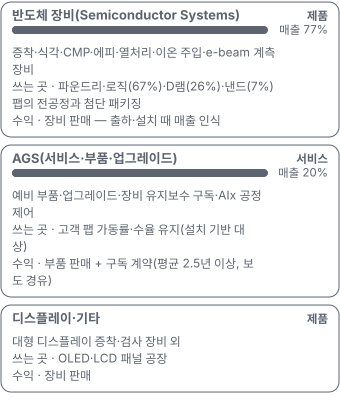

# 텐배거 리포트 2026-11-11 — Applied Materials — 이익 추정은 1년에 66% 올랐는데, 주가는 고점의 절반이 됐다

> 2026-11-11 · Applied Materials, Inc.(AMAT) · 기업: 웨이퍼에 막을 쌓고(증착)·깎고(식각)·평평하게 하고(CMP)·결정을 키우고(에피)·재는(e-beam 계측) 반도체 전공정 장비를 가장 넓게 파는 세계 최대 반도체 장비 회사 — 팹에 깔린 장비의 부품·서비스(AGS)가 매출의 약 20%다

## Chiip View

3Q FY26 매출 \$9.1B(+25%)·조정 EPS \$3.50(+41%)에 4Q 가이던스는 매출 \$10.25B(+51%)·EPS \$4.02다. FY27 EPS 컨센서스는 1년 전 \$11.0에서 \$18.3으로 66% 올랐다. 그런데 주가 \$372.53(11/10 종가, 4Q 실적 전)은 6/30 종가 고점 \$723.00보다 48% 낮다. 시가총액은 기본 주식 기준 \$295.6B, 완전 희석 기준 \$298.0B, EV \$296.1B다. **우리가 다르게 보는 곳은 '이익 → 배수' 고리다.** 시장의 이야기는 'AI가 공정 단계를 늘린다'이고 회사 숫자는 그대로 나왔다 — 하락은 이익이 아니라 배수에서 왔다(3Q 콜 뒤 다음 4개 분기 EPS 추정 +14%, 주가 −30%). 경쟁 가설은 셋이다. '고객이 데이터센터 부지·전력 때문에 팹 램프를 늦춘다'는 11/12 1Q FY27 가이던스와 2027년 장비 성장 숫자가, '이익이 사이클 정점이다'는 2027년 1월 TSMC·삼성전자·SK하이닉스의 2027년 설비투자 가이던스가, '중국 26%가 규칙 하나로 줄어든다'는 BIS(미국 상무부 산업안보국, 수출통제 집행) 규칙 개정(수시)과 4Q 콜의 중국 비중이 가른다. **구매 등급은 Neutral, 목표주가 \$360(−3%)다.** 규칙 등급도 Neutral이고 애널리스트 토론은 등급을 옮기지 않았다. 목표주가는 선정 배수 Fwd 1Y P/E 20.7배(지금 21.1배, 동종 중앙값 22.5배)로 계산한 약세 \$227과 기본 \$379 사이다. 선정 배수에는 사이클 정점·중국·2028년 고객 설비투자 둔화를 이유로 −5% 판단 감산을 넣었다. DCF 내재가치(기본)는 지금 가격보다 37% 낮다 — DCF는 2027년 뒤 성장이 빠르게 식는다고 보고(장비 사이클), 배수는 FY27 컨센서스 이익을 그대로 곱한다. 이 차이가 '이익이 정점이냐'는 쟁점이다. 정량 신호는 약하다(5년 연 기대수익 +1.7%, 자기자본비용 11.2% 대비 −9.5%p, 안전마진 0.42). 가를 것은 11/12(미국) 4Q 콜의 2027년 장비 성장 숫자다.

## 대시보드
| 항목 | 값 | 설명 |
|---|---|---|
| 주가 | \$372.53 | 고점 대비 -48% · 1년 +58% |
| 시가총액 | \$298.02B | 완전 희석 기준 · EV \$296.14B |
| 업사이드 | -3% | 목표주가 \$360 · 다운사이드 -39% · 손익비(강세÷약세) 1.4 |
| 구매등급 | Neutral | 애널리스트 37명: Strong Buy 26 · Buy 3 · Neutral 8 · Sell 0 · Strong Sell 0 |
| 멀티플 | Fwd 1Y P/E 21.1배 | 동종 중앙값 22.5배 |
| 가이던스 4Q26 | \$10,250M · \$4.02 | 컨센서스 \$10,450M · \$4.15 |
| 알파 | 6.4/10 | 텐배거 가능성 점수 |
| 이벤트 | 4Q FY26 실적·어닝콜(미국 장 마감 뒤, 한국 11/13 06시) — 1Q FY27 가이던스(14주 분기)·2027년 장비 성장 숫자가 첫 확인 사건 | 2026-11-12 |

## 한 장 요약
- **기업가치를 결정하는 내러티브** Applied의 값은 **AI가 반도체 공정 단계 수를 늘리는 속도**와 **고객이 그 팹을 제때 짓는 속도** 둘에 달렸다. 앞의 것은 숫자로 나왔다 — 3Q 매출 \$9.1B(+25%), 4Q 가이던스 \$10.25B(+51%), FY27 EPS 컨센서스 \$18.3(1년 전 \$11.0). 주가는 뒤의 것을 의심한다 — 6/30 종가 고점 \$723에서 11/10 \$372.53으로 −48%, Fwd 1Y P/E는 21.1배로 내려왔다
- **밸류에이션 모델로 본 주가 상방은 어디까지인가?** **목표주가 \$360(-3%), 약세와 기본 사이(약세 쪽 12%)다.** 강세 \$569(+53%)는 Fwd 1Y P/E 25.9배를 강세 EPS에 적용한 값이다. 기본 \$379, 약세 \$227. 손익비 1.4, DCF 기준 업사이드 -37%.
- **수주는 어디까지 왔나?** 회사 전체 수주잔고(FY25 말) 미확인, 100% 매출 \$15.00B · 고객 8분기 순환 예측(일부 2030까지) 미확인, 100% 매출 미확인 · BESI 지분 약 20% 확대(전략 투자) 미확인, 100% 매출 미확인. 개별 수주는 공시하지 않는다. FY25 말 잔고 \$15.0B(31%는 12개월 밖), 7월 말 RPO(남은 이행 의무, 계약했지만 아직 인식하지 않은 매출) \$1.0B(73% 12개월 안)·계약부채 \$3.27B(10월 말 \$2.57B)다. 고객 8분기 예측은 확정 주문이 아니다
- **누가 사 주나?** 최대 고객 중국 고객(합계) 26%, 상위 3곳 60%. 공시·회사 발표로 확인한 몫은 26%다.
- **마진과 공급망은 어디가 약한가?** GPM 50.3%, OPM 33.7%. OPM을 가장 흔드는 BOM(제품 원가를 이루는 부품·재료 명세) 항목은 챔버·세라믹·석영 정밀 부품이고 가격 +10%에 -0.69%p다. 공급망 신뢰성은 5.8/10(병목 주의)이고 가장 약한 고리는 챔버·세라믹·석영 정밀 부품이다.
- **생산능력은 얼마나 늘어나나?** 현재 명목 캐파 미확인, 착공 이상 증설 0 분기 시스템 출하(매출 \$B 대용). FY2027 CAPEX는 매출의 7.0%다.
- **지금 가격은 무엇을 가정하나?** 시가총액은 기본 주식 기준 \$295.6B, 완전 희석 기준 \$298.0B다. Fwd 1Y P/E 21.1배는 동종 4곳 중앙값 22.5배와 비슷하고 지난 3년 자기 범위의 중간이다. 지금 가격은 FY27 이익이 컨센서스(\$18.3) 근처에서 나오되 그 뒤 성장이 정상 속도로 식는다는 가정을 담는다 — 배수로는 기본 \$379(+2%)로 거의 같고, 2027년 뒤 성장이 빨리 식는 DCF로는 지금보다 37% 낮다. 5년 매출 CAGR로 바꾸면 지금 가격은 25%를, 기본 시나리오는 13%를 가정한다.
- **왜 움직였나?** 1년 동안 58% 올랐지만 고점에서는 48% 내렸다. 6월 한 달 61% 오른 뒤 7월 차익 실현, 10월 이후 업종 급락(SOX(필라델피아 반도체 지수) 10/1 이후 −31%)이 이어졌다. 3Q 콜 뒤로만 보면 다음 4개 분기 EPS 추정은 약 14% 올랐는데 주가는 30% 내렸다 — 하락은 전부 배수 압축이다. 11/5 하루 −13.6%는 회사 공시 없이 중간선거 뒤 데이터센터 건설 속도 우려로 업종이 함께 빠진 날이다.
- **3Q 콜에서 무엇이 바뀌었나?** 숫자를 모두 올렸다 — 2026년 장비 성장은 '30% 초과'에서 '그보다 높다'로, 첨단 패키징은 50% 초과에서 70% 초과로, AGS(Applied의 서비스·예비 부품·업그레이드 사업부)는 20% 초과로 올렸고, 공정 진단·제어(PDC(공정 진단·제어, 계측·검사 사업)) 50% 초과 성장을 새로 냈다. 2028년까지 분기 출하 능력을 2배로 만들 준비를 한다고 밝혔다. 중국은 '보합'에서 '2026·2027년 모두 증가'로 바뀌었다. 반대로 4Q 총이익률은 현장 엔지니어 1,000명 이상 추가 비용으로 보합(50.4%)이다. 2027년 성장률 숫자는 내놓지 않았다(UBS·Cantor 질문).
- **무엇이 바뀌면 판단이 달라지나?** 위로: 4Q 콜에서 2027년 장비 성장을 2026년 수준 이상으로 숫자로 내고, 1Q FY27 가이던스가 14주 효과를 빼고도 4Q보다 높으면 배수 압축의 이유(건설 지연 공포)가 약해진다. 아래로: 1Q 가이던스가 4Q 아래이거나, 고객(TSMC·삼성·SK하이닉스·Micron)이 1월에 2027년 설비투자를 낮추거나, 대중국 장비 수출 규칙이 28nm 이상까지 넓어지면 약세 시나리오로 옮긴다.

## 한눈에 보기

**일봉**

**주봉**

**월봉**

**분기 매출·EPS 실적과 컨센서스**

**4Q26 매출 — 지표 추세 vs 가이던스·컨센서스**

**EPS 리비전**

① 25-11-13 4Q FY25 실적, 다음 날 +1.2% · EPS 리비전 -
② 26-02-12 1Q FY26 실적·장비 성장 20%↑ 제시, 다음 날 +8.1% · EPS 리비전 -
③ 26-05-14 2Q FY26 실적·장비 성장 30%↑, 다음 날 −0.9% · EPS 리비전 -
④ 26-06-30 WFE 랠리 정점 종가 \$723 · EPS 리비전 -
⑤ 26-08-13 3Q FY26 실적·4Q +51% 가이던스, 다음 날 −5.1% · EPS 리비전 -
⑥ 26-10-13 투자자 행사·2030 목표, 당일 −6.7% · EPS 리비전 -
⑦ 26-11-05 데이터센터 건설 우려 업종 급락 −13.6% · EPS 리비전 -

**밸류에이션 주가 시나리오**

**주가별 업사이드**

**제품·서비스 포트폴리오**

**고객 믹스(FY25·3Q FY26, 매출 대비)**

**공급 병목(10점, 낮을수록 병목)**

**CAPEX의 매출 대비 비중**

**어닝콜 변화별 주주가치 영향**

**멀티플 프리미엄(Fwd 1Y P/E, 최근 4개 분기말)**

**합리적 멀티플**

**수주·파이프라인 확실성 사다리**

**매출 → 매출총이익 → 영업이익(매출 = 100, 최근 4분기)**

**1년 전 대비 마진 기여(비용 비중 변화의 반대)**

**분기 비용 비중 추이(매출 대비, 공시)**

**비용 요인별 매출 대비 비중과 1년 변화**

**BOM 항목 가격 +10% 시 OPM 변화**

**반도체 장비(Semiconductor Systems) BOM 원가 몫과 가격 +10% 시 OPM**

**AGS(서비스·부품·업그레이드) BOM 원가 몫과 가격 +10% 시 OPM**

**매출·PPI·수출입 — 최근 16개 분기 같은 축(4Q22 = 100) + 다음 분기 추정**

**매출과 EU 반도체 제조장비 수입(HS 848620) 증가율(전년 대비, 최근 16개 분기 + 다음 분기 추정)**

**10년 P·Q 사이클 — 추세(HP 필터) 대비 갭과 8분기 전망**

**매출 증가율의 가격·물량 분해와 8분기 전망(전년 대비)**

**분기별 매출 증가율 분해**

**목표주가 산정 — 약세와 기본 사이(약세 쪽 12%), 도달 확률 약 52%**

**일봉 지지·저항과 목표주가**

**커뮤니티 언급 수(최근 30일, 채널별)**

**커뮤니티 게시 수(월, 최근 7개월)**

**일별 거래량 분해**

**기관 자금 흐름**

**몬테카를로**

해석: 3,000번 중 223번(7%)에서 가치가 지금 주가 이상이었다. 가정을 흔들어도 지금 주가를 뒷받침하지 못하는 경우가 더 많다. 가운데 값은 0.65배이고, 열 번 중 여덟 번은 0.42~0.96배 사이에 든다.

## 내러티브

> **기업가치를 결정하는 이야기:** Applied는 웨이퍼 위에 막을 쌓고(증착), 깎고(식각), 평평하게 하고(CMP(웨이퍼 표면을 화학·기계적으로 평평하게 연마하는 공정)), 결정을 키우고(에피), 재는(e-beam(전자빔으로 미세 패턴을 재고 결함을 찾는 계측·검사)) 장비를 가장 넓게 판다. AI 칩은 트랜지스터 구조(GAA(게이트가 채널을 네 면에서 감싸는 차세대 트랜지스터 구조))·배선·메모리 적층(HBM(D램을 수직으로 쌓은 고대역폭 메모리))·패키징이 바뀔 때마다 이런 소재공학 단계가 늘어난다. 그래서 WFE가 30% 클 때 Applied의 기회 시장은 더 빨리 큰다는 것이 회사 논리다. 여기에 팹에 깔린 장비가 서비스·부품 매출(AGS, 매출의 약 20%)을 만든다. 돈은 장비 판매(출하 때 인식)와 서비스 계약에서 나오고, 가치 기반 가격으로 총이익률이 50%를 넘었다

> **멀티플·EPS 프리미엄**
> **멀티플:** Fwd 1Y P/E 21.1배로 동종 4곳 중앙(약 22.5배)과 비슷하고 지난 3년 자기 범위(15.6~32배) 중간이다. 6월 정점 때 30배를 넘었던 배수가 이익 상향을 따라가지 못하고 압축됐다. Fwd 2Y 18.4배·3Y 15.8배
> **EPS:** FY27 EPS 컨센서스가 1년 동안 \$11.0 → \$18.3(+66%), 3Q 콜 뒤에만 +12.6% 올랐다. 이익이 오르는 동안 주가는 콜 당일 종가 \$534.54에서 −30% 내려 배수 몫이 −38%였다

### 투자자들은 왜 열광했나

열광은 6월이었다 — 5/29 \$450에서 6/30 종가 \$723까지 한 달 +61%. 메모리 슈퍼사이클과 고객 팹 증설 소식, 'AI 칩 수요가 장비로 번진다'는 이야기에 업종 전체가 올랐다. 식은 이유는 두 번이다 — 7월 초 차익 실현(7/1 −10%), 그리고 10월 이후 '돈과 전력이 데이터센터 일정을 막는다'는 공포(10/1 이후 SOX −31%, 11/5 하루 −13.6%). 회사 숫자가 나빠진 사건은 없었다

### 무엇이 기업가치를 바꾸나

> **구조적 체질 변화**
> **변화:** 장비 판매 회사에서 '장비 + 설치 기반 서비스 + 공동 개발(EPIC(Applied의 고객·협력사 공동 개발 전략))' 회사로. AGS가 매출의 약 20%이고 영업이익률 30%다. EPIC 센터(Applied가 실리콘밸리에 지은 고객 공동 연구 클린룸, \$5B 규모)로 고객 차세대 공정 개발에 먼저 들어간다
> **증거:** EX-99.1·3Q 콜
> **반증:** EPIC 협력이 실제 신규 공정 수주(점유)로 이어진다는 숫자가 2027년까지 없다

> **고부가 믹스 확장**
> **변화:** 반도체 장비 총이익률 55.4%(+1.9%p YoY), 회사 50.4%(13분기 연속 상승). 패키징·PDC(계측) 같은 고마진 사업이 평균보다 빨리 큰다
> **증거:** EX-99.1·3Q 콜
> **반증:** 디스플레이 비중이 커져 회사 총이익률이 내려간다(회사가 직접 짚은 위험)

> **기술 혁신**
> **변화:** 3Q에 신제품 6종(D램 에피 Centura(Applied의 단일 웨이퍼 증착·에피 장비 플랫폼) Prime, HBM용 Producer(Applied의 CVD 장비 플랫폼) Avila, 도금·패키징 CMP, e-beam 2종). 4F²(셀 면적을 줄인 차세대 D램 셀 구조)·3D D램(셀을 수직으로 쌓는 차세대 D램)·패널 패키징 협의
> **증거:** 3Q 콜
> **반증:** 신제품 인증이 고객 양산 라인으로 넘어가지 못한다

> **실행 속도**
> **변화:** 회사는 납기를 공시하지 않는다. FY25 말 잔고 ÷ 월평균 매출로 근사한 주문→매출 대기는 약 6.4개월이다(추정). 고객이 '일정 맞춘 인도'를 요구하고 8분기 예측을 공유한다 **납품 리드타임 6.4개월.** 피어 비교 미확인. 이전 대비 미확인.
> **증거:** FY25 10-K·3Q 콜
> **반증:** 공급사 증설이 늦어 4Q·1Q 출하가 가이던스를 밑돈다

> **M&A**
> **변화:** BESI 지분 약 9% → 약 20%(10/26 8-K) — 하이브리드 본딩(범프 없이 구리 패드를 직접 붙이는 칩 적층 기술) 장비 선두와 묶는다. 이사회 진출·추가 확대 의사는 없다고 밝혔다
> **증거:** 8-K 2026-10-26
> **반증:** BESI가 다른 인수자(Lam 등 보도)와 합치거나 하이브리드 본딩 채택이 늦어진다

> **정책·입법 연관성**
> **재정정책:** 반도체 제조 투자세액공제(48D) — 2025년 법 개정으로 25% → 35%, 2026년 말까지 착공한 팹에 적용된다(법조문 기준, 원문 미대조). 미국 고객 팹의 착공 시점을 앞당기는 유인이다 공개 법조문(2025 예산조정법)·10-Q 정부 지원 주석(장비 투자 인센티브 \$1.8B 차감) 반증: 기한 연장 없이 2027년 미국 팹 착공이 끊긴다 의회 동의 10/10 — 하원 5/5(2022 CHIPS(미국 반도체 지원법)법·2025 예산조정법 하원 본회의 통과) · 상원 5/5(같은 법 상원 통과).
> **행정명령:** 대중국 장비 수출통제(BIS 규칙) — 행정부 규칙이라 의회 표결 없이 바뀐다. 9M FY26에 BIS와 수출통제 위반 합의금 \$253M을 냈다 https://www.sec.gov/Archives/edgar/data/6951/000162828026058235/amat-20260726.htm 반증: 새 규칙이 28nm 이상 성숙 공정까지 막는다 의회 동의 2/10 — 하원 1/5(의회 절차 아님(행정 규칙)) · 상원 1/5(의회 절차 아님).
> **연관입법:** 해당 없음(Applied 매출에 바로 닿는 계류 법안을 확인하지 못했다). 중간선거(11/3) 뒤 의회 구성이 바뀌어도 대중국 통제는 양당 공통이다(가설) 미확인 반증: CHIPS 세액공제 축소 법안이 위원회를 통과한다

> **CAPEX 낙수효과**
> **변화:** 하이퍼스케일러 AI 설비투자 → 칩 수요 → 고객 팹 증설(3Q에만 신규 팹 프로젝트 10개 이상) → 장비. 금지표대로 고객 CAPEX를 Applied 매출로 바로 옮기지 않고 회사 가이던스·잔고로 확인한다 — 4Q 가이던스 +51%
> **증거:** 3Q 콜
> **반증:** 고객이 2027년 설비투자를 낮춘다(TSMC·삼성·SK하이닉스·Micron 1월 가이던스)

### 내러티브 근거

> 'AI가 선단 로직·D램·첨단 패키징 공정 수를 늘리고, 그 공정 폭을 가장 넓게 가진 회사가 Applied'라는 이야기. 이익 쪽은 숫자로 확인됐다(FY27 EPS 컨센서스 1년 +66%). 지금 시장이 의심하는 것은 수요가 아니라 고객이 팹을 제때 짓느냐(부지·전력·자금)다. 동종 대비 멀티플 차이 -6% 중 회사 고유 몫은 +28%다. 단계는 컨센서스, 쏠림은 중간이다.

> **AI가 공정 수를 늘린다(GAA·HBM·패키징)** · 확인
> **논리:** 선단 로직·D램·첨단 패키징이 2026~27년 WFE 증가의 약 80%이고, 세 곳 모두 Applied가 1위다
> **숫자:** 3Q DRAM 매출 +52% YoY, 패키징 2026년 70%↑, FY27 EPS 컨센서스 +66%(1년)
> **반증:** 1Q FY27 가이던스가 4Q보다 낮다(14주 분기(회계연도 달력 보정으로 한 주가 더 들어간 분기)를 빼고도)

> **가치 기반 가격·마진 확장** · 강화
> **논리:** 총이익률 13분기 연속 상승, 2030년 54% 목표 — 이익이 매출보다 빨리 는다
> **숫자:** 3Q 비GAAP 총이익률 50.4%, 영업이익률 34.0%
> **반증:** 4Q 총이익률이 50% 아래

> **AGS 반복 매출** · 유지
> **논리:** 설치 기반·가동률 연동 서비스가 사이클 하방을 받친다
> **숫자:** AGS +22% YoY, 영업이익률 30.1%, 매출의 약 20%
> **반증:** 고객 가동률 하락으로 AGS 성장이 10% 아래

> **WFE 점유 확대·2030 목표** · 태동
> **논리:** 점유 18.3% → 20% 이상, 매출 2배를 인력 증가 없이 — 운영 레버리지
> **숫자:** 영업이익률 2030 목표 40%(보도 경유)
> **반증:** 2027년 WFE 점유가 늘지 않는다(Gartner 등 제3자 집계)

> **반대 — 고객이 팹을 제때 못 짓는다** · 확산
> **논리:** 데이터센터 부지·전력·자금 제약이 칩 수요 일정을 늦추고, 그 뒤 팹 증설과 장비 인도가 밀린다
> **숫자:** SOX 10/1 이후 −31%, AMAT 11/5 −13.6%
> **반증:** 4Q 콜에서 2027년 장비 성장 숫자가 2026년 이상

> **반대 — 사이클 정점과 중국** · 잠복
> **논리:** EPS가 1년에 66% 올랐다 — 장비 사이클은 고객 설비투자가 꺾이는 해에 이익과 배수가 같이 내려간다. 중국 26%는 수출통제 하나로 줄 수 있다
> **숫자:** 2028년 클라우드 설비투자 증가율 컨센서스 +9%(IB 자료 요지), 9M BIS 합의금 \$253M
> **반증:** 2028년 WFE 컨센서스가 2027년 위로 올라간다

## 포트폴리오

| 제품·서비스 | 구분 | 무엇 | 쓰는 곳 | 돈 버는 방식 | Mix | Mix 변화(전 분기 대비) |
|---|---|---|---|---|---|---|
| 반도체 장비(Semiconductor Systems) | 제품 | 증착·식각·CMP·에피·열처리·이온 주입·e-beam 계측 장비 | 파운드리·로직(67%)·D램(26%)·낸드(7%) 팹의 전공정과 첨단 패키징 | 장비 판매 — 출하·설치 때 매출 인식 | 77% | +1.8%p |
| AGS(서비스·부품·업그레이드) | 서비스 | 예비 부품·업그레이드·장비 유지보수 구독·AIx(Applied의 장비 데이터·AI 공정 제어 소프트웨어) 공정 제어 | 고객 팹 가동률·수율 유지(설치 기반 대상) | 부품 판매 + 구독 계약(평균 2.5년 이상, 보도 경유) | 20% | -1.5%p |
| 디스플레이·기타 | 제품 | 대형 디스플레이 증착·검사 장비 외 | OLED(유기 발광 디스플레이)·LCD(액정 디스플레이) 패널 공장 | 장비 판매 | 3% | -0.3%p |

**Mix 변화가 가장 큰 쪽은 반도체 장비(Semiconductor Systems, +1.8%p, 전 분기 대비).** 계절성 판정: 분기 매출 계절 지수 기준 없음 → 직전 분기와 비교.

## 고객

> **FY25·3Q FY26 최대 고객 중국 고객(합계) 26%, 상위 3곳 60%, 집중도 분산.** 공시·회사 발표로 확인한 몫은 매출의 26%이고, 나머지 고객 몫은 추정이거나 미분해다. FY25 두 고객이 매출의 19%·15%다(10-K, 이름 미공시). 지역으로는 3Q 중국 26%·대만 22%·한국 17%·미국 15%·일본 9%다(컨센서스 세그먼트 기준)

**고객별 매출 몫(FY25·3Q FY26)**
| 고객 | 몫 | 변화 | 근거 |
|---|---|---|---|
| 중국 고객(합계) | 26% | +2%p | 공시 |
| TSMC(추정)(고객 1(19%)) | 19% | 미확인 | 추정 |
| 삼성전자(추정)(고객 2(15%)) | 15% | 미확인 | 추정 |
| 기타·미분해 | 40% | - | - |

> **중국 고객(합계)** · 공시
> **사는 것:** 28nm 파운드리·ICAPS
> **추정 근거:** 3Q 반도체 장비+AGS 매출 중 중국 26%(콜), 2Q 24% — 고객 1·2와 겹치지 않는다

> **TSMC(추정)(고객 1(19%))** · 추정
> **사는 것:** 선단 파운드리 증착·식각·CMP·에피
> **추정 근거:** FY25 10-K 두 고객 19%·15% — 대만 매출 비중(FY25 약 24%)과 선단 파운드리 1위라는 정황으로 옮긴 가설

> **삼성전자(추정)(고객 2(15%))** · 추정
> **사는 것:** D램·파운드리·HBM 장비
> **추정 근거:** 한국 매출 비중(FY25 약 20%)과 EPIC 창립 회원 정황 — 가설. SK하이닉스와 나눌 수 있다

## 수주·파이프라인

> **2026-11-11 기준 3건.** 확정 \$15.00B. 공시 수주잔고(FY25 말, 10-K) \$15.00B. 서로 겹치는 항목은 합계에서 뺐다.

**실행 속도와 방해 요인**
| 항목 | 상태 | 실행 속도 | 방해 요인 |
|---|---|---|---|
| 회사 전체 수주잔고(FY25 말) | 확정 | 미확인 | 공급사 증설 · 고객 클린룸(먼지를 통제한 반도체 생산 공간) 완공 일정 |
| 고객 8분기 순환 예측(일부 2030까지) | 파이프라인 | 미확인 | 데이터센터 부지·전력 지연 · 고객 설비투자 축소 |
| BESI 지분 약 20% 확대(전략 투자) | 조건부 | 미확인 | HSR(미국 기업결합 사전 신고 제도) 심사 |

## 마진 구조

> **GPM 50.3%, OPM 33.7%.** 3Q FY25 대비 GPM +1.5%p, OPM +3.2%p. 변동비는 매출의 42%이고, 매출이 10% 늘면 OPM은 +2.2%p 움직인다. 매출원가는 매출의 49.7%(3Q)로 1년 전 51.2%보다 1.5%p 낮다 — 반도체 장비 몫이 커지고(믹스) 가치 기반 가격이 원가 상승을 넘었다. 연구개발 12.1%·판관비 4.5%라 영업이익률은 33.7%(GAAP)다. 원가 세부는 공시되지 않아 아래 요인은 세그먼트 총이익률에서 나눈 추정이다

> **매출 100 중 매출원가 50.6, 매출총이익 49.4(최근 4분기, 공시).** 매출원가 요인 중 장비 구매 부품·서브시스템(장비 안에 들어가는 모듈 조립품)이 매출의 26.0%로 가장 무겁고, 단가가 +10% 오르면 GPM이 -2.60%p 움직인다. 분기 회귀로 매출 1이 늘 때 매출원가는 0.48 늘고, 매출원가의 고정비 몫은 11%다.

**비용 요인 강도 — 비중·추세·충격(+10%)·탄력**
| 비용 | 구분 | 매출 대비 | 1년 변화 | 마진 기여 | 충격 시 마진 | 매출 탄력 | 고정비 몫 |
|---|---|---|---|---|---|---|---|
| 장비 구매 부품·서브시스템 | 매출원가 요인 | 26.0% | -0.8%p | +0.8%p | -2.60%p | 미확인 | 0% |
| AGS 서비스 원가(부품·현장 엔지니어) | 매출원가 요인 | 12.6% | -0.7%p | +0.7%p | -1.26%p | 미확인 | 50% |
| 장비 제조 인건비·간접비 | 매출원가 요인 | 5.0% | -0.2%p | +0.2%p | -0.50%p | 미확인 | 60% |
| 설치·보증·운송 | 매출원가 요인 | 3.4% | +0.0%p | -0.0%p | -0.34%p | 미확인 | 20% |
| 디스플레이·기타 원가 | 매출원가 요인 | 2.7% | +0.2%p | -0.2%p | -0.27%p | 미확인 | 40% |
| 매출원가 | 공시 항목 | 50.6% | -0.9%p | +0.9%p | -5.06%p | 0.48 | 11% |
| 연구개발 | 공시 항목 | 12.9% | +0.6%p | -0.6%p | 미확인 | 0.11 | 13% |
| 판관비 | 공시 항목 | 5.4% | -0.7%p | +0.7%p | 미확인 | 0.05 | 19% |
| 기타 영업비용 | 공시 항목 | 1.4% | 미확인 | 미확인 | 미확인 | 0.01 | 11% |

매출 탄력 = 분기 비용을 매출에 회귀한 기울기(매출 1당 변동비), 고정비 몫 = 절편 ÷ 평균 비용. 표본이 8분기 미만이면 미확인. 매출원가 요인 비중은 margin 재료의 추정이 섞여 있고, 공시 매출원가와의 차이는 '기타 매출원가'로 둔다.

**GPM에서 OPM까지(GAAP)**
| 기간 | GPM | 연구개발 | 판관비 | 기타 | OPM |
|---|---|---|---|---|---|
| 3Q FY25 | 48.8% | 12.3% | 5.9% | 0.0% | 30.6% |
| 3Q FY26 | 50.3% | 12.1% | 4.5% | 0.0% | 33.7% |

**GPM·OPM 최근 4개 분기**
| 분기 | GPM | OPM |
|---|---|---|
| 2025-10 | 48.0% | 25.2% |
| 2026-01 | 49.0% | 26.1% |
| 2026-04 | 49.9% | 31.9% |
| 2026-07 | 50.3% | 33.7% |

**마진을 결정하는 비용 요인 — 비용 +10% 시 OPM**
| 비용 | 매출 대비 | 변화 | 고정비 | OPM |
|---|---|---|---|---|
| 장비 구매 부품·서브시스템 | 26.0% | -0.8%p | 0% | -2.60%p |
| AGS 서비스 원가(부품·현장 엔지니어) | 12.6% | -0.7%p | 50% | -1.26%p |
| 연구개발 | 12.1% | -0.2%p | 85% | -1.21%p |
| 장비 제조 인건비·간접비 | 5.0% | -0.2%p | 60% | -0.50%p |
| 판매·관리 | 4.5% | -1.4%p | 70% | -0.45%p |
| 설치·보증·운송 | 3.4% | +0.0%p | 20% | -0.34%p |
| 디스플레이·기타 원가 | 2.7% | +0.2%p | 40% | -0.27%p |

**비용을 움직이는 요인**
| 비용 | 요인 |
|---|---|
| 장비 구매 부품·서브시스템(매출원가) | RF(고주파, 플라즈마 전원) 전원·진공·가스 모듈·정밀 부품 구매가 — 공급사도 증설 중 · 근거 추정 |
| AGS 서비스 원가(부품·현장 엔지니어, 매출원가) | 현장 지원 엔지니어 1,000명 이상 추가, 예비 부품 단가 · 근거 추정 |
| 연구개발(연구개발) | EPIC 센터·첨단 패키징·신제품 6종(3Q) · 근거 공시 |
| 장비 제조 인건비·간접비(매출원가) | 싱가포르 새 공장·인력 램프(3Q 1,500명) · 근거 추정 |
| 판매·관리(판관비) | AI 도구로 G&A 비중 역대 최저(3Q 콜) · 근거 공시 |
| 설치·보증·운송(매출원가) | 출하 대수·신제품 초기 보증 · 근거 추정 |
| 디스플레이·기타 원가(매출원가) | 디스플레이 장비 물량 · 근거 추정 |

**반도체 장비(Semiconductor Systems) BOM — 매출의 77%, GPM 55%(세그먼트 비GAAP 총이익률 공시(3Q)), 항목 가격 +10% 시**
| 항목 | 원가 몫 | 전가 | 제품 GPM | OPM |
|---|---|---|---|---|
| 챔버·세라믹·석영 정밀 부품 | 15~25% | 미확인 | -0.9%p | -0.69%p |
| 가스 공급 모듈·유체 서브시스템 | 10~18% | 미확인 | -0.6%p | -0.48%p |
| RF 전원·플라즈마 전원 | 8~14% | 미확인 | -0.5%p | -0.38%p |
| 로봇·제어 전자 | 8~14% | 미확인 | -0.5%p | -0.38%p |
| 진공 펌프·밸브 | 5~10% | 미확인 | -0.3%p | -0.26%p |
| 미분해 | 36% | - | - | - |

**AGS(서비스·부품·업그레이드) BOM — 매출의 20%, GPM 36%(세그먼트 비GAAP 총이익률 공시(3Q)), 항목 가격 +10% 시**
| 항목 | 원가 몫 | 전가 | 제품 GPM | OPM |
|---|---|---|---|---|
| 예비 부품 | 45~60% | 미확인 | -3.4%p | -0.66%p |
| 현장 지원 엔지니어 인건비 | 30~40% | 미확인 | -2.3%p | -0.44%p |
| 물류·창고 | 5~12% | 미확인 | -0.5%p | -0.11%p |
| 미분해 | 4% | - | - | - |

챔버·세라믹·석영 정밀 부품 가격이 +10% 오르면 영업이익은 -2.0% 움직인다. 판매가 전가를 모르는 항목은 전가 0%로 계산했다.

**BOM 항목 가격을 움직이는 것**
| 항목 | 요인 |
|---|---|
| RF 전원·플라즈마 전원 | 식각·증착 챔버마다 들어가는 핵심 서브시스템 · 근거 추정 |
| 가스 공급 모듈·유체 서브시스템 | 외주 비중이 큰 모듈, 공급사 증설 속도가 출하를 정한다 · 근거 추정 |
| 진공 펌프·밸브 | 진공 장비 필수품 · 근거 추정 |
| 챔버·세라믹·석영 정밀 부품 | 일부 부품은 단일·소수 공급사(10-K) · 근거 추정 |
| 로봇·제어 전자 | 웨이퍼 이송·장비 제어 · 근거 추정 |
| 예비 부품 | 가동률이 오르면 소모 부품 주문이 는다 · 근거 추정 |
| 현장 지원 엔지니어 인건비 | 3Q에 1,000명 이상 추가 · 근거 추정 |
| 물류·창고 | 24시간 부품 공급 · 근거 추정 |

**BOM 투입 물가 — PPI 전년비, 2026-11-11 수집**
| 항목 | 미국 | 일본 | 한국 | 대만 |
|---|---|---|---|---|
| RF 전원·플라즈마 전원 | +1.5% | +5.9% | +0.0% | +3.0%* |
| 가스 공급 모듈·유체 서브시스템 | +6.8%* | 미확인 | 미확인 | 미확인 |
| 로봇·제어 전자 | -2.2% | +3.9% | +134.0%* | +22.9%* |

별표는 품목보다 넓은 업종 지수다. 지난 1년 투입 물가를 판매가 전가 뒤 원가에 그대로 넣으면 OPM은 -0.45%p 움직인다(매출원가의 25% 기준).

## 공급망 병목

이미지 없음(눈 검수 대기) — 디스플레이·기타

이미지 없음(검수 실패) — 반도체 장비(Semiconductor Systems)

> **공급망 신뢰성 5.8/10, 병목 주의.** 가장 약한 고리는 챔버·세라믹·석영 정밀 부품 5.3점이고, 품목 평균은 6.5점이다. 병목은 Applied 자신의 조립 능력보다 서브시스템 공급사(RF 전원·가스 모듈·정밀 부품)의 증설 속도다. 회사는 공급사에 8분기 예측을 공유해 묶어 두고 있고(3Q 콜), 단일·소수 공급원 부품이 있다(10-K)

**병목과 마진 — 품목 가격 +10% 시 OPM**
| 품목 | 점수 | 판정 | 구분 | OPM |
|---|---|---|---|---|
| 챔버·세라믹·석영 정밀 부품(필수) | 5.3 | 병목 주의 | 핵심 통제 품목 | -0.69%p |
| RF 전원·플라즈마 전원(필수) | 5.5 | 병목 주의 | 출하 차질 위험 | -0.38%p |
| 가스 공급 모듈·유체 서브시스템(필수) | 6.6 | 관리 가능 | 일반 | -0.48%p |
| 조립·출하 능력(자체) | 8.7 | 병목 낮음 | 일반 | 미확인 |

> **챔버·세라믹·석영 정밀 부품** · 5.3/10
> **왜:** 단일 공급원 문구(10-K) · 인증 2곳·지역 몫은 추정
> **병목 요인:** 인증 공급사 2곳 · 캐파 빠듯 · 리드타임 미확인 · 재인증 12개월 · 1위 점유율 미확인 · 일본·미국(추정) 집중 60% · 물량 확보 장기계약
> **풀리는 조건:** 미확인

> **RF 전원·플라즈마 전원** · 5.5/10
> **왜:** 두 공급사가 시장 대부분을 나눈다(추정) · 재인증 12개월은 챔버 공정 재검증 기간 추정 · 장기계약 = 8분기 예측 공유 방식
> **병목 요인:** 인증 공급사 2곳 · 캐파 빠듯 · 리드타임 미확인 · 재인증 12개월 · 1위 점유율 50% · 미국(추정) 집중 60% · 물량 확보 장기계약
> **풀리는 조건:** 미확인

> **가스 공급 모듈·유체 서브시스템** · 6.6/10
> **왜:** 복수 공급사 · 재인증 9개월·점유율은 추정
> **병목 요인:** 인증 공급사 3곳 · 캐파 빠듯 · 리드타임 미확인 · 재인증 9개월 · 1위 점유율 40% · 미국·싱가포르·말레이시아(추정) 집중 50% · 물량 확보 복수구매
> **풀리는 조건:** 미확인

> **조립·출하 능력(자체)** · 8.7/10
> **왜:** 자체 공장 · 지역 몫 추정
> **병목 요인:** 인증 공급사 4곳 · 캐파 균형 · 리드타임 미확인 · 재인증 미확인 · 1위 점유율 미확인 · 싱가포르(추정) 집중 50% · 물량 확보 내재화
> **풀리는 조건:** 싱가포르 새 제조 센터 가동(3Q) — '가동'까지 확인, 증설 효과는 출하로 확인 전

**공급사**
| 품목 | 공급사 | 몫 | 근거 |
|---|---|---|---|
| RF 전원·플라즈마 전원 | MKS Instruments(RF 전원·진공 계측) | 미확인 | 공시 |
| RF 전원·플라즈마 전원 | Advanced Energy(RF·DC(직류 전원) 전원) | 미확인 | 공시 |
| 가스 공급 모듈·유체 서브시스템 | Ultra Clean(가스 공급 모듈·위탁 제조) | 미확인 | 공시 |
| 가스 공급 모듈·유체 서브시스템 | Ichor(가스·유체 모듈) | 미확인 | 공시 |
| 가스 공급 모듈·유체 서브시스템 | Applied 자체(일부 내재화) | 미확인 | 추정 |
| 챔버·세라믹·석영 정밀 부품 | 단일·소수 공급사(이름 미공시, 정밀 부품) | 미확인 | 공시 |
| 조립·출하 능력(자체) | Applied 자체(미국·싱가포르·대만·이스라엘, 최종 조립) | 미확인 | 공시 |

**무역 통계로 본 공급 지역**
| 품목 | EU 수입처 | 일본 수입처 | EU 1위 전년비 |
|---|---|---|---|
| RF 전원·플라즈마 전원 | JP(일본) 45% · US 35% · TW(대만) 7% | 大韓民国 36% · シンガポール 25% | +1090.7% |
| 가스 공급 모듈·유체 서브시스템 | CN(중국) 63% · US 27% · JP 4% | 中華人民共和国 28% · アメリカ合衆国 25% | +2.7% |

## 생산능력

> **현재 명목 캐파 미확인, 가동률 미확인.** 착공 이상 증설은 0 분기 시스템 출하(매출 \$B 대용), 발표까지 합치면 0 분기 시스템 출하(매출 \$B 대용)이다. FY2025 CAPEX는 \$2.26B로 매출의 8.0%다. 명목 캐파는 공시하지 않는다. 3Q 반도체 장비 매출 \$7.04B가 출하 능력의 대용이고, 회사는 2028년까지 분기 시스템 출하를 지금의 2배로 만들 준비(인력·공간)를 한다고 밝혔다

**생산시설 3곳**(FY25 10-K Item 2는 지역·면적 합계(소유 약 910만 sq ft·임차 약 530만 sq ft, 제조는 주로 미국·싱가포르·대만·이스라엘)만 읽혔다 — 시설별 목록 미대조. 여기 3곳은 회사가 이름을 밝힌 곳만 센다), 미확인 2곳 · 소유 1곳. 시설별 생산능력은 공개되지 않았다 — 회사 전체 캐파만 위에 적었다.

**생산시설 3곳 — 명칭·위치·생산능력**
| 시설 | 위치 | 용도 | 생산능력 | 소유·상태 |
|---|---|---|---|---|
| 싱가포르 제조 센터(2026 신설) | 싱가포르 | 장비 제조 | 미확인 — 시설별 캐파 미공시 | 미확인 · 가동 |
| EPIC 센터 | 미국 캘리포니아 실리콘밸리 | 공동 연구 클린룸(R&D) | 미확인 — 생산 시설 아님 | 소유 · 가동 |
| 산타클라라 본사 | 미국 캘리포니아 산타클라라 | 본사·R&D | 미확인 — 생산 시설 아님 | 미확인 · 가동 |

**생산능력 확충 계획**
| 계획 | 단계 | 증설 | 가동 시점 | CAPEX |
|---|---|---|---|---|
| 2028년 분기 출하 2배 계획(인력·공간) | 발표 | 미확인 | 2028 | 미확인 |

남은 계획의 CAPEX 합계는 \$0.00B(금액 미확인 1건 제외)다. 합계는 FY2027 매출의 0%다.

**증설 방해 요인**
| 계획 | 방해 요인 |
|---|---|
| 2028년 분기 출하 2배 계획(인력·공간) | 공급사 증설·현장 인력 |

**CAPEX와 매출 대비**
| 기간 | CAPEX | 매출 | 매출 대비 | 구분 |
|---|---|---|---|---|
| FY2025 | \$2.26B | \$28.37B | 8.0% | 실적 |
| FY2026 | \$2.79B | \$34.49B | 8.1% | 컨센서스 |
| FY2027 | \$3.20B | \$46.00B | 7.0% | 컨센서스 |

## 해자

> 해자는 넓다 — 장비 공정 폭(증착·식각·CMP·에피·계측)과 설치 기반 서비스가 동시에 있다. 다만 선단 공정 고객 몇 곳에 매출이 몰려 있어 가격 협상력은 고객 쪽에도 있다

> **가장 넓은 소재공학 공정 폭** · 강함
> **해자:** 증착(PVD(물리 기상 증착, 금속 배선 막)·CVD(화학 기상 증착, 절연·금속 막)·ALD(원자층 단위 증착)·에피)·식각·CMP·열처리·e-beam 계측을 한 회사가 다 판다 — GAA·HBM·첨단 패키징처럼 공정이 늘어나는 전환에서 장비 수가 먼저 늘어난다
> **근거:** 3Q 콜: 증착(PVD·CVD·에피)·열처리·식각·CMP·PDC 각각 분기 최고 매출. 반도체 장비 비GAAP 총이익률 55.4%
> **숫자:** WFE 점유 CY25 18.3% → 2030년 20% 이상 목표(투자자 행사, 보도 경유 — 원문 미대조)
> **깨지는 조건:** 선단 노드(1.4nm·4F² D램)에서 식각 비중이 커지고 증착 단계 수가 줄어든다(ASML 콜이 짚은 EUV(극자외선 노광) 단계 축소 논리)

> **설치 기반 서비스(AGS)** · 강함
> **해자:** 장비가 팹에 남아 있는 한 예비 부품·업그레이드·구독 서비스가 따라온다. 가동률이 오르면 부품 소모가 먼저 는다
> **근거:** 3Q AGS 매출 \$1.78B(+22% YoY), 영업이익률 30.1%. AIx 연결 챔버 37,000개 이상
> **숫자:** AGS = 매출의 약 20%, 장기 성장 10%대 중반(회사)
> **깨지는 조건:** 고객 가동률이 꺾여 부품 주문이 줄고 AGS 성장이 한 자릿수로 내려간다

> **가치 기반 가격** · 보통
> **해자:** 장비마다 고객 가치로 가격을 다시 매긴다 — 3년 동안 회사 총이익률 약 3%p 상승
> **근거:** 3Q 비GAAP 총이익률 50.4%, 13분기 연속 YoY 상승(EX-99.1·콜)
> **숫자:** 반도체 장비 총이익률 55.4%(+1.9%p YoY)
> **깨지는 조건:** 4Q 이후 총이익률이 50% 아래로 내려간다 — 램프 비용이 가격 효과를 넘는다

> **e-beam 계측·검사** · 보통
> **해자:** 고종횡비 구조를 나노미터 이하로 보는 e-beam 단계가 늘어나는데 이 시장의 선두다
> **근거:** 3Q 콜: PDC 2026년 50% 초과 성장, 광학 검사 신제품
> **숫자:** 미확인(PDC 매출 미공시)
> **깨지는 조건:** KLA가 광학·e-beam 혼합 검사로 점유를 지킨다(2Q 콜에서 공정 제어 점유 하락 질문)

## 경영진·네트워크

> CEO Gary Dickerson(2013~)이 'AI = 소재공학 전환'이라는 이야기를 13년 동안 끌고 왔다. CFO Brice Hill이 가치 기반 가격·주주 환원(FCF의 80~100%)을 맡는다. 8월 Qualcomm 출신 재무 임원이 감사위원 이사로 들어왔다

> **Gary Dickerson** · 사장·CEO · 2013
> **프로필:** Varian 반도체 장비 CEO 출신(2011 인수로 합류). 재임 중 비GAAP 총이익률 800bp 상승(2Q 콜)
> **비즈니스:** 삼성전자·Broadcom 등 EPIC 협력 11곳의 대표 창구(콜에서 고객 CEO와 직접 협의한다고 밝힘)
> **정계:** 미확인
> **동문:** 미확인
> **사모임:** 미확인

> **Brice Hill** · 수석부사장·CFO · 미확인
> **프로필:** 가치 기반 가격 도입, FCF의 80~100% 환원 원칙, 2028 출하 능력 2배 계획 발표
> **비즈니스:** 공급망 협력사에 8분기 예측 공유
> **정계:** 미확인
> **동문:** 미확인
> **사모임:** 미확인

> **Akash Palkhiwala** · 이사(감사위원) · 2026-08
> **프로필:** 8/27 이사 선임(8-K). 연간 보수 \$100K + 감사위원 \$25K + RSU \$250K
> **비즈니스:** 미확인(8-K는 경력을 적지 않았다)
> **정계:** 미확인
> **동문:** 미확인
> **사모임:** 미확인

**네트워크 정량화**
| 연결 | 강도 | 닿는 매출 | 가중 노출 | 매출 대비 | 근거 |
|---|---|---|---|---|---|
| 비즈니스: EPIC 공동 연구 협력(삼성전자 창립 회원, Broadcom·SCREEN·UC 버클리 등 11곳) | 4/5 | \$4.60B | \$3.68B | 12% | FY26 9M 한국 매출 \$4.55B를 연환산 근사한 값의 몫 — 삼성 단독 매출 미공시(추정) 3Q 콜·회사 발표(2026-02) |
| 정계: BIS 수출통제 합의(\$253M, 9M FY26) — 연방 수출통제 당국과의 관계는 위험 쪽 연결 | 4/5 | 미확인 | 미확인 | 미확인 | 중국 매출(3Q 26%)이 노출 범위 https://www.sec.gov/Archives/edgar/data/6951/000162828026058235/amat-20260726.htm |
| 동문: 공개 기록에서 확인한 연결 없음 | 0/5 | 미확인 | 미확인 | 미확인 | 미확인 미확인 |
| 사모임: 공개 기록에서 확인한 연결 없음 | 0/5 | 미확인 | 미확인 | 미확인 | 미확인 미확인 |

가중 노출은 연결이 닿는 매출의 크기다. 연결이 그 매출을 만들었다는 뜻이 아니며, 인과는 공개 자료로 입증하지 못한다.

## 약세 논리 및 셀온 조건

| 약세 논리 | 근거 | 반박 | 가를 자료 · 공개 시점 |
|---|---|---|---|
| 고객이 팹을 제때 못 짓는다 | SOX 10/1 이후 −31%, AMAT 11/5 −13.6%(회사 공시 없음). 데이터센터 부지·전력·자금 제약이 칩 수요 일정을 늦춘다는 업종 논리 | 3Q에만 고객 신규 팹 프로젝트 10개 이상, 8분기 순환 예측·일부 2030년까지 협의(3Q 콜). 4Q 가이던스 +51% | 1Q FY27 가이던스·2027년 장비 성장 숫자 — 2026-11-12 4Q 콜 |
| 사이클 정점의 이익에 배수를 준다 | FY27 EPS 컨센서스 1년 +66%. 2028년 클라우드 설비투자 증가율 컨센서스 +9%(IB 자료 요지) | AGS(매출의 20%, 영업이익률 30%)가 과거보다 하방을 받친다. 회사는 2027년도 '강한 기록의 해'라고 했다 | 2028년 WFE 컨센서스 방향 — 2027-01~02 고객 설비투자 가이던스 |
| 중국·수출통제 | 3Q 중국 26%, 9M FY26 BIS 수출통제 합의금 \$253M(10-Q) | 회사는 중국이 28nm 파운드리로 2026·2027년 모두 는다고 했다. 선단 공정 성장이 중국 비중을 낮춘다 | BIS 새 규칙 여부 — 수시. 4Q 콜의 중국 비중 |
| 마진 확장이 멈춘다 | 4Q 총이익률 가이던스 50.4%로 보합 — 현장 엔지니어 1,000명 이상 추가, 3Q 1,500명 채용 | 13분기 연속 YoY 상승, 반도체 장비 55.4%. 회사는 램프 비용을 일시적이라고 설명 | 4Q 실제 총이익률과 1Q 가이던스 — 2026-11-12 |

**정책·거시.** 중간선거 영향 +0.5/10 — 가장 큰 채널은 CHIPS 보조금·세액공제(폐지 입법 위험이 낮아졌다는 가설), 업종 반응은 선거일 뒤 SMH −2.7%(t −0.84, 유의하지 않음)다. 정책 0단계(선거 결과) 가설이다. 반도체 제조 투자세액공제(48D, 35%)는 2026년 말까지 착공한 팹에 적용돼 미국 고객의 착공을 앞당기는 유인이다(법조문 기준, 원문 미대조). **추가 원천(11/11).** 노션 자료실의 IB 자료 요지는 2026~2027년 WFE 성장 31%·38%(업종 프리뷰)와 9월 반도체 매출 +150% YoY를 전한다 — 시장 기대의 증거이지 Applied 매출이 아니다. 노션 45주차 리뷰는 'AMAT 주문'을 다음 주 쟁점으로 적었다. **데이터 한계.** www.sec.gov 직접 접속이 막혀 10-Q MD(경영진의 재무 상황 설명)&A의 구매 약정·10% 고객 표를 끝까지 읽지 못했다(미확인). FY25 두 고객 19%·15%의 이름은 공시되지 않아 TSMC·삼성전자로 옮긴 것은 가설이다. 10/13 투자자 행사의 2030년 목표(총이익률 약 54%·영업이익률 40%)는 보도·커뮤니티 경유로, 회사 자료 원문과 대조하지 않았다.

> **셀온 조건**
> **조건 1:** 1Q FY27 가이던스가 14주 효과를 빼고 4Q 실적보다 낮다 — 3Q 콜에서 밝힌 순차 성장 기대가 깨진다
> **조건 2:** 2027년 반도체 장비 성장 숫자가 20% 아래로 나오거나, 회사가 2027년 숫자 제시를 피한다
> **조건 3:** 주요 고객(TSMC·삼성전자·SK하이닉스·Micron) 가운데 둘 이상이 2027년 설비투자를 낮춘다
> **조건 4:** 비GAAP 총이익률이 2분기 연속 50% 아래로 내려간다
> **조건 5:** 대중국 장비 수출 규칙이 28nm 이상 성숙 공정까지 넓어진다

## 어닝콜 변화

**직전 콜 대비 새로 나오거나 바뀐 내용 → 가치 영향**
| 항목 | 내용 | 직전 콜 | 최신 콜 | 모델 동인 이동 | 확신도 | 가치 영향 |
|---|---|---|---|---|---|---|
| 업데이트 | 2026 장비 성장 전망 | 2Q 콜: 2026년 반도체 장비 30% 초과 | 3Q 콜: 30%를 넘어 더 높다(숫자 미제시) | 1년차 성장률 +3.0% | 0.8 | +3.1% |
| 신규 | 출하 능력 2배 | 2Q 콜: 제조 공간 몇 년 사이 2배 | 2028년까지 분기 시스템 출하 2배 준비, 3Q 1,500명 채용 | 장기 성장 수렴값 +1.0% | 0.5 | +2.3% |
| 업데이트 | 첨단 패키징 | 2026년 50% 초과 | 2026년 70% 초과 | 1년차 성장률 +1.0% | 0.8 | +1.0% |
| 업데이트 | AGS 성장 | 장기 10%대 중반, 올해 더 높을 수 있음 | 2026년 20% 초과, 장기 10%대 중반 유지 | 1년차 성장률 +0.50% | 0.8 | +0.5% |
| 신규 | 공정 진단·제어 | 언급 없음(MS가 점유율 하락을 지적) | 2026년 50% 초과 성장, 광학 검사 신제품 | 1년차 성장률 +0.50% | 0.8 | +0.5% |
| 업데이트 | 중국 | 중국·ICAPS 보합~소폭 증가, 비중 24% | 2026·2027년 증가(28nm 파운드리), 비중 26% | 1년차 성장률 +0.50% | 0.5 | +0.5% |
| 업데이트 | 총이익률 | 2Q 50.0%, 3Q 가이던스 50.1% | 3Q 50.4%(13분기 연속 YoY 상승), 4Q 50.4% 가이던스 | 목표 이익률 +0.50% | 0.8 | +0.3% |
| 부정 | 램프 비용 | 2Q: 이익률 상승 경로 | 4Q 총이익률 보합 — 지원 엔지니어 1,000명 이상 추가 비용 | 출발 이익률 -0.30% | 0.8 | -0.1% |
| 반복 | 수요 가시성 | 2Q: 8분기 순환 예측 | 8분기 + 일부 2030년까지 협의 | 성장 지속(감속 계수) +2.0% | 0.5 | +0.8% |
| **합계** | 단독 합 |  |  | 동시 적용 +9.3% |  | **+9.1%** |

**사건별 EPS 리비전**
| # | 날짜 | 구분 | 사건 | CY2026 EPS 전→후 | CY2027 EPS 전→후 | 리비전 | 주가 반응 |
|---|---|---|---|---|---|---|---|
| ① | 25-11-13 | 실적 | 4Q FY25 실적, 다음 날 +1.2% | - → \$9.76 | - → - | - | +1.2% |
| ② | 26-02-12 | 실적 | 1Q FY26 실적·장비 성장 20%↑ 제시, 다음 날 +8.1% | \$9.89 → \$11.42 | - → - | - | +8.1% |
| ③ | 26-05-14 | 실적 | 2Q FY26 실적·장비 성장 30%↑, 다음 날 −0.9% | \$11.61 → \$12.65 | - → - | - | -0.9% |
| ④ | 26-06-30 | 내러티브 | WFE 랠리 정점 종가 \$723 | \$12.75 → \$12.84 | - → - | - | +4.1% |
| ⑤ | 26-08-13 | 실적 | 3Q FY26 실적·4Q +51% 가이던스, 다음 날 −5.1% | \$12.84 → \$13.66 | - → - | - | -5.1% |
| ⑥ | 26-10-13 | 내러티브 | 투자자 행사·2030 목표, 당일 −6.7% | \$13.71 → \$13.70 | - → - | - | -6.7% |
| ⑦ | 26-11-05 | 내러티브 | 데이터센터 건설 우려 업종 급락 −13.6% | \$13.70 → \$13.70 | - → - | - | -13.6% |

## 거시 지표 싱크로율

> **EU(유럽연합) 반도체 제조장비 수입(HS(국제 통일 상품 분류 코드) 848620)와 반도체 장비(Semiconductor Systems) 싱크로율 68%(0분기 = 약 0개월 선행, 전년 대비, 표본 12개·t 2.9·유의·신뢰 보통).** 이 지표가 내포하는 4Q26 반도체 장비(Semiconductor Systems)은 5.66B(±1σ 5.17B~6.14B, 나우캐스트 1개월)다. 표본 밖 검증(최근 6개 분기)에서 지표 모델 오차는 9.4%p, 기준선(직전 증가율 지속)은 10.4%p다 — 지표가 기준선을 이겨 지표 64%·기준선 36%로 결합했다. 세그먼트 추정에 나머지 사업(직전 증가율 지속)을 더한 전사 매출은 8.09B(7.60B~8.58B)다. 가이던스는 이보다 +26.7%(범위 위), 컨센서스는 +29.1%(범위 위)다. 매출은 고객 팹 장비 반입을 따른다 — 대만·한국 반도체 장비 수입(HS 8486.20)과 미국 반도체 장비 PPI(생산자물가지수)를 쓴다

**지표별 싱크로율(상관계수 × 100) — 위 두 줄이 제품 연관성 × 싱크로율로 고른 PPI·수출입 세부 지표**
| 지표 | 비교 대상 | 증가율 기준 | 지표 선행 | 매출(t값) | 영업이익 | 방향 일치 | 표본·신뢰 | 표본 밖 오차(지표/기준선) | 4Q26 추정 매출 |
|---|---|---|---|---|---|---|---|---|---|
| 한국 반도체 제조장비 PPI | 반도체 장비(Semiconductor Systems) | 전년 대비 | 2분기(6개월) | 51%(t 1.9) | 48%(0분기) | 83% | 12·보통 | 10.5/10.4%p ✘ | +15.9% → 5.52B(확정) |
| EU 반도체 제조장비 수입(HS 848620) | 반도체 장비(Semiconductor Systems) | 전년 대비 | 0분기(0개월) | 68%(t 2.9) | -24%(4분기) | 50% | 12·보통 | 9.4/10.4%p ✔ | +18.8% → 5.66B(나우캐스트 1개월) |
| 미국 반도체 장비 PPI | 반도체 장비(Semiconductor Systems) | 전년 대비 | 3분기(9개월) | -71%(t -3.2) | -44%(0분기) | 50% | 12·보통 | 10.5/10.4%p ✘ | +19.8% → 5.70B(확정) |

**지표 후보 25개 — 연관성(제품 품목 일치 × 대용 감점 × 매출 비중) × 싱크로율로 고른다. 후보가 많을수록 최대 상관은 우연히 부풀 수 있다**
| 후보 | 종류 | 연관성 | 매출 분기 일치 | 싱크로율(선행) | 점수 | 출처 |
|---|---|---|---|---|---|---|
| EU 반도체 제조장비 수입(HS 848620) ✔ | 수출입 | 0.80 | 100% | 68%(0분기) | 0.54 | 자동 |
| 미국 반도체 제조장비 수입(HS 848620) | 수출입 | 0.80 | 100% | 57%(0분기) | 0.45 | 자동 |
| 미국 HS 848690 수입(반도체 장비(Semiconductor Systems)과 같은 4자리 품목군) | 수출입 | 0.56 | 100% | 70%(2분기) | 0.39 | 자동 |
| 미국 HS 848690 수출(반도체 장비(Semiconductor Systems)과 같은 4자리 품목군) | 수출입 | 0.56 | 100% | 68%(1분기) | 0.38 | 자동 |
| EU HS 848630 수출(반도체 장비(Semiconductor Systems)과 같은 4자리 품목군) | 수출입 | 0.56 | 100% | 66%(0분기) | 0.37 | 자동 |
| EU HS 848640 수입(반도체 장비(Semiconductor Systems)과 같은 4자리 품목군) | 수출입 | 0.56 | 100% | 60%(0분기) | 0.34 | 자동 |
| 한국 반도체 제조장비 PPI ✔ | PPI | 0.80 | 100% | 51%(2분기) | 0.32 | 자동 |
| EU HS 848690 수입(반도체 장비(Semiconductor Systems)과 같은 4자리 품목군) | 수출입 | 0.56 | 100% | 57%(2분기) | 0.32 | 자동 |
| 일본 반도체 제조장비 PPI | PPI | 0.80 | 100% | 49%(4분기) | 0.32 | 자동 |
| 미국 반도체 제조장비 수출(HS 848620) | 수출입 | 0.80 | 100% | 45%(1분기) | 0.28 | 자동 |
| 미국 HS 848630 수출(반도체 장비(Semiconductor Systems)과 같은 4자리 품목군) | 수출입 | 0.56 | 94% | 45%(0분기) | 0.20 | 자동 |
| 미국 HS 848610 수출(반도체 장비(Semiconductor Systems)과 같은 4자리 품목군) | 수출입 | 0.56 | 100% | 35%(4분기) | 0.16 | 자동 |

**선행 지표로 본 향후 분기 매출 전망(이미 나온 지표 값 기준, ±1σ)**
| 지표 | 대상 | 분기 | 지표 증가율 | 내포 매출 증가율 | 내포 매출 |
|---|---|---|---|---|---|
| 미국 반도체 장비 PPI | 반도체 장비(Semiconductor Systems) | 4Q26 | +0.5% | +14.9% | 5.47B(5.10B~5.84B) |
| 미국 반도체 장비 PPI | 반도체 장비(Semiconductor Systems) | 1Q27 | +1.0% | +13.6% | 5.84B(5.44B~6.24B) |
| 미국 반도체 장비 PPI | 반도체 장비(Semiconductor Systems) | 2Q27 | +1.5% | +12.6% | 6.72B(6.25B~7.18B) |
| EU 반도체 제조장비 수출(HS 848620) | 반도체 장비(Semiconductor Systems) | 4Q26 | -17.2% | +22.3% | 5.82B(5.43B~6.21B) |
| EU 반도체 제조장비 수출(HS 848620) | 반도체 장비(Semiconductor Systems) | 1Q27 | -29.2% | +28.8% | 6.62B(6.20B~7.04B) |
| EU 반도체 제조장비 수출(HS 848620) | 반도체 장비(Semiconductor Systems) | 2Q27 | +4.5% | +10.5% | 6.59B(6.10B~7.08B) |
| 미국 반도체 제조장비 수출(HS 848620) | 반도체 장비(Semiconductor Systems) | 4Q26 | -1.0% | +8.0% | 5.14B(4.67B~5.61B) |
| 일본 반도체 제조장비 PPI | 반도체 장비(Semiconductor Systems) | 4Q26 | -1.8% | -0.4% | 4.74B(4.28B~5.20B) |
| 일본 반도체 제조장비 PPI | 반도체 장비(Semiconductor Systems) | 1Q27 | +3.9% | +6.6% | 5.48B(4.99B~5.97B) |
| 일본 반도체 제조장비 PPI | 반도체 장비(Semiconductor Systems) | 2Q27 | +3.1% | +5.6% | 6.30B(5.73B~6.87B) |
| 일본 반도체 제조장비 PPI | 반도체 장비(Semiconductor Systems) | 3Q27 | +0.3% | +2.2% | 7.20B(6.52B~7.87B) |
| 한국 반도체 제조장비 PPI | 반도체 장비(Semiconductor Systems) | 4Q26 | +0.0% | +6.3% | 5.06B(4.61B~5.51B) |
| 한국 반도체 제조장비 PPI | 반도체 장비(Semiconductor Systems) | 1Q27 | +0.0% | +6.3% | 5.47B(4.98B~5.96B) |
| EU HS 848610 수출(반도체 장비(Semiconductor Systems)과 같은 4자리 품목군) | 반도체 장비(Semiconductor Systems) | 4Q26 | -11.4% | +7.9% | 5.13B(4.68B~5.58B) |
| EU HS 848640 수출(반도체 장비(Semiconductor Systems)과 같은 4자리 품목군) | 반도체 장비(Semiconductor Systems) | 4Q26 | -39.2% | +8.5% | 5.16B(4.66B~5.67B) |
| EU HS 848640 수출(반도체 장비(Semiconductor Systems)과 같은 4자리 품목군) | 반도체 장비(Semiconductor Systems) | 1Q27 | +4.4% | +6.3% | 5.46B(4.91B~6.01B) |
| EU HS 848610 수입(반도체 장비(Semiconductor Systems)과 같은 4자리 품목군) | 반도체 장비(Semiconductor Systems) | 4Q26 | -55.0% | +10.2% | 5.25B(4.79B~5.71B) |
| EU HS 848630 수입(반도체 장비(Semiconductor Systems)과 같은 4자리 품목군) | 반도체 장비(Semiconductor Systems) | 4Q26 | +95.6% | +6.0% | 5.04B(4.54B~5.55B) |
| EU HS 848630 수입(반도체 장비(Semiconductor Systems)과 같은 4자리 품목군) | 반도체 장비(Semiconductor Systems) | 1Q27 | +193.0% | +5.5% | 5.43B(4.88B~5.97B) |
| EU HS 848690 수입(반도체 장비(Semiconductor Systems)과 같은 4자리 품목군) | 반도체 장비(Semiconductor Systems) | 4Q26 | +22.5% | +16.4% | 5.54B(5.11B~5.97B) |
| EU HS 848690 수입(반도체 장비(Semiconductor Systems)과 같은 4자리 품목군) | 반도체 장비(Semiconductor Systems) | 1Q27 | +29.8% | +20.2% | 6.18B(5.71B~6.65B) |
| 미국 HS 848610 수출(반도체 장비(Semiconductor Systems)과 같은 4자리 품목군) | 반도체 장비(Semiconductor Systems) | 4Q26 | -14.3% | +2.1% | 4.86B(4.37B~5.35B) |
| 미국 HS 848610 수출(반도체 장비(Semiconductor Systems)과 같은 4자리 품목군) | 반도체 장비(Semiconductor Systems) | 1Q27 | +49.0% | +10.9% | 5.70B(5.17B~6.23B) |
| 미국 HS 848610 수출(반도체 장비(Semiconductor Systems)과 같은 4자리 품목군) | 반도체 장비(Semiconductor Systems) | 2Q27 | -9.6% | +2.7% | 6.13B(5.51B~6.74B) |
| 미국 HS 848610 수출(반도체 장비(Semiconductor Systems)과 같은 4자리 품목군) | 반도체 장비(Semiconductor Systems) | 3Q27 | -49.2% | -2.8% | 6.85B(6.12B~7.57B) |
| 미국 HS 848640 수출(반도체 장비(Semiconductor Systems)과 같은 4자리 품목군) | 반도체 장비(Semiconductor Systems) | 4Q26 | +15.6% | +1.2% | 4.82B(4.35B~5.28B) |
| 미국 HS 848640 수출(반도체 장비(Semiconductor Systems)과 같은 4자리 품목군) | 반도체 장비(Semiconductor Systems) | 1Q27 | -1.4% | +5.2% | 5.41B(4.91B~5.91B) |
| 미국 HS 848640 수출(반도체 장비(Semiconductor Systems)과 같은 4자리 품목군) | 반도체 장비(Semiconductor Systems) | 2Q27 | -2.7% | +5.5% | 6.29B(5.71B~6.88B) |
| 미국 HS 848690 수출(반도체 장비(Semiconductor Systems)과 같은 4자리 품목군) | 반도체 장비(Semiconductor Systems) | 4Q26 | +20.9% | +15.9% | 5.52B(5.13B~5.90B) |
| 미국 HS 848610 수입(반도체 장비(Semiconductor Systems)과 같은 4자리 품목군) | 반도체 장비(Semiconductor Systems) | 4Q26 | -60.3% | +15.1% | 5.48B(5.16B~5.80B) |
| 미국 HS 848610 수입(반도체 장비(Semiconductor Systems)과 같은 4자리 품목군) | 반도체 장비(Semiconductor Systems) | 1Q27 | -36.9% | +14.0% | 5.86B(5.52B~6.21B) |
| 미국 HS 848610 수입(반도체 장비(Semiconductor Systems)과 같은 4자리 품목군) | 반도체 장비(Semiconductor Systems) | 2Q27 | -30.8% | +13.7% | 6.79B(6.38B~7.19B) |
| 미국 HS 848610 수입(반도체 장비(Semiconductor Systems)과 같은 4자리 품목군) | 반도체 장비(Semiconductor Systems) | 3Q27 | -31.8% | +13.8% | 8.01B(7.54B~8.48B) |
| 미국 HS 848630 수입(반도체 장비(Semiconductor Systems)과 같은 4자리 품목군) | 반도체 장비(Semiconductor Systems) | 4Q26 | -74.2% | +9.7% | 5.22B(4.74B~5.70B) |
| 미국 HS 848630 수입(반도체 장비(Semiconductor Systems)과 같은 4자리 품목군) | 반도체 장비(Semiconductor Systems) | 1Q27 | -68.1% | +9.5% | 5.63B(5.11B~6.15B) |
| 미국 HS 848690 수입(반도체 장비(Semiconductor Systems)과 같은 4자리 품목군) | 반도체 장비(Semiconductor Systems) | 4Q26 | +31.6% | +17.5% | 5.59B(5.22B~5.97B) |
| 미국 HS 848690 수입(반도체 장비(Semiconductor Systems)과 같은 4자리 품목군) | 반도체 장비(Semiconductor Systems) | 1Q27 | +23.4% | +14.1% | 5.87B(5.46B~6.27B) |

지표가 k분기 앞서면 이미 발표된 지표로 k분기 뒤까지의 매출 증가율을 회귀식으로 읽는다. 표본이 작거나 t값이 2 미만이면 전망은 참고용이다.

**지표를 고른 이유**
| 지표 | 이유 |
|---|---|
| 한국 반도체 제조장비 PPI | 반도체 장비(Semiconductor Systems) ↔ 반도체 제조장비 생산자물가 |
| EU 반도체 제조장비 수입(HS 848620) | 반도체 장비(Semiconductor Systems) 품목 일치 |
| 미국 반도체 장비 PPI | 제품 가격(가치 기반 가격 대용) |

다음 분기 추정 = 지표 회귀와 기준선(직전 증가율 지속)을 표본 밖 오차의 역제곱으로 가중 결합한 값이다(예측 결합). 지표가 회귀에 쓴 범위를 벗어나면 범위 끝으로 자르고(외삽 제한), 세그먼트 추정은 나머지 사업을 기준선으로 더해 전사로 바꾼다. 싱크로율은 증가율의 상관계수이며 인과가 아니다. 지표 단위·통화는 원자료 그대로이고 나라끼리 더하지 않는다(EU 수입만 상대국 합계). ±1σ는 회귀 잔차 표준편차이고, 지표를 예측한 분기는 지표 예측 오차까지 더해 넓혔다.

## P·Q 사이클

> **10년 위치: Q형 기업(매출 갭 분산의 0%가 가격) — 가격은 추세 대비 -1.0%(수축, 10년 분위 15%), 물량은 -4.4%(회복, 분위 42%). P 프리미엄 -2%, Q 프리미엄 -5%(매출총이익이 정상(추세) 수준보다 요인별로 이만큼 높거나 낮다).** 전망으로 가격 갭은 4분기 뒤 -0.2%·8분기 뒤 +0.7%, 물량 갭은 +11.7%·+3.9%(물량은 컨센서스 몫 40%를 섞었다).

**10년 P·Q 사이클 위치·프리미엄**
| 항목 | 가격(P) | 물량(Q) |
|---|---|---|
| 추세 대비 갭(현재) | -1.0% | -4.4% |
| 사이클 시계 | 수축 | 회복 |
| 10년 분위 | 15% | 42% |
| 프리미엄(현재) | -2% | -5% |
| 프리미엄 4분기 뒤 | -1% | +13% |
| 프리미엄 8분기 뒤 | +2% | +4% |
| 갭 반감기 | 4분기 | 1분기 |
| 갭 4분기 뒤(80% 범위) | -0.2% (-1.8%~+1.3%) | +11.7% (+5.8%~+17.9%) |
| 갭 8분기 뒤(80% 범위) | +0.7% (-0.9%~+2.4%) | +3.9% (-3.0%~+11.3%) |
| 전망 모형 | 자기회귀모델(과거 2개 시점) | 자기회귀모델(과거 2개 시점) + 컨센서스(분기 컨센서스 4개 + 연간 컨센서스 성장률 FY2027→FY2028 +11%, 4분기 뒤 몫 40%) |

방법: P = 가격 지수 4분기 평균(미국 PPI 반도체 제조 장비 대용 — 회사 판매가가 아니라 업종 가격), Q = TTM 매출 ÷ P. 추세는 로그 레벨의 HP(경기 추세를 떼어 내는 통계 필터) 필터(λ 1600)로 정상(mid-cycle) 수준을 잡는다. 프리미엄 = 요인별 매출총이익 증분 ÷ 정상 매출총이익(정상 GPM 46.4% = 10년 중앙값, 물량 증분 마진 52.9% = 전년 대비 ΔGP÷ΔRev 회귀, 가격은 전액 이익 반영). 표본 40개 TTM 분기. 전망: 가격 갭은 BIC(모형 차수를 고르는 정보 기준)로 차수를 고른 자기회귀모델(정상성 보정), 물량은 통계 갭 자기회귀모델과 컨센서스 매출 ÷ 가격 전망(매출 = P × Q)을 분산 역수로 섞는다(Bates·Granger 1969). 끝점 편향을 줄이려고 전망 경로를 이어 붙인 뒤 HP 필터를 다시 건다(Kaiser·Maravall 1999). 80% 범위는 예측 오차(TTM이 4분기씩 겹쳐 생기는 자기상관을 뉴이·웨스트 장기 분산으로 반영)와 애널리스트 범위에서 낸다. 모형 산출이며 가이던스가 아니다.

> **Q 사이클 — 최근 4분기 평균 가격 기여 +0.7%, 물량 기여 +6.1%(전년 대비 로그 증가율).** P 강도 3.9/10, Q 강도 4.6/10, 최근 8분기 중 38%가 같은 요인 우세(순환적). 전망으로는 8분기 안에 전환 신호가 없다(물량은 컨센서스를 섞었다).

**P·Q 사이클 정량**
| 항목 | 가격(P) | 물량(Q) |
|---|---|---|
| 최근 4분기 평균 기여 | +0.7% | +6.1% |
| 강도(0~10, 자기 이력 z) | 3.9 | 4.6 |
| 고유 주기(자기회귀모델 과거 2개 시점일 때) | 미확인 | 16.3분기 |
| 다음 4분기 투영 평균 | +1.8% | +31.9% |
| 4분기 뒤 투영(80% 범위) | +2.0% (-1.9%~+5.8%) | +20.9% (+12.7%~+29.2%) |
| 장기 평균(표본 → 기저율 수축) | +2.4% → +2.3% | +7.7% → +6.3% |
| 투영 모형 | 자기회귀모델(과거 1개 시점) | 자기회귀모델(과거 2개 시점) + 컨센서스(분기 컨센서스 4개 + 연간 컨센서스 성장률 FY2027→FY2028 +11%) |

가격 근거: 미국 PPI 반도체 제조 장비 대용 — 회사 판매가가 아니라 업종 가격. PPI를 쓰면 회사 판매가가 아니라 업종 가격 대용이다. 로그 증가율이라 가격·물량 기여의 합이 매출 증가율이다. 전망: 가격은 BIC로 차수를 고른 자기회귀모델에 이미 발표된 월간 가격을 먼저 넣고(나우캐스트), 물량은 자기회귀모델과 '컨센서스 매출 증가율 − 가격 전망'을 분산 역수로 섞는다. 장기 평균은 표본 평균을 장기 기저율(가격 연 2%·물량 연 4%) 쪽으로 줄인다 — 고성장 구간만 담긴 표본이 그 성장을 끝없이 잇지 않게. 범위는 4분기 겹친 표본의 자기상관을 반영한다. 모형 산출이며 가이던스가 아니다. 회사 판매가로 잴 수 없는 이유: 장비 출하 대수·ASP를 분기로 공시하지 않는다 — 업종 PPI(반도체 장비) 대용으로 잰다

## 밸류에이션

> **목표주가 \$360, 업사이드 -3%.** 자리는 약세와 기본 사이(약세 쪽 12%)이고 도달 확률은 약 52%다. 기본 \$379, 강세 \$569(+53%), 약세 \$227(-39%). DCF 기준 업사이드는 기본 -37%, 강세 -11%, 약세 -57%다(WACC 11.2%).

기준 멀티플이 Fwd 1Y P/E라 시나리오도 FY2027 조정 EPS로 둔다. 확률은 콜 톤 '상향'(가이던스·세부 성장률 모두 상향)에도 약세를 30%로 둔다 — 10/1 이후 업종 −31%가 가리키는 위험(데이터센터 부지·전력 지연 → 칩 수요 일정 → 팹 램프 지연)이 회사 숫자에는 아직 나타나지 않았기 때문이다. 이 위험은 11/12 1Q FY27 가이던스와 1월 고객 설비투자 가이던스로 처음 확인된다.

> **약세 \$227 (-39%)** · 확률 30%
> **가정:** 15.5배 × EPS \$14.60
> **근거:** 고객이 데이터센터 일정 지연으로 2027년 하반기 팹 장비 인도를 미룬다. FY27 매출 약 \$40B(+16%, 추정 하단), 램프 비용으로 영업이익률 33% 근처 — EPS 약 \$14.6(컨센서스 하단)

> **기본 \$379 (+2%)** · 확률 45%
> **가정:** 20.7배 × EPS \$18.30
> **근거:** 컨센서스 경로 — FY27 매출 약 \$46B(+33%), 조정 영업이익률 36%, 세율 13%로 EPS 약 \$18.3(14명 평균 \$18.28)

> **강세 \$569 (+53%)** · 확률 25%
> **가정:** 25.9배 × EPS \$22.00
> **근거:** D램·선단 로직·패키징이 동시에 늘고 점유가 오른다. FY27 매출 약 \$52B(+50%), 영업이익률 38% — EPS 약 \$22(컨센서스 상단)

**멀티플 선정 — Fwd 1Y P/E**
| 단계 | 조정 | 근거 |
|---|---|---|
| 동종 중앙값 | 22.5배 | 범위 15.8~24.3배, 4곳 |
| 펀더멘털 | -13% | 성장·이익률·ROIC로 본 합리적 멀티플 16.5배와의 차이의 일부만 인정 |
| 해자 | +11% | 가장 넓은 소재공학 공정 폭 강함 · 설치 기반 서비스(AGS) 강함 · 가치 기반 가격 보통 · e-beam 계측·검사 보통 |
| 반복 매출 | -3% | 반복 매출 20%(동종 30%) · 서비스·예비 부품·업그레이드(AGS) — 설치 기반·가동률 연동 · 이미 반복 단계 · 기반 AIx 연결 챔버 37,000개 이상(3Q 콜, 전체 설치 기반 미공시) |
| 수주 전환·가시성 | +3% | 잔고 커버리지 0.00 · RPO 12개월 0.86 → 가시성 0.43 · 전환 6.5개월(동종 12) |
| 내러티브 | +0% | 단계 컨센서스 |
| 사이클·실행 판단 | -5% | −5%. ① 1년 동안 FY27 EPS 컨센서스가 \$11.0 → \$18.3(+66%)로 올라 사이클 정점에 가까운 이익을 곱한다 ② 중국 비중 26%와 BIS 수출통제 이력 ③ 2028년 클라우드 설비투자 증가율 컨센서스가 +9%로 꺾인다. 반대로 WFE 점유 확대와 AGS 반복 매출은 동종 중앙 근처를 지킨다 |
| **선정** | **20.7배** | 지금 21.1배 |

**동종 레인지**
| 회사 | Fwd 1Y P/E | Fwd 2Y P/E | Fwd 3Y P/E | 성장 | 영업이익률 | ROIC |
|---|---|---|---|---|---|---|
| LRCX | 21.9 | 18.8 | 18.3 | 42% | 40% | 89% |
| KLAC | 23.2 | 20.2 | 18.4 | 44% | 47% | 79% |
| ASML | 24.3 | 21.6 | 15.8 | 42% | 45% | 113% |
| ONTO | 15.8 | 13.4 | 11.3 | 52% | 35% | 18% |
| **Applied Materials** | 21.1 | 18.4 | 15.8 |  |  |  |

지금 주가가 요구하는 5년 매출 CAGR 25%, 기본 시나리오 13%. 몬테카를로 중앙값 업사이드 -35%.

> 의사결정 보조(투자자문 아님): ① 매수 매력: 5년 보유 가정 연 기대수익 +1.7% — 주주가 요구하는 수익률(자기자본비용) 11.2%보다 -9.5%p · 요구수익률을 넘을 확률 5% · 안전마진 0.42(비관적 경우의 기업가치가 지금 시가총액의 42%) → 정량 신호 약함 / ② 위험 예산 지표(이론): 0% — 기대수익이 요구수익률에 못 미친다(켈리 기준 — 수익·손실 확률로 계산한 이론상 최대 노출 — 0%는 참고) · 5년 뒤 나쁜 경우(하위 10%) -34% · 30% 넘게 잃을 확률 14% / ③ 상방(5년): 평균 1.09배 · 2배 이상 확률 1% · 3배 이상 0% · 10배 이상 0% · 잘 풀린 경우(상위 10%) 1.55배 이상

투입 물가 점검: 지난 1년 PPI를 BOM에 넣으면 OPM -0.45%p다(매출원가의 25% 기준).

## 매수 위치(일봉)

> **현재가 \$373는 '지지 근접'(가장 가까운 일봉 지지 \$371에서 ATR 0.0배 위).** 이 자리에서 목표주가까지 -3.4%, 첫 일봉 저항까지 +4.7%, 다음 지지까지 하방 -14.9%, 손익비 -0.2배. 손익비는 지지 1 \$371에서 -0.2배로 가장 높다(목표주가까지 -3.0%).

**가격대별 업사이드(일봉 기준)**
| 가격대 | 가격 | 목표주가까지 | 첫 저항까지 | 다음 지지까지 | 손익비 | 근거 기법(강도) |
|---|---|---|---|---|---|---|
| 현재가 | \$373 | -3.4% | +4.7% | -14.9% | -0.2 | - |
| 지지 1 | \$371 | -3.0% | +5.0% | -14.6% | -0.2 | 피보 23.6%(1.0) |
| 지지 2 | \$317 | +13.6% | +17.1% | 미확인 | 미확인 | 120일 지그재그 저점 · 스윙 저점(1.8) |

**일봉 저항**
| 저항 | 가격 | 현재가 대비 | 근거 기법(강도) |
|---|---|---|---|
| 저항 1 | \$390 | +4.7% | 20일선(0.5) |
| 저항 2 | \$405 | +8.7% | 피보 38.2%(1.0) |
| 저항 3 | \$412 | +10.5% | 120일 지그재그 저점(0.8) |

일봉만 쓴다(주봉·월봉 제외). 손익비 = 목표주가까지 업사이드 ÷ 다음 지지까지 하방. 가격대별 기대값 참고표이며 매수·매도 시점 지시가 아니다.

## 애널리스트 토론

> **토론 결론 Neutral(규칙 등급 Neutral).** 이익 상향(FY27 EPS +66%)과 4Q +51% 가이던스는 1차 자료로 확인됐지만, 선정 배수 20.7배로 계산한 목표주가가 지금 가격 근처이고 DCF는 그보다 낮다. 살아남은 반박은 '고객 건설 일정'이며 11/12 2027년 장비 성장 숫자로 가릴 수 있다 — 그 전에는 규칙 등급(Neutral)을 옮길 근거가 없다

**패널 — 등급별 자리**
| 자리 | 핵심 논리 | 틀리는 조건 | 최종 투표 |
|---|---|---|---|
| Strong Buy | 이익은 1년에 66% 올랐는데 배수는 30배대에서 21배로 내려왔다 — 수요가 아니라 공포를 할인 중이다 | 1Q FY27 가이던스가 4Q보다 낮다 | Buy |
| Buy | 선단 로직·D램·패키징 세 곳 모두 1위라 WFE보다 빨리 큰다 — 사이클이 길어진다 | 2027년 장비 성장 숫자가 20% 아래 | Buy |
| Neutral | 숫자는 좋지만 다음 확인은 11/12 하루다 — 가를 자료는 2027년 장비 성장 숫자와 1Q 가이던스 | 4Q 콜에서 2027년 성장 숫자가 2026년 이상 | Neutral |
| Sell | 장비 사이클 정점의 이익에 동종 수준 배수를 주면 비싸다 — 2028년 고객 설비투자 증가율이 꺾인다 | 2028년 WFE 컨센서스가 2027년 위로 올라간다 | Neutral |
| Strong Sell | 팹을 짓는 속도가 막혔다 — 데이터센터 부지·전력이 늦으면 장비 인도가 밀리고 가이던스가 처음으로 꺾인다 | 고객 2027년 설비투자 가이던스(1월)가 늘어난다 | Sell |

**투표**
| Strong Buy | Buy | Neutral | Sell | Strong Sell |
|---|---|---|---|---|
| 0 | 2 | 2 | 1 | 0 |

> **개회 · Strong Buy**
> **발언:** 콜 뒤 석 달 동안 이익 추정은 +12.6%, 주가는 −30%다. 배수 몫이 −38%다

> **개회 · Buy**
> **발언:** D램 매출이 1년에 52% 늘었다. 4Q에는 장비만 +62%를 가이던스로 냈다

> **개회 · Neutral**
> **발언:** 8분기 예측은 주문이 아니다. 확인할 숫자는 11/12에 나온다

> **개회 · Sell**
> **발언:** 장비주는 이익 정점에서 싸 보인다. Fwd 3Y 15.8배가 그 신호다

> **개회 · Strong Sell**
> **발언:** 11/5 하루 −13.6%는 회사 공시 없이 일어났다. 시장은 고객의 건설 일정을 의심한다

> **반박1 · Strong Buy → Strong Sell**
> **발언:** 건설 지연은 데이터센터 얘기다. 팹 클린룸은 3Q에만 신규 프로젝트 10개 이상이 발표됐다

> **반박1 · Strong Sell → Strong Buy**
> **발언:** 팹 칩의 최종 수요가 데이터센터다. 칩이 늦게 깔리면 팹 램프도 늦어진다

> **반박1 · Sell → Buy**
> **발언:** 점유 확대는 목표다. 2Q 콜에서 공정 제어 점유 하락을 질문받았다

> **반박1 · Buy → Sell**
> **발언:** 그 다음 분기에 PDC를 2026년 50% 이상 성장으로 제시했다

> **반박1 · Neutral → Strong Buy**
> **발언:** 배수 압축의 원인이 공포인지 정점 할인인지는 아직 가를 자료가 없다

> **반박2 · Strong Buy → Sell**
> **발언:** AGS가 매출의 20%고 영업이익률 30%다. 과거 사이클보다 하방이 얕다

> **반박2 · Sell → Strong Buy**
> **발언:** AGS도 가동률을 따라간다. 하락기에는 부품 주문이 같이 준다

> **반박2 · Strong Sell → Buy**
> **발언:** 중국 26%는 규칙 하나로 줄어든다. 합의금 \$253M이 그 이력이다

> **반박2 · Buy → Strong Sell**
> **발언:** 회사는 중국이 2026·2027년 모두 는다고 했다. 28nm 성숙 공정이다

> **반박2 · Neutral → Sell**
> **발언:** 정점 논리를 가를 자료는 2027년 WFE 성장 숫자다 — 4Q 콜과 1월 고객 가이던스

> **최종 · Strong Buy**
> **발언:** 이익과 배수의 괴리는 크다. 등급을 지킨다

> **최종 · Buy**
> **발언:** 세 성장 축이 모두 1위라는 점은 지킨다. 다만 배수 정상화는 11/12 숫자가 먼저다

> **최종 · Neutral**
> **발언:** 목표주가가 지금 가격 근처라면 11/12 숫자 전에는 중립이 맞다

> **최종 · Sell** · Neutral
> **발언:** 정점 위험은 남지만 배수가 이미 동종 아래다. 중립으로 물러선다

> **최종 · Strong Sell** · Sell
> **발언:** 회사 숫자가 나빠진 증거는 아직 없다. Sell로 물러선다

남은 반대 의견: Strong Buy 자리는 콜 뒤 석 달 동안 이익 추정 +14%에 주가 −30%인 괴리가 공포 할인이라는 점을 남겼다

패널은 등급별 논리를 대표하는 자리이고 실존 IB의 의견이 아니다.

## 커뮤니티 내러티브

> **6~8월 'AI 메모리 슈퍼사이클 + WFE 랠리' 이야기가 정점(Strong 85~88)이었고, 9~10월은 Moderate(72)로 식었다. 지금은 11/12 실적을 앞두고 공급망 회사들(PDF Solutions·Air Products·KLA·UCTT) 콜에서 장비 수요를 확인하는 '교차 확인' 글이 주류다** 관심 급증 0.0/10(결합 Z -1.4), 최근 7일 신뢰 가중 감성 +0.50(관측 전체 +0.35).

**채널별 내러티브와 기대 소화**
| 채널 | 주된 이야기 | 기대 | 1차 자료 대조 | 비중 |
|---|---|---|---|---|
| X | 공급망 회사 실적이 장비 출하 증가를 확인한다(교차 확인) | 상향 | 미확인(다른 회사 콜 — Applied 1차 자료는 11/12) | 40% |
| X | 2030년 목표: WFE 점유 +2%p, 총이익률 54%·영업이익률 40%, 매출 2배 | 상향 | 미확인(투자자 행사 원문 미대조) | 25% |
| X | BESI 지분 20% — 하이브리드 본딩을 묶는다 / ASML에 밀릴까 | 혼재 | 확인(8-K 10/26 지분 약 20%) | 15% |
| 레딧 | \$640 위에서 판 것이 다행 — 고점 대비 반 토막 | 소진 | 확인(종가 고점 6/30 \$723 → 11/10 \$372.53, −48%) | 10% |
| 유튜브 | 메모리 부족 → 장비 수요(방송 진행자 추천) | 상향 | 확인(3Q DRAM 매출 +52% YoY) | 10% |

**채널별 급증 측정(음이항 Z·CUSUM, 사건형은 포아송 꼬리확률)**
| 채널 | 최근 | 평소 | 급증 | 지속 |
|---|---|---|---|---|
| X | 3일 0건 | 하루 1.7건 | Z -1.4 | - |
| 레딧 | 3일 0건 | 하루 0.1건 | Z -0.4 | - |
| 유튜브 | 3일 0건 | 하루 0.1건 | Z -0.4 | - |
| 의회 매매 | 30일 1건 | 30일당 1.0건 | p 0.632 | - |

**기대가 바뀐 시점:** 9월(85 → 72)에 꺾였다. 10/13 투자자 행사 당일 −6.7%, 11/5 업종 급락 −13.6%로 주가는 대화보다 더 빨리 식었다

원천: Quantral(X·레딧·유튜브·서브스택 언급 집계, 작성자 적중률로 신뢰 가중). 커뮤니티 의견은 시장 기대의 증거이지 사실이 아니며, 관심 급증은 주가·펀더멘털 변화가 아니다.

## 시장 평가

> **셀사이드(IB 애널리스트)**
> **한 줄:** 셀사이드는 거의 만장일치 매수다. 3Q 콜 질문은 '2026년 장비 성장률 숫자'와 '총이익률 지속성' 두 가지에 몰렸다. 목표가 하단 \$452도 지금 가격 위라 의견 하향보다 목표가 하향이 먼저 나올 자리다(추정)
> **애널리스트 의견(37명):** Strong Buy 26 · Buy 3 · Hold 8 · Sell 0
> **목표가 평균(33명):** \$628 (범위 \$452~900)
> **FY27 EPS 컨센서스:** \$18.28(14명) — 1년 전 \$11.0

> **바이사이드(기관 투자자)**
> **한 줄:** 공매도가 적어 하락은 숏이 아니라 롱 정리(차익 실현·업종 비중 축소)에서 나왔다(추정). 의원 3명의 매수 공시가 있었지만 금액이 작다(\$1K~15K)
> **기관 보유:** 86%(yfinance)
> **내부자 보유:** 0.3%
> **공매도:** 유통 주식의 1.8%, 2.0일
> **내부자 장내 거래:** CAO(최고 회계 책임자) 매도 \$395K(10/2, \$544.56)

> **언론·업계**
> **한 줄:** 언론은 이번 실적을 반도체 업종 전체의 시험대로 본다 — 장비 주문이 꺾이지 않으면 11월 급락은 수요가 아니라 포지션 정리였다는 해석이 힘을 얻는다
> **주요 제목:** '시장 전체에 중요한 실적 프리뷰'(Seeking Alpha 11/7) — '51% 성장 분기를 23배에'(10/30)
> **회사 발표:** BESI 지분 20% 확대(10/26)·EPIC 센터 공개(10/12)

## 체크리스트

| 시점 | 무엇 | 의미 |
|---|---|---|
| 2026-11-12(미국, 장 마감 뒤) | 4Q FY26 실적·1Q FY27 가이던스·2027년 장비 성장 숫자 | 배수 압축의 이유(건설 지연 공포)가 회사 숫자로 옮겨 가는지 첫 확인 |
| 2026-11 중 | 4Q 어닝콜 전문 게시 | 2027년 성장·총이익률·중국에 대한 회사 답변(재발행 대상) |
| 2026-12 중순(예상) | FY26 10-K — 10% 초과 고객·수주잔고·구매 약정 | 잔고 \$15.0B(FY25 말)가 늘었는지, 고객 집중 변화 |
| 2027-01 | TSMC·삼성전자·SK하이닉스 2027년 설비투자 가이던스 | 장비 수요의 최종 확인 — 하향이면 약세 시나리오 |
| 수시 | BESI 지분 20% 취득 완료(HSR 대기 기간 종료) | 하이브리드 본딩 공정 묶음 — 금액 공시 여부 |
| 2027-02-18(예상) | 1Q FY27 실적(14주 분기) | 4Q 가이던스 대비 실행, 2027년 경로 재확인 |

## 출처
- https://www.sec.gov/Archives/edgar/data/6951/000162828026056699/exhibit991q32026earningsre.htm
- https://www.sec.gov/Archives/edgar/data/6951/000162828026058235/amat-20260726.htm
- https://www.sec.gov/Archives/edgar/data/6951/000162828025056742/amat-20251026.htm
- https://www.sec.gov/Archives/edgar/data/6951/000162828026067303/amat-20261026.htm
- https://www.sec.gov/Archives/edgar/data/6951/000162828026059257/amat-20260827.htm
- 3Q·2Q FY26 어닝콜(2026-08-13·05-14) — 요지만 자기 말로
- 라이선스 자료 요지 포함(노션 자료실 IB 리포트) — 외부 공유 금지
- 마스터 노션 자료: 미확인 Japan_Machinery__Automation__Trade_statistics__September_2026_robot_Robodrill_volume_trends.pdf (요지만, 외부 공유 금지)
- 마스터 노션 자료: 미확인 Japan_Machinery__Construction__September_2026_trade_statistics.pdf (요지만, 외부 공유 금지)
- 마스터 노션 자료: 미확인 Americas_Technology__Semiconductors__SIA_data_shows_mostly_below-seasonal_trends_in_September_following_a_strong_August.pdf (요지만, 외부 공유 금지)
- 마스터 노션 자료: 미확인 US_Conviction_List_-_Directors__Cut__November_2026_Update_-_Mid-earnings_thoughts.pdf (요지만, 외부 공유 금지)
- 마스터 노션 자료: UBS UBS_Memory_Semis_Monthly：October_'26_Edition：_Is_the_Wall_of_Worry.pdf (요지만, 외부 공유 금지)
- 마스터 노션 자료: 미확인 JP Morgan SemiconductorsSemi Cap Equipment 3Q26 Sector Preview.pdf (요지만, 외부 공유 금지)
- 마스터 노션 자료: 미확인 Bernstein - Global Memory & Storage - HBF Deep Dive - Could HBF be the solution to the Memory bottleneck - 27 Oct 2026.pdf (요지만, 외부 공유 금지)
- 마스터 노션 자료: 미확인 South Korea Tech_ Memory Pricing Tracker_ Oct. 2026_ 4Q26 DRAM ASP forecast for PC higher, server_mobile in-line, NAND lower ....pdf (요지만, 외부 공유 금지)
- 마스터 노션 자료: 미확인 South Korea Tech_ October 2026 export tracker_ Another record-high DRAM exports at US\$34bn (+595_ yoy).pdf (요지만, 외부 공유 금지)
- 마스터 노션 자료: JPM 2026-11-03 JPM_Memory_Market_Update_2026-11-03_5522344.pdf (요지만, 외부 공유 금지)
- 마스터 노션 자료: 미확인 Global_Semiconductors_2027E_Global_Memory_Supply_Demand_Projection.pdf (요지만, 외부 공유 금지)
- 마스터 노션 자료: JPM 2026-11-09 JPM_Semiconductors_Septe_2026-11-09_5521351.pdf (요지만, 외부 공유 금지)
- 3Q FY26 어닝콜
- MKS·Advanced Energy 10-K(Applied를 10% 초과 고객으로 공시) — 몫은 업계 추정
- Ultra Clean·Ichor 10-K(Applied를 주요 고객으로 공시) — 몫은 업계 추정
- 업계 자료(공급사 이름 미공시)
- 회사 발표(UPS 타오위안 물류센터, 2026-03 보도)
- Advanced Energy 10-K(고객 공시)
- ICHR 10-K(Applied 주요 고객)
- MKS 10-K(고객 공시)
- UCTT 10-K(Applied 주요 고객)
- https://www.sec.gov/cgi-bin/browse-edgar?action=getcompany&CIK=0001275014
- 추정

_구매 등급·목표주가 모두 규칙이 계산한 모델 값으로, 개인의 보유 종목·자금 사정을 반영하지 않는다 · 공개 자료 기반 분석이며 투자 권유가 아님 · 1차 판정, 미검증 · Chiip ten-bagger_