# 텐배거 리포트 2026-11-11 — Bloom Energy — 매출은 2배, 주가는 고점의 절반: 배수가 이익 상향을 다 먹었다

> 2026-11-11 · Bloom Energy Corporation(BE) · 기업: 고체산화물 연료전지(SOFC)로 천연가스를 태우지 않고 현장에서 전기를 만드는 발전 설비(Energy Server)를 만들어 AI 데이터센터·전력회사·공장에 팔고 15~20년 서비스로 운영하는 회사

## Chiip View

3Q26 매출 \$1.24B(+138%)·조정 EPS \$0.94로 실적 전 컨센서스(매출 약 \$1.06~1.07B·EPS \$0.70)를 크게 넘었고, FY26 가이던스를 세 번째로 올렸다(매출 \$4.4~4.6B, 조정 EPS \$3.10~3.40). 11월에는 Google 와이오밍 702MW(AEP 경유)와 NTT DATA 900MW가 더해졌다. 그런데 주가 \$185.42는 6/22 종가 고점 \$345.85보다 46% 낮다. 시가총액은 기본 주식 기준 \$54.8B, 완전 희석 기준 \$57.9B, EV \$58.2B다. **우리가 다르게 보는 곳은 '좋은 숫자가 이미 가격에 있다'는 점이다.** FY27 EPS 컨센서스는 1년 동안 \$2.80에서 \$5.69로 2배가 됐고 주가는 33% 올랐다 — 배수가 줄었는데도 Fwd 1Y P/E 42.5배로 동종 중앙 22.2배의 2배 가까이다. 경쟁 가설은 셋이다. '고객 집중은 납기 시점 문제일 뿐'은 FY26 10-K의 10% 고객·관계사 매출(2027-02 말)이, '현금 유출은 일시적'은 4Q 영업현금흐름(2027-02 초)이, '캐파 2GW가 다 팔린다'는 2027 매출 가이던스(같은 날)가 가른다. **구매 등급은 Sell, 목표주가 \$127(−32%)다.** 규칙 등급은 Strong Sell이었고, 애널리스트 토론은 Neutral을 냈지만 규칙 등급에서 한 단계까지만 옮길 수 있어 Sell로 정했다. 목표주가는 선정 배수 Fwd 1Y P/E 23.5배(지금 42.5배, 동종 중앙 22.2배)로 계산한 기본 \$115와 강세 \$182 사이다. 선정 배수는 동종 중앙에 펀더멘털·해자 가산을 더하고, 반복 매출 비중이 낮고(6%) 잔고 전환이 길다(약 22개월)는 점을 깎은 값이다. 강세 \$182도 지금 가격보다 2% 낮아 손익비(강세 상승폭 ÷ 약세 하락폭)가 0 근처다 — 이 배수 체계로는 지금 가격이 강세 시나리오까지 반영했다는 뜻이다. DCF 내재가치(기본)도 −47%로 같은 쪽이다. 정량 신호는 약하다(5년 연 기대수익 +1.3%, 자기자본비용 10.1% 대비 −8.8%p, 안전마진 0.22). 반대로 보면, 배수가 40배대에 머물고 2028 EPS가 컨센서스 상단(\$8) 쪽으로 가면 지금 가격은 정당화된다 — 강세 쪽 투자자가 사는 이야기가 그것이다. 가를 것은 2027년 2월 초 4Q 실적의 2027 가이던스다.

## 대시보드
| 항목 | 값 | 설명 |
|---|---|---|
| 주가 | \$185.42 | 고점 대비 -46% · 1년 +33% |
| 시가총액 | \$57.92B | 완전 희석 기준 · EV \$58.19B |
| 업사이드 | -32% | 목표주가 \$127 · 다운사이드 -66% · 손익비(강세÷약세) 정의 안 됨 — 강세 \$182도 현재가 아래 |
| 구매등급 | Sell | 애널리스트 27명: Strong Buy 12 · Buy 2 · Neutral 12 · Sell 0 · Strong Sell 1 |
| 멀티플 | Fwd 1Y P/E 42.5배 | 동종 중앙값 22.2배 |
| 가이던스 4Q26 | \$1,448M · \$1.09 | 컨센서스 \$1,270M · \$0.85 |
| 알파 | 5.9/10 | 텐배거 가능성 점수 |
| 이벤트 | 4Q26 실적·2027 첫 가이던스 — 날짜 미발표, 전년 2/5 기준 추정 | 2027-02-04 |

## 한 장 요약
- **기업가치를 결정하는 내러티브** Bloom의 값은 **AI 데이터센터의 현장 전력 수요를 캐파 2GW → 5GW로 따라가면서 매출을 현금으로 바꾸는가**에 달렸다. 3Q 매출 \$1.24B(+138%)·조정 영업이익률 23.1%로 네 분기 연속 컨센서스를 크게 넘었고, FY26 가이던스를 세 번 올려 \$4.4~4.6B다. 그런데 주가는 6월 종가 고점의 54%다 — 1년 동안 FY27 EPS 추정은 2배가 됐지만 Fwd 1Y P/E는 6월 약 97배에서 42배로 줄었다. 시장은 매출의 69%가 두 고객이라는 점과 3Q 현금 유출을 할인한다
- **밸류에이션 모델로 본 주가 상방은 어디까지인가?** **목표주가 \$127(-32%), 기본과 강세 사이(강세 쪽 18%)다.** 강세 \$182(-2%)는 Fwd 1Y P/E 29.4배를 강세 EPS에 적용한 값이다. 기본 \$115, 약세 \$64. 손익비는 정의되지 않는다(강세 \$182도 현재가 \$185.42 아래), DCF 기준 업사이드 -47%.
- **수주는 어디까지 왔나?** AEP 구매 약정(최대 1GW) 미확인, 100% 매출 \$2.65B · Google 와이오밍 702MW(AEP 경유) 0%, 100% 매출 미확인 · Oracle 확대(초기 1.2GW) 미확인, 100% 매출 미확인. 회사 KPI 제품 잔고는 2025년 말 \$6.0B, 서비스 잔고 \$14B다. 2026년에는 잔고를 분기마다 공시하지 않고 '잔고가 매출보다 빨리 는다'고만 말한다. 10-Q 잔여 이행 의무는 \$661M뿐이다 — 대형 계약의 대부분은 금융 파트너가 주문을 낼 때 잡힌다
- **누가 사 주나?** 최대 고객 고객 1(이름 미공시 — AEP로 추정, 가설, Customer One) 43%, 공시 두 고객 69%(나머지 31%는 미분해 잔여). 공시·회사 발표로 확인한 몫은 69%다.
- **마진과 공급망은 어디가 약한가?** GPM 33.8%, OPM 18.2%. OPM을 가장 흔드는 BOM(제품 원가를 이루는 부품·재료 명세) 항목은 셀·스택 소재(세라믹·스칸듐·니켈·인터커넥트)이고 가격 +10%에 -2.56%p다. 공급망 신뢰성은 5.9/10(병목 주의)이고 가장 약한 고리는 현장 시공 인력·하도급이다.
- **생산능력은 얼마나 늘어나나?** 현재 명목 캐파 1 GW/년, 착공 이상 증설 1 GW/년. FY2027 CAPEX는 매출의 6.8%다.
- **지금 가격은 무엇을 가정하나?** 시가총액은 기본 주식 기준 \$54.8B, 완전 희석 기준 \$57.9B다. 다음 4개 분기 컨센서스 EPS \$4.36에 Fwd 1Y P/E 42.5배로 동종 5곳 중앙(22.2배)보다 91% 높고, 성장이 비슷하게 빠른 GE Vernova(40.8배) 수준이다. 지금 가격은 2027년 매출이 50% 안팎 더 늘고 조정 영업이익률 24%대가 유지된다는 컨센서스를 대체로 믿는 값이다 — 배수가 동종 중앙으로 내려오려면 이익이 지금 추정보다 2배 가까이 커져야 한다.
- **왜 움직였나?** 1년 동안 33% 올랐지만 6월 종가 고점에서는 46% 내려왔다. 그 사이 FY27 EPS 컨센서스는 2배가 됐다 — 이익은 올랐고 배수가 그보다 더 크게 줄었다. 실적 다음 날 반응은 1Q +27%, 2Q −2%, 3Q −11%로 기대가 높아질수록 약해졌다. 11/5 −16%는 중간선거 뒤 AI 인프라 전체 급락이었고, 같은 날 나온 Google·NTT DATA 계약도 막지 못했다.
- **3Q 콜에서 무엇이 바뀌었나?** FY26 가이던스를 세 번째로 올렸다 — 매출 \$4.4~4.6B(2Q 때 중간 약 \$4.1B), 조정 영업이익 \$960M~1.03B(2Q \$800~900M), 조정 EPS \$3.10~3.40. 새로 나온 것은 AEP·Google 700MW 탄소 포집형 계약, Fremont 부지 확대(5GW 이후 대비), 텍사스 첫 출하다. 매출을 올렸는데 조정 총이익률 가이던스는 약 34%에 묶었다. 현금 질문(Evercore ISI)에 CFO는 '자체 자금으로 성장한다'며 계약자산은 청구 마일스톤에 따라 회전한다고 답했다 — 3Q 수치로 확인된 답은 아니다.
- **무엇이 바뀌면 판단이 달라지나?** 위로: 2월 초 2027 가이던스 매출이 \$7.5B를 넘고 4Q 영업현금흐름이 +\$300M을 넘으면 배수를 지킬 근거가 생긴다. 아래로: 2027 매출 가이던스가 \$6.0B 아래이거나 4Q에 두 고객 몫이 70%를 넘으면 약세 시나리오로 옮긴다.

## 한눈에 보기

**일봉**

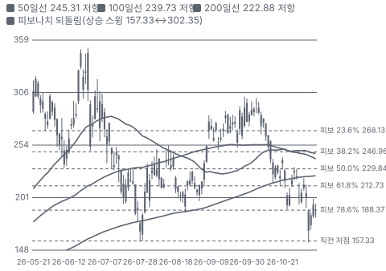

**주봉**

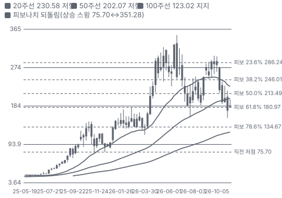

**월봉**

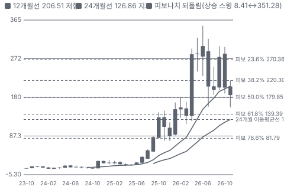

**분기 매출·EPS 실적과 컨센서스**

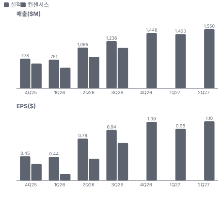

**4Q26 매출 — 지표 추세 vs 가이던스·컨센서스**

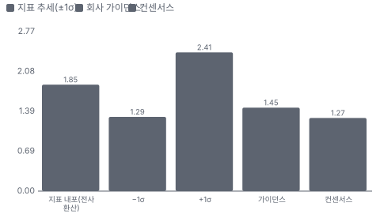

**최근 4개 분기 주가 변화 분석**

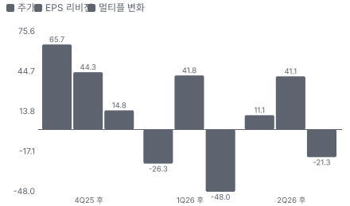

**EPS 리비전**

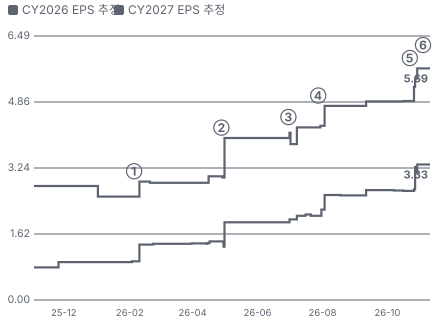

① 26-02-05 4Q25 실적·2026 첫 가이던스 · EPS 리비전 +15%
② 26-04-28 1Q26 실적·상향, 다음 날 +27% · EPS 리비전 +31%
③ 26-06-30 Brookfield \$15B 확대 · EPS 리비전 +6%
④ 26-07-28 2Q26 실적·두 번째 상향 · EPS 리비전 +13%
⑤ 26-10-22 3Q26 실적·세 번째 상향, 다음 날 −11% · EPS 리비전 +16%
⑥ 26-11-05 Google 와이오밍·NTT DATA 900MW · 실적 창과 겹침

**밸류에이션 주가 시나리오**

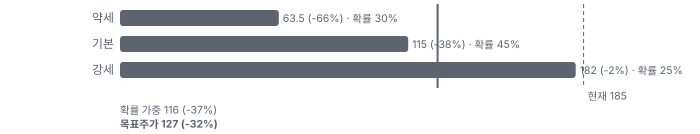

**주가별 업사이드**

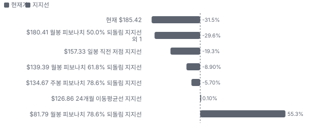
- 제품·서비스 포트폴리오

**고객 믹스(3Q26, 매출 대비)**

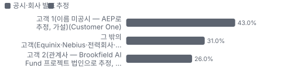

**공급 병목(10점, 낮을수록 병목)**

**생산능력 현재와 확충 계획(GW/년)**

**CAPEX의 매출 대비 비중**

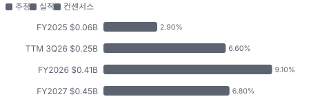

**어닝콜 변화별 주주가치 영향**

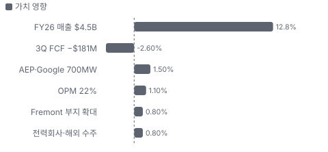

**멀티플 프리미엄(Fwd 1Y P/E, 최근 4개 분기말)**

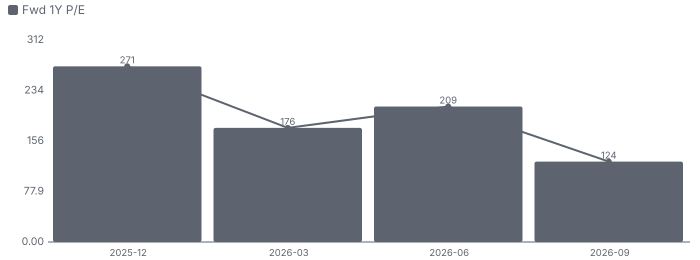

**합리적 멀티플**

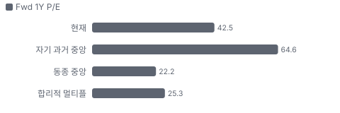

**수주·파이프라인 확실성 사다리**

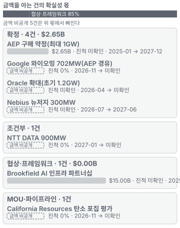

**매출 → 매출총이익 → 영업이익(매출 = 100, 최근 4분기)**

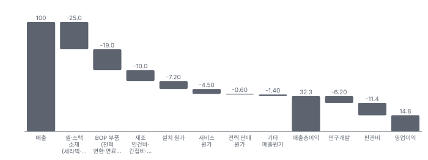

**1년 전 대비 마진 기여(비용 비중 변화의 반대)**

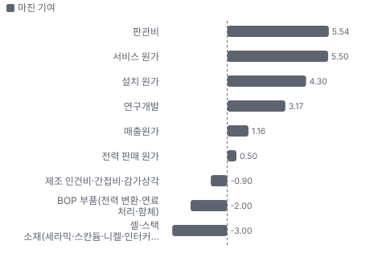

**분기 비용 비중 추이(매출 대비, 공시)**

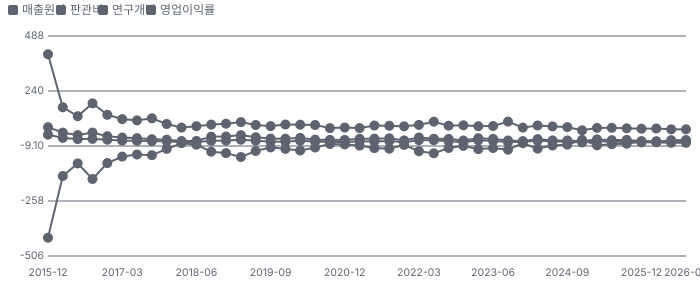

**비용 요인별 매출 대비 비중과 1년 변화**

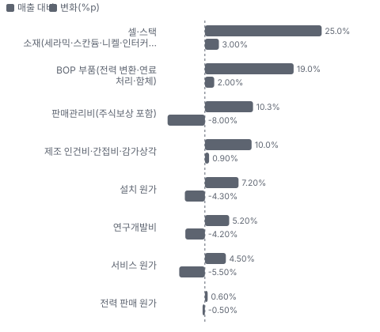

**BOM 항목 가격 +10% 시 OPM 변화**

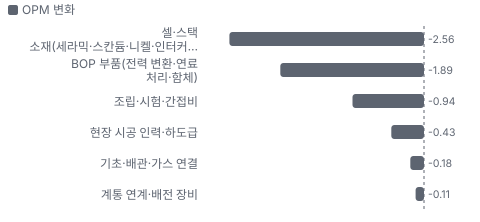

**제품(Energy Server) BOM 원가 몫과 가격 +10% 시 OPM**

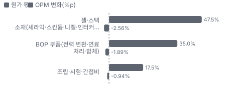

**설치 BOM 원가 몫과 가격 +10% 시 OPM**

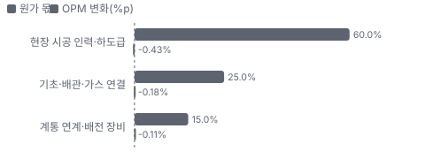

**매출·PPI·수출입 — 최근 16개 분기 같은 축(4Q22 = 100) + 다음 분기 추정**

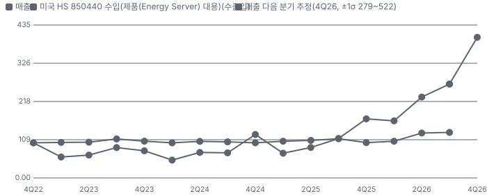

**매출과 미국 HS 850440 수입(제품(Energy Server) 대용) 증가율(전년 대비, 최근 16개 분기 + 다음 분기 추정)**

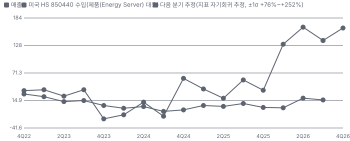

**매출 증가율의 가격·물량 분해와 8분기 전망(전년 대비)**

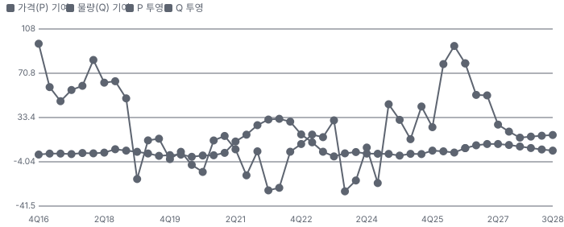

**분기별 매출 증가율 분해**

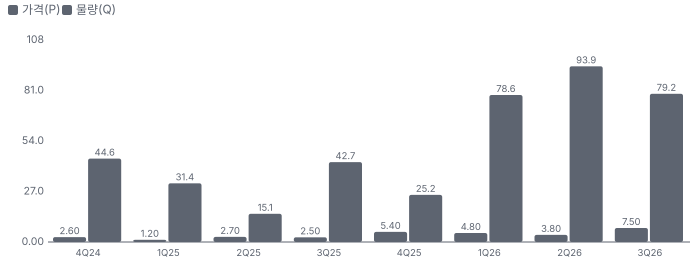

**목표주가 산정 — 기본과 강세 사이(강세 쪽 18%), 도달 확률 약 41%**

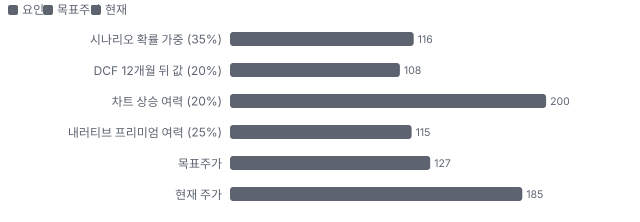

**PEG — 성장 대비 멀티플(낮을수록 성장 대비 쌈)**

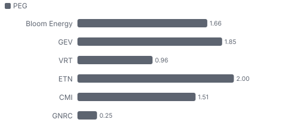

**일봉 지지·저항과 목표주가**

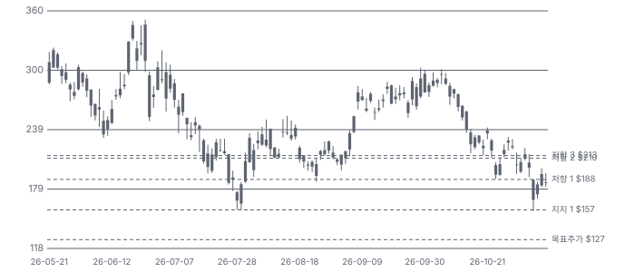

**커뮤니티 언급 수(최근 30일, 채널별)**

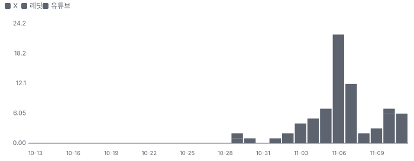

**커뮤니티 게시 수(월, 최근 8개월 — 이번 달은 진행 중)**

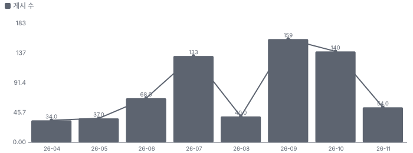

**일별 거래량 분해**

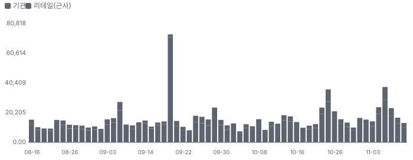

**기관 자금 흐름**

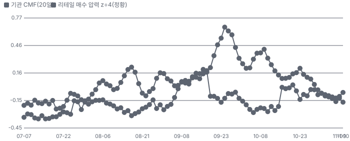

**몬테카를로**

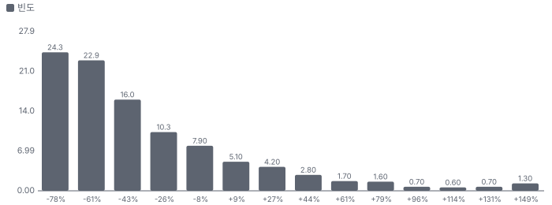

해석: 3,000번 중 564번(19%)에서 가치가 지금 주가 이상이었다. 가정을 흔들어도 지금 주가를 뒷받침하지 못하는 경우가 더 많다. 가운데 값은 0.50배이고, 열 번 중 여덟 번은 0.22~1.32배 사이에 든다.

## 내러티브

> **기업가치를 결정하는 이야기:** Bloom은 고체산화물 연료전지(SOFC(고체산화물 연료전지 — 세라믹 전해질로 가스를 태우지 않고 전기를 만든다))로 천연가스를 태우지 않고 전기를 만드는 발전 설비 'Energy Server(Bloom의 연료전지 발전 설비 묶음, 스택·연료 처리·전력 변환)'를 만든다. 셀·스택을 Fremont·Newark 공장에서 직접 만들고, 고객 현장에 설치한 뒤 15~20년 서비스 계약으로 운영한다. 데이터센터가 전력망 연결을 몇 년씩 기다릴 수 없게 되면서 '현장에서 몇 달 만에 전기를 대는' 수단으로 하이퍼스케일러가 쓰기 시작했다. 고객 대부분은 설비를 직접 사지 않고 Brookfield 같은 금융 파트너가 서버를 사서 쓰게 한다. 가치는 세 숫자로 갈린다 — 캐파 2GW(2026년 말)가 다 팔리고 5GW로 가는가, 조정 영업이익률 22%가 유지되는가, 그리고 이익이 현금으로 들어오는가

> **멀티플·EPS 프리미엄**
> **멀티플:** Fwd 1Y P/E 42.5배로 동종 5곳 중앙(22.2배)보다 91% 높다 — GE Vernova(40.8배)와 비슷하다. Fwd 2Y 33.8배·3Y 27.5배로 내려간다. 지난 3년 자기 범위는 약 30~180배이고 지금은 그 하단 쪽이다
> **EPS:** FY27 EPS 컨센서스는 1년 전 \$2.80(2025-11)에서 3Q 실적 뒤 \$5.69(10/29)로 2배가 됐다. 이익 추정이 오른 만큼 배수가 줄어 주가는 1년 +33%에 그쳤다

### 투자자들은 왜 열광했나

열광은 4~6월이었다 — 1Q 실적 다음 날 +27%, 6월 Brookfield \$15B 확대로 6/22 종가 고점 \$345.85(6/25 장중 \$351.28)까지 갔다. 식은 이유는 셋이다 — 7월 공매도 보고서(스칸듐 공급망), 2Q·3Q 실적 다음 날 반응이 −2%·−11%로 약했던 것(이미 기대가 높았다), 그리고 11/5 중간선거 뒤 AI 인프라 급락(−16%)이다. 11/9 반등(+12%)은 회사 공시가 없는 업종 반등이다

### 무엇이 기업가치를 바꾸나

> **구조적 체질 변화**
> **변화:** 보조금에 기대던 청정 발전 회사에서 AI 데이터센터 현장 전력 회사로 — 2024년 적자에서 2026년 조정 영업이익률 22%(가이던스)로
> **증거:** 3Q26 EX-99.1·10-Q
> **반증:** 2027 조정 영업이익률이 20% 아래

> **고부가 믹스 확장**
> **변화:** 제품 비중 74% → 87%(3Q 전년 대비), 제품 총이익률 37.9%. 적자 설치·저마진 전력 판매 비중이 줄었다
> **증거:** 10-Q 매출 분해
> **반증:** 설치 비중이 다시 15% 넘게 커지며 총이익률이 떨어진다

> **기술 혁신**
> **변화:** 탄소 포집형 서버(AEP·Google 700MW), 800V 직류 직결, 전해조 특허(11/10 연속로 제조법)
> **증거:** 3Q 콜·특허
> **반증:** 탄소 포집 프로젝트 가동이 2028년 이후로 밀린다

> **실행 속도**
> **변화:** 계약에서 전력까지 Oracle 유타 55일, Nebius 인허가 3개월(회사). 가스 터빈은 대기가 수년이다(회사 비교) **납품 리드타임 2개월.** 피어 비교 미확인. 이전 대비 미확인.
> **증거:** 2Q·3Q 어닝콜
> **반증:** 대형 프로젝트 첫 전력이 계약 뒤 12개월 넘게 걸린다

> **M&A**
> **변화:** 해당 없음(최근 3년 인수 없음) — 대신 Brookfield AI Fund(Brookfield와 만든 AI 인프라 전력 투자 펀드) 지분 투자
> **증거:** 10-Q Note 7
> **반증:** 해당 없음

> **정책·입법 연관성**
> **재정정책:** 청정 전력 세액공제(48E(청정 전력 투자 세액공제 조항)·ITC(투자 세액공제)) — 연료전지는 2025년 세제법(OBBBA(2025년 미국 세제·재정 조정법)) 뒤에도 일정 기간 남는다(10-Q가 10-K를 참조). 금액은 10-Q에 없다 10-Q 3Q26 Note 2·12 반증: 연료전지 세액공제 조기 종료 입법 의회 동의 2/10 — 하원 1/5(Bloom 직접 관련 새 법안 미확인) · 상원 1/5(Bloom 직접 관련 새 법안 미확인).
> **행정명령:** 대형 데이터센터가 자체 전력을 갖추라는 행정부 방향(시장 해석) — 공식 행정명령 문서는 미확인 커뮤니티·보도(1차 문서 미대조) 반증: 해당 없음 의회 동의 2/10 — 하원 1/5(의회 절차 아님) · 상원 1/5(의회 절차 아님).
> **연관입법:** 발전소·송전선 인허가를 빠르게 하고 대형 데이터센터에 계통 증설 비용을 지우는 초당적 법안이 상원 절차 표결(73-25)을 통과했다는 보도 — 법안 번호·최종 표결 미대조 보도(11/10, 1차 문서 미대조) 반증: 본회의 부결·하원 계류

> **CAPEX 낙수효과**
> **변화:** 하이퍼스케일러·AI 연구소의 데이터센터 투자 → 현장 전력 주문. 금지표대로 고객 투자를 Bloom 매출로 바로 옮기지 않는다 — 확인된 것은 AEP 약 \$2.65B 구매 약정, NTT DATA 900MW 같은 개별 계약
> **증거:** AEP 3Q 콜·회사 발표
> **반증:** 하이퍼스케일러 2027 CAPEX 가이던스 하향

### 내러티브 근거

> 'AI 데이터센터가 전력망을 기다리지 않고 현장에서 전기를 만든다 — 그 표준이 Bloom'이라는 이야기. 2026년 매출은 2배 넘게 늘고(가이던스 +122%) 조정 영업이익률은 22%로 올라 숫자는 나왔다. 그런데 주가는 6월 종가 고점보다 46% 낮다 — 시장은 고객 집중·현금 전환·배수 부담을 본다. 동종 대비 멀티플 차이 +92% 중 회사 고유 몫은 +68%다. 단계는 컨센서스, 쏠림은 높음이다.

> **현장 전력 표준화** · 강화
> **논리:** 전력망 연결을 기다릴 수 없는 데이터센터가 현장 발전을 택한다 — 비연소·무용수·빠른 인허가로 Bloom이 표준이 됐다
> **숫자:** FY26 매출 가이던스 \$4.5B(+122%), 미국 주요 하이퍼스케일러 모두 고객(2Q 콜)
> **반증:** 2027 매출 가이던스 성장이 50% 아래

> **고객 확장(Oracle·AEP·Google·NTT DATA)** · 강화
> **논리:** 한 고객에서 하이퍼스케일러·전력회사·해외로 넓어진다
> **숫자:** Google 702MW(AEP), NTT DATA 900MW, Oracle 초기 1.2GW
> **반증:** 4Q에 두 고객 몫이 70%를 넘는다

> **마진 확장** · 확인
> **논리:** 규모가 커지며 총이익률 30% → 34%, 조정 영업이익률 14% → 22%(가이던스 기준)
> **숫자:** 3Q 조정 총이익률 34.5%, 조정 영업이익률 23.1%
> **반증:** 4Q 조정 총이익률 32% 아래

> **탄소 포집·800V 직류 옵션** · 태동
> **논리:** 농축 CO2(이산화탄소)로 포집이 쉽고 직류 출력이 800V 데이터센터와 맞는다 — 새 시장
> **숫자:** AEP·Google 700MW 탄소 포집형(첫 사례)
> **반증:** 포집 설비 가동이 2028년 이후

> **반대 — 고객 집중·관계사 매출** · 확인
> **논리:** 매출의 69%가 두 고객이고 한 곳은 Bloom이 지분을 가진 관계사다
> **숫자:** 고객 1 43% · 고객 2(관계사) 26%
> **반증:** 4Q·2027 1Q에 두 고객 몫 50% 아래

> **반대 — 현금 전환·공급망 의혹** · 확인
> **논리:** 운전자본이 늘어 3Q FCF가 마이너스, 스칸듐 공급 의혹·집단소송이 남아 있다
> **숫자:** 3Q FCF −\$181M, 구매 약정 \$5.8B
> **반증:** 4Q 영업현금흐름 +\$300M 이상

이미지 없음(아직 생성 전) — 제품(Energy Server)·설치

## 포트폴리오

| 제품·서비스 | 구분 | 무엇 | 쓰는 곳 | 돈 버는 방식 | Mix | Mix 변화(전년 대비) |
|---|---|---|---|---|---|---|
| 제품(Energy Server) | 제품 | 고체산화물 연료전지 발전 설비 — 셀·스택·연료 처리·전력 변환을 한 함체에 | AI 데이터센터·전력회사·공장·병원의 현장 발전 | 설비 판매(금융 파트너에 팔고 고객은 사용료로 쓰는 구조가 많다) | 87% | +12.8%p |
| 설치 | 서비스 | 현장 기초·배관·계통 연계 시공 | 고객 현장 | 진행률로 인식 — 지금은 적자(총이익률 −4.8%) | 7% | -5.8%p |
| 서비스 | 서비스 | 설치 기반 유지보수·스택 교체(15~20년 계약) | 설치 고객 전체 | 계약 기간에 나눠 인식 — 총이익률 18% | 5% | -5.8%p |
| 전력 판매(PPA(전력 구매 계약)) | 서비스 | Bloom이 소유한 설비로 전기를 팔아 받는 돈 | 옛 PPA 고객 | 전력 구매 계약 | 1% | -1.2%p |

**Mix 변화가 가장 큰 쪽은 제품(Energy Server, +12.8%p, 전년 대비).** 계절성 판정: 분기 매출 계절 지수 기준 있음 → 전년 같은 분기와 비교.

## 고객

> **3Q26 최대 고객 고객 1(이름 미공시 — AEP로 추정, 가설, Customer One) 43%, 공시 두 고객 69%(나머지 31%는 미분해 잔여), 집중도 집중.** 공시·회사 발표로 확인한 몫은 매출의 69%이고, 나머지 고객 몫은 추정이거나 미분해다. 3Q 매출의 69%가 두 고객이다 — 고객 1 약 43%, 관계사인 고객 2 약 26%(10-Q). 회사는 이름을 밝히지 않고, '고객'은 최종 사용자가 아니라 금융 파트너의 프로젝트 법인일 수 있다고 적었다

**고객별 매출 몫(3Q26)**
| 고객 | 몫 | 변화 | 근거 |
|---|---|---|---|
| 고객 1(이름 미공시 — AEP로 추정, 가설, Customer One) | 43% | 미확인 | 공시 |
| 그 밖의 고객(Equinix·Nebius·전력회사·상업 고객 등) | 31% | 미확인 | 추정 |
| 고객 2(관계사 — Brookfield AI Fund 프로젝트 법인으로 추정, 가설)(Customer Two(related party)) | 26% | -29%p | 공시 |

> **고객 1(이름 미공시 — AEP로 추정, 가설, Customer One)** · 공시
> **사는 것:** Energy Server(제품·설치)
> **추정 근거:** 몫은 공시. 이름은 AEP 구매 약정 약 \$2.65B가 시공·설치 단계라는 AEP 3Q 콜에 기댄 가설 — 반대 근거: 금융 파트너 프로젝트 법인일 수 있다

> **그 밖의 고객(Equinix·Nebius·전력회사·상업 고객 등)** · 추정
> **사는 것:** Energy Server·서비스·전력
> **추정 근거:** 100% − 두 고객 69%

> **고객 2(관계사 — Brookfield AI Fund 프로젝트 법인으로 추정, 가설)(Customer Two(related party))** · 공시
> **사는 것:** Energy Server
> **추정 근거:** 관계사 매출 3Q \$321.6M(26%). Bloom이 지분을 가진 AI Fund 법인(Bolt JVCo·ORC HoldCo)이 관계사 — 최종 사용자는 Oracle 등으로 추정. 전년 3Q 관계사 고객 55%

## 수주·파이프라인

> **2026-11-11 기준 7건.** 확정 \$2.65B. 공시 제품 잔고(2025-12) \$6.00B. 서로 겹치는 항목은 합계에서 뺐다.

**실행 속도와 방해 요인**
| 항목 | 상태 | 실행 속도 | 방해 요인 |
|---|---|---|---|
| AEP 구매 약정(최대 1GW) | 확정 | 미확인 | 현장 준비 · 계통 연계 |
| Google 와이오밍 702MW(AEP 경유) | 확정 | 미확인 | 탄소 포집 설비 · CO2 파이프라인 |
| Oracle 확대(초기 1.2GW) | 확정 | 미확인 | 데이터센터 일정 |
| Nebius 뉴저지 300MW | 확정 | 미확인 | 고객 데이터센터 준비 |
| NTT DATA 900MW | 조건부 | 미확인 | 해외 인허가 · 현지 연료 공급 |
| Brookfield AI 인프라 파트너십 | 프레임워크 | 미확인 | 프로젝트별 고객 확정 |
| California Resources 탄소 포집 평가 | MOU(양해각서) | 미확인 | 계약 전 |

## 마진 구조

> **GPM 33.8%, OPM 18.2%.** 3Q25 대비 GPM +4.5%p, OPM +16.7%p. 변동비는 매출의 58%이고, 매출이 10% 늘면 OPM은 +2.2%p 움직인다. 제품이 매출의 87%이고 제품 총이익률은 37.9%다. 설치는 적자(−4.8%), 서비스는 18% 흑자다. 원가 세부 구성은 공시되지 않아 제품 원가 요인 셋은 추정이다

> **매출 100 중 매출원가 67.7, 매출총이익 32.3(최근 4분기, 공시).** 매출원가 요인 중 셀·스택 소재(세라믹·스칸듐·니켈·인터커넥트)이 매출의 25.0%로 가장 무겁고, 단가가 +10% 오르면 GPM이 -2.50%p 움직인다. 분기 회귀로 매출 1이 늘 때 매출원가는 0.63 늘고, 매출원가의 고정비 몫은 20%다.

**비용 요인 강도 — 비중·추세·충격(+10%)·탄력**
| 비용 | 구분 | 매출 대비 | 1년 변화 | 마진 기여 | 충격 시 마진 | 매출 탄력 | 고정비 몫 |
|---|---|---|---|---|---|---|---|
| 셀·스택 소재(세라믹·스칸듐·니켈·인터커넥트) | 매출원가 요인 | 25.0% | +3.0%p | -3.0%p | -2.50%p | 미확인 | 0% |
| BOP(스택 밖의 주변 설비, 연료 처리·송풍기·전력 변환) 부품(전력 변환·연료 처리·함체) | 매출원가 요인 | 19.0% | +2.0%p | -2.0%p | -1.90%p | 미확인 | 0% |
| 제조 인건비·간접비·감가상각 | 매출원가 요인 | 10.0% | +0.9%p | -0.9%p | -1.00%p | 미확인 | 70% |
| 설치 원가 | 매출원가 요인 | 7.2% | -4.3%p | +4.3%p | -0.72%p | 미확인 | 20% |
| 서비스 원가 | 매출원가 요인 | 4.5% | -5.5%p | +5.5%p | -0.45%p | 미확인 | 50% |
| 전력 판매 원가 | 매출원가 요인 | 0.6% | -0.5%p | +0.5%p | -0.06%p | 미확인 | 80% |
| 매출원가 | 공시 항목 | 67.7% | -1.2%p | +1.2%p | -6.77%p | 0.63 | 20% |
| 판관비 | 공시 항목 | 11.4% | -5.5%p | +5.5%p | 미확인 | 0.09 | 50% |
| 연구개발 | 공시 항목 | 6.2% | -3.2%p | +3.2%p | 미확인 | 0.05 | 51% |

매출 탄력 = 분기 비용을 매출에 회귀한 기울기(매출 1당 변동비), 고정비 몫 = 절편 ÷ 평균 비용. 표본이 8분기 미만이면 미확인. 매출원가 요인 비중은 margin 재료의 추정이 섞여 있고, 공시 매출원가와의 차이는 '기타 매출원가'로 둔다.

**GPM에서 OPM까지(GAAP)**
| 기간 | GPM | 연구개발 | 판관비 | 기타 | OPM |
|---|---|---|---|---|---|
| 3Q25 | 29.2% | 9.4% | 18.3% | 0.0% | 1.5% |
| 3Q26 | 33.8% | 5.2% | 10.3% | 0.0% | 18.2% |

**GPM·OPM 최근 4개 분기**
| 분기 | GPM | OPM |
|---|---|---|
| 2025-12 | 30.8% | 11.3% |
| 2026-03 | 30.0% | 9.6% |
| 2026-06 | 33.4% | 17.1% |
| 2026-09 | 33.8% | 18.2% |

**마진을 결정하는 비용 요인 — 비용 +10% 시 OPM**
| 비용 | 매출 대비 | 변화 | 고정비 | OPM |
|---|---|---|---|---|
| 셀·스택 소재(세라믹·스칸듐·니켈·인터커넥트) | 25.0% | +3.0%p | 0% | -2.50%p |
| BOP 부품(전력 변환·연료 처리·함체) | 19.0% | +2.0%p | 0% | -1.90%p |
| 판매관리비(주식보상 포함) | 10.3% | -8.0%p | 80% | -1.03%p |
| 제조 인건비·간접비·감가상각 | 10.0% | +0.9%p | 70% | -1.00%p |
| 설치 원가 | 7.2% | -4.3%p | 20% | -0.72%p |
| 연구개발비 | 5.2% | -4.2%p | 90% | -0.52%p |
| 서비스 원가 | 4.5% | -5.5%p | 50% | -0.45%p |
| 전력 판매 원가 | 0.6% | -0.5%p | 80% | -0.06%p |

**비용을 움직이는 요인**
| 비용 | 요인 |
|---|---|
| 셀·스택 소재(세라믹·스칸듐·니켈·인터커넥트, 매출원가) | 소재 단가·스택 수명 · 근거 추정 |
| BOP 부품(전력 변환·연료 처리·함체, 매출원가) | 외부 구매 부품가 · 근거 추정 |
| 판매관리비(주식보상 포함, 판관비) | 본사·영업·주식보상 · 근거 공시 |
| 제조 인건비·간접비·감가상각(매출원가) | 라인 램프·가동률(감가상각 TTM \$54M) · 근거 추정 |
| 설치 원가(매출원가) | 현장 시공 범위(고객마다 다름) · 근거 공시 |
| 연구개발비(판관비) | 엔지니어링 로드맵(전해조·800V 직류·탄소 포집) · 근거 공시 |
| 서비스 원가(매출원가) | 스택 교체 시점·설치 기반 · 근거 공시 |
| 전력 판매 원가(매출원가) | PPA 자산 감가상각·연료 · 근거 공시 |

**제품(Energy Server) BOM — 매출의 87%, GPM 38%(공시 — 3Q 제품 총이익 \$406.6M ÷ \$1,073.6M), 항목 가격 +10% 시**
| 항목 | 원가 몫 | 전가 | 제품 GPM | OPM |
|---|---|---|---|---|
| 셀·스택 소재(세라믹·스칸듐·니켈·인터커넥트) | 40~55% | 미확인 | -2.9%p | -2.56%p |
| BOP 부품(전력 변환·연료 처리·함체) | 30~40% | 미확인 | -2.2%p | -1.89%p |
| 조립·시험·간접비 | 15~20% | 미확인 | -1.1%p | -0.94%p |

**설치 BOM — 매출의 7%, GPM -5%(공시 — 3Q 설치 총이익 −\$4.1M ÷ \$84.9M), 항목 가격 +10% 시**
| 항목 | 원가 몫 | 전가 | 제품 GPM | OPM |
|---|---|---|---|---|
| 현장 시공 인력·하도급 | 50~70% | 미확인 | -6.3%p | -0.43%p |
| 기초·배관·가스 연결 | 20~30% | 미확인 | -2.6%p | -0.18%p |
| 계통 연계·배전 장비 | 10~20% | 미확인 | -1.6%p | -0.11%p |

셀·스택 소재(세라믹·스칸듐·니켈·인터커넥트) 가격이 +10% 오르면 영업이익은 -14.0% 움직인다. 판매가 전가를 모르는 항목은 전가 0%로 계산했다.

**BOM 항목 가격을 움직이는 것**
| 항목 | 요인 |
|---|---|
| 셀·스택 소재(세라믹·스칸듐·니켈·인터커넥트) | 스택이 서버 원가의 가장 큰 덩어리(업계 통념) — 소재 단가 연동 조항 미확인 · 근거 추정 |
| BOP 부품(전력 변환·연료 처리·함체) | 인버터·송풍기·열교환기·함체는 외부 구매(추정) · 근거 추정 |
| 조립·시험·간접비 | 램프 초기 비용이 마진 가이던스를 누른다(CFO) · 근거 추정 |
| 현장 시공 인력·하도급 | 고객마다 시공 범위가 다르다 · 근거 추정 |
| 기초·배관·가스 연결 | 현장 조건 · 근거 추정 |
| 계통 연계·배전 장비 | 개폐기·변압기 · 근거 추정 |

**BOM 투입 물가 — PPI 전년비, 2026-11-11 수집**
| 항목 | 미국 | 일본 | 한국 | 대만 |
|---|---|---|---|---|
| 기초·배관·가스 연결 | +6.8%* | 미확인 | 미확인 | 미확인 |
| 계통 연계·배전 장비 | +12.3% | +14.8% | +1.6% | +10.6%* |

별표는 품목보다 넓은 업종 지수다. 지난 1년 투입 물가를 판매가 전가 뒤 원가에 그대로 넣으면 OPM은 -0.23%p 움직인다(매출원가의 4% 기준).

## 공급망 병목

이미지 없음(아직 생성 전) — 제품(Energy Server)

> **공급망 신뢰성 5.9/10, 병목 주의.** 가장 약한 고리는 현장 시공 인력·하도급 5.3점이고, 품목 평균은 6.8점이다. 근거가 부족한 2건(셀·스택 소재(세라믹·스칸듐·니켈·인터커넥트) · BOP 부품(전력 변환·연료 처리·함체))은 점수에서 뺐다. 회사가 공급사를 거의 밝히지 않는다. 쟁점은 전해질 첨가제 스칸듐 — 공매도 보고서가 '중국산 의존·공급 부족'을 주장했고 회사는 반박했다. 인터커넥트 공급사 Plansee와는 중재가 진행 중이다(10-Q)

**병목과 마진 — 품목 가격 +10% 시 OPM**
| 품목 | 점수 | 판정 | 구분 | OPM |
|---|---|---|---|---|
| 현장 시공 인력·하도급 | 5.3 | 병목 주의 | 출하 차질 위험 | -0.43%p |
| 천연가스 연료(고객 조달) | 8.2 | 병목 낮음 | 일반 | 미확인 |

> **현장 시공 인력·하도급** · 5.3/10
> **왜:** 설치는 적자 사업 — 일정이 밀리면 인식이 밀린다
> **병목 요인:** 인증 공급사 미확인 · 캐파 빠듯 · 리드타임 미확인 · 재인증 3개월 · 1위 점유율 미확인 · 미국 집중 100% · 물량 확보 복수구매
> **풀리는 조건:** 미확인

> **천연가스 연료(고객 조달)** · 8.2/10
> **왜:** 고객이 사고 Bloom 원가가 아니다 — 고객 총비용 경쟁력에 닿는다
> **병목 요인:** 인증 공급사 4곳 · 캐파 여유 · 리드타임 미확인 · 재인증 미확인 · 1위 점유율 미확인 · 미국 집중 100% · 물량 확보 현물
> **풀리는 조건:** 해당 없음

**공급사**
| 품목 | 공급사 | 몫 | 근거 |
|---|---|---|---|
| 셀·스택 소재(세라믹·스칸듐·니켈·인터커넥트) | 스칸듐 공급사(미공개, 전해질 첨가제) | 미확인 | 추정 |
| 셀·스택 소재(세라믹·스칸듐·니켈·인터커넥트) | Plansee(인터커넥트(과거 공급사, 중재 중)) | 미확인 | 공시 |
| BOP 부품(전력 변환·연료 처리·함체) | 미공개(인버터·송풍기·열교환기·함체) | 미확인 | 추정 |
| 현장 시공 인력·하도급 | EPC(설계·조달·시공)·하도급(미공개, 설치) | 미확인 | 추정 |
| 천연가스 연료(고객 조달) | 고객·가스회사(연료) | 미확인 | 추정 |

## 생산능력

> **현재 명목 캐파 1 GW/년, 가동률 미확인.** 착공 이상 증설은 1 GW/년, 발표까지 합치면 1 GW/년이다. 다 가동하면 지금보다 +100%, 착공 이상만이면 +100%다. TTM 3Q26 CAPEX는 \$0.25B로 매출의 6.6%다. 연간 생산능력은 2025년 약 1GW, 2026년 말 2GW 목표다(회사). Fremont·Newark 기존 공장 안에서 장비를 늘리고(9M 설비투자 \$231M), Fremont 부지를 넓혀 5GW 이후를 준비한다. 가동률은 공시하지 않는다

**생산시설 3곳**(10-K Item 2 — 제조 시설: Fremont(캘리포니아)·Newark(델라웨어) + 한국 합작 조립(Bloom SK Fuel Cell). 본사(산호세)는 사무실이라 뺐다. FY2025 10-K 원문 미대조 — 10-Q·콜 기준), 임차 1곳 · 소유 1곳 · 위탁 1곳. 시설별 생산능력은 공개되지 않았다 — 회사 전체 캐파만 위에 적었다.

**생산시설 3곳 — 명칭·위치·생산능력**
| 시설 | 위치 | 용도 | 생산능력 | 소유·상태 |
|---|---|---|---|---|
| Fremont 공장 | 미국 캘리포니아 Fremont | 셀·스택·시스템 제조 | 미확인 — 시설별 캐파 미공시 — 회사 합계만(2025년 약 1GW/년) | 임차 · 증설 중 |
| Newark 공장 | 미국 델라웨어 Newark | 시스템 조립·제조 | 미확인 — 시설별 캐파 미공시 | 소유 · 증설 중 |
| Bloom SK Fuel Cell 합작 조립 | 한국 경북 구미 | 한국 시장 최종 조립 | 미확인 — 합작사 캐파 미공시 | 위탁 · 가동 |

**생산능력 확충 계획**
| 계획 | 단계 | 증설 | 가동 시점 | CAPEX |
|---|---|---|---|---|
| Fremont·Newark 라인 증설(2GW) | 장비 반입 | 1 GW/년 | 2026-12 | 미확인 |
| Fremont 부지 확대(5GW 이후 대비) | 발표 | 미확인 | 미확인 | 미확인 |

남은 계획의 CAPEX 합계는 \$0.00B(금액 미확인 2건 제외)다. 합계는 FY2027 매출의 0%다.

**증설 방해 요인**
| 계획 | 방해 요인 |
|---|---|
| Fremont·Newark 라인 증설(2GW) | 램프 초기 비용·수율 |
| Fremont 부지 확대(5GW 이후 대비) | 단계적 증설 — 수요를 보며 |

**CAPEX와 매출 대비**
| 기간 | CAPEX | 매출 | 매출 대비 | 구분 |
|---|---|---|---|---|
| FY2025 | \$0.06B | \$2.02B | 2.9% | 추정 |
| TTM 3Q26 | \$0.25B | \$3.83B | 6.6% | 실적 |
| FY2026 | \$0.41B | \$4.50B | 9.1% | 컨센서스 |
| FY2027 | \$0.45B | \$6.60B | 6.8% | 컨센서스 |

## 해자

> 해자는 '보통'이다. 비연소 연료전지로 대형 현장 전력을 파는 회사는 사실상 Bloom 하나다. 막는 것은 ① 셀·스택 자체 제조와 수년 운영 이력 ② 계약에서 전력까지의 속도 ③ 금융 파트너가 받쳐 주는 판매 구조 ④ 농축 CO2로 탄소 포집이 쉬운 구조다. 반대로 가스 엔진·터빈(Caterpillar·INNIO·GE Vernova)이 같은 현장 전력 시장을 공격한다

> **셀·스택 자체 제조(Fremont·Newark)** · 보통
> **해자:** SOFC 셀·스택을 직접 만들고 공정 노하우를 쌓았다 — 경쟁 SOFC는 대형 데이터센터 규모 실적이 없다
> **근거:** 10-K 사업 설명·3Q 콜(생산 라인 인력 600명으로 1GW → 5GW에도 같은 인력)
> **숫자:** 제품 총이익률 37.9%(3Q)
> **깨지는 조건:** 다른 SOFC 업체가 100MW급 데이터센터 수주

> **속도(time to power(계약에서 전력 공급까지 걸리는 시간))** · 보통
> **해자:** 계약에서 전력까지 몇 달 — Oracle 유타 55일, Nebius 뉴저지 인허가 3개월
> **근거:** 2Q·3Q 콜(회사 발언)
> **숫자:** 가스 터빈 대기 4년 안팎(회사 비교, 업계 자료 미대조)
> **깨지는 조건:** 가스 엔진 업체가 같은 리드타임을 제시

> **금융 파트너(Brookfield \$15B)** · 보통
> **해자:** 고객이 설비를 사지 않고 쓰는 만큼 내게 금융 파트너가 서버를 사 준다 — 판매 마찰을 줄인다
> **근거:** 2Q 콜·10-Q Note 7(AI Fund 지분)
> **숫자:** Brookfield 약정 \$15B(6월 확대)
> **깨지는 조건:** 금융 파트너가 약정을 줄이거나 조건을 바꾼다

> **탄소 포집 적합성** · 약함
> **해자:** 배기 CO2가 농축돼 포집 비용이 낮다 — AEP·Google 700MW가 첫 사례
> **근거:** 3Q 콜·AEP 발표
> **숫자:** 탄소 포집 추가 비용 10~15%(CEO 발언, 미검증)
> **깨지는 조건:** 포집 설비 실가동이 2028년 이후로 밀린다

## 경영진·네트워크

> 공동 창업자 KR(한국) Sridhar가 회장·CEO다. CFO Simon Edwards는 2026년 4월 합류했다. 이사회에 John Chambers(전 Cisco CEO)·Jeffrey Immelt(전 GE CEO)가 있다. 정계 연결은 공개 기록에서 확인하지 못했다

> **KR Sridhar** · 공동 창업자·회장·CEO · 2001
> **프로필:** NASA(미국 항공우주국) 화성 산소 생성 연구에서 출발해 회사를 세웠다. 올해 8월 30만 주를 증여했다(Form 4)
> **비즈니스:** 전사·고객 관계
> **정계:** 미확인
> **동문:** 미확인
> **사모임:** 미확인

> **Simon Edwards** · CFO · 2026-04
> **프로필:** 2Q 콜이 첫 전체 분기. 가이던스를 백로그 + 확률 가중 파이프라인 두 층으로 짠다고 설명
> **비즈니스:** 재무·자본 배분
> **정계:** 미확인
> **동문:** 미확인
> **사모임:** 미확인

> **John T. Chambers** · 이사 · 미확인
> **프로필:** 전 Cisco CEO. 11/2 사전 계획 매도 \$1.8M(Form 4)
> **비즈니스:** 이사회
> **정계:** 미확인
> **동문:** 미확인
> **사모임:** 미확인

**네트워크 정량화**
| 연결 | 강도 | 닿는 매출 | 가중 노출 | 매출 대비 | 근거 |
|---|---|---|---|---|---|
| 비즈니스: Brookfield — AI Fund 공동 투자(Bolt JVCo 6.2%·ORC HoldCo 15.0% 지분), 약정 \$15B | 5/5 | \$1.00B | \$1.00B | 26% | 관계사 매출 9M \$697.7M(10-Q) 연환산 근사 — 관계사 고객 2 몫 10-Q 3Q26 Note 7·관계사 거래 |
| 비즈니스: Oracle — 워런트(3,531,073주, \$113.28) 행사로 주주가 된 고객 | 4/5 | 미확인 | 미확인 | 미확인 | Oracle 매출 몫 미공시 10-Q 3Q26 Note 3 |
| 정계: 공개 기록에서 확인한 정계 연결 없음(하원 로비 집계 대상 밖) | 0/5 | 미확인 | 미확인 | 미확인 | 집계 범위 밖 미확인 |

가중 노출은 연결이 닿는 매출의 크기다. 연결이 그 매출을 만들었다는 뜻이 아니며, 인과는 공개 자료로 입증하지 못한다.

## 약세 논리 및 셀온 조건

| 약세 논리 | 근거 | 반박 | 가를 자료 · 공개 시점 |
|---|---|---|---|
| 매출이 두 고객에 묶였고 한 곳은 관계사다 | 3Q 고객 1 약 43%·고객 2(관계사) 약 26%, 관계사 매출 9M \$697.7M(10-Q). Bloom이 AI Fund 법인 지분(6.2~15.0%)을 가진다 | 관계사 고객 몫은 전년 3Q 55%에서 26%로 줄었다. 최종 사용자는 하이퍼스케일러로 추정(가설) | FY26 10-K 10% 고객·관계사 매출 — 2027-02 말 |
| 이익이 현금으로 들어오지 않는다 | 3Q 영업현금흐름 −\$27M·FCF −\$181M, 매출채권+계약자산 TTM +\$825M | 9M FCF는 +\$42M이고 설비투자가 전년의 4배다. 현금 \$2.49B·미사용 한도 \$510M | 4Q 영업현금흐름 — 2027-02 초(4Q 실적) |
| 배수가 너무 높다 | Fwd 1Y P/E 42.5배 vs 동종 중앙 22.2배, 목표가 범위 \$105~354 | 성장 59%(다음 4개 분기)는 동종의 1.5~4배다. 1년 전 배수는 150배를 넘었다 | 2027 매출 가이던스 — 2027-02 초 |
| 스칸듐 공급 병목·공매도 의혹 | 공매도 보고서: 5GW에 스칸듐 산화물 약 220톤, 세계 공급 약 240톤(2026-07). 집단소송 제기 | 회사는 의혹을 반박했고 2Q·3Q 제품 총이익률이 올랐다(37.2% → 37.9%) | FY26 10-K 공급망 위험 요인·구매 약정 내역 — 2027-02 말 |
| 2030 전환사채 희석 | \$2.5B, 전환가 \$194.97 — 주가가 넘으면 최대 12.8M주(약 4%) | 0% 이자, 2028-11 전에는 회사 상환권 없음 | 주가 \$194.97 대비 위치 — 상시 |
| 가스 엔진·터빈이 같은 시장을 잡는다 | INNIO·Caterpillar·GE Vernova 캐파가 Bloom의 수 배(커뮤니티 비교, 단위 미대조) | 비연소·무용수·탄소 포집 적합성으로 인허가가 빠르다(회사) | 2027 1Q 신규 대형 계약 공시 — 2027-04 |

**정책·거시.** 중간선거 영향은 데이터센터 전력 인프라 채널로 소폭 플러스이고, 업종 ETF 반응은 선거 뒤 −2.1%(t −0.95, 유의하지 않음)였다 — 정책 0단계(선거 결과) 가설이다. 셀사이드에는 민주당 주도 의회가 데이터센터 용수·대기 규제를 강화하면 비연소·무용수 발전이 유리하다는 해석이 있다(라이선스 자료 요지). **추가 원천(11/11).** 노션 자료실 업종 리포트 19건(데이터센터 전력 수요·계약 구조·중간선거 뒤 NIMBY(지역 주민의 시설 입지 반대))을 참조했다. 마스터 노션 인사이트(11/3)는 엔터지 지역 왕복엔진과 SOFC 연료소비율을 비교했다. **데이터 한계.** FY25 10-K 시설 목록·10-Q 경영진 논의 절의 캐파 문구는 원문을 열지 못해 콜 발언으로 대신했다. 회사는 2026년 분기 잔고를 공시하지 않는다. 셀·스택 소재(HS(국제 상품 분류 코드) 2846.90 희토류·스칸듐 화합물)·특수강(HS 7219.34) 물가 지표는 이 회차에 원천을 새로 등록했고 10년 시계열 수집이 끝나지 않아 마진·공급망 표의 PPI(생산자물가지수) 연결에서 뺐다 — 다음 갱신에 넣는다. 이미지는 월 생성 한도를 넘어 이번 리포트에 없다.

> **셀온 조건**
> **조건 1:** 2027 매출 가이던스가 \$6.0B 아래(성장 33% 미만)
> **조건 2:** 4Q 영업현금흐름이 다시 마이너스
> **조건 3:** 4Q 또는 2027 1Q에 두 고객 몫이 70%를 넘는다
> **조건 4:** 조정 총이익률이 2분기 연속 32% 아래
> **조건 5:** 스칸듐 등 핵심 소재 공급 차질이 10-K·8-K로 확인된다

## 어닝콜 변화

**직전 콜 대비 새로 나오거나 바뀐 내용 → 가치 영향**
| 항목 | 내용 | 직전 콜 | 최신 콜 | 모델 동인 이동 | 확신도 | 가치 영향 |
|---|---|---|---|---|---|---|
| 업데이트 | FY26 매출 가이던스 | 중간 약 \$4.1B(2Q 콜, 2025 매출의 2배) | \$4.4~4.6B(중간 +122%) | 1년차 성장률 +6.0% | 0.8 | +12.8% |
| 업데이트 | 조정 영업이익률 | \$800~900M, 중간 이익률 약 21%(2Q) | \$960M~1.03B, 중간 22% | 목표 이익률 +1.0% | 0.8 | +1.1% |
| 반복 | 조정 총이익률 | 약 34%(2Q) | 약 34% 유지 | 출발 이익률 — | 0.8 | +0.0% |
| 신규 | AEP·Google 700MW 탄소 포집 | AEP 최대 1GW 계약(2025-01) | AEP가 Google 와이오밍에 700MW 탄소 포집형 서버 사용 발표 | 장기 성장 수렴값 +1.0% | 0.8 | +1.5% |
| 부정 | 현금 전환 | 2Q 영업현금흐름 +\$226M | 3Q 영업현금흐름 −\$27M, FCF −\$181M(9M +\$42M) | 매출÷투하자본 -30.0% | 1.0 | -2.6% |
| 신규 | 생산 부지 확대 | 2026년 말 2GW/년 목표 | Fremont 부지 확대 — 5GW 이후 대비, 단계적 증설 | 장기 성장 수렴값 +0.50% | 0.5 | +0.8% |
| 신규 | 전력회사·해외 | 언급 적음 | 계통 앞단 계약·해외 파트너 수주 예고 | 장기 성장 수렴값 +0.50% | 0.3 | +0.8% |
| **합계** | 단독 합 |  |  | 동시 적용 +14.6% |  | **+14.3%** |

**사건별 EPS 리비전**
| # | 날짜 | 구분 | 사건 | CY2026 EPS 전→후 | CY2027 EPS 전→후 | 리비전 | 주가 반응 |
|---|---|---|---|---|---|---|---|
| ① | 26-02-05 | 실적 | 4Q25 실적·2026 첫 가이던스 | \$0.95 → \$1.36 | \$2.54 → \$2.91 | +14.7% | +4.7% |
| ② | 26-04-28 | 실적 | 1Q26 실적·상향, 다음 날 +27% | \$1.44 → \$1.91 | \$3.04 → \$3.98 | +30.9% | +27.2% |
| ③ | 26-06-30 | 내러티브 | Brookfield \$15B 확대 | \$1.91 → \$2.07 | \$3.98 → \$4.24 | +6.5% | +10.1% |
| ④ | 26-07-28 | 실적 | 2Q26 실적·두 번째 상향 | \$2.07 → \$2.58 | \$4.24 → \$4.77 | +12.6% | -1.9% |
| ⑤ | 26-10-22 | 실적 | 3Q26 실적·세 번째 상향, 다음 날 −11% | \$2.68 → \$3.33 | \$4.89 → \$5.69 | +16.2% | -11.2% |
| ⑥ | 26-11-05 | 내러티브 | Google 와이오밍·NTT DATA 900MW | \$3.33 → \$3.33 | \$5.69 → \$5.69 | 실적 창과 겹침 | -16.4% |

**해석:** 3개 구간 누적 주가 +36% = EPS 리비전 +189% × 멀티플 -53%. 더 크게 움직인 쪽은 **EPS 리비전**이다.

## 거시 지표 싱크로율

> **미국 HS 850440 수입(제품(Energy Server) 대용)와 제품(Energy Server) 싱크로율 64%(0분기 = 약 0개월 선행, 전년 대비, 표본 10개·t 2.3·유의·신뢰 낮음).** 이 지표가 내포하는 4Q26 제품(Energy Server)은 1.68B(±1σ 1.12B~2.25B, 지표 자기회귀 추정)다. 표본 밖 검증(최근 5개 분기)에서 지표 모델 오차는 73.8%p, 기준선(직전 증가율 지속)은 55.7%p다 — **지표가 기준선을 이기지 못해(예측력 없음) 추정은 대부분 기준선이다(지표 가중 40%).** 기준선은 인수·환율 효과의 소멸을 모르므로 회사 가이던스와 차이가 크면 가이던스 쪽 설명을 먼저 본다. 세그먼트 추정에 나머지 사업(직전 증가율 지속)을 더한 전사 매출은 1.85B(1.29B~2.41B)다. 가이던스는 이보다 -21.8%(범위 안), 컨센서스는 -31.4%(범위 아래)다. 제품 원가는 셀·스택 소재(스칸듐 등 희토류 화합물)와 특수강을, 수요는 데이터센터 전력 투자를 따른다 — 미국 희토류 화합물 수입과 기초 무기화학 PPI

**지표별 싱크로율(상관계수 × 100) — 위 두 줄이 제품 연관성 × 싱크로율로 고른 PPI·수출입 세부 지표**
| 지표 | 비교 대상 | 증가율 기준 | 지표 선행 | 매출(t값) | 영업이익 | 방향 일치 | 표본·신뢰 | 표본 밖 오차(지표/기준선) | 4Q26 추정 매출 |
|---|---|---|---|---|---|---|---|---|---|
| 미국 HS 850440 수입(제품(Energy Server) 대용) | 제품(Energy Server) | 전년 대비 | 0분기(0개월) | 64%(t 2.3) | 58%(1분기) | 80% | 10·낮음 | 73.8/55.7%p ✘ | +163.8% → 1.68B(지표 자기회귀 추정) |
| 미국 희토류·스칸듐 화합물 수입(HS 2846.90) | 제품(Energy Server) | 전년 대비 | 0분기(0개월) | 56%(t 1.9) | -26%(4분기) | 50% | 10·낮음 | 77.2/55.7%p ✘ | +157.3% → 1.64B(지표 자기회귀 추정) |

**지표 후보 25개 — 연관성(제품 품목 일치 × 대용 감점 × 매출 비중) × 싱크로율로 고른다. 후보가 많을수록 최대 상관은 우연히 부풀 수 있다**
| 후보 | 종류 | 연관성 | 매출 분기 일치 | 싱크로율(선행) | 점수 | 출처 |
|---|---|---|---|---|---|---|
| 미국 HS 850440 수입(제품(Energy Server) 대용) ✔ | 수출입 | 0.93 | 100% | 64%(0분기) | 0.59 | 자동 |
| EU(유럽연합) HS 850440 수입(제품(Energy Server) 대용) | 수출입 | 0.93 | 94% | 61%(1분기) | 0.57 | 자동 |
| EU HS 850450 수입(제품(Energy Server)과 같은 4자리 품목군) | 수출입 | 0.65 | 94% | 83%(1분기) | 0.54 | 자동 |
| EU HS 850432 수입(제품(Energy Server)과 같은 4자리 품목군) | 수출입 | 0.65 | 94% | 79%(4분기) | 0.51 | 자동 |
| EU HS 850422 수입(제품(Energy Server)과 같은 4자리 품목군) | 수출입 | 0.65 | 94% | 77%(1분기) | 0.50 | 자동 |
| EU HS 850431 수입(제품(Energy Server)과 같은 4자리 품목군) | 수출입 | 0.65 | 94% | 70%(0분기) | 0.45 | 자동 |
| 미국 희토류·스칸듐 화합물 수입(HS 2846.90) | 수출입 | 1.00 | 100% | 56%(0분기) | 0.45 | 모델 지정 |
| EU HS 850410 수출(제품(Energy Server)과 같은 4자리 품목군) | 수출입 | 0.65 | 94% | 63%(1분기) | 0.41 | 자동 |
| 미국 HS 850440 수출(제품(Energy Server) 대용) | 수출입 | 0.93 | 100% | 52%(2분기) | 0.39 | 자동 |
| EU HS 850434 수출(제품(Energy Server)과 같은 4자리 품목군) | 수출입 | 0.65 | 94% | 60%(2분기) | 0.39 | 자동 |
| EU HS 850410 수입(제품(Energy Server)과 같은 4자리 품목군) | 수출입 | 0.65 | 94% | 59%(1분기) | 0.38 | 자동 |
| EU HS 850432 수출(제품(Energy Server)과 같은 4자리 품목군) | 수출입 | 0.65 | 94% | 58%(4분기) | 0.38 | 자동 |

**선행 지표로 본 향후 분기 매출 전망(이미 나온 지표 값 기준, ±1σ)**
| 지표 | 대상 | 분기 | 지표 증가율 | 내포 매출 증가율 | 내포 매출 |
|---|---|---|---|---|---|
| EU HS 850440 수출(제품(Energy Server) 대용) | 제품(Energy Server) | 4Q26 | +0.4% | +93.5% | 1.24B(706M~1.76B) |
| EU HS 850440 수출(제품(Energy Server) 대용) | 제품(Energy Server) | 1Q27 | -5.4% | +107.9% | 1.36B(817M~1.90B) |
| EU HS 850440 수출(제품(Energy Server) 대용) | 제품(Energy Server) | 2Q27 | +4.5% | +83.1% | 1.71B(937M~2.49B) |
| 미국 HS 850440 수출(제품(Energy Server) 대용) | 제품(Energy Server) | 4Q26 | +12.2% | +141.2% | 1.54B(1.04B~2.04B) |
| 미국 HS 850440 수출(제품(Energy Server) 대용) | 제품(Energy Server) | 1Q27 | +19.8% | +191.7% | 1.91B(1.40B~2.42B) |
| EU HS 850423 수출(제품(Energy Server)과 같은 4자리 품목군) | 제품(Energy Server) | 4Q26 | +15.4% | +59.2% | 1.02B(707M~1.33B) |
| EU HS 850423 수출(제품(Energy Server)과 같은 4자리 품목군) | 제품(Energy Server) | 1Q27 | +106.8% | -169.9% | -457M(-773M~-140M) |
| EU HS 850431 수출(제품(Energy Server)과 같은 4자리 품목군) | 제품(Energy Server) | 4Q26 | -0.1% | +106.1% | 1.32B(827M~1.81B) |
| EU HS 850431 수출(제품(Energy Server)과 같은 4자리 품목군) | 제품(Energy Server) | 1Q27 | +1.5% | +97.0% | 1.29B(787M~1.79B) |
| EU HS 850431 수출(제품(Energy Server)과 같은 4자리 품목군) | 제품(Energy Server) | 2Q27 | +15.7% | +12.2% | 1.05B(333M~1.77B) |
| EU HS 850432 수출(제품(Energy Server)과 같은 4자리 품목군) | 제품(Energy Server) | 4Q26 | +23.7% | +58.7% | 1.01B(537M~1.49B) |
| EU HS 850432 수출(제품(Energy Server)과 같은 4자리 품목군) | 제품(Energy Server) | 1Q27 | -54.9% | +33.2% | 870M(383M~1.36B) |
| EU HS 850432 수출(제품(Energy Server)과 같은 4자리 품목군) | 제품(Energy Server) | 2Q27 | -24.4% | +43.1% | 1.34B(641M~2.04B) |
| EU HS 850433 수출(제품(Energy Server)과 같은 4자리 품목군) | 제품(Energy Server) | 4Q26 | +6.1% | +116.5% | 1.38B(963M~1.80B) |
| EU HS 850433 수출(제품(Energy Server)과 같은 4자리 품목군) | 제품(Energy Server) | 1Q27 | +36.0% | +77.4% | 1.16B(730M~1.59B) |
| EU HS 850433 수출(제품(Energy Server)과 같은 4자리 품목군) | 제품(Energy Server) | 2Q27 | +21.7% | +96.1% | 1.83B(1.22B~2.45B) |
| EU HS 850434 수출(제품(Energy Server)과 같은 4자리 품목군) | 제품(Energy Server) | 4Q26 | -5.1% | +50.2% | 959M(489M~1.43B) |
| EU HS 850450 수출(제품(Energy Server)과 같은 4자리 품목군) | 제품(Energy Server) | 4Q26 | +23.7% | -26.4% | 470M(7M~933M) |
| EU HS 850490 수출(제품(Energy Server)과 같은 4자리 품목군) | 제품(Energy Server) | 4Q26 | -14.0% | +160.1% | 1.66B(1.19B~2.13B) |
| EU HS 850490 수출(제품(Energy Server)과 같은 4자리 품목군) | 제품(Energy Server) | 1Q27 | +17.7% | +15.1% | 752M(273M~1.23B) |
| EU HS 850432 수입(제품(Energy Server)과 같은 4자리 품목군) | 제품(Energy Server) | 4Q26 | -18.0% | +57.7% | 1.01B(651M~1.36B) |
| EU HS 850432 수입(제품(Energy Server)과 같은 4자리 품목군) | 제품(Energy Server) | 1Q27 | -10.1% | +85.4% | 1.21B(847M~1.58B) |
| EU HS 850432 수입(제품(Energy Server)과 같은 4자리 품목군) | 제품(Energy Server) | 2Q27 | -1.0% | +117.5% | 2.03B(1.51B~2.56B) |
| EU HS 850433 수입(제품(Energy Server)과 같은 4자리 품목군) | 제품(Energy Server) | 4Q26 | +4.9% | +76.1% | 1.12B(588M~1.66B) |
| EU HS 850434 수입(제품(Energy Server)과 같은 4자리 품목군) | 제품(Energy Server) | 4Q26 | +31.5% | +135.2% | 1.50B(1.00B~2.00B) |

지표가 k분기 앞서면 이미 발표된 지표로 k분기 뒤까지의 매출 증가율을 회귀식으로 읽는다. 표본이 작거나 t값이 2 미만이면 전망은 참고용이다.

**지표를 고른 이유**
| 지표 | 이유 |
|---|---|
| 미국 HS 850440 수입(제품(Energy Server) 대용) | 제품(Energy Server) 품목 일치 |
| 미국 희토류·스칸듐 화합물 수입(HS 2846.90) | 스택 소재 조달의 거울(다른 산업 수요가 섞임) |

다음 분기 추정 = 지표 회귀와 기준선(직전 증가율 지속)을 표본 밖 오차의 역제곱으로 가중 결합한 값이다(예측 결합). 지표가 회귀에 쓴 범위를 벗어나면 범위 끝으로 자르고(외삽 제한), 세그먼트 추정은 나머지 사업을 기준선으로 더해 전사로 바꾼다. 싱크로율은 증가율의 상관계수이며 인과가 아니다. 지표 단위·통화는 원자료 그대로이고 나라끼리 더하지 않는다(EU 수입만 상대국 합계). ±1σ는 회귀 잔차 표준편차이고, 지표를 예측한 분기는 지표 예측 오차까지 더해 넓혔다.

## P·Q 사이클

> **Q 사이클 — 최근 4분기 평균 가격 기여 +5.4%, 물량 기여 +69.2%(전년 대비 로그 증가율).** P 강도 4.6/10, Q 강도 7.5/10, 최근 8분기 중 100%가 같은 요인 우세(구조적). 전망으로는 8분기 안에 전환 신호가 없다(물량은 컨센서스를 섞었다).

**P·Q 사이클 정량**
| 항목 | 가격(P) | 물량(Q) |
|---|---|---|
| 최근 4분기 평균 기여 | +5.4% | +69.2% |
| 강도(0~10, 자기 이력 z) | 4.6 | 7.5 |
| 고유 주기(자기회귀모델 과거 2개 시점일 때) | 16.5분기 | 미확인 |
| 다음 4분기 투영 평균 | +10.5% | +38.4% |
| 4분기 뒤 투영(80% 범위) | +10.2% (-0.2%~+20.6%) | +21.5% (+6.5%~+36.5%) |
| 장기 평균(표본 → 기저율 수축) | +8.2% → +5.8% | +24.2% → +16.2% |
| 투영 모형 | 자기회귀모델(과거 2개 시점) | 자기회귀모델(과거 1개 시점) + 컨센서스(분기 컨센서스 4개 + 연간 컨센서스 성장률 FY2027→FY2028 +27%) |

가격 근거: 미국 PPI 변압기·배전 기기 대용 — 회사 판매가가 아니라 업종 가격. PPI를 쓰면 회사 판매가가 아니라 업종 가격 대용이다. 로그 증가율이라 가격·물량 기여의 합이 매출 증가율이다. 전망: 가격은 BIC(모형 차수를 고르는 정보 기준)로 차수를 고른 자기회귀모델에 이미 발표된 월간 가격을 먼저 넣고(나우캐스트), 물량은 자기회귀모델과 '컨센서스 매출 증가율 − 가격 전망'을 분산 역수로 섞는다. 장기 평균은 표본 평균을 장기 기저율(가격 연 2%·물량 연 4%) 쪽으로 줄인다 — 고성장 구간만 담긴 표본이 그 성장을 끝없이 잇지 않게. 범위는 4분기 겹친 표본의 자기상관을 반영한다. 모형 산출이며 가이던스가 아니다. 회사 판매가로 잴 수 없는 이유: 출하 MW(메가와트)·단가를 분기마다 공시하지 않는다(2023년 이후 제품 인수 대수 KPI 중단) — 업종 PPI 대용으로 잰다

10년 위치·프리미엄: 구조 단절(1Q25 전후 분기 매출 급변·되돌림(재작성·분리 자료가 섞인 것으로 보임) — 그 뒤만 쓴다) 뒤 TTM 표본이 3개로 20개에 못 미쳐 10년 비교를 하지 않는다 — 단절 전후 매출은 같은 회사 범위가 아니다.

## 밸류에이션

> **목표주가 \$127, 업사이드 -32%.** 자리는 기본과 강세 사이(강세 쪽 18%)이고 도달 확률은 약 41%다. 기본 \$115, 강세 \$182(-2%), 약세 \$64(-66%). DCF 기준 업사이드는 기본 -47%, 강세 +18%, 약세 -72%다(WACC 10.1%).

기준 멀티플이 Fwd 1Y P/E라 시나리오도 FY2027 조정 EPS로 둔다. 콜 톤은 상향이지만 매출의 69%가 두 고객이고 2027 가이던스 전이라 약세를 30% 남긴다.

> **약세 \$64 (-66%)** · 확률 30%
> **가정:** 17.6배 × EPS \$3.60
> **근거:** 2027 출하가 캐파 2GW에 못 미치고(데이터센터 준비 지연·탄소 포집 설비 대기) 두 고객 주문이 늦는다. 매출 약 \$5.6B, 조정 영업이익률 20% — EPS 약 \$3.6(컨센서스 하단 \$3.3 위)

> **기본 \$115 (-38%)** · 확률 45%
> **가정:** 23.5배 × EPS \$4.90
> **근거:** 매출 약 \$6.6~7.0B(+47~55%), 조정 영업이익률 24~25% — EPS 약 \$4.9(컨센서스 \$4.67~5.69 사이)

> **강세 \$182 (-2%)** · 확률 25%
> **가정:** 29.4배 × EPS \$6.20
> **근거:** NTT DATA·Google·Oracle이 겹쳐 2GW 캐파가 다 팔리고 Fremont 증설이 앞당겨진다. 매출 약 \$8B, 조정 영업이익률 26% — EPS 약 \$6.2(최고 추정 \$6.66 아래)

**멀티플 선정 — Fwd 1Y P/E**
| 단계 | 조정 | 근거 |
|---|---|---|
| 동종 중앙값 | 22.2배 | 범위 14.0~40.8배, 5곳 |
| 펀더멘털 | +7% | 성장·이익률·ROIC로 본 합리적 멀티플 25.3배와의 차이의 일부만 인정 |
| 해자 | +3% | 셀·스택 자체 제조(Fremont·Newark) 보통 · 속도(time to power) 보통 · 금융 파트너(Brookfield \$15B) 보통 · 탄소 포집 적합성 약함 |
| 반복 매출 | -4% | 반복 매출 6%(동종 20%) · 장기 서비스 계약(설치 기반 유지보수·스택 교체) · 이미 반복 단계 |
| 수주 전환·가시성 | -5% | 가시성 재료 없음 |
| 내러티브 | +0% | 단계 컨센서스 |
| 사이클·실행 판단 | +5% | 동종 중앙 Fwd 1Y P/E 22.2배는 성장이 BE의 1/3~1/4인 Eaton·Cummins·Generac이 끌어내린 값이다 — 다음 4개 분기 매출 성장 BE 59% vs GE Vernova 19%·Vertiv 43%. 성장으로 +, 그러나 매출의 69%가 두 고객(10-Q)이고 3Q FCF가 −\$181M이며 공매도 보고서·집단소송이 걸려 있어 일부를 깎는다 — 순 +5% |
| **선정** | **23.5배** | 지금 42.5배 |

**동종 레인지**
| 회사 | Fwd 1Y P/E | Fwd 2Y P/E | Fwd 3Y P/E | 성장 | 영업이익률 | ROIC |
|---|---|---|---|---|---|---|
| GEV | 40.8 | 33.5 | 26.0 | 19% | 13% | - |
| VRT | 22.2 | 18.0 | 14.3 | 43% | 25% | 52% |
| ETN | 22.4 | 20.1 | 17.7 | 18% | 21% | 13% |
| CMI | 15.1 | 13.8 | 11.7 | 9% | 15% | 24% |
| GNRC | 14.0 | 8.9 | 7.5 | 34% | 16% | 14% |
| **Bloom Energy** | 42.5 | 33.8 | 27.5 |  |  |  |

> **PEG 1.66** — Fwd 1Y P/E 42.5배를 다음 해 EPS 성장 26%로 나눈 값, 동종 중앙 1.51(동종과 비슷하다). 성장률은 Fwd 1Y·2Y P/E에서 역산한 컨센서스라 다음 해 한 해 성장만 반영하고, 성장 지속 기간은 담지 않는다.

**PEG — Fwd 1Y P/E ÷ 다음 해 EPS 성장률**
| 회사 | Fwd 1Y P/E | 다음 해 EPS 성장 | PEG |
|---|---|---|---|
| **Bloom Energy** | 42.5 | +26% | 1.66 |
| GEV | 40.8 | +22% | 1.85 |
| VRT | 22.2 | +23% | 0.96 |
| ETN | 22.4 | +11% | 2.00 |
| CMI | 15.1 | +10% | 1.51 |
| GNRC | 14.0 | +57% | 0.25 |

지금 주가가 요구하는 5년 매출 CAGR 47%, 기본 시나리오 28%. 몬테카를로 중앙값 업사이드 -50%.

> 의사결정 보조(투자자문 아님): ① 매수 매력: 5년 보유 가정 연 기대수익 +1.3% — 주주가 요구하는 수익률(자기자본비용) 10.1%보다 -8.8%p · 요구수익률을 넘을 확률 19% · 안전마진 0.22(비관적 경우의 기업가치가 지금 시가총액의 22%) → 정량 신호 약함 / ② 위험 예산 지표(이론): 0% — 기대수익이 요구수익률에 못 미친다(켈리 기준 — 수익·손실 확률로 계산한 이론상 최대 노출 — 0%는 참고) · 5년 뒤 나쁜 경우(하위 10%) -65% · 30% 넘게 잃을 확률 42% / ③ 상방(5년): 평균 1.07배 · 2배 이상 확률 12% · 3배 이상 3% · 10배 이상 0% · 잘 풀린 경우(상위 10%) 2.11배 이상

투입 물가 점검: 지난 1년 PPI를 BOM에 넣으면 OPM -0.23%p다(매출원가의 4% 기준).

## 매수 위치(일봉)

> **현재가 \$185는 '중간'(가장 가까운 일봉 지지 \$157에서 ATR 1.3배 위).** 이 자리에서 목표주가까지 -31.5%, 첫 일봉 저항까지 +1.6%, 다음 지지까지 하방 -15.1%, 손익비 -2.1배.

**가격대별 업사이드(일봉 기준)**
| 가격대 | 가격 | 목표주가까지 | 첫 저항까지 | 다음 지지까지 | 손익비 | 근거 기법(강도) |
|---|---|---|---|---|---|---|
| 현재가 | \$185 | -31.5% | +1.6% | -15.1% | -2.1 | - |
| 지지 1 | \$157 | -19.3% | +19.7% | 미확인 | 미확인 | 120일 지그재그 저점 · 스윙 저점(1.8) |

**일봉 저항**
| 저항 | 가격 | 현재가 대비 | 근거 기법(강도) |
|---|---|---|---|
| 저항 1 | \$188 | +1.6% | 피보 78.6%(1.0) |
| 저항 2 | \$210 | +13.3% | 20일선(0.5) |
| 저항 3 | \$213 | +14.7% | 피보 61.8%(1.0) |

일봉만 쓴다(주봉·월봉 제외). 손익비 = 목표주가까지 업사이드 ÷ 다음 지지까지 하방. 가격대별 기대값 참고표이며 매수·매도 시점 지시가 아니다.

## 애널리스트 토론

> **토론 결론 Sell(규칙 등급 Strong Sell).** 성장과 수주는 확인됐지만 Fwd 1Y P/E가 동종 중앙의 2배이고, 매출의 69%가 두 고객이며 3Q 현금 전환이 마이너스다 — 2027 가이던스가 배수를 가른다 토론은 Neutral를 냈지만 규칙 등급에서 1단계까지만 옮길 수 있어 Sell로 정했다.

**패널 — 등급별 자리**
| 자리 | 핵심 논리 | 틀리는 조건 | 최종 투표 |
|---|---|---|---|
| Strong Buy | 매출 +138%·조정 영업이익률 23%로 네 분기 연속 컨센서스를 크게 넘었다 — 1년 동안 FY27 EPS 추정은 2배가 됐는데 주가는 33% 올랐다 | 2027 가이던스가 컨센서스(\$6.6~7.4B) 아래 | Strong Buy |
| Buy | Google·AEP 702MW, NTT DATA 900MW, Oracle 1.2GW로 고객이 넓어진다 — 캐파 2GW가 다 팔린다 | 2027년 상반기 출하가 2GW 연 속도에 못 미친다 | Buy |
| Neutral | 성장은 확인됐지만 Fwd 1Y P/E 42배가 동종 중앙 22배의 2배다 — 2027 가이던스(2월)가 나오기 전까지 배수를 가를 자료가 없다 | 2027 매출 가이던스가 \$7.5B 이상 | Neutral |
| Sell | 두 고객이 매출의 69%이고 한 곳은 관계사다 — 금융 파트너가 사 주는 매출의 질을 할인해야 한다 | 4Q에 두 고객 몫이 50% 아래로 | Neutral |
| Strong Sell | 현금이 이익을 따라오지 않는다 — 3Q FCF −\$181M, 구매 약정 \$5.8B, 스칸듐 공급 의혹과 집단소송 | 4Q 영업현금흐름 +\$300M 이상 | Sell |

**투표**
| Strong Buy | Buy | Neutral | Sell | Strong Sell |
|---|---|---|---|---|
| 1 | 1 | 2 | 1 | 0 |

> **개회 · Strong Buy**
> **발언:** FY26 가이던스를 세 번 올렸다. 연초 성장 60% 기대가 122%가 됐다

> **개회 · Buy**
> **발언:** 11월에만 Google 702MW와 NTT DATA 900MW가 나왔다. 2GW 캐파의 80%다

> **개회 · Neutral**
> **발언:** Fwd 1Y P/E 42배는 동종 중앙의 2배다. 2월 가이던스가 배수를 정한다

> **개회 · Sell**
> **발언:** 3Q 매출 69%가 두 고객이다. 관계사 매출이 26%다

> **개회 · Strong Sell**
> **발언:** 3Q 영업현금흐름은 −\$27M이다. 이익이 운전자본에 묶였다

> **반박1 · Strong Buy → Strong Sell**
> **발언:** 9M FCF는 +\$42M이다. 3Q 하나로 판단하면 안 된다

> **반박1 · Strong Sell → Strong Buy**
> **발언:** 9M 설비투자 \$231M을 빼고도 그 정도다. 2027년 구매 약정이 \$2.6B다

> **반박1 · Buy → Sell**
> **발언:** 관계사는 Brookfield 펀드 법인이고 최종 사용자는 Oracle 같은 하이퍼스케일러다

> **반박1 · Sell → Buy**
> **발언:** 최종 사용자를 회사가 밝히지 않는다. 가설로 매출의 질을 올릴 수 없다

> **반박1 · Neutral → Buy**
> **발언:** NTT DATA는 2027년 첫 출하다. 702MW도 탄소 포집 설비가 필요하다

> **반박2 · Strong Buy → Neutral**
> **발언:** 2028 EPS 컨센서스 \$5.8~8.0이면 지금 가격은 23~32배다. 동종 GE Vernova 41배 아래다

> **반박2 · Neutral → Strong Buy**
> **발언:** 2028 추정은 표본이 3명이고 범위가 \$3.5~8.9다. 배수를 그 위에 세우기 어렵다

> **반박2 · Buy → Strong Sell**
> **발언:** 공매도 보고서 뒤 2Q·3Q 모두 제품 총이익률이 올랐다. 소재 병목이면 마진이 깎였어야 한다

> **반박2 · Strong Sell → Buy**
> **발언:** 구매 약정에 원자재 가격 조정 조항이 있다. 비용은 2027년에 온다

> **반박2 · Sell → Buy**
> **발언:** 고객 2 몫은 전년 55%에서 26%로 줄었다 — 분산은 진행 중이라는 점은 인정한다

> **최종 · Strong Buy**
> **발언:** 이익 추정이 배수보다 빨리 오른다. 등급을 지킨다

> **최종 · Buy**
> **발언:** 캐파가 팔리는 한 Buy가 맞다

> **최종 · Neutral**
> **발언:** 2월 가이던스 전까지 중립 근거가 남는다

> **최종 · Sell**
> **발언:** 고객 분산이 확인되면 물러선다. 지금은 Neutral로 간다

> **최종 · Strong Sell**
> **발언:** 9M FCF 흑자는 인정한다. Sell로 물러선다

남은 반대 의견: Strong Buy 자리는 1년 동안 EPS 추정이 2배가 된 반면 배수가 절반 이하로 줄었다는 점을 남겼다

패널은 등급별 논리를 대표하는 자리이고 실존 IB의 의견이 아니다.

## 커뮤니티 내러티브

> **대화가 많고 기대가 높다 — 7일 Strong(78), 11월 54건. 이야기는 'AI 전력 부족을 가장 빨리 메우는 회사'와 '급락은 매수 기회'다. 반대 이야기는 캐파가 가스 엔진 경쟁사보다 작고 현금흐름이 마이너스라는 점이다** 관심 급증 2.3/10(결합 Z +0.7), 최근 7일 신뢰 가중 감성 +0.44(관측 전체 +0.45).

**채널별 내러티브와 기대 소화**
| 채널 | 주된 이야기 | 기대 | 1차 자료 대조 | 비중 |
|---|---|---|---|---|
| X | AI 전력 부족 — 현장 연료전지가 가장 빠른 해법, Google 와이오밍·NTT DATA로 확인 | 상향 | 확인(Google·AEP 702MW, NTT DATA 900MW 회사 발표) — 매출 인식 시점은 미확인 | 50% |
| X | 실적은 기록인데 주가는 빠졌다 — 급락은 매수 기회 | 상향 | 확인(3Q 매출 +138%) — 다만 3Q FCF −\$181M은 거의 언급되지 않는다(과장) | 25% |
| 레딧 | 급락 뒤 반등 매매·옵션 수익 자랑 | 혼재 | 해당 없음(매매 이야기) | 10% |
| X | 반대 — 캐파 1GW(2025)는 INNIO 3.5GW·GE Vernova 20GW보다 작은데 몸값은 몇 배 | 하향 | 확인(회사 2026년 말 2GW 목표) — 비교 대상의 단위 정의는 미대조 | 15% |

**채널별 급증 측정(음이항 Z·CUSUM, 사건형은 포아송 꼬리확률)**
| 채널 | 최근 | 평소 | 급증 | 지속 |
|---|---|---|---|---|
| X | 3일 15건 | 하루 4.8건 | Z +0.1 | - |
| 레딧 | 3일 0건 | 하루 0.4건 | Z -0.9 | - |
| 유튜브 | 3일 1건 | 하루 0.1건 | Z +2.2 | - |

**기대가 바뀐 시점:** 9월 Weak(53) → 10월 Strong(81): S&P 500 편입 뒤 대화가 식었다가 3Q 실적(+138%)과 실적 뒤 급락·반등으로 다시 커졌다. 11월은 Google 와이오밍 발표가 반등의 계기로 회자된다

원천: Quantral(X·레딧·유튜브·서브스택 언급 집계, 작성자 적중률로 신뢰 가중). 커뮤니티 의견은 시장 기대의 증거이지 사실이 아니며, 관심 급증은 주가·펀더멘털 변화가 아니다.

## 시장 평가

> **셀사이드(IB 애널리스트)**
> **한 줄:** 강세와 중립이 반반이다. 목표가 범위가 \$105~354로 3배 넘게 벌어졌다 — 셀사이드도 배수에 합의하지 못했다. 3Q 콜 질문은 부지 확대·FCF·탄소 포집·속도·총비용에 몰렸다
> **애널리스트 의견(27명):** Strong Buy 12 · Buy 2 · Hold 12 · Strong Sell 1
> **목표가 평균(23명):** \$283.43 (범위 \$105~354)
> **최근 의견 변경:** Barclays 상향(11/3)

> **바이사이드(기관 투자자)**
> **한 줄:** S&P 500 편입(9월)으로 지수 추종 기관이 들어왔다 — Geode +3.26M주·FMR +2.03M주. 내부자는 꾸준히 판다(이사 2명 11월 사전 계획 매도)
> **13F 보유 기관(3Q):** 778곳 — 늘린 곳 316 · 줄인 곳 176
> **3Q 순매수:** 약 8.97M주(지수 편입 효과 포함)
> **내부자 장내 매매(최근):** 매수 1건 · 매도 104건(대부분 사전 계획)
> **공매도:** 유통 주식의 6.8%, 1.2일

> **언론·업계**
> **한 줄:** 매체는 '좋은 소식에도 빠진다'를 다룬다 — 하락 원인은 업종 전체(중간선거 뒤 AI 인프라 급락)로 본다
> **주요 제목:** AI 데이터센터 우려에 15% 급락·사상 최대 해외 계약에도 하락(Seeking Alpha, 11/5)
> **회사 발표:** NTT DATA 900MW·Google 와이오밍(11/5)·CRC 탄소 포집(11/2)

## 체크리스트

| 시점 | 무엇 | 의미 |
|---|---|---|
| 2026-12 | Fremont·Newark 라인 2GW 가동 확인(회사 발표) | 2027 출하 상한 — 늦으면 2027 성장 가정이 깎인다 |
| 2027-02 초(추정) | 4Q26 실적·2027 첫 가이던스 | 배수를 가르는 사건 — 매출 \$7.5B 이상이면 강세 근거, \$6.0B 아래면 약세 |
| 2027-02 말 | FY26 10-K — 10% 고객·관계사·구매 약정·공급망 위험 | 고객 집중과 스칸듐 쟁점의 1차 확인 |
| 2027 상반기 | NTT DATA 900MW 첫 출하·Google 와이오밍 착공 | 해외·탄소 포집 수요가 실제 매출로 가는지 |
| 상시 | 주가 \$194.97(2030 전환사채 전환가) 대비 위치 | 넘으면 최대 12.8M주 희석이 주당 가치에 들어온다 |

## 정정 기록 — Chiip Proviser 23:50

| 무엇을(전 → 후) | 왜 | 근거 |
|---|---|---|
| 대시보드 업사이드 칸·요약 밸류에이션 문장: '손익비(강세÷약세) -0.0' → '정의 안 됨 — 강세 \$182도 현재가 아래' | 손익비 = 강세 상승폭 ÷ 약세 하락폭인데 강세 \$182.26이 현재가 \$185.42보다 낮아 분자가 음수다. '-0.0'은 계산값이 아니라 정의되지 않는 값을 0으로 반올림한 표기라 독자가 '손익비 0'으로 읽는다 | 재계산: (182.26 − 185.42) ÷ (185.42 − 63.50) = −0.026 — 리포트 시나리오 표 강세 \$182 · 약세 \$64 · 현재가 \$185.42 (엔진 표기 문제는 TODO 21-43) |
| 고객 절 머리·요약 '누가 사 주나?': '상위 3곳 100%' → '공시 두 고객 69%(나머지 31%는 미분해 잔여)' | 고객 표 셋째 행은 고객 한 곳이 아니라 '그 밖의 고객'(100% − 69%) 잔여 묶음이다. 이를 상위 3곳에 넣어 100%가 됐고, 집중도를 실제(두 고객 69%)보다 과장해 보이게 했다 | Bloom 3Q26 10-Q(be-20260930.htm) Note 1 Concentration of Risk: 두 고객 약 43%·26%(둘째는 관계사), 관계사 매출 \$321.6M |

## 출처
- 마스터 노션 자료: 미확인 Americas_Utilities_Power_IPPs_Updating__into_3Q_pullback_presents_compelling_opportunity_f.pdf (요지만, 외부 공유 금지)
- 마스터 노션 자료: 미확인 Americas_Utilities__US_Power_Pipeline__September_capacity_additions_accelerate_led_by_solar_and_storage.pdf (요지만, 외부 공유 금지)
- 마스터 노션 자료: BofA 2026-10-30 BofA_-_US_Power__Utilities_-_Watts_On_Tap_Next_Week_-_2026-10-30.pdf (요지만, 외부 공유 금지)
- 마스터 노션 자료: 미확인 When_AI_cannibalises_hyperscalers.pdf (요지만, 외부 공유 금지)
- 마스터 노션 자료: 미확인 Bernstein_-_U.S._Data_Center_Capacity_-_Your_seat_is_skewing_your_numbers._Five_ways_to_forecast_DC_capacity_(and_our_definitive_view)_-_2_Oct_2026.pdf (요지만, 외부 공유 금지)
- 마스터 노션 자료: 미확인 Bernstein_-_Americas_Power__Energy_Transition_-_How_much_power_will_the_US_need_-_our_power_demand_forecast_through_2030_-_6_Oct_2026.pdf (요지만, 외부 공유 금지)
- 마스터 노션 자료: 미확인 Bernstein_-_Decoding_Datacenter_Contracts_-_Key_takeaways_and_transcript_from_our_discussion_with_a_legal_expert_-_30_Oct_2026.pdf (요지만, 외부 공유 금지)
- 마스터 노션 자료: 미확인 AI_Adoption_Tracker__October_2026__Adoption_Rises_to_24.6_.pdf (요지만, 외부 공유 금지)
- 마스터 노션 자료: 미확인 Energy_Utilities__Mining_Pulse__Investors_Asking__What_Has_Been_the_Strongest__Weakest_Mid_Large_Cap_Performer_Over_the_Pa.pdf (요지만, 외부 공유 금지)
- 마스터 노션 자료: MS MS_-_Data_Center_Capacity_Model_20_CAGR_to_Over_300_GW_by_2030E.pdf (요지만, 외부 공유 금지)
- 마스터 노션 자료: MS MS_-_Following_AIs_1.6_trillion_Money_Trail_-_Mapping_the_Revenue_Generated_by_the_Capex_Boom(1).pdf (요지만, 외부 공유 금지)
- 마스터 노션 자료: 미확인 Global_Technology__Global_Data_Center_Capacity_update__Increasing_capacity_.pdf (요지만, 외부 공유 금지)
- 마스터 노션 자료: GS GS_Utilities_Daily__Fortum_takes_full_ownership_of_Elmera_Group____Enel_9M26_operating_data__Output_up_c.5__driven_by_strong_(1).pdf (요지만, 외부 공유 금지)
- 마스터 노션 자료: 미확인 US_Data_Center_Bills_Tracker.xlsx (요지만, 외부 공유 금지)
- 마스터 노션 자료: 미확인 US_Electric_Utilities_New_Texas_Democrat_Governor_Reduces_Texas.pdf (요지만, 외부 공유 금지)
- 마스터 노션 자료: 미확인 APAC Conviction List - Directors_ Cut_ October Update_ Adding Panasonic, CATL, Zijin Mining, Weichai Power, Food & Life, Hanw...(1).pdf (요지만, 외부 공유 금지)
- 마스터 노션 자료: 미확인 The great electrification_ Can Europe_s grids..-압축됨.pdf (요지만, 외부 공유 금지)
- 마스터 노션 자료: 미확인 Barclays_Data_centers_US_midterm_results_demonstrate_growing_NIMBYism.pdf (요지만, 외부 공유 금지)
- 마스터 노션 자료: 미확인 BOFA Blue Sweep, Gridlock Risks.pdf (요지만, 외부 공유 금지)
- https://www.sec.gov/Archives/edgar/data/1664703/000162828026066931/be-20260930.htm
- 3Q26 어닝콜
- 3Q26 어닝콜·Google 발표(2026-11-05)
- AEP 3Q26 어닝콜(2026-10-28) — 상대방 발언
- 회사 발표(2026-04)·10-Q Note 3(워런트)
- 회사 발표(2026-06-30)·10-Q Note 7
- 회사 발표(2026-11-05)
- 회사·CRC 발표(2026-11-02)
- 10-K 사업 설명(자체 셀·스택 제조) — 몫은 추정
- 10-Q 3Q26
- 10-Q 3Q26 — 몫은 추정
- 10-Q 3Q26 — 요인 분할은 추정
- 10-Q 3Q26 매출원가(제품 \$667.0M) — 요인 분할은 추정
- 3Q26 어닝콜 — 생산 인력
- 3Q26 어닝콜 — 생산 인력 600명
- https://www.sec.gov/Archives/edgar/data/1664703/000162828026066890/ex991_q326financialresults.htm
- 공매도 보고서(2026-07) — 회사 반박
- 3Q26 어닝콜 — 9M 설비투자 \$231M이 기존 공장 기계 투자
- 3Q26 어닝콜(2026-10-22)
- 3Q26 어닝콜(JPMorgan 질문)

_구매 등급·목표주가 모두 규칙이 계산한 모델 값으로, 개인의 보유 종목·자금 사정을 반영하지 않는다 · 공개 자료 기반 분석이며 투자 권유가 아님 · 1차 판정, 미검증 · Chiip ten-bagger_