# 텐배거 리포트 2026-11-11 — Burford Capital — YPF가 사라진 뒤, 장부가치 아래의 소송 회수 회사

> 2026-11-11 · Burford Capital Limited(BUR) · 기업: 기업 소송·중재 비용을 대고 승소·합의금의 일부를 받는 세계 최대 소송 금융 회사 — 자기 대차대조표 투자(Principal Finance)와 외부 투자자 자금 운용(Asset Management) 두 부문, NYSE·LSE 이중 상장

## Chiip View

2026-03-27 미국 제2순회 항소법원이 \$16.1B YPF 판결을 뒤집었고, Burford는 1Q에 YPF 관련 자산을 상각해 순손실 −\$1.63B를 냈다. 주당 장부가치는 2024년 말 \$11.03에서 \$3.86으로 내려왔고, 주가 \$3.65는 그보다 약간 낮다(P/B 0.95배). 시가총액은 기본 주식 기준 \$0.80B, 완전 희석 기준 \$0.82B, EV \$2.60B다. **우리가 다르게 보는 곳은 '싼 이유'의 무게다.** 시장은 YPF가 무너진 회사를 장부가치 아래로 할인한다. 그런데 YPF는 이미 장부에서 거의 빠졌고, 남은 장부(공정가치 약 \$2.5B 포트폴리오)는 17년 누적 회수 \$4B·역사적 IRR(내부수익률) 약 25%의 분산 사건들이다. 할인의 진짜 이유는 YPF가 아니라 레버리지다 — 사채 원금 \$2.335B가 Burford 몫 자기자본 \$0.848B의 2.7배이고, 사채 약정 한도에 걸려 신규 투자를 스스로 줄이고 있다. 경쟁 가설은 셋이다. '남은 장부도 부풀었다'는 FY2026 10-K의 실현 이익 vs 미실현 평가 이익(2027-03 초)이, '부채가 성장을 막는다'는 4Q 차입·부채 ÷ 유형 장부가치(같은 날)가, 'YPF 옵션이 살아난다'는 대법원 상고 허가 결정(No. 26-442, 2026-12~2027-01 예상)이 가른다. **구매 등급은 Buy, 목표주가 \$6(정확히 \$5.60, +53%)다.** 규칙 등급은 Strong Buy였고, 애널리스트 토론이 부채 약정 한도와 신규 약정 축소를 이유로 한 단계 내렸다. 목표주가는 선정 배수 Fwd 1Y P/E 8.9배(지금 6.8배, 동종 중앙 9.0배)를 FY2027 EPS 컨센서스 \$0.62에 적용한 기본 시나리오 자리다 — 장부가치의 1.45배로, 자기자본비용 약 11%와 ROE 약 15%를 가정한 값이다. 레버리지로 다시 계산한 자기자본비용 19%를 쓰면 정당 P/B는 0.75배(약 \$2.9)까지 내려간다 — 이 차이가 이 종목의 핵심 변수다. 약세 \$1.67(−54%)·강세 \$11.14(+205%)로 손익비(강세 상승폭 ÷ 약세 하락폭)는 3.8이다. DCF 내재가치(기본)는 +200%로 배수 계산보다 높다 — DCF는 공정가치 수익(미실현 포함)이 영업이익률 60%대로 10년 이어진다고 보기 때문이고, 이 회사에서는 그 가정의 신뢰도가 낮다. YPF는 목표주가에 넣지 않았다 — 상고 허가 10%·파기 50%·집행 50%·합의 할인 50%를 곱한 기대값은 주당 약 \$0.35(추정)다. 가를 것은 대법원 허가 결정과 2027년 3월 FY2026 10-K의 실현 현금이다.

## 대시보드
| 항목 | 값 | 설명 |
|---|---|---|
| 주가 | \$3.65 | 고점 대비 -63% · 1년 -59% |
| 시가총액 | \$0.82B | 완전 희석 기준 · EV \$2.60B |
| 업사이드 | +53% | 목표주가 \$6 · 다운사이드 -54% · 손익비(강세÷약세) 3.8 |
| 구매등급 | Buy | 애널리스트 6명: Strong Buy 3 · Buy 0 · Neutral 3 · Sell 0 · Strong Sell 0 |
| 멀티플 | Fwd 1Y P/E 6.8배 | 동종 중앙값 9.0배 |
| 가이던스 4Q26 |  | 컨센서스 \$108M · \$0.09 |
| 알파 | 4.6/10 | 텐배거 가능성 점수 |
| 이벤트 | FY2026 실적·10-K(예상 — 전년 3/4 발표 기준, 날짜 미공지). 그 전 변수: 미국 대법원의 YPF 상고 허가 결정(No. 26-442, 날짜 미정) | 2027-03-03 |

## 한 장 요약
- **기업가치를 결정하는 내러티브** Burford의 값은 **장부가치 × 회수 속도 − 부채 비용 + YPF 옵션**으로 정해진다. 남의 소송 비용을 대고 승소·합의금의 일부를 받는 회사다. 2026-03-27 미국 항소법원이 \$16.1B YPF 판결을 뒤집자 장부의 대부분이 사라졌고(1Q 순손실 −\$1.63B), 주당 장부가치는 \$3.86까지 내려왔다. 지금 주가 \$3.65는 그 장부가치보다 약간 낮다.
- **밸류에이션 모델로 본 주가 상방은 어디까지인가?** **목표주가 \$6(+53%), 기본 시나리오다.** 강세 \$11(+205%)는 Fwd 1Y P/E 11.1배를 강세 EPS에 적용한 값이다. 기본 \$6, 약세 \$2. 손익비 3.8, DCF 기준 업사이드 +200%.
- **수주는 어디까지 왔나?** YPF(Petersen·Eton Park) 대법원 상고 미확인, 100% 매출 미확인 · YPF 투자협정 중재(ICSID) 미확인, 100% 매출 미확인 · 4Q 회수 — 2015년 사건 100%, 100% 매출 \$0.06B. 수주가 아니라 진행 중인 사건이다. 판결은 '판결 → 확정 → 집행 → 현금 수령'을 따로 센다 — YPF는 항소심에서 파기돼 확정 판결이 없다
- **누가 사 주나?** 최대 고객 기업 소송 당사자(원고 — 반독점·중재·지재권) 68%, 상위 3곳 98%. 공시·회사 발표로 확인한 몫은 0%다.
- **마진과 공급망은 어디가 약한가?** GPM 100.0%, OPM 66.6%. OPM을 가장 흔드는 BOM(제품 원가를 이루는 부품·재료 명세) 항목은 투하 자본(사건 비용 대납)이고 가격 +10%에 -1.49%p다. 공급망 신뢰성은 4.8/10(병목 주의)이고 가장 약한 고리는 사채 시장 자금 조달이다.
- **지금 가격은 무엇을 가정하나?** 시가총액은 기본 주식 기준 \$0.80B, 완전 희석 기준 \$0.82B다. 주가 \$3.65는 주당 장부가치 \$3.86의 0.95배, FY2027 EPS 컨센서스 \$0.62의 약 6배(Fwd 1Y P/E 6.8배, 동종 중앙 9.0배)다. 지금 가격은 YPF를 0으로 보고, 남은 포트폴리오의 장부가치에도 약간의 할인을 얹은 가격이다 — 곧 '레버리지가 줄기 전에는 장부가치를 그대로 믿지 않는다'는 가정이다.
- **왜 움직였나?** 1년 동안 59% 내렸다. 거의 전부가 하루에 일어났다 — 2026-03-27 항소심이 YPF 판결을 파기한 날 −47%, 거래량은 평소의 약 20배였다. 이익 추정도 같이 무너졌다 — FY2027 EPS 컨센서스는 1년 전 \$1.88, 지금 \$0.62다. 판결 뒤에는 \$3.0~5.3 사이를 오갔고, 3Q 실적 날 +10%를 낸 뒤 \$3.65로 돌아왔다.
- **3Q 콜에서 무엇이 바뀌었나?** 방어에서 부채 축소로 넘어갔다. 차입을 \$100M 줄였고 2028년 만기 사채를 모두 갚았다. 대신 신규 약정을 일부러 줄인다고 했다. 할인율(금리) 상승이 비현금 역풍이었다 — 회사는 그것이 없었으면 자본 공급 이익이 \$200M을 넘었을 것이라고 했다. 쟁점인 부채 목표에 CFO는 '정해진 숫자는 없고 지금 약정 수준에 있다'고 답했다. YPF는 대법원 상고 허가 신청(9/30)이 진행 중이고 투자협정 중재로 갈 가능성이 크다고 말했다.
- **무엇이 바뀌면 판단이 달라지나?** 위로: 대법원이 YPF 상고를 허가하거나, FY2026 10-K에서 실현 현금 회수가 늘고 부채 ÷ 유형 장부가치가 3.2배 아래로 내려가면 할인이 줄 근거가 생긴다. 아래로: YPF 밖 자산의 공정가치 상각이 나오거나 차입이 다시 늘면 약세 시나리오로 옮긴다.

## 한눈에 보기

**일봉**

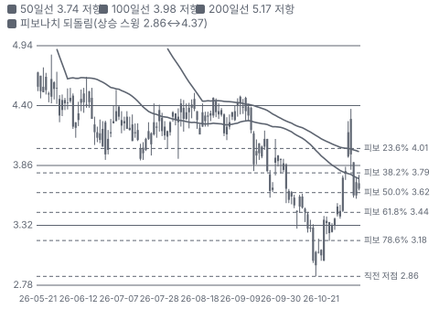

**주봉**

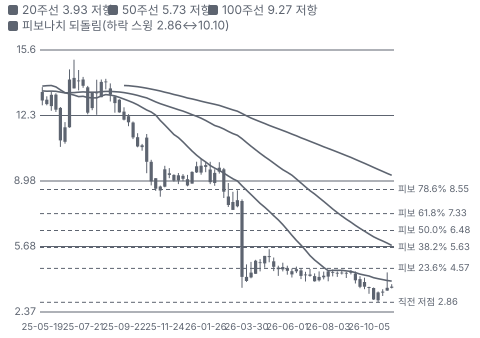

**월봉**

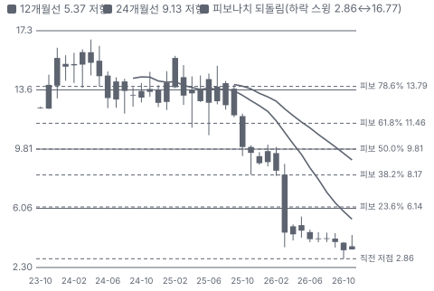

**분기 매출·EPS 실적과 컨센서스**

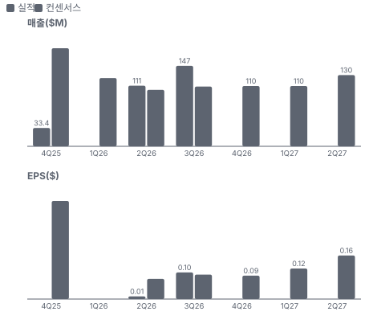

**EPS 리비전**

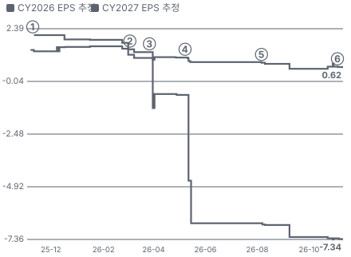

① 25-11-06 3Q25 실적 · EPS 리비전 -
② 26-03-04 4Q25 실적 · EPS 리비전 -9%
③ 26-03-27 YPF 항소심 판결 파기 · EPS 리비전 -17%
④ 26-05-08 1Q26 실적·YPF 상각 · EPS 리비전 -20%
⑤ 26-08-06 2Q26 실적 · EPS 리비전 -10%
⑥ 26-11-04 3Q26 실적·부채 축소 · EPS 리비전 -3%

**밸류에이션 주가 시나리오**

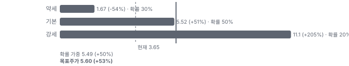

**주가별 업사이드**

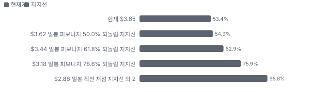
- 제품·서비스 포트폴리오

**고객 믹스(3Q26, 매출 대비)**

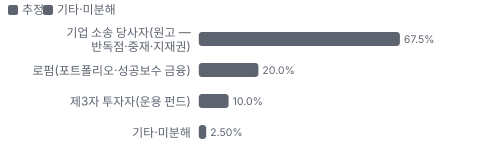

**공급 병목(10점, 낮을수록 병목)**

**어닝콜 변화별 주주가치 영향**

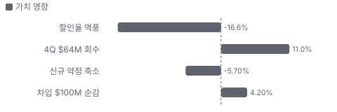

**멀티플 프리미엄(Fwd 1Y P/E, 최근 4개 분기말)**

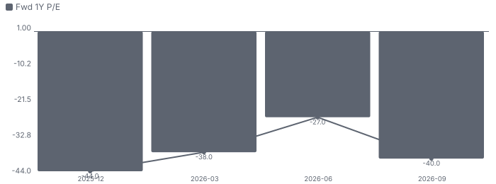

**합리적 멀티플**

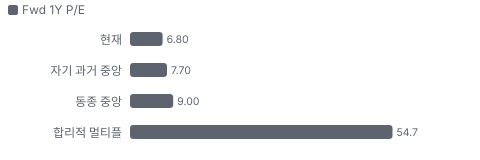

**수주·파이프라인 확실성 사다리**

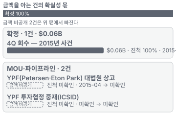

**매출 → 매출총이익 → 영업이익(매출 = 100, 최근 4분기)**

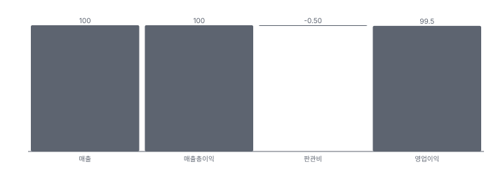

**1년 전 대비 마진 기여(비용 비중 변화의 반대)**

**분기 비용 비중 추이(매출 대비, 공시)**

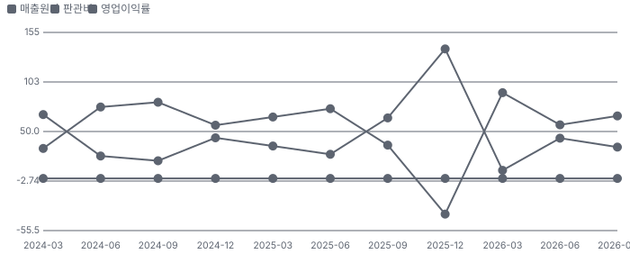

**비용 요인별 매출 대비 비중과 1년 변화**

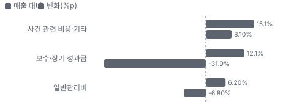

**BOM 항목 가격 +10% 시 OPM 변화**

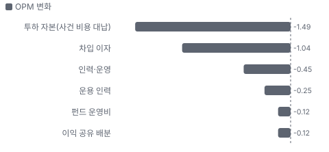

**Principal Finance BOM 원가 몫과 가격 +10% 시 OPM**

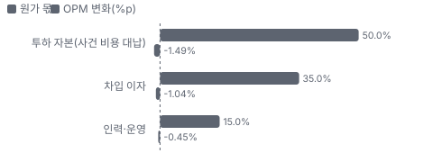

**Asset Management BOM 원가 몫과 가격 +10% 시 OPM**

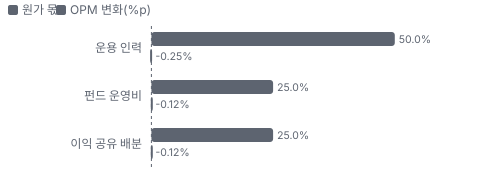

**목표주가 산정 — 기본 시나리오, 도달 확률 약 45%**

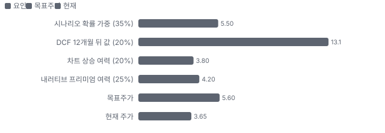

**PEG — 성장 대비 멀티플(낮을수록 성장 대비 쌈)**

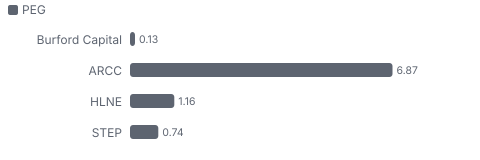

**일봉 지지·저항과 목표주가**

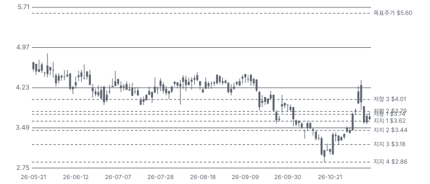

**일별 거래량 분해**

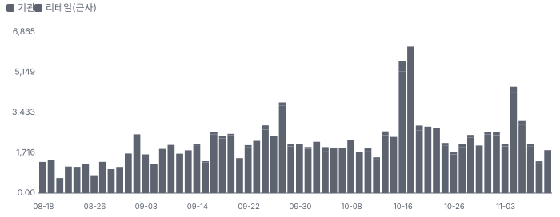

**기관 자금 흐름**

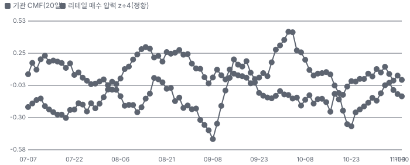

**몬테카를로**

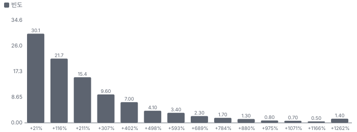

해석: 3,000번 중 2,838번(95%)에서 가치가 지금 주가 이상이었다. 가정을 흔들어도 지금 주가를 뒷받침하는 경우가 더 많다. 가운데 값은 2.55배이고, 열 번 중 여덟 번은 1.14~6.98배 사이에 든다.

## 내러티브

> **기업가치를 결정하는 이야기:** 자산은 Burford 몫 소송 포트폴리오 공정가치 약 \$2.5B(3Q 콜)와 현금·유가증권 \$531M이다. 부채는 사채 원금 \$2.335B(가중 금리 8.2%, 3년 안 만기 없음)다. 이 회사의 이익은 두 가지다 — 사건이 끝나 현금을 받을 때의 실현 이익과, 진행 중 사건을 공정가치로 다시 잴 때의 미실현 이익. 3Q 총수익 \$146.9M 가운데 상당 부분은 미실현이고, 할인율(시장 금리) 상승이 그 값을 깎았다. 현금 쪽은 꾸준하다 — 누적 회수 \$4B, 4Q 첫 달 2015년 사건 하나로 \$64M(투하원가의 11배 이상)을 받았다. 문제는 이자다. 1년 이자 약 \$190M이 실현 이익의 상당 부분을 먼저 가져간다.

> **멀티플·EPS 프리미엄**
> **멀티플:** Fwd 1Y P/E 6.8배로 동종(BDC·사모시장 운용사) 중앙값 9.0배보다 24% 낮고, P/B 0.95배로 BDC(0.65~1.0배)와 비슷하다. 할인의 이유는 레버리지(차입이 Burford 몫 자기자본의 2.7배)와 공정가치 장부에 대한 불신이다.
> **EPS:** EPS 추정이 계속 내려왔다. FY2027 컨센서스는 1년 전 \$1.88에서 YPF 판결 뒤 \$0.96, 2Q 콜 무렵 \$0.82, 지금 \$0.62다(−67%). 3Q EPS \$0.10은 컨센서스(\$0.09)에 가까웠다.

### 투자자들은 왜 열광했나

열광은 YPF였다. 2023년 1심이 아르헨티나에 \$16.1B 배상을 명령했고 Burford 몫은 약 \$6.2B로 시가총액보다 컸다(2024년 주가 \$16 안팎). 2026-03-27 항소심 다수 의견이 '주주가 국가에 공개매수 약속을 강제할 수 없다'며 판결을 파기하자 하루 만에 −47%, 거래량 3,814만 주가 나왔다. 6월 전원합의체 재심은 기각됐고(보도), 원고 측은 9/30 대법원에 상고 허가를 신청했다. 열기는 꺼졌고, 남은 기대는 대법원 허가라는 낮은 확률의 옵션이다.

### 무엇이 기업가치를 바꾸나

> **구조적 체질 변화**
> **변화:** '단일 대형 사건(YPF)에 기댄 회사'에서 '분산 포트폴리오 + 부채 축소' 회사로 이야기를 바꾸는 중
> **증거:** 3Q 콜 — 수백 건 분산, 차입 \$100M 순감
> **반증:** 다음 4개 분기 안에 차입이 다시 늘어난다

> **고부가 믹스 확장**
> **변화:** 위험 중간 구간(10~25%) 신규를 줄이고 낮은 위험 포트폴리오·높은 위험 단일 사건 위주로 — 의도적 축소
> **증거:** 3Q 콜(CEO 위험 구간 설명)
> **반증:** 신규 약정이 2분기 연속 늘어난다

> **기술 혁신**
> **변화:** 해당 없음(소송 심사·가격이 핵심이고 기술 매출은 없다). FluxCap 시드 투자는 소액이다
> **증거:** 보도(9월)
> **반증:** 해당 없음

> **실행 속도**
> **변화:** 해당 없음(납품이 없는 금융 서비스). 대신 회수 기간이 길어졌다 — COVID(코로나19 대유행) 빈티지(2016~2017년 약정)가 법원 지연으로 늦다
> **증거:** 2Q·3Q 콜
> **반증:** 2016~2017년 빈티지가 1년 안에 크게 회수된다

> **M&A**
> **변화:** 해당 없음(최근 3년 인수 없음)
> **증거:** 10-Q
> **반증:** 해당 없음

> **정책·입법 연관성**
> **재정정책:** 해당 없음(연방 재정에 닿는 매출 없음). 의회의 제3자 소송 금융 과세 논의는 단계를 확인하지 못했다(미확인) 미확인 반증: 소송 금융 수익 과세 조항이 세출·세법 법안에 반영된다 의회 동의 2/10 — 하원 1/5(관련 재정 조치 단계 미확인) · 상원 1/5(관련 재정 조치 단계 미확인).
> **행정명령:** 해당 없음(회사 매출에 닿는 행정명령 확인 못 함). 미국 정부가 YPF 사건에서 아르헨티나 쪽 의견을 낸 적이 있는지는 이 회차에 확인하지 않았다(미확인) 미확인 반증: 미국 법무부가 대법원에 상고 반대 의견서를 낸다 의회 동의 2/10 — 하원 1/5(의회 절차 아님) · 상원 1/5(의회 절차 아님).
> **연관입법:** 해당 없음(회사 매출에 직접 닿는 의회 입법 확인 못 함). 소송 금융 공시 의무 법안의 단계는 미확인 미확인 반증: 소송 금융 공시·과세 법안이 위원회를 통과한다

> **CAPEX 낙수효과**
> **변화:** 해당 없음(설비투자와 무관한 금융 회사다)
> **증거:** 10-K 사업 설명
> **반증:** 해당 없음

### 내러티브 근거

> 'YPF 한 건이 회사를 몇 배로 만든다'는 이야기가 2026-03-27 항소심 파기로 무너졌다. 지금 남은 이야기는 '장부가치 아래에서 거래되는 소송 회수 회사'와 '부채 축소'다 — 주가는 1년 동안 59% 내렸다(2025-11-10 \$8.98 → 2026-11-10 \$3.65). 동종 대비 멀티플 차이 -25% 중 회사 고유 몫은 -88%다. 단계는 붕괴, 쏠림은 낮음이다.

> **YPF 판결 회복 옵션** · 잠복
> **논리:** 대법원이 상고를 허가하고 항소심을 뒤집으면 Burford 몫 약 \$6.2B(원판결 기준, 주당 약 \$28)가 다시 살아난다
> **숫자:** 상고 허가 신청 9/30(No. 26-442) — 허가 결정 대기. 1Q 상각으로 장부 반영은 거의 없다(추정)
> **반증:** 대법원이 상고를 기각한다(허가 거부)

> **장부가치 아래 회수 회사** · 확산
> **논리:** 포트폴리오 공정가치 약 \$2.5B, 누적 회수 \$4B, 역사적 IRR 약 25%를 가진 회사가 P/B 0.95배에 거래된다
> **숫자:** BVPS(주당 장부가치) \$3.86, P/B 0.95배, Fwd 1Y P/E 6.8배
> **반증:** 다음 공정가치 평가에서 YPF 밖 자산이 상각된다

> **부채 축소** · 태동
> **논리:** 회수 현금으로 빚을 갚아 부채 ÷ 유형 장부가치 3.2배를 낮추면 할인이 줄어든다
> **숫자:** 3Q 차입 \$100M 순감, 3년 안 만기 0, 가중 금리 8.2%
> **반증:** 4Q·1Q 차입이 다시 늘거나 현금·유가증권이 \$400M 아래

> **이익 회복(실현 이익)** · 약화
> **논리:** 할인율 역풍이 멈추고 사건이 끝나면 분기 이익이 \$0.15~0.20로 돌아온다
> **숫자:** FY2027 EPS 컨센서스 \$0.62~0.64 — 1년 전 \$1.88
> **반증:** FY2027 EPS 컨센서스가 \$0.5 아래로 더 내려간다

> **반대 — 공정가치 장부 불신** · 컨센서스
> **논리:** 확정 판결이었던 YPF도 한 분기에 사라졌다. 남은 장부도 할인해야 한다
> **숫자:** 1Q 순손실 −\$1.63B, BVPS \$11.0(2024 말) → \$3.86
> **반증:** 4개 분기 연속 실현 이익이 미실현 평가 이익보다 크다

> **반대 — 차입 약정 족쇄** · 확산
> **논리:** 사채 약정 한도에 걸려 신규 투자를 줄여야 하고, 그만큼 2027~2028년 회수가 준다
> **숫자:** 부채 ÷ 유형 장부가치 3.2배 — '약정 수준'(CFO)
> **반증:** 부채 비율이 2.5배 아래로 내려가 신규 약정이 다시 는다

이미지 없음(검수 실패) — Principal Finance

## 포트폴리오

| 제품·서비스 | 구분 | 무엇 | 쓰는 곳 | 돈 버는 방식 | Mix | Mix 변화(전년 대비) |
|---|---|---|---|---|---|---|
| Principal Finance | 서비스 | 자기 대차대조표 자본으로 기업 소송·중재 비용을 대거나, 진행 중인 청구권을 사들인다 | 반독점·국제 중재·지식재산 소송을 하는 기업과 로펌 | 승소·합의금의 일정 몫(투하원가의 배수 또는 IRR 기준) | 미확인 | 미확인 |
| Asset Management | 서비스 | 국부펀드 등 외부 투자자의 돈으로 소송 자산에 투자하고 관리 보수·이익 공유를 받는다 | 기관 투자자(BOF-C(Burford가 국부펀드와 함께 운용하는 소송 금융 투자 기구) 공동 투자) | 관리 보수·성과 이익 공유 — 9개월 이익 \$29M | 미확인 | 미확인 |

## 고객

> **3Q26 최대 고객 기업 소송 당사자(원고 — 반독점·중재·지재권) 68%, 상위 3곳 98%, 집중도 집중.** 공시·회사 발표로 확인한 몫은 매출의 0%이고, 나머지 고객 몫은 추정이거나 미분해다. 고객은 소송 당사자(기업)와 로펌이다. 10%를 넘는 단일 고객은 공시되지 않았지만 단일 사건 집중은 크다 — YPF가 한때 장부의 큰 몫이었고 1Q 상각으로 장부가치 \$3.86/주까지 내려왔다.

**고객별 매출 몫(3Q26)**
| 고객 | 몫 | 변화 | 근거 |
|---|---|---|---|
| 기업 소송 당사자(원고 — 반독점·중재·지재권) | 60~75% | 미확인 | 추정 |
| 로펌(포트폴리오·성공보수 금융) | 15~25% | 미확인 | 추정 |
| 제3자 투자자(운용 펀드) | 5~15% | 미확인 | 추정 |
| 기타·미분해 | 2% | - | - |

> **기업 소송 당사자(원고 — 반독점·중재·지재권)** · 추정
> **사는 것:** 소송 비용 대납·청구권 현금화
> **추정 근거:** 자기자본 금융 부문의 대부분(추정)

> **로펌(포트폴리오·성공보수 금융)** · 추정
> **사는 것:** 여러 사건 묶음 금융
> **추정 근거:** 회사 설명 — 몫 미공시

> **제3자 투자자(운용 펀드)** · 추정
> **사는 것:** 소송 자산 운용
> **추정 근거:** 자산운용 이익 9개월 \$29M

## 수주·파이프라인

> **2026-11-11 기준 3건.** 확정 \$0.06B. 공시 Burford 몫 소송 포트폴리오 공정가치(YPF 제외 대부분, 3Q 콜) \$2.50B. 서로 겹치는 항목은 합계에서 뺐다.

**실행 속도와 방해 요인**
| 항목 | 상태 | 실행 속도 | 방해 요인 |
|---|---|---|---|
| YPF(Petersen·Eton Park) 대법원 상고 | 파이프라인 | 대법원 허가 결정 대기(날짜 미정) | 대법원 허가(희귀) · 파기 뒤 환송·확정 · 국가 자산 집행 · 1Q 상각으로 장부 반영 거의 없음(추정) |
| YPF 투자협정 중재(ICSID) | 파이프라인 | 청구액·일정 미공시 | 중재 판정 · 취소 절차 · 국가 집행 |
| 4Q 회수 — 2015년 사건 | 확정 | 계획대로(계획 100%, +0%p), 이대로면 2026-11 완료, 1개월 지연 | 없음 — 현금 수령 완료 |

## 마진 구조

> **GPM 100.0%, OPM 66.6%.** 3Q25 대비 GPM +0.0%p, OPM +31.0%p. 변동비는 매출의 18%이고, 매출이 10% 늘면 OPM은 +1.4%p 움직인다. 3Q26 총수익 \$146.9M 중 영업비용은 약 \$49M(보수 \$18M·일반관리 \$9M·사건 관련 비용 등)이고 영업이익은 \$97.8M이다. 진짜 무거운 비용은 영업 아래 이자다 — 3Q 이자 비용 \$52M로 영업이익의 절반을 넘게 가져간다.

> **매출 100 중 매출원가 -0.0, 매출총이익 100.0(최근 4분기, 공시).**

**비용 요인 강도 — 비중·추세·충격(+10%)·탄력**
| 비용 | 구분 | 매출 대비 | 1년 변화 | 마진 기여 | 충격 시 마진 | 매출 탄력 | 고정비 몫 |
|---|---|---|---|---|---|---|---|
| 판관비 | 공시 항목 | 0.5% | -36.6%p | +36.6%p | 미확인 | 0.10 | 100% |

매출 탄력 = 분기 비용을 매출에 회귀한 기울기(매출 1당 변동비), 고정비 몫 = 절편 ÷ 평균 비용. 표본이 8분기 미만이면 미확인. 매출원가 요인 비중은 margin 재료의 추정이 섞여 있고, 공시 매출원가와의 차이는 '기타 매출원가'로 둔다.

**GPM에서 OPM까지(GAAP)**
| 기간 | GPM | 연구개발 | 판관비 | 기타 | OPM |
|---|---|---|---|---|---|
| 3Q25 | 100.0% | 0.0% | 64.5% | 0.0% | 35.5% |
| 3Q26 | 100.0% | 0.0% | 33.4% | 0.0% | 66.6% |

**GPM·OPM 최근 4개 분기**
| 분기 | GPM | OPM |
|---|---|---|
| 2025-12 | 100.0% | -37.9% |
| 2026-03 | 100.0% | 91.3% |
| 2026-06 | 100.0% | 57.1% |
| 2026-09 | 100.0% | 66.6% |

**마진을 결정하는 비용 요인 — 비용 +10% 시 OPM**
| 비용 | 매출 대비 | 변화 | 고정비 | OPM |
|---|---|---|---|---|
| 사건 관련 비용·기타 | 15.1% | +8.1%p | 20% | -1.51%p |
| 보수·장기 성과급 | 12.1% | -31.9%p | 60% | -1.21%p |
| 일반관리비 | 6.2% | -6.8%p | 90% | -0.62%p |

**비용을 움직이는 요인**
| 비용 | 요인 |
|---|---|
| 사건 관련 비용·기타(판관비) | 자산화 못 한 사건 비용 · 근거 추정 |
| 보수·장기 성과급(판관비) | 성과급이 평가 이익에 연동 · 근거 공시 |
| 일반관리비(판관비) | 인력·사무 · 근거 공시 |

**Principal Finance BOM — 매출의 90%, GPM 67%(매출원가 개념이 없어 회사 3Q 영업이익률 67%(97.8 ÷ 146.9, 10-Q XBRL)를 대용 — 부문 손익은 원자료로 확인하지 못했다), 항목 가격 +10% 시**
| 항목 | 원가 몫 | 전가 | 제품 GPM | OPM |
|---|---|---|---|---|
| 투하 자본(사건 비용 대납) | 40~60% | 0% | -1.6%p | -1.49%p |
| 차입 이자 | 30~40% | 0% | -1.2%p | -1.04%p |
| 인력·운영 | 10~20% | 0% | -0.5%p | -0.45%p |

**Asset Management BOM — 매출의 10%, GPM 50%(추정 — 9개월 자산운용 이익 \$29M(3Q 콜)에 운용 인력 비용을 반영한 대용), 항목 가격 +10% 시**
| 항목 | 원가 몫 | 전가 | 제품 GPM | OPM |
|---|---|---|---|---|
| 운용 인력 | 40~60% | 0% | -2.5%p | -0.25%p |
| 펀드 운영비 | 20~30% | 0% | -1.3%p | -0.12%p |
| 이익 공유 배분 | 20~30% | 0% | -1.3%p | -0.12%p |

투하 자본(사건 비용 대납) 가격이 +10% 오르면 영업이익은 -2.2% 움직인다.

**BOM 항목 가격을 움직이는 것**
| 항목 | 요인 |
|---|---|
| 투하 자본(사건 비용 대납) | 변호사 보수·감정·소송 비용을 대신 낸다 — 원가가 아니라 투자 자산으로 잡힌다 · 근거 추정 |
| 차입 이자 | 사채 \$2.335B, 가중 금리 8.2% · 근거 추정 |
| 인력·운영 | 심사·소송 관리 인력 172명(yfinance) · 근거 추정 |
| 운용 인력 | 펀드 심사·관리 · 근거 추정 |
| 펀드 운영비 | 법률·감사 · 근거 추정 |
| 이익 공유 배분 | 공동 투자자 몫 · 근거 추정 |

## 공급망 병목

> **공급망 신뢰성 4.8/10, 병목 주의.** 가장 약한 고리는 사채 시장 자금 조달 4.8점이고, 품목 평균은 4.8점이다. 근거가 부족한 2건(법원·중재 처리 속도 · 제3자 투자자 자금(운용 펀드))은 점수에서 뺐다. 소송 금융의 공급망은 부품이 아니라 자본과 법원이다. 가장 약한 고리는 차입 조달(사채 약정 한도)과 법원 처리 속도다.

**병목과 마진 — 품목 가격 +10% 시 OPM**
| 품목 | 점수 | 판정 | 구분 | OPM |
|---|---|---|---|---|
| 사채 시장 자금 조달(필수) | 4.8 | 병목 주의 | 출하 차질 위험 | 미확인 |

> **사채 시장 자금 조달** · 4.8/10
> **왜:** 신규 배치의 재원
> **병목 요인:** 인증 공급사 3곳 · 캐파 부족 · 리드타임 미확인 · 재인증 미확인 · 1위 점유율 미확인 · 미국(달러 사채 시장, 추정) 집중 100% · 물량 확보 장기계약
> **풀리는 조건:** 부채 축소(\$100M 순감)와 회수 현금으로 장부가치를 다시 쌓아야 풀린다

**공급사**
| 품목 | 공급사 | 몫 | 근거 |
|---|---|---|---|
| 사채 시장 자금 조달 | 미국 고수익 사채 투자자(2029~2031년 이후 만기, 선순위 무담보 사채 \$2.335B) | 미확인 | 공시 |
| 법원·중재 처리 속도 | 미국·영국·EU(유럽연합) 법원과 국제 중재 기관(판결·판정) | 미확인 | 공시 |
| 제3자 투자자 자금(운용 펀드) | 국부펀드(BOF-C 공동 투자, 공동 투자) | 미확인 | 공시 |

## 해자

> 해자는 규모·데이터·평판이다. 17년 동안 수백 건의 사건을 끝까지 가져가 본 자료와 대형 로펌·기업 법무팀 관계가 신규 거래를 부르고, 대차대조표 자본을 직접 대는 몇 안 되는 회사라 큰 거래를 혼자 받을 수 있다. 약점은 그 대차대조표가 지금 부채에 묶였다는 점이다.

> **회수 이력 데이터(가격 결정력)** · 보통
> **해자:** 17년간 끝난 사건의 회수 기록으로 사건 가격(요구 수익률)을 정한다. 신규 경쟁자는 이 데이터가 없다.
> **근거:** 누적 현금 회수 \$4B(3Q 콜), 끝난 사건의 역사적 IRR 약 25%(CFO). 2015년 사건이 투하원가의 11배 이상으로 끝났다.
> **숫자:** 역사적 IRR 약 25% vs 차입 금리 8.2%
> **깨지는 조건:** 끝난 사건의 현금 ROIC가 2개 연도 연속 낮아지고 손실 사건 비중이 커진다

> **대차대조표 직접 투자 규모** · 약함
> **해자:** 펀드가 아니라 자기 자본으로 대형 단일 사건·포트폴리오를 받는다 — 다만 지금은 부채 약정 한도로 신규를 줄이고 있다.
> **근거:** Burford 몫 포트폴리오 공정가치 약 \$2.5B, 분기 배치 약 \$100M(3Q 콜). 부채 ÷ 유형 장부가치 3.2배, '약정 수준'(CFO).
> **숫자:** 포트폴리오 약 \$2.5B vs 시가총액 \$0.80B
> **깨지는 조건:** 분기 신규 약정이 2분기 연속 크게 줄고 경쟁사가 대형 거래를 가져간다

> **로펌·기업 법무팀 관계(반복 거래)** · 보통
> **해자:** 대형 로펌과 포트폴리오 단위 계약을 반복하고, 우선 협상권 같은 재량 약정이 신규 흐름을 만든다.
> **근거:** 재량 미인출 약정(우선 협상권·로펌 파트너십, 3Q 콜). 금액·상대방은 미공시.
> **숫자:** 미확인(재량 약정 금액 미공시)
> **깨지는 조건:** 재량 약정 잔액이 줄고 대형 로펌이 다른 자본(사모 신용)과 거래한다

## 경영진·네트워크

> 공동 창업자 Christopher Bogart(CEO)와 Jonathan Molot(CIO(최고투자책임자))가 2009년부터 회사를 이끈다. 두 사람 모두 변호사 출신이다. YPF 사건을 처음부터 사들인 것도 이 팀이다.

> **Christopher Bogart** · 공동 창업자·CEO · 2009
> **프로필:** 변호사 출신 — 회사 소개 기준 Time Warner 법무 총괄을 지냈다
> **비즈니스:** 자본 배분·부채 축소·투자자 소통
> **정계:** 미확인
> **동문:** 미확인
> **사모임:** 미확인

> **Jonathan Molot** · 공동 창업자·CIO · 2009
> **프로필:** 변호사·법학 교수 출신(회사 소개 기준 Georgetown 법대)
> **비즈니스:** 투자 심사·포트폴리오
> **정계:** 미확인
> **동문:** 미확인
> **사모임:** 미확인

> **Jordan Licht** · CFO · 미확인
> **프로필:** 3Q 콜에서 부채 ÷ 유형 장부가치 목표는 없고 '약정 수준'이라고 밝혔다
> **비즈니스:** 재무·부채 관리
> **정계:** 미확인
> **동문:** 미확인
> **사모임:** 미확인

**네트워크 정량화**
| 연결 | 강도 | 닿는 매출 | 가중 노출 | 매출 대비 | 근거 |
|---|---|---|---|---|---|
| 비즈니스: 대형 로펌·기업 법무팀, 국부펀드(BOF-C 공동 투자자) | 3/5 | 미확인 | 미확인 | 미확인 | 상대방·금액 미공시 10-K 사업 설명·3Q 콜 |
| 정계: 공개 기록에서 확인한 정계 연결 없음 | 0/5 | 미확인 | 미확인 | 미확인 | 로비 공시는 Easyconomics 하원 LD(미국 하원 로비 공시) 유니버스 밖이라 확인하지 못했다 미확인 |

가중 노출은 연결이 닿는 매출의 크기다. 연결이 그 매출을 만들었다는 뜻이 아니며, 인과는 공개 자료로 입증하지 못한다.

## 약세 논리 및 셀온 조건

| 약세 논리 | 근거 | 반박 | 가를 자료 · 공개 시점 |
|---|---|---|---|
| 부채가 장부의 2.7배라 평가 손실 한 번에 약정이 흔들린다 | 사채 원금 \$2.335B vs Burford 몫 자기자본 \$0.848B, 부채 ÷ 유형 장부가치 3.2배 — '약정 수준'(CFO) | 3년 안 만기가 0이고 가중 만기가 길다. 약정은 추가 차입 제한(incurrence)이지 즉시 상환 조건이 아니다(회사 설명 — 원문 미확인) | FY2026 10-K 사채 약정·부채 비율 — 2027-03 초(예상) |
| 공정가치 장부를 믿을 수 없다 | YPF 상각으로 1Q 순손실 −\$1.63B, BVPS \$11.03(2024 말) → \$3.86 | YPF는 국가 상대 단일 사건이었다. 나머지는 수백 건으로 분산되고 끝난 사건의 역사적 IRR은 약 25%다 | 4Q·FY2026 실현 이익 vs 미실현 평가 이익 — 2027-03 |
| 회사가 스스로 성장을 줄였다 | 신규 약정 의도적 축소(3Q 콜), FY2027 EPS 컨센서스 1년 새 −67% | 분기 배치 약 \$100M은 유지됐고, 낮은 수익 거래만 줄였다(CEO) | 4Q 신규 약정·배치 — 2027-03 |
| 할인율(금리) 역풍이 이익을 계속 깎는다 | 3Q 비현금 역풍 — 없었으면 자본 공급 이익 \$200M 이상(CEO) | 비현금이라 금리가 내려가면 되돌아온다 | 미국 10년물 금리·4Q 평가 변화 — 2027-03 |
| 현금이 빠져나간다 | 9개월 영업현금흐름 −\$212M, 현금·유가증권 \$733M(6월) → \$531M(9월) | 3Q 감소분의 대부분은 차입 상환(\$100M 순감)이다. 4Q에 \$64M이 이미 들어왔다 | 4Q 현금·유가증권 잔액 — 2027-03 |

**데이터 한계.** 회사는 숫자 가이던스를 내지 않아 데이터 검증의 '회사 가이던스' 항목이 실패로 남았다(9.3/10). www.sec.gov 본문이 자동 접속을 막아 10-Q 수치는 SEC XBRL(data.sec.gov)로 대조했고, 미인출 약정·부문 손익·사채 약정 문구는 원문으로 확인하지 못했다(미확인). 13F 기관 증감과 세그먼트 시계열은 원천에서 받지 못했다. 업종 PPI(생산자물가지수)·P·Q 사이클·무역 지표는 소송 금융과 맞지 않아 '해당 없음'이다. **정책·거시.** 중간선거 영향은 0으로 나왔다 — 소송 금융 과세·공시 입법은 단계를 확인하지 못했다(정책 0단계 가설). **추가 원천(11/11).** 노션 자료실·게시글, 공개 텔레그램 채널, 딘스티커에 Burford 자료는 없었다. 커뮤니티 대화는 7일 언급이 없다.

> **셀온 조건**
> **조건 1:** 대법원이 YPF 상고를 기각한다(옵션 가치 소멸 — 장부 영향은 작지만 내러티브가 끝난다)
> **조건 2:** 4Q·1Q에 YPF 밖 자산의 공정가치 상각이 나온다
> **조건 3:** 차입이 다시 늘거나 현금·유가증권이 \$400M 아래로 내려간다
> **조건 4:** 부채 ÷ 유형 장부가치가 3.2배보다 올라간다
> **조건 5:** FY2027 EPS 컨센서스가 \$0.5 아래로 내려간다

## 어닝콜 변화

**직전 콜 대비 새로 나오거나 바뀐 내용 → 가치 영향**
| 항목 | 내용 | 직전 콜 | 최신 콜 | 모델 동인 이동 | 확신도 | 가치 영향 |
|---|---|---|---|---|---|---|
| 업데이트 | 부채 축소 | 2Q: 부채 축소 프로그램 예고, 현금·유가증권 \$733M | 3Q: 차입 \$100M 순감·2028 만기 상환·2029 만기 발행, 현금·유가증권 \$531M | 순차입 -\$0.10B | 1.0 | +4.2% |
| 부정 | 신규 약정 축소 | 2Q: 대형 저수익 거래를 줄인다 | 3Q: 위험 중간 구간 신규를 의도적으로 줄이고 현금을 부채 축소에 | 1년차 성장률 -3.0% | 0.8 | -5.7% |
| 부정 | 할인율 역풍 | 2Q: 언급 작음 | 3Q: 할인율 상승으로 비현금 평가 이익 약 \$60~70M 감소(CEO 'ROE 13% vs 40%대') | 기준연도 매출 -\$0.06B | 0.8 | -16.6% |
| 신규 | 4Q 현금 회수 | 없음 | 2015년 사건 종결, \$64M 현금(11배 이상) | 기준연도 매출 +\$0.03B | 1.0 | +11.0% |
| 업데이트 | YPF 절차 | 2Q: 항소 패소 뒤 전원합의체 재심 기각(6월) | 3Q: 대법원 상고 허가 신청(9/30) — 허가 결정 대기, 투자협정 중재 병행 | 장기 성장 수렴값 — | 0.3 | +0.0% |
| 반복 | 분기 배치 | 2Q: 배치가 회수와 비슷 | 3Q: 분기 약 \$100M 배치 유지, 미인출 약정 소폭 증가 | 성장 지속(감속 계수) — | 1.0 | +0.0% |
| **합계** | 단독 합 |  |  | 동시 적용 -11.0% |  | **-7.1%** |

**사건별 EPS 리비전**
| # | 날짜 | 구분 | 사건 | CY2026 EPS 전→후 | CY2027 EPS 전→후 | 리비전 | 주가 반응 |
|---|---|---|---|---|---|---|---|
| ① | 25-11-06 | 실적 | 3Q25 실적 | - → \$1.35 | - → \$2.10 | - | -4.3% |
| ② | 26-03-04 | 실적 | 4Q25 실적 | \$1.19 → \$1.04 | \$1.44 → \$1.31 | -9.3% | -2.1% |
| ③ | 26-03-27 | 내러티브 | YPF 항소심 판결 파기 | \$1.04 → \$-0.63 | \$1.31 → \$1.08 | -17.4% | -2.7% |
| ④ | 26-05-08 | 실적 | 1Q26 실적·YPF 상각 | \$-0.67 → \$-6.61 | \$1.06 → \$0.85 | -20.0% | -0.4% |
| ⑤ | 26-08-06 | 실적 | 2Q26 실적 | \$-6.61 → \$-6.69 | \$0.85 → \$0.77 | -9.5% | +0.7% |
| ⑥ | 26-11-04 | 실적 | 3Q26 실적·부채 축소 | \$-7.31 → \$-7.34 | \$0.64 → \$0.62 | -3.0% | +9.8% |

## 밸류에이션

> **목표주가 \$6, 업사이드 +53%.** 자리는 기본 시나리오이고 도달 확률은 약 45%다. 기본 \$6, 강세 \$11(+205%), 약세 \$2(-54%). DCF 기준 업사이드는 기본 +200%, 강세 +547%, 약세 +33%다(WACC 9.7%).

기준 멀티플이 Fwd 1Y P/E라 시나리오는 FY2027 EPS로 둔다. 이 숫자에는 YPF가 들어 있지 않다 — YPF는 1Q에 대부분 상각돼 이익 추정에 없고, 결과가 12개월 안에 현금이 될 가능성도 낮다. 그래서 아래 표로 따로 잰다.

| YPF 단계 | 가정 확률(추정) | 누적 확률 | 근거 |
|---|---|---|---|
| ① 대법원 상고 허가(No. 26-442) | 10% | 10% | 유료 상고 신청의 허가율은 평균 약 4%다. 항소심 반대 의견·순회법원 간 해석 차이 주장·제3자 의견서가 있어 평균보다 높게 둔다 |
| ② 허가 뒤 항소심 파기(원판결 회복 또는 환송) | 50% | 5% | 다수 의견은 아르헨티나 법 해석 문제였다 — 대법원이 연방 문제로 볼지 불확실 |
| ③ 판결 확정 뒤 집행·합의로 현금 수령 | 50% | 2.5% | 국가 자산 집행은 수년이 걸리고 합의는 할인된다 |
| ④ 회수 가치(합의 할인 50% 가정) | Burford 몫 약 \$6.2B × 50% ≈ \$3.1B | 기대값 약 \$78M | 주당 약 \$0.35(현재가의 약 10%) — 현재가치 할인 전. 투자협정 중재(ICSID) 경로는 금액·일정 미공시라 0으로 둔다 |

**판결 단계를 섞지 않는다.** 1심 판결(2023-09) → 항소심 파기(2026-03-27) → 전원합의체 재심 기각(6월, 보도) → 대법원 상고 허가 신청(9/30)까지가 확인된 단계다. 허가·확정·집행·현금 수령은 하나도 일어나지 않았다. 법률 판단은 하지 않고 공개 자료의 단계만 적었다. 위 확률은 모델 가정이다.

| 장부가치 교차 점검(정당 P/B = (ROE − g) ÷ (자기자본비용 − g), g 3%) | 가정 | 정당 P/B | 주가 환산(BVPS \$3.86) |
|---|---|---|---|
| 레버리지 반영 자기자본비용(엔진) | ROE 15%, 자기자본비용 19.1% | 0.75배 | 약 \$2.9(−21%) |
| 목표주가가 내포한 값 | ROE 15%, 자기자본비용 약 11.3% | 1.45배 | \$5.60(목표주가) |
| 업종 자기자본비용 | ROE 15%, 자기자본비용 10% | 1.71배 | 약 \$6.6 |
| YPF 전(2024년 말) | BVPS \$11.03, 주가 \$13 안팎 | 약 1.2배 | — |

ROE 15%는 FY2027 EPS 컨센서스 \$0.62 ÷ 2027년 평균 장부가치(약 \$4.1, 추정)다. 투하자본 대비 실현 수익(ROIC)은 회사가 끝난 사건 기준 역사적 IRR 약 25%로 밝히지만, 이 회차에는 연도별 실현 ROIC·MOIC(투하원가 대비 회수 배수) 표(10-K)를 원문으로 열지 못했다(미확인). 회수 시점은 법원이 정한다 — 2016~2017년 약정이 COVID 지연으로 늦어졌다.

> **약세 \$2 (-54%)** · 확률 30%
> **가정:** 6.7배 × EPS \$0.25
> **근거:** 할인율 역풍이 이어지고 2016~2017년 빈티지 회수가 더 늦어진다. 부채 축소에 현금을 쓰느라 신규 약정이 줄어 FY2027 EPS 약 \$0.25 — 이자 약 \$190M이 실현 이익 대부분을 가져간다

> **기본 \$6 (+51%)** · 확률 50%
> **가정:** 8.9배 × EPS \$0.62
> **근거:** 컨센서스 — FY2027 매출 약 \$450~520M, 순이익 약 \$140M. 분기 배치 \$100M 유지, 차입은 회수 현금으로 조금씩 줄인다

> **강세 \$11 (+205%)** · 확률 20%
> **가정:** 11.1배 × EPS \$1.00
> **근거:** 금리가 내려가 할인율 역풍이 평가 이익으로 돌아오고, 대형 사건 2~3건이 끝나 실현 이익이 커진다. ROE 15~20%로 회복 — EPS 약 \$1.0(2025년 초 컨센서스 수준)

**멀티플 선정 — Fwd 1Y P/E**
| 단계 | 조정 | 근거 |
|---|---|---|
| 동종 중앙값 | 9.0배 | 범위 7.8~11.8배, 4곳 |
| 펀더멘털 | +20% | 성장·이익률·ROIC로 본 합리적 멀티플 54.7배와의 차이의 일부만 인정 |
| 해자 | +2% | 회수 이력 데이터(가격 결정력) 보통 · 대차대조표 직접 투자 규모 약함 · 로펌·기업 법무팀 관계(반복 거래) 보통 |
| 반복 매출 | -3% | 반복 매출 10%(동종 20%) · 자산운용 수수료(BOF-C 이익 공유·관리 보수) · 이미 반복 단계 · 기반 운용 펀드 — 회사 9개월 자산운용 이익 \$29M(전년 \$21M), 현금 \$14M |
| 수주 전환·가시성 | +0% | 재료 없음 |
| 내러티브 | -20% | 단계 붕괴 |
| 사이클·실행 판단 | +0% | 동종 Fwd 1Y P/E 중앙값(약 9.0배)보다 BUR(6.8배)이 낮은 것은 이유가 있다 — 부채비율(차입 ÷ 유형 장부가치 3.2배)이 BDC(약 1.1~1.2배)의 세 배에 가깝고, 사채 약정 한도에 걸려 추가 차입이 막혀 있으며, 이익이 공정가치 평가(할인율)로 크게 흔들린다. 반대로 과거 실현 ROIC(회수 현금 ÷ 투하원가)는 동종보다 높다. 두 요인이 맞서 판단 조정은 0으로 둔다 |
| **선정** | **8.9배** | 지금 6.8배 |

**동종 레인지**
| 회사 | Fwd 1Y P/E | Fwd 2Y P/E | Fwd 3Y P/E | 성장 | 영업이익률 | ROIC |
|---|---|---|---|---|---|---|
| ARCC | 9.9 | 9.7 | 9.7 | 2% | 29% | 3% |
| FSK | 8.2 | 9.0 | 9.3 | -13% | -40% | -4% |
| OBDC | 7.8 | 8.6 | 8.5 | -4% | 21% | 2% |
| HLNE | 11.8 | 10.7 | 9.7 | 5% | 66% | 48% |
| **Burford Capital** | 6.8 | 4.5 | 3.8 |  |  |  |

> **PEG 0.13** — Fwd 1Y P/E 6.8배를 다음 해 EPS 성장 51%로 나눈 값, 동종 중앙 1.16(성장 대비 싸다). 성장률은 Fwd 1Y·2Y P/E에서 역산한 컨센서스라 다음 해 한 해 성장만 반영하고, 성장 지속 기간은 담지 않는다.

**PEG — Fwd 1Y P/E ÷ 다음 해 EPS 성장률**
| 회사 | Fwd 1Y P/E | 다음 해 EPS 성장 | PEG |
|---|---|---|---|
| **Burford Capital** | 6.8 | +51% | 0.13 |
| ARCC | 9.9 | +1% | 6.87 |
| FSK | 8.2 | -9% | - |
| OBDC | 7.8 | -10% | - |
| HLNE | 11.8 | +10% | 1.16 |
| STEP | 18.0 | +24% | 0.74 |

몬테카를로 중앙값 업사이드 +155%.

> 의사결정 보조(투자자문 아님): ① 매수 매력: 5년 보유 가정 연 기대수익 +40.4% — 주주가 요구하는 수익률(자기자본비용) 19.1%보다 +21.2%p · 요구수익률을 넘을 확률 73% · 안전마진 1.14(비관적 경우의 기업가치가 지금 시가총액의 114%) → 정량 신호 강함 / ② 위험 예산 지표(이론): 켈리 기준(수익·손실 확률로 계산한 이론상 최대 노출)의 1/4만 반영 10.0% (상한 10%) · 5년 뒤 나쁜 경우(하위 10%) +68% · 30% 넘게 잃을 확률 0% / ③ 상방(5년): 평균 5.45배 · 2배 이상 확률 82% · 3배 이상 63% · 10배 이상 13% · 잘 풀린 경우(상위 10%) 11.15배 이상

## 매수 위치(일봉)

> **현재가 \$3.65는 '지지 근접'(가장 가까운 일봉 지지 \$3.62에서 ATR 0.1배 위).** 이 자리에서 목표주가까지 +53.4%, 첫 일봉 저항까지 +2.5%, 다음 지지까지 하방 -1.0%, 손익비 55.7배.

**가격대별 업사이드(일봉 기준)**
| 가격대 | 가격 | 목표주가까지 | 첫 저항까지 | 다음 지지까지 | 손익비 | 근거 기법(강도) |
|---|---|---|---|---|---|---|
| 현재가 | \$3.65 | +53.4% | +2.5% | -1.0% | 55.7 | - |
| 지지 1 | \$3.62 | +54.9% | +3.5% | -4.8% | 11.5 | 피보 50.0%(1.0) |
| 지지 2 | \$3.44 | +62.7% | +5.0% | -7.5% | 8.3 | 20일선 · 피보 61.8%(1.5) |
| 지지 3 | \$3.18 | +75.9% | +8.2% | -10.2% | 7.5 | 피보 78.6%(1.0) |
| 지지 4 | \$2.86 | +95.8% | +11.3% | 미확인 | 미확인 | 120일 지그재그 저점 · 스윙 저점(1.8) |

**일봉 저항**
| 저항 | 가격 | 현재가 대비 | 근거 기법(강도) |
|---|---|---|---|
| 저항 1 | \$3.74 | +2.5% | 50일선(1.0) |
| 저항 2 | \$3.79 | +3.9% | 피보 38.2%(1.0) |
| 저항 3 | \$4.01 | +10.0% | 피보 23.6%(1.0) |

일봉만 쓴다(주봉·월봉 제외). 손익비 = 목표주가까지 업사이드 ÷ 다음 지지까지 하방. 가격대별 기대값 참고표이며 매수·매도 시점 지시가 아니다.

## 애널리스트 토론

> **토론 결론 Buy(규칙 등급 Strong Buy).** 장부가치 아래·Fwd P/E 6.8배로 싸지만, 부채 약정 한도와 신규 약정 축소 때문에 2027년 이익 회복이 느리다 토론은 Neutral를 냈지만 규칙 등급에서 1단계까지만 옮길 수 있어 Buy로 정했다.

**패널 — 등급별 자리**
| 자리 | 핵심 논리 | 틀리는 조건 | 최종 투표 |
|---|---|---|---|
| Strong Buy | 장부가치 아래에서 거래되는 회수 머신 + 공짜 YPF 옵션 | FY2026 실현 이익(현금 회수 − 원가)이 \$100M 아래 | Buy |
| Buy | 부채 축소가 시작돼 위험이 줄어드는 국면 | 4Q 차입이 다시 늘거나 현금이 \$400M 아래 | Buy |
| Neutral | 싸지만 2027년 이익을 끌어올릴 동력이 꺼져 있다 | 분기 신규 약정이 다시 늘고 할인율 역풍이 멈춘다 | Neutral |
| Sell | 부채가 장부의 2.7배라 평가 손실 하나에 약정이 흔들린다 | 부채 ÷ 유형 장부가치가 2.5배 아래로 내려간다 | Neutral |
| Strong Sell | 공정가치 장부를 믿을 수 없다 — YPF가 증명했다 | 다음 4개 분기 실현 이익이 평가 이익보다 크다 | Sell |

**투표**
| Strong Buy | Buy | Neutral | Sell | Strong Sell |
|---|---|---|---|---|
| 0 | 2 | 2 | 1 | 0 |

> **개회 · Strong Buy**
> **발언:** 시가총액 \$0.80B로 공정가치 \$2.5B 포트폴리오와 17년 회수 기록을 산다. 부채를 빼도 장부가치 아래다

> **개회 · Buy**
> **발언:** 3Q는 방어에서 회복으로 넘어간 첫 분기다. 빚을 갚기 시작했고 4Q 첫 달에 \$64M을 받았다

> **개회 · Neutral**
> **발언:** 가격은 싸다. 그런데 회사가 스스로 성장을 줄였다. 2027년 EPS가 \$0.6 근처면 배수 확장 재료가 약하다

> **개회 · Sell**
> **발언:** 자기자본보다 빚이 2.7배 크다. 평가 손실이 조금만 나도 사채 약정이 신규 차입을 막는다 — 이미 막혀 있다

> **개회 · Strong Sell**
> **발언:** 장부가치의 질이 문제다. YPF는 '확정 판결'이었는데도 한 분기에 사라졌다

> **반박1 · Strong Buy → Strong Sell**
> **발언:** YPF는 단일 사건이고 국가 상대였다. 나머지 수백 건은 분산돼 있고 끝난 사건의 손실률은 낮다

> **반박1 · Sell → Strong Buy**
> **발언:** 회수 \$4B는 17년 누적이다. 1년에 갚아야 할 이자만 약 \$190M이다

> **반박1 · Buy → Sell**
> **발언:** 이자 \$190M은 연 회수 현금으로 감당된다. 4Q \$64M 한 건이 이자 4개월치다

> **반박1 · Strong Sell → Buy**
> **발언:** 회수 시점은 법원이 정한다. COVID 빈티지는 이미 늦었다

> **반박1 · Neutral → Sell**
> **발언:** 가를 자료는 FY2026 10-K의 연간 현금 회수와 실현 이익이다

> **반박2 · Strong Buy → Neutral**
> **발언:** 할인율 역풍은 비현금이다. 금리가 내려가면 같은 장부가 평가 이익으로 돌아온다

> **반박2 · Sell → Strong Buy**
> **발언:** 비현금이라도 약정 비율은 GAAP 장부로 잰다. 역풍이 이어지면 부채 축소 속도보다 장부가 더 빨리 준다

> **반박2 · Buy → Sell**
> **발언:** 2029년 전 만기가 없다(3년 안 원금 0). 시간이 Burford 편이다

> **반박2 · Strong Sell → Buy**
> **발언:** 만기가 없다는 건 차환 위험이 미뤄졌다는 뜻이지 사라졌다는 뜻이 아니다

> **반박2 · Neutral → Strong Sell**
> **발언:** 만기 구조는 하방을 받치지만, 성장 재개 신호가 없으면 배수는 오르지 않는다

> **최종 · Strong Buy**
> **발언:** 장부가치 아래·P/E 7배는 회수 기록에 비해 지나친 할인이다

> **최종 · Buy**
> **발언:** 부채 축소가 이어지면 할인이 줄어든다

> **최종 · Neutral**
> **발언:** 하방은 장부가치가, 상방은 YPF가 쥐고 있다 — 중간이 비어 있다

> **최종 · Sell**
> **발언:** 부채 비율이 내려갈 때까지 할인은 정당하다

> **최종 · Strong Sell**
> **발언:** 공정가치 장부를 할인하는 게 맞다

남은 반대 의견: Strong Buy 자리는 YPF 상고를 공짜 옵션으로 보고 끝까지 Buy 이상을 주장했다

패널은 등급별 논리를 대표하는 자리이고 실존 IB의 의견이 아니다.

## 커뮤니티 내러티브

커뮤니티 집계 없음 — Quantral 수록 종목이지만 최근 24시간·7일 언급이 없고 월간 요약도 없다(2026-11-11)

## 시장 평가

> **셀사이드(IB 애널리스트)**
> **한 줄:** 셀사이드는 강세·보합으로 갈렸다. 3Q 콜 질문은 부채 축소 순서·최소 현금·신규 약정 규모(B. Riley·Bank of America·Deutsche Bank)에 몰렸다 — 성장이 아니라 대차대조표를 묻는 단계다. 실적 뒤 Berenberg가 목표가를 \$5.85에서 \$6.35로 올렸다(보도).
> **애널리스트 의견:** Strong Buy 3 · Hold 3 (10/12)
> **목표가:** 중앙 \$6.35 · 평균 \$8.90 (5명, \$3.65~22.50)
> **FY2027 EPS 리비전 8/6 → 11/5:** \$0.82 → \$0.62 (−25%)

> **바이사이드(기관 투자자)**
> **한 줄:** 기관이 대부분을 들고 있지만 13F 증감은 확인하지 못했다. 내부자 장내 매수가 없다 — 경영진이 장부가치 아래 가격을 매수 신호로 쓰지 않았다는 단서다(자사주도 3Q 0).
> **13F 기관 보유:** 조회 실패(미확인)
> **기관 보유 비중:** 약 80%(yfinance)
> **내부자 장내 거래(최근):** 6월 보상 부여·행사·원천징수만 — 장내 매수·매도 없음

> **언론·업계**
> **한 줄:** 언론은 YPF 대법원 단계를 다룬다. 회사 본업(사건 회수) 기사는 드물다.
> **주요 제목:** 'YPF 역전 — \$16.1B 판결을 잃고도 돈을 번 방법'(업계 블로그), 'Argentina awaits the Supreme Court'(MercoPress)

## 체크리스트

| 시점 | 무엇 | 의미 |
|---|---|---|
| 2026-12~2027-01(예상) | 대법원 상고 허가 회의·결정(No. 26-442) | YPF 옵션이 살아나는지 — 허가되면 확률 가중 표의 ①이 10% → 100% |
| 2027-03 초(예상) | FY2026 실적·10-K — 연간 현금 회수·실현 이익·사채 약정 비율 | 장부가치를 다시 쌓는 속도와 부채 축소 진척 |
| 2027-03 | 연간 '모델 실현 가치' 갱신(3Q 콜 \$5.2B — 연 1회) | 포트폴리오가 앞으로 낼 현금의 회사 추정 |
| 2027-05(예상) | 1Q27 실적 — 할인율 효과·신규 약정 | 이익 회복이 시작됐는지 |
| 수시 | YPF 투자협정 중재(ICSID) 절차 | 미국 법원 밖 두 번째 경로의 진척 |

## 출처
- Burford 3Q26 10-Q(2026-11-04, 0001714174-26-000112) — https://www.sec.gov/Archives/edgar/data/1714174/000171417426000112/bur-20260930.htm (수치는 SEC XBRL로 대조)
- 3Q26 실적 8-K(Item 2.02·9.01, 0001714174-26-000111) — https://www.sec.gov/Archives/edgar/data/1714174/000171417426000111/bur-20261104.htm
- YPF 항소심 판결 관련 8-K(2026-03-27, Item 7.01) EX-99.1 — https://www.sec.gov/Archives/edgar/data/1714174/000171417426000040/bur-20260327xex991.htm
- FY2025 10-K — https://www.sec.gov/Archives/edgar/data/1714174/000171417426000007/bur-20251231.htm
- 미국 대법원 사건 기록 No. 26-442(Petersen 상고 허가 신청, 2026-09-30) — https://www.supremecourt.gov/DocketPDF/26/26-442/426134/20260930163303843_No.%20___%20Petition.pdf
- Burford 성명 — YPF 항소 판결(2026-03-27) — https://investors.burfordcapital.com/news/news-details/2026/Burford-Capital-Statement-Re-YPF-Appeal-Decision/default.aspx
- MercoPress(2026-10-20) — 1심 사건 종결·대법원 대기 — https://en.mercopress.com/2026/10/20/argentina-awaits-the-supreme-court-after-the-ypf-case-is-closed-at-first-instance
- 3Q26 실적 보도자료 — https://www.prnewswire.com/news-releases/burford-reports-3q26-and-ytd26-financial-results-302929128.html
- 3Q26·2Q26 어닝콜 — 요지만 자기 말로
- 3Q 콜
- https://www.sec.gov/Archives/edgar/data/1714174/000171417426000007/bur-20251231.htm
- 3Q 콜(CFO)
- https://www.sec.gov/Archives/edgar/data/1714174/000171417426000040/bur-20260327xex991.htm
- https://www.supremecourt.gov/DocketPDF/26/26-442/426134/20260930163303843_No.%20___%20Petition.pdf
- 10-Q 영업비용
- 10-Q 이자 비용 3Q \$52.1M
- 3Q 콜(BOF-C 이익 공유)
- 3Q 콜(분기 배치 약 \$100M)
- https://www.sec.gov/Archives/edgar/data/1714174/000171417426000112/bur-20260930.htm 3Q 급여 \$10.9M + 장기 성과급 약 \$6.9M(XBRL LaborAndRelated \$17.8M)
- https://www.sec.gov/Archives/edgar/data/1714174/000171417426000112/bur-20260930.htm G&A \$9.1M
- https://www.sec.gov/Archives/edgar/data/1714174/000171417426000112/bur-20260930.htm 영업비용 \$49.1M − 보수 − G&A
- 미확인
- https://www.sec.gov/Archives/edgar/data/1714174/000171417426000112/bur-20260930.htm

_구매 등급·목표주가 모두 규칙이 계산한 모델 값으로, 개인의 보유 종목·자금 사정을 반영하지 않는다 · 공개 자료 기반 분석이며 투자 권유가 아님 · 1차 판정, 미검증 · Chiip ten-bagger_