# 텐배거 리포트 2026-11-11 — Clearfield — 매출은 데이터센터로 다시 자라는데, 이익은 아직 이자 수익뿐이다

> 2026-11-11 · Clearfield, Inc.(CLFD) · 기업: 통신사가 광섬유망(FTTH)을 깔 때 쓰는 광섬유 분배 캐비닛·패널·카세트·조립품을 미네소타·멕시코 공장에서 만드는 회사 — 지역 통신사·케이블TV가 주 고객이고, 2026년 하이퍼스케일 데이터센터 안 광섬유 관리(Nova)로 넓히는 중이다

## Chiip View

FY26 4Q 매출 \$39.3M(−4%)·총이익률 30.7%·영업손실 \$1.0M으로 분기는 약했지만, 수주잔고가 \$43.3M으로 6월 말의 2배가 됐고 첫 하이퍼스케일 데이터센터 주문 \$22M이 출하를 시작했다. FY27 매출 가이던스 \$195~205M(+31%)과 1Q27 \$48~52M은 실적 전 컨센서스(\$188.2M·\$41.7M)보다 높다. 반대로 FY27 EPS 가이던스 \$0.25~0.46은 컨센서스 \$0.75의 절반 아래이고, 중간값 \$0.355 가운데 약 \$0.33이 현금·투자 \$157M의 이자 수익이다(추정). 주가 \$30.19는 실적 발표 전 종가로, 5/27 종가 고점 \$51.26보다 41% 낮고 1년 전보다 8% 낮다. 시가총액은 기본 주식 기준 \$0.41B, 완전 희석 기준 \$0.42B, EV \$0.27B다. **우리가 다르게 보는 곳은 '매출 → 이익' 고리다.** 시장의 이야기는 '광대역 회사가 데이터센터 광 연결 회사로 바뀐다'이고 매출 숫자는 그 방향으로 나왔다. 하지만 회사 스스로 FY27 영업이익을 0 근처로 안내했다 — 총이익률이 1년 새 3.9%p 내려갔고 판관비가 매출의 33%다. 경쟁 가설은 셋이다. '총이익률 하락은 데이터센터 램프 초기 원가라 일시적이다'는 1Q27 총이익률(2027-02 초)이, '데이터센터는 반복 사업이 된다'는 같은 캠퍼스 다음 건물 수주 또는 두 번째 고객(2027-02·05 실적의 잔고)이, '광대역은 BEAD(미국 연방 광대역 보급 보조금 프로그램, 약 \$42.5B)로 회복한다'는 1Q27 10-Q의 커뮤니티 광대역 매출(2027-02)이 가른다. **구매 등급은 Neutral, 목표주가 \$25(−17%)다.** 규칙 등급은 Sell이었고, 애널리스트 토론이 순현금이 시가총액의 36%라 하방이 받쳐진다는 이유로 한 단계 올렸다. 목표주가는 선정 배수 Fwd 1Y EV/EBITDA 18.6배(지금 43.0배, 동종 중앙값 12.4배)로 계산한 기본 \$20과 강세 \$32 사이다. 선정 배수에는 저점 이익·순현금·매출 +31%를 이유로 상한 +30% 판단 가산을 넣었다. 43.0배는 장기 투자 \$49M을 현금으로 보지 않은 EV 기준이고, 회사처럼 현금·투자 \$157M을 모두 빼면 약 38배다. DCF 내재가치(기본)는 지금 가격과 거의 같다(0%) — DCF는 영업이익률이 5년 안에 10%로 돌아간다고 가정하고(FY19~21 평균 약 11%), 배수는 FY27 저점 EBITDA(약 \$7M)에 값을 매긴다. 이 차이가 곧 위의 '매출 → 이익' 쟁점이다. 정량 신호는 약하다(연 기대수익 +7.5%, 자기자본비용 8.9% 대비 −1.3%p, 안전마진 0.68). 가를 것은 2027년 2월 1Q27 실적의 총이익률이다.

## 대시보드
| 항목 | 값 | 설명 |
|---|---|---|
| 주가 | \$30.19 | 고점 대비 -41% · 1년 -8% |
| 시가총액 | \$0.42B | 완전 희석 기준 · EV \$0.27B |
| 업사이드 | -17% | 목표주가 \$25 · 다운사이드 -55% · 손익비(강세÷약세) 0.1 |
| 구매등급 | Neutral | 애널리스트 5명: Strong Buy 3 · Buy 1 · Neutral 1 · Sell 0 · Strong Sell 0 |
| 멀티플 | Fwd 1Y EV/EBITDA 43.0배 | 동종 중앙값 12.4배 |
| 가이던스 1Q27 | \$50M · \$-0.01 | 컨센서스 \$42M · \$0.09 |
| 알파 | 5.5/10 | 텐배거 가능성 점수 |
| 이벤트 | 1Q27(10~12월) 실적 — 날짜 미발표, 전년 2/4 기준 추정. 그 전에 4Q 어닝콜 전문 게시·FY26 10-K(11월 말 예상)·회전 신용 만기(11/21)·CEO 후임 발표 여부 | 2027-02-04 |

## 한 장 요약
- **기업가치를 결정하는 내러티브** Clearfield의 값은 **미국 광대역 광섬유 관리 제품의 회복 + 데이터센터라는 새 시장**에 달렸다. 4Q는 매출이 −4%였지만 잔고가 \$43.3M으로 2배가 됐고, FY27 매출 가이던스는 \$195~205M(+31%)이다. 문제는 이익이다 — FY27 EPS 가이던스 \$0.25~0.46의 대부분이 현금 \$157M의 이자 수익이고, 영업이익은 0 근처다
- **밸류에이션 모델로 본 주가 상방은 어디까지인가?** **목표주가 \$25(-17%), 기본과 강세 사이(강세 쪽 41%)다.** 강세 \$32(+7%)는 Fwd 1Y EV/EBITDA 23.3배를 강세 EBITDA에 적용한 값이다. 기본 \$20, 약세 \$14. 손익비 0.1, DCF 기준 업사이드 0%.
- **수주는 어디까지 왔나?** 하이퍼스케일 캠퍼스 첫 건물(Nova(Clearfield의 데이터센터용 고밀도 광섬유 관리 플랫폼)) 미확인, 100% 매출 \$0.02B · 광대역 수주잔고(데이터센터 외) 미확인, 100% 매출 미확인 · BEAD 자금 구축(East Central Energy, 미네소타·위스콘신) 미확인, 100% 매출 미확인. 회사 잔고는 \$43.3M으로 6월 말의 2배다 — 데이터센터 \$22M 주문이 대부분을 설명한다(추정, 출하분 제외 금액 미공시). 나머지는 광대역 주문이다
- **누가 사 주나?** 최대 고객 고객 A(배급사, 미공시, Customer A) 14%, 상위 3곳 38%. 공시·회사 발표로 확인한 몫은 38%다.
- **마진과 공급망은 어디가 약한가?** GPM 30.7%, OPM -2.7%. OPM을 가장 흔드는 BOM(제품 원가를 이루는 부품·재료 명세) 항목은 광섬유 케이블이고 가격 +10%에 -1.21%p다. 공급망 신뢰성은 5.0/10(병목 주의)이고 가장 약한 고리는 광섬유·케이블이다.
- **생산능력은 얼마나 늘어나나?** 현재 명목 캐파 미확인, 착공 이상 증설 0 광섬유 포트/년. FY2027 CAPEX는 매출의 2.5%다.
- **지금 가격은 무엇을 가정하나?** 시가총액은 기본 주식 기준 \$0.41B, 완전 희석 기준 \$0.42B이고, 현금·투자 \$157M을 빼면 EV는 \$0.27B다. 매출 \$200M(FY27 가이던스) 회사에 EV/매출 약 1.4배지만, 선행 EBITDA가 약 \$7M뿐이라 Fwd 1Y EV/EBITDA는 43.0배로 동종 중앙값 12.4배의 3.5배다. 지금 가격은 이익률이 FY19~21 수준(영업이익률 약 11%)으로 돌아간다는 가정을 담고 있다 — DCF 내재가치(기본)가 그 가정으로 지금 가격과 거의 같다(0%). FY27 가이던스 이익률(0% 근처)로는 기본 \$20이다.
- **왜 움직였나?** 1년 동안 8% 내렸다. 5월 2Q 실적 뒤 +24%와 '데이터센터 광섬유' 이야기로 5/27 종가 고점 \$51.26까지 갔다가, 8월 3Q 실적(FY26 가이던스 하향·최대 커뮤니티 고객 주문 취소) 다음 날 21% 빠졌다. 그 뒤 \$27~33 박스에 있다. 같은 기간 FY27 EPS 컨센서스는 \$1.56(2월)에서 \$0.75(8월)로 절반이 됐고, 이번 가이던스 중간 \$0.355는 그 절반 아래다 — 하락은 이익 추정 하향이 이끌었다. 11/5 −12.7%는 회사 공시가 없어 원인 미확인이다.
- **4Q에서 무엇이 바뀌었나?** 매출 쪽 숫자가 바뀌었다 — 잔고 \$43.3M(+106% QoQ, +75% YoY), 데이터센터 \$22M 주문 출하 시작, 미네소타 BEAD 자금 첫 구축 현장 출하. FY27 매출 가이던스는 \$195~205M, 1Q27은 \$48~52M으로 둘 다 실적 전 컨센서스보다 높다. 이익 쪽은 나빠졌다 — 4Q 총이익률 30.7%(전년 34.6%, 회사 설명은 하반기 '높아진 제품 원가' 흡수), 영업손실 \$1.0M. FY27 EPS 가이던스 \$0.25~0.46은 컨센서스 \$0.75의 절반 아래다. 4Q 어닝콜 전문은 아직 게시되지 않았다 — 총이익률 회복 경로에 대한 회사 답변은 확인 전이다.
- **무엇이 바뀌면 판단이 달라지나?** 위로: 1Q27 총이익률이 33% 이상으로 돌아오고 영업이익이 흑자로 서거나, 같은 캠퍼스 다음 건물 주문(또는 두 번째 데이터센터 고객)이 나오면 이익 경로가 열린다. 아래로: 1Q27 매출이 가이던스 하단 \$48M 아래이거나, 잔고 취소가 되풀이되거나, 새 CEO가 데이터센터 전략을 바꾸면 약세 시나리오로 옮긴다.

## 한눈에 보기

**일봉**

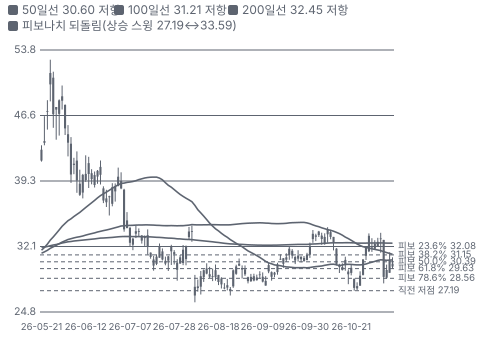

**주봉**

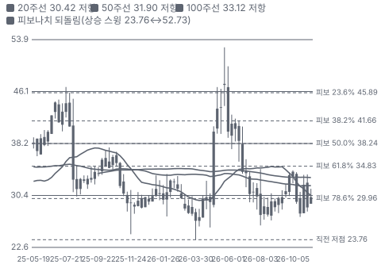

**월봉**

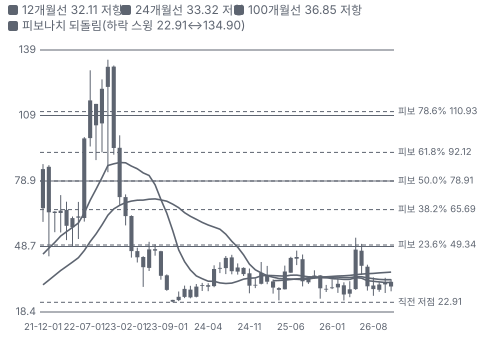

**분기 매출·EPS 실적과 컨센서스**

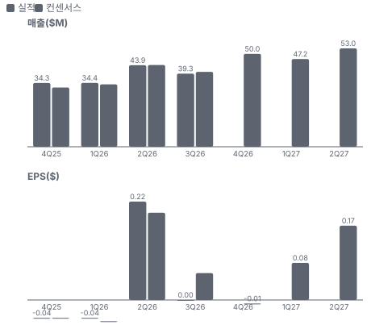

**4Q26 매출 — 지표 추세 vs 가이던스·컨센서스**

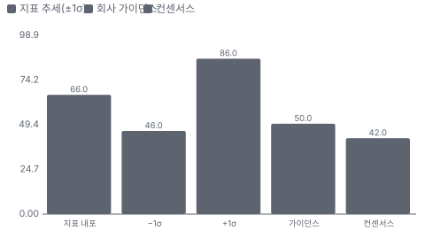

**최근 4개 분기 주가 변화 분석**

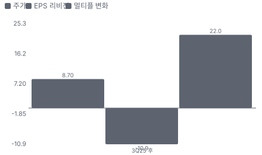

**EPS 리비전**

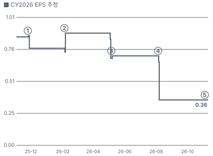

① 25-11-25 FY25 4Q 실적·Nestor 매각 완료, 당일 −4.6% · EPS 리비전 -
② 26-02-04 FY26 1Q 실적, 다음 날 −4.6% · EPS 리비전 -
③ 26-05-06 FY26 2Q 실적, 다음 날 +23.8% · EPS 리비전 -
④ 26-08-05 FY26 3Q 실적·연간 하향·데이터센터 \$22M, 다음 날 −21.1% · EPS 리비전 -
⑤ 26-11-10 FY26 4Q 실적·FY27 가이던스 +31% · EPS 리비전 -

**밸류에이션 주가 시나리오**

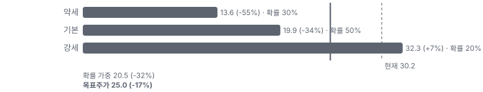

**주가별 업사이드**

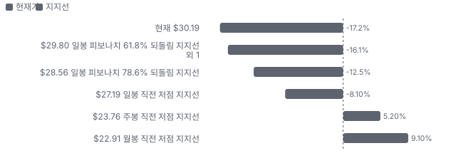

**제품·서비스 포트폴리오**

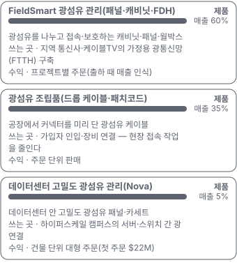

**고객 믹스(9M FY26, 매출 대비)**

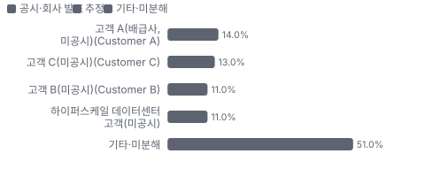

**공급 병목(10점, 낮을수록 병목)**

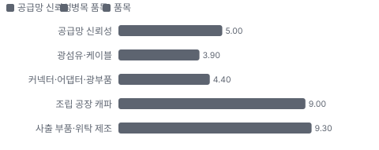

**CAPEX의 매출 대비 비중**

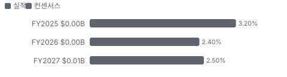

**어닝콜 변화별 주주가치 영향**

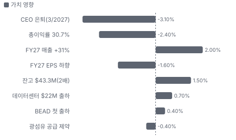

**멀티플 프리미엄(Fwd 1Y EV/EBITDA, 최근 4개 분기말)**

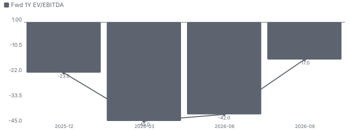

**합리적 멀티플**

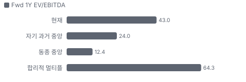

**수주·파이프라인 확실성 사다리**

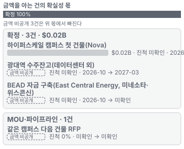

**매출 → 매출총이익 → 영업이익(매출 = 100, 최근 4분기)**

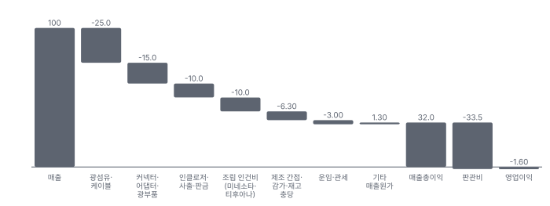

**1년 전 대비 마진 기여(비용 비중 변화의 반대)**

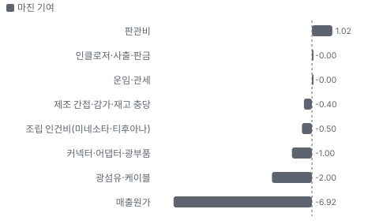

**분기 비용 비중 추이(매출 대비, 공시)**

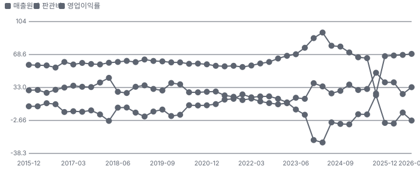

**비용 요인별 매출 대비 비중과 1년 변화**

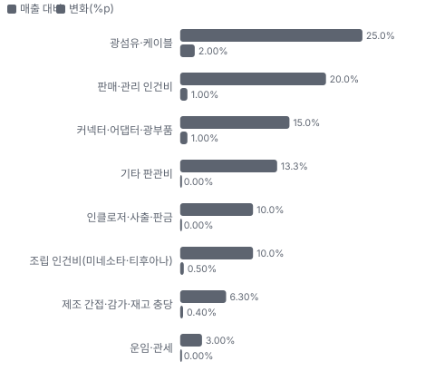

**BOM 항목 가격 +10% 시 OPM 변화**

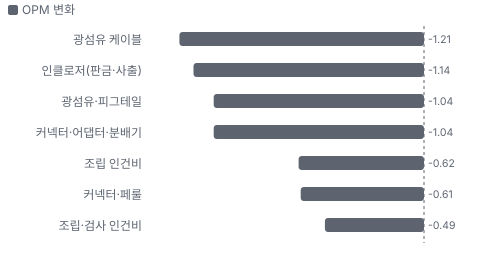

**FieldSmart 광섬유 관리(패널·캐비닛·FDH) BOM 원가 몫과 가격 +10% 시 OPM**

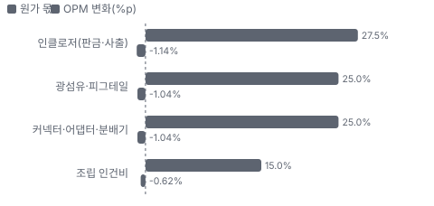

**광섬유 조립품(드롭 케이블·패치코드) BOM 원가 몫과 가격 +10% 시 OPM**

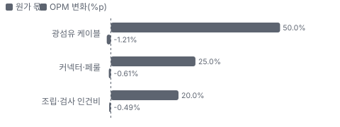

**생산시설별 면적(sq ft, 큰 순) — 생산능력 미공시라 면적을 대용으로**

**매출·PPI·수출입 — 최근 16개 분기 같은 축(4Q22 = 100) + 다음 분기 추정**

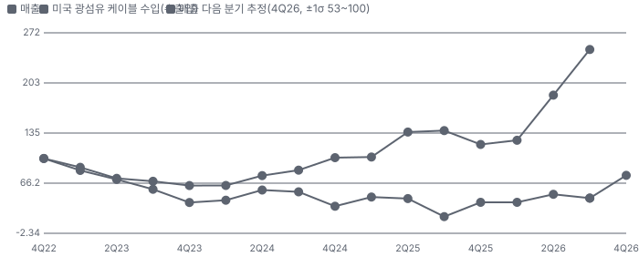

**매출과 미국 광섬유 케이블 수입 증가율(전년 대비, 최근 16개 분기 + 다음 분기 추정)**

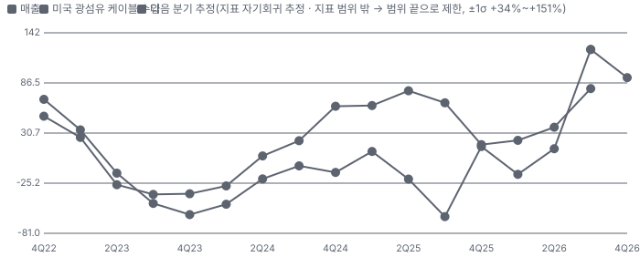

**목표주가 산정 — 기본과 강세 사이(강세 쪽 41%), 도달 확률 약 31%**

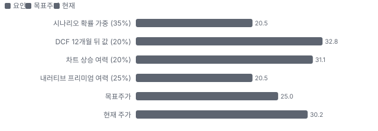

**PEG — 성장 대비 멀티플(낮을수록 성장 대비 쌈)**

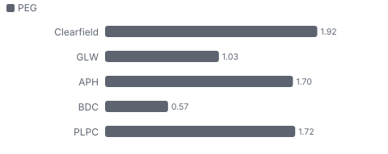

**일봉 지지·저항과 목표주가**

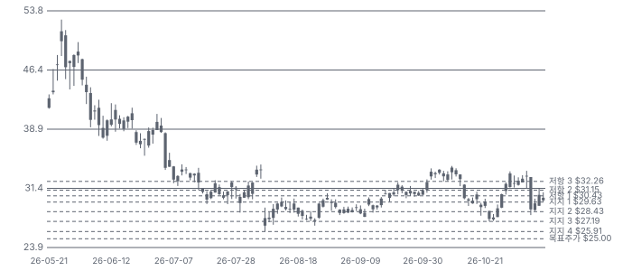

**일별 거래량 분해**

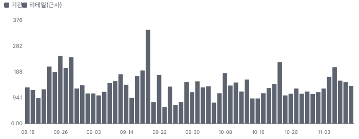

**기관 자금 흐름**

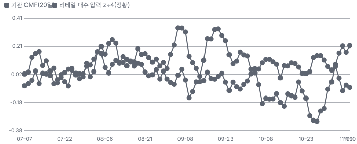

**몬테카를로**

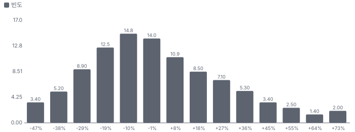

해석: 3,000번 중 1,396번(47%)에서 가치가 지금 주가 이상이었다. 지금 주가를 뒷받침하는 경우와 그렇지 않은 경우가 반반에 가깝다. 가운데 값은 0.97배이고, 열 번 중 여덟 번은 0.69~1.40배 사이에 든다.

## 내러티브

> **기업가치를 결정하는 이야기:** 회사는 통신사가 광섬유를 깔 때 쓰는 분배 캐비닛·패널·카세트·조립품을 만든다. 현장 접속 작업을 공장으로 옮겨 설치 인건비를 줄이는 설계가 강점이고, 대형 광섬유 회사가 덜 챙기는 지역 통신사·조합(Tier 2·3(지역 통신사·조합·지자체 광대역 사업자))이 주 고객이다. FY22 물량 부족 국면에 매출 \$271M·영업이익률 24%까지 갔다가, 고객 재고 조정과 BEAD 지연으로 FY24~26 매출 \$150M대·적자로 내려왔다. 이제 두 가지가 회복 경로다 — BEAD 자금이 커뮤니티 광대역 구축으로 내려오는 것, 그리고 하이퍼스케일 데이터센터 안 광섬유 관리(Nova)로 시장이 넓어지는 것

> **멀티플·EPS 프리미엄**
> **멀티플:** Fwd 1Y EV/EBITDA 43.0배로 동종 4곳 중앙(약 12배)의 3.5배다. 이익이 저점이라 배수가 높아 보인다 — Fwd 2Y 28.7배·3Y 21.2배로 내려가도 동종보다 높다. 순현금이 시가총액의 36%라 EV는 약 \$261M뿐이다
> **EPS:** FY27 EPS 컨센서스는 실적 전 \$0.75(8월)였고, 2월에는 \$1.56이었다. 가이던스 중간 \$0.355는 그 절반 아래다 — 1년 동안 EPS 추정은 계속 내려왔다

### 투자자들은 왜 열광했나

열광은 5월이었다 — 2Q 실적 다음 날 +23.8%, 5/27 종가 고점 \$51.26(장중 \$52.73)까지 갔다. X 테마 계정들이 'AI 데이터센터는 광섬유를 더 쓴다'는 이야기를 밀었다. 식은 이유는 8/5 3Q 실적이다 — FY26 매출 가이던스를 \$151~155M으로 낮추고 최대 커뮤니티 고객의 맞춤 주문 \$4.6M이 취소돼 다음 날 −21.1%였다. 같은 날 데이터센터 \$22M 주문을 발표했지만 주가를 받치지 못했다

### 무엇이 기업가치를 바꾸나

> **구조적 체질 변화**
> **변화:** 통신 광대역 단일 시장에서 데이터센터로 — 첫 주문 \$22M이 출하됐다. 다만 데이터센터 매출 비중을 회사가 공개하지 않아 체질 변화는 아직 숫자로 확인되지 않았다
> **증거:** EX-99.1·3Q 콜
> **반증:** FY27 데이터센터 매출이 \$22M 주문 하나에 그친다

> **고부가 믹스 확장**
> **변화:** 총이익률은 FY25 33.7% → FY26 32.0%, 4Q 30.7%로 내려갔다. 데이터센터가 믹스를 올린다는 근거는 아직 없다
> **증거:** EX-99.1
> **반증:** 1Q27 총이익률이 33%를 넘는다

> **기술 혁신**
> **변화:** Nova 고밀도 패널·카세트, 광섬유 관리 플랫폼에 디지털 전력 전송(VoltServer) 결합 — 고객 설계 단계부터 맞춤 패널을 만들었다(3Q 콜)
> **증거:** 3Q 콜·회사 발표(5월, 원문 미대조)
> **반증:** 다음 건물 RFP(제안 요청서, 공급사 입찰 요청)에서 탈락

> **실행 속도**
> **변화:** 회사는 납기를 공시하지 않는다. 잔고 ÷ 월평균 매출로 근사한 주문→출하 평균 대기는 3.4개월로 1년 전 1.8개월보다 길어졌다(추정) — 잔고가 데이터센터 대형 주문으로 불어난 탓이 크다. 빠른 맞춤 생산(quick-turn)을 내세우지만 광섬유 공급 제약이 소화 속도를 막을 수 있다 **납품 리드타임 3.4개월.** 피어 비교 미확인. 2025-09-30(잔고 \$24.7M ÷ 4Q25 월매출 \$13.7M) 1.8개월보다 89% 길다.
> **증거:** 10-K 사업 설명
> **반증:** 광섬유 공급 제약으로 잔고 소화가 늦어진다(잔고 3.4개월분)

> **M&A**
> **변화:** 해당 없음(최근 3년 인수 없음). 2025-11 Nestor Cables 매각으로 사업을 줄였다. 순현금 \$148M은 인수 여력이다
> **증거:** EX-99.1
> **반증:** 새 CEO가 대형 인수로 현금을 쓴다

> **정책·입법 연관성**
> **재정정책:** BEAD(연방 광대역 보조금 \$42.5B) — 주별 사업자 선정·착공이 2026년 하반기에 시작됐다. 고객 자금이라 Clearfield 매출의 선행 지표다 EX-99.1(미네소타 BEAD 첫 출하) 반증: 연방이 BEAD 규칙을 다시 바꿔 집행이 멈춘다 의회 동의 10/10 — 하원 5/5(2021 인프라법(IIJA(2021년 미국 인프라 투자·일자리법))으로 하원 본회의 통과·세출 반영) · 상원 5/5(IIJA 상원 본회의 통과(초당적)).
> **행정명령:** 해당 없음(Clearfield 매출에 직접 닿는 행정명령을 확인하지 못했다). 관세 정책은 원가 요인 — 3Q에 이미 낸 관세 \$0.7M이 환급됐다 10-Q 6/30 반증: 멕시코산 조립품에 새 관세 의회 동의 2/10 — 하원 1/5(의회 절차 아님) · 상원 1/5(의회 절차 아님).
> **연관입법:** BABA(미국산 자재 요건) — BEAD 사업 제품은 미국산 기준을 맞춰야 한다. 미네소타 공장이 이를 맞춘다 FY25 10-K 위험 요인 반증: BABA 면제가 넓어져 수입품과 경쟁이 세진다

> **CAPEX 낙수효과**
> **변화:** 하이퍼스케일러 데이터센터 투자와 BEAD 광대역 투자 두 갈래. 금지표대로 고객 CAPEX를 Clearfield 매출로 바로 옮기지 않고 주문·출하로 확인한다 — 확인된 것은 데이터센터 \$22M 한 건과 BEAD 첫 출하
> **증거:** EX-99.1
> **반증:** 하이퍼스케일러가 같은 캠퍼스 다음 건물을 다른 공급사에 준다

### 내러티브 근거

> '미국 광대역(FTTH(가정까지 광섬유를 까는 통신망)) 광섬유 관리 회사가 AI 데이터센터 광 연결 회사로 바뀐다'는 이야기. 데이터센터 첫 주문 \$22M 출하·FY27 매출 +31% 가이던스로 매출 쪽은 숫자가 나왔다. 이익 쪽은 아직이다 — FY27 EPS 가이던스의 대부분이 이자 수익이다. 동종 대비 멀티플 차이 +247% 중 회사 고유 몫은 -33%다. 단계는 태동, 쏠림은 낮음이다.

> **AI 데이터센터 광섬유 밀도** · 태동
> **논리:** AI 클러스터는 서버당 광 연결이 많아 광섬유 관리 패널·카세트 수요가 늘어난다
> **숫자:** 첫 하이퍼스케일 주문 \$22M(FY26 매출의 14%), 4Q 출하 시작
> **반증:** FY27 안에 두 번째 데이터센터 주문이 없다

> **BEAD 광대역 보조금 집행** · 지연
> **논리:** \$42.5B 연방 보조금이 커뮤니티 광대역 구축으로 내려오면 Tier 2·3 고객 주문이 돌아온다
> **숫자:** 첫 BEAD 현장 출하(미네소타), FY26 커뮤니티 광대역 9M +8%
> **반증:** 2027 상반기에도 주별 BEAD 착공이 늦어진다

> **순현금·자사주** · 유지
> **논리:** 시가총액의 36%가 순현금이고 3년간 \$65M을 자사주로 돌려줬다 — 하방 완충
> **숫자:** 현금·투자 \$157M, 잔여 매입 한도 \$13.2M
> **반증:** 현금을 수익성 낮은 인수에 쓴다

> **수주잔고 반등** · 강화
> **논리:** 잔고가 6월 말 \$21.0M에서 \$43.3M으로 2배 — 다음 분기 매출 가시성
> **숫자:** 1Q27 매출 가이던스 \$48~52M(컨센서스 \$41.7M)
> **반증:** 잔고 취소(3Q \$4.6M 선례)가 되풀이된다

> **반대 — 매출 성장에 이익이 안 따라온다** · 확인
> **논리:** FY27 매출 +31%에도 EPS 가이던스 중간 \$0.355는 대부분 이자 수익이다 — 총이익률 30.7%·판관비 33%로 영업 레버리지가 없다
> **숫자:** FY26 영업손실 −\$2.4M, 투자 수익 \$5.7M
> **반증:** 1Q27 총이익률 33% 이상·영업이익 흑자

> **반대 — 경영진 교체** · 잠복
> **논리:** 공동 창업자 CEO가 2027-03에 떠난다. 새 CEO가 데이터센터 전략과 자본 배분을 바꿀 수 있다
> **숫자:** 후임 미정(외부·내부 탐색)
> **반증:** 데이터센터 경험이 있는 후임이 2027-03 전에 정해진다

## 포트폴리오

| 제품·서비스 | 구분 | 무엇 | 쓰는 곳 | 돈 버는 방식 | Mix | Mix 변화(추정 — 제품별 매출 미공시(단일 사업부)) |
|---|---|---|---|---|---|---|
| FieldSmart(Clearfield의 광섬유 분배 패널·캐비닛·월박스 제품군) 광섬유 관리(패널·캐비닛·FDH(광섬유 분배 허브, 동네 단위 분배 캐비닛)) | 제품 | 광섬유를 나누고 접속·보호하는 캐비닛·패널·월박스 | 지역 통신사·케이블TV의 가정용 광통신망(FTTH) 구축 | 프로젝트별 주문(출하 때 매출 인식) | 60% | 미확인 |
| 광섬유 조립품(드롭 케이블·패치코드(양 끝에 커넥터를 단 짧은 광섬유 케이블)) | 제품 | 공장에서 커넥터를 미리 단 광섬유 케이블 | 가입자 인입·장비 연결 — 현장 접속 작업을 줄인다 | 주문 단위 판매 | 35% | 미확인 |
| 데이터센터 고밀도 광섬유 관리(Nova) | 제품 | 데이터센터 안 고밀도 광섬유 패널·카세트 | 하이퍼스케일 캠퍼스의 서버·스위치 간 광 연결 | 건물 단위 대형 주문(첫 주문 \$22M) | 5% | 미확인 |

## 고객

> **9M FY26 최대 고객 고객 A(배급사, 미공시, Customer A) 14%, 상위 3곳 38%, 집중도 분산.** 공시·회사 발표로 확인한 몫은 매출의 38%이고, 나머지 고객 몫은 추정이거나 미분해다. 9개월 매출의 38%가 세 고객(14%·13%·11%)이다 — 배급사 2곳과 대형 지역 사업자 1곳, 이름 미공시. 구매 약정이 없다(10-K). 고객 시장별로는 커뮤니티 광대역·대형 지역 사업자가 늘고 MSO(케이블TV 사업자)가 줄었다. 데이터센터 첫 고객(하이퍼스케일)은 4Q에 출하가 시작됐다

**고객별 매출 몫(9M FY26)**
| 고객 | 몫 | 변화 | 근거 |
|---|---|---|---|
| 고객 A(배급사, 미공시, Customer A) | 14% | +2%p | 공시 |
| 고객 C(미공시, Customer C) | 13% | -4%p | 공시 |
| 고객 B(미공시, Customer B) | 11% | 미확인 | 공시 |
| 하이퍼스케일 데이터센터 고객(미공시) | 10~12% | +11%p | 추정 |
| 주문 취소 커뮤니티 광대역 고객 | 미확인 | 미확인 | 회사 발표 |
| 기타·미분해 | 51% | - | - |

> **고객 A(배급사, 미공시, Customer A)** · 공시
> **사는 것:** 광섬유 관리 제품 전반
> **추정 근거:** 9M FY26 비중(전년 9M 12%)

> **고객 C(미공시, Customer C)** · 공시
> **사는 것:** 광섬유 관리 제품
> **추정 근거:** 9M FY26 비중(전년 9M 17%, 배급사)

> **고객 B(미공시, Customer B)** · 공시
> **사는 것:** 광섬유 관리 제품
> **추정 근거:** 9M FY26 비중 — 세 곳 중 한 곳이 대형 지역 사업자(어느 쪽인지 미공시)

> **하이퍼스케일 데이터센터 고객(미공시)** · 추정
> **사는 것:** Nova 고밀도 광섬유 관리(캠퍼스 첫 건물)
> **추정 근거:** \$22M 주문이 FY27에 대부분 인식된다고 가정하면 FY27 가이던스 \$200M의 약 11%(추정) — 인식 시점 미공시

> **주문 취소 커뮤니티 광대역 고객** · 회사 발표
> **사는 것:** 맞춤 제품(취소 \$4.6M)
> **추정 근거:** 커뮤니티 광대역 최대 고객 — 경영진 교체 뒤 망 확장 대신 가입자 확대로 전략을 바꿨다(CEO)

## 수주·파이프라인

> **2026-11-11 기준 4건.** 확정 \$0.02B. 공시 수주잔고(받았지만 출하 전 주문) \$0.04B. 서로 겹치는 항목은 합계에서 뺐다.

**실행 속도와 방해 요인**
| 항목 | 상태 | 실행 속도 | 방해 요인 |
|---|---|---|---|
| 하이퍼스케일 캠퍼스 첫 건물(Nova) | 확정 | 미확인 | 광섬유·커넥터 공급 제약 · 다음 건물 RFP 결과 |
| 광대역 수주잔고(데이터센터 외) | 확정 | 미확인 | BEAD 집행 속도 · 고객 주문 취소(3Q \$4.6M 선례) |
| BEAD 자금 구축(East Central Energy, 미네소타·위스콘신) | 확정 | 미확인 | 주별 BEAD 집행 일정 |
| 같은 캠퍼스 다음 건물 RFP | 파이프라인 | 미확인 | 경쟁 입찰 |

## 마진 구조

> **GPM 30.7%, OPM -2.7%.** 4Q FY25 대비 GPM -4.0%p, OPM -5.0%p. 변동비는 매출의 67%이고, 매출이 10% 늘면 OPM은 +3.2%p 움직인다. 매출원가는 매출의 69.3%(4Q)로 1년 전 65.4%보다 3.9%p 높다 — 회사는 하반기 '높아진 제품 원가'를 흡수했다고 밝혔다. 판관비는 매출의 33%라 매출 \$40M대에서는 영업이익이 0 근처다. 원가 세부 구성은 공시되지 않아 아래 요인은 추정이다

> **매출 100 중 매출원가 68.0, 매출총이익 32.0(최근 4분기, 공시).** 매출원가 요인 중 광섬유·케이블이 매출의 25.0%로 가장 무겁고, 단가가 +10% 오르면 GPM이 -2.50%p 움직인다. 분기 회귀로 매출 1이 늘 때 매출원가는 0.66 늘고, 매출원가의 고정비 몫은 -3%다.

**비용 요인 강도 — 비중·추세·충격(+10%)·탄력**
| 비용 | 구분 | 매출 대비 | 1년 변화 | 마진 기여 | 충격 시 마진 | 매출 탄력 | 고정비 몫 |
|---|---|---|---|---|---|---|---|
| 광섬유·케이블 | 매출원가 요인 | 25.0% | +2.0%p | -2.0%p | -2.50%p | 미확인 | 0% |
| 커넥터·어댑터·광부품 | 매출원가 요인 | 15.0% | +1.0%p | -1.0%p | -1.50%p | 미확인 | 0% |
| 인클로저·사출·판금 | 매출원가 요인 | 10.0% | +0.0%p | -0.0%p | -1.00%p | 미확인 | 0% |
| 조립 인건비(미네소타·티후아나) | 매출원가 요인 | 10.0% | +0.5%p | -0.5%p | -1.00%p | 미확인 | 50% |
| 제조 간접·감가·재고 충당 | 매출원가 요인 | 6.3% | +0.4%p | -0.4%p | -0.63%p | 미확인 | 80% |
| 운임·관세 | 매출원가 요인 | 3.0% | +0.0%p | -0.0%p | -0.30%p | 미확인 | 0% |
| 매출원가 | 공시 항목 | 68.0% | +6.9%p | -6.9%p | -6.80%p | 0.66 | -3% |
| 판관비 | 공시 항목 | 33.5% | -1.0%p | +1.0%p | 미확인 | 0.12 | 54% |

매출 탄력 = 분기 비용을 매출에 회귀한 기울기(매출 1당 변동비), 고정비 몫 = 절편 ÷ 평균 비용. 표본이 8분기 미만이면 미확인. 매출원가 요인 비중은 margin 재료의 추정이 섞여 있고, 공시 매출원가와의 차이는 '기타 매출원가'로 둔다.

**GPM에서 OPM까지(GAAP)**
| 기간 | GPM | 연구개발 | 판관비 | 기타 | OPM |
|---|---|---|---|---|---|
| 4Q FY25 | 34.6% | 0.0% | 32.3% | 0.0% | 2.3% |
| 4Q FY26 | 30.7% | 0.0% | 33.3% | 0.0% | -2.7% |

**GPM·OPM 최근 4개 분기**
| 분기 | GPM | OPM |
|---|---|---|
| 2025-12 | 33.2% | -5.3% |
| 2026-03 | 32.5% | -6.0% |
| 2026-06 | 31.8% | 5.9% |
| 2026-09 | 30.7% | -2.7% |

**마진을 결정하는 비용 요인 — 비용 +10% 시 OPM**
| 비용 | 매출 대비 | 변화 | 고정비 | OPM |
|---|---|---|---|---|
| 광섬유·케이블 | 25.0% | +2.0%p | 0% | -2.50%p |
| 판매·관리 인건비 | 20.0% | +1.0%p | 80% | -2.00%p |
| 커넥터·어댑터·광부품 | 15.0% | +1.0%p | 0% | -1.50%p |
| 기타 판관비 | 13.3% | +0.0%p | 70% | -1.33%p |
| 인클로저·사출·판금 | 10.0% | +0.0%p | 0% | -1.00%p |
| 조립 인건비(미네소타·티후아나) | 10.0% | +0.5%p | 50% | -1.00%p |
| 제조 간접·감가·재고 충당 | 6.3% | +0.4%p | 80% | -0.63%p |
| 운임·관세 | 3.0% | +0.0%p | 0% | -0.30%p |

**비용을 움직이는 요인**
| 비용 | 요인 |
|---|---|
| 광섬유·케이블(매출원가) | 광섬유 배정·가격(데이터센터 수요가 물량을 먼저 가져간다) · 근거 추정 |
| 판매·관리 인건비(판관비) | 인력 243명(yfinance)·주식보상 \$4.6M · 근거 추정 |
| 커넥터·어댑터·광부품(매출원가) | 커넥터·분배기 구매가, 단일·소수 공급사 · 근거 추정 |
| 기타 판관비(판관비) | 본사·영업·상각 · 근거 추정 |
| 인클로저·사출·판금(매출원가) | 사출 부품·판금 단가 · 근거 추정 |
| 조립 인건비(미네소타·티후아나, 매출원가) | 조립 물량·멕시코 임금 · 근거 추정 |
| 제조 간접·감가·재고 충당(매출원가) | 공장 임차료(티후아나 월 약 \$169K)·재고 평가 · 근거 추정 |
| 운임·관세(매출원가) | 관세 정책(3Q 관세 환급 \$0.7M) · 근거 추정 |

**FieldSmart 광섬유 관리(패널·캐비닛·FDH) BOM — 매출의 60%, GPM 31%(전사 4Q 총이익률 대용(제품별 미공시)), 항목 가격 +10% 시**
| 항목 | 원가 몫 | 전가 | 제품 GPM | OPM |
|---|---|---|---|---|
| 인클로저(판금·사출) | 20~35% | 미확인 | -1.9%p | -1.14%p |
| 광섬유·피그테일 | 20~30% | 미확인 | -1.7%p | -1.04%p |
| 커넥터·어댑터·분배기 | 20~30% | 미확인 | -1.7%p | -1.04%p |
| 조립 인건비 | 10~20% | 미확인 | -1.0%p | -0.62%p |
| 미분해 | 7% | - | - | - |

**광섬유 조립품(드롭 케이블·패치코드) BOM — 매출의 35%, GPM 31%(전사 4Q 총이익률 대용(제품별 미공시)), 항목 가격 +10% 시**
| 항목 | 원가 몫 | 전가 | 제품 GPM | OPM |
|---|---|---|---|---|
| 광섬유 케이블 | 40~60% | 미확인 | -3.5%p | -1.21%p |
| 커넥터·페룰 | 20~30% | 미확인 | -1.7%p | -0.61%p |
| 조립·검사 인건비 | 15~25% | 미확인 | -1.4%p | -0.49%p |
| 미분해 | 5% | - | - | - |

판매가 전가를 모르는 항목은 전가 0%로 계산했다.

**BOM 항목 가격을 움직이는 것**
| 항목 | 요인 |
|---|---|
| 인클로저(판금·사출) | 캐비닛·패널 몸체 — 사출 부품은 외부 구매(10-K) · 근거 추정 |
| 광섬유·피그테일 | 광섬유 공급 제약이 원가·납기를 흔든다 · 근거 추정 |
| 커넥터·어댑터·분배기 | 단일·소수 공급사 부품(10-K) · 근거 추정 |
| 조립 인건비 | 미네소타·티후아나 최종 조립 · 근거 추정 |
| 광섬유 케이블 | 조립품 원가의 중심 · 근거 추정 |
| 커넥터·페룰 | 양 끝 커넥터 연마·검사 · 근거 추정 |
| 조립·검사 인건비 | 공장에서 미리 단말 처리 · 근거 추정 |

**BOM 투입 물가 — PPI 전년비, 2026-11-11 수집**
| 항목 | 미국 | 일본 | 한국 | 대만 |
|---|---|---|---|---|
| 광섬유 케이블 | 미확인* | 미확인 | 미확인 | 미확인 |
| 커넥터·페룰 | +3.4%* | 미확인 | 미확인 | 미확인 |

별표는 품목보다 넓은 업종 지수다. 지난 1년 투입 물가를 판매가 전가 뒤 원가에 그대로 넣으면 OPM은 -0.56%p 움직인다(매출원가의 24% 기준).

## 공급망 병목

이미지 없음(검수 실패) — FieldSmart 광섬유 관리(패널·캐비닛·FDH)

> **공급망 신뢰성 5.0/10, 병목 주의.** 가장 약한 고리는 광섬유·케이블 3.9점이고, 품목 평균은 6.6점이다. 병목은 광섬유 자체다. 데이터센터와 대형 통신사가 광섬유·케이블을 대량으로 묶어 가면서 Clearfield 같은 소형 구매자와 그 고객(Tier 2·3)은 배정이 줄었다(3Q 콜). 회사는 장기 공급 계약 없이 주문 단위로 산다(10-K)

**병목과 마진 — 품목 가격 +10% 시 OPM**
| 품목 | 점수 | 판정 | 구분 | OPM |
|---|---|---|---|---|
| 광섬유·케이블(필수) | 3.9 | 병목 심각 | 출하 차질 위험 | 미확인 |
| 커넥터·어댑터·광부품(필수) | 4.4 | 병목 주의 | 출하 차질 위험 | 미확인 |
| 조립 공장 캐파 | 9.0 | 병목 낮음 | 일반 | 미확인 |
| 사출 부품·위탁 제조 | 9.3 | 병목 낮음 | 일반 | 미확인 |

> **광섬유·케이블** · 3.9/10
> **왜:** 장기 계약 없이 주문 단위 구매(10-K) — 대형 구매자보다 배정 순위가 낮다 · 1위 몫 0.3은 추정(세계 광섬유는 Corning·중국 YOFC 등 상위 몇 곳이 나눈다). 지역 0.51 = EU(유럽연합) 광섬유 케이블(HS(국제 통일 상품 분류 코드) 8544.70) 수입처 중 중국 51%(trade_ppi, 2026) — 미국 조달 지역 집중의 대용
> **병목 요인:** 인증 공급사 미확인 · 캐파 부족 · 리드타임 미확인 · 재인증 미확인 · 1위 점유율 30% · 중국(EU 수입처 기준) 집중 51% · 물량 확보 현물
> **풀리는 조건:** 미확인

> **커넥터·어댑터·광부품** · 4.4/10
> **왜:** 일부 부품은 단일·소수 공급사(10-K) · 인증 공급사 2곳은 10-K '단일 또는 소수'에서 추정. 지역 0.63 = EU 광섬유 커넥터(HS 8536.70) 수입처 중 중국 63%(trade_ppi) 대용
> **병목 요인:** 인증 공급사 2곳 · 캐파 빠듯 · 리드타임 미확인 · 재인증 미확인 · 1위 점유율 미확인 · 중국(EU 수입처 기준) 집중 63% · 물량 확보 현물
> **풀리는 조건:** 미확인

> **조립 공장 캐파** · 9.0/10
> **왜:** BABA 미국산 요건은 미네소타 공장이 맞춘다 · 공급사 3 = 자체 공장 3곳, 지역 0.6 = 공장 면적 중 티후아나 몫(318 ÷ 508천 sq ft)
> **병목 요인:** 인증 공급사 3곳 · 캐파 여유 · 리드타임 미확인 · 재인증 미확인 · 1위 점유율 미확인 · 멕시코(티후아나 318,000 sq ft, 면적 기준) 집중 60% · 물량 확보 내재화
> **풀리는 조건:** 해당 없음

> **사출 부품·위탁 제조** · 9.3/10
> **왜:** 범용 부품
> **병목 요인:** 인증 공급사 4곳 · 캐파 여유 · 리드타임 미확인 · 재인증 미확인 · 1위 점유율 미확인 · 미국·멕시코·아시아(추정) 집중 50% · 물량 확보 복수구매
> **풀리는 조건:** 해당 없음

**공급사**
| 품목 | 공급사 | 몫 | 근거 |
|---|---|---|---|
| 광섬유·케이블 | 광섬유 제조사(이름 미공시, 광섬유·케이블) | 미확인 | 공시 |
| 커넥터·어댑터·광부품 | 단일·소수 공급사(이름 미공시, 커넥터·광부품) | 미확인 | 공시 |
| 사출 부품·위탁 제조 | 국내·해외 제조 협력사(사출·외주 조립) | 미확인 | 공시 |
| 조립 공장 캐파 | 자체 3곳(브루클린 파크 2·티후아나 1, 최종 조립) | 미확인 | 공시 |

**무역 통계로 본 공급 지역**
| 품목 | EU 수입처 | 일본 수입처 | EU 1위 전년비 |
|---|---|---|---|
| 광섬유·케이블 | CN(중국) 51% · US 37% · VN 5% | 中華人民共和国 46% · ベトナム 20% | +11.4% |
| 커넥터·어댑터·광부품 | CN 63% · US 24% · TW(대만) 6% | 中華人民共和国 36% · アメリカ合衆国 21% | +15.0% |

## 생산능력

> **현재 명목 캐파 미확인, 가동률 미확인.** FY2026 CAPEX는 \$0.00B로 매출의 2.4%다. 생산은 조립 공장 3곳(미네소타 2·멕시코 1, 모두 임차)이다. 회사는 연 '100만 포트 이상'을 배치한다고만 밝히고 명목 캐파·가동률은 공시하지 않는다. 매출이 FY22 고점의 56%라 캐파 여유가 있다(추정)

**생산시설 3곳**(FY25 10-K Item 2: 브루클린 파크 본사·제조·창고 85,000 sq ft, 브루클린 파크 창고·제조 105,000 sq ft, 티후아나 사무·제조·창고 약 318,000 sq ft(마킬라도라, 간접 임차). 최종 조립 대부분이 이 공장들에서 이뤄지고 국내외 제조 협력사가 지원한다), 임차 3곳. 시설별 생산능력은 공개되지 않았다 — 회사 전체 캐파만 위에 적었다.

**생산시설 3곳 — 명칭·위치·생산능력**
| 시설 | 위치 | 용도 | 생산능력 | 소유·상태 |
|---|---|---|---|---|
| 브루클린 파크 본사·공장(7050 Winnetka Ave N) | 미국 미네소타 브루클린 파크 | 본사·제조·창고 | 미확인 — 시설별 캐파 미공시 · 면적 85,000 sq ft | 임차 · 가동 |
| 브루클린 파크 제2 공장 | 미국 미네소타 브루클린 파크 | 창고·제조(2032-04까지 연장) | 미확인 — 시설별 캐파 미공시 · 면적 105,000 sq ft | 임차 · 가동 |
| 티후아나 공장 | 멕시코 바하칼리포르니아 티후아나 | 사무·제조·창고(마킬라도라, 2024-04 7년 임차) | 미확인 — 시설별 캐파 미공시 · 면적 318,000 sq ft | 임차 · 가동 |

공개된 증설 계획은 확인되지 않았다.

**CAPEX와 매출 대비**
| 기간 | CAPEX | 매출 | 매출 대비 | 구분 |
|---|---|---|---|---|
| FY2025 | \$0.00B | \$0.15B | 3.2% | 실적 |
| FY2026 | \$0.00B | \$0.15B | 2.4% | 실적 |
| FY2027 | \$0.01B | \$0.20B | 2.5% | 컨센서스 |

## 해자

> 해자는 좁다. 수동 광 부품은 Corning·CommScope(Amphenol)·AFL 등 큰 경쟁사가 많다. Clearfield의 차별점은 '현장 작업을 줄이는 설계(카세트·프리터미네이트 조립품)'와 Tier 2·3 사업자 채널, 빠른 맞춤 생산이다. 데이터센터는 첫 주문 하나로 아직 해자가 아니다

> **현장 인력 절감 설계(카세트 표준)** · 보통
> **해자:** Clearview 카세트·프리터미네이트 조립품으로 접속 작업을 공장으로 옮겨 설치 인건비를 줄인다 — 숙련공이 부족한 소형 사업자에게 먹힌다
> **근거:** 10-K 사업 설명('labor lite, craft-friendly'), 연 100만 포트 이상 배치(EX-99.1)
> **숫자:** 미확인(설치 시간 절감 수치 미공시)
> **깨지는 조건:** 대형 경쟁사가 같은 카세트형 제품을 낮은 가격에 내 Tier 2·3 점유율이 떨어진다

> **Tier 2·3 광대역 채널** · 보통
> **해자:** 커뮤니티 광대역(지역 통신사·조합·지자체)에서 오래된 관계와 배급사 망을 가졌다 — 대형 광섬유 회사의 우선 고객이 아닌 시장이다
> **근거:** 3Q 콜(CEO: 소형 고객은 대형 광섬유사에 '두 번째 순위'), 10-Q 고객 시장 매출
> **숫자:** 9M FY26 커뮤니티 광대역 매출 +8%, MSO −17%
> **깨지는 조건:** BEAD 집행이 늘어도 커뮤니티 광대역 매출이 늘지 않는다

> **빠른 맞춤 생산(미네소타·티후아나)** · 보통
> **해자:** 최종 조립을 미국·멕시코 두 공장에서 빠르게 맞춤으로 한다 — BABA 미국산 요건과 짧은 납기를 함께 맞춘다
> **근거:** 10-K Item 2·사업 설명(quick-turn and scheduled delivery)
> **숫자:** 미확인(납기 미공시)
> **깨지는 조건:** BABA 요건 미충족 판정 또는 납기 경쟁에서 밀린다

> **데이터센터 고밀도 플랫폼(Nova)** · 약함
> **해자:** 하이퍼스케일 캠퍼스 첫 건물에 설계 단계부터 참여해 \$22M 주문을 받았다 — 다음 건물 RFP로 이어질지가 해자 여부를 가른다
> **근거:** 3Q 콜·EX-99.1
> **숫자:** 주문 1건 \$22M(FY26 매출의 14%)
> **깨지는 조건:** 다음 건물 RFP를 놓치거나 첫 주문 뒤 반복 주문이 없다

## 경영진·네트워크

> 공동 창업자 Cheri Beranek CEO가 2027-03-31 은퇴한다(10/20 8-K). 후임은 외부·내부에서 찾는 중이다. CEO는 2026년 5~7월 사전 계획 매도를 했고, 10% 주주인 이사 Ronald Roth는 2024·2025년 \$30 근처에서 장내 매수했다

> **Cheri Beranek** · 사장·CEO(2027-03-31 은퇴) · 2008(공동 창업)
> **프로필:** 제품·시장 확장 설계자(이사회 의장 평가). 은퇴 뒤 명예 CEO로 전환. 2026-05~07 사전 계획(10b5-1) 매도 약 \$0.86M
> **비즈니스:** 전사
> **정계:** 미확인
> **동문:** 미확인
> **사모임:** 미확인

> **Dan Herzog** · CFO · 미확인
> **프로필:** 3년 누적 FCF 약 \$41M·자사주 \$65M을 밝혔다
> **비즈니스:** 재무·자본 배분
> **정계:** 미확인
> **동문:** 미확인
> **사모임:** 미확인

> **Catherine Kelly** · 이사회 의장 · 미확인
> **프로필:** CEO 후임 탐색(전국 서치펌)을 이끈다
> **비즈니스:** 이사회
> **정계:** 미확인
> **동문:** 미확인
> **사모임:** 미확인

> **Anis Khemakhem** · 최고 영업 책임자 · 미확인
> **프로필:** 2026-06-09 \$39.90에 약 \$67K 매도(Form 4)
> **비즈니스:** 영업
> **정계:** 미확인
> **동문:** 미확인
> **사모임:** 미확인

> **Ronald Roth** · 이사·10% 주주 · 미확인
> **프로필:** 2024-12 \$31.00 약 \$0.16M, 2025-12 \$30.06 약 \$0.30M 장내 매수(Form 4)
> **비즈니스:** 이사회
> **정계:** 미확인
> **동문:** 미확인
> **사모임:** 미확인

**네트워크 정량화**
| 연결 | 강도 | 닿는 매출 | 가중 노출 | 매출 대비 | 근거 |
|---|---|---|---|---|---|
| 비즈니스: 배급사 2곳이 매출의 약 25%(9M), 대형 지역 사업자 1곳 13% — 이름 미공시. 데이터센터 하이퍼스케일 고객 1곳 | 2/5 | 미확인 | 미확인 | 미확인 | 고객명 미공시 10-Q Note 9 |
| 정계: 공개 기록에서 확인한 정계 연결 없음 | 0/5 | 미확인 | 미확인 | 미확인 | 로비 공시 집계 범위 밖 미확인 |

가중 노출은 연결이 닿는 매출의 크기다. 연결이 그 매출을 만들었다는 뜻이 아니며, 인과는 공개 자료로 입증하지 못한다.

## 약세 논리 및 셀온 조건

| 약세 논리 | 근거 | 반박 | 가를 자료 · 공개 시점 |
|---|---|---|---|
| 매출이 늘어도 이익이 따라오지 않는다 | FY27 매출 +31% 가이던스에 EPS \$0.25~0.46 — 이자 수익을 빼면 영업이익은 0 근처. 4Q 총이익률 30.7%, 판관비 매출의 33% | 1Q27 매출 \$50M이면 판관비 비율이 26%(3Q 수준)로 내려갈 수 있다 — 3Q에는 매출 \$43.9M에서 영업이익 \$2.6M을 냈다 | 1Q27 총이익률·영업이익 — 2027-02 초(1Q 실적) |
| 데이터센터는 주문 한 건이다 | \$22M 주문 1건(FY26 매출의 14%), 고객 1곳·캠퍼스 첫 건물 | 설계 단계부터 참여해 맞춤 패널을 만들었고 고객이 RFP를 계속 낸다(3Q 콜 CEO) | 같은 캠퍼스 다음 건물 수주 공시 또는 잔고 증가 — 2027-02·05 실적 |
| 광대역은 BEAD에 달렸다 | FY26 매출 +1%, MSO −17%(9M). 3Q 최대 커뮤니티 고객 맞춤 주문 \$4.6M 취소 | BEAD 첫 현장(미네소타) 출하, 커뮤니티 광대역 9M +8% | 주별 BEAD 착공 일정·1Q27 고객 시장별 매출 — 2027-02 10-Q |
| 선행 배수가 너무 높다 | Fwd 1Y EV/EBITDA 43.0배, 동종 4곳 10.2~16.7배 | EBITDA가 저점이다 — FY19~21 영업이익률(평균 약 11%)이면 FY27 EBITDA는 약 \$30M(추정)으로 EV/EBITDA 약 9배 | FY27 분기 총이익률 추이 — 2027-02·05·08 |
| CEO 교체기 | 공동 창업자 CEO 2027-03-31 은퇴, 후임 미정 | 명예 CEO로 남아 인계(8-K), 이사회가 전국 서치펌으로 탐색 | 후임 발표 — 2027-03 전 |
| 광섬유 공급 제약 | 데이터센터·대형 통신사가 광섬유를 먼저 가져간다(3Q 콜), 장기 공급 계약 없음(10-K) | 가이던스가 이미 공급 제약을 반영했다고 회사가 밝혔다(EX-99.1) | 1Q27 잔고 소화 속도(잔고 ÷ 매출) — 2027-02 |

**정책·거시.** 중간선거 영향은 작다 — 고객 자금인 BEAD(2021 인프라법, 상·하원 통과·세출 반영)는 이미 집행 단계라 선거가 바꿀 여지가 작다. 정책 0단계(선거 결과) 가설이다. **추가 원천(11/11).** 노션 자료실·게시글에 Clearfield 자료는 없었다. 커뮤니티는 최근 7일 언급이 없고, 5월 X 테마 계정들의 'FY27 EPS 약 \$3' 같은 기대는 회사 가이던스(\$0.25~0.46)와 크게 어긋난다. 공매도는 유통 주식의 11.7%(9.6일분)다. **데이터 한계.** 4Q 어닝콜 전문이 아직 없어 콜 질의응답은 3Q(8/5) 기준이다(게시되면 재발행). FY26 10-K 제출 전이라 희석 주식(옵션 118,350주·제한주 291,286주)은 6/30 값이고, 9/30 고객 집중·구매 약정도 10-K에서 다시 확인해야 한다. 제품별·데이터센터 매출은 공시되지 않는다.

> **셀온 조건**
> **조건 1:** 1Q27 매출이 가이던스 하단 \$48M 아래이거나 FY27 가이던스(\$195~205M)를 낮춘다
> **조건 2:** 총이익률이 2분기 연속 31% 아래에 머물러 영업이익이 계속 적자다
> **조건 3:** FY27 안에 두 번째 데이터센터 주문(같은 캠퍼스 다음 건물 포함)이 나오지 않는다
> **조건 4:** 잔고 취소가 되풀이된다(3Q \$4.6M 선례)
> **조건 5:** 새 CEO가 데이터센터 확장을 줄이거나 현금을 수익성 낮은 인수에 쓴다

## 어닝콜 변화

**직전 콜 대비 새로 나오거나 바뀐 내용 → 가치 영향**
| 항목 | 내용 | 직전 콜 | 최신 콜 | 모델 동인 이동 | 확신도 | 가치 영향 |
|---|---|---|---|---|---|---|
| 신규 | 데이터센터 출하 | 3Q 콜: 하이퍼스케일 캠퍼스 첫 건물 \$22M 주문, FY27 초 출하 예정 | 4Q에 출하 시작(EX-99.1) | 1년차 성장률 +1.0% | 1.0 | +0.7% |
| 업데이트 | 수주잔고 | 6/30 \$21.0M(−34% QoQ, 주문 취소 \$4.6M 제외) | 9/30 \$43.3M(+106% QoQ, +75% YoY) | 1년차 성장률 +2.0% | 1.0 | +1.5% |
| 신규 | FY27 매출 가이던스 | 컨센서스 \$188.2M(8/7) | 가이던스 \$195~205M | 기준연도 매출 +\$0.01B | 0.8 | +2.0% |
| 부정 | FY27 이익 가이던스 | 컨센서스 \$0.75(8/7) | 가이던스 \$0.25~0.46 | 출발 이익률 -2.0% | 0.8 | -1.6% |
| 부정 | 총이익률 | 3Q 31.8%(일회성 −1.8%p 포함), 전년 4Q 34.6% | 4Q 30.7% — 하반기 제품 원가 상승 흡수 | 목표 이익률 -1.0% | 1.0 | -2.4% |
| 신규 | CEO 승계 | 언급 없음 | 2027-03-31 은퇴, 후임 탐색(외부·내부) | 할인율(WACC) +0.25% | 0.5 | -3.1% |
| 업데이트 | BEAD | 3Q: BEAD 지연이 커뮤니티 광대역 자본 집행을 막는다 | 미네소타 BEAD 현장 첫 출하, '점진적 회복' 기대 | 1년차 성장률 +0.50% | 0.5 | +0.4% |
| 반복 | 공급 제약 | 3Q: 데이터센터가 광섬유를 먼저 가져가 소형 사업자는 배정이 줄었다 | 가이던스에 광섬유·케이블·커넥터 공급 제약 반영 | 1년차 성장률 -0.50% | 0.5 | -0.4% |
| **합계** | 단독 합 |  |  | 동시 적용 -2.5% |  | **-2.8%** |

**사건별 EPS 리비전**
| # | 날짜 | 구분 | 사건 | CY2026 EPS 전→후 | CY2027 EPS 전→후 | 리비전 | 주가 반응 |
|---|---|---|---|---|---|---|---|
| ① | 25-11-25 | 실적 | FY25 4Q 실적·Nestor 매각 완료, 당일 −4.6% | \$0.86 → \$0.77 | - → - | - | +1.6% |
| ② | 26-02-04 | 실적 | FY26 1Q 실적, 다음 날 −4.6% | \$0.77 → \$0.89 | - → - | - | -4.6% |
| ③ | 26-05-06 | 실적 | FY26 2Q 실적, 다음 날 +23.8% | \$0.69 → \$0.71 | - → - | - | +23.8% |
| ④ | 26-08-05 | 실적 | FY26 3Q 실적·연간 하향·데이터센터 \$22M, 다음 날 −21.1% | \$0.71 → \$0.36 | - → - | - | -21.1% |
| ⑤ | 26-11-10 | 실적 | FY26 4Q 실적·FY27 가이던스 +31% | \$0.36 → \$0.36 | - → - | - | - |

**해석:** 1개 구간 누적 주가 +9% = EPS 리비전 -11% × 멀티플 +22%. 더 크게 움직인 쪽은 **멀티플**이다.

## 거시 지표 싱크로율

> **미국 광섬유 케이블 수입과 전사 매출 싱크로율 61%(0분기 = 약 0개월 선행, 전년 대비, 표본 32개·t 4.3·유의·신뢰 보통).** 이 지표가 내포하는 4Q26 전사 매출은 66M(±1σ 46M~86M, 지표 자기회귀 추정 · 지표 범위 밖 → 범위 끝으로 제한)다. 표본 밖 검증(최근 6개 분기)에서 지표 모델 오차는 52.1%p, 기준선(직전 증가율 지속)은 53.4%p다 — 지표가 기준선을 이겨 지표 47%·기준선 53%로 결합했다. 가이던스는 이보다 -24.3%(범위 안), 컨센서스는 -36.9%(범위 아래)다. 제품 원가와 수요가 광섬유 케이블·커넥터 거래와 가격을 따라간다 — 미국 광섬유 케이블 수입과 광섬유 케이블 PPI(생산자물가지수)

**지표별 싱크로율(상관계수 × 100) — 위 두 줄이 제품 연관성 × 싱크로율로 고른 PPI·수출입 세부 지표**
| 지표 | 비교 대상 | 증가율 기준 | 지표 선행 | 매출(t값) | 영업이익 | 방향 일치 | 표본·신뢰 | 표본 밖 오차(지표/기준선) | 4Q26 추정 매출 |
|---|---|---|---|---|---|---|---|---|---|
| 미국 광섬유 케이블 수입 | 전사 매출 | 전년 대비 | 0분기(0개월) | 61%(t 4.3) | 31%(0분기) | 69% | 32·보통 | 52.1/53.4%p ✔ | +92.4% → 66M(지표 자기회귀 추정 · 지표 범위 밖 → 범위 끝으로 제한) |

**지표 후보 25개 — 연관성(제품 품목 일치 × 대용 감점 × 매출 비중) × 싱크로율로 고른다. 후보가 많을수록 최대 상관은 우연히 부풀 수 있다**
| 후보 | 종류 | 연관성 | 매출 분기 일치 | 싱크로율(선행) | 점수 | 출처 |
|---|---|---|---|---|---|---|
| 미국 광섬유 케이블 수입 ✔ | 수출입 | 1.00 | 100% | 61%(0분기) | 0.61 | 모델 지정 |
| EU HS 854442 수입(광섬유 관리·연결 제품(전사)과 같은 4자리 품목군) | 수출입 | 0.70 | 94% | 79%(0분기) | 0.55 | 자동 |
| EU 광섬유 케이블(개별 피복 광섬유) 수출(HS 854470) | 수출입 | 1.00 | 94% | 54%(0분기) | 0.54 | 자동 |
| EU HS 854420 수입(광섬유 관리·연결 제품(전사)과 같은 4자리 품목군) | 수출입 | 0.70 | 94% | 75%(1분기) | 0.53 | 자동 |
| EU HS 854449 수입(광섬유 관리·연결 제품(전사)과 같은 4자리 품목군) | 수출입 | 0.70 | 94% | 66%(0분기) | 0.46 | 자동 |
| EU HS 854411 수출(광섬유 관리·연결 제품(전사)과 같은 4자리 품목군) | 수출입 | 0.70 | 94% | 63%(1분기) | 0.44 | 자동 |
| EU HS 854449 수출(광섬유 관리·연결 제품(전사)과 같은 4자리 품목군) | 수출입 | 0.70 | 94% | 56%(0분기) | 0.39 | 자동 |
| EU HS 854442 수출(광섬유 관리·연결 제품(전사)과 같은 4자리 품목군) | 수출입 | 0.70 | 94% | 56%(0분기) | 0.39 | 자동 |
| 미국 광섬유 케이블(개별 피복 광섬유) 수출(HS 854470) | 수출입 | 1.00 | 100% | 37%(2분기) | 0.37 | 자동 |
| EU HS 854411 수입(광섬유 관리·연결 제품(전사)과 같은 4자리 품목군) | 수출입 | 0.70 | 94% | 49%(2분기) | 0.34 | 자동 |
| 미국 HS 854442 수출(광섬유 관리·연결 제품(전사)과 같은 4자리 품목군) | 수출입 | 0.70 | 100% | 42%(0분기) | 0.29 | 자동 |
| 미국 HS 854420 수출(광섬유 관리·연결 제품(전사)과 같은 4자리 품목군) | 수출입 | 0.70 | 100% | 41%(0분기) | 0.29 | 자동 |

**선행 지표로 본 향후 분기 매출 전망(이미 나온 지표 값 기준, ±1σ)**
| 지표 | 대상 | 분기 | 지표 증가율 | 내포 매출 증가율 | 내포 매출 |
|---|---|---|---|---|---|
| 미국 광섬유 케이블(개별 피복 광섬유) 수출(HS 854470) | 전사 매출 | 4Q26 | +0.8% | +11.3% | 38M(23M~53M) |
| 미국 광섬유 케이블(개별 피복 광섬유) 수출(HS 854470) | 전사 매출 | 1Q27 | +13.8% | +21.3% | 42M(27M~57M) |
| EU HS 854460 수출(광섬유 관리·연결 제품(전사)과 같은 4자리 품목군) | 전사 매출 | 4Q26 | -19.5% | +27.4% | 44M(27M~60M) |
| EU HS 854460 수출(광섬유 관리·연결 제품(전사)과 같은 4자리 품목군) | 전사 매출 | 1Q27 | +27.0% | +15.3% | 40M(23M~56M) |
| EU HS 854460 수출(광섬유 관리·연결 제품(전사)과 같은 4자리 품목군) | 전사 매출 | 2Q27 | -23.0% | +28.3% | 56M(35M~77M) |
| EU HS 854411 수입(광섬유 관리·연결 제품(전사)과 같은 4자리 품목군) | 전사 매출 | 4Q26 | +44.7% | +48.6% | 51M(37M~65M) |
| 일본 HS 8544 수출(광섬유 관리·연결 제품(전사)과 같은 4자리 품목군) | 전사 매출 | 4Q26 | -2.0% | +9.5% | 43M(19M~67M) |
| 미국 HS 854430 수출(광섬유 관리·연결 제품(전사)과 같은 4자리 품목군) | 전사 매출 | 4Q26 | -3.0% | +24.3% | 43M(26M~59M) |
| 미국 HS 854430 수출(광섬유 관리·연결 제품(전사)과 같은 4자리 품목군) | 전사 매출 | 1Q27 | -5.6% | +25.6% | 43M(27M~60M) |
| 미국 HS 854430 수출(광섬유 관리·연결 제품(전사)과 같은 4자리 품목군) | 전사 매출 | 2Q27 | +10.0% | +17.4% | 52M(31M~72M) |
| 미국 HS 854430 수출(광섬유 관리·연결 제품(전사)과 같은 4자리 품목군) | 전사 매출 | 3Q27 | +11.0% | +16.9% | 46M(27M~65M) |

지표가 k분기 앞서면 이미 발표된 지표로 k분기 뒤까지의 매출 증가율을 회귀식으로 읽는다. 표본이 작거나 t값이 2 미만이면 전망은 참고용이다.

**지표를 고른 이유**
| 지표 | 이유 |
|---|---|
| 미국 광섬유 케이블 수입 | 미국 광섬유 구축 물량의 거울 |

다음 분기 추정 = 지표 회귀와 기준선(직전 증가율 지속)을 표본 밖 오차의 역제곱으로 가중 결합한 값이다(예측 결합). 지표가 회귀에 쓴 범위를 벗어나면 범위 끝으로 자르고(외삽 제한), 세그먼트 추정은 나머지 사업을 기준선으로 더해 전사로 바꾼다. 싱크로율은 증가율의 상관계수이며 인과가 아니다. 지표 단위·통화는 원자료 그대로이고 나라끼리 더하지 않는다(EU 수입만 상대국 합계). ±1σ는 회귀 잔차 표준편차이고, 지표를 예측한 분기는 지표 예측 오차까지 더해 넓혔다.

## 밸류에이션

> **목표주가 \$25, 업사이드 -17%.** 자리는 기본과 강세 사이(강세 쪽 41%)이고 도달 확률은 약 31%다. 기본 \$20, 강세 \$32(+7%), 약세 \$14(-55%). DCF 기준 업사이드는 기본 0%, 강세 +33%, 약세 -20%다(WACC 8.9%).

기준 멀티플이 Fwd 1Y EV/EBITDA라 시나리오도 FY2027 EBITDA로 둔다. P/E를 쓰지 않는 이유는 FY27 EPS 가이던스 중간 \$0.355 가운데 약 \$0.33이 현금·투자 \$157M의 이자 수익(FY26 투자 수익 \$5.7M, 세후 추정)이라 사업 이익을 거의 재지 못하기 때문이다. 확률은 콜 톤 '혼재'(매출 가이던스 위·EPS 가이던스 아래)와 BEAD 지연으로 약세 30%·기본 50%·강세 20%에 둔다.

> **약세 \$14 (-55%)** · 확률 30%
> **가정:** 14.0배 × EBITDA \$0.00B
> **근거:** BEAD 집행이 더 늦어 광대역이 FY26 수준에 머물고 데이터센터는 첫 주문 \$22M에서 끝난다. 매출 약 \$175M, 총이익률 30%대 초반이 이어져 영업손실 — FY27 EBITDA 약 \$3M(감가상각 약 \$6.5M 포함)

> **기본 \$20 (-34%)** · 확률 50%
> **가정:** 18.6배 × EBITDA \$0.01B
> **근거:** 회사 가이던스 중간 — 매출 \$200M, EPS \$0.355(대부분 이자 수익), 영업이익 약 \$0.7M에 감가상각을 더해 FY27 EBITDA 약 \$7M. 다음 4개 분기 EBITDA 추정 \$7.2M과 같은 수준

> **강세 \$32 (+7%)** · 확률 20%
> **가정:** 23.3배 × EBITDA \$0.01B
> **근거:** 데이터센터 같은 캠퍼스 다음 건물 주문이 FY27 안에 들어오고 총이익률이 33%로 돌아온다. 매출 \$205M 이상, FY27 EBITDA 약 \$13M(실적 전 컨센서스 \$12M 수준)

**멀티플 선정 — Fwd 1Y EV/EBITDA**
| 단계 | 조정 | 근거 |
|---|---|---|
| 동종 중앙값 | 12.4배 | 범위 10.2~16.7배, 4곳 |
| 펀더멘털 | +20% | 성장·이익률·ROIC로 본 합리적 멀티플 64.3배와의 차이의 일부만 인정 |
| 해자 | +3% | 현장 인력 절감 설계(카세트 표준) 보통 · Tier 2·3 광대역 채널 보통 · 빠른 맞춤 생산(미네소타·티후아나) 보통 · 데이터센터 고밀도 플랫폼(Nova) 약함 |
| 반복 매출 | +0% | 재료 없음 |
| 수주 전환·가시성 | -3% | 잔고 커버리지 0.00 · book-to-bill 0.64 → 가시성 0.02(감점 0.30) · 전환 3.4개월(동종 12) |
| 내러티브 | +0% | 단계 태동 |
| 사이클·실행 판단 | +30% | 상한 +30%까지 가산한다. ① 지금 EBITDA는 저점이다 — FY26 EBITDA 약 \$3.9M(영업손실 + 감가상각)로 FY19~21 평균 영업이익률(약 11%)보다 크게 낮다 ② 순현금 \$148M이 시가총액의 36%다 ③ FY27 매출 가이던스 +31%·잔고 2배. 다만 선행 EV/EBITDA 43.0배는 동종 중앙 약 12배의 3.5배라 가산해도 레인지 상단에 머문다 |
| **선정** | **18.6배** | 지금 43.0배 |

**동종 레인지**
| 회사 | Fwd 1Y EV/EBITDA | Fwd 2Y EV/EBITDA | Fwd 3Y EV/EBITDA | 성장 | 영업이익률 | ROIC |
|---|---|---|---|---|---|---|
| GLW | 16.7 | 12.9 | 9.9 | 19% | 24% | 17% |
| APH | 13.9 | 12.6 | 11.2 | 36% | 30% | 26% |
| BDC | 10.2 | 9.2 | 8.4 | 25% | 7% | 4% |
| PLPC | 10.9 | 9.9 | 9.0 | 10% | 12% | 15% |
| **Clearfield** | 43.0 | 28.7 | 21.2 |  |  |  |

> **PEG 1.92** — Fwd 1Y P/E 83.5배를 다음 해 EPS 성장 44%로 나눈 값, 동종 중앙 1.36(성장 대비 비싸다). 성장률은 Fwd 1Y·2Y P/E에서 역산한 컨센서스라 다음 해 한 해 성장만 반영하고, 성장 지속 기간은 담지 않는다.

**PEG — Fwd 1Y P/E ÷ 다음 해 EPS 성장률**
| 회사 | Fwd 1Y P/E | 다음 해 EPS 성장 | PEG |
|---|---|---|---|
| **Clearfield** | 83.5 | +44% | 1.92 |
| GLW | 27.1 | +26% | 1.03 |
| APH | 22.2 | +13% | 1.70 |
| BDC | 11.1 | +20% | 0.57 |
| PLPC | 19.5 | +11% | 1.72 |

지금 주가가 요구하는 5년 매출 CAGR 9%, 기본 시나리오 9%. 몬테카를로 중앙값 업사이드 -3%.

> 의사결정 보조(투자자문 아님): ① 매수 매력: 5년 보유 가정 연 기대수익 +7.7% — 주주가 요구하는 수익률(자기자본비용) 8.9%보다 -1.2%p · 요구수익률을 넘을 확률 38% · 안전마진 0.69(비관적 경우의 기업가치가 지금 시가총액의 69%) → 정량 신호 약함 / ② 위험 예산 지표(이론): 0% — 기대수익이 요구수익률에 못 미친다(켈리 기준 — 수익·손실 확률로 계산한 이론상 최대 노출 — 100%는 참고) · 5년 뒤 나쁜 경우(하위 10%) -4% · 30% 넘게 잃을 확률 2% / ③ 상방(5년): 평균 1.45배 · 2배 이상 확률 10% · 3배 이상 0% · 10배 이상 0% · 잘 풀린 경우(상위 10%) 2.01배 이상

투입 물가 점검: 지난 1년 PPI를 BOM에 넣으면 OPM -0.56%p다(매출원가의 24% 기준).

## 매수 위치(일봉)

> **현재가 \$30.19는 '지지 근접'(가장 가까운 일봉 지지 \$29.63에서 ATR 0.3배 위).** 이 자리에서 목표주가까지 -17.2%, 첫 일봉 저항까지 +0.8%, 다음 지지까지 하방 -1.8%, 손익비 -9.3배. 손익비는 지지 3 \$27.19에서 -1.7배로 가장 높다(목표주가까지 -8.1%).

**가격대별 업사이드(일봉 기준)**
| 가격대 | 가격 | 목표주가까지 | 첫 저항까지 | 다음 지지까지 | 손익비 | 근거 기법(강도) |
|---|---|---|---|---|---|---|
| 현재가 | \$30.19 | -17.2% | +0.8% | -1.8% | -9.3 | - |
| 지지 1 | \$29.63 | -15.6% | +2.7% | -4.1% | -3.8 | 피보 61.8%(1.0) |
| 지지 2 | \$28.43 | -12.1% | +4.2% | -4.4% | -2.8 | 120일 지그재그 저점 · 피보 78.6%(1.8) |
| 지지 3 | \$27.19 | -8.1% | +4.6% | -4.7% | -1.7 | 120일 지그재그 저점 · 스윙 저점(1.8) |
| 지지 4 | \$25.91 | -3.5% | +4.9% | 미확인 | 미확인 | 120일 지그재그 저점(0.8) |

**일봉 저항**
| 저항 | 가격 | 현재가 대비 | 근거 기법(강도) |
|---|---|---|---|
| 저항 1 | \$30.43 | +0.8% | 20일선 · 50일선 · 피보 50.0%(2.5) |
| 저항 2 | \$31.15 | +3.2% | 피보 38.2%(1.0) |
| 저항 3 | \$32.26 | +6.9% | 200일선 · 피보 23.6%(2.0) |

일봉만 쓴다(주봉·월봉 제외). 손익비 = 목표주가까지 업사이드 ÷ 다음 지지까지 하방. 가격대별 기대값 참고표이며 매수·매도 시점 지시가 아니다.

## 애널리스트 토론

> **토론 결론 Neutral(규칙 등급 Sell).** 매출 가이던스(+31%)와 잔고 2배는 숫자로 확인됐지만, 영업이익은 FY27 가이던스로도 0 근처이고 이익 대부분이 이자 수익이다. 순현금이 하방을 받치고 선행 배수가 상방을 누른다

**패널 — 등급별 자리**
| 자리 | 핵심 논리 | 틀리는 조건 | 최종 투표 |
|---|---|---|---|
| Strong Buy | 현금이 시가총액의 36%다. 사업 가치는 \$250M대에 매출 +31% 회사를 사는 셈이다 | 1Q27 매출이 \$48M 아래 | Buy |
| Buy | 데이터센터 첫 주문이 출하로 넘어갔다 — 다음 건물로 이어지면 믹스가 바뀐다 | FY27 안에 두 번째 데이터센터 주문이 없다 | Buy |
| Neutral | 매출은 늘지만 이익은 이자 수익뿐이다 — 가를 자료는 1Q27 총이익률 | 1Q27 총이익률이 33%를 넘는다 | Neutral |
| Sell | 선행 EV/EBITDA 43배는 동종의 3.5배다 — 이익이 늘어도 배수가 먼저 줄어든다 | FY27 EBITDA가 \$15M을 넘는다 | Sell |
| Strong Sell | 광대역은 BEAD에 달렸고 CEO는 떠난다 — 데이터센터 한 건으로 회사가 바뀌지 않는다 | 새 CEO가 데이터센터 전략을 이어가고 2Q27 매출이 가이던스 경로를 탄다 | Sell |

**투표**
| Strong Buy | Buy | Neutral | Sell | Strong Sell |
|---|---|---|---|---|
| 0 | 2 | 1 | 2 | 0 |

> **개회 · Strong Buy**
> **발언:** 순현금 \$148M을 빼면 사업 가치는 약 \$260M이다. 매출 \$200M 회사에 1.3배다

> **개회 · Buy**
> **발언:** 데이터센터 \$22M은 FY26 매출의 14%다. 한 건으로 잔고가 2배가 됐다

> **개회 · Neutral**
> **발언:** 매출 +31%인데 EPS 가이던스 중간 \$0.355는 대부분 이자다. 영업이익은 0 근처다

> **개회 · Sell**
> **발언:** 선행 EV/EBITDA 43배다. 동종은 10~17배다

> **개회 · Strong Sell**
> **발언:** 광대역 매출은 1년 동안 +1%였다. BEAD는 아직 첫 출하다

> **반박1 · Strong Buy → Sell**
> **발언:** 43배는 저점 EBITDA라서다. FY19~21 이익률이면 FY27 EBITDA는 \$30M이고 EV/EBITDA는 9배다

> **반박1 · Sell → Strong Buy**
> **발언:** 그 이익률은 회사가 가이던스로 막았다. EPS 하단 \$0.25면 영업은 적자다

> **반박1 · Buy → Neutral**
> **발언:** 총이익률 하락은 데이터센터 램프 초기 원가와 광섬유 가격 때문이다 — 일시적일 수 있다

> **반박1 · Neutral → Buy**
> **발언:** '일시적'을 가를 자료는 1Q27 총이익률이다. 회사는 이유를 '제품 원가 흡수'로만 밝혔다

> **반박1 · Strong Sell → Strong Buy**
> **발언:** 주문 취소 \$4.6M은 최대 커뮤니티 고객의 전략 변경이었다. 잔고도 취소될 수 있다

> **반박2 · Strong Buy → Strong Sell**
> **발언:** 3년 동안 자사주 \$65M을 샀다. 시가총액의 16%다

> **반박2 · Strong Sell → Strong Buy**
> **발언:** 그 사이 주가는 박스권이었다. 자사주가 사업을 바꾸지 못했다

> **반박2 · Sell → Buy**
> **발언:** 데이터센터 주문 1건이 해자는 아니다. Corning·Amphenol이 같은 고객을 판다

> **반박2 · Buy → Sell**
> **발언:** 설계 단계부터 들어가 맞춤 패널을 만들었다. 다음 건물 RFP가 첫 검증이다

> **반박2 · Neutral → Strong Sell**
> **발언:** 양쪽 모두 1Q27 실적(2월)로 가를 수 있다 — 매출 \$50M과 총이익률

> **최종 · Strong Buy**
> **발언:** 현금 하방이 있다. 등급을 지킨다

> **최종 · Buy**
> **발언:** 데이터센터 반복 주문 전까지는 Buy가 상한이다

> **최종 · Neutral**
> **발언:** 이익이 이자뿐인 동안은 중립이 맞다

> **최종 · Sell**
> **발언:** 배수가 이익보다 먼저 줄어들 위험이 남는다

> **최종 · Strong Sell**
> **발언:** 현금이 하방을 막는다는 점은 인정한다. Sell로 물러선다

남은 반대 의견: Strong Buy 자리는 저점 이익률이 정상화되면 배수가 빠르게 내려간다는 점을 남겼다

패널은 등급별 논리를 대표하는 자리이고 실존 IB의 의견이 아니다.

## 커뮤니티 내러티브

> **X의 테마 투자 계정 두세 곳이 5월에 '데이터센터 광섬유 관리' 이야기를 밀었고 주가가 3년 박스를 넘었다. 8월 실적 뒤 이야기가 끊겼고 최근 7일 언급은 없다** 관심 급증 0.0/10(결합 Z -0.4).

**채널별 내러티브와 기대 소화**
| 채널 | 주된 이야기 | 기대 | 1차 자료 대조 | 비중 |
|---|---|---|---|---|
| X | AI 데이터센터는 광섬유를 더 쓴다 → 광섬유 관리 수요 | 상향 | 확인(데이터센터 \$22M 주문·출하 시작, EX-99.1) | 50% |
| X | VoltServer와 제휴 — 데이터센터가 시험 단계를 건너뛰고 주문한다 | 상향 | 미확인(제휴는 회사 발표지만 '시험 단계 생략'은 근거 없음) | 20% |
| X | FY27 EPS 약 \$3.0 — 15배 | 상향 | 과장(회사 FY27 EPS 가이던스 \$0.25~0.46) | 15% |
| X | 3년 박스 돌파·200주선 지지(차트) | 혼재 | 확인(5/27 종가 고점 \$51.26 뒤 8/6 \$26.66까지 반락) | 15% |

**채널별 급증 측정(음이항 Z·CUSUM, 사건형은 포아송 꼬리확률)**
| 채널 | 최근 | 평소 | 급증 | 지속 |
|---|---|---|---|---|
| X | 3일 0건 | 하루 0.1건 | Z -0.4 | - |

**기대가 바뀐 시점:** 5월(대화 강도 Strong 81) 이야기가 정점이었고 6월(79) 뒤로 줄었다. 8/6 −21% 이후 커뮤니티 언급이 거의 끊겼다

원천: Quantral(X·레딧·유튜브·서브스택 언급 집계, 작성자 적중률로 신뢰 가중). 커뮤니티 의견은 시장 기대의 증거이지 사실이 아니며, 관심 급증은 주가·펀더멘털 변화가 아니다.

## 시장 평가

> **셀사이드(IB 애널리스트)**
> **한 줄:** 커버리지가 얇다. 3Q 콜 질문은 한 곳(Needham)이었다. 실적 전 FY27 컨센서스는 매출 \$188.2M·EPS \$0.75였는데 가이던스는 매출이 위, EPS가 아래로 나왔다 — EPS 추정 하향이 먼저 나올 가능성이 크다(추정)
> **애널리스트 의견(5명):** Strong Buy 3 · Buy 1 · Hold 1
> **목표가 평균(4명):** \$40.25 (범위 \$38~45)
> **추정 커버리지:** EPS 2명·매출 4명 — 소형주

> **바이사이드(기관 투자자)**
> **한 줄:** 공매도 잔고가 유통의 12%, 일평균 거래량의 약 10일분이라 실적일 급등락이 크다(2Q +24%, 3Q −21%). 10% 주주 이사는 \$30 근처에서 샀다
> **기관 보유:** 68%(yfinance)
> **내부자 보유:** 18%
> **내부자 장내 거래(12개월):** 이사 Roth 매수 \$0.30M(12/2025) · CEO 사전 계획 매도 약 \$0.86M(5~7월)
> **공매도:** 유통 주식의 11.7%, 9.6일

> **언론·업계**
> **한 줄:** 언론은 회사 보도자료를 옮기는 수준이다. 독립 장문 분석은 찾지 못했다
> **주요 제목:** 4Q 실적·FY27 가이던스 보도자료(11/10)
> **회사 발표:** BEAD 첫 구축 현장 지원(11/5)·CEO 승계(10/20)

## 체크리스트

| 시점 | 무엇 | 의미 |
|---|---|---|
| 2026-11-11(미국 장) | 4Q 실적 첫 주가 반응 | 매출 가이던스 상향과 EPS 가이던스 하향 중 시장이 어디에 무게를 두나 |
| 2026-11 중 | 4Q 어닝콜 전문 게시 | 총이익률 하락 이유·데이터센터 후속 RFP에 대한 회사 답변 |
| 2026-11-21 | \$40M 회전 신용 만기(미사용) | 연장 여부 — 유동성 영향은 작다(현금·투자 \$157M) |
| 2026-11 말(예상) | FY26 10-K — 10% 초과 고객·희석 주식·구매 약정 | 고객 집중·데이터센터 고객 비중 공시 여부 |
| 2027-02 초(예상) | 1Q27 실적 — 매출 \$48~52M·총이익률·잔고 | 이익이 매출을 따라오는지 첫 확인 |
| 2027-03-31 전 | CEO 후임 발표 | 데이터센터 전략·자본 배분 연속성 |

## 출처
- Clearfield FY26 4Q 실적 8-K(Item 2.02·9.01, 0001171843-26-007330) EX-99.1 — https://www.sec.gov/Archives/edgar/data/796505/000117184326007330/exh_991.htm
- Clearfield 10-Q(2026-06-30) — https://www.sec.gov/Archives/edgar/data/796505/000117184326005329/clfd20260630_10q.htm
- Clearfield FY25 10-K(2025-09-30) — https://www.sec.gov/Archives/edgar/data/796505/000117184325007594/clfd20250930_10k.htm
- 8-K CEO 승계 계획(Item 5.02·7.01, 2026-10-20) — https://www.sec.gov/Archives/edgar/data/796505/000117184326006713/exh_991.htm
- 8-K 회전 신용 만기 연장(Item 1.01, 2026-07-27) — https://www.sec.gov/Archives/edgar/data/796505/000117184326004903/f8k_072426.htm
- 3Q26 어닝콜(2026-08-05) — 요지만 자기 말로. 4Q26 어닝콜 전문은 11/11 09시 기준 미게시
- 3Q26 어닝콜(2026-08-05)
- 3Q26 어닝콜(2026-08-05)·EX-99.1
- https://www.sec.gov/Archives/edgar/data/796505/000117184326005329/clfd20260630_10q.htm
- EX-99.1
- 회사 보도자료(2026-11-05, 원문 미대조)·EX-99.1
- https://www.sec.gov/Archives/edgar/data/796505/000117184325007594/clfd20250930_10k.htm
- https://www.sec.gov/Archives/edgar/data/796505/000117184326007330/exh_991.htm

_구매 등급·목표주가 모두 규칙이 계산한 모델 값으로, 개인의 보유 종목·자금 사정을 반영하지 않는다 · 공개 자료 기반 분석이며 투자 권유가 아님 · 1차 판정, 미검증 · Chiip ten-bagger_