# 텐배거 리포트 2026-11-11 — FTAI Aviation — 엔진 모듈은 숫자로 확인됐고, 전력은 아직 계약서 위에 있다

> 2026-11-11 · FTAI Aviation Ltd.(FTAI) · 기업: 보잉 737NG·에어버스 A320ceo용 CFM56·V2500 엔진을 사서 모듈로 정비해 항공사에 팔거나 교환해 주는 회사(매출 93%) — 항공기·엔진 리스와 투자 파트너십(SCI) 운용, 그리고 CFM56 코어로 만든 25MW 발전기(FTAI Power, 2027 인도 시작)를 함께 한다

## Chiip View

3Q26 매출 \$977.7M(+46.6%), 조정 EBITDA \$348.3M(+17%)으로 회사는 2026·2027 조정 EBITDA 가이던스를 지켰다(2027 \$2.3B, 하단 기준). 바탕 사업은 숫자로 확인됐다 — 항공 제품 매출 \$910.0M(+76%), EBITDA 이익률 31%, CFM56(보잉 737NG·에어버스 A320ceo에 달린 협동체 엔진, CFM 인터내셔널 제작) 모듈(엔진을 나눈 정비 단위, 팬·압축기·연소기·터빈 등) 311개(+50%). 전력(Mod-1(CFM56 코어로 만든 25MW급 발전용 가스터빈))은 핵심 시험을 마치고(최대 25MW·연속 23MW) 2027~28 100기 이상을 계약했고 선수금 \$234M을 받았지만 인도는 0기다. 주가 \$188.00은 2/26 종가 고점 \$310.04보다 39% 낮고 1년 전보다 14% 높다. 시가총액은 기본 주식 기준 \$19.23B, 완전 희석 기준 \$19.50B, EV \$22.57B다. **우리가 다르게 보는 곳은 '이익 → 현금' 고리다.** 이익은 늘었지만 9개월 영업현금흐름은 −\$333M이고 재고가 \$739M 늘었다. 회사 설명은 '재고가 먼저, 매출이 뒤'(2년 전 재고 \$0.5B → 이듬해 항공 제품 매출 \$1.9B)이고, 맞는지는 4Q 현금흐름이 처음 보여 준다. 경쟁 가설은 셋이다. '재고 선매입이 매출로 바뀐다'는 4Q26 영업현금흐름·재고(2027-02 하순)가, '고객 집중은 대형 항공사 유입 결과다'는 FY2026 10-K의 10% 초과 고객 공시(2027-02 하순)가, '전력 \$450M은 실현된다'는 2027 상반기 첫 인도와 매출 인식(2027-05 1Q 실적)이 가른다. **구매 등급은 Buy, 목표주가 \$314(+67%)다.** 규칙 등급은 Strong Buy였고 애널리스트 토론이 현금 전환과 전력 인도가 확인 전이라는 이유로 한 단계 내렸다. 목표주가는 선정 배수 Fwd 1Y EV/EBITDA 18.2배(지금 14.2배, 동종 중앙값 18.9배)에서 나온 기본 \$374와 약세 \$168 사이(약세 쪽 29%)다. 선정 배수에는 현금 전환·고객 집중·미인도 전력을 이유로 상한 −30% 판단 할인을 넣었다. DCF 내재가치(기본)는 +1%로 배수보다 훨씬 낮다 — DCF는 매출 1달러를 늘리는 데 투하자본이 약 1달러 드는 지금의 재고 집약 구조(매출÷투하자본 0.98)를 10년 동안 이어 가정해 재투자가 현금을 먹고, 배수는 재고 매입을 빼고 보는 선행 EBITDA에 값을 매긴다. 이 차이가 곧 위의 '이익 → 현금' 쟁점이다. 정량 신호는 약하다(연 기대수익 +10.1%, 자기자본비용 9.2% 대비 +0.9%p, 안전마진 0.48). 판단의 근거는 '항공 제품 이익은 확인, 현금 전환과 전력 인도는 미확인'이라는 한 고리이고, 가를 것은 2027년 2월 4Q 실적의 영업현금흐름이다.

## 대시보드
| 항목 | 값 | 설명 |
|---|---|---|
| 주가 | \$188.00 | 고점 대비 -39% · 1년 +14% |
| 시가총액 | \$19.50B | 완전 희석 기준 · EV \$22.57B |
| 업사이드 | +67% | 목표주가 \$314 · 다운사이드 -11% · 손익비(강세÷약세) 17.2 |
| 구매등급 | Buy | 애널리스트 12명: Strong Buy 10 · Buy 1 · Neutral 1 · Sell 0 · Strong Sell 0 |
| 멀티플 | Fwd 1Y EV/EBITDA 14.2배 | 동종 중앙값 18.9배 |
| 가이던스 4Q26 | EBITDA \$435M | 컨센서스 EBITDA \$400M |
| 알파 | 6.0/10 | 텐배거 가능성 점수 |
| 이벤트 | 4Q26 실적·2027 가이던스 갱신(날짜 미발표 — 전년 2/25 기준 추정). 그 전에 11/23 배당 지급, 4Q 중 ASR \$500M 종료, 연말 SCI-1 301대 종결 목표 | 2027-02-25 |

## 한 장 요약
- **기업가치를 결정하는 내러티브** FTAI의 값은 **CFM56·V2500(A320ceo 계열의 다른 협동체 엔진, IAE 제작) 모듈 판매량 × 30% 이익률**이 바탕이고, 그 위에 **같은 엔진 코어로 만든 25MW 발전기(Mod-1)**라는 선택권이 얹혀 있다. 3Q는 바탕이 숫자로 확인된 분기다 — 항공 제품 매출 \$910.0M(+76%), EBITDA \$282.4M(31%), 모듈 311개(+50%). 선택권은 시험이 끝나고 100기 이상 계약이 있지만 인도는 2027이다
- **밸류에이션 모델로 본 주가 상방은 어디까지인가?** **목표주가 \$314(+67%), 약세와 기본 사이(약세 쪽 29%)다.** 강세 \$540(+187%)는 Fwd 1Y EV/EBITDA 22.7배를 강세 EBITDA에 적용한 값이다. 기본 \$374, 약세 \$168. 손익비 17.2, DCF 기준 업사이드 +1%.
- **수주는 어디까지 왔나?** J&F 하이퍼스케일러 첫 PO(Mod-1, 2027 인도) 0%, 100% 매출 \$1.47B · Mod-1 100기 이상(2027~28, 미국·캐나다) 0%, 100% 매출 미확인 · SCI-1 301대(약 \$6B 투입) 70%, 100% 매출 미확인. 확정 계약은 전력 쪽에 몰려 있다 — J&F 첫 PO \$1.465B와 2027~28 100기 이상. 항공 쪽은 United 같은 다년 교환 계약과 SCI(FTAI가 운용하는 항공기 투자 파트너십, Strategic Capital Initiative) 거래가 물량을 받친다. 인도·매출 인식은 아직 0이다
- **누가 사 주나?** 최대 고객 고객 A(미공시, Customer A) 37%, 상위 3곳 65%. 공시·회사 발표로 확인한 몫은 78%다.
- **마진과 공급망은 어디가 약한가?** GPM 36.2%, OPM 22.4%. OPM을 가장 흔드는 BOM(제품 원가를 이루는 부품·재료 명세) 항목은 피드스톡 엔진·모듈이고 가격 +10%에 -3.37%p다. 공급망 신뢰성은 2.4/10(병목 심각)이고 가장 약한 고리는 신품 LLP(수명 제한 부품, 디스크·축 등 사이클 수 상한이 있는 부품)·OEM 부품이다.
- **생산능력은 얼마나 늘어나나?** 현재 명목 캐파 미확인, 착공 이상 증설 0 CFM56 모듈/년. FY2027 CAPEX는 매출의 3.0%다.
- **지금 가격은 무엇을 가정하나?** 시가총액은 기본 주식 기준 \$19.23B, 완전 희석 기준 \$19.50B이고 EV는 \$22.57B다. Fwd 1Y EV/EBITDA 14.2배, 2027 가이던스(\$2.3B) 기준으로는 약 9.8배다. 동종 중앙값 18.9배보다 낮다 — 시장은 2027 가이던스 중 전력 몫(\$450M 이상)과 현금 전환을 거의 믿지 않는 가격을 매기고 있다. DCF 내재가치(기본)는 지금 가격과 거의 같다(+1%).
- **왜 움직였나?** 1년 동안 14% 올랐지만 2월 종가 고점보다 39% 낮다. 하락은 이익 추정 하향이 아니라 배수 축소다 — 3월 말 이후 주가는 24% 내렸는데 같은 기간 2027 EPS 컨센서스는 31% 올라, 배수가 약 42% 줄었다. 3Q 실적일에 17% 올랐고, 11월 4~5일 이틀 20% 빠졌다가 다시 회복했다(원인 미확인). 11월 10일 −5.4%는 같은 날 GE Vernova 급락(소프트뱅크 데이터센터 계획 수정 보도, 미확인)과 겹친다.
- **3Q에서 무엇이 바뀌었나?** 전력이 '출시 준비'에서 '시험 완료·100기 이상 계약'으로 넘어갔다 — 최대 25MW·연속 23MW, 대부분 2027 인도, 생산은 몬트리올에서 월 0~5기로 시작해 2027년 말 월 10~15기. 2027 전력 조정 EBITDA는 \$450~750M 범위로 나왔고 총 \$2.3B는 하단이다. 대가도 있었다 — 2026 성장 투자 전 FCF는 \$1.1B로 \$61M 내렸고 성장 투자는 \$290M에서 \$463M으로 늘었다. 리스 EBITDA는 1년 새 23% 줄었다. 자사주 프로그램을 \$1.0B로 늘리고 \$500M ASR을 시작했으며, 11월 \$1.0B 사채(7.125%, 2034년 만기)를 발행했다. 4Q 내재 EBITDA 약 \$435M을 확신하느냐는 질문에 사장은 SCI 거래 종결이 열쇠라고 답했다.
- **무엇이 바뀌면 판단이 달라지나?** 위로: 4Q 영업현금흐름이 크게 플러스로 돌고 재고가 줄거나, 2027 상반기 Mod-1 첫 인도가 매출로 잡히면 판단 할인(−30%)을 줄일 근거가 생긴다. 아래로: 4Q 조정 EBITDA가 \$400M 아래이거나 2027 가이던스를 낮추면, 또는 항공 제품 이익률이 2분기 연속 28% 아래로 떨어지면 약세 시나리오(\$168)로 옮긴다.

## 한눈에 보기

**일봉**

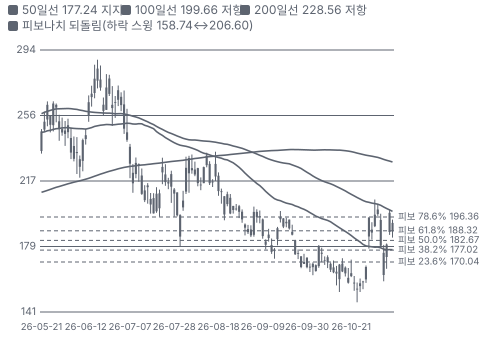

**주봉**

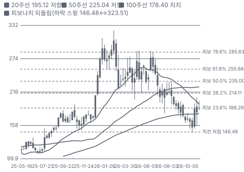

**월봉**

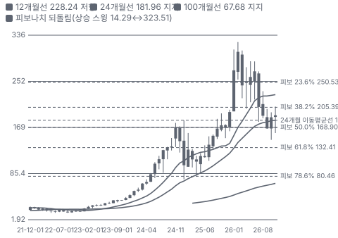

**분기 매출·EPS 실적과 컨센서스**

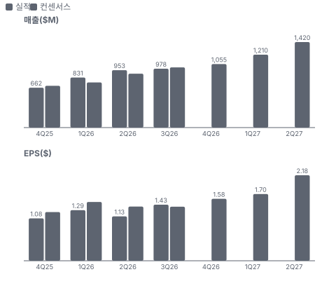

**4Q26 매출 — 지표 추세 vs 가이던스·컨센서스**

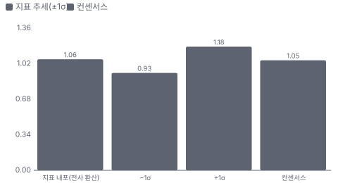

**최근 4개 분기 주가 변화 분석**

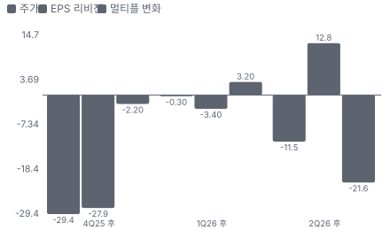

**EPS 리비전**

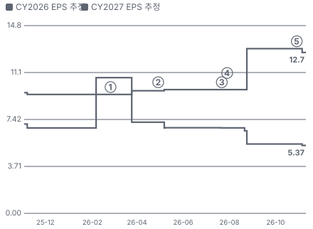

① 26-02-25 4Q25 실적, 다음 날 +2.7%·종가 고점 \$310.04 · EPS 리비전 +0%
② 26-04-29 1Q26 실적, 다음 날 +17.2% · EPS 리비전 +1%
③ 26-07-22 J&F 하이퍼스케일러 MSA·첫 PO \$1.465B 발표(2Q 콜에서 확인) · EPS 리비전 +0%
④ 26-07-29 2Q26 실적, 당일 −7.1% · EPS 리비전 +0%
⑤ 26-10-29 3Q26 실적·Mod-1 시험 완료, 당일 +17.3% · EPS 리비전 -2%

**밸류에이션 주가 시나리오**

**주가별 업사이드**

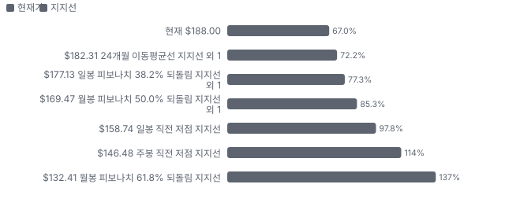

**제품·서비스 포트폴리오**

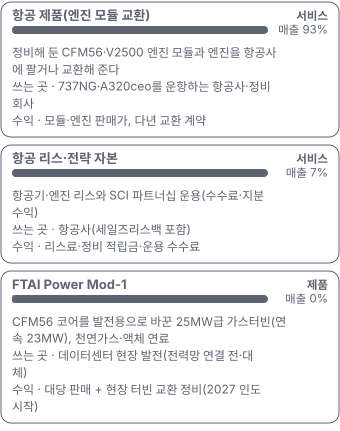

**고객 믹스(3Q26, 매출 대비)**

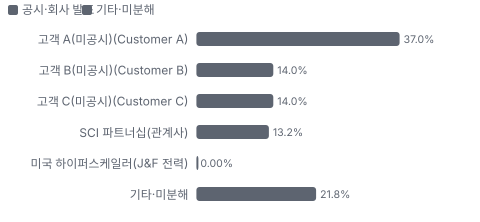

**공급 병목(10점, 낮을수록 병목)**

**CAPEX의 매출 대비 비중**

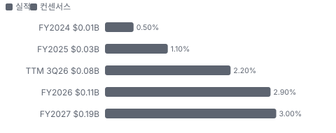

**어닝콜 변화별 주주가치 영향**

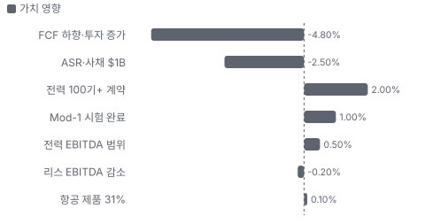

**멀티플 프리미엄(현재값 — 최근 4개 분기 추이 재료 없음)**

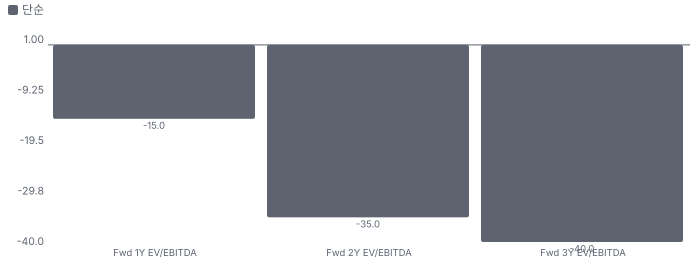

**합리적 멀티플**

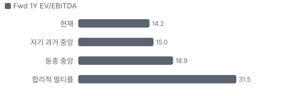

**수주·파이프라인 확실성 사다리**

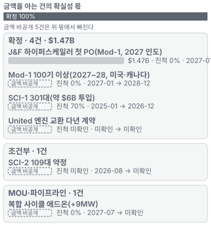

**매출 → 매출총이익 → 영업이익(매출 = 100, 최근 4분기)**

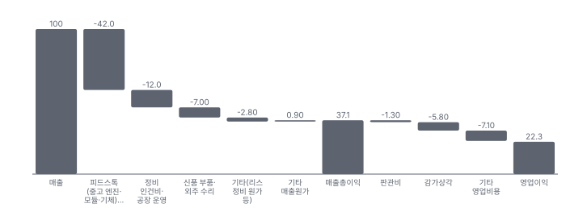

**1년 전 대비 마진 기여(비용 비중 변화의 반대)**

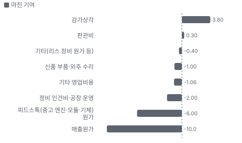

**분기 비용 비중 추이(매출 대비, 공시)**

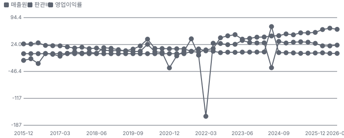

**비용 요인별 매출 대비 비중과 1년 변화**

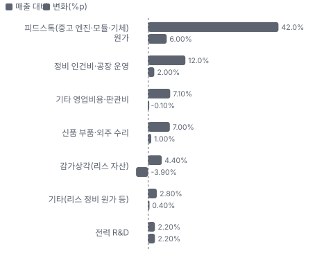

**BOM 항목 가격 +10% 시 OPM 변화**

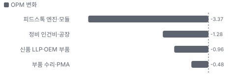

**항공 제품(엔진 모듈 교환) BOM 원가 몫과 가격 +10% 시 OPM**

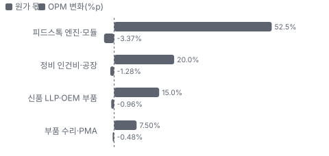

**생산시설별 면적(sq ft, 큰 순) — 생산능력 미공시라 면적을 대용으로**

**매출·PPI·수출입 — 최근 16개 분기 같은 축(4Q22 = 100) + 다음 분기 추정**

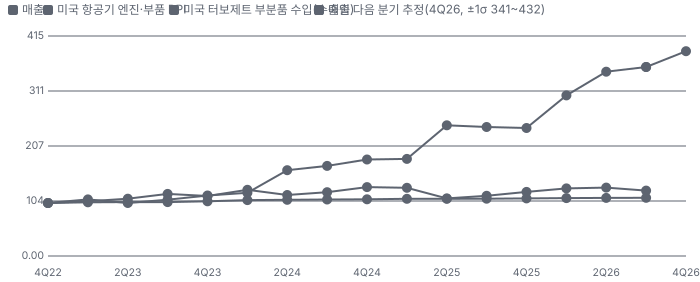

**매출과 미국 항공기 엔진·부품 PPI 증가율(전년 대비, 최근 16개 분기 + 다음 분기 추정)**

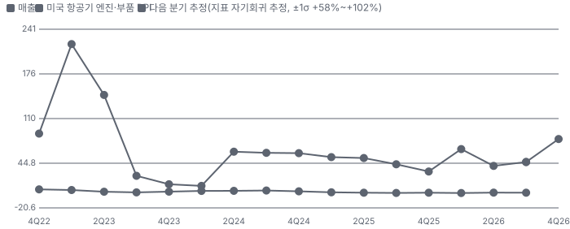

**목표주가 산정 — 약세와 기본 사이(약세 쪽 29%), 도달 확률 약 57%**

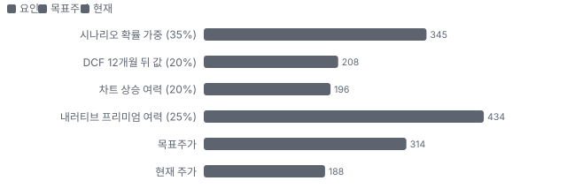

**PEG — 성장 대비 멀티플(낮을수록 성장 대비 쌈)**

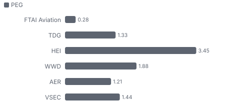

**일봉 지지·저항과 목표주가**

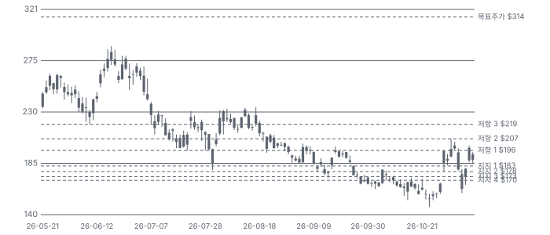

**커뮤니티 언급 수(최근 30일, 채널별)**

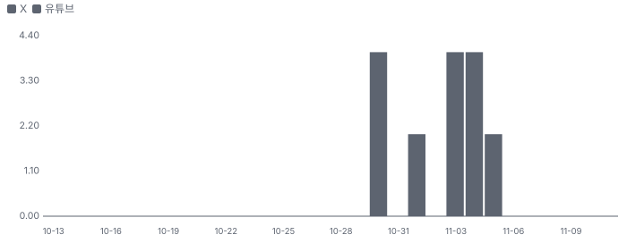

**일별 거래량 분해**

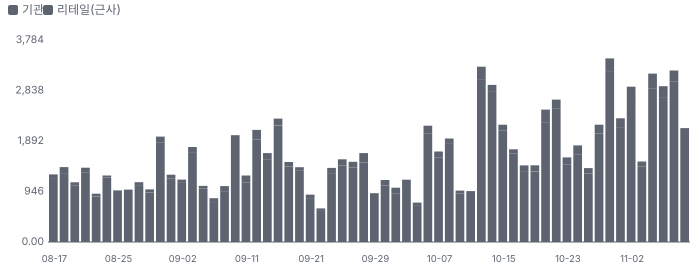

**기관 자금 흐름**

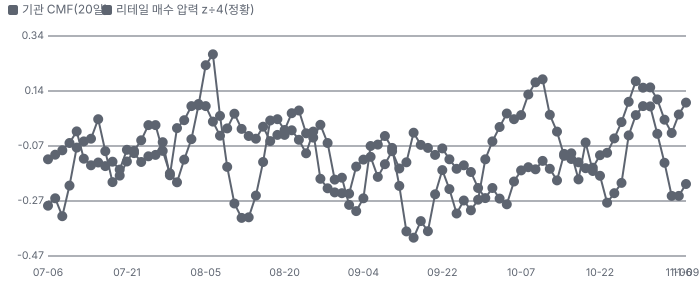

**몬테카를로**

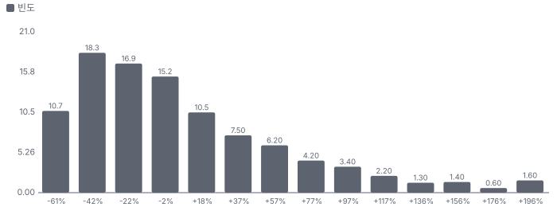

해석: 3,000번 중 1,329번(44%)에서 가치가 지금 주가 이상이었다. 지금 주가를 뒷받침하는 경우와 그렇지 않은 경우가 반반에 가깝다. 가운데 값은 0.93배이고, 열 번 중 여덟 번은 0.48~1.89배 사이에 든다.

## 내러티브

> **기업가치를 결정하는 이야기:** 신조기(737 MAX(보잉 737 신형)·A320neo)가 2032년 이후까지 막혀 있어 노후 협동체가 더 오래 난다. 그 엔진(CFM56·V2500)은 정비할 때마다 4~7개월이 걸리는데, FTAI는 미리 정비해 둔 모듈과 바로 바꿔 준다. 엔진을 사 와서(피드스톡) 모듈로 나눠 파는 구조라 재고가 먼저 늘고 이익이 뒤따른다. 전력은 퇴역 CFM56 코어를 발전기로 바꿔 데이터센터 현장에 공급하는 사업으로, 2027 조정 EBITDA \$450~750M을 회사가 제시했다

> **멀티플·EPS 프리미엄**
> **멀티플:** Fwd 1Y EV/EBITDA 14.2배로 동종 중앙값 18.9배(TransDigm 제외 4곳)보다 낮다. 독점 부품 회사(HEICO 29.7배·Woodward 22.4배)와 리스 회사(AerCap 8.9배) 사이다. Fwd 2Y는 9.9배로 가이던스가 맞으면 빠르게 내려간다
> **EPS:** 2027 EPS 컨센서스는 8월 \$13.02 → 11월 \$12.72로 소폭 내려갔지만 매출 추정은 \$6.58B → \$6.91B로 올라갔다. 이익률 가정이 낮아졌다는 뜻이다

### 투자자들은 왜 열광했나

열광은 2025년 12월 30일 FTAI Power 출시 뒤였다 — 주가는 2026-02-26 종가 고점 \$310.04(장중 \$323.51)까지 갔다. 식은 이유는 세 가지다. 영업현금흐름 음수가 이어졌고, 2Q에 리스 이익을 낮췄고(당일 −7.1%), 이사 한 명이 5월에 \$61.5M을 팔았다. 10/23 장중 \$146.48까지 내려갔다가 3Q 실적일 +17.3%로 반등했다

### 무엇이 기업가치를 바꾸나

> **구조적 체질 변화**
> **변화:** 리스 회사에서 정비·제품 회사로 — 항공 제품 매출 비중 1년 새 78% → 93%, 리스 EBITDA는 −23%. 자산은 SCI로 넘기고 정비 물량만 가져온다
> **증거:** 세그먼트 KPI·EX-99.1
> **반증:** SCI 분배가 끊겨 리스 자산을 다시 대차대조표로 들인다

> **고부가 믹스 확장**
> **변화:** 항공 제품 EBITDA 이익률 28.5%(2Q) → 31%(3Q), 회사는 '수년간 30%'. 대형 항공사·완전 정비 비중이 늘어도 믹스가 바뀌지 않는다고 답했다
> **증거:** EX-99.1·3Q 콜
> **반증:** 항공 제품 이익률이 2분기 연속 28% 아래

> **기술 혁신**
> **변화:** Mod-1 핵심 시험 완료(최대 25MW·연속 23MW), 복합 사이클 애드온(+9MW, 효율 50% 초과 목표) 합작 — 연료 추가 없이 출력 +36%
> **증거:** EX-99.1
> **반증:** 복합 사이클 첫 시험(2027 하반기)이 늦어지거나 효율 목표에 못 미친다

> **실행 속도**
> **변화:** 항공: 엔진 정비 4~7개월 대신 즉시 모듈 교환. 전력: 첫 인도 2027, 월 0~5기 → 연말 월 10~15기 **납품 리드타임 0개월.** 피어 비교 미확인. 이전 대비 미확인.
> **증거:** 2Q·3Q 콜
> **반증:** 모듈 재고가 줄어 교환 대기 시간이 생긴다

> **M&A**
> **변화:** 해당 없음(최근 3년 회사 단위 인수 없음). 정비 시설·부품 수리 수직계열화 M&A를 찾는 중(CEO)
> **증거:** 3Q 콜
> **반증:** 대형 인수로 순차입/EBITDA가 3배를 넘는다

> **정책·입법 연관성**
> **재정정책:** 해당 없음(연방 예산이 매출에 직접 닿지 않는다). 데이터센터 전력 수요는 민간 투자가 이끈다 미확인 반증: 연방 전력 지원 예산이 현장 발전 조달을 바꾼다 의회 동의 2/10 — 하원 1/5(관련 세출 논의 없음) · 상원 1/5(관련 세출 논의 없음).
> **행정명령:** 전력망 연결 발전 설비의 해외 우려국 부품 사용을 겨냥한 행정명령 — 3Q 콜에서 Jereh(중국) 합작 노출 질문이 나왔고 회사는 대량 발전(전력망) 대상이라 Mod-1 영향은 작다고 답했다 3Q 콜(행정명령 번호·원문 미대조) 반증: 명령 세부 규칙이 현장 발전·합작 조달을 포함한다 의회 동의 2/10 — 하원 1/5(의회 절차 아님) · 상원 1/5(의회 절차 아님).
> **연관입법:** 해당 없음(회사 매출에 닿는 연관 입법을 확인하지 못했다) 미확인 반증: 데이터센터 현장 발전 인허가 입법

> **CAPEX 낙수효과**
> **변화:** 데이터센터 전력 부족이 현장 발전 수요로 번졌다 — 하이퍼스케일러 MSA(기본 공급 계약)·PO \$1.465B. 금지표대로 고객 투자 발표를 FTAI 매출로 바로 옮기지 않고 인도·매출 인식으로 확인한다
> **증거:** 2Q 콜·10-Q 선수금 \$234M
> **반증:** 하이퍼스케일러가 계약 물량을 줄이거나 대형 가스터빈 납기가 짧아진다

### 내러티브 근거

> '엔진 모듈 교환 고마진 복리'(컨센서스)와 '항공 엔진을 데이터센터 발전기로'(확산)가 겹친 이야기. 3Q로 바탕은 확인됐고, 전력은 시험 완료·계약까지 왔다. 쟁점은 현금 전환과 2027 첫 인도. 동종 대비 멀티플 차이 -25% 중 회사 고유 몫은 -55%다. 단계는 확산, 쏠림은 중간이다.

> **노후 협동체 정비 수요(신조기 지연)** · 강화
> **논리:** 737 MAX·A320neo가 2032년 이후까지 막혀 CFM56·V2500이 더 오래 날고, 신형 엔진(LEAP(CFM56 후속 신형 협동체 엔진)·GTF(프랫앤휘트니 기어드 터보팬 신형 엔진))은 정비소에 더 오래 머문다
> **숫자:** 3Q 모듈 311개(+50%), 항공 제품 매출 +76%
> **반증:** CFM56 리스료·모듈 가격이 내려간다(사장: 하락 없음)

> **현장 발전(behind-the-meter(전력망을 거치지 않고 수요처 현장에서 바로 쓰는 발전))** · 확산
> **논리:** 데이터센터가 전력망 연결을 기다리지 않고 현장에서 25MW 단위로 쌓는다
> **숫자:** 100기 이상 계약, 2027 전력 EBITDA \$450~750M(회사)
> **반증:** 2027 첫 인도 지연 또는 하이퍼스케일러 계약 축소

> **자본 재활용(SCI)** · 진행
> **논리:** 항공기를 외부 자본으로 사고 정비만 가져와 자기 자본 회전을 높인다
> **숫자:** SCI-1 약 \$6B(301대), 3Q 전략 자본 EBITDA \$54M
> **반증:** SCI-2 모집 지연

> **주주환원(ASR)** · 진행
> **논리:** 주가가 고점 대비 크게 내려간 구간에서 \$1.0B 자사주 프로그램으로 주식 수를 줄인다
> **숫자:** \$500M ASR(약 2.6M주, 추정), 이미 \$80M을 \$178.73에 매입
> **반증:** 차입이 EBITDA의 3배를 넘는다

> **반대 — 현금 전환·고객 집중** · 잠복
> **논리:** 이익은 재고를 빚으로 사서 만든다. 9M 영업현금흐름 −\$333M, 3Q 한 고객 37%
> **숫자:** 재고 \$1.93B(+\$739M), 차입 \$3.46B vs 자기자본 \$0.43B
> **반증:** 4Q 영업현금흐름이 크게 플러스로 돈다

> **반대 — 정통 터빈 납기 단축** · 잠복
> **논리:** GE Vernova·지멘스 에너지의 가스터빈 납기가 짧아지면 '빨리 공급한다'는 Mod-1 프리미엄이 줄어든다
> **숫자:** 미확인(정통 터빈 납기 공시 비교 없음)
> **반증:** 대형 터빈 회사가 슬롯 대기를 1년 이상 줄였다고 밝힌다

## 포트폴리오

| 제품·서비스 | 구분 | 무엇 | 쓰는 곳 | 돈 버는 방식 | Mix | Mix 변화(전년 대비) |
|---|---|---|---|---|---|---|
| 항공 제품(엔진 모듈 교환) | 서비스 | 정비해 둔 CFM56·V2500 엔진 모듈과 엔진을 항공사에 팔거나 교환해 준다 | 737NG·A320ceo를 운항하는 항공사·정비 회사 | 모듈·엔진 판매가, 다년 교환 계약 | 93% | +15.4%p |
| 항공 리스·전략 자본 | 서비스 | 항공기·엔진 리스와 SCI 파트너십 운용(수수료·지분 수익) | 항공사(세일즈리스백 포함) | 리스료·정비 적립금·운용 수수료 | 7% | -15.4%p |
| FTAI Power Mod-1 | 제품 | CFM56 코어를 발전용으로 바꾼 25MW급 가스터빈(연속 23MW), 천연가스·액체 연료 | 데이터센터 현장 발전(전력망 연결 전·대체) | 대당 판매 + 현장 터빈 교환 정비(2027 인도 시작) | 0% | +0.0%p |

**Mix 변화가 가장 큰 쪽은 항공 제품(엔진 모듈 교환, +15.4%p, 전년 대비).** 계절성 판정: 분기 매출 계절 지수 기준 있음 → 전년 같은 분기와 비교.

## 고객

> **3Q26 최대 고객 고객 A(미공시, Customer A) 37%, 상위 3곳 65%, 집중도 보통.** 공시·회사 발표로 확인한 몫은 매출의 78%이고, 나머지 고객 몫은 추정이거나 미분해다. 3Q 매출의 65%가 세 고객(37%·14%·14%)이다 — 모두 항공 제품이고 이름은 공시하지 않았다. 9M으로는 두 곳이 27%·20%다. 1년 전(16%·11%)보다 집중이 크게 높아졌다

**고객별 매출 몫(3Q26)**
| 고객 | 몫 | 변화 | 근거 |
|---|---|---|---|
| 고객 A(미공시, Customer A) | 37% | +21%p | 공시 |
| 고객 B(미공시, Customer B) | 14% | +3%p | 공시 |
| 고객 C(미공시, Customer C) | 14% | 미확인 | 공시 |
| SCI 파트너십(관계사) | 13% | 미확인 | 공시 |
| 미국 하이퍼스케일러(J&F 전력) | 0% | +0%p | 공시 |
| United(엔진 교환 다년 계약) | 미확인 | 미확인 | 보도 |
| 기타·미분해 | 22% | - | - |

> **고객 A(미공시, Customer A)** · 공시
> **사는 것:** 엔진 모듈·엔진
> **추정 근거:** 3Q26 매출 비중. 정체는 미확인 — 관계사 MRE(모듈 교환·정비 계약, Maintenance, Repair and Exchange) 계약 매출(\$129.4M, 13%)만으로는 37%를 설명하지 못한다

> **고객 B(미공시, Customer B)** · 공시
> **사는 것:** 엔진 모듈
> **추정 근거:** 3Q26 매출 비중

> **고객 C(미공시, Customer C)** · 공시
> **사는 것:** 엔진 모듈
> **추정 근거:** 3Q26 매출 비중

> **SCI 파트너십(관계사)** · 공시
> **사는 것:** MRE 모듈 교환 계약
> **추정 근거:** 3Q 'MRE 계약 매출 — 관계사' \$129.4M ÷ \$977.7M. 위 세 고객과 겹치는지는 미확인

> **미국 하이퍼스케일러(J&F 전력)** · 공시
> **사는 것:** Mod-1 발전기(2027 인도)
> **추정 근거:** 5년 MSA·첫 PO \$1.465B(J&F 합작 계약) — 매출 인식 전, 선수금 \$234M

> **United(엔진 교환 다년 계약)** · 보도
> **사는 것:** V2500·CFM56 엔진 교환
> **추정 근거:** 애널리스트가 '확대 계약'을 짚었다 — 금액 미공시

## 수주·파이프라인

> **2026-11-11 기준 6건.** 확정 \$1.47B. 서로 겹치는 항목은 합계에서 뺐다.

**실행 속도와 방해 요인**
| 항목 | 상태 | 실행 속도 | 방해 요인 |
|---|---|---|---|
| J&F 하이퍼스케일러 첫 PO(Mod-1, 2027 인도) | 확정 | 미확인 | 첫 양산 램프(월 0~5기) · Jereh 합작 공급망·행정명령 |
| Mod-1 100기 이상(2027~28, 미국·캐나다) | 확정 | 미확인 | 고객 현장 요건 · 생산 램프 |
| SCI-1 301대(약 \$6B 투입) | 확정 | 지연(계획 96%, -26%p), 이대로면 2027-08 완료, 8개월 지연 | 연말 종결 일정 |
| SCI-2 109대 약정 | 조건부 | 미확인 | 투자자 모집 |
| United 엔진 교환 다년 계약 | 확정 | 미확인 | 미확인 |
| 복합 사이클 애드온(+9MW) | 파이프라인 | 미확인 | 개발·시험 |

## 마진 구조

> **GPM 36.2%, OPM 22.4%.** 3Q25 대비 GPM -9.4%p, OPM -7.7%p. 변동비는 매출의 57%이고, 매출이 10% 늘면 OPM은 +1.8%p 움직인다. 원가의 대부분은 사 온 엔진·모듈(피드스톡)이다. 3Q26 매출원가는 매출의 63.8%로 1년 전 54.4%보다 9.4%p 높다 — 리스(원가가 감가상각으로 잡혀 매출원가가 낮은 사업) 비중이 15%에서 7%로 줄고 항공 제품(재고 원가가 매출원가로 가는 사업)이 늘어난 믹스 효과다. 세부 원가 구성은 공시되지 않아 아래 요인은 추정이다

> **매출 100 중 매출원가 62.9, 매출총이익 37.1(최근 4분기, 공시).** 매출원가 요인 중 피드스톡(중고 엔진·모듈·기체) 원가이 매출의 42.0%로 가장 무겁고, 단가가 +10% 오르면 GPM이 -4.20%p 움직인다. 분기 회귀로 매출 1이 늘 때 매출원가는 0.68 늘고, 매출원가의 고정비 몫은 -39%다.

**비용 요인 강도 — 비중·추세·충격(+10%)·탄력**
| 비용 | 구분 | 매출 대비 | 1년 변화 | 마진 기여 | 충격 시 마진 | 매출 탄력 | 고정비 몫 |
|---|---|---|---|---|---|---|---|
| 피드스톡(중고 엔진·모듈·기체) 원가 | 매출원가 요인 | 42.0% | +6.0%p | -6.0%p | -4.20%p | 미확인 | 0% |
| 정비 인건비·공장 운영 | 매출원가 요인 | 12.0% | +2.0%p | -2.0%p | -1.20%p | 미확인 | 60% |
| 신품 부품·외주 수리 | 매출원가 요인 | 7.0% | +1.0%p | -1.0%p | -0.70%p | 미확인 | 0% |
| 기타(리스 정비 원가 등) | 매출원가 요인 | 2.8% | +0.4%p | -0.4%p | -0.28%p | 미확인 | 50% |
| 매출원가 | 공시 항목 | 62.9% | +10.0%p | -10.0%p | -6.29%p | 0.68 | -39% |
| 기타 영업비용 | 공시 항목 | 7.1% | +1.1%p | -1.1%p | 미확인 | 0.02 | 89% |
| 감가상각 | 공시 항목 | 5.8% | -3.8%p | +3.8%p | 미확인 | 0.03 | 80% |
| 판관비 | 공시 항목 | 1.3% | -0.3%p | +0.3%p | 미확인 | 0.02 | 74% |

매출 탄력 = 분기 비용을 매출에 회귀한 기울기(매출 1당 변동비), 고정비 몫 = 절편 ÷ 평균 비용. 표본이 8분기 미만이면 미확인. 매출원가 요인 비중은 margin 재료의 추정이 섞여 있고, 공시 매출원가와의 차이는 '기타 매출원가'로 둔다.

**GPM에서 OPM까지(GAAP)**
| 기간 | GPM | 연구개발 | 판관비 | 기타 | OPM |
|---|---|---|---|---|---|
| 3Q25 | 45.6% | 0.0% | 1.3% | 14.2% | 30.1% |
| 3Q26 | 36.2% | 2.3% | 0.7% | 10.8% | 22.4% |

**GPM·OPM 최근 4개 분기**
| 분기 | GPM | OPM |
|---|---|---|
| 2025-12 | 44.3% | 27.0% |
| 2026-03 | 36.9% | 20.5% |
| 2026-06 | 33.3% | 20.4% |
| 2026-09 | 36.2% | 22.4% |

**마진을 결정하는 비용 요인 — 비용 +10% 시 OPM**
| 비용 | 매출 대비 | 변화 | 고정비 | OPM |
|---|---|---|---|---|
| 피드스톡(중고 엔진·모듈·기체) 원가 | 42.0% | +6.0%p | 0% | -4.20%p |
| 정비 인건비·공장 운영 | 12.0% | +2.0%p | 60% | -1.20%p |
| 기타 영업비용·판관비 | 7.1% | -0.1%p | 70% | -0.71%p |
| 신품 부품·외주 수리 | 7.0% | +1.0%p | 0% | -0.70%p |
| 감가상각(리스 자산) | 4.4% | -3.9%p | 100% | -0.44%p |
| 기타(리스 정비 원가 등) | 2.8% | +0.4%p | 50% | -0.28%p |
| 전력 R&D | 2.2% | +2.2%p | 100% | -0.22%p |

**비용을 움직이는 요인**
| 비용 | 요인 |
|---|---|
| 피드스톡(중고 엔진·모듈·기체) 원가(매출원가) | CFM56·V2500 중고 엔진 매입가와 모듈 판매 물량 · 근거 추정 |
| 정비 인건비·공장 운영(매출원가) | 모듈 생산량(3Q 311개)·공장 4곳 인력 · 근거 추정 |
| 기타 영업비용·판관비(판관비) | 본사·보상 · 근거 공시 |
| 신품 부품·외주 수리(매출원가) | LLP 교체·OEM 부품 가격 · 근거 추정 |
| 감가상각(리스 자산, 기타) | 리스 기단 축소 · 근거 공시 |
| 기타(리스 정비 원가 등, 매출원가) | 리스 반환 정비 · 근거 추정 |
| 전력 R&D(연구개발) | Mod-1 시험·복합 사이클 개발 — 조정 EBITDA에서 뺀다 · 근거 공시 |

**항공 제품(엔진 모듈 교환) BOM — 매출의 93%, GPM 31%(사업부 조정 EBITDA 이익률 대용(\$282.4M ÷ \$910.0M, EX-99.1)), 항목 가격 +10% 시**
| 항목 | 원가 몫 | 전가 | 제품 GPM | OPM |
|---|---|---|---|---|
| 피드스톡 엔진·모듈 | 45~60% | 미확인 | -3.6%p | -3.37%p |
| 정비 인건비·공장 | 15~25% | 미확인 | -1.4%p | -1.28%p |
| 신품 LLP·OEM 부품 | 10~20% | 미확인 | -1.0%p | -0.96%p |
| 부품 수리·PMA(FAA 승인을 받은 비OEM 대체 부품) | 5~10% | 미확인 | -0.5%p | -0.48%p |
| 미분해 | 5% | - | - | - |

피드스톡 엔진·모듈 가격이 +10% 오르면 영업이익은 -15.1% 움직인다. 판매가 전가를 모르는 항목은 전가 0%로 계산했다.

**BOM 항목 가격을 움직이는 것**
| 항목 | 요인 |
|---|---|
| 피드스톡 엔진·모듈 | 중고 엔진을 사서 모듈로 나눠 정비한다 — 매입가가 원가의 중심 · 근거 추정 |
| 신품 LLP·OEM 부품 | 수명 제한 부품 교체 — OEM 가격 인상에 노출 · 근거 추정 |
| 정비 인건비·공장 | 모듈당 정비 시간 · 근거 추정 |
| 부품 수리·PMA | 합작사(AERJV·Prime Engine Accessories)로 원가를 낮춘다 · 근거 추정 |

**BOM 투입 물가 — PPI 전년비, 2026-11-11 수집**
| 항목 | 미국 | 일본 | 한국 | 대만 |
|---|---|---|---|---|
| 신품 LLP·OEM 부품 | +1.2%* | 미확인 | 미확인 | 미확인 |

별표는 품목보다 넓은 업종 지수다. 지난 1년 투입 물가를 판매가 전가 뒤 원가에 그대로 넣으면 OPM은 -0.50%p 움직인다(매출원가의 68% 기준).

## 공급망 병목

이미지 없음(검수 실패) — FTAI Power Mod-1

> **공급망 신뢰성 2.4/10, 병목 심각.** 가장 약한 고리는 신품 LLP·OEM 부품 2.4점이고, 품목 평균은 2.4점이다. 근거가 부족한 5건(피드스톡 엔진·모듈 · 부품 수리·PMA · 정비 공장 캐파 · 발전 패키지(Mod-1 주변 설비) · 자금(채권·전략 자본 투자자))은 점수에서 뺐다. 병목은 부품이 아니라 '중고 엔진(피드스톡)'이다. 회사도 CFM56 시장이 수요가 아니라 공급에 막혀 있다고 말한다(2Q 콜). 전력은 Jereh(중국) 합작의 발전 패키지 공급망이 두 번째 위험이다

**병목과 마진 — 품목 가격 +10% 시 OPM**
| 품목 | 점수 | 판정 | 구분 | OPM |
|---|---|---|---|---|
| 신품 LLP·OEM 부품(필수) | 2.4 | 병목 심각 | 핵심 통제 품목 | -0.96%p |

> **신품 LLP·OEM 부품** · 2.4/10
> **왜:** LLP는 OEM 또는 PMA 승인품만 쓸 수 있다 — 1위 몫 0.9는 추정(CFM56 신품 LLP는 CFM이 사실상 유일, 일부 PMA 대체). 지역 = CFM(미국·프랑스 합작) 한 공급원
> **병목 요인:** 인증 공급사 1곳 · 캐파 미확인 · 리드타임 미확인 · 재인증 미확인 · 1위 점유율 90% · 미국·프랑스 집중 100% · 물량 확보 장기계약
> **풀리는 조건:** 미확인

**공급사**
| 품목 | 공급사 | 몫 | 근거 |
|---|---|---|---|
| 피드스톡 엔진·모듈 | 항공사·리스사(퇴역 기체·엔진 매각, 중고 엔진 매도) | 미확인 | 공시 |
| 피드스톡 엔진·모듈 | WestJet(737-700 10대, 기체 매각) | 미확인 | 회사 발표 |
| 신품 LLP·OEM 부품 | CFM International(GE·사프란, 신품 부품·수리 기술) | 미확인 | 보도 |
| 부품 수리·PMA | Advanced Engine Repair JV(25%, 부품 수리) | 미확인 | 공시 |
| 부품 수리·PMA | Prime Engine Accessories(50%, 보기류 수리) | 미확인 | 공시 |
| 정비 공장 캐파 | 자체 4곳(몬트리올·마이애미·리스본·Orange, 모듈 정비) | 미확인 | 공시 |
| 정비 공장 캐파 | QuickTurn Europe(로마, 50%, 정비·시험 셀) | 미확인 | 공시 |
| 정비 공장 캐파 | GMF AeroAsia(자카르타, 전략 정비 협력) | 미확인 | 회사 발표 |
| 발전 패키지(Mod-1 주변 설비) | J&F Power Systems(Jereh 합작, 발전 패키지·주변 설비 조달) | 미확인 | 공시 |
| 자금(채권·전략 자본 투자자) | 선순위 사채(BB(투기 등급 신용등급의 상단 구간) 등급)(차입) | 미확인 | 공시 |
| 자금(채권·전략 자본 투자자) | SCI 투자자(항공기 매입 자본) | 미확인 | 공시 |

**무역 통계로 본 공급 지역**
| 품목 | EU 수입처 | 일본 수입처 | EU 1위 전년비 |
|---|---|---|---|
| 피드스톡 엔진·모듈 | US 85% · CN 6% · JP 5% | アメリカ合衆国 66% · 英国 10% | +31.2% |
| 신품 LLP·OEM 부품 | US 85% · CN 6% · JP 5% | アメリカ合衆国 66% · 英国 10% | +31.2% |
| 발전 패키지(Mod-1 주변 설비) | US 94% · JP 4% · VN 1% | アメリカ合衆国 100% | +57.3% |

## 생산능력

> **현재 명목 캐파 미확인, 가동률 미확인.** 착공 이상 증설은 0 CFM56 모듈/년, 발표까지 합치면 0 CFM56 모듈/년이다. TTM 3Q26 CAPEX는 \$0.08B로 매출의 2.2%다. 생산능력은 정비 공장의 모듈 처리량이다. 3Q 311개(연환산 약 1,240개)로 2026 목표 1,200개를 넘는 속도다. 전력은 몬트리올에서 월 0~5기로 시작해 2027년 말 월 10~15기가 회사 계획이다(인도 전)

**생산시설 6곳**(10-Q Note 1: 100% 소유 엔진 정비 시설 4곳(몬트리올·마이애미·리스본·Orange) + 50% 지분 2곳(QuickTurn Europe 로마, Prime Engine Accessories 브리스톨). 합계 100만 sq ft 초과), 소유 4곳 · 소유·임차 2곳. 시설별 생산능력은 공개되지 않았다 — 회사 전체 캐파만 위에 적었다.

**생산시설 6곳 — 명칭·위치·생산능력**
| 시설 | 위치 | 용도 | 생산능력 | 소유·상태 |
|---|---|---|---|---|
| 몬트리올 정비 시설 | 캐나다 몬트리올 | CFM56 모듈 정비, Mod-1 첫 생산 거점 | 미확인 — 시설별 처리량 미공시 | 소유 · 가동 |
| 마이애미 정비 시설 | 미국 플로리다 마이애미 | 엔진 모듈 정비 | 미확인 — 시설별 처리량 미공시 | 소유 · 가동 |
| 리스본 정비 시설 | 포르투갈 리스본 | 엔진 모듈 정비 | 미확인 — 시설별 처리량 미공시 | 소유 · 증설 중 |
| Orange 정비 시설 | 미확인(10-Q 표기 'Orange') | 엔진 정비 | 미확인 — 시설별 처리량 미공시 | 소유 · 가동 |
| QuickTurn Europe | 이탈리아 로마 피우미치노 | 엔진 정비·시험 셀(50% 지분) | 미확인 — 시설별 처리량 미공시 · 면적 200,000 sq ft | 소유·임차 · 증설 중 |
| Prime Engine Accessories | 영국 브리스톨 | 엔진 보기류 수리(50% 지분) | 미확인 — 시설별 처리량 미공시 | 소유·임차 · 가동 |

**생산능력 확충 계획**
| 계획 | 단계 | 증설 | 가동 시점 | CAPEX |
|---|---|---|---|---|
| 로마 QuickTurn 시험 셀(CFM56·LEAP) | 발표 | 미확인 | 미확인 | 미확인 |
| 로마·리스본·몬트리올 확장 | 발표 | 미확인 | 미확인 | 미확인 |
| GMF AeroAsia 전략 정비 협력(자카르타) | 발표 | 미확인 | 미확인 | 미확인 |
| Mod-1 발전기 생산(몬트리올) | 발표 | 미확인 | 2027-01 | 미확인 |

남은 계획의 CAPEX 합계는 \$0.00B(금액 미확인 4건 제외)다. 합계는 FY2027 매출의 0%다.

**증설 방해 요인**
| 계획 | 방해 요인 |
|---|---|
| 로마 QuickTurn 시험 셀(CFM56·LEAP) | LEAP 정비 자격 |
| 로마·리스본·몬트리올 확장 | 인력 |
| GMF AeroAsia 전략 정비 협력(자카르타) | 제휴사 공장(250,000 sq ft) — FTAI 소유 아님 |
| Mod-1 발전기 생산(몬트리올) | 첫 인도 전 — 월 0~5기 → 2027년 말 월 10~15기 |

**CAPEX와 매출 대비**
| 기간 | CAPEX | 매출 | 매출 대비 | 구분 |
|---|---|---|---|---|
| FY2024 | \$0.01B | \$1.73B | 0.5% | 실적 |
| FY2025 | \$0.03B | \$2.51B | 1.1% | 실적 |
| TTM 3Q26 | \$0.08B | \$3.42B | 2.2% | 실적 |
| FY2026 | \$0.11B | \$3.82B | 2.9% | 컨센서스 |
| FY2027 | \$0.19B | \$6.40B | 3.0% | 컨센서스 |

## 해자

> 해자는 '엔진을 가진 정비 회사'라는 구조다. 세계 최대급 독립 CFM56·V2500 엔진·모듈 재고와 자체 공장 4곳으로 항공사에 즉시 교환을 내주고, 정비 원가는 부품 수리 합작·중고 부품으로 낮춘다. 전력은 같은 엔진 코어를 발전기로 돌리는 선택권이지만 아직 인도 전이다

> **엔진·모듈 재고 규모(즉시 교환)** · 강함
> **해자:** 항공사는 엔진을 4~7개월 정비소에 보내는 대신 FTAI의 정비된 모듈과 바로 바꾼다. 재고를 가진 쪽만 이 서비스를 할 수 있다
> **근거:** 10-Q 재고 \$1.93B, 3Q 모듈 311개(+50%), 시장 점유율 약 15%(애널리스트 질문 전제)
> **숫자:** 2026 모듈 1,200개 목표, 9M 877개
> **깨지는 조건:** OEM(CFM)·대형 MRO(항공기·엔진 정비·수리·분해 점검)가 같은 모듈 교환 상품을 FTAI보다 싸게 내거나 항공 제품 이익률이 25% 아래로 떨어진다

> **정비 원가 우위(중고 부품·PMA·부품 수리 합작)** · 보통
> **해자:** 새 부품 대신 중고 부품·PMA·자체 수리로 정비 원가를 낮춘다 — 회사는 항공사가 직접 하는 것보다 같거나 싸다고 말한다
> **근거:** AERJV 25%·Prime Engine Accessories 50%(10-Q 주석), 3Q 콜 CEO
> **숫자:** 미확인(정비 1회 원가 비교 미공시)
> **깨지는 조건:** CFM56 중고 부품 가격이 급등하거나 OEM이 PMA 사용 정비에 보증을 제한한다

> **자본 재활용(SCI 파트너십)** · 보통
> **해자:** 항공기를 외부 투자자 돈(SCI)으로 사고 정비는 FTAI가 맡아, 자기 자본을 적게 쓰고 정비 물량과 수수료를 얻는다
> **근거:** SCI-1 301대 약 \$6B(연말 종결 목표), SCI-2 109대·\$2.0B 창고 한도(EX-99.1)
> **숫자:** 3Q 전략 자본 EBITDA \$54M(수수료 \$7.4M + 지분 수익 \$46.2M)
> **깨지는 조건:** SCI 분배가 끊기거나 SCI-2 모집이 멈춘다

> **전력: 작은 단위·빠른 교환(미실증)** · 약함
> **해자:** 25MW 단위로 쌓아 예비 용량을 적게 두고, 고장 나면 48시간 안에 터빈을 바꾼다 — 대형 터빈 대비 이중화 비용이 낮다는 주장
> **근거:** 3Q 콜 사장·CEO, Mod-1 시험 완료(EX-99.1)
> **숫자:** 미확인(상업 운전 실적 0기)
> **깨지는 조건:** 2027 상반기 첫 인도가 늦어지거나 현장 가동률이 기존 항공 전용 발전기보다 낮게 나온다

## 경영진·네트워크

> Joe Adams CEO 겸 회장이 2011년 설립부터 회사를 이끈다. 사장 David Moreno가 전력·전략 자본 실행을 맡는다. 경영진은 2025년 저점에서 장내 매수했고 사장은 2026-07-31에도 약 \$0.5M을 샀다. 반면 이사 한 명은 5월에 \$61.5M을 팔았다

> **Joe Adams** · CEO·회장 · 2011(설립)
> **프로필:** 엔진 모듈 교환·전력 전환 전략을 세웠다. 2025-05·11 장내 매수(Form 4)
> **비즈니스:** 항공 제품·전력
> **정계:** 미확인
> **동문:** 미확인
> **사모임:** 미확인

> **David Moreno** · 사장 · 미확인
> **프로필:** 전력(Mod-1)·SCI 실행. 2026-07-31 \$201.27에 약 \$0.50M 장내 매수
> **비즈니스:** 전력·전략 자본·항공사 영업
> **정계:** 미확인
> **동문:** 미확인
> **사모임:** 미확인

> **Nicholas McAleese** · CFO · 미확인
> **프로필:** 조정 EBITDA를 핵심 지표로 제시, 2027 \$2.3B를 보수적 하단이라고 설명
> **비즈니스:** 재무·자본 배분
> **정계:** 미확인
> **동문:** 미확인
> **사모임:** 미확인

> **Stacy Kuperus** · COO · 미확인
> **프로필:** 2025-05 장내 매수 약 \$0.10M
> **비즈니스:** 운영
> **정계:** 미확인
> **동문:** 미확인
> **사모임:** 미확인

> **Martin Tuchman** · 이사 · 미확인
> **프로필:** 2026-05-01 \$242.01에 약 \$61.5M 장내 매도(Form 4)
> **비즈니스:** 이사회
> **정계:** 미확인
> **동문:** 미확인
> **사모임:** 미확인

**네트워크 정량화**
| 연결 | 강도 | 닿는 매출 | 가중 노출 | 매출 대비 | 근거 |
|---|---|---|---|---|---|
| 비즈니스: CFM(GE·사프란 합작)과 부품·수리 협력(보도·애널리스트 노트, 10-Q에는 계약 기술 없음), United 다년 엔진 교환, Jereh 합작(J&F) | 3/5 | 미확인 | 미확인 | 미확인 | 계약 금액 대부분 미공시 — J&F 선수금 \$234M만 공시 10-Q·2Q·3Q 콜 |
| 정계: 공개 기록에서 확인한 정계 연결 없음. 하원 의원 1명이 5월 일부 매도(의회 거래 공시) | 0/5 | 미확인 | 미확인 | 미확인 | 로비 공시 집계 범위(대형주 120개) 밖이라 확인하지 못했다 미확인 |

가중 노출은 연결이 닿는 매출의 크기다. 연결이 그 매출을 만들었다는 뜻이 아니며, 인과는 공개 자료로 입증하지 못한다.

## 약세 논리 및 셀온 조건

| 약세 논리 | 근거 | 반박 | 가를 자료 · 공개 시점 |
|---|---|---|---|
| 이익은 재고를 빚으로 사서 만든다 | 9M 영업현금흐름 −\$333M, 재고 \$1.93B(연초 대비 +\$739M), 차입 \$3.46B vs 자기자본 \$0.43B(10-Q) | CFO: 2년 전 재고 \$0.5B가 이듬해 항공 제품 매출 \$1.9B가 됐다 — 재고 회전 약 2배 목표. 2026 성장 투자 전 FCF \$1.1B 가이던스 | 4Q26 영업현금흐름과 재고 증감 — 2027-02 하순(4Q 실적·10-K) |
| 고객 한 곳이 매출 37% | 3Q 고객 세 곳 37%·14%·14%, 1년 전 16%·11%. 관계사 MRE 계약 매출 \$129.4M(13%) | 대형 항공사(United 확대 계약)·SCI 물량이 들어온 결과라는 설명 — 9M 기준으로는 27%·20%로 덜 몰린다 | FY2026 10-K 10% 초과 고객 공시(이름·세그먼트) — 2027-02 하순 |
| 4Q 내재 EBITDA \$435M은 거래 시점에 달렸다 | 3Q \$348.3M → 4Q 약 \$435M(+25%). 사장: 리스 쪽 4Q 큰 폭 증가가 질문의 핵심 | SCI-1 301대를 연말까지 종결(9/30 212대, 이후 30대 \$1B 종결) — 일정대로면 도달 | 4Q26 실적 조정 EBITDA — 2027-02 하순 |
| 전력은 시험만 끝났다 | Mod-1 상업 인도 0기, 첫 생산 월 0~5기(몬트리올). 2027 전력 EBITDA \$450~750M은 범위가 넓다 | J&F 선수금 \$234M(10-Q 계약부채)·100기 이상 계약·시험 완료(25MW·23MW) | 2027 1Q·2Q 첫 인도와 전력 매출 인식 — 2027-05·08 실적 |
| 중국 합작사(Jereh) 리스크 | J&F는 Jereh 합작 — 3Q 콜에서 행정명령 노출 질문 | 회사: 명령은 전력망 대량 발전 대상, 주변 설비는 여러 나라에서 조달 가능 | 행정명령 세부 규칙·관세 적용 범위 — 시점 미확인 |
| 정통 가스터빈 납기가 짧아지면 프리미엄이 준다 | Mod-1의 가치는 '빨리 공급'이다(사장: 속도·규모·비용) | 현재 대형 터빈은 슬롯 예약으로 수년 대기(업계 보도) — 25MW 단위 이중화 비용 장점은 납기와 별개 | GE Vernova·지멘스 에너지 분기 실적의 슬롯·납기 발언 — 2027-01 하순 |

**정책·거시.** 중간선거 영향은 작다 — 방위 매출이 없어 국방 예산 채널은 0이고, 전력망·인프라 채널(현장 발전)과 관세 채널(Jereh 조달)에 일부만 노출된다. 정책 0단계(선거 결과) 가설이다. **추가 원천(11/11).** 노션 자료실의 항공·방위 업종 리포트 요지(항공 여객 9월 −0.5%, 터빈 부품 공급 빡빡함, 애프터마켓 성장은 회사마다 갈림)와 마스터 인사이트(정통 터빈 납기가 짧아지면 FTAI 프리미엄이 준다)를 반대 검증에 넣었다. 커뮤니티는 최근 7일 Moderate(55)로, 강세 장문과 공시 재검토 회의론이 섞였다. 공매도는 유통 주식의 9.7%다. **데이터 한계.** 회사는 매출 가이던스를 내지 않는다(조정 EBITDA로만) — 데이터 검증 '회사 가이던스 반영'은 그래서 실패로 남는다. 10-Q 약정 주석(구매 약정)은 읽지 못해 미확인이다.

> **셀온 조건**
> **조건 1:** 4Q26 조정 EBITDA가 \$400M 아래로 나오거나 2027 가이던스 \$2.3B를 낮춘다
> **조건 2:** 항공 제품 EBITDA 이익률이 2분기 연속 28% 아래
> **조건 3:** Mod-1 첫 인도가 2027 하반기 이후로 밀리거나 하이퍼스케일러가 계약 물량을 줄인다
> **조건 4:** 4Q 영업현금흐름이 다시 크게 음수이고 순차입/EBITDA가 3배를 넘는다
> **조건 5:** 행정명령·관세가 J&F(Jereh 합작) 조달을 막는다

## 어닝콜 변화

**직전 콜 대비 새로 나오거나 바뀐 내용 → 가치 영향**
| 항목 | 내용 | 직전 콜 | 최신 콜 | 모델 동인 이동 | 확신도 | 가치 영향 |
|---|---|---|---|---|---|---|
| 신규 | Mod-1 시험 | 2Q '4Q 상업 출시 준비' | 핵심 시험 완료, 최대 25MW·연속 23MW | 1년차 성장률 +1.0% | 1.0 | +1.0% |
| 업데이트 | 전력 수주 | J&F 첫 PO \$1.465B(2027 인도) | 2027~28 100기 이상 계약, 대부분 2027 | 1년차 성장률 +2.0% | 0.8 | +2.0% |
| 신규 | 2027 전력 EBITDA | 전력 \$450M 기여(2027, 보도 인용) | \$450~750M 범위, 총 \$2.3B는 하단 기준 | 목표 이익률 +0.50% | 0.5 | +0.5% |
| 부정 | 현금흐름 | 성장 투자 전 FCF 약 \$1.16B, 성장 투자 \$290M | FCF \$1.1B(−\$61M), 성장 투자 \$463M | 매출÷투하자본 -10.0% | 0.8 | -4.8% |
| 업데이트 | 항공 제품 이익률 | 2Q 이익률 약 28.5% | 31%, '향후 몇 년 30%' 재확인 | 출발 이익률 +0.50% | 1.0 | +0.1% |
| 부정 | 리스 사업 | 3Q25 리스 EBITDA \$134.4M | 3Q26 \$104.0M(−23%), 자산 경량화 | 기준연도 매출 -\$0.01B | 1.0 | -0.2% |
| 신규 | 자본 배분 | 자사주 \$500M 프로그램 | \$1.0B로 확대·ASR \$500M, 2034 사채 \$1.0B 발행 | 순차입 +\$0.50B | 1.0 | -2.5% |
| **합계** | 단독 합 |  |  | 동시 적용 -3.8% |  | **-3.8%** |

**사건별 EPS 리비전**
| # | 날짜 | 구분 | 사건 | CY2026 EPS 전→후 | CY2027 EPS 전→후 | 리비전 | 주가 반응 |
|---|---|---|---|---|---|---|---|
| ① | 26-02-25 | 실적 | 4Q25 실적, 다음 날 +2.7%·종가 고점 \$310.04 | \$10.73 → \$10.73 | \$9.40 → \$9.40 | +0.0% | +2.7% |
| ② | 26-04-29 | 실적 | 1Q26 실적, 다음 날 +17.2% | \$7.21 → \$6.77 | \$9.69 → \$9.78 | +0.9% | +17.2% |
| ③ | 26-07-22 | 내러티브 | J&F 하이퍼스케일러 MSA·첫 PO \$1.465B 발표(2Q 콜에서 확인) | \$6.76 → \$6.76 | \$9.78 → \$9.78 | +0.0% | +5.8% |
| ④ | 26-07-29 | 실적 | 2Q26 실적, 당일 −7.1% | \$6.76 → \$6.76 | \$9.78 → \$9.78 | +0.0% | -7.1% |
| ⑤ | 26-10-29 | 실적 | 3Q26 실적·Mod-1 시험 완료, 당일 +17.3% | \$5.48 → \$5.37 | \$13.02 → \$12.72 | -2.3% | +17.3% |

**해석:** 3개 구간 누적 주가 -38% = EPS 리비전 -21% × 멀티플 -21%. 더 크게 움직인 쪽은 **EPS 리비전**이다.

## 거시 지표 싱크로율

> **미국 항공기 엔진·부품 PPI(생산자물가지수)와 항공 제품(엔진 모듈 교환) 싱크로율 85%(0분기 = 약 0개월 선행, 전년 대비, 표본 12개·t 5.2·유의·신뢰 보통).** 이 지표가 내포하는 4Q26 항공 제품(엔진 모듈 교환)은 1.01B(±1σ 889M~1.14B, 지표 자기회귀 추정)다. 표본 밖 검증(최근 6개 분기)에서 지표 모델 오차는 18.1%p, 기준선(직전 증가율 지속)은 18.2%p다 — 지표가 기준선을 이겨 지표 52%·기준선 48%로 결합했다. 세그먼트 추정에 나머지 사업(직전 증가율 지속)을 더한 전사 매출은 1.06B(934M~1.18B)다. 컨센서스는 -0.4%(범위 안)다. 항공 제품 매출은 엔진 부품 거래·가격을 따라가야 한다 — 미국 터보제트 부분품 수입과 항공기 엔진 부품 PPI

**지표별 싱크로율(상관계수 × 100) — 위 두 줄이 제품 연관성 × 싱크로율로 고른 PPI·수출입 세부 지표**
| 지표 | 비교 대상 | 증가율 기준 | 지표 선행 | 매출(t값) | 영업이익 | 방향 일치 | 표본·신뢰 | 표본 밖 오차(지표/기준선) | 4Q26 추정 매출 |
|---|---|---|---|---|---|---|---|---|---|
| 미국 항공기 엔진·부품 PPI | 항공 제품(엔진 모듈 교환) | 전년 대비 | 0분기(0개월) | 85%(t 5.2) | -22%(2분기) | 100% | 12·보통 | 18.1/18.2%p ✔ | +80.2% → 1.01B(지표 자기회귀 추정) |
| 미국 터보제트 부분품 수입 | 항공 제품(엔진 모듈 교환) | 전년 대비 | 2분기(6개월) | 66%(t 2.8) | -53%(4분기) | 67% | 12·보통 | 20.1/18.2%p ✘ | +99.9% → 1.13B(확정) |

**지표 후보 26개 — 연관성(제품 품목 일치 × 대용 감점 × 매출 비중) × 싱크로율로 고른다. 후보가 많을수록 최대 상관은 우연히 부풀 수 있다**
| 후보 | 종류 | 연관성 | 매출 분기 일치 | 싱크로율(선행) | 점수 | 출처 |
|---|---|---|---|---|---|---|
| 미국 항공기 엔진·부품 PPI ✔ | PPI | 1.00 | 100% | 85%(0분기) | 0.85 | 모델 지정 |
| 미국 터보제트 부분품 수입 ✔ | 수출입 | 1.00 | 100% | 66%(2분기) | 0.66 | 모델 지정 |
| EU(유럽연합) HS(국제 통일 상품 분류 코드) 841111 수출(항공 제품(엔진 모듈 교환)과 같은 4자리 품목군) | 수출입 | 0.70 | 94% | 82%(3분기) | 0.57 | 자동 |
| EU HS 841181 수입(항공 제품(엔진 모듈 교환)과 같은 4자리 품목군) | 수출입 | 0.70 | 94% | 69%(0분기) | 0.49 | 자동 |
| EU HS 841121 수입(항공 제품(엔진 모듈 교환)과 같은 4자리 품목군) | 수출입 | 0.70 | 94% | 68%(0분기) | 0.48 | 자동 |
| EU HS 841122 수출(항공 제품(엔진 모듈 교환)과 같은 4자리 품목군) | 수출입 | 0.70 | 94% | 66%(3분기) | 0.46 | 자동 |
| EU HS 841199 수출(항공 제품(엔진 모듈 교환)과 같은 4자리 품목군) | 수출입 | 0.70 | 94% | 66%(4분기) | 0.46 | 자동 |
| 미국 HS 841111 수출(항공 제품(엔진 모듈 교환)과 같은 4자리 품목군) | 수출입 | 0.70 | 100% | 60%(2분기) | 0.42 | 자동 |
| EU 터보제트·터보프롭 엔진 부분품 수출(HS 841191) | 수출입 | 1.00 | 94% | 37%(4분기) | 0.30 | 자동 |
| EU HS 841199 수입(항공 제품(엔진 모듈 교환)과 같은 4자리 품목군) | 수출입 | 0.70 | 94% | 49%(0분기) | 0.27 | 자동 |
| EU HS 841182 수입(항공 제품(엔진 모듈 교환)과 같은 4자리 품목군) | 수출입 | 0.70 | 94% | 47%(0분기) | 0.26 | 자동 |
| 미국 HS 841181 수출(항공 제품(엔진 모듈 교환)과 같은 4자리 품목군) | 수출입 | 0.70 | 100% | 33%(3분기) | 0.18 | 자동 |

**선행 지표로 본 향후 분기 매출 전망(이미 나온 지표 값 기준, ±1σ)**
| 지표 | 대상 | 분기 | 지표 증가율 | 내포 매출 증가율 | 내포 매출 |
|---|---|---|---|---|---|
| 미국 터보제트 부분품 수입 | 항공 제품(엔진 모듈 교환) | 4Q26 | +18.8% | +124.9% | 1.27B(1.12B~1.41B) |
| 미국 터보제트 부분품 수입 | 항공 제품(엔진 모듈 교환) | 1Q27 | +8.7% | +106.1% | 1.53B(1.35B~1.72B) |
| EU 터보제트·터보프롭 엔진 부분품 수출(HS 841191) | 항공 제품(엔진 모듈 교환) | 4Q26 | +12.6% | +97.6% | 1.11B(938M~1.29B) |
| EU 터보제트·터보프롭 엔진 부분품 수출(HS 841191) | 항공 제품(엔진 모듈 교환) | 1Q27 | +1.0% | +85.7% | 1.38B(1.15B~1.61B) |
| EU 터보제트·터보프롭 엔진 부분품 수출(HS 841191) | 항공 제품(엔진 모듈 교환) | 2Q27 | +17.7% | +102.7% | 1.77B(1.50B~2.05B) |
| EU HS 841111 수출(항공 제품(엔진 모듈 교환)과 같은 4자리 품목군) | 항공 제품(엔진 모듈 교환) | 4Q26 | +128.2% | +163.1% | 1.48B(1.37B~1.59B) |
| EU HS 841111 수출(항공 제품(엔진 모듈 교환)과 같은 4자리 품목군) | 항공 제품(엔진 모듈 교환) | 1Q27 | +4.0% | +88.9% | 1.41B(1.26B~1.55B) |
| EU HS 841121 수출(항공 제품(엔진 모듈 교환)과 같은 4자리 품목군) | 항공 제품(엔진 모듈 교환) | 4Q26 | -3.1% | +107.4% | 1.17B(1.01B~1.33B) |
| EU HS 841121 수출(항공 제품(엔진 모듈 교환)과 같은 4자리 품목군) | 항공 제품(엔진 모듈 교환) | 1Q27 | +49.0% | +86.0% | 1.38B(1.17B~1.59B) |
| EU HS 841121 수출(항공 제품(엔진 모듈 교환)과 같은 4자리 품목군) | 항공 제품(엔진 모듈 교환) | 2Q27 | +68.5% | +78.0% | 1.56B(1.31B~1.80B) |
| EU HS 841122 수출(항공 제품(엔진 모듈 교환)과 같은 4자리 품목군) | 항공 제품(엔진 모듈 교환) | 4Q26 | -20.5% | +92.0% | 1.08B(940M~1.22B) |
| EU HS 841122 수출(항공 제품(엔진 모듈 교환)과 같은 4자리 품목군) | 항공 제품(엔진 모듈 교환) | 1Q27 | -20.5% | +92.0% | 1.43B(1.24B~1.61B) |
| EU HS 841181 수출(항공 제품(엔진 모듈 교환)과 같은 4자리 품목군) | 항공 제품(엔진 모듈 교환) | 4Q26 | -22.7% | +129.3% | 1.29B(1.12B~1.46B) |
| EU HS 841181 수출(항공 제품(엔진 모듈 교환)과 같은 4자리 품목군) | 항공 제품(엔진 모듈 교환) | 1Q27 | +7.1% | +112.7% | 1.58B(1.36B~1.80B) |
| EU HS 841182 수출(항공 제품(엔진 모듈 교환)과 같은 4자리 품목군) | 항공 제품(엔진 모듈 교환) | 4Q26 | -21.0% | +120.3% | 1.24B(1.09B~1.39B) |
| EU HS 841182 수출(항공 제품(엔진 모듈 교환)과 같은 4자리 품목군) | 항공 제품(엔진 모듈 교환) | 1Q27 | -0.8% | +114.7% | 1.60B(1.40B~1.79B) |
| EU HS 841199 수출(항공 제품(엔진 모듈 교환)과 같은 4자리 품목군) | 항공 제품(엔진 모듈 교환) | 4Q26 | +6.5% | +92.8% | 1.09B(944M~1.23B) |
| EU HS 841199 수출(항공 제품(엔진 모듈 교환)과 같은 4자리 품목군) | 항공 제품(엔진 모듈 교환) | 1Q27 | +11.9% | +99.0% | 1.48B(1.29B~1.67B) |
| EU HS 841199 수출(항공 제품(엔진 모듈 교환)과 같은 4자리 품목군) | 항공 제품(엔진 모듈 교환) | 2Q27 | +6.7% | +93.0% | 1.69B(1.47B~1.91B) |
| EU HS 841112 수입(항공 제품(엔진 모듈 교환)과 같은 4자리 품목군) | 항공 제품(엔진 모듈 교환) | 4Q26 | +6.8% | +111.3% | 1.19B(1.03B~1.35B) |
| EU HS 841112 수입(항공 제품(엔진 모듈 교환)과 같은 4자리 품목군) | 항공 제품(엔진 모듈 교환) | 1Q27 | +18.3% | +97.0% | 1.47B(1.25B~1.68B) |
| EU HS 841122 수입(항공 제품(엔진 모듈 교환)과 같은 4자리 품목군) | 항공 제품(엔진 모듈 교환) | 4Q26 | +45.9% | +78.5% | 1.01B(863M~1.15B) |
| EU HS 841122 수입(항공 제품(엔진 모듈 교환)과 같은 4자리 품목군) | 항공 제품(엔진 모듈 교환) | 1Q27 | +5.4% | +101.0% | 1.49B(1.31B~1.68B) |
| EU HS 841122 수입(항공 제품(엔진 모듈 교환)과 같은 4자리 품목군) | 항공 제품(엔진 모듈 교환) | 2Q27 | +18.9% | +93.5% | 1.69B(1.47B~1.91B) |
| 미국 HS 841111 수출(항공 제품(엔진 모듈 교환)과 같은 4자리 품목군) | 항공 제품(엔진 모듈 교환) | 4Q26 | -87.2% | +61.6% | 910M(759M~1.06B) |
| 미국 HS 841111 수출(항공 제품(엔진 모듈 교환)과 같은 4자리 품목군) | 항공 제품(엔진 모듈 교환) | 1Q27 | -54.5% | +74.3% | 1.30B(1.10B~1.50B) |
| 미국 HS 841112 수출(항공 제품(엔진 모듈 교환)과 같은 4자리 품목군) | 항공 제품(엔진 모듈 교환) | 4Q26 | -12.7% | +115.6% | 1.21B(1.04B~1.39B) |
| 미국 HS 841112 수출(항공 제품(엔진 모듈 교환)과 같은 4자리 품목군) | 항공 제품(엔진 모듈 교환) | 1Q27 | +14.1% | +110.3% | 1.56B(1.33B~1.80B) |
| 미국 HS 841112 수출(항공 제품(엔진 모듈 교환)과 같은 4자리 품목군) | 항공 제품(엔진 모듈 교환) | 2Q27 | -2.1% | +113.5% | 1.87B(1.59B~2.14B) |
| 미국 HS 841112 수출(항공 제품(엔진 모듈 교환)과 같은 4자리 품목군) | 항공 제품(엔진 모듈 교환) | 3Q27 | -21.2% | +117.3% | 1.98B(1.69B~2.26B) |
| 미국 HS 841121 수출(항공 제품(엔진 모듈 교환)과 같은 4자리 품목군) | 항공 제품(엔진 모듈 교환) | 4Q26 | -38.2% | +126.3% | 1.27B(1.12B~1.42B) |
| 미국 HS 841122 수출(항공 제품(엔진 모듈 교환)과 같은 4자리 품목군) | 항공 제품(엔진 모듈 교환) | 4Q26 | +174.6% | +95.2% | 1.10B(921M~1.28B) |
| 미국 HS 841122 수출(항공 제품(엔진 모듈 교환)과 같은 4자리 품목군) | 항공 제품(엔진 모듈 교환) | 1Q27 | -32.3% | +108.5% | 1.55B(1.32B~1.79B) |
| 미국 HS 841181 수출(항공 제품(엔진 모듈 교환)과 같은 4자리 품목군) | 항공 제품(엔진 모듈 교환) | 4Q26 | +52.6% | +132.7% | 1.31B(1.13B~1.49B) |
| 미국 HS 841181 수출(항공 제품(엔진 모듈 교환)과 같은 4자리 품목군) | 항공 제품(엔진 모듈 교환) | 1Q27 | -9.5% | +90.9% | 1.42B(1.18B~1.66B) |
| 미국 HS 841181 수출(항공 제품(엔진 모듈 교환)과 같은 4자리 품목군) | 항공 제품(엔진 모듈 교환) | 2Q27 | +1.7% | +98.4% | 1.74B(1.46B~2.01B) |

지표가 k분기 앞서면 이미 발표된 지표로 k분기 뒤까지의 매출 증가율을 회귀식으로 읽는다. 표본이 작거나 t값이 2 미만이면 전망은 참고용이다.

**지표를 고른 이유**
| 지표 | 이유 |
|---|---|
| 미국 항공기 엔진·부품 PPI | 부품 가격 — 모듈 가격 전가의 대용 |
| 미국 터보제트 부분품 수입 | 엔진 부품 거래량의 거울 |

다음 분기 추정 = 지표 회귀와 기준선(직전 증가율 지속)을 표본 밖 오차의 역제곱으로 가중 결합한 값이다(예측 결합). 지표가 회귀에 쓴 범위를 벗어나면 범위 끝으로 자르고(외삽 제한), 세그먼트 추정은 나머지 사업을 기준선으로 더해 전사로 바꾼다. 싱크로율은 증가율의 상관계수이며 인과가 아니다. 지표 단위·통화는 원자료 그대로이고 나라끼리 더하지 않는다(EU 수입만 상대국 합계). ±1σ는 회귀 잔차 표준편차이고, 지표를 예측한 분기는 지표 예측 오차까지 더해 넓혔다.

## 밸류에이션

> **목표주가 \$314, 업사이드 +67%.** 자리는 약세와 기본 사이(약세 쪽 29%)이고 도달 확률은 약 57%다. 기본 \$374, 강세 \$540(+187%), 약세 \$168(-11%). DCF 기준 업사이드는 기본 +1%, 강세 +82%, 약세 -41%다(WACC 8.6%).

기준 멀티플이 Fwd 1Y EV/EBITDA라 시나리오도 FY2027 조정 EBITDA로 둔다. 회사가 조정 EBITDA를 핵심 지표로 부르고 2026·2027 가이던스를 이 지표로만 내며, 리스 자산 감가상각과 전력 R&D가 순이익을 흔들기 때문이다. 확률은 콜 톤 '유지'(가이던스 재확인, 현금흐름 소폭 하향)와 전력 미인도로 약세 30%·기본 50%·강세 20%에 둔다.

> **약세 \$168 (-11%)** · 확률 30%
> **가정:** 13.6배 × EBITDA \$1.50B
> **근거:** 전력 인도가 2028로 밀려 2027 전력 EBITDA가 0에 가깝고, 유가 부담으로 항공사 정비 지출이 줄어 항공 제품이 2026 수준(EBITDA 약 \$1.05B)에서 10%만 큰다. 리스는 자산 경량화로 계속 준다. 2027 조정 EBITDA \$1.5B — 가이던스보다 35% 낮다

> **기본 \$374 (+99%)** · 확률 50%
> **가정:** 18.2배 × EBITDA \$2.30B
> **근거:** 항공 제품이 모듈 약 1,700개·30% 이익률을 지키고 전력이 하단(\$450M)을 낸다. 2027 조정 EBITDA \$2.3B — 회사 가이던스 하단이자 컨센서스(\$2.23~2.30B) 위쪽

> **강세 \$540 (+187%)** · 확률 20%
> **가정:** 22.7배 × EBITDA \$2.60B
> **근거:** 전력이 2027 말 월 10~15기 속도에 닿아 상단(\$750M)을 내고 SCI-2가 빠르게 차서 리스 이익이 바닥을 친다. 2027 조정 EBITDA \$2.6B

**멀티플 선정 — Fwd 1Y EV/EBITDA**
| 단계 | 조정 | 근거 |
|---|---|---|
| 동종 중앙값 | 18.9배 | 범위 8.9~29.7배, 4곳 |
| 펀더멘털 | +20% | 성장·이익률·ROIC로 본 합리적 멀티플 31.5배와의 차이의 일부만 인정 |
| 해자 | +6% | 엔진·모듈 재고 규모(즉시 교환) 강함 · 정비 원가 우위(중고 부품·PMA·부품 수리 합작) 보통 · 자본 재활용(SCI 파트너십) 보통 · 전력: 작은 단위·빠른 교환(미실증) 약함 |
| 반복 매출 | -4% | 반복 매출 6%(동종 20%) · 리스료·정비 적립금·SCI 수수료 · 이미 반복 단계 · 기반 리스 기단 290개 자산(항공기 47·엔진 243, 2025-12-31, 회사 개요) |
| 수주 전환·가시성 | +0% | 재료 없음 |
| 내러티브 | +5% | 단계 확산 |
| 사이클·실행 판단 | -30% | 상한 −30%까지 할인한다. ① 이익이 현금이 아니다 — 9M 영업현금흐름 −\$333M, 재고 \$1.93B(+\$739M)를 빚으로 산다 ② 3Q 매출 37%가 이름 없는 한 고객이고 관계사(SCI) 매출이 13%다 ③ 2027 가이던스 \$2.3B에 인도 0기인 전력 \$450M이 들어 있다 ④ 자기 3년 Fwd EV/EBITDA 중앙값은 약 15배다. 동종 중앙값에는 독점 부품 회사(HEICO·TransDigm·Woodward)가 섞여 펀더멘털 가산(+20%)이 크게 잡힌다 |
| **선정** | **18.2배** | 지금 14.2배 |

**동종 레인지**
| 회사 | Fwd 1Y EV/EBITDA | Fwd 2Y EV/EBITDA | Fwd 3Y EV/EBITDA | 성장 | 영업이익률 | ROIC |
|---|---|---|---|---|---|---|
| HEI | 29.7 | 25.9 | 23.1 | 17% | 25% | 14% |
| WWD | 22.4 | 19.9 | 17.8 | 10% | 19% | 17% |
| AER | 8.9 | 8.8 | 8.6 | -5% | 58% | 7% |
| VSEC | 15.4 | 13.5 | 11.9 | 41% | 14% | 4% |
| **FTAI Aviation** | 14.2 | 9.8 | 8.4 |  |  |  |

> **PEG 0.28** — Fwd 1Y P/E 21.9배를 다음 해 EPS 성장 79%로 나눈 값, 동종 중앙 1.44(성장 대비 싸다). 성장률은 Fwd 1Y·2Y P/E에서 역산한 컨센서스라 다음 해 한 해 성장만 반영하고, 성장 지속 기간은 담지 않는다.

**PEG — Fwd 1Y P/E ÷ 다음 해 EPS 성장률**
| 회사 | Fwd 1Y P/E | 다음 해 EPS 성장 | PEG |
|---|---|---|---|
| **FTAI Aviation** | 21.9 | +79% | 0.28 |
| TDG | 25.8 | +19% | 1.33 |
| HEI | 49.1 | +14% | 3.45 |
| WWD | 31.9 | +17% | 1.88 |
| AER | 9.0 | +7% | 1.21 |
| VSEC | 21.6 | +15% | 1.44 |

지금 주가가 요구하는 5년 매출 CAGR 23%, 기본 시나리오 24%. 몬테카를로 중앙값 업사이드 -7%.

> 의사결정 보조(투자자문 아님): ① 매수 매력: 5년 보유 가정 연 기대수익 +10.1% — 주주가 요구하는 수익률(자기자본비용) 9.2%보다 +0.9%p · 요구수익률을 넘을 확률 42% · 안전마진 0.48(비관적 경우의 기업가치가 지금 시가총액의 48%) → 정량 신호 약함 / ② 위험 예산 지표(이론): 켈리 기준(수익·손실 확률로 계산한 이론상 최대 노출)의 1/4만 반영 10.0% (상한 10%) · 5년 뒤 나쁜 경우(하위 10%) -28% · 30% 넘게 잃을 확률 9% / ③ 상방(5년): 평균 1.62배 · 2배 이상 확률 26% · 3배 이상 8% · 10배 이상 0% · 잘 풀린 경우(상위 10%) 2.83배 이상

투입 물가 점검: 지난 1년 PPI를 BOM에 넣으면 OPM -0.50%p다(매출원가의 68% 기준).

## 매수 위치(일봉)

> **현재가 \$188는 '지지 근접'(가장 가까운 일봉 지지 \$183에서 ATR 0.4배 위).** 이 자리에서 목표주가까지 +67.0%, 첫 일봉 저항까지 +4.4%, 다음 지지까지 하방 -2.8%, 손익비 23.6배. 손익비는 지지 3 \$173에서 42.3배로 가장 높다(목표주가까지 +81.1%).

**가격대별 업사이드(일봉 기준)**
| 가격대 | 가격 | 목표주가까지 | 첫 저항까지 | 다음 지지까지 | 손익비 | 근거 기법(강도) |
|---|---|---|---|---|---|---|
| 현재가 | \$188 | +67.0% | +4.4% | -2.8% | 23.6 | - |
| 지지 1 | \$183 | +71.9% | +7.5% | -2.7% | 26.9 | 피보 50.0%(1.0) |
| 지지 2 | \$178 | +76.6% | +2.7% | -2.5% | 30.8 | 120일 지그재그 저점 · 50일선 · 피보 38.2%(2.8) |
| 지지 3 | \$173 | +81.1% | +2.6% | -1.9% | 42.3 | 20일선(0.5) |
| 지지 4 | \$170 | +84.7% | +2.0% | 미확인 | 미확인 | 피보 23.6%(1.0) |

**일봉 저항**
| 저항 | 가격 | 현재가 대비 | 근거 기법(강도) |
|---|---|---|---|
| 저항 1 | \$196 | +4.4% | 피보 78.6%(1.0) |
| 저항 2 | \$207 | +9.9% | 120일 지그재그 고점 · 스윙 고점(1.8) |
| 저항 3 | \$219 | +16.7% | 120일 지그재그 저점(0.8) |

일봉만 쓴다(주봉·월봉 제외). 손익비 = 목표주가까지 업사이드 ÷ 다음 지지까지 하방. 가격대별 기대값 참고표이며 매수·매도 시점 지시가 아니다.

## 애널리스트 토론

> **토론 결론 Buy(규칙 등급 Strong Buy).** 항공 제품의 이익(EBITDA +57%, 31%)과 2027 가이던스는 숫자로 확인됐지만, 현금 전환(9M 영업현금흐름 −\$333M)과 전력 인도(0기)는 확인 전이다. 표는 Buy·Neutral로 갈렸다

**패널 — 등급별 자리**
| 자리 | 핵심 논리 | 틀리는 조건 | 최종 투표 |
|---|---|---|---|
| Strong Buy | 항공 제품만으로 2027 EBITDA \$1.8B 안팎이고 전력은 덤이다 — Fwd 2Y EV/EBITDA 9.9배는 싸다 | 4Q 조정 EBITDA가 \$400M 아래 | Strong Buy |
| Buy | 모듈 수요는 공급이 막는 시장이다 — 생산이 +50%로 늘면 이익이 따라온다 | 2027 모듈 계획이 1,500개 아래로 내려간다 | Buy |
| Neutral | 이익은 늘지만 현금은 아직 안 나온다 — 가를 자료는 4Q 현금흐름과 2027 첫 인도 | 4Q에 영업현금흐름이 크게 플러스로 돈다 | Neutral |
| Sell | 고객 한 곳 37%와 관계사 거래가 실적을 받친다 — 품질 할인이 맞다 | 10-K에서 고객 집중이 20% 아래로 풀린다 | Neutral |
| Strong Sell | 전력은 시험만 끝났고 파트너는 중국 회사다 — 2027 \$450M 이상은 믿기 이르다 | 2027 1Q에 첫 인도·매출 인식 | Sell |

**투표**
| Strong Buy | Buy | Neutral | Sell | Strong Sell |
|---|---|---|---|---|
| 1 | 1 | 2 | 1 | 0 |

> **개회 · Strong Buy**
> **발언:** 선행 EBITDA로 14배, 2027 가이던스로는 약 10배다. 동종 중앙값 18.9배보다 싸다

> **개회 · Buy**
> **발언:** 공급이 막힌 시장에서 생산을 50% 늘렸다. 가격도 지켰다 — 이익률 31%

> **개회 · Neutral**
> **발언:** 이익과 현금이 갈라져 있다. 9개월 영업현금흐름이 −\$333M이다

> **개회 · Sell**
> **발언:** 고객 세 곳이 매출 65%다. 1년 전에는 27%였다

> **개회 · Strong Sell**
> **발언:** 전력 이익 \$450~750M은 아직 한 대도 안 판 사업의 숫자다

> **반박1 · Strong Buy → Neutral**
> **발언:** 현금 유출은 재고 매입이다. 2년 전 재고 \$0.5B가 이듬해 매출 \$1.9B가 됐다(CFO)

> **반박1 · Neutral → Strong Buy**
> **발언:** 그 설명은 맞다. 하지만 지금 재고 \$1.93B가 2027 매출로 바뀌는지는 4Q 현금흐름이 처음 보여 준다

> **반박1 · Buy → Sell**
> **발언:** 고객 집중은 대형 항공사가 들어온 결과다. United 같은 대형사가 확대 계약을 했다

> **반박1 · Sell → Buy**
> **발언:** 37% 고객이 누군지 공시하지 않았다. 관계사 매출만 13%다 — 독립 수요가 얼마인지 모른다

> **반박1 · Strong Sell → Strong Buy**
> **발언:** 선수금 \$234M이 수요는 증명한다. 그러나 생산은 증명하지 못한다

> **반박2 · Strong Buy → Strong Sell**
> **발언:** 전력을 0으로 둬도 2027 EBITDA는 \$1.85B 안팎이다 — 지금 EV \$22B면 약 12배다

> **반박2 · Strong Sell → Strong Buy**
> **발언:** 그 \$1.85B에는 4Q 내재 \$435M 같은 전략 자본 거래 시점이 섞여 있다

> **반박2 · Sell → Buy**
> **발언:** 리스 EBITDA가 1년 새 23% 줄었다. 자산 경량화라지만 이익 원천이 하나 줄었다

> **반박2 · Buy → Sell**
> **발언:** 줄어든 리스 이익은 모듈 판매로 옮겨 갔다. 항공 제품 EBITDA는 +57%다

> **반박2 · Neutral → Strong Sell**
> **발언:** 두 쪽 모두 4Q 숫자로 가를 수 있다 — EBITDA \$435M 달성과 현금흐름

> **최종 · Strong Buy**
> **발언:** 배수는 성장에 비해 싸다. 등급을 지킨다

> **최종 · Buy**
> **발언:** 항공 제품 실적만 보면 Buy다

> **최종 · Neutral**
> **발언:** 현금 전환과 전력 인도 전까지는 중립이 맞다

> **최종 · Sell**
> **발언:** 고객 집중이 풀리지 않으면 할인은 남는다 — Neutral까지는 동의한다

> **최종 · Strong Sell**
> **발언:** 전력 기대가 빠지면 하방이 크다. Sell로 한 단계 물러선다

남은 반대 의견: Strong Sell 자리는 전력 기대가 빠지면 배수 할인이 커진다는 점을 남겼다

패널은 등급별 논리를 대표하는 자리이고 실존 IB의 의견이 아니다.

## 커뮤니티 내러티브

> **X·서브스택에서는 '세계 최대 CFM56 엔진 풀 + 전력 선택권' 강세 이야기가 9~10월 주가 반토막 구간에 쏟아졌고, 3Q 뒤에는 공시를 다시 읽은 회의론이 섞였다** 관심 급증 0.0/10(결합 Z -3.3), 최근 7일 신뢰 가중 감성 +0.01(관측 전체 +0.60).

**채널별 내러티브와 기대 소화**
| 채널 | 주된 이야기 | 기대 | 1차 자료 대조 | 비중 |
|---|---|---|---|---|
| X | 고점 대비 절반 — 엔진 풀·전력 수주로 저평가 | 상향 | 확인(전력 PO \$1.465B·100기 계약, 10-Q 선수금 \$234M) | 60% |
| X | 공시를 줄 단위로 읽으면 슬라이드와 다르다(현금흐름·고객 집중) | 혼재 | 확인(영업현금흐름 −\$333M, 고객 1곳 37%) | 20% |
| 서브스택 | 모듈 공장 점유율 14% → 25% 목표, 저평가된 멀티배거 | 상향 | 과장(25%는 회사 장기 목표, 3Q 점유율은 애널리스트 전제 약 15%) | 60% |
| 유튜브 | 현장 발전 2번째 픽, 대형 고객이 특정 기업이라는 추측 | 상향 | 미확인(고객명 미공시) | 50% |

**채널별 급증 측정(음이항 Z·CUSUM, 사건형은 포아송 꼬리확률)**
| 채널 | 최근 | 평소 | 급증 | 지속 |
|---|---|---|---|---|
| X | 3일 0건 | 하루 0.5건 | Z -0.9 | - |
| 레딧 | 3일 0건 | 하루 0.1건 | Z -0.4 | - |
| 유튜브 | 3일 0건 | 하루 0.1건 | Z -0.4 | - |
| 서브스택 | 3일 0건 | 하루 0.1건 | Z -0.4 | - |
| 의회 매매 | 30일 0건 | 30일당 0.5건 | p 1.000 | - |

**기대가 바뀐 시점:** 9월 말~10월 초 주가 \$165~175 구간에서 강세 글이 몰렸다. 11/3 3Q 공시를 다시 읽은 회의적 글이 나오며 감성이 혼재로 바뀌었다(최근 7일 점수 Moderate)

원천: Quantral(X·레딧·유튜브·서브스택 언급 집계, 작성자 적중률로 신뢰 가중). 커뮤니티 의견은 시장 기대의 증거이지 사실이 아니며, 관심 급증은 주가·펀더멘털 변화가 아니다.

## 시장 평가

> **셀사이드(IB 애널리스트)**
> **한 줄:** 의견은 강세 쏠림이지만 목표가는 10월에 내려왔다. 3Q 뒤에는 RBC가 소폭 올렸고 Morgan Stanley는 내렸다. 질문은 4Q 내재 EBITDA·전력 생산 일정·고객 믹스에 몰렸다
> **애널리스트 의견:** Strong Buy 10 · Buy 1 · Hold 1
> **목표가 평균(11명):** \$335 (범위 \$265~540)
> **최근 변경:** RBC \$250 → \$265(10/30), Morgan Stanley 하향(11/5), Barclays \$310 유지

> **바이사이드(기관 투자자)**
> **한 줄:** 기관이 거의 전부를 들고 있다. 경영진은 저점마다 샀지만 고점 근처에서 이사의 대량 매도가 있었다. 공매도 잔고가 높아 실적일 급등락이 커진다
> **기관 보유:** 99%(yfinance)
> **내부자 장내 거래:** 사장 7/31 매수 약 \$0.50M · 이사 5/1 매도 약 \$61.5M
> **공매도:** 유통 주식의 9.7%, 4.0일

> **언론·업계**
> **한 줄:** 언론은 엔진 → 발전기 이야기를 다뤘다. 회사 고유 새 사실은 사채 발행(11/9) 뒤로 없다
> **주요 제목:** 'Jet Engines Can Power AI Data Centers'(Barron's 10/29)
> **방송:** CNBC Mad Money 11/4 긍정 언급

## 체크리스트

| 시점 | 무엇 | 의미 |
|---|---|---|
| 2026-11-23 | 분기 배당 \$0.50 지급 | 현금 배분 유지 |
| 2026 4Q 중 | ASR \$500M 종료·최종 주식 수 | 주당 가치 개선 폭(약 2.6M주, 추정) |
| 2026-12-31 | SCI-1 301대 종결 여부 | 4Q 내재 EBITDA \$435M의 열쇠 |
| 2027-02 하순(예상) | 4Q26 실적·10-K — 조정 EBITDA·영업현금흐름·재고·10% 고객·구매 약정 | 이익 → 현금 전환의 첫 확인 |
| 2027 상반기 | Mod-1 첫 인도·전력 매출 인식 | 시험 → 양산(금지표)의 첫 증거 |
| 2027 하반기 | 복합 사이클 애드온 첫 시험 | 대당 출력 +9MW 선택권 |

## 출처
- FTAI 3Q26 실적 8-K(Item 2.02, 0001590364-26-000092) EX-99.1 — https://www.sec.gov/Archives/edgar/data/1590364/000159036426000092/ftai9302026earningsrelease.htm
- FTAI 10-Q(2026-09-30) — https://www.sec.gov/Archives/edgar/data/1590364/000162828026068648/ftai-20260930.htm
- 8-K 2034 사채 가격 결정(Item 8.01, 2026-11-02) — https://www.sec.gov/Archives/edgar/data/1590364/000114036126041585/ef20084710_8k.htm
- 8-K 2034 사채 발행·약정서(Item 1.01, 2026-11-09) — https://www.sec.gov/Archives/edgar/data/1590364/000114036126042548/ef20085046_8k.htm
- 3Q26·2Q26 어닝콜(2026-10-29·07-29) — 요지만 자기 말로
- 노션 자료실 업종 리포트 요지 5건(라이선스 자료 요지 포함 — 외부 공유 금지)·마스터 인사이트 260906
- 마스터 노션 자료: 미확인 Aerospace__Defense__Aerospace_in_Pictures_.pdf (요지만, 외부 공유 금지)
- 마스터 노션 자료: 미확인 Howmet_Aerospace_Inc.pdf (요지만, 외부 공유 금지)
- 마스터 노션 자료: 미확인 Honeywell_Aerospace_Inc_(HONA)__Turnaround_efforts_may_need_time.pdf (요지만, 외부 공유 금지)
- 마스터 노션 자료: 미확인 Leonardo_DRS_(DRS)__Quietly_outperforming_within_defense_tech.pdf (요지만, 외부 공유 금지)
- 마스터 노션 자료: 미확인 RBC November 2, 2026 Aerospace & Defense 3Q26 half-time report Defense has been bought, aero sold_ positioning ahead of mid-terms, oil outlook.pdf (요지만, 외부 공유 금지)
- 2Q26 어닝콜(2026-07-29)
- 3Q26 어닝콜(2026-10-29)
- https://www.sec.gov/Archives/edgar/data/1590364/000162828026068648/ftai-20260930.htm
- 2Q26 어닝콜(2026-07-29)·10-Q
- EX-99.1
- https://www.sec.gov/Archives/edgar/data/1590364/000159036426000092/ftai9302026earningsrelease.htm
- 언론·애널리스트 노트(10-Q 미기술)

_구매 등급·목표주가 모두 규칙이 계산한 모델 값으로, 개인의 보유 종목·자금 사정을 반영하지 않는다 · 공개 자료 기반 분석이며 투자 권유가 아님 · 1차 판정, 미검증 · Chiip ten-bagger_