# 텐배거 리포트 2026-11-11 — Sanmina — AI 랙 가이던스는 컨센서스를 넘었는데, 주가는 고점의 절반이다

> 2026-11-11 · Sanmina Corporation(SANM) · 기업: 통신·클라우드·산업·의료·방위 회사의 전자 보드와 시스템을 대신 조립하는 EMS 회사 — 2025-10 AMD에서 ZT Systems 제조 사업을 사서 AI 가속기 랙 통합으로 넓혔고, PCB·금속 랙·메모리·광 모듈 같은 부품도 직접 만든다

## Chiip View

FY26 4Q 매출 \$3.86B(+84%)·조정 EPS \$4.43으로 실적 전 컨센서스(\$3.48B·\$3.27)를 크게 넘었고, FY27 첫 가이던스(매출 \$17.5~19.5B·조정 EPS \$15.50~17.50)는 실적 전 컨센서스(\$16.79B·\$14.14)보다 10~17% 높다. 그런데 주가 \$155.43은 6/3 종가 고점 \$282.72보다 45% 낮고 1년 전보다 11% 낮다. 시가총액은 기본 주식 기준 \$8.33B, 완전 희석 기준 \$8.56B, EV \$8.97B다. **우리가 다르게 보는 곳은 '이익은 오르는데 배수가 내려간' 이유다.** FY27 EPS 컨센서스는 1년 동안 \$11.46에서 가이던스 중간 \$16.50 쪽으로 올랐는데, Fwd 1Y P/E는 5월 말 22배에서 지금 9.4배로 줄었다. 시장은 AI 매출의 하반기 몰림·AMD 한 플랫폼 의존·운전자본 증가를 할인한다. 경쟁 가설은 셋이다. '하반기 램프가 늦는다'는 1Q27 클라우드·AI 시스템 매출 \$1.3~1.5B(2027-01 말)가, '7%대 마진은 일회성이다'는 1Q27 조정 영업이익률 7.0~7.5%(같은 날)가, 'AI 매출이 AMD에 묶였다'는 세 번째 플랫폼 계약 공시(FY27 중)가 가른다. **구매 등급은 Buy, 목표주가 \$252(+62%)다.** 규칙 등급은 Strong Buy였고, 애널리스트 토론이 AI 매출의 하반기 몰림과 FY27 현금 유출(FCF 추정 −\$200M)을 이유로 한 단계 내렸다. 목표주가는 선정 배수 Fwd 1Y P/E 14.4배(지금 9.4배, 동종 중앙 14.1배)로 계산한 기본 \$237과 강세 \$332 사이다. 선정 배수에는 AI 비중이 큰 동종(Celestica 12.7배·Flex 11.8배)이 중앙보다 낮고 FCF가 마이너스라는 이유로 −20% 판단 감산을 넣었다. 약세 \$145(−6%)가 지금 가격에 가까워 손익비(강세 상승폭 ÷ 약세 하락폭)가 17.8로 크게 나온다 — 하방이 작다는 뜻이지 확실하다는 뜻은 아니다. DCF 내재가치(기본)는 +124%로 배수 계산보다 훨씬 높다 — DCF는 조정 영업이익률 7% 안팎이 10년 이어진다고 보고, 배수는 EMS(전자제품 위탁 제조 서비스) 하단 배수를 적용한다. 이 차이가 곧 위의 배수 쟁점이다. 정량 신호는 강하다(연 기대수익 +30.9%, 자기자본비용 9.1% 대비 +21.8%p, 안전마진 1.01). 가를 것은 2027년 1월 말 1Q27 실적의 클라우드·AI 시스템 매출과 마진이다.

## 대시보드
| 항목 | 값 | 설명 |
|---|---|---|
| 주가 | \$155.43 | 고점 대비 -45% · 1년 -11% |
| 시가총액 | \$8.56B | 완전 희석 기준 · EV \$8.97B |
| 업사이드 | +62% | 목표주가 \$252 · 다운사이드 -6% · 손익비(강세÷약세) 17.8 |
| 구매등급 | Buy | 애널리스트 6명: Strong Buy 2 · Buy 0 · Neutral 4 · Sell 0 · Strong Sell 0 |
| 멀티플 | Fwd 1Y P/E 9.4배 | 동종 중앙값 14.1배 |
| 가이던스 1Q27 | \$3,950M · \$3.67 | 컨센서스 \$3,610M · \$3.09 |
| 알파 | 6.0/10 | 텐배거 가능성 점수 |
| 이벤트 | 1Q27(10~12월) 실적 — 날짜 미발표, 전년 1/26 기준 추정. 그 전에 FY26 10-K(11월 중순 예상)·AMD 행사·Helios 고객 램프 소식 | 2027-01-26 |

## 한 장 요약
- **기업가치를 결정하는 내러티브** Sanmina의 값은 **ZT 인수로 얻은 AI 랙 통합 사업이 AMD 한 플랫폼을 넘어 커지는가**에 달렸다. FY26 매출은 \$14.5B(+79%), 조정 EPS \$13.28(2배)였고 FY27 가이던스는 매출 \$18.5B·EPS \$16.50(중간)으로 실적 전 컨센서스를 10~17% 넘었다. 그런데 주가는 6월 종가 고점의 55%이고 Fwd 1Y P/E는 9.4배로 동종 중앙(14.1배)보다 33% 낮다 — 시장은 AI 매출의 하반기 몰림과 현금 유출을 할인한다
- **밸류에이션 모델로 본 주가 상방은 어디까지인가?** **목표주가 \$252(+62%), 기본과 강세 사이(강세 쪽 16%)다.** 강세 \$332(+114%)는 Fwd 1Y P/E 18.0배를 강세 EPS에 적용한 값이다. 기본 \$237, 약세 \$145. 손익비 17.8, DCF 기준 업사이드 +124%.
- **수주는 어디까지 왔나?** AMD Helios(AMD의 랙 단위 AI 가속기 시스템, MI450 계열 GPU 72개 묶음) 랙(여러 고객) 미확인, 100% 매출 미확인 · 두 번째 AI 플랫폼(AMD 밖) 0%, 100% 매출 미확인 · 세 번째 AI 플랫폼 0%, 100% 매출 미확인. 회사는 수주잔고를 '의미 있는 지표가 아니다'라며 공시하지 않는다(10-K). 대신 4Q 수주/매출 1.22, FY27 클라우드·AI 시스템 가이던스로 가시성을 잰다
- **누가 사 주나?** 최대 고객 고객 A(10% 이상, 미공시, 10% 고객 1) 14%, 상위 3곳 25%. 공시·회사 발표로 확인한 몫은 25%다.
- **마진과 공급망은 어디가 약한가?** GPM 11.3%, OPM 6.0%. OPM을 가장 흔드는 BOM(제품 원가를 이루는 부품·재료 명세) 항목은 전자 부품(반도체·수동소자)이고 가격 +10%에 -1.70%p다. 공급망 신뢰성은 5.5/10(병목 주의)이고 가장 약한 고리는 메모리·스토리지다.
- **생산능력은 얼마나 늘어나나?** 현재 명목 캐파 미확인, 착공 이상 증설 0 sq ft(제조 면적). FY2027 CAPEX는 매출의 2.4%다.
- **지금 가격은 무엇을 가정하나?** 시가총액은 기본 주식 기준 \$8.33B, 완전 희석 기준 \$8.56B다. FY27 가이던스 중간 EPS \$16.50에 Fwd 1Y P/E 9.4배로 동종 5곳 중앙(14.1배)보다 33% 낮고, 지난 3년 자기 범위(9~22배)의 하단이다. 지금 가격은 가이던스를 믿되 그 이익에 EMS 하단 배수만 준다 — 곧 AI 매출의 하반기 램프가 늦거나 마진이 동종 수준(약 5%)으로 돌아갈 위험을 이미 크게 반영한 가격이다.
- **왜 움직였나?** 1년 동안 11% 내렸다. 그 사이 6월 초 종가 고점 \$282.72까지 올랐다가 45% 내려왔다. 이익 추정은 1년 내내 올랐다 — FY27 EPS 컨센서스는 1년 전 \$11.46였고 이번 가이던스 중간은 \$16.50다. 하락은 이익이 아니라 배수 축소가 만들었다. 실적 다음 날 반응은 1Q −22%, 2Q +15%, 3Q −18%, 4Q +4%(시간외 +20%를 대부분 반납)로 엇갈렸다. 10월 중순부터 11/5까지 약 40% 빠진 구간은 회사 공시가 없어 원인 미확인이다.
- **4Q 콜에서 무엇이 바뀌었나?** FY27 첫 연간 가이던스가 나왔다 — 매출 \$17.5~19.5B(그중 클라우드·AI 시스템 \$7.5~9.0B), 조정 영업이익률 7.0~7.5%, 설비투자 \$450M. AMD Helios 랙이 소량 출하를 시작했고, AMD 밖 두 번째 플랫폼은 가이던스에 들어갔으며 세 번째 플랫폼 협의가 시작됐다(가이던스 밖). 쟁점인 하반기 몰림에 CFO는 'AI 매출은 여전히 하반기에 몰린다', 현금에는 '운전자본이 늘어 순차입 배수가 1~2배 목표 범위로 오른다'고 답했다.
- **무엇이 바뀌면 판단이 달라지나?** 위로: 1Q27(1월 말) 클라우드·AI 시스템 매출이 \$1.5B를 넘거나 세 번째 플랫폼 계약이 공시되면 배수 할인이 줄 근거가 생긴다. 아래로: 1Q27 조정 영업이익률이 7% 아래이거나 FY27 클라우드·AI 시스템 가이던스를 \$7.5B 밑으로 낮추면 약세 시나리오로 옮긴다.

## 한눈에 보기

**일봉**

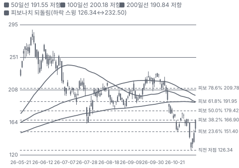

**주봉**

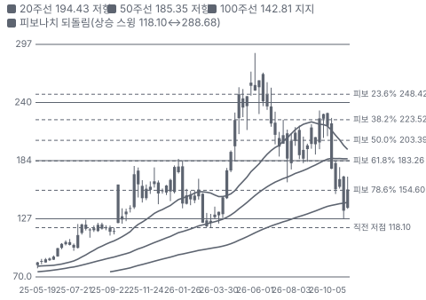

**월봉**

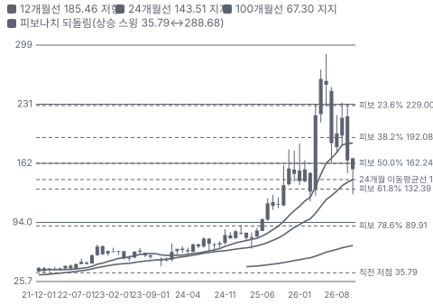

**분기 매출·EPS 실적과 컨센서스**

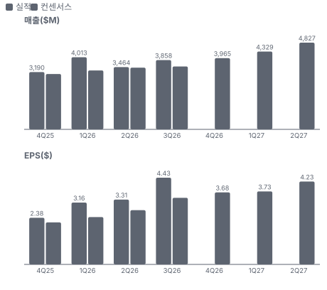

**4Q26 매출 — 지표 추세 vs 가이던스·컨센서스**

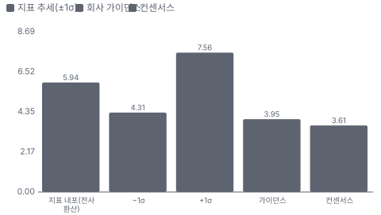

**최근 4개 분기 주가 변화 분석**

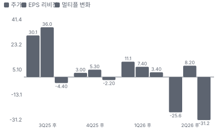

**EPS 리비전**

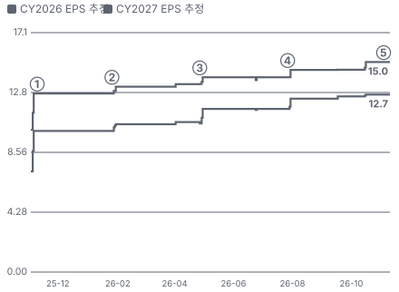

① 25-11-03 FY25 4Q 실적·ZT 인수 종결 직후 · EPS 리비전 +26%
② 26-01-26 1Q26 실적(ZT 첫 분기), 다음 날 −21.6% · EPS 리비전 +4%
③ 26-04-27 2Q26 실적·첫 연간 가이던스, +14.6% · EPS 리비전 +4%
④ 26-07-27 3Q26 실적·연간 상향, −17.5% · EPS 리비전 +4%
⑤ 26-11-09 4Q26 실적·FY27 가이던스 +27% · EPS 리비전 +0%

**밸류에이션 주가 시나리오**

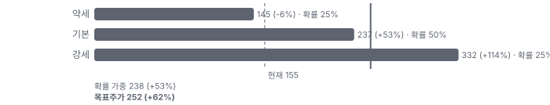

**주가별 업사이드**

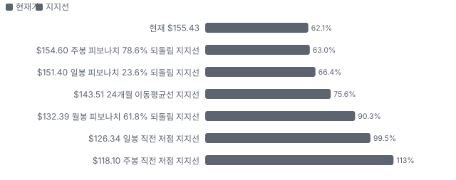

**제품·서비스 포트폴리오**

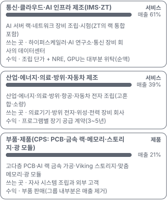

**고객 믹스(9M FY26, 매출 대비)**

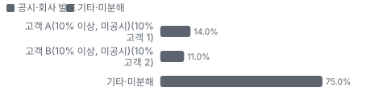

**공급 병목(10점, 낮을수록 병목)**

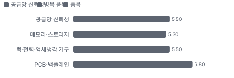

**CAPEX의 매출 대비 비중**

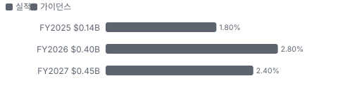

**어닝콜 변화별 주주가치 영향**

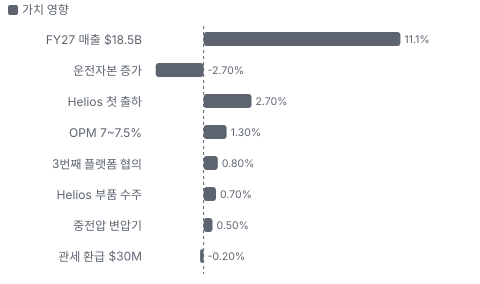

**멀티플 프리미엄(Fwd 1Y P/E, 최근 4개 분기말)**

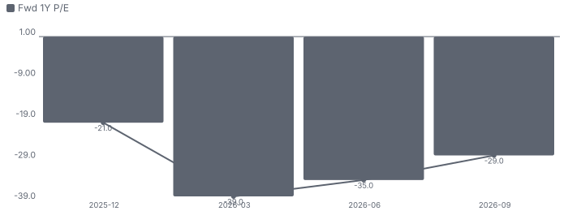

**합리적 멀티플**

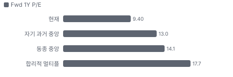

**수주·파이프라인 확실성 사다리**

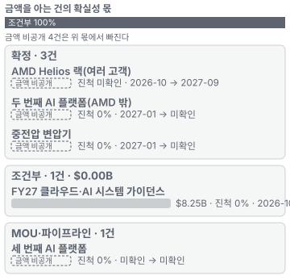

**매출 → 매출총이익 → 영업이익(매출 = 100, 최근 4분기)**

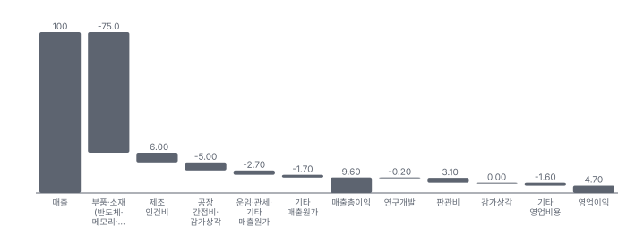

**1년 전 대비 마진 기여(비용 비중 변화의 반대)**

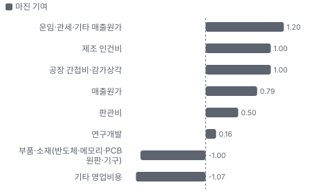

**분기 비용 비중 추이(매출 대비, 공시)**

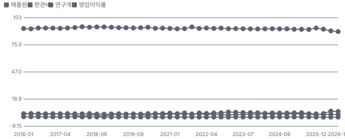

**비용 요인별 매출 대비 비중과 1년 변화**

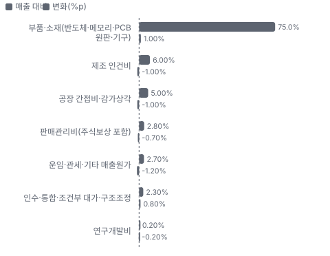

**BOM 항목 가격 +10% 시 OPM 변화**

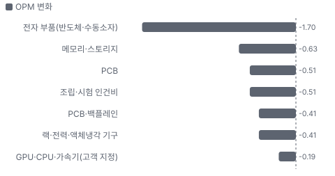

**통신·클라우드·AI 인프라 제조(IMS·ZT) BOM 원가 몫과 가격 +10% 시 OPM**

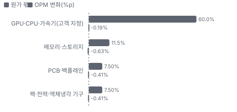

**산업·에너지·의료·방위·자동차 제조 BOM 원가 몫과 가격 +10% 시 OPM**

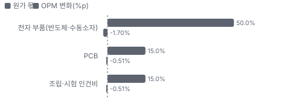

**생산시설별 면적(sq ft, 큰 순) — 생산능력 미공시라 면적을 대용으로**

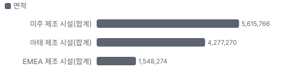

**ZT Systems 제조 사업(AMD로부터) 시너지 램프(종류별, 확률 가중)**

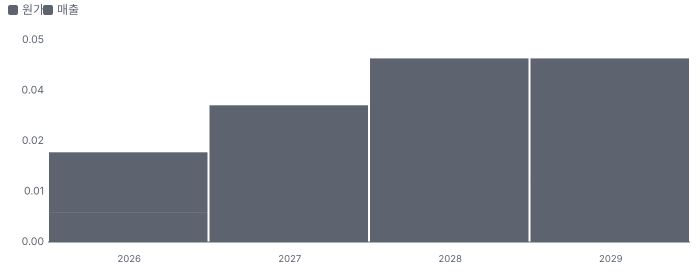

**시너지 가치 vs 웃돈**

**EPS 효과(인수 기업, 기존 대비)**

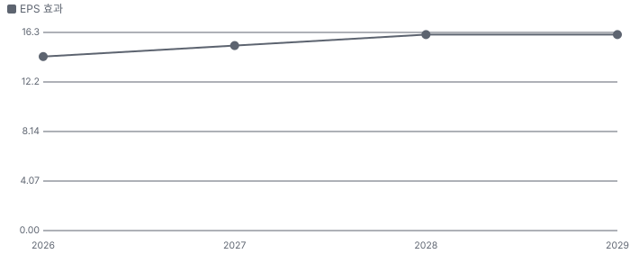

**매출·PPI·수출입 — 최근 16개 분기 같은 축(4Q22 = 100) + 다음 분기 추정**

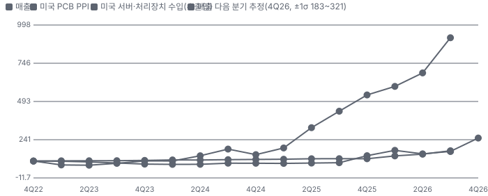

**매출과 미국 서버·처리장치 수입 증가율(전년 대비, 최근 16개 분기 + 다음 분기 추정)**

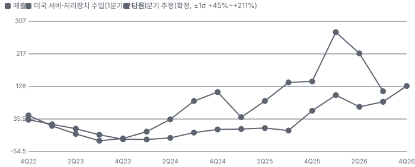

**10년 P·Q 사이클 — 추세(HP 필터) 대비 갭과 8분기 전망**

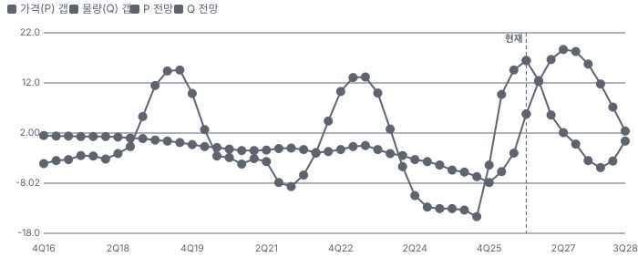

**매출 증가율의 가격·물량 분해와 8분기 전망(전년 대비)**

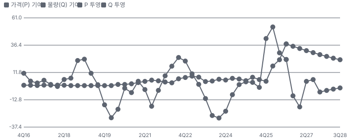

**분기별 매출 증가율 분해**

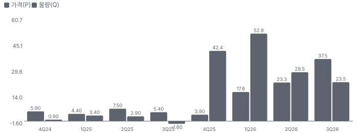

**목표주가 산정 — 기본과 강세 사이(강세 쪽 16%), 도달 확률 약 44%**

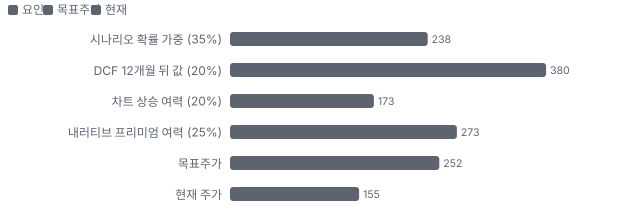

**PEG — 성장 대비 멀티플(낮을수록 성장 대비 쌈)**

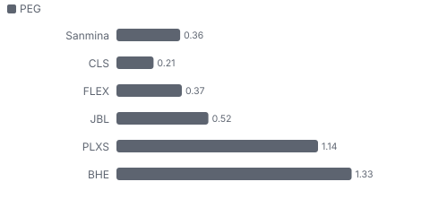

**일봉 지지·저항과 목표주가**

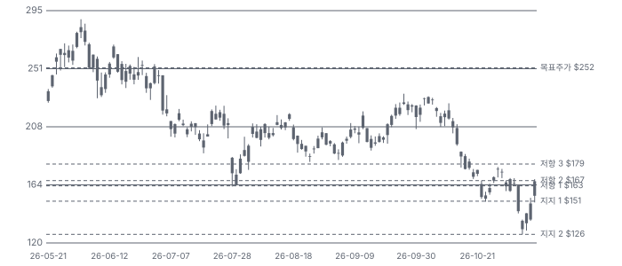

**커뮤니티 언급 수(최근 30일, 채널별)**

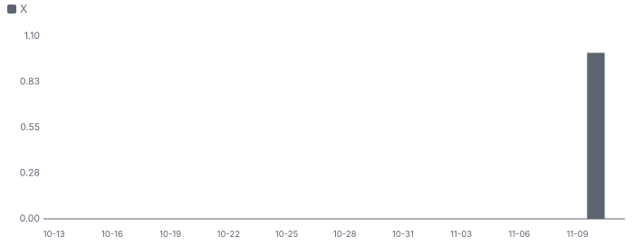

**일별 거래량 분해**

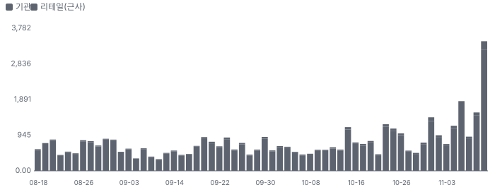

**기관 자금 흐름**

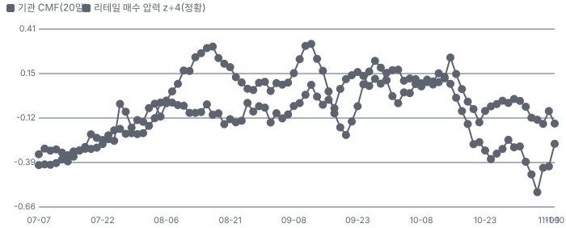

**몬테카를로**

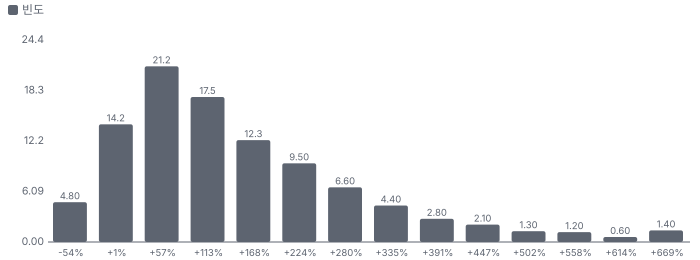

해석: 3,000번 중 2,709번(90%)에서 가치가 지금 주가 이상이었다. 가정을 흔들어도 지금 주가를 뒷받침하는 경우가 더 많다. 가운데 값은 2.15배이고, 열 번 중 여덟 번은 1.01~4.56배 사이에 든다.

## 내러티브

> **기업가치를 결정하는 이야기:** Sanmina는 남의 상표 제품을 대신 만드는 EMS 회사다. 통신 장비·서버·산업·의료·방위 회사의 보드와 시스템을 조립하고, PCB·금속 랙·메모리·광 모듈 같은 부품도 직접 만든다. 2025-10 AMD에서 ZT Systems 제조 사업을 \$1.67B(조건부 대가 공정가치 포함)에 사면서 AI 가속기 랙을 통째로 조립·시험하는 미국 내 캐파와 AMD의 'NPI(신제품 초기 생산) 제조 파트너' 지위를 얻었다. FY27에는 AMD Helios 랙이 하반기에 램프하고, AMD 밖 두 번째 플랫폼이 붙는다. 기존 EMS도 산업·에너지·방위 쪽에서 다시 자란다(4Q +19%). 가치는 두 숫자로 갈린다 — AI 시스템 매출 \$7.5~9.0B가 실제로 나오는가, 그리고 7%대 마진이 동종 수준(5%)으로 돌아가지 않는가

> **멀티플·EPS 프리미엄**
> **멀티플:** Fwd 1Y P/E 9.4배로 동종 5곳 중앙(14.1배)보다 33% 낮다. Fwd 2Y 7.5배·3Y 6.5배로 내려간다. 지난 3년 자기 범위는 9~22배이고 5월 고점은 22배였다 — 지금은 범위 하단이다
> **EPS:** FY27 EPS 컨센서스는 1년 전 \$11.46(2025-11)에서 실적 전 \$14.14(10/16)로 올랐고 가이던스 중간 \$16.50은 그 위다. 이익 추정은 1년 내내 올라왔는데 배수가 그보다 더 크게 줄었다

### 투자자들은 왜 열광했나

열광은 4~6월이었다 — 2Q 실적과 첫 연간 가이던스 다음 날 +14.6%, 6/3 종가 고점 \$282.72(장중 \$288.68)까지 갔다. 식은 이유는 두 번의 실적 반응이다 — 7/27 3Q 실적(연간 상향·두 번째 플랫폼)에도 다음 날 −17.5%였고, 10월 중순~11/5에 회사 공시 없이 −40%가 빠졌다(원인 미확인). 11/9 실적은 시간외 +20%였지만 11/10 종가는 +3.9%로 대부분 반납했다

### 무엇이 기업가치를 바꾸나

> **구조적 체질 변화**
> **변화:** 통신·산업 EMS에서 AI 랙 통합으로 — 클라우드·AI 인프라(통신망 포함) 매출이 1년 새 41% → 61%가 됐다
> **증거:** 4Q 콜 시장별 매출
> **반증:** FY27 클라우드·AI 시스템 매출이 \$7.5B 아래

> **고부가 믹스 확장**
> **변화:** 조정 영업이익률 FY25 5.7% → FY26 7.4%, 4Q 9.0%(관세 환급 0.75%p 포함). 수직 계열화(CPS(Sanmina의 부품·제품·서비스 사업부, PCB·금속 가공·메모리·스토리지·광 모듈) 부품)가 Helios에서 시작됐다
> **증거:** EX-99.1·4Q 콜
> **반증:** FY27 조정 영업이익률 7.0% 아래

> **기술 혁신**
> **변화:** 액체냉각 매니폴드·버스바·맞춤 광 모듈·AI 랙 금속 가공에 투자 — 랙 하나에 들어가는 부품을 더 많이 직접 만든다
> **증거:** 4Q 콜(CEO 우선순위)
> **반증:** 수직 계열화 수주가 FY27에 늘지 않는다

> **실행 속도**
> **변화:** 회사는 납기를 공시하지 않는다. 고객 확정 주문은 30~90일 앞까지(10-K)이고 재고 회전(선수금 차감)은 6.7회 → 5.2회로 느려졌다 — 재고가 머무는 기간이 54일 → 70일(추정, 365 ÷ 회전) **납품 리드타임 70일.** 피어 비교 미확인. 4Q FY25(재고 회전 6.7회) 54일보다 30% 길다.
> **증거:** 4Q 콜
> **반증:** 재고 회전이 4회 아래

> **M&A**
> **변화:** ZT Systems 인수(2025-10, \$1.67B) — 통합 1·2단계 완료, 3단계(성장)로. 인수 때 '3년 매출 2배' 목표를 2년 만에 넘었다
> **증거:** 10-Q Note 13·4Q 콜
> **반증:** 조건부 대가가 최대 \$450M까지 오르는데 AI 마진이 줄어든다(대가는 매출·총이익 조건)

> **정책·입법 연관성**
> **재정정책:** 해당 없음(Sanmina 매출에 직접 닿는 재정 지출을 확인하지 못했다). 방위·항공 매출은 국방 예산의 간접 노출 4Q 콜(미국 방위 성장) 반증: 국방 조달 삭감 의회 동의 2/10 — 하원 1/5(Sanmina 직접 관련 법안 미확인) · 상원 1/5(Sanmina 직접 관련 법안 미확인).
> **행정명령:** 관세 행정명령 — 원가 요인. 4Q에 옛 ZT 제품 관세 \$30M을 환급받았다. 멕시코 조립 비중이 커서 USMCA(미국·멕시코·캐나다 무역협정) 원산지 규칙이 중요하다 4Q 콜·10-Q(미주 매출 중 멕시코 40%) 반증: 멕시코산 서버·보드에 새 관세 의회 동의 2/10 — 하원 1/5(의회 절차 아님) · 상원 1/5(의회 절차 아님).
> **연관입법:** 해당 없음(CHIPS(미국 반도체 생산 보조금 법) 보조금 등 Sanmina 수령 계약 미확인) 10-K·10-Q 반증: 미국 내 서버 조립 우대 입법

> **CAPEX 낙수효과**
> **변화:** 하이퍼스케일러·AI 연구소·네오클라우드 AI 투자 → Helios 랙 주문. 금지표대로 고객 CAPEX를 Sanmina 매출로 바로 옮기지 않는다 — 확인된 것은 가이던스 \$7.5~9.0B와 첫 출하
> **증거:** EX-99.1·4Q 콜
> **반증:** AMD Helios 고객이 투자를 늦춘다

### 내러티브 근거

> '전통 EMS가 ZT 인수로 AI 랙 통합 회사가 된다'는 이야기. FY26 매출 +79%·EPS 2배, FY27 가이던스 +27%로 숫자는 나왔다. 그런데 주가는 6월 고점에서 −45%다 — 시장은 AI 매출이 AMD 한 플랫폼·하반기에 몰려 있다는 점과 현금 유출을 먼저 본다. 동종 대비 멀티플 차이 -33% 중 회사 고유 몫은 -47%다. 단계는 확산, 쏠림은 낮음이다.

> **ZT 인수 → AI 랙 통합** · 강화
> **논리:** AMD에서 ZT 제조 사업을 사서 AI 랙 통합 캐파와 AMD 파트너 지위를 얻었다
> **숫자:** FY26 클라우드·AI 시스템 \$5.3B → FY27 가이던스 \$7.5~9.0B
> **반증:** FY27 클라우드·AI 시스템이 \$7.5B 아래

> **플랫폼 분산(AMD 밖)** · 태동
> **논리:** 두 번째 플랫폼 수주·세 번째 협의 — 한 칩 회사 의존을 줄인다
> **숫자:** 두 번째 플랫폼 FY27 가이던스 포함, 세 번째는 밖
> **반증:** FY27 안에 세 번째 플랫폼 계약이 없다

> **핵심 EMS 회복** · 강화
> **논리:** 산업·에너지·의료·방위가 다시 자란다 — 4Q +19%
> **숫자:** 핵심 사업 4Q +42%, FY27 '두 자릿수 초반' 성장(회사)
> **반증:** 핵심 사업 FY27 성장 한 자릿수

> **자사주·재무 여력** · 유지
> **논리:** 순차입 0.33배·유동성 \$3.8B로 투자와 자사주를 함께 한다
> **숫자:** FY26 자사주 \$393M, 잔여 \$446M
> **반증:** 순차입 배수가 2배를 넘는다

> **반대 — AI 매출 하반기 몰림** · 확인
> **논리:** FY27 AI 매출 대부분이 하반기다. 고객 인수 일정·부품 부족이 밀리면 가이던스가 깎인다
> **숫자:** 1Q27 AI 시스템 \$1.3~1.5B = 연간 중간의 17%
> **반증:** 2Q27 AI 시스템 매출이 \$2B를 넘는다

> **반대 — 현금 유출·EMS 마진 회귀** · 확인
> **논리:** 운전자본이 늘어 FCF가 마이너스로 돌고, 7%대 마진은 NRE(고객이 따로 내는 일회성 개발·엔지니어링 비용)·관세 환급이 섞인 값이다
> **숫자:** FY27 FCF 추정 −\$200M, 동종 영업이익률 중앙 5.1%
> **반증:** FY27 상반기 영업현금흐름 흑자·조정 영업이익률 7% 유지

## 포트폴리오

| 제품·서비스 | 구분 | 무엇 | 쓰는 곳 | 돈 버는 방식 | Mix | Mix 변화(전 분기 대비) |
|---|---|---|---|---|---|---|
| 통신·클라우드·AI 인프라 제조(IMS(Sanmina의 통합 제조 솔루션 사업부, 보드 조립·시스템 조립·시험)·ZT) | 서비스 | AI 서버 랙·네트워크 장비 조립·시험(ZT의 랙 통합 포함) | 하이퍼스케일러·AI 연구소·통신 장비 회사의 데이터센터 | 조립 단가 + NRE, GPU는 대부분 위탁(순액) | 61% | -0.6%p |
| 산업·에너지·의료·방위·자동차 제조 | 서비스 | 산업·에너지·의료·방위·항공·자동차 전자 조립(고혼합·소량) | 의료기기·방위 전자·위성·전력 장비 회사 | 프로그램별 장기 공급 계약(3~5년) | 39% | +0.6%p |
| 부품·제품(CPS: PCB·금속 랙·메모리·스토리지·광 모듈) | 제품 | 고다층 PCB·AI 랙 금속 가공·Viking 스토리지·맞춤 메모리·광 모듈 | 자사 시스템 조립과 외부 고객 | 부품 판매(그룹 내부분은 매출 제거) | 21% | 미확인 |

**Mix 변화가 가장 큰 쪽은 산업·에너지·의료·방위·자동차 제조(+0.6%p, 전 분기 대비).** 계절성 판정: 분기 매출 계절 지수 기준 없음 → 직전 분기와 비교.

## 고객

> **9M FY26 최대 고객 고객 A(10% 이상, 미공시, 10% 고객 1) 14%, 상위 3곳 25%, 집중도 분산.** 공시·회사 발표로 확인한 몫은 매출의 25%이고, 나머지 고객 몫은 추정이거나 미분해다. 상위 10곳이 9개월 매출의 67%(전년 51%)이고 10% 넘는 고객이 2곳이다 — 이름 미공시. AI 시스템 고객은 하이퍼스케일러·프런티어 AI 연구소·OEM·네오클라우드로 미국 안팎에 퍼져 있다(CFO)

**고객별 매출 몫(9M FY26)**
| 고객 | 몫 | 변화 | 근거 |
|---|---|---|---|
| 고객 A(10% 이상, 미공시, 10% 고객 1) | 10~18% | +14%p | 공시 |
| 고객 B(10% 이상, 미공시, 10% 고객 2) | 10~12% | +1%p | 공시 |
| 그 밖의 상위 10곳(8곳 합계) | 미확인 | 미확인 | 추정 |
| AMD Helios 고객군(하이퍼스케일·AI 연구소·OEM) | 미확인 | 미확인 | 회사 발표 |
| 기타·미분해 | 75% | - | - |

> **고객 A(10% 이상, 미공시, 10% 고객 1)** · 공시
> **사는 것:** IMS 시스템 조립
> **추정 근거:** 9M 10% 넘는 고객 2곳 중 하나 — 3Q 단독 1곳. 몫 범위는 추정

> **고객 B(10% 이상, 미공시, 10% 고객 2)** · 공시
> **사는 것:** IMS 시스템 조립
> **추정 근거:** FY25 10.1% 고객과 같은 회사인지 미확인

> **그 밖의 상위 10곳(8곳 합계)** · 추정
> **사는 것:** 통신·클라우드·산업·의료
> **추정 근거:** 상위 10곳 67% − 10% 고객 2곳

> **AMD Helios 고객군(하이퍼스케일·AI 연구소·OEM)** · 회사 발표
> **사는 것:** Helios 랙 통합
> **추정 근거:** FY27 클라우드·AI 시스템 가이던스 \$7.5~9.0B의 대부분 — 고객별 몫 미공시

## 수주·파이프라인

> **2026-11-11 기준 5건.** 확정 \$0.00B. 서로 겹치는 항목은 합계에서 뺐다.

**실행 속도와 방해 요인**
| 항목 | 상태 | 실행 속도 | 방해 요인 |
|---|---|---|---|
| AMD Helios 랙(여러 고객) | 확정 | 미확인 | 고객 인수 일정 · 부품 부족 |
| 두 번째 AI 플랫폼(AMD 밖) | 확정 | 미확인 | 초기 단계 |
| 세 번째 AI 플랫폼 | 파이프라인 | 미확인 | 계약 전 |
| FY27 클라우드·AI 시스템 가이던스 | 조건부 | 지연(계획 8%, -8%p) | 하반기 몰림 |
| 중전압 변압기 | 확정 | 미확인 | 신사업 수율 |

## 마진 구조

> **GPM 11.3%, OPM 6.0%.** 4Q FY25 대비 GPM +2.2%p, OPM +2.2%p. 변동비는 매출의 85%이고, 매출이 10% 늘면 OPM은 +0.9%p 움직인다. EMS는 매출원가가 매출의 89%(4Q)다 — 대부분 고객이 지정한 부품(GPU·CPU·메모리·PCB)을 사서 붙이는 값이라 원가 전가가 된다. 이익을 가르는 것은 믹스(랙 통합·CPS 부품)와 공장 가동률이다. 원가 세부 구성은 공시되지 않아 아래 요인은 추정이다

> **매출 100 중 매출원가 90.4, 매출총이익 9.6(최근 4분기, 공시).** 매출원가 요인 중 부품·소재(반도체·메모리·PCB 원판·기구)이 매출의 75.0%로 가장 무겁고, 단가가 +10% 오르면 GPM이 -7.50%p 움직인다. 분기 회귀로 매출 1이 늘 때 매출원가는 0.89 늘고, 매출원가의 고정비 몫은 4%다.

**비용 요인 강도 — 비중·추세·충격(+10%)·탄력**
| 비용 | 구분 | 매출 대비 | 1년 변화 | 마진 기여 | 충격 시 마진 | 매출 탄력 | 고정비 몫 |
|---|---|---|---|---|---|---|---|
| 부품·소재(반도체·메모리·PCB 원판·기구) | 매출원가 요인 | 75.0% | +1.0%p | -1.0%p | -7.50%p | 미확인 | 0% |
| 제조 인건비 | 매출원가 요인 | 6.0% | -1.0%p | +1.0%p | -0.60%p | 미확인 | 40% |
| 공장 간접비·감가상각 | 매출원가 요인 | 5.0% | -1.0%p | +1.0%p | -0.50%p | 미확인 | 80% |
| 운임·관세·기타 매출원가 | 매출원가 요인 | 2.7% | -1.2%p | +1.2%p | -0.27%p | 미확인 | 20% |
| 매출원가 | 공시 항목 | 90.4% | -0.8%p | +0.8%p | -9.04%p | 0.89 | 4% |
| 판관비 | 공시 항목 | 3.1% | -0.5%p | +0.5%p | 미확인 | 0.02 | 28% |
| 기타 영업비용 | 공시 항목 | 1.6% | +1.1%p | -1.1%p | 미확인 | 0.03 | -100% |
| 연구개발 | 공시 항목 | 0.2% | -0.2%p | +0.2%p | 미확인 | 0.00 | 89% |
| 감가상각 | 공시 항목 | 0.0% | 미확인 | 미확인 | 미확인 | 미확인 | 미확인 |

매출 탄력 = 분기 비용을 매출에 회귀한 기울기(매출 1당 변동비), 고정비 몫 = 절편 ÷ 평균 비용. 표본이 8분기 미만이면 미확인. 매출원가 요인 비중은 margin 재료의 추정이 섞여 있고, 공시 매출원가와의 차이는 '기타 매출원가'로 둔다.

**GPM에서 OPM까지(GAAP)**
| 기간 | GPM | 연구개발 | 판관비 | 기타 | OPM |
|---|---|---|---|---|---|
| 4Q FY25 | 9.1% | 0.4% | 3.5% | 1.5% | 3.7% |
| 4Q FY26 | 11.3% | 0.2% | 2.8% | 2.3% | 6.0% |

**GPM·OPM 최근 4개 분기**
| 분기 | GPM | OPM |
|---|---|---|
| 2025-12 | 7.6% | 2.3% |
| 2026-03 | 8.8% | 3.9% |
| 2026-06 | 10.5% | 6.4% |
| 2026-10 | 11.3% | 6.0% |

**마진을 결정하는 비용 요인 — 비용 +10% 시 OPM**
| 비용 | 매출 대비 | 변화 | 고정비 | OPM |
|---|---|---|---|---|
| 부품·소재(반도체·메모리·PCB 원판·기구) | 75.0% | +1.0%p | 0% | -7.50%p |
| 제조 인건비 | 6.0% | -1.0%p | 40% | -0.60%p |
| 공장 간접비·감가상각 | 5.0% | -1.0%p | 80% | -0.50%p |
| 판매관리비(주식보상 포함) | 2.8% | -0.7%p | 80% | -0.28%p |
| 운임·관세·기타 매출원가 | 2.7% | -1.2%p | 20% | -0.27%p |
| 인수·통합·조건부 대가·구조조정 | 2.3% | +0.8%p | 0% | -0.23%p |
| 연구개발비 | 0.2% | -0.2%p | 90% | -0.02%p |

**비용을 움직이는 요인**
| 비용 | 요인 |
|---|---|
| 부품·소재(반도체·메모리·PCB 원판·기구, 매출원가) | 고객 지정 부품 구매가(대부분 원가 전가) · 근거 추정 |
| 제조 인건비(매출원가) | 멕시코·미국·아시아 공장 인력(약 39,000명, FY25) · 근거 추정 |
| 공장 간접비·감가상각(매출원가) | 감가상각 FY26 \$181M·FY27 약 \$200M, 전력·시험 셀 · 근거 추정 |
| 판매관리비(주식보상 포함, 판관비) | 본사·영업·주식보상 \$20M(4Q) · 근거 공시 |
| 운임·관세·기타 매출원가(매출원가) | 관세(4Q 환급 \$30M) · 근거 추정 |
| 인수·통합·조건부 대가·구조조정(기타) | 조건부 대가 평가 \$78M(4Q) · 근거 공시 |
| 연구개발비(판관비) | 자체 설계(Viking·광 모듈) · 근거 공시 |

**통신·클라우드·AI 인프라 제조(IMS·ZT) BOM — 매출의 61%, GPM 11%(IMS 4Q 조정 총이익률 대용(시장별 미공시)), 항목 가격 +10% 시**
| 항목 | 원가 몫 | 전가 | 제품 GPM | OPM |
|---|---|---|---|---|
| GPU·CPU·가속기(고객 지정) | 50~70% | 100% | -0.6%p | -0.19%p |
| 메모리·스토리지 | 8~15% | 미확인 | -1.0%p | -0.63%p |
| PCB·백플레인 | 5~10% | 미확인 | -0.7%p | -0.41%p |
| 랙·전력·액체냉각 기구 | 5~10% | 미확인 | -0.7%p | -0.41%p |
| 미분해 | 14% | - | - | - |

**산업·에너지·의료·방위·자동차 제조 BOM — 매출의 39%, GPM 12%(CPS·IMS 혼합 대용(추정)), 항목 가격 +10% 시**
| 항목 | 원가 몫 | 전가 | 제품 GPM | OPM |
|---|---|---|---|---|
| 전자 부품(반도체·수동소자) | 40~60% | 미확인 | -4.4%p | -1.70%p |
| PCB | 10~20% | 미확인 | -1.3%p | -0.51%p |
| 조립·시험 인건비 | 10~20% | 미확인 | -1.3%p | -0.51%p |
| 미분해 | 20% | - | - | - |

전자 부품(반도체·수동소자) 가격이 +10% 오르면 영업이익은 -28.5% 움직인다. 판매가 전가를 모르는 항목은 전가 0%로 계산했다.

**BOM 항목 가격을 움직이는 것**
| 항목 | 요인 |
|---|---|
| GPU·CPU·가속기(고객 지정) | 랙 시스템 원가의 대부분 — Helios는 고객 위탁(순액) 회계 가정(CFO)이라 가격이 그대로 넘어간다 · 근거 추정 |
| 메모리·스토리지 | 서버 보드 메모리 · 근거 추정 |
| PCB·백플레인 | CPS 자체 생산 일부 · 근거 추정 |
| 랙·전력·액체냉각 기구 | 금속 랙·매니폴드·버스바 — 수직 계열화 대상 · 근거 추정 |
| 전자 부품(반도체·수동소자) | 산업·의료 보드 원가 중심 · 근거 추정 |
| PCB | 방위·항공 고다층 PCB 자체 생산 · 근거 추정 |
| 조립·시험 인건비 | 고혼합·소량 생산 · 근거 추정 |

**BOM 투입 물가 — PPI 전년비, 2026-11-11 수집**
| 항목 | 미국 | 일본 | 한국 | 대만 |
|---|---|---|---|---|
| 전자 부품(반도체·수동소자) | -2.2% | +3.9% | +134.0%* | +22.9%* |
| 메모리·스토리지 | -2.2%* | +3.9%* | +134.0% | +22.9%* |
| PCB | +45.8% | +11.3% | +4.5% | +12.1% |
| 랙·전력·액체냉각 기구 | +3.0% | 미확인 | 미확인 | +57.2%* |

별표는 품목보다 넓은 업종 지수다. 지난 1년 투입 물가를 판매가 전가 뒤 원가에 그대로 넣으면 OPM은 -10.36%p 움직인다(매출원가의 78% 기준).

## 공급망 병목

> **공급망 신뢰성 5.5/10, 병목 주의.** 가장 약한 고리는 메모리·스토리지 5.3점이고, 품목 평균은 5.8점이다. 근거가 부족한 1건(GPU·CPU·가속기(고객 지정))은 점수에서 뺐다. 병목은 고객 지정 반도체(GPU·CPU·메모리)다 — CEO는 '지금 부족이 있다'고 밝혔고 FY27 가이던스 범위가 넓은 이유로 공급망을 들었다. GPU는 대부분 고객이 위탁으로 넘겨 Sanmina가 직접 사지 않는다

**병목과 마진 — 품목 가격 +10% 시 OPM**
| 품목 | 점수 | 판정 | 구분 | OPM |
|---|---|---|---|---|
| 메모리·스토리지(필수) | 5.3 | 병목 주의 | 핵심 통제 품목 | -0.63%p |
| 랙·전력·액체냉각 기구 | 5.5 | 병목 주의 | 출하 차질 위험 | -0.41%p |
| PCB·백플레인 | 6.8 | 관리 가능 | 일반 | -0.41%p |

> **메모리·스토리지** · 5.3/10
> **왜:** 회사는 확정 주문에만 산다 — 가격은 대부분 전가(추정)
> **병목 요인:** 인증 공급사 3곳 · 캐파 부족 · 리드타임 미확인 · 재인증 미확인 · 1위 점유율 40% · 한국(추정) 집중 60% · 물량 확보 미확인
> **풀리는 조건:** 미확인

> **랙·전력·액체냉각 기구** · 5.5/10
> **왜:** 수직 계열화 대상
> **병목 요인:** 인증 공급사 2곳 · 캐파 빠듯 · 리드타임 미확인 · 재인증 미확인 · 1위 점유율 미확인 · 미국·멕시코(추정) 집중 60% · 물량 확보 내재화
> **풀리는 조건:** 증설 중

> **PCB·백플레인** · 6.8/10
> **왜:** 일부 자체 생산
> **병목 요인:** 인증 공급사 3곳 · 캐파 빠듯 · 리드타임 미확인 · 재인증 미확인 · 1위 점유율 미확인 · 미국·중국(추정) 집중 50% · 물량 확보 내재화
> **풀리는 조건:** 증설 중(가동 미확인)

**공급사**
| 품목 | 공급사 | 몫 | 근거 |
|---|---|---|---|
| GPU·CPU·가속기(고객 지정) | AMD(Helios GPU·CPU(위탁 공급)) | 미확인 | 회사 발표 |
| 메모리·스토리지 | 메모리 3사(이름 미공시, DRAM·NAND) | 미확인 | 추정 |
| PCB·백플레인 | Sanmina CPS 자체 PCB 공장(고다층 PCB) | 미확인 | 공시 |
| 랙·전력·액체냉각 기구 | Sanmina 금속 가공(자체, AI 랙·매니폴드·버스바) | 미확인 | 회사 발표 |

**무역 통계로 본 공급 지역**
| 품목 | EU 수입처 | 일본 수입처 | EU 1위 전년비 |
|---|---|---|---|
| GPU·CPU·가속기(고객 지정) | TW(대만) 32% · MY(말레이시아) 19% · CN(중국) 15% | 台湾 60% · 中華人民共和国 8% | +136.5% |
| 메모리·스토리지 | TW 45% · KR(한국) 21% · CN 16% | 台湾 52% · 大韓民国 28% | +365.5% |
| PCB·백플레인 | CN 85% · TW 4% · KR 4% | 中華人民共和国 62% · 台湾 11% | +25.2% |
| 랙·전력·액체냉각 기구 | US 50% · TW 30% · CN 14% | アメリカ合衆国 30% · 台湾 18% | +106.2% |

## 생산능력

> **현재 명목 캐파 미확인, 가동률 미확인.** 착공 이상 증설은 0 sq ft(제조 면적), 발표까지 합치면 0 sq ft(제조 면적)이다. FY2026 CAPEX는 \$0.40B로 매출의 2.8%다. 제조 면적 약 1,144만 sq ft(FY25 10-K, 인수 전) — 자가 약 900만·임차 약 200만. ZT 인수로 미국 AI 랙 공장이 더해졌다(면적 미공시). 회사는 명목 캐파·가동률을 공시하지 않는다

**생산시설 3곳**(실제 시설 수 미공시 — 3은 10-K가 묶어 적은 지역 합계 단위의 수다(시설 수가 아니다). FY25 10-K Item 2는 시설을 이름 없이 지역별 면적으로만 적는다 — 미주 5,615,766·아태 4,277,270·EMEA(유럽·중동·아프리카 지역) 1,548,274 sq ft(합계 11,441,310). 시설 수·이름 미공시), 소유·임차 3곳. 시설별 생산능력은 공개되지 않았다 — 회사 전체 캐파만 위에 적었다.

**생산시설 3곳 — 명칭·위치·생산능력**
| 시설 | 위치 | 용도 | 생산능력 | 소유·상태 |
|---|---|---|---|---|
| 미주 제조 시설(합계) | 미국·멕시코 등 | 보드·시스템 조립·AI 랙(ZT 포함은 인수 뒤) | 미확인 — 시설별 캐파 미공시 · 면적 5,615,766 sq ft | 소유·임차 · 가동 |
| 아태 제조 시설(합계) | 중국·인도·말레이시아·태국 등(10-K 위험 요인 국가) | 부품·조립 | 미확인 — 시설별 캐파 미공시 · 면적 4,277,270 sq ft | 소유·임차 · 가동 |
| EMEA 제조 시설(합계) | 유럽·이스라엘 등 | 산업·방위 | 미확인 — 시설별 캐파 미공시 · 면적 1,548,274 sq ft | 소유·임차 · 가동 |

**생산능력 확충 계획**
| 계획 | 단계 | 증설 | 가동 시점 | CAPEX |
|---|---|---|---|---|
| AI 랙 금속 가공·고기술 PCB 증설 | 발표 | 미확인 | 미확인 | 미확인 |
| 중전압 변압기 공장(12톤 이상) | 장비 반입 | 미확인 | 2027-01 | 미확인 |

남은 계획의 CAPEX 합계는 \$0.00B(금액 미확인 2건 제외)다. 합계는 FY2027 매출의 0%다.

**증설 방해 요인**
| 계획 | 방해 요인 |
|---|---|
| AI 랙 금속 가공·고기술 PCB 증설 | 고객 램프 시점 |
| 중전압 변압기 공장(12톤 이상) | 생산 수율·인증 |

**CAPEX와 매출 대비**
| 기간 | CAPEX | 매출 | 매출 대비 | 구분 |
|---|---|---|---|---|
| FY2025 | \$0.14B | \$8.13B | 1.8% | 실적 |
| FY2026 | \$0.40B | \$14.53B | 2.8% | 실적 |
| FY2027 | \$0.45B | \$18.50B | 2.4% | 가이던스 |

## M&A 시너지

> **ZT Systems 제조 사업(AMD로부터) 인수(2025-10-27, \$1.67B): 시너지가 다 나면 연 \$0.04B(확률 가중 이익 기여), 인수 배수 EV/EBITDA 4.8배 → 시너지 반영 4.3배.** 세후 시너지 가치는 통합 비용을 빼고 \$0.26B. EPS 효과는 2026년 +14.3%에서 2029년 +16.1%.

**ZT Systems 제조 사업(AMD로부터) 시너지가 생기는 길**
| 종류 | 시너지 | 연 규모 | 완성 | 확률 | 어떻게 생기나 | 근거 |
|---|---|---|---|---|---|---|
| 원가 | 수직 계열화(랙·PCB·냉각 부품 자체 공급) | \$0.03B | 2028 | 50% | 외부 구매하던 랙 부품을 CPS가 만들어 그룹 안에서 이익을 남긴다(매출은 제거) — 규모 미공시, 추정 | 4Q FY26 어닝콜(2026-11-09) — 규모는 추정 |
| 매출 | AMD 밖 AI 플랫폼·기존 네트워크 고객 교차 판매 | \$1.00B(이익률 7%) | 2028 | 40% | ZT 랙 통합 캐파로 두 번째·세 번째 플랫폼과 네트워크 고객의 시스템 통합을 받는다 — 규모 미공시, 추정 | 4Q FY26 어닝콜(2026-11-09) — 규모는 추정 |

시너지 가치 = 세후 이익 기여 5년 + 말기 가치(할인율 9%, 성장 0) − 통합 비용. 매출 시너지는 그 매출의 이익률만 반영하고, 모든 시너지에 실현 확률을 곱했다.

## 해자

> 해자는 '좁음~보통'이다. EMS는 가격 경쟁이 세고 고객이 공급사를 나눈다. Sanmina의 차별점은 ① AMD와 묶인 미국 내 AI 랙 통합 캐파(ZT) ② PCB·금속 랙·메모리·광 모듈까지 직접 만드는 수직 계열화 ③ 방위·의료 인증 공장이다

> **AMD 전략 파트너(미국 NPI 제조)** · 보통
> **해자:** AMD가 ZT 제조 사업을 넘기며 Sanmina를 미국 내 NPI 제조 파트너로 정했다 — Helios 고객이 처음부터 Sanmina 라인에서 검증한다
> **근거:** 10-Q Note 13·4Q 콜(운영 모델 확정)
> **숫자:** FY26 클라우드·AI 시스템 매출 \$5.3B, FY27 가이던스 \$7.5~9.0B
> **깨지는 조건:** Helios 대형 고객이 다른 ODM(Celestica·Foxconn 등)으로 옮긴다

> **수직 계열화(PCB·금속 랙·액체냉각 부품·메모리)** · 보통
> **해자:** 랙 시스템 안에 들어가는 부품을 자체 CPS 사업부에서 만들어 이익을 더 남긴다 — Helios에서도 초기 수주
> **근거:** 4Q 콜(CPS 매출 \$822M, +83%)
> **숫자:** CPS 4Q 매출 +83%, 조정 총이익률 12.0%(IMS 11.2%)
> **깨지는 조건:** CPS 총이익률이 IMS 아래로 내려간다(4Q −2.5%p)

> **인증 공장·고난도 생산(방위·의료·위성)** · 보통
> **해자:** 방위·의료는 인증·규제 이력이 진입 장벽 — 고객이 쉽게 바꾸지 못한다
> **근거:** 10-K 인증 절·4Q 콜(위성 고객 확대)
> **숫자:** 산업·에너지·의료·방위·자동차 4Q 매출 \$1.49B(+19%)
> **깨지는 조건:** 산업·의료 매출이 FY27에 다시 역성장

> **규모·운전자본 관리** · 약함
> **해자:** 고객 선수금(\$1.54B)과 확정 주문에만 재고를 쌓아 재고 위험을 줄인다 — 다만 이는 업계 공통 관행이다
> **근거:** 4Q 콜·10-K
> **숫자:** 재고 회전(선수금 차감) 5.2회, 전년 6.7회
> **깨지는 조건:** 재고 회전이 4회 아래로 떨어진다

## 경영진·네트워크

> Jure Sola가 1980년 공동 창업 뒤 회장·CEO다(2017년 복귀). ZT 인수를 이끈 CFO Jon Faust가 자본 배분을 맡는다. 정계 연결은 공개 기록에서 확인하지 못했다

> **Jure Sola** · 회장·CEO · 1980(공동 창업)
> **프로필:** 창업 뒤 SCI 합병·구조조정을 거쳐 2017년 CEO로 복귀. ZT 인수로 매출 2배 계획을 세웠다
> **비즈니스:** 전사
> **정계:** 미확인
> **동문:** 미확인
> **사모임:** 미확인

> **Jon Faust** · EVP·CFO · 미확인
> **프로필:** ZT 3단계 계획·대출 재조정·자본 배분 우선순위(성장 투자 → 인수 → 투자 등급 → 자사주)를 밝혔다
> **비즈니스:** 재무·자본 배분
> **정계:** 미확인
> **동문:** 미확인
> **사모임:** 미확인

> **Shanker Trivedi** · 이사(2026-09 선임) · 2026-09
> **프로필:** 이사 선임 8-K(2026-09-15)
> **비즈니스:** 이사회
> **정계:** 미확인
> **동문:** 미확인
> **사모임:** 미확인

**네트워크 정량화**
| 연결 | 강도 | 닿는 매출 | 가중 노출 | 매출 대비 | 근거 |
|---|---|---|---|---|---|
| 비즈니스: AMD — ZT 매도인이자 전략 파트너(조건부 대가 최대 \$450M, 매도인 보유 1,151,052주는 1/3씩 1·2·3년 보호예수) | 4/5 | 미확인 | 미확인 | 미확인 | 클라우드·AI 시스템 FY26 \$5.3B 중 AMD 플랫폼 몫 미공시 10-Q Note 13 |
| 정계: 공개 기록에서 확인한 정계 연결 없음(하원 로비 집계 대상 밖) | 0/5 | 미확인 | 미확인 | 미확인 | 집계 범위 밖 미확인 |

가중 노출은 연결이 닿는 매출의 크기다. 연결이 그 매출을 만들었다는 뜻이 아니며, 인과는 공개 자료로 입증하지 못한다.

## 약세 논리 및 셀온 조건

| 약세 논리 | 근거 | 반박 | 가를 자료 · 공개 시점 |
|---|---|---|---|
| AI 매출이 하반기에 몰려 가이던스가 깎인다 | 1Q27 클라우드·AI 시스템 \$1.3~1.5B = 연간 중간 \$8.25B의 17%. CEO는 공급 부족을 범위가 넓은 이유로 들었다 | Helios 소량 출하가 이미 시작됐고 여러 고객의 운영 모델이 확정됐다. 두 번째 플랫폼도 가이던스에 들어 있다 | 1Q27 클라우드·AI 시스템 매출 — 2027-01 말(1Q 실적) |
| 7%대 마진은 일회성이 섞인 값이다 | 4Q 관세 환급 \$30M(약 0.75%p), Helios NRE 이익이 예상보다 컸다(CFO). 동종 5곳 최근 4분기 영업이익률 중앙 5.1% | 관세 환급을 빼도 4Q는 8.25%다. FY27 가이던스 7.0~7.5%는 FY26 7.4%와 같은 수준이다 | 1Q27 조정 영업이익률(가이던스 7.0~7.5%) — 2027-01 말 |
| 현금이 빠져나간다 | FY27 FCF 추정 −\$200M, 재고 \$3.6B(1년 +82%), 조건부 대가 공정가치 \$261M | 순차입 배수 0.33배·유동성 \$3.83B, 고객 선수금 \$1.54B. 회사는 확정 주문에만 재고를 산다 | 1Q27 영업현금흐름·재고 회전 — 2027-01 말 10-Q |
| AI 매출이 AMD 한 플랫폼에 묶였다 | FY26 클라우드·AI 시스템 \$5.3B 중 ZT \$4.9B — 대부분 AMD 플랫폼 | 두 번째 플랫폼(AMD 밖) 수주, 세 번째 협의. 고객은 하이퍼스케일·AI 연구소·OEM·네오클라우드로 분산(CFO) | 세 번째 플랫폼 계약 공시 — FY27 중(시점 미정) |
| 고객 집중 | 상위 10곳 매출 67%(9M), 10% 넘는 고객 2곳(이름 미공시) | 3~5년 공급 계약이 보통이다(10-K) — 다만 최소 구매 의무는 없다 | FY26 10-K 10% 고객 비중 — 2026-11 중순(예상) |
| 배수 할인은 구조적이다 | EMS는 자기 지난 3년 Fwd P/E 9~22배, 동종도 경쟁이 세다 | 지금 9.4배는 자기 범위 하단이다 — 이익 추정은 1년 내내 올랐다 | 실적 뒤 컨센서스 상향 폭 — 2026-11 말 |

**정책·거시.** 중간선거 영향은 0으로 나왔다 — 업종 분류가 표에 없어 노출을 관세 0.4·방위 0.1로 datapack에 적었다. 멕시코 조립 비중(3Q 미주 매출의 40%)이 커서 USMCA·관세 정책이 원가 요인이다. 정책 0단계(선거 결과) 가설이다. **추가 원천(11/11).** 노션 자료실·게시글에 Sanmina 자료는 없었다. 커뮤니티 대화는 7일 Weak(50)로 조용하다. 실적 뒤 JPMorgan이 중립을 유지하며 목표가를 \$270에서 \$230으로 내렸다. **데이터 한계.** FY26 10-K 제출 전이라 10% 고객 비중·시설 목록·구매 약정은 FY25 10-K·3Q 10-Q 값이다. 회사는 수주잔고와 시설별 캐파를 공시하지 않는다. 10월 중순~11/5 하락(−40%)은 회사 공시가 없어 원인 미확인이다.

> **셀온 조건**
> **조건 1:** 1Q27 클라우드·AI 시스템 매출이 가이던스 하단 \$1.3B 아래
> **조건 2:** FY27 매출 가이던스를 \$17.5B 아래로 낮추거나 클라우드·AI 시스템 범위를 \$7.5B 밑으로 내린다
> **조건 3:** 조정 영업이익률이 2분기 연속 7.0% 아래
> **조건 4:** 순차입 배수가 회사 목표 상단 2.0배를 넘는다
> **조건 5:** Helios 대형 고객이 다른 ODM으로 옮긴다는 공시·발표

## 어닝콜 변화

**직전 콜 대비 새로 나오거나 바뀐 내용 → 가치 영향**
| 항목 | 내용 | 직전 콜 | 최신 콜 | 모델 동인 이동 | 확신도 | 가치 영향 |
|---|---|---|---|---|---|---|
| 신규 | FY27 가이던스 | 컨센서스 \$16.79B(10/16), 회사는 '3년 안 \$16B' 목표를 2년으로 당겼었다 | FY27 가이던스 \$17.5~19.5B(중간 +27%) | 1년차 성장률 +8.0% | 0.8 | +11.1% |
| 업데이트 | 이익률 | 인수 발표 때 결합 사업 6~7% 기대(2025-05) | FY27 조정 영업이익률 7.0~7.5%, FY26 실적 7.4% | 목표 이익률 +0.40% | 0.8 | +1.3% |
| 신규 | Helios 출하 | 3Q: 고객 검증·사전 생산 진행 | 소량 출하 시작, 여러 고객 운영 모델 확정 | 1년차 성장률 +2.0% | 1.0 | +2.7% |
| 업데이트 | AI 플랫폼 | 3Q: AMD 밖 두 번째 플랫폼 수주(가이던스 포함) | 세 번째 플랫폼 협의 시작 — 가이던스 밖 | 장기 성장 수렴값 +0.50% | 0.3 | +0.8% |
| 신규 | 수직 계열화 | Helios에서는 수직 계열화를 기대하지 않았다 | 랙·부품 등 초기 프로그램 수주 — 매출은 제거되고 이익에만 보탠다 | 목표 이익률 +0.20% | 0.5 | +0.7% |
| 부정 | 운전자본·FCF | FY26 영업현금흐름 \$944M·FCF \$541M | FY27 운전자본 증가로 순차입 배수가 0.33배 → 1~2배 목표 범위로 오른다 | 매출÷투하자본 -30.0% | 0.8 | -2.7% |
| 부정 | 일회성 이익 | 가이던스에 없음 | 4Q 관세 환급 \$30M(OPM +0.75%p, EPS +\$0.42) — 반복하지 않는다 | 출발 이익률 -0.20% | 1.0 | -0.2% |
| 신규 | 전력 기기 | 언급 없음 | 12톤 이상 변압기 2027-01 생산, 2027 중반부터 이익 기대 | 장기 성장 수렴값 +0.30% | 0.5 | +0.5% |
| **합계** | 단독 합 |  |  | 동시 적용 +14.9% |  | **+14.1%** |

**사건별 EPS 리비전**
| # | 날짜 | 구분 | 사건 | CY2026 EPS 전→후 | CY2027 EPS 전→후 | 리비전 | 주가 반응 |
|---|---|---|---|---|---|---|---|
| ① | 25-11-03 | 실적 | FY25 4Q 실적·ZT 인수 종결 직후 | \$7.20 → \$10.09 | \$10.17 → \$12.77 | +25.6% | +16.6% |
| ② | 26-01-26 | 실적 | 1Q26 실적(ZT 첫 분기), 다음 날 −21.6% | \$10.09 → \$10.57 | \$12.77 → \$13.26 | +3.9% | -21.6% |
| ③ | 26-04-27 | 실적 | 2Q26 실적·첫 연간 가이던스, +14.6% | \$10.73 → \$11.67 | \$13.44 → \$13.93 | +3.7% | +14.6% |
| ④ | 26-07-27 | 실적 | 3Q26 실적·연간 상향, −17.5% | \$11.67 → \$12.40 | \$13.93 → \$14.46 | +3.8% | -17.5% |
| ⑤ | 26-11-09 | 실적 | 4Q26 실적·FY27 가이던스 +27% | \$12.69 → \$12.69 | \$15.02 → \$15.02 | +0.0% | +3.9% |

**해석:** 4개 구간 누적 주가 +11% = EPS 리비전 +67% × 멀티플 -34%. 더 크게 움직인 쪽은 **EPS 리비전**이다.

## 거시 지표 싱크로율

> **미국 서버·처리장치 수입과 통신·클라우드·AI 인프라 제조(IMS·ZT) 싱크로율 87%(1분기 = 약 3개월 선행, 전년 대비, 표본 13개·t 5.8·유의·신뢰 보통).** 이 지표가 내포하는 4Q26 통신·클라우드·AI 인프라 제조(IMS·ZT)은 4.47B(±1σ 2.85B~6.10B, 확정)다. 표본 밖 검증(최근 6개 분기)에서 지표 모델 오차는 66.5%p, 기준선(직전 증가율 지속)은 64.5%p다 — **지표가 기준선을 이기지 못해(예측력 없음) 추정은 대부분 기준선이다(지표 가중 51%).** 기준선은 인수·환율 효과의 소멸을 모르므로 회사 가이던스와 차이가 크면 가이던스 쪽 설명을 먼저 본다. 세그먼트 추정에 나머지 사업(직전 증가율 지속)을 더한 전사 매출은 5.94B(4.31B~7.56B)다. 가이던스는 이보다 -33.5%(범위 아래), 컨센서스는 -39.2%(범위 아래)다. 매출은 AI 서버·통신 장비 거래를, 원가는 반도체·PCB 가격을 따른다 — 미국 서버(HS(국제 통일 상품 분류 코드) 8471.50) 수입과 미국 PCB PPI(생산자물가지수)

**지표별 싱크로율(상관계수 × 100) — 위 두 줄이 제품 연관성 × 싱크로율로 고른 PPI·수출입 세부 지표**
| 지표 | 비교 대상 | 증가율 기준 | 지표 선행 | 매출(t값) | 영업이익 | 방향 일치 | 표본·신뢰 | 표본 밖 오차(지표/기준선) | 4Q26 추정 매출 |
|---|---|---|---|---|---|---|---|---|---|
| 미국 PCB PPI | 산업·에너지·의료·방위·자동차 제조 | 전년 대비 | 1분기(3개월) | 77%(t 3.9) | 18%(0분기) | 46% | 13·보통 | 6.6/6.1%p ✘ | +26.1% → 1.55B(확정) |
| 미국 서버·처리장치 수입 | 통신·클라우드·AI 인프라 제조(IMS·ZT) | 전년 대비 | 1분기(3개월) | 87%(t 5.8) | 44%(4분기) | 85% | 13·보통 | 66.5/64.5%p ✘ | +127.7% → 4.47B(확정) |

**지표 후보 26개 — 연관성(제품 품목 일치 × 대용 감점 × 매출 비중) × 싱크로율로 고른다. 후보가 많을수록 최대 상관은 우연히 부풀 수 있다**
| 후보 | 종류 | 연관성 | 매출 분기 일치 | 싱크로율(선행) | 점수 | 출처 |
|---|---|---|---|---|---|---|
| 미국 서버·처리장치 수입 ✔ | 수출입 | 1.00 | 100% | 87%(1분기) | 0.87 | 모델 지정 |
| 미국 PCB PPI ✔ | PPI | 1.00 | 100% | 77%(1분기) | 0.77 | 모델 지정 |
| EU(유럽연합) 서버·컴퓨터 수입(HS 847150) | 수출입 | 0.61 | 94% | 86%(1분기) | 0.53 | 자동 |
| 한국 메모리 반도체 PPI | PPI | 0.61 | 100% | 81%(0분기) | 0.50 | 자동 |
| EU 서버·컴퓨터 수출(HS 847150) | 수출입 | 0.61 | 94% | 74%(4분기) | 0.45 | 자동 |
| 미국 서버·컴퓨터 수출(HS 847150) | 수출입 | 0.61 | 100% | 70%(2분기) | 0.43 | 자동 |
| EU 인쇄회로기판 수입(HS 853400) | 수출입 | 0.39 | 94% | 84%(1분기) | 0.32 | 자동 |
| 미국 인쇄회로기판 수출(HS 853400) | 수출입 | 0.39 | 100% | 80%(3분기) | 0.31 | 자동 |
| 대만 인쇄회로기판 PPI | PPI | 0.39 | 100% | 68%(1분기) | 0.26 | 자동 |
| 대만 서버·컴퓨터 PPI(업종 대용) | PPI | 0.37 | 100% | 62%(0분기) | 0.23 | 자동 |
| 일본 인쇄회로기판 PPI | PPI | 0.39 | 100% | 57%(0분기) | 0.22 | 자동 |
| 한국 인쇄회로기판 PPI | PPI | 0.39 | 100% | 55%(0분기) | 0.21 | 자동 |

**선행 지표로 본 향후 분기 매출 전망(이미 나온 지표 값 기준, ±1σ)**
| 지표 | 대상 | 분기 | 지표 증가율 | 내포 매출 증가율 | 내포 매출 |
|---|---|---|---|---|---|
| 미국 서버·처리장치 수입 | 통신·클라우드·AI 인프라 제조(IMS·ZT) | 4Q26 | +112.9% | +78.4% | 3.50B(2.44B~4.57B) |
| 미국 PCB PPI | 산업·에너지·의료·방위·자동차 제조 | 4Q26 | +45.5% | +34.2% | 1.65B(1.58B~1.71B) |
| EU 서버·컴퓨터 수출(HS 847150) | 통신·클라우드·AI 인프라 제조(IMS·ZT) | 4Q26 | +50.9% | +101.8% | 3.96B(2.53B~5.40B) |
| EU 서버·컴퓨터 수출(HS 847150) | 통신·클라우드·AI 인프라 제조(IMS·ZT) | 1Q27 | +55.8% | +112.1% | 5.88B(3.85B~7.91B) |
| EU 서버·컴퓨터 수출(HS 847150) | 통신·클라우드·AI 인프라 제조(IMS·ZT) | 2Q27 | +139.3% | +284.6% | 8.26B(6.69B~9.83B) |
| 미국 서버·컴퓨터 수출(HS 847150) | 통신·클라우드·AI 인프라 제조(IMS·ZT) | 4Q26 | +76.2% | +64.1% | 3.22B(1.70B~4.75B) |
| 미국 서버·컴퓨터 수출(HS 847150) | 통신·클라우드·AI 인프라 제조(IMS·ZT) | 1Q27 | +27.0% | +2.0% | 2.83B(677M~4.97B) |
| 미국 서버·컴퓨터 PPI | 통신·클라우드·AI 인프라 제조(IMS·ZT) | 4Q26 | +2.7% | +101.4% | 3.96B(1.90B~6.01B) |
| EU 인쇄회로기판 수출(HS 853400) | 산업·에너지·의료·방위·자동차 제조 | 4Q26 | -6.8% | +1.8% | 1.25B(1.16B~1.33B) |
| EU 인쇄회로기판 수출(HS 853400) | 산업·에너지·의료·방위·자동차 제조 | 1Q27 | -12.2% | +4.0% | 1.29B(1.20B~1.38B) |
| EU 인쇄회로기판 수출(HS 853400) | 산업·에너지·의료·방위·자동차 제조 | 2Q27 | -0.8% | -0.8% | 1.31B(1.21B~1.40B) |
| 미국 인쇄회로기판 수출(HS 853400) | 산업·에너지·의료·방위·자동차 제조 | 4Q26 | +73.1% | +23.0% | 1.51B(1.45B~1.57B) |
| 미국 인쇄회로기판 수출(HS 853400) | 산업·에너지·의료·방위·자동차 제조 | 1Q27 | +32.9% | +10.3% | 1.37B(1.31B~1.43B) |
| 미국 인쇄회로기판 수출(HS 853400) | 산업·에너지·의료·방위·자동차 제조 | 2Q27 | +3.0% | +0.9% | 1.33B(1.26B~1.40B) |
| 미국 인쇄회로기판 수입(HS 853400) | 산업·에너지·의료·방위·자동차 제조 | 4Q26 | +34.7% | +8.0% | 1.32B(1.23B~1.41B) |
| 대만 인쇄회로기판 PPI | 산업·에너지·의료·방위·자동차 제조 | 4Q26 | +12.0% | +25.8% | 1.54B(1.47B~1.62B) |
| 미국 로직 반도체 PPI | 산업·에너지·의료·방위·자동차 제조 | 4Q26 | -3.3% | +3.4% | 1.27B(1.18B~1.36B) |
| 미국 로직 반도체 PPI | 산업·에너지·의료·방위·자동차 제조 | 1Q27 | -0.8% | +0.5% | 1.25B(1.16B~1.34B) |
| 미국 로직 반도체 PPI | 산업·에너지·의료·방위·자동차 제조 | 2Q27 | +0.6% | -1.1% | 1.30B(1.21B~1.40B) |
| 미국 로직 반도체 PPI | 산업·에너지·의료·방위·자동차 제조 | 3Q27 | -2.5% | +2.5% | 1.53B(1.42B~1.64B) |
| 일본 로직 반도체 PPI | 산업·에너지·의료·방위·자동차 제조 | 4Q26 | -0.9% | +2.1% | 1.25B(1.15B~1.35B) |
| 일본 로직 반도체 PPI | 산업·에너지·의료·방위·자동차 제조 | 1Q27 | +1.0% | +0.6% | 1.25B(1.15B~1.35B) |
| 일본 로직 반도체 PPI | 산업·에너지·의료·방위·자동차 제조 | 2Q27 | +2.5% | -0.6% | 1.31B(1.20B~1.41B) |
| 일본 로직 반도체 PPI | 산업·에너지·의료·방위·자동차 제조 | 3Q27 | +3.4% | -1.2% | 1.47B(1.35B~1.59B) |
| EU 서버·컴퓨터 PPI(업종 대용) | 통신·클라우드·AI 인프라 제조(IMS·ZT) | 4Q26 | +2.2% | +11.6% | 2.19B(576M~3.81B) |
| EU 서버·컴퓨터 PPI(업종 대용) | 통신·클라우드·AI 인프라 제조(IMS·ZT) | 1Q27 | +6.3% | -98.7% | 37M(-2.24B~2.32B) |
| 영국 서버·컴퓨터 PPI(업종 대용) | 통신·클라우드·AI 인프라 제조(IMS·ZT) | 4Q26 | +0.3% | +161.8% | 5.14B(3.76B~6.52B) |
| 영국 서버·컴퓨터 PPI(업종 대용) | 통신·클라우드·AI 인프라 제조(IMS·ZT) | 1Q27 | +2.5% | +68.7% | 4.67B(2.72B~6.62B) |
| 영국 서버·컴퓨터 PPI(업종 대용) | 통신·클라우드·AI 인프라 제조(IMS·ZT) | 2Q27 | +3.1% | +42.9% | 3.07B(1.56B~4.58B) |
| 미국 메모리 반도체 PPI(업종 대용) | 통신·클라우드·AI 인프라 제조(IMS·ZT) | 4Q26 | -3.3% | +131.0% | 4.54B(3.32B~5.76B) |
| 미국 메모리 반도체 PPI(업종 대용) | 통신·클라우드·AI 인프라 제조(IMS·ZT) | 1Q27 | -0.8% | +72.3% | 4.78B(3.06B~6.50B) |
| 미국 메모리 반도체 PPI(업종 대용) | 통신·클라우드·AI 인프라 제조(IMS·ZT) | 2Q27 | +0.6% | +40.5% | 3.02B(1.69B~4.35B) |
| 미국 메모리 반도체 PPI(업종 대용) | 통신·클라우드·AI 인프라 제조(IMS·ZT) | 3Q27 | -2.5% | +112.5% | 5.03B(3.56B~6.50B) |
| 일본 메모리 반도체 PPI(업종 대용) | 통신·클라우드·AI 인프라 제조(IMS·ZT) | 4Q26 | -0.9% | +122.3% | 4.37B(3.03B~5.70B) |
| 일본 메모리 반도체 PPI(업종 대용) | 통신·클라우드·AI 인프라 제조(IMS·ZT) | 1Q27 | +1.0% | +82.1% | 5.05B(3.17B~6.92B) |
| 일본 메모리 반도체 PPI(업종 대용) | 통신·클라우드·AI 인프라 제조(IMS·ZT) | 2Q27 | +2.5% | +49.5% | 3.21B(1.76B~4.67B) |
| 일본 메모리 반도체 PPI(업종 대용) | 통신·클라우드·AI 인프라 제조(IMS·ZT) | 3Q27 | +3.4% | +30.7% | 3.10B(1.49B~4.70B) |
| EU 메모리 반도체 PPI(업종 대용) | 통신·클라우드·AI 인프라 제조(IMS·ZT) | 4Q26 | +2.2% | +11.6% | 2.19B(576M~3.81B) |
| EU 메모리 반도체 PPI(업종 대용) | 통신·클라우드·AI 인프라 제조(IMS·ZT) | 1Q27 | +6.3% | -98.7% | 37M(-2.24B~2.32B) |
| 영국 메모리 반도체 PPI(업종 대용) | 통신·클라우드·AI 인프라 제조(IMS·ZT) | 4Q26 | +0.3% | +161.8% | 5.14B(3.76B~6.52B) |
| 영국 메모리 반도체 PPI(업종 대용) | 통신·클라우드·AI 인프라 제조(IMS·ZT) | 1Q27 | +2.5% | +68.7% | 4.67B(2.72B~6.62B) |
| 영국 메모리 반도체 PPI(업종 대용) | 통신·클라우드·AI 인프라 제조(IMS·ZT) | 2Q27 | +3.1% | +42.9% | 3.07B(1.56B~4.58B) |
| 대만 메모리 반도체 PPI(업종 대용) | 통신·클라우드·AI 인프라 제조(IMS·ZT) | 4Q26 | +12.1% | -115.9% | -312M(-1.86B~1.24B) |
| 대만 메모리 반도체 PPI(업종 대용) | 통신·클라우드·AI 인프라 제조(IMS·ZT) | 1Q27 | +22.6% | -289.1% | -5.24B(-7.43B~-3.05B) |
| 일본 HS 8534 수출(산업·에너지·의료·방위·자동차 제조과 같은 4자리 품목군) | 산업·에너지·의료·방위·자동차 제조 | 4Q26 | +15.7% | +2.4% | 1.53B(1.43B~1.63B) |

지표가 k분기 앞서면 이미 발표된 지표로 k분기 뒤까지의 매출 증가율을 회귀식으로 읽는다. 표본이 작거나 t값이 2 미만이면 전망은 참고용이다.

**지표를 고른 이유**
| 지표 | 이유 |
|---|---|
| 미국 PCB PPI | 보드 원가 |
| 미국 서버·처리장치 수입 | 미국 AI 서버 물량의 거울(멕시코 조립분 포함) |

다음 분기 추정 = 지표 회귀와 기준선(직전 증가율 지속)을 표본 밖 오차의 역제곱으로 가중 결합한 값이다(예측 결합). 지표가 회귀에 쓴 범위를 벗어나면 범위 끝으로 자르고(외삽 제한), 세그먼트 추정은 나머지 사업을 기준선으로 더해 전사로 바꾼다. 싱크로율은 증가율의 상관계수이며 인과가 아니다. 지표 단위·통화는 원자료 그대로이고 나라끼리 더하지 않는다(EU 수입만 상대국 합계). ±1σ는 회귀 잔차 표준편차이고, 지표를 예측한 분기는 지표 예측 오차까지 더해 넓혔다.

## P·Q 사이클

> **10년 위치: Q형 기업(매출 갭 분산의 17%가 가격) — 가격은 추세 대비 +5.8%(확장, 10년 분위 100%), 물량은 +16.5%(확장, 분위 100%). P 프리미엄 +87%, Q 프리미엄 +20%(매출총이익이 정상(추세) 수준보다 요인별로 이만큼 높거나 낮다).** 전망으로 가격 갭은 4분기 뒤 +18.3%·8분기 뒤 +2.4%, 물량 갭은 -0.2%·+0.4%(물량은 컨센서스 몫 41%를 섞었다). 이익이 사이클 덕에 정상보다 높다 — 지금 이익에 높은 멀티플을 함께 주면 사이클을 두 번 세는 셈이다(IB는 정상 이익에 멀티플을 건다).

**10년 P·Q 사이클 위치·프리미엄**
| 항목 | 가격(P) | 물량(Q) |
|---|---|---|
| 추세 대비 갭(현재) | +5.8% | +16.5% |
| 사이클 시계 | 확장 | 확장 |
| 10년 분위 | 100% | 100% |
| 프리미엄(현재) | +87% | +20% |
| 프리미엄 4분기 뒤 | +100% | 0% |
| 프리미엄 8분기 뒤 | +31% | +0% |
| 갭 반감기 | 8분기 | 2분기 |
| 갭 4분기 뒤(80% 범위) | +18.3% (+13.2%~+23.5%) | -0.2% (-7.9%~+8.1%) |
| 갭 8분기 뒤(80% 범위) | +2.4% (-4.0%~+9.2%) | +0.4% (-8.8%~+10.6%) |
| 전망 모형 | 자기회귀모델(과거 2개 시점) 정상성 보정 | 자기회귀모델(과거 2개 시점) + 컨센서스(분기 컨센서스 4개 + 연간 컨센서스 성장률 FY2027→FY2028 +19%, 4분기 뒤 몫 41%) |

방법: P = 가격 지수 4분기 평균(미국 PPI 인쇄회로기판 대용 — 회사 판매가가 아니라 업종 가격), Q = TTM 매출 ÷ P. 추세는 로그 레벨의 HP(경기 추세를 떼어 내는 통계 필터) 필터(λ 1600)로 정상(mid-cycle) 수준을 잡는다. 프리미엄 = 요인별 매출총이익 증분 ÷ 정상 매출총이익(정상 GPM 7.8% = 10년 중앙값, 물량 증분 마진 9.4% = 전년 대비 ΔGP÷ΔRev 회귀, 가격은 전액 이익 반영). 표본 40개 TTM 분기. 전망: 가격 갭은 BIC(모형 차수를 고르는 정보 기준)로 차수를 고른 자기회귀모델(정상성 보정), 물량은 통계 갭 자기회귀모델과 컨센서스 매출 ÷ 가격 전망(매출 = P × Q)을 분산 역수로 섞는다(Bates·Granger 1969). 끝점 편향을 줄이려고 전망 경로를 이어 붙인 뒤 HP 필터를 다시 건다(Kaiser·Maravall 1999). 80% 범위는 예측 오차(TTM이 4분기씩 겹쳐 생기는 자기상관을 뉴이·웨스트 장기 분산으로 반영)와 애널리스트 범위에서 낸다. 모형 산출이며 가이던스가 아니다.

> **Q 사이클 — 최근 4분기 평균 가격 기여 +20.6%, 물량 기여 +37.1%(전년 대비 로그 증가율).** P 강도 9.5/10, Q 강도 8.7/10, 최근 8분기 중 38%가 같은 요인 우세(순환적). 전망으로는 1분기 뒤(4Q26) P 사이클로 전환(물량은 컨센서스를 섞었다).

**P·Q 사이클 정량**
| 항목 | 가격(P) | 물량(Q) |
|---|---|---|
| 최근 4분기 평균 기여 | +20.6% | +37.1% |
| 강도(0~10, 자기 이력 z) | 9.5 | 8.7 |
| 고유 주기(자기회귀모델 과거 2개 시점일 때) | 미확인 | 미확인 |
| 다음 4분기 투영 평균 | +32.5% | -4.8% |
| 4분기 뒤 투영(80% 범위) | +29.7% (+22.0%~+37.3%) | +5.4% (-7.0%~+17.7%) |
| 장기 평균(표본 → 기저율 수축) | -8.4% → -4.7% | +4.3% → +4.2% |
| 투영 모형 | 자기회귀모델(과거 1개 시점) | 자기회귀모델(과거 1개 시점) + 컨센서스(분기 컨센서스 4개 + 연간 컨센서스 성장률 FY2027→FY2028 +19%) |

가격 근거: 미국 PPI 인쇄회로기판 대용 — 회사 판매가가 아니라 업종 가격. PPI를 쓰면 회사 판매가가 아니라 업종 가격 대용이다. 로그 증가율이라 가격·물량 기여의 합이 매출 증가율이다. 전망: 가격은 BIC로 차수를 고른 자기회귀모델에 이미 발표된 월간 가격을 먼저 넣고(나우캐스트), 물량은 자기회귀모델과 '컨센서스 매출 증가율 − 가격 전망'을 분산 역수로 섞는다. 장기 평균은 표본 평균을 장기 기저율(가격 연 2%·물량 연 4%) 쪽으로 줄인다 — 고성장 구간만 담긴 표본이 그 성장을 끝없이 잇지 않게. 범위는 4분기 겹친 표본의 자기상관을 반영한다. 모형 산출이며 가이던스가 아니다. 회사 판매가로 잴 수 없는 이유: 제품 단가·출하 대수를 공시하지 않는다(EMS는 고객 제품별 계약 단가) — 업종 PPI 대용으로 잰다

## 밸류에이션

> **목표주가 \$252, 업사이드 +62%.** 자리는 기본과 강세 사이(강세 쪽 16%)이고 도달 확률은 약 44%다. 기본 \$237, 강세 \$332(+114%), 약세 \$145(-6%). DCF 기준 업사이드는 기본 +124%, 강세 +247%, 약세 +48%다(WACC 8.9%).

기준 멀티플이 Fwd 1Y P/E라 시나리오도 FY2027 조정 EPS로 둔다. 확률은 가이던스가 컨센서스를 넘고 네 분기 연속 실적이 컨센서스를 넘은 '상향' 콜 톤을 반영하되, 가이던스 범위 ±\$1B의 대부분이 AI 시스템이라 약세를 25% 남긴다.

> **약세 \$145 (-6%)** · 확률 25%
> **가정:** 10.8배 × EPS \$13.50
> **근거:** Helios 고객 인수가 FY28로 밀리고 부품 부족이 이어진다. 클라우드·AI 시스템 매출 약 \$6B, 전체 매출 약 \$16.5B, 조정 영업이익률 6.5% — EPS 약 \$13.5(실적 전 컨센서스 \$14.14 아래)

> **기본 \$237 (+53%)** · 확률 50%
> **가정:** 14.4배 × EPS \$16.50
> **근거:** 회사 가이던스 중간 — 매출 \$18.5B, 조정 영업이익률 7.25%, 영업외 비용 \$140M, 약 55M 주로 EPS \$16.50

> **강세 \$332 (+114%)** · 확률 25%
> **가정:** 18.0배 × EPS \$18.50
> **근거:** 두 번째 플랫폼이 빨리 커지고 세 번째 플랫폼·수직 계열화가 FY27 하반기 숫자로 나온다. 매출 \$19.5B 이상, 조정 영업이익률 7.5% — EPS 약 \$18.5(가이던스 상단 \$17.50 위)

**멀티플 선정 — Fwd 1Y P/E**
| 단계 | 조정 | 근거 |
|---|---|---|
| 동종 중앙값 | 14.1배 | 범위 11.8~18.9배, 5곳 |
| 펀더멘털 | +13% | 성장·이익률·ROIC로 본 합리적 멀티플 17.7배와의 차이의 일부만 인정 |
| 해자 | +3% | AMD 전략 파트너(미국 NPI 제조) 보통 · 수직 계열화(PCB·금속 랙·액체냉각 부품·메모리) 보통 · 인증 공장·고난도 생산(방위·의료·위성) 보통 · 규모·운전자본 관리 약함 |
| 반복 매출 | -5% | 반복 매출 5%(동종 20%) · 애프터마켓 수리·물류 서비스 · 이미 반복 단계 |
| 수주 전환·가시성 | +5% | book-to-bill 0.84 → 가시성 0.84 |
| 내러티브 | +5% | 단계 확산 |
| 사이클·실행 판단 | -20% | 동종 중앙 14.1배는 AI 비중이 낮은 Plexus(18.9배)·Benchmark(17.5배)가 끌어올린 값이다 — AI 랙 비중이 큰 Celestica 12.7배·Flex 11.8배·Jabil 14.1배는 더 낮다. Sanmina 자기 지난 3년 Fwd P/E 중앙도 약 12.5배다. 여기에 AI 매출이 AMD 한 플랫폼·하반기에 몰려 있고 FY27 FCF 추정이 마이너스(−\$200M)라 −20%를 판단 감산한다 |
| **선정** | **14.4배** | 지금 9.4배 |

**동종 레인지**
| 회사 | Fwd 1Y P/E | Fwd 2Y P/E | Fwd 3Y P/E | 성장 | 영업이익률 | ROIC |
|---|---|---|---|---|---|---|
| CLS | 12.7 | 7.8 | 6.3 | 80% | 9% | - |
| FLEX | 11.8 | 9.0 | 7.1 | 31% | 8% | 24% |
| JBL | 14.1 | 11.1 | 9.6 | 24% | 6% | 52% |
| PLXS | 18.9 | 16.2 | 14.6 | 17% | 6% | 15% |
| BHE | 17.5 | 15.5 | 13.2 | 18% | 6% | 13% |
| **Sanmina** | 9.4 | 7.5 | 6.5 |  |  |  |

> **PEG 0.36** — Fwd 1Y P/E 9.4배를 다음 해 EPS 성장 26%로 나눈 값, 동종 중앙 0.52(성장 대비 싸다). 성장률은 Fwd 1Y·2Y P/E에서 역산한 컨센서스라 다음 해 한 해 성장만 반영하고, 성장 지속 기간은 담지 않는다.

**PEG — Fwd 1Y P/E ÷ 다음 해 EPS 성장률**
| 회사 | Fwd 1Y P/E | 다음 해 EPS 성장 | PEG |
|---|---|---|---|
| **Sanmina** | 9.4 | +26% | 0.36 |
| CLS | 12.7 | +62% | 0.21 |
| FLEX | 11.8 | +32% | 0.37 |
| JBL | 14.1 | +27% | 0.52 |
| PLXS | 18.9 | +17% | 1.14 |
| BHE | 17.5 | +13% | 1.33 |

지금 주가가 요구하는 5년 매출 CAGR -15%, 기본 시나리오 14%. 몬테카를로 중앙값 업사이드 +115%.

> 의사결정 보조(투자자문 아님): ① 매수 매력: 5년 보유 가정 연 기대수익 +30.9% — 주주가 요구하는 수익률(자기자본비용) 9.1%보다 +21.8%p · 요구수익률을 넘을 확률 89% · 안전마진 1.01(비관적 경우의 기업가치가 지금 시가총액의 101%) → 정량 신호 강함 / ② 위험 예산 지표(이론): 켈리 기준(수익·손실 확률로 계산한 이론상 최대 노출)의 1/4만 반영 10.0% (상한 10%) · 5년 뒤 나쁜 경우(하위 10%) +51% · 30% 넘게 잃을 확률 2% / ③ 상방(5년): 평균 3.84배 · 2배 이상 확률 79% · 3배 이상 56% · 10배 이상 2% · 잘 풀린 경우(상위 10%) 6.94배 이상

투입 물가 점검: 지난 1년 PPI를 BOM에 넣으면 OPM -10.36%p다(매출원가의 78% 기준).

## 매수 위치(일봉)

> **현재가 \$155는 '지지 근접'(가장 가까운 일봉 지지 \$151에서 ATR 0.3배 위).** 이 자리에서 목표주가까지 +62.1%, 첫 일봉 저항까지 +4.8%, 다음 지지까지 하방 -2.6%, 손익비 23.9배.

**가격대별 업사이드(일봉 기준)**
| 가격대 | 가격 | 목표주가까지 | 첫 저항까지 | 다음 지지까지 | 손익비 | 근거 기법(강도) |
|---|---|---|---|---|---|---|
| 현재가 | \$155 | +62.1% | +4.8% | -2.6% | 23.9 | - |
| 지지 1 | \$151 | +66.4% | +7.6% | -16.5% | 4.0 | 피보 23.6%(1.0) |
| 지지 2 | \$126 | +99.5% | +19.8% | 미확인 | 미확인 | 120일 지그재그 저점 · 스윙 저점(1.8) |

**일봉 저항**
| 저항 | 가격 | 현재가 대비 | 근거 기법(강도) |
|---|---|---|---|
| 저항 1 | \$163 | +4.8% | 120일 지그재그 저점 · 20일선(1.3) |
| 저항 2 | \$167 | +7.4% | 피보 38.2%(1.0) |
| 저항 3 | \$179 | +15.4% | 피보 50.0%(1.0) |

일봉만 쓴다(주봉·월봉 제외). 손익비 = 목표주가까지 업사이드 ÷ 다음 지지까지 하방. 가격대별 기대값 참고표이며 매수·매도 시점 지시가 아니다.

## 애널리스트 토론

> **토론 결론 Buy(규칙 등급 Strong Buy).** FY27 가이던스가 컨센서스를 매출 10%·EPS 17% 넘었고 Fwd 1Y P/E는 동종 중앙의 2/3다. 다만 AI 매출의 하반기 몰림과 FY27 현금 유출이 상방을 누른다

**패널 — 등급별 자리**
| 자리 | 핵심 논리 | 틀리는 조건 | 최종 투표 |
|---|---|---|---|
| Strong Buy | Fwd 1Y P/E 9.4배로 동종 중앙 14.1배의 2/3다 — 가이던스가 컨센서스를 17% 넘었는데 주가는 고점의 55%다 | 1Q27 EPS가 \$3.50 아래 | Strong Buy |
| Buy | Helios 첫 출하·두 번째 플랫폼·수직 계열화로 AI 매출이 한 고객에서 여러 플랫폼으로 넓어진다 | FY27 클라우드·AI 시스템 매출이 \$7.5B 아래 | Buy |
| Neutral | 숫자는 좋지만 AI 매출이 하반기에 몰려 있다 — 가를 자료는 1Q27의 클라우드·AI 시스템 \$1.3~1.5B | 1Q27 클라우드·AI 시스템이 \$1.5B를 넘는다 | Buy |
| Sell | EMS 마진은 결국 동종 수준(5%)으로 돌아온다 — 7%대는 NRE·관세 환급이 섞인 값이다 | FY27 조정 영업이익률 7.0% 이상 유지 | Neutral |
| Strong Sell | 현금이 빠져나간다 — FY27 FCF 추정 −\$200M, 운전자본이 늘고 조건부 대가 \$261M이 남았다 | FY27 상반기 영업현금흐름 흑자 유지 | Sell |

**투표**
| Strong Buy | Buy | Neutral | Sell | Strong Sell |
|---|---|---|---|---|
| 1 | 2 | 1 | 1 | 0 |

> **개회 · Strong Buy**
> **발언:** 가이던스 중간 EPS \$16.50에 9.4배다. 동종 중앙이면 \$233이다

> **개회 · Buy**
> **발언:** AI 시스템 매출 \$5.3B가 FY27에 \$8.25B로 커진다. 플랫폼이 둘로 늘었다

> **개회 · Neutral**
> **발언:** 1Q27 AI 시스템 가이던스 \$1.4B는 연간 중간의 17%다. 나머지 83%가 뒤에 있다

> **개회 · Sell**
> **발언:** 동종 영업이익률 중앙은 5.1%다. Sanmina 7.4%는 일회성이 섞였다

> **개회 · Strong Sell**
> **발언:** 재고가 1년 새 \$2.0B에서 \$3.6B다. FY27 FCF는 마이너스로 본다

> **반박1 · Strong Buy → Sell**
> **발언:** 관세 환급을 빼도 4Q 조정 영업이익률은 8.25%다. 가이던스 7.0~7.5%가 보수적이다

> **반박1 · Sell → Strong Buy**
> **발언:** 8.25%에는 Helios NRE가 들어 있다. CFO도 NRE가 예상보다 컸다고 했다

> **반박1 · Buy → Strong Sell**
> **발언:** 고객 선수금 \$1.54B가 재고를 받친다. 확정 주문에만 산다

> **반박1 · Strong Sell → Buy**
> **발언:** 선수금은 1년 새 \$0.88B → \$1.54B, 재고는 +\$1.6B다. 차이를 차입으로 메운다

> **반박1 · Neutral → Strong Buy**
> **발언:** 그래서 하반기 램프가 늦으면 이익과 현금이 함께 밀린다

> **반박2 · Strong Buy → Strong Sell**
> **발언:** 순차입 배수 0.33배다. 1~2배 목표까지 여유가 크다

> **반박2 · Strong Sell → Strong Buy**
> **발언:** 여유는 있지만 주가가 고점에서 −45%인 이유는 그 위험을 시장이 먼저 봤기 때문이다

> **반박2 · Sell → Buy**
> **발언:** AI 랙은 Celestica·Foxconn·Wiwynn이 경쟁한다. 배수 할인은 구조적이다

> **반박2 · Buy → Sell**
> **발언:** AMD가 ZT를 넘기며 Sanmina를 미국 NPI 파트너로 정했다. 경쟁 구도가 다르다

> **반박2 · Neutral → Strong Sell**
> **발언:** 1Q27(1월 말)의 AI 시스템 매출이 양쪽을 가른다

> **최종 · Strong Buy**
> **발언:** 배수 할인과 가이던스 상향이 함께 있다. 등급을 지킨다

> **최종 · Buy**
> **발언:** 플랫폼 분산이 확인될 때까지는 Buy가 맞다

> **최종 · Neutral**
> **발언:** 하반기 몰림이 확인되기 전까지는 중립 근거도 남는다

> **최종 · Sell**
> **발언:** 마진이 7%를 지키면 물러선다. Neutral로 간다

> **최종 · Strong Sell**
> **발언:** 순차입 여유는 인정한다. Sell로 물러선다

남은 반대 의견: Strong Sell 자리는 재고 +\$1.6B와 FCF 마이너스 추정을 남겼다

패널은 등급별 논리를 대표하는 자리이고 실존 IB의 의견이 아니다.

## 커뮤니티 내러티브

> **커뮤니티 대화가 거의 없다 — 최근 24시간 언급 0, 7일 강도 Weak(50). 레딧 순위 638위. 이야기는 셀사이드·투자 매체(·Seeking Alpha·Barron's)가 끌고 간다** 관심 급증 6.8/10(결합 Z +2.8), 최근 7일 신뢰 가중 감성 +0.50(관측 전체 +0.64).

**채널별 내러티브와 기대 소화**
| 채널 | 주된 이야기 | 기대 | 1차 자료 대조 | 비중 |
|---|---|---|---|---|
| 투자 매체 | 'AI가 실적으로 나온다' — 가이던스 상향·저평가 EMS | 상향 | 확인(FY27 가이던스 매출 +27%, EPS +24% — EX-99.1) | 50% |
| 텔레그램(한국 공개 채널) | 실적 품질 8/10, 시간외 +20% | 상향 | 확인 — 다만 다음 날 종가는 +3.9%로 대부분 반납(TradingView) | 30% |
| 투자 매체 | 6개월 −25% 하락 — 매수 기회인가 | 혼재 | 확인(6/3 종가 고점 \$282.72 → 11/5 \$130.23, −54%) | 20% |

**채널별 급증 측정(음이항 Z·CUSUM, 사건형은 포아송 꼬리확률)**
| 채널 | 최근 | 평소 | 급증 | 지속 |
|---|---|---|---|---|
| X | 3일 1건 | 하루 0.1건 | Z +2.8 | 지속 상승 |

**기대가 바뀐 시점:** 월간 요약 기록 없음. 11/9 실적 시간외 +20%가 11/10 장중 +12% → 종가 +3.9%로 줄었다 — 실적 뒤 기대가 빠르게 식었다

원천: Quantral(X·레딧·유튜브·서브스택 언급 집계, 작성자 적중률로 신뢰 가중). 커뮤니티 의견은 시장 기대의 증거이지 사실이 아니며, 관심 급증은 주가·펀더멘털 변화가 아니다.

## 시장 평가

> **셀사이드(IB 애널리스트)**
> **한 줄:** Hold가 다수다. 실적 뒤 목표가를 내린 곳이 있다 — 가이던스는 좋지만 하반기 몰림·현금 유출을 할인한다(추정). 4Q 콜 질문은 5곳 모두 AI 매출 배분·마진 지속성에 몰렸다
> **애널리스트 의견(6명):** Strong Buy 2 · Hold 4
> **목표가 평균(7명):** \$248.86 (범위 \$186~300)
> **실적 뒤 의견 변경:** JPMorgan 중립 유지, 목표가 \$270 → \$230

> **바이사이드(기관 투자자)**
> **한 줄:** 기관 비중이 매우 높다 — 6월 이후 하락은 기관 차익 실현이 컸을 가능성(추정, 수급 절 참조). 회사는 하락 구간 4Q에 \$154M을 샀다
> **기관 보유:** 94%(yfinance)
> **내부자 보유:** 5.3%
> **공매도:** 유통 주식의 5.5%, 2.6일
> **자사주(FY26):** \$393M(약 2.4M 주), 잔여 한도 \$446M

> **언론·업계**
> **한 줄:** 매체는 가이던스 상향과 저평가를 다룬다. 10월 하락의 원인을 짚은 기사는 찾지 못했다
> **주요 제목:** FY27 \$19.5B 전망(Seeking Alpha)·AI가 실적으로(Barron's)
> **회사 발표:** 4Q 실적(11/9)·대출 재조정(10/27)

## 체크리스트

| 시점 | 무엇 | 의미 |
|---|---|---|
| 2026-11 중순(예상) | FY26 10-K — 10% 고객·시설·구매 약정·조건부 대가 | AI 고객 집중과 ZT 공장 위치 확인 |
| 2026-11 말 | 실적 뒤 컨센서스 상향 폭 | FY27 EPS 컨센서스가 가이던스 중간 \$16.50으로 따라오나 |
| 2027-01 말(예상) | 1Q27 실적 — 매출 \$3.8~4.1B·클라우드·AI 시스템 \$1.3~1.5B·마진 7~7.5% | 하반기 램프 전 첫 확인 |
| 2027-01 | 중전압 변압기 생산 시작 | 전력 기기 신사업의 첫 실행 |
| FY27 중 | 세 번째 AI 플랫폼 계약 | AMD 의존 완화 — 배수 할인의 핵심 변수 |
| 2027-04 | Term Loan A 지연 인출 기한 | 운전자본 자금 수요 크기 |

## 출처
- Sanmina 4Q FY26 실적 8-K(Item 2.02·8.01·9.01, 0000897723-26-000044) EX-99.1 — https://www.sec.gov/Archives/edgar/data/897723/000089772326000044/sanmina_exx991xoctober32026.htm
- 8-K 대출 변경(Amendment No. 5, 2026-10-27) — https://www.sec.gov/Archives/edgar/data/897723/000089772326000044/sanm-20261027.htm
- Sanmina 10-Q(2026-06-27) — https://www.sec.gov/Archives/edgar/data/897723/000089772326000037/sanm-20260627.htm
- Sanmina FY25 10-K(2025-09-27) — https://www.sec.gov/Archives/edgar/data/897723/000089772325000042/sanm-20250927.htm
- 3Q FY26 실적 8-K EX-99.1 — https://www.sec.gov/Archives/edgar/data/897723/000089772326000036/sanmina_exx991xjune272026.htm
- 4Q FY26 어닝콜(2026-11-09) — 요지만 자기 말로
- 4Q FY26 어닝콜(2026-11-09)
- https://www.sec.gov/Archives/edgar/data/897723/000089772326000037/sanm-20260627.htm
- https://www.sec.gov/Archives/edgar/data/897723/000089772326000044/sanmina_exx991xoctober32026.htm
- https://www.sec.gov/Archives/edgar/data/897723/000089772325000042/sanm-20250927.htm

_구매 등급·목표주가 모두 규칙이 계산한 모델 값으로, 개인의 보유 종목·자금 사정을 반영하지 않는다 · 공개 자료 기반 분석이며 투자 권유가 아님 · 1차 판정, 미검증 · Chiip ten-bagger_