# 텐배거 리포트 2026-11-12 — TOWA — 수주는 사상 최대인데 주가는 고점의 65%, HBM 발주가 '이어지는지'가 할인을 가른다

> 2026-11-12 · TOWA(6315) · 기업: 반도체 칩을 수지로 감싸는 몰딩 장비(컴프레션·트랜스퍼)와 금형·싱귤레이션 장비를 만드는 교토의 반도체 후공정 장비 회사(도쿄증권거래소 6315)

## Chiip View

주가는 11/12 ¥2,317, 시가총액 ¥173.9B(희석 증권이 없어 기본·완전 희석 같다), 순현금 ¥13.1B를 뺀 EV는 ¥160.8B다. 2Q 수주 ¥33.0B는 분기 사상 최대이고 9월 말 잔고 ¥51.8B는 최근 12개월 매출의 9.6개월치다. 통기 가이던스도 매출 ¥71.0B·영업이익 ¥13.15B로 올렸다. 그런데 주가는 6/22 종가 고점 ¥3,540에서 아직 −35%이고 Fwd 1Y P/E는 16.1배로 후공정 장비 동종 중앙값 25.1배보다 크게 낮다. **우리가 다르게 보는 곳은 '사상 최대 수주 = 싸다'는 읽기다.** ==할인은 숫자가 아니라 지속성에 붙어 있다== — 2023년 7~9월에도 한국 수주가 튄 뒤 꺾였고, 이번 '다른 HBM(D램 칩을 여러 층 쌓아 AI 가속기 옆에 붙이는 고대역폭 메모리) 고객·미국 공장'은 아직 회사 말뿐이다. 목표주가는 ¥3,346(+44%), 규칙 등급과 애널리스트 토론 모두 Buy다. 기본 ¥3,908(선정 배수 27.2배 × 다음 4개 분기 EPS ¥143.5), 약세 ¥1,940(−16%), 강세 ¥5,957(+157%)이다. __DCF 기준 업사이드는 −16%, 몬테카를로 중앙값은 −21%로 배수 기준과 반대 방향이다__ — 장비 사이클의 이익률이 장기 15%로 돌아온다는 DCF 가정이 차이를 만든다. 경쟁 가설 ① 수주가 다변화돼 분기 ¥25B 이상이 이어진다(가를 자료: 3Q 수주, 2027-02) ② 2Q는 HBM 공장 한두 곳의 덩어리 발주다(가를 자료: 3Q 한국·그 밖의 아시아 수주와 SK하이닉스·마이크론 후공정 장비 반입) ③ 리드타임 1년 초과가 매출 인식을 늦춘다(가를 자료: 하반기 매출 ¥37.3B 달성, 2027-05). 중간선거 영향 0.0/10 — 구미 매출 약 4%로 미국 직접 노출이 작고, 업종 ETF 반응은 재지 못했다. 정책 0단계(선거 결과) 가설이다.

## 대시보드
| 항목 | 값 | 설명 |
|---|---|---|
| 주가 | ¥2,317 | 고점 대비 -35% · 1년 +2% |
| 시가총액 | ¥173.87B | 완전 희석 기준 · EV ¥160.78B |
| 업사이드 | +44% | 목표주가 ¥3,346 · 다운사이드 -16% · 손익비(강세÷약세) 9.7 |
| 구매등급 | Buy | 애널리스트 5명: Strong Buy 3 · Buy 0 · Neutral 2 · Sell 0 · Strong Sell 0 |
| 멀티플 | Fwd 1Y P/E 16.1배 | 동종 중앙값 25.1배 |
| 가이던스 3Q27 | ¥18,640M · ¥34.40 | 컨센서스 ¥17,460M |
| 알파 | 5.8/10 | 텐배거 가능성 점수 |
| 이벤트 | 3Q FY3/27 결산 발표(예정, 전년 일정 기준 2월 초) — 10~12월 수주가 ¥25B를 지키는지 | 2027-02-06 |

## 한 장 요약
- **기업가치를 결정하는 내러티브** TOWA(6315)는 교토의 반도체 후공정 장비 회사다. 칩을 수지로 감싸는 몰딩 장비가 매출의 72%, 금형·부품·서비스(TSS(TOWA의 금형·부품·서비스 사업, Total Solution Service))가 17%다. 1H FY3/27 매출 ¥33.7B(+44%)·영업이익 ¥5.7B(+128%)이고, 11/6 통기 가이던스를 매출 ¥71.0B·영업이익 ¥13.15B·EPS ¥119.95로 올렸다. 2Q 수주 ¥33.0B는 분기 사상 최대, 9월 말 잔고는 ¥51.8B다. 주가는 11/12 ¥2,317, 시가총액 ¥173.9B(기본 주식 기준)
- **밸류에이션 모델로 본 주가 상방은 어디까지인가?** **목표주가 ¥3,346(+44%), 약세와 기본 사이(약세 쪽 29%)다.** 강세 ¥5,957(+157%)는 Fwd 1Y P/E 34.0배를 강세 EPS에 적용한 값이다. 기본 ¥3,908, 약세 ¥1,940. 손익비 9.7, DCF 기준 업사이드 -16%.
- **수주는 어디까지 왔나?** 9월 말 수주잔고(전사) 미확인, 100% 매출 JPY 51.83B · INNOMS(TOWA가 메모리 고객과 평가 중인 신형 몰딩 장비) 신형 장비(메모리 고객 평가) 미확인, 100% 매출 미확인. 9월 말 수주잔고 ¥51.8B = 최근 12개월 매출의 약 9.6개월치. 건별 수주는 공시하지 않는다
- **누가 사 주나?** 최대 고객 중국 OSAT·반도체 회사(출하지 중국) 47%, 상위 3곳 88%. 공시·회사 발표로 확인한 몫은 88%다.
- **마진과 공급망은 어디가 약한가?** GPM 35.6%, OPM 16.9%. OPM을 가장 흔드는 BOM(제품 원가를 이루는 부품·재료 명세) 항목은 구매 부품(모터·센서·제어기)이고 가격 +10%에 -1.59%p다. 공급망 신뢰성은 5.5/10(병목 주의)이고 가장 약한 고리는 정밀 금형이다.
- **생산능력은 얼마나 늘어나나?** 현재 명목 캐파 미확인, 착공 이상 증설 0 매출 환산 ¥B/년. 1H FY3/27 CAPEX는 매출의 7.7%다.
- **지금 가격은 무엇을 가정하나?** Fwd 1Y P/E 16.1배(다음 4개 분기 EPS ¥143.5, 애널리스트 평균)로 후공정 장비 동종 6곳 중앙값 25.1배보다 36% 낮다. 시장은 HBM 발주가 덩어리로 왔다가 사라지는 사업으로 값을 매긴다. 반대로 DCF는 지금 가격도 16% 비싸다고 본다 — 이익률이 장기 15%로 돌아오는 장비 사이클을 가정하기 때문이다. 선정 배수는 27.2배, 목표주가는 ¥3,346이다. 가격은 '수주는 정점, 지속은 미확인' 사이에 있다.
- **왜 움직였나?** 6월 22일 종가 고점 ¥3,540에서 11월 6일 ¥1,785까지 −50% 빠졌다. 5월 결산 다음 날 −21%, 8월 1Q 결산 다음 날 −12%로 '수주가 이어지지 않는다'는 걱정이 쌓였다. 2Q 결산(수주 +126%·통기 상향) 다음 날 +17.7%(거래량 829만 주)로 반등했고 지금 ¥2,317이다. 반등은 이익 추정 상향이 이끌었다 — FY3/27 경상이익 컨센서스가 4주 동안 +4.1% 올랐고, 컨센서스는 아직 회사 가이던스 아래다.
- **2Q 결산에서 무엇이 바뀌었나?** 통기 가이던스를 매출 ¥64.0B → ¥71.0B, 영업이익 ¥10.24B → ¥13.15B, 순이익 ¥9.0B(EPS ¥119.95), 배당 ¥20 → ¥30으로 올렸다. 하반기만 보면 매출 ¥37.3B·영업이익률 20%다. 새로 나온 말은 ① HBM용 몰딩 장비 수요가 '연 십수 대'에서 1.5~2배 ② 다른 HBM 고객 인증·미국계 포함 2027년 HBM 공장 ③ 리드타임 6개월 → 1년 초과 ④ FY3/28 매출 감 ¥80B(사장 발언, 가이던스 아님)다. 2Q 지역별 수주는 중국 ¥11.6B, 그 밖의 아시아 ¥10.1B, 한국 ¥4.5B(1Q의 3.3배)다.
- **회사는 쟁점에 뭐라고 답했나?** 쟁점은 '이 수주가 이어지나'다. 사장은 '고객이 후공정 공장을 짓고 있고, 공장이 생기는 한 납입 대수는 계속된다'고 답했다. 그동안 발주가 없던 이유는 수요가 아니라 고객의 조립 공간 부족이었다고 했다. 생산능력은 협력사를 포함하면 다음 해 ¥100B 규모까지 대응 가능하고, 병목은 모터·센서 같은 구매 부품 납기라고 했다. 고객 이름은 밝히지 않았다 — ==다변화의 증거는 아직 고객 쪽 발표가 아니라 회사 말이다==.
- **무엇이 바뀌면 판단이 달라지나?** 위로는 3Q(10~12월) 수주가 ¥25B 이상이고 한국·미국 출하지 수주가 늘면 기본 ¥3,908, 분기 ¥30B가 이어지며 FY3/28 가이던스가 ¥80B를 넘으면 강세 ¥5,957 쪽이다. 아래로는 __3Q 수주가 ¥20B 아래__이거나 3Q 영업이익률이 17% 아래면 약세 ¥1,940(−16%) 쪽이다 — 11월 6일 종가 저점 ¥1,785 근처다.

## 한눈에 보기

**일봉**

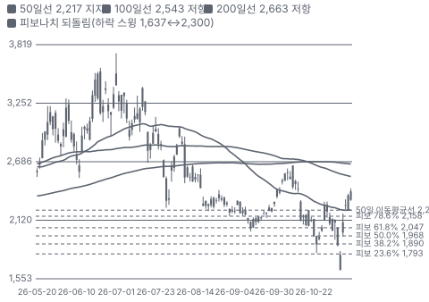

**주봉**

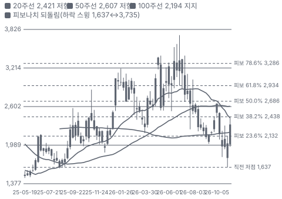

**월봉**

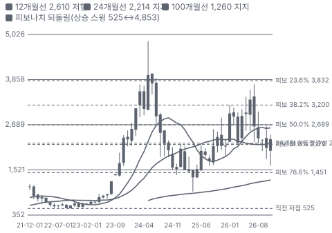

**분기 매출·EPS 실적과 컨센서스**

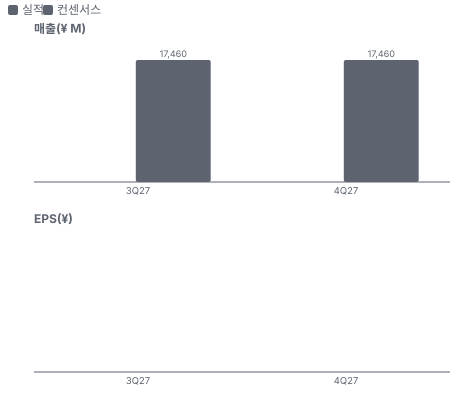

**밸류에이션 주가 시나리오**

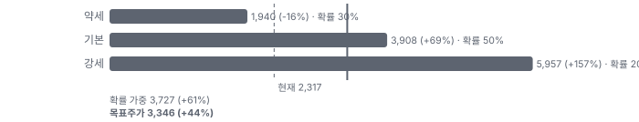

**주가별 업사이드**

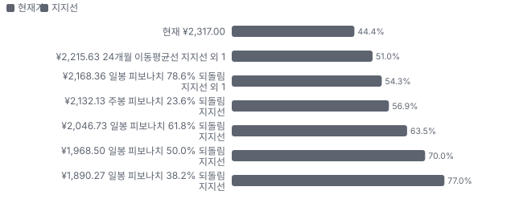
- 제품·서비스 포트폴리오

**고객 믹스(1H FY3/27, 매출 대비)**

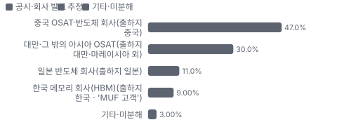

**공급 병목(10점, 낮을수록 병목)**

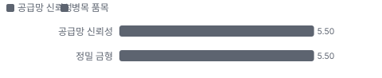

**CAPEX의 매출 대비 비중**

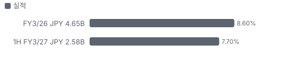

**어닝콜 변화별 주주가치 영향**

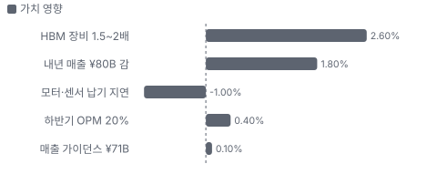

**멀티플 프리미엄(현재값 — 최근 4개 분기 추이 재료 없음)**

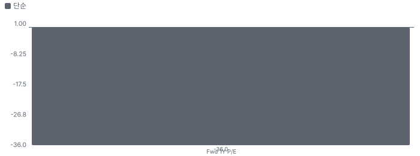

**합리적 멀티플**

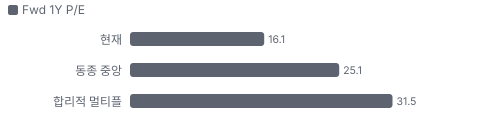

**수주·파이프라인 확실성 사다리**

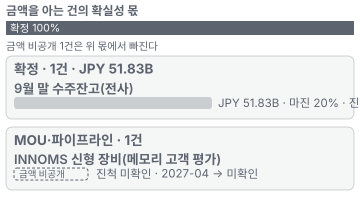

**매출 → 매출총이익 → 영업이익(매출 = 100, 최근 4분기)**

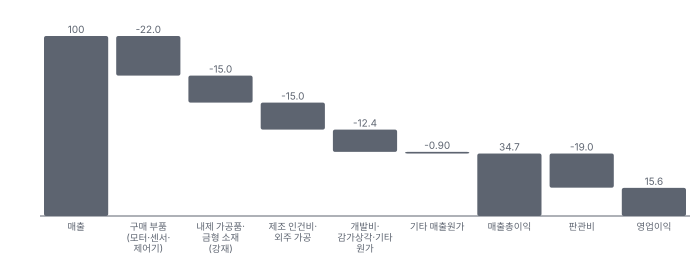

**1년 전 대비 마진 기여(비용 비중 변화의 반대)**

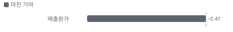

**분기 비용 비중 추이(매출 대비, 공시)**

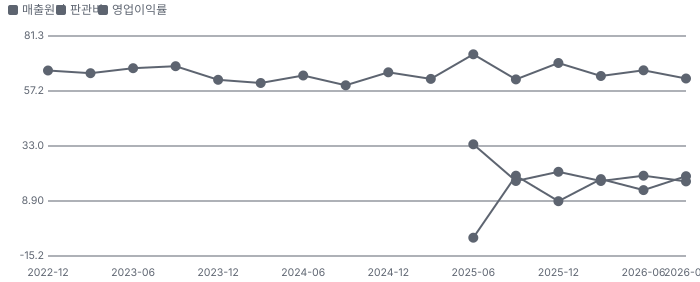

**비용 요인별 매출 대비 비중과 1년 변화**

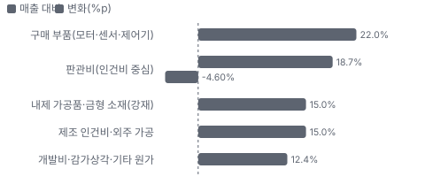

**BOM 항목 가격 +10% 시 OPM 변화**

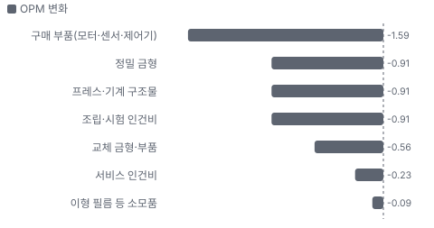

**몰딩 장비 BOM 원가 몫과 가격 +10% 시 OPM**

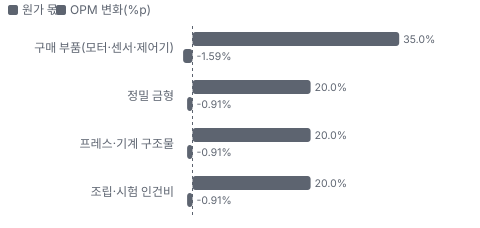

**TSS(금형·부품·서비스) BOM 원가 몫과 가격 +10% 시 OPM**

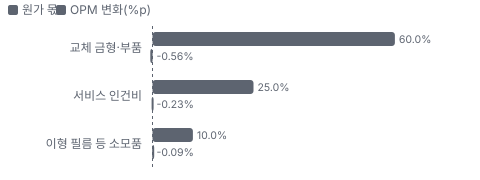

**매출 증가율의 가격·물량 분해와 8분기 전망(전년 대비)**

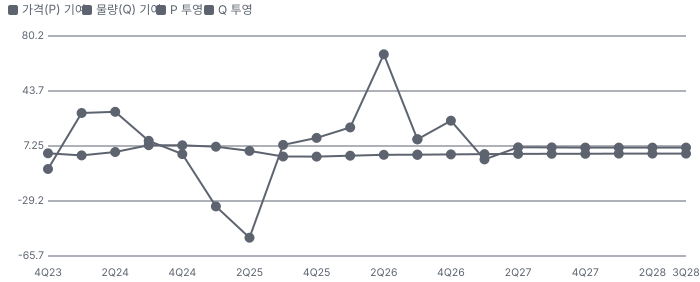

**분기별 매출 증가율 분해**

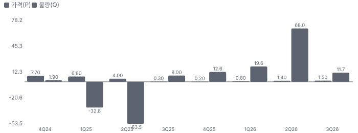

**목표주가 산정 — 약세와 기본 사이(약세 쪽 29%), 도달 확률 약 56%**

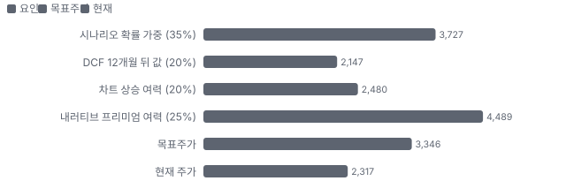

**PEG — 성장 대비 멀티플(낮을수록 성장 대비 쌈)**

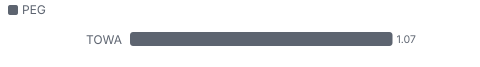

**일봉 지지·저항과 목표주가**

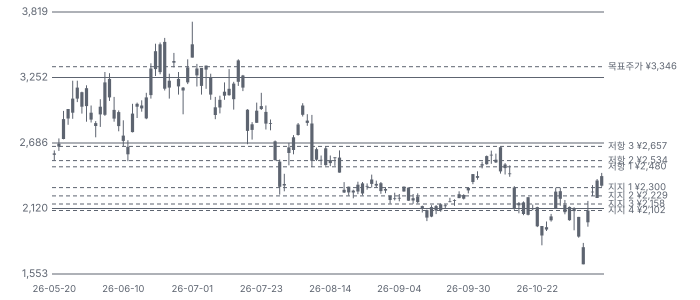

**몬테카를로**

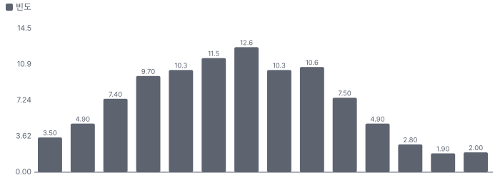

해석: 3,000번 중 394번(13%)에서 가치가 지금 주가 이상이었다. 가정을 흔들어도 지금 주가를 뒷받침하지 못하는 경우가 더 많다. 가운데 값은 0.79배이고, 열 번 중 여덟 번은 0.57~1.03배 사이에 든다.

## 내러티브

> **기업가치를 결정하는 이야기:** Fwd 1Y P/E 16.1배(12개월 선행 EPS ¥143.5 컨센서스)로 후공정 장비 동종 6곳 중앙값 25.1배보다 크게 낮다. 시장은 HBM 발주가 덩어리로 왔다가 사라지는 사업으로 값을 매긴다. 가치를 정하는 것은 ① 3Q·4Q 수주가 ¥25B 이상을 이어 가는지 ② 하반기 영업이익률 20%가 실제로 나오는지 ③ FY3/28 매출이 사장 감 ¥80B에 닿는지다

> **멀티플·EPS 프리미엄**
> **멀티플:** Fwd 1Y P/E 16.1배, 동종 6곳 중앙값 25.1배(디스코 27.7·도쿄정밀 16.8·시바우라 13.1·BESI 30.6·ASMPT 22.5·한미반도체 60.3 — 동종은 다음 회계연도 컨센서스 기준)
> **EPS:** TTM EPS ¥87.6 → FY3/27 가이던스 ¥119.95(+37%) → 12개월 선행 ¥143.5. 하반기만 보면 EPS 약 ¥69(가이던스 순이익 ¥9.0B − 상반기 ¥3.83B)

### 투자자들은 왜 열광했나

2026년 4~6월 HBM·AI 기대로 ¥2,100대에서 6월 22일 종가 ¥3,540까지 올랐다. 그 뒤 5월 결산 다음 날 −21%, 8월 1Q 결산 다음 날 −12%로 '수주가 이어지지 않는다'는 걱정이 커져 11월 6일 ¥1,785까지 빠졌다. 2Q 결산(수주 +126%·통기 상향) 다음 날 +17.7%로 반등했다 — 기대가 다시 붙는 초입이지만 고점 대비로는 아직 −35%다

### 무엇이 기업가치를 바꾸나

> **구조적 체질 변화**
> **변화:** HBM 고객 1곳 위주 → 다른 HBM 고객도 인증·공급 시작(미국계 포함 2027년 HBM 공장). 고객이 늘면 덩어리 발주가 이어지는 발주로 바뀔 수 있다
> **증거:** 2Q 콜(회사 말, 고객 발표 미확인)
> **반증:** 3Q 한국·미국 출하지 수주 감소

> **고부가 믹스 확장**
> **변화:** 몰딩 비중 69% → 72%, 하반기 영업이익률 계획 20%(2Q 19.8%)
> **증거:** 2Q 설명자료
> **반증:** 몰딩 비중 하락과 영업이익률 17% 미만

> **기술 혁신**
> **변화:** INNOMS 신형 장비가 메모리 고객 현장 평가 중 — 빠르면 2027년 4월 다른 고객에 판매
> **증거:** 2Q 콜
> **반증:** 평가 연장·판매 시점 연기

> **실행 속도**
> **변화:** 리드타임이 약 6개월 → 1년 초과로 늘었다 — 수요가 공급보다 빠르다는 신호이면서 납기 경쟁에는 약점 **납품 리드타임 12~14개월.** 피어 비교 미확인. 2026-05 6개월보다 117% 길다.
> **증거:** 2Q 콜
> **반증:** 리드타임이 다시 6개월대로 줄며 수주도 유지

> **M&A**
> **변화:** 해당 없음 — 최근 3년 의미 있는 인수 없음
> **증거:** 결산단신(일본 상장사의 분기 실적 속보 공시, 決算短信)
> **반증:** 해당 없음

> **정책·입법 연관성**
> **재정정책:** 해당 없음(TOWA를 겨냥한 미국 재정정책 미확인). 고객의 미국 HBM 공장은 CHIPS(미국 반도체지원법) 보조금 대상이지만 TOWA 매출로 바로 잇지 않는다(금지표) 미확인 반증: 해당 없음 의회 동의 2/10 — 하원 1/5(TOWA 관련 논의 없음) · 상원 1/5(같음).
> **행정명령:** 미국의 대중 반도체 장비 수출통제가 일본 후공정 장비로 넓어질 위험 — TOWA는 중국 출하 47%. 현재 후공정 몰딩 장비가 통제 대상이라는 1차 자료는 없다 미확인(정책 0단계 가설) 반증: 일본 경제산업성 수출 규제 대상에 몰딩 장비 추가 의회 동의 2/10 — 하원 1/5(후공정 장비를 겨냥한 행정명령·법안 미확인) · 상원 1/5(같음).
> **연관입법:** 해당 없음(회사를 겨냥한 미국·일본 법안 미확인) 미확인 반증: 대중 후공정 장비 수출 제한 법안 발의

> **CAPEX 낙수효과**
> **변화:** AI 데이터센터 CAPEX → HBM·전원 반도체 생산 → 고객 후공정 공장 증설 → 몰딩 장비. 가장 마지막 고리라 시점이 늦고 덩어리로 온다
> **증거:** 2Q 콜(고객 공장 건설이 발주 조건)
> **반증:** HBM 회사 후공정 CAPEX 축소 발표

### 내러티브 근거

> AI 데이터센터가 HBM과 전원용 파워 반도체를 늘리고, 둘 다 컴프레션 몰딩(반도체 칩 위에 수지를 깔고 눌러 굳히는 패키지 봉지 방식 — 얇고 넓은 패키지·적층 칩에 쓴다)을 써야 하니 TOWA 수주가 사상 최대로 간다는 이야기다. 2Q 수주 ¥33.0B(+126%)·잔고 ¥51.8B·통기 상향이 이를 숫자로 보여 줬다. 그런데 주가는 6월 종가 고점 ¥3,540에서 11월 6일 ¥1,785까지 반 토막이 났다 — 'HBM 발주가 한 번 튀고 끝난다'는 2023년의 기억이 할인을 만든다. 동종 대비 멀티플 차이 -36% 중 회사 고유 몫은 -49%다. 단계는 확산, 쏠림은 낮음이다.

> **HBM 후공정 공장 증설** · 강화
> **논리:** HBM 고객이 후공정 공장을 지으며 몰딩 장비 수요가 연 십수 대 → 1.5~2배가 된다
> **숫자:** 2Q 몰딩 수주 ¥26.0B, 한국 수주 ¥4.51B(1Q의 3.3배)
> **반증:** 3Q 수주 ¥25B 미만(2027년 2월 결산)

> **데이터센터 전원 파워 반도체** · 강화
> **논리:** GPU 기판 하나에 디스크리트 소자가 약 500개, 방열 수지 파워 반도체는 컴프레션만 가능하다
> **숫자:** 2Q 중국 수주 ¥11.6B(전원·범용 패키지 중심, 회사 설명)
> **반증:** 중국 수주가 2분기 연속 ¥6B 미만

> **가이던스 상향·이익률 레버리지** · 강화
> **논리:** 매출이 늘면 고정비가 깔려 하반기 영업이익률 20%가 된다
> **숫자:** 1H OPM 16.9%, 2Q 19.8%, 하반기 계획 20%
> **반증:** 3Q 영업이익률 17% 미만

> **리드타임·잔고 가시성** · 강화
> **논리:** 리드타임이 1년을 넘어 잔고가 내년 매출을 미리 깔아 준다
> **숫자:** 잔고 ¥51.8B = 9.6개월 매출, B/B 1.38
> **반증:** 잔고가 2분기 연속 감소

> **반대: 2023년식 한 번 튀고 꺾이는 발주** · 유지
> **논리:** 2023년 7~9월에도 한국 수주가 튄 뒤 꺾였다 — HBM 장비는 소수 고객·소수 대수라 덩어리로 들어온다
> **숫자:** 종가 고점 ¥3,540(6/22) → ¥1,785(11/6) −50%
> **반증:** 3Q·4Q 수주가 연속 ¥25B 이상

> **반대: 하이브리드 본딩(범프 없이 구리 패드끼리 직접 붙이는 차세대 칩 적층 방식) 전환** · 정황
> **논리:** HBM이 하이브리드 본딩으로 넘어가면 MR-MUF(HBM 적층 칩 사이와 바깥을 한 번에 수지로 채우는 공정, 몰디드 언더필) 몰딩 수요가 준다
> **숫자:** 회사: 고객에게서 수요 감소 신호 없음, 높이 제한 완화로 MR-MUF 유지 움직임
> **반증:** HBM 회사가 16단 이상에서 하이브리드 본딩 양산 채택 발표

이미지 없음(아직 생성 전) — 몰딩 장비·싱귤레이션(봉지가 끝난 기판을 개별 패키지로 자르는 공정) 장비·TSS(금형·부품·서비스)

## 포트폴리오

| 제품·서비스 | 구분 | 무엇 | 쓰는 곳 | 돈 버는 방식 | Mix | Mix 변화(1H 몰딩 ¥24.33B ÷ ¥33.72B, 전년 1H ¥16.24B ÷ ¥23.44B) |
|---|---|---|---|---|---|---|
| 몰딩 장비 | 제품 | 칩을 수지로 감싸는 컴프레션·트랜스퍼 몰딩(녹인 수지를 금형 통로로 밀어 넣어 칩을 감싸는 전통 봉지 방식) 장비 | HBM·파워 반도체·로직 패키지 봉지 | 장비 판매(대당 수억 엔대, 추정) | 72% | +2.9%p |
| TSS(금형·부품·서비스) | 서비스 | 교체 금형·부품·현장 서비스 | 설치된 TOWA 장비 유지 | 반복 매출 | 17% | -1.1%p |
| 싱귤레이션 장비 | 제품 | 봉지된 기판을 개별 패키지로 자르는 장비·블레이드 | 패키지 절단 | 장비·블레이드 판매 | 4% | -0.4%p |
| 의료·레이저 | 제품 | 의료용 조립품, 레이저 트리머 | 의료 기기·전자 부품 가공 | 제품 판매 | 6% | -1.4%p |

**Mix 변화가 가장 큰 쪽은 몰딩 장비(+2.9%p, 1H 몰딩 ¥24.33B ÷ ¥33.72B, 전년 1H ¥16.24B ÷ ¥23.44B).** 계절성 판정: 분기 매출 계절 지수 기준 없음 → 직전 분기와 비교.

## 고객

> **1H FY3/27 최대 고객 중국 OSAT·반도체 회사(출하지 중국) 47%, 상위 3곳 88%, 집중도 집중.** 공시·회사 발표로 확인한 몫은 매출의 88%이고, 나머지 고객 몫은 추정이거나 미분해다. 회사는 고객 이름과 10% 초과 고객을 결산단신·설명자료에서 밝히지 않는다(유가증권보고서 미열람). 출하지는 중국이 매출의 47%(2Q)로 가장 크고, HBM용 MR-MUF 몰딩은 한국 메모리 고객이 쓰는 것으로 보이나 고객 이름 매핑은 가설이다

**고객별 매출 몫(1H FY3/27)**
| 고객 | 몫 | 변화 | 근거 |
|---|---|---|---|
| 중국 OSAT·반도체 회사(출하지 중국) | 47% | +12%p | 회사 발표 |
| 대만·그 밖의 아시아 OSAT(출하지 대만·마레이시아 외) | 25~35% | 미확인 | 회사 발표 |
| 일본 반도체 회사(출하지 일본) | 11% | -1%p | 회사 발표 |
| 한국 메모리 회사(HBM)(출하지 한국 · 'MUF(칩 아래 빈틈과 바깥을 한 번에 몰딩 수지로 채우는 방식) 고객') | 6~12% | 미확인 | 추정 |
| 기타·미분해 | 3% | - | - |

> **중국 OSAT·반도체 회사(출하지 중국)** · 회사 발표
> **사는 것:** 몰딩·싱귤레이션 장비(파워·아날로그·범용 패키지)
> **추정 근거:** 2Q 출하지별 매출 ¥8.28B ÷ ¥17.53B. 1Q 34.6%(¥5.6B)에서 올랐다 — 개별 고객은 미공시

> **대만·그 밖의 아시아 OSAT(출하지 대만·마레이시아 외)** · 회사 발표
> **사는 것:** 몰딩 장비·금형·서비스
> **추정 근거:** 2Q 그 밖의 아시아 수주 ¥10.12B — 매출 비중은 그림에서 읽은 범위

> **일본 반도체 회사(출하지 일본)** · 회사 발표
> **사는 것:** 몰딩 장비·의료 조립품
> **추정 근거:** 2Q 출하지 일본 약 11%(그림 판독)

> **한국 메모리 회사(HBM, 출하지 한국 · 'MUF 고객')** · 추정
> **사는 것:** HBM용 컴프레션 몰딩(MR-MUF 공정)
> **추정 근거:** 2Q 한국 수주 ¥4.51B(1Q ¥1.38B). MR-MUF를 쓰는 HBM 회사를 SK하이닉스로 보는 것은 가설 — 회사는 고객 이름을 대지 않는다

## 수주·파이프라인

> **2026-09-30 기준 2건.** 확정 JPY 51.83B. 공시 수주잔고 JPY 51.83B.

**실행 속도와 방해 요인**
| 항목 | 상태 | 실행 속도 | 방해 요인 |
|---|---|---|---|
| 9월 말 수주잔고(전사) | 확정 | 미확인 | 구매 부품 납기 · 리드타임 1년 초과 |
| INNOMS 신형 장비(메모리 고객 평가) | 파이프라인 | 빠르면 2027년 4월 다른 메모리 고객 판매 | 고객 현장 평가 |

## 마진 구조

> **GPM 35.6%, OPM 16.9%.** 1H FY3/26 대비 GPM +1.7%p, OPM +6.2%p. 변동비는 매출의 48%이고, 매출이 10% 늘면 OPM은 +3.2%p 움직인다. 1H 매출총이익률 35.6%(전년 33.9%), 판관비 18.7%(전년 23.3%) — 매출이 44% 늘며 고정비가 깔려 영업이익률이 10.6% → 16.9%가 됐다. 회사 분해: 매출 증가 +¥4.69B, 믹스 +¥0.10B, 개발비 −¥0.76B, 판관비 −¥0.85B. 이 회사의 이익은 가동률(물량)이 정한다

> **매출 100 중 매출원가 65.3, 매출총이익 34.7(최근 4분기, 공시).** 매출원가 요인 중 구매 부품(모터·센서·제어기)이 매출의 22.0%로 가장 무겁고, 단가가 +10% 오르면 GPM이 -2.20%p 움직인다. 분기 회귀로 매출 1이 늘 때 매출원가는 0.56 늘고, 매출원가의 고정비 몫은 13%다.

**비용 요인 강도 — 비중·추세·충격(+10%)·탄력**
| 비용 | 구분 | 매출 대비 | 1년 변화 | 마진 기여 | 충격 시 마진 | 매출 탄력 | 고정비 몫 |
|---|---|---|---|---|---|---|---|
| 구매 부품(모터·센서·제어기) | 매출원가 요인 | 22.0% | 미확인 | 미확인 | -2.20%p | 미확인 | 0% |
| 내제 가공품·금형 소재(강재) | 매출원가 요인 | 15.0% | 미확인 | 미확인 | -1.50%p | 미확인 | 20% |
| 제조 인건비·외주 가공 | 매출원가 요인 | 15.0% | 미확인 | 미확인 | -1.50%p | 미확인 | 60% |
| 개발비·감가상각·기타 원가 | 매출원가 요인 | 12.4% | 미확인 | 미확인 | -1.24%p | 미확인 | 80% |
| 매출원가 | 공시 항목 | 65.3% | +0.4%p | -0.4%p | -6.53%p | 0.56 | 13% |
| 판관비 | 공시 항목 | 19.0% | 미확인 | 미확인 | 미확인 | 미확인 | 미확인 |

매출 탄력 = 분기 비용을 매출에 회귀한 기울기(매출 1당 변동비), 고정비 몫 = 절편 ÷ 평균 비용. 표본이 8분기 미만이면 미확인. 매출원가 요인 비중은 margin 재료의 추정이 섞여 있고, 공시 매출원가와의 차이는 '기타 매출원가'로 둔다.

**GPM에서 OPM까지(J-GAAP)**
| 기간 | GPM | 연구개발 | 판관비 | 기타 | OPM |
|---|---|---|---|---|---|
| 1H FY3/26 | 33.9% | 0.0% | 23.3% | 0.0% | 10.6% |
| 1H FY3/27 | 35.6% | 0.0% | 18.7% | 0.0% | 16.9% |

**GPM·OPM 최근 4개 분기**
| 분기 | GPM | OPM |
|---|---|---|
| 2025-12 | 30.5% | 8.8% |
| 2026-03 | 36.2% | 18.5% |
| 2026-06 | 33.7% | 13.7% |
| 2026-09 | 37.3% | 19.8% |

**마진을 결정하는 비용 요인 — 비용 +10% 시 OPM**
| 비용 | 매출 대비 | 변화 | 고정비 | OPM |
|---|---|---|---|---|
| 구매 부품(모터·센서·제어기) | 22.0% | 미확인 | 0% | -2.20%p |
| 판관비(인건비 중심) | 18.7% | -4.6%p | 70% | -1.87%p |
| 내제 가공품·금형 소재(강재) | 15.0% | 미확인 | 20% | -1.50%p |
| 제조 인건비·외주 가공 | 15.0% | 미확인 | 60% | -1.50%p |
| 개발비·감가상각·기타 원가 | 12.4% | 미확인 | 80% | -1.24%p |

**비용을 움직이는 요인**
| 비용 | 요인 |
|---|---|
| 구매 부품(모터·센서·제어기, 매출원가) | 부품 단가·납기(콜: 판가 인상으로 흡수 가능) · 근거 추정 |
| 판관비(인건비 중심, 판관비) | 인건비 증가가 판관비 +¥0.85B의 주인 · 근거 공시 |
| 내제 가공품·금형 소재(강재, 매출원가) | 강재·초경 소재 가격 · 근거 추정 |
| 제조 인건비·외주 가공(매출원가) | 인원·협력사 활용(하반기 파견·도급 확대) · 근거 추정 |
| 개발비·감가상각·기타 원가(매출원가) | 개발비 +¥0.76B(전년 대비), 감가상각 분기 ¥0.88B · 근거 공시 |

**몰딩 장비 BOM — 매출의 72%, GPM 37%(추정 — 제품별 이익률 미공시. 반도체 사업 영업이익률 17.1%(1H)에서 전사 판관비율을 더해 역산), 항목 가격 +10% 시**
| 항목 | 원가 몫 | 전가 | 제품 GPM | OPM |
|---|---|---|---|---|
| 구매 부품(모터·센서·제어기) | 30~40% | 미확인 | -2.2%p | -1.59%p |
| 정밀 금형 | 15~25% | 미확인 | -1.3%p | -0.91%p |
| 프레스·기계 구조물 | 15~25% | 미확인 | -1.3%p | -0.91%p |
| 조립·시험 인건비 | 15~25% | 미확인 | -1.3%p | -0.91%p |
| 미분해 | 5% | - | - | - |

**TSS(금형·부품·서비스) BOM — 매출의 17%, GPM 45%(추정 — 미공시. 교체 금형·부품·서비스라 장비보다 높게 본 업계 관행 추정), 항목 가격 +10% 시**
| 항목 | 원가 몫 | 전가 | 제품 GPM | OPM |
|---|---|---|---|---|
| 교체 금형·부품 | 50~70% | 미확인 | -3.3%p | -0.56%p |
| 서비스 인건비 | 20~30% | 미확인 | -1.4%p | -0.23%p |
| 이형 필름(몰딩 뒤 패키지가 금형에서 잘 떨어지게 까는 필름) 등 소모품 | 5~15% | 미확인 | -0.6%p | -0.09%p |
| 미분해 | 5% | - | - | - |

구매 부품(모터·센서·제어기) 가격이 +10% 오르면 영업이익은 -9.4% 움직인다. 판매가 전가를 모르는 항목은 전가 0%로 계산했다.

**BOM 항목 가격을 움직이는 것**
| 항목 | 요인 |
|---|---|
| 구매 부품(모터·센서·제어기) | 서보 모터·압력 센서·PLC(공장 기계를 제어하는 산업용 컨트롤러)가 장비 원가의 큰 몫 — 사장은 판가 인상으로 부품값 상승을 흡수할 수 있다고 했다(계약 연동 조항은 미확인) · 근거 추정 |
| 정밀 금형 | 패키지마다 따로 만드는 금형 — 내제라 마진의 원천 · 근거 추정 |
| 프레스·기계 구조물 | 수지를 누르는 프레스 유닛·프레임 · 근거 추정 |
| 조립·시험 인건비 | 교토·중국 공장 조립 · 근거 추정 |
| 교체 금형·부품 | 설치 대수가 늘수록 교체 수요가 는다 · 근거 추정 |
| 서비스 인건비 | 현장 서비스 · 근거 추정 |
| 이형 필름 등 소모품 | 컴프레션 몰딩용 소모품 · 근거 추정 |

**BOM 투입 물가 — PPI 전년비, 2026-11-12 수집**
| 항목 | 미국 | 일본 | 한국 | 대만 |
|---|---|---|---|---|
| 구매 부품(모터·센서·제어기) | +1.5% | +5.9% | +0.0% | +3.0%* |

별표는 품목보다 넓은 업종 지수다. 지난 1년 투입 물가를 판매가 전가 뒤 원가에 그대로 넣으면 OPM은 -0.39%p 움직인다(매출원가의 25% 기준).

## 공급망 병목

이미지 없음(아직 생성 전) — 몰딩 장비

> **공급망 신뢰성 5.5/10, 병목 주의.** 가장 약한 고리는 정밀 금형 5.5점이고, 품목 평균은 5.5점이다. 근거가 부족한 1건(구매 부품(모터·센서·제어기))은 점수에서 뺐다. 내제 가공품·금형은 캐파가 있다고 회사가 말했다. 약한 고리는 모터·센서 같은 구매 부품 — 반도체 장비 업계 전체가 납기 지연을 겪는다(2Q 콜). 공급사 이름은 공시되지 않았다

**병목과 마진 — 품목 가격 +10% 시 OPM**
| 품목 | 점수 | 판정 | 구분 | OPM |
|---|---|---|---|---|
| 정밀 금형(필수) | 5.5 | 병목 주의 | 핵심 통제 품목 | -0.91%p |

> **정밀 금형** · 5.5/10
> **왜:** 내제라 외부 병목은 없지만 단일 출처
> **병목 요인:** 인증 공급사 1곳 · 캐파 여유 · 리드타임 미확인 · 재인증 미확인 · 1위 점유율 100% · 지역 집중 미확인 · 물량 확보 내재화
> **풀리는 조건:** 해당 없음

**공급사**
| 품목 | 공급사 | 몫 | 근거 |
|---|---|---|---|
| 구매 부품(모터·센서·제어기) | 미공시(서보 모터·센서·제어기) | 미확인 | 추정 |
| 정밀 금형 | TOWA 내제(금형 설계·가공) | 미확인 | 회사 발표 |

**무역 통계로 본 공급 지역**
| 품목 | EU 수입처 | 일본 수입처 | EU 1위 전년비 |
|---|---|---|---|
| 구매 부품(모터·센서·제어기) | JP(일본) 45% · US 35% · TW(대만) 7% | 大韓民国 36% · シンガポール 25% | +1090.7% |

## 생산능력

> **현재 명목 캐파 미확인, 가동률 미확인.** 착공 이상 증설은 0 매출 환산 ¥B/년, 발표까지 합치면 0 매출 환산 ¥B/년이다. 1H FY3/27 CAPEX는 JPY 2.58B로 매출의 7.7%다. 회사는 명목 캐파를 대수로 밝히지 않는다. 사장은 현행 캐파로 지금 수주를 '전혀 문제없이' 생산할 수 있고, 협력사를 포함하면 다음 해 ¥100B 규모까지 대응 가능하다고 했다. 중국 공장 부지 안 증설은 계획대로 진행

**생산시설 2곳**(회사가 이름을 밝힌 생산 거점만 센다 — 본사(교토)와 중국 공장. 유가증권보고서 '설비의 상황'(국내·해외 공장 목록)은 이번 회차에 열지 못해 전체 수는 미확인), 미확인 2곳. 시설별 생산능력은 공개되지 않았다 — 회사 전체 캐파만 위에 적었다.

**생산시설 2곳 — 명칭·위치·생산능력**
| 시설 | 위치 | 용도 | 생산능력 | 소유·상태 |
|---|---|---|---|---|
| 본사·공장 | 일본 교토시 미나미구 | 몰딩 장비·금형 설계·제조 | 미확인 — 시설별 캐파 미공시 | 미확인 · 가동 |
| 중국 공장(蘇州) | 중국 장쑤성 쑤저우 | 몰딩 장비·싱귤레이션 블레이드 제조 | 미확인 — 시설별 캐파 미공시 — 부지 여유가 있어 증설 예정(2Q 콜) | 미확인 · 가동 |

**생산능력 확충 계획**
| 계획 | 단계 | 증설 | 가동 시점 | CAPEX |
|---|---|---|---|---|
| 중국(蘇州) 공장 부지 내 증설 | 발표 | 미확인 | 미확인 | 미확인 |
| 2032년 매출 ¥100B 대응 단계적 설비 확충 | 발표 | 미확인 | 2032 | 미확인 |

남은 계획의 CAPEX 합계는 JPY 0.00B(금액 미확인 2건 제외)다. 합계는 1H FY3/27 매출의 0%다.

**증설 방해 요인**
| 계획 | 방해 요인 |
|---|---|
| 중국(蘇州) 공장 부지 내 증설 | 구매 부품 납기·인력 |
| 2032년 매출 ¥100B 대응 단계적 설비 확충 | 수요 확인 뒤 단계 투자 |

**CAPEX와 매출 대비**
| 기간 | CAPEX | 매출 | 매출 대비 | 구분 |
|---|---|---|---|---|
| FY3/26 | JPY 4.65B | JPY 54.37B | 8.6% | 실적 |
| 1H FY3/27 | JPY 2.58B | JPY 33.72B | 7.7% | 실적 |

## 해자

> 해자는 컴프레션 몰딩 기술과 내제 금형이다. 방열 수지 파워 반도체와 HBM MR-MUF 몰딩처럼 컴프레션만 되는 공정에서 TOWA의 위치가 강하다 — 다만 점유율 수치는 미공시

> **컴프레션 몰딩 공정 독점성** · 강함
> **해자:** 방열 수지를 쓰는 데이터센터 파워 반도체는 컴프레션 방식만 가능하고, HBM 고객도 인증을 거쳐 쓴다
> **근거:** 2Q 콜 — HBM 고객 추가 인증·공급 시작, 몰딩 수주 ¥26.0B(2Q)
> **숫자:** 몰딩 매출 비중 72%, 점유율 미공시(미확인)
> **깨지는 조건:** 하이브리드 본딩 전환으로 HBM 몰딩 공정이 줄거나 경쟁사 컴프레션 장비가 HBM 인증

> **내제 금형·설치 기반** · 보통
> **해자:** 패키지별 금형을 내제하고 설치 장비에 교체 금형·서비스(TSS)를 판다
> **근거:** TSS 1H ¥5.73B(+34.7%)
> **숫자:** 반복 매출 비중 17%
> **깨지는 조건:** TSS 성장률이 장비 매출보다 2분기 연속 낮다

> **고객 인증 기간** · 보통
> **해자:** HBM 공정 장비는 고객 인증에 시간이 걸려 한 번 들어가면 바꾸기 어렵다
> **근거:** INNOMS가 고객 현장 평가 중(2027년 4월 판매 목표)
> **숫자:** 인증 기간 미공시(미확인)
> **깨지는 조건:** 고객이 다른 몰딩 공급사를 이중 인증

## 경영진·네트워크

> 대표이사 사장 미우라(三浦) 씨가 설명회 질의응답에 직접 답했다(전문 공개, 이름 전체·경력은 이번 회차 미대조). 경영진 정치·동문 연결은 공개 기록으로 확인하지 못했다

> **미우라(三浦) 대표이사 사장 — 이름 전체는 이번 회차 1차 미대조** · 대표이사 사장 · 미확인
> **프로필:** 2Q 결산설명회에서 수요·캐파·리드타임 질문에 답변
> **비즈니스:** 미확인
> **정계:** 미확인
> **동문:** 미확인
> **사모임:** 미확인

**네트워크 정량화**
| 연결 | 강도 | 닿는 매출 | 가중 노출 | 매출 대비 | 근거 |
|---|---|---|---|---|---|
| 비즈니스: 미확인 — 공개 연결 기록 없음 | 0/5 | ¥0.00B | ¥0.00B | 0% | 공개 자료에 없음 미확인 |

가중 노출은 연결이 닿는 매출의 크기다. 연결이 그 매출을 만들었다는 뜻이 아니며, 인과는 공개 자료로 입증하지 못한다.

## 약세 논리 및 셀온 조건

| 약세 논리 | 근거 | 반박 | 가를 자료 |
|---|---|---|---|
| HBM 발주는 덩어리로 왔다 사라진다 | 2023년 7~9월 한국 수주 ¥4.4B 뒤 꺾임(2Q 콜 질의). HBM 장비는 연 십수~20대 시장 | 다른 HBM 고객 인증·미국계 2027년 공장이 더해졌다(회사 말) | 3Q 수주(2027년 2월 결산) — ¥25B 이상이면 반박 성립 |
| 수주의 절반이 중국 범용 | 2Q 수주 중 중국 ¥11.6B로 가장 크다 — 전원·범용 패키지 경기에 기댄다 | 데이터센터 전원 파워 반도체는 컴프레션만 가능하다(회사 설명) | 3Q 지역별 수주(중국 몫) |
| 리드타임·부품이 매출을 늦춘다 | 리드타임 6개월 → 1년 초과, 모터·센서 납기 지연, 재공품 ¥11.8B → ¥14.4B | 협력사 포함 다음 해 ¥100B 규모까지 대응 가능(사장) | 하반기 매출 ¥37.3B 달성 여부(2027년 5월 결산) |
| 하이브리드 본딩 전환 | HBM 적층이 범프 없는 하이브리드 본딩으로 가면 MR-MUF 몰딩이 준다 | 회사: 고객에게서 감소 신호 없음, 높이 제한 완화로 MR-MUF 유지 움직임 | HBM 회사의 16단 이상 양산 공정 발표 |
| 대중 수출통제 확대 | 출하지 중국이 매출의 47%(2Q) | 현재 후공정 몰딩 장비가 통제 대상이라는 1차 자료 없음 | 일본 경제산업성·미국 상무부 규칙 개정 |
| 표본이 작다 | 커버리지 5명, FY3/28 컨센서스 미공개, 12개월 선행 EPS ¥143.5는 평균 하나 | 회사 가이던스·잔고가 기준선 | 3Q 뒤 증권사 추정 수정 |

데이터 공백: 1순위 재무·컨센서스 데이터 서비스가 TOWA를 다루지 않아 재무는 2Q 결산단신·결산설명자료(1차)와 공개 시세 서비스의 분기 재무로, 컨센서스는 공개 페이지(5명)로 채웠다. 유가증권보고서를 열지 못해 10% 초과 고객·공장별 캐파·구매 약정은 미확인이다. 분기 발표 직전 컨센서스가 없어 서프라이즈 표가 빠졌고, Fwd 2Y·3Y EPS는 사장 감(¥80B)으로 외삽했다. 제품 개념도는 이번 달 이미지 장부 한도를 넘어 넣지 못했다(이미지 없음 — 월 한도).

> **셀온 조건**
> **조건 1:** 3Q(10~12월) 수주가 ¥20B 아래로 내려간다 — 2023년식 덩어리 발주의 꺾임
> **조건 2:** 3Q 영업이익률이 17% 아래 — 하반기 20% 계획이 2Q 한 분기에 기댔다는 뜻
> **조건 3:** 수주잔고가 2분기 연속 줄어든다
> **조건 4:** HBM 회사가 16단 이상에서 하이브리드 본딩 양산을 발표하고 TOWA가 그 공정 장비 수주를 밝히지 않는다
> **조건 5:** 몰딩 장비가 일본·미국 대중 수출통제 대상에 들어간다

## 어닝콜 변화

**직전 콜 대비 새로 나오거나 바뀐 내용 → 가치 영향**
| 항목 | 내용 | 직전 콜 | 최신 콜 | 모델 동인 이동 | 확신도 | 가치 영향 |
|---|---|---|---|---|---|---|
| 업데이트 | 통기 매출 가이던스 | ¥64.0B(5월) | ¥71.0B(11/6) | 기준연도 매출 +0.06 BJPY(십억 엔 단위) | 0.8 | +0.1% |
| 업데이트 | 하반기 영업이익률 | 통기 16.0%(5월 계획) | 하반기 20.0%, 통기 18.5% | 출발 이익률 +2.0% | 0.8 | +0.4% |
| 신규 | HBM 장비 대수 | 연 십수 대 | 1.5~2배(연 20대 가능) | 1년차 성장률 +3.0% | 0.5 | +2.6% |
| 신규 | FY3/28 매출 감 | 중기 2032년 ¥100B | FY3/28 ¥80B 정도(사장) | 장기 성장 수렴값 +1.0% | 0.5 | +1.8% |
| 부정 | 구매 부품 납기 | 언급 약함 | 생산 병목으로 언급 | 매출÷투하자본 -10.0% | 0.3 | -1.0% |
| **합계** | 단독 합 |  |  | 동시 적용 +4.1% |  | **+4.0%** |

## P·Q 사이클

> **Q 사이클 — 최근 4분기 평균 가격 기여 +1.0%, 물량 기여 +28.0%(전년 대비 로그 증가율).** P 강도 3.5/10, Q 강도 6.3/10, 최근 8분기 중 62%가 같은 요인 우세(순환적). 전망으로는 2분기 뒤(1Q27) P 사이클로 전환(물량은 컨센서스를 섞었다).

**P·Q 사이클 정량**
| 항목 | 가격(P) | 물량(Q) |
|---|---|---|
| 최근 4분기 평균 기여 | +1.0% | +28.0% |
| 강도(0~10, 자기 이력 z) | 3.5 | 6.3 |
| 고유 주기(자기회귀모델 과거 2개 시점일 때) | 미확인 | 미확인 |
| 다음 4분기 투영 평균 | +1.9% | +8.8% |
| 4분기 뒤 투영(80% 범위) | +2.1% (-2.6%~+6.8%) | +6.3% (-39.2%~+51.7%) |
| 장기 평균(표본 → 기저율 수축) | +3.0% → +2.3% | +11.2% → +6.4% |
| 투영 모형 | 자기회귀모델(과거 1개 시점) | 자기회귀모델(과거 1개 시점) + 컨센서스(분기 컨센서스 2개) |

가격 근거: 미국 PPI(생산자물가지수) 반도체 제조 장비 대용 — 회사 판매가가 아니라 업종 가격. PPI를 쓰면 회사 판매가가 아니라 업종 가격 대용이다. 로그 증가율이라 가격·물량 기여의 합이 매출 증가율이다. 전망: 가격은 BIC(모형 차수를 고르는 정보 기준)로 차수를 고른 자기회귀모델에 이미 발표된 월간 가격을 먼저 넣고(나우캐스트), 물량은 자기회귀모델과 '컨센서스 매출 증가율 − 가격 전망'을 분산 역수로 섞는다. 장기 평균은 표본 평균을 장기 기저율(가격 연 2%·물량 연 4%) 쪽으로 줄인다 — 고성장 구간만 담긴 표본이 그 성장을 끝없이 잇지 않게. 범위는 4분기 겹친 표본의 자기상관을 반영한다. 모형 산출이며 가이던스가 아니다. 회사 판매가로 잴 수 없는 이유: 회사가 장비 판매 대수·평균 단가를 공시하지 않는다. 가격 인상 언급(콜)은 있으나 수치가 없어 가격·물량 분해를 하지 않는다

10년 위치·프리미엄: 구조 단절(3Q25 전후 분기 매출 급변·되돌림(재작성·분리 자료가 섞인 것으로 보임) — 그 뒤만 쓴다) 뒤 TTM 표본이 1개로 20개에 못 미쳐 10년 비교를 하지 않는다 — 단절 전후 매출은 같은 회사 범위가 아니다.

## 밸류에이션

> **목표주가 ¥3,346, 업사이드 +44%.** 자리는 약세와 기본 사이(약세 쪽 29%)이고 도달 확률은 약 56%다. 기본 ¥3,908, 강세 ¥5,957(+157%), 약세 ¥1,940(-16%). DCF 기준 업사이드는 기본 -16%, 강세 -6%, 약세 -37%다(WACC 10.9%).

배수 기준 기본 ¥3,908은 다음 4개 분기 EPS ¥143.5에 선정 배수 27.2배를 곱한 값이고, DCF 기본 업사이드는 −16%다. 둘이 반대로 가는 이유는 이익률의 지속이다. DCF는 매출이 FY3/27 가이던스 ¥71.0B에서 해마다 둔화해 장기 4%로 가고, 영업이익률이 2년 뒤 19%를 찍은 뒤 장기 15%로 내려온다고 둔다 — 장비 사이클의 평균 회귀다. 배수는 동종 중앙값 근처 P/E를 1년 뒤 EPS에 곱할 뿐이라 그 뒤 사이클이 꺾이는 속도를 묻지 않는다. 선정 배수 27.2배도 지금 TOWA의 16.1배와 거리가 멀다 — 동종 중앙값을 하이브리드 본딩 기대가 붙은 고이익률 회사들이 끌어올렸기 때문이다(판단 조정 −25%). 그래서 목표주가는 기본이 아니라 약세와 기본 사이 ¥3,346에 놓였다. 약세 ¥1,940은 EPS ¥95에 20.4배, 강세 ¥5,957은 EPS ¥175에 34.0배다.

> **약세 ¥1,940 (-16%)** · 확률 30%
> **가정:** 20.4배 × EPS ¥95.00
> **근거:** HBM 발주가 2023년처럼 한 번 튀고 꺾여 3Q·4Q 수주가 분기 ¥15~20B로 돌아가고, FY3/28 상반기 매출이 ¥30B 안팎으로 내려간다. 구매 부품 지연으로 하반기 매출 일부가 밀리고 영업이익률은 14~16%. 다음 4개 분기 EPS ¥95

> **기본 ¥3,908 (+69%)** · 확률 50%
> **가정:** 27.2배 × EPS ¥143.50
> **근거:** 하반기 가이던스(매출 ¥37.3B·영업이익률 20%)를 지키고 FY3/28 매출이 사장 감 ¥80B 근처, 영업이익률 19~20%. 다음 4개 분기 EPS ¥143.5(12개월 선행 컨센서스)

> **강세 ¥5,957 (+157%)** · 확률 20%
> **가정:** 34.0배 × EPS ¥175.00
> **근거:** 다른 HBM 고객·미국 공장 발주가 더해져 분기 수주 ¥30B가 이어지고 FY3/28 매출 ¥90B·영업이익률 21%. 다음 4개 분기 EPS ¥175

**멀티플 선정 — Fwd 1Y P/E**
| 단계 | 조정 | 근거 |
|---|---|---|
| 동종 중앙값 | 25.1배 | 범위 13.1~60.3배, 6곳 |
| 펀더멘털 | +13% | 성장·이익률·ROIC로 본 합리적 멀티플 31.5배와의 차이의 일부만 인정 |
| 해자 | +7% | 컴프레션 몰딩 공정 독점성 강함 · 내제 금형·설치 기반 보통 · 고객 인증 기간 보통 |
| 반복 매출 | -1% | 반복 매출 17%(동종 20%) · 금형·부품·서비스(TSS) · 이미 반복 단계 · 기반 설치 장비 대수 미공시 |
| 수주 전환·가시성 | +10% | book-to-bill 1.00 → 가시성 1.00 · 전환 9.6개월(동종 12) |
| 내러티브 | +5% | 단계 확산 |
| 사이클·실행 판단 | -25% | 동종 중앙값 25.1배는 하이브리드 본딩·HBM 본더 기대가 붙은 한미반도체(60배)·BESI(31배)·디스코(28배)가 끌어올린 값이다 — 이들은 영업이익률 40%대이고 TOWA는 16~20%다. 또 2023년 7~9월 한국 수주가 튄 뒤 꺾였고, 2026년 6월 종가 고점 ¥3,540에서 11월 6일 ¥1,785까지 −50% 빠진 이력이 있다. HBM 고객 다변화가 고객 발표로 확인되기 전에는 펀더멘털·해자·수주 가산분을 대부분 상쇄해 25% 낮춘다 |
| **선정** | **27.2배** | 지금 16.1배 |

**동종 레인지**
| 회사 | Fwd 1Y P/E | 성장 | 영업이익률 | ROIC |
|---|---|---|---|---|
| 디스코 | 27.7 | 14% | 44% | 79% |
| 도쿄정밀 | 16.8 | 6% | 22% | 22% |
| 시바우라메카트로닉스 | 13.1 | 24% | 16% | 62% |
| BESI | 30.6 | 18% | 40% | 167% |
| ASMPT | 22.5 | 22% | 9% | 8% |
| 한미반도체 | 60.3 | 26% | 42% | 30% |
| **TOWA** | 16.1 |  |  |  |

> **PEG 1.07** — Fwd 1Y P/E 16.1배를 다음 해 EPS 성장 15%로 나눈 값. 성장률은 Fwd 1Y·2Y P/E에서 역산한 컨센서스라 다음 해 한 해 성장만 반영하고, 성장 지속 기간은 담지 않는다.

**PEG — Fwd 1Y P/E ÷ 다음 해 EPS 성장률**
| 회사 | Fwd 1Y P/E | 다음 해 EPS 성장 | PEG |
|---|---|---|---|
| **TOWA** | 16.1 | +15% | 1.07 |
| 디스코 | 27.7 | - | - |
| 도쿄정밀 | 16.8 | - | - |
| 시바우라메카트로닉스 | 13.1 | - | - |
| BESI | 30.6 | - | - |
| ASMPT | 22.5 | - | - |
| 한미반도체 | 60.3 | - | - |

몬테카를로 중앙값 업사이드 -21%.

> 의사결정 보조(투자자문 아님): ① 매수 매력: 5년 보유 가정 연 기대수익 +4.5% — 주주가 요구하는 수익률(자기자본비용) 10.9%보다 -6.4%p · 요구수익률을 넘을 확률 6% · 안전마진 0.57(비관적 경우의 기업가치가 지금 시가총액의 57%) → 정량 신호 약함 / ② 위험 예산 지표(이론): 0% — 기대수익이 요구수익률에 못 미친다(켈리 기준 — 수익·손실 확률로 계산한 이론상 최대 노출 — 0%는 참고) · 5년 뒤 나쁜 경우(하위 10%) -11% · 30% 넘게 잃을 확률 1% / ③ 상방(5년): 평균 1.25배 · 2배 이상 확률 0% · 3배 이상 0% · 10배 이상 0% · 잘 풀린 경우(상위 10%) 1.61배 이상

투입 물가 점검: 지난 1년 PPI를 BOM에 넣으면 OPM -0.39%p다(매출원가의 25% 기준).

## 매수 위치(일봉)

> **현재가 ¥2,317는 '지지 근접'(가장 가까운 일봉 지지 ¥2,300에서 ATR 0.1배 위).** 이 자리에서 목표주가까지 +44.4%, 첫 일봉 저항까지 +7.0%, 다음 지지까지 하방 -0.7%, 손익비 60.5배.

**가격대별 업사이드(일봉 기준)**
| 가격대 | 가격 | 목표주가까지 | 첫 저항까지 | 다음 지지까지 | 손익비 | 근거 기법(강도) |
|---|---|---|---|---|---|---|
| 현재가 | ¥2,317 | +44.4% | +7.0% | -0.7% | 60.5 | - |
| 지지 1 | ¥2,300 | +45.5% | +7.8% | -3.1% | 14.7 | 120일 지그재그 고점 · 스윙 고점(1.8) |
| 지지 2 | ¥2,229 | +50.1% | +3.2% | -3.2% | 15.9 | 120일 지그재그 저점 · 50일선(1.8) |
| 지지 3 | ¥2,158 | +55.0% | +3.3% | -2.6% | 21.3 | 피보 78.6%(1.0) |
| 지지 4 | ¥2,102 | +59.1% | +2.6% | 미확인 | 미확인 | 20일선(0.5) |

**일봉 저항**
| 저항 | 가격 | 현재가 대비 | 근거 기법(강도) |
|---|---|---|---|
| 저항 1 | ¥2,480 | +7.0% | 피보 확장 127.2%(0.8) |
| 저항 2 | ¥2,534 | +9.3% | 120일 지그재그 저점(0.8) |
| 저항 3 | ¥2,657 | +14.7% | 120일 지그재그 고점 · 200일선(1.8) |

일봉만 쓴다(주봉·월봉 제외). 손익비 = 목표주가까지 업사이드 ÷ 다음 지지까지 하방. 가격대별 기대값 참고표이며 매수·매도 시점 지시가 아니다.

## 애널리스트 토론

> **토론 결론 Buy(규칙 등급 Buy).** 잔고 ¥51.8B·2Q 영업이익률 19.8%·순현금 반박이 살아남았고, 고객 다변화가 회사 말뿐이라는 반박도 살아남았다. 규칙 등급을 출발점으로 둔다

**패널 — 등급별 자리**
| 자리 | 핵심 논리 | 틀리는 조건 | 최종 투표 |
|---|---|---|---|
| Strong Buy | 사상 최대 수주·잔고에 Fwd 1Y P/E 16배 — 동종 중앙값 25배와의 차이가 너무 크다 | 3Q 수주 ¥20B 미만 | Strong Buy |
| Buy | 하반기 영업이익률 20% 계획은 잔고가 받친다 — 컨센서스가 아직 가이던스 아래다 | 3Q 영업이익률 17% 미만 | Buy |
| Neutral | 수주는 확인됐지만 지속성은 확인되지 않았다. HBM 고객 다변화가 회사 말뿐이다 | 3Q·4Q 수주 연속 ¥25B 이상 | Buy |
| Sell | 리드타임 1년 초과와 구매 부품 지연은 매출 인식이 밀릴 위험이다 | 하반기 매출 ¥37.3B 달성 | Neutral |
| Strong Sell | HBM 장비는 소수 고객·소수 대수다. 주가가 6개월 만에 반 토막 난 건 시장이 그 덩어리를 안다는 뜻이다 | FY3/28 매출 가이던스 ¥80B 이상 | Neutral |

**투표**
| Strong Buy | Buy | Neutral | Sell | Strong Sell |
|---|---|---|---|---|
| 1 | 2 | 2 | 0 | 0 |

> **개회 · Strong Buy**
> **발언:** 상반기 수주 ¥54.8B는 전년의 2.2배다. 잔고만으로 하반기 매출 계획 ¥37.3B를 넘는다

> **개회 · Buy**
> **발언:** 2Q 영업이익률이 이미 19.8%다. 하반기 20%는 새 가정이 아니다

> **개회 · Neutral**
> **발언:** 2Q 수주 중 중국이 ¥11.6B로 가장 크다. HBM만의 이야기가 아니고, 범용 패키지 경기도 섞여 있다

> **개회 · Sell**
> **발언:** 리드타임이 두 배가 됐다. 잔고가 쌓여도 매출로 넘어가는 속도가 느려진다

> **개회 · Strong Sell**
> **발언:** HBM 장비 시장은 연 20대 수준이다. 한 고객의 공장 일정이 바뀌면 분기 수주가 크게 흔들린다

> **반박1 · Neutral → Strong Buy**
> **발언:** 동종 중앙값 25배에는 한미반도체 60배·BESI 31배 같은 하이브리드 본딩 기대가 섞였다. 몰딩 회사에 그대로 적용하기 어렵다

> **반박1 · Buy → Sell**
> **발언:** 회사는 협력사까지 쓰면 다음 해 ¥100B까지 만들 수 있다고 했다. 캐파보다 부품이 병목이고, 판가 인상으로 흡수한다고 답했다

> **반박1 · Strong Buy → Strong Sell**
> **발언:** 이번엔 다른 HBM 고객 인증과 미국계 공장이 더해졌다. 2023년은 고객 한 곳이었다

> **반박1 · Sell → Buy**
> **발언:** 단기차입이 ¥2.5B 늘었다. 재공품이 ¥11.8B에서 ¥14.4B로 쌓이는 동안 현금은 운전자금에 묶인다

> **반박1 · Strong Sell → Neutral**
> **발언:** 다변화가 회사 말뿐이라는 점에 동의한다. 고객 발표가 없다

> **반박2 · Strong Buy → Sell**
> **발언:** 2Q 영업현금흐름 ¥5.1B로 순현금이 ¥13.1B다. 운전자금 증가는 감당 가능하다

> **반박2 · Neutral → Buy**
> **발언:** 하반기 20%는 2Q 한 분기 숫자에 기댄다. 1Q는 13.7%였다

> **반박2 · Sell → Strong Buy**
> **발언:** Fwd 1Y P/E 16배는 12개월 선행 EPS ¥143.5를 믿을 때다. FY3/28 컨센서스는 공개되지 않았다

> **반박2 · Buy → Strong Sell**
> **발언:** 몰딩 수주 ¥26.0B 중 HBM이 얼마인지 몰라도, 전원 반도체만으로도 중국 수주가 ¥11.6B였다

> **반박2 · Strong Sell → Strong Buy**
> **발언:** 새 고객 인증은 매출이 아니다. 금지표대로 계약·물량이 나와야 한다

> **최종 · Strong Buy**
> **발언:** 3Q 수주가 ¥25B를 넘으면 할인이 풀린다

> **최종 · Buy**
> **발언:** 잔고와 컨센서스 갭이 리비전을 위로 이끈다

> **최종 · Neutral**
> **발언:** 지속성 확인 전에는 규칙 등급을 크게 옮길 근거가 약하다

> **최종 · Sell**
> **발언:** 리드타임과 부품 지연을 3Q에서 확인해야 한다

> **최종 · Strong Sell**
> **발언:** 덩어리 발주의 꺾임을 할인으로 반영해야 한다

남은 반대 의견: Strong Sell 자리: HBM 장비는 덩어리 발주라 수주 정점이 곧 주가 정점이다

패널은 등급별 논리를 대표하는 자리이고 실존 IB의 의견이 아니다.

## 커뮤니티 내러티브

커뮤니티 집계 없음 — Quantral 미수록

## 시장 평가

> **셀사이드(IB 애널리스트)**
> **한 줄:** 컨센서스가 아직 11/6 가이던스를 다 따라오지 않았다 — 경상이익 컨센서스가 4주 동안 +4.1% 올랐다. 질의응답에는 모건스탠리·SMBC닛코 등이 하반기 이익률·HBM 대수·캐파를 물었다
> **의견 분포:** 강세 3·중립 2 — 5명
> **목표가 평균:** ¥3,230 — 현재가 +39%
> **FY3/27 영업이익 컨센서스:** ¥12.7B — 가이던스 ¥13.15B 아래

> **바이사이드(기관 투자자)**
> **한 줄:** 13F 같은 보유 변화 자료는 일본에 없어 미확인. 노무라증권 5% 초과 보고는 자기 계정·신탁 구분이 없어 매수 의도로 읽지 않는다
> **기관 보유:** 28.9% — 공개 시세 개요
> **내부자 보유:** 15.6% — 공개 시세 개요
> **대량보유:** 노무라증권 5% 초과 — 보고

> **언론·업계**
> **한 줄:** 일본 시황 매체는 '컨센서스를 넘는 상향'과 4일 만의 반등으로 묶었다
> **보도 초점:** 통기 상향·컨센서스 넘는 상향·생성 AI 수요 — 가부탄·피스코

## 체크리스트

| 시점 | 무엇 | 의미 |
|---|---|---|
| 2027-02 초(예정) | 3Q FY3/27 결산 — 수주·지역·잔고 | 분기 수주 ¥25B 유지 여부가 할인의 첫 시험 |
| 2026-12~2027-03 | SK하이닉스·마이크론 후공정 증설·미국 HBM 공장 장비 반입 | 회사 말(다른 고객·미국 공장)이 고객 쪽 흔적으로 확인되는지 |
| 2027-04(목표) | INNOMS 다른 메모리 고객 판매 시작 | 신형 장비가 평가를 통과했는지 |
| 2027-05(예정) | FY3/27 결산·FY3/28 첫 가이던스 | 사장 감 ¥80B가 가이던스가 되는지 |
| 수시 | HBM 적층 공정 발표(하이브리드 본딩 채택) | MR-MUF 몰딩 수요의 장기 위험 |

## 출처
- 2Q FY3/27 결산단신(2026-11-06) https://www.towajapan.co.jp/jp/wp-content/uploads/sites/2/2026/11/2026FY_secondquarter_annual.pdf
- 2Q FY3/27 결산설명자료 https://www.towajapan.co.jp/jp/wp-content/uploads/sites/2/2026/11/2026FY_secondquarter_presentation.pdf
- 2Q 결산설명회 스피치·질의응답 전문(회사 공개) https://www.towajapan.co.jp/jp/wp-content/uploads/sites/2/2026/11/2026FY_secondquarter_presentation_speech_and_QA.pdf
- FY3/26 결산 질의응답(2026-05-15) https://www.towajapan.co.jp/jp/wp-content/uploads/sites/2/2026/05/2025FY_qa.pdf
- https://www.towajapan.co.jp/jp/wp-content/uploads/sites/2/2026/11/2026FY_secondquarter_presentation.pdf
- https://www.towajapan.co.jp/jp/wp-content/uploads/sites/2/2026/11/2026FY_secondquarter_presentation_speech_and_QA.pdf
- 2Q 설명자료 '생산 체제 강화'
- 2Q 콜 — 구매 부품 납기 지연 언급, 비중 미공시
- 2Q 콜(구매 부품이 병목)
- TSS = Total Solution Service
- https://www.towajapan.co.jp/jp/wp-content/uploads/sites/2/2026/11/2026FY_secondquarter_annual.pdf
- 금형 내제(콜 '가공품·내제품은 캐파 있음')
- 미확인
- 업계 장비 원가 구조
- 회사 사업 설명(금형 내제)
- 회사 제품 목록(이형 필름)
- 2Q 콜

_구매 등급·목표주가 모두 규칙이 계산한 모델 값으로, 개인의 보유 종목·자금 사정을 반영하지 않는다 · 공개 자료 기반 분석이며 투자 권유가 아님 · 1차 판정, 미검증 · Chiip ten-bagger_