# 텐배거 리포트 2026-11-12 — Charles River — 전임상 수요는 돌아왔는데, 주가는 그보다 먼저 갔다

> 2026-11-12 · Charles River Laboratories International, Inc.(CRL) · 기업: 신약 후보의 안전성 시험(독성 시험)을 대신 해 주고 실험용 동물과 의약품 품질 시험 제품을 파는 미국 전임상 CRO — 북미·유럽에 시험 시설을 두고 제약·바이오·학계에 판다

## Chiip View

주가는 11/11 \$342.69, 시가총액 \$16.42B, 순차입 약 \$2.24B(리스 별도 \$0.41B)다. 3Q26 매출 \$982.7M(유기 +4.7%)·조정 영업이익률 23%·조정 EPS \$3.09(+27% YoY)로 3년 만의 가장 강한 성장이 나왔고, 연간 EPS 가이던스는 \$11.35~11.55로 올랐다. 그런데 순수주는 \$701M에서 \$652M으로, B/B(수주 ÷ 매출 비율)는 1.19에서 1.09로 내려왔고 실적 날 주가는 −7%였다. 다음 4개 분기 EPS 컨센서스 \$12.61 기준 Fwd 1Y P/E 27.4배로 동종 중앙(약 20배)보다 높다 — 가를 것은 2027년 2월 4Q B/B와 2027 가이던스다.

## 대시보드
| 항목 | 값 | 설명 |
|---|---|---|
| 주가 | \$342.69 | 고점 대비 -9% · 1년 +98% |
| 시가총액 | \$16.63B | 완전 희석 기준 · EV \$18.87B |
| 업사이드 | -9% | 목표주가 \$313 · 다운사이드 -37% · 손익비(강세÷약세) 0.6 |
| 구매등급 | Neutral | 애널리스트 16명: Strong Buy 12 · Buy 1 · Neutral 3 · Sell 0 · Strong Sell 0 |
| 멀티플 | Fwd 1Y P/E 27.4배 | 동종 중앙값 20.0배 |
| 가이던스 FY2026 |  | 컨센서스 미확인 |
| 알파 | 5.5/10 | 텐배거 가능성 점수 |
| 이벤트 | 4Q26 실적·2027 가이던스(2월 관행, 날짜 미확정) | 2027-02-17 |

## 한 장 요약
- **기업가치를 결정하는 내러티브** Charles River의 값은 **바닥을 지난 전임상 수요가 2027~2028에 5~7% 성장으로 돌아가고, 매각·절감으로 높인 이익률이 유지되느냐**에 달렸다. 3Q는 그 방향을 확인했다 — DSA(신약 후보 발굴과 안전성 평가, 독성 시험 사업부) 유기 성장 5.9%, 영업이익률 23%, EPS 가이던스 상향. 그러나 주가는 1년 +103%로 먼저 갔고 Fwd 1Y P/E 27배는 동종(약 20배)보다 높다. 실적 날 −7%는 B/B 하락(1.19 → 1.09)과 높아진 기대가 만난 결과로 보인다(추정)
- **밸류에이션 모델로 본 주가 상방은 어디까지인가?** **목표주가 \$313(-9%), 기본 시나리오다.** 강세 \$413(+21%)는 Fwd 1Y P/E 30.8배를 강세 EPS에 적용한 값이다. 기본 \$311, 약세 \$215. 손익비 0.6, DCF 기준 업사이드 -69%.
- **수주는 어디까지 왔나?** DSA 수주잔고 미확인, 100% 매출 \$2.03B. DSA 잔고 \$2.03B는 DSA 분기 매출의 약 3.4배다. 개별 계약은 공시하지 않아 잔고 전체를 한 행으로 잡는다
- **누가 사 주나?** 최대 고객 중소 바이오테크(바이오) 40%, 상위 3곳 40%. 공시·회사 발표로 확인한 몫은 0%다.
- **마진과 공급망은 어디가 약한가?** GPM 36.4%, OPM 20.6%. OPM을 가장 흔드는 BOM(제품 원가를 이루는 부품·재료 명세) 항목은 시험·연구 인력이고 가격 +10%에 -2.81%p다. 공급망 신뢰성은 7.1/10(관리 가능)이고 가장 약한 고리는 연구용 동물(NHP(영장류 실험동물, 주로 원숭이)·설치류)이다.
- **생산능력은 얼마나 늘어나나?** 현재 명목 캐파 미확인, 착공 이상 증설 0 시설 공간(미공시). FY2026 CAPEX는 매출의 5.1%다.
- **지금 가격은 무엇을 가정하나?** 시가총액 \$16.42B에 순차입 약 \$2.24B다. 다음 4개 분기 EPS 컨센서스 \$12.61 기준 Fwd 1Y P/E는 27.4배로 동종 중앙(약 20배)보다 약 37% 높고, Fwd 2Y 23.9배·3Y 21.7배다. 지금 가격은 2028년 5~7% 성장과 영업이익률 20%대 중반 유지를 상당 부분 가정한다. 애널리스트 목표가 평균은 \$353.27(15명)이다.
- **왜 움직였나?** 1년 동안 \$169에서 \$343으로 +103% 올랐다. 2025년 4월 FDA(미국 식품의약국)의 동물 시험 축소 계획으로 하루 약 28% 빠진 뒤 '규제 전환은 느리고 바이오 자금은 돌아온다'는 이야기가 퍼졌고, 2Q 유기 성장 전환(8/5 +11%)으로 숫자가 붙었다. 같은 기간 FY2027 EPS 추정은 5% 올랐다 — 상승의 대부분은 배수 확대다.
- **3Q에서 무엇이 바뀌었나?** DSA 유기 성장이 0.2%에서 5.9%로 올랐고, 조정 영업이익률이 20.5%에서 23%로 올랐다. 연간 유기 성장 가이던스는 '0~1%'에서 '1.5% 이상'으로, EPS는 \$11.35~11.55로 올랐다. 2027은 점진 개선, 2028부터 5~7%라는 경로도 처음 나왔다. 반대로 순수주는 \$701M에서 \$652M으로 줄었고, 가격 효과는 빨라야 2027 하반기라고 했다.
- **무엇이 바뀌면 판단이 달라지나?** 위로: 4Q B/B가 1.15 이상이고 2027 가이던스가 유기 성장 3% 이상·영업이익률 +100bp 이상이면 2027 EPS 추정이 \$13.5 이상으로 오른다. 아래로: B/B가 1.0 아래로 내려가거나, FDA 지침이 생물의약품 동물 시험 면제를 넓히거나, 4Q 영업이익률이 24%에 못 미치면 약세 시나리오로 옮긴다.

## 한눈에 보기

**일봉**

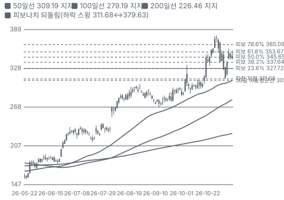

**주봉**

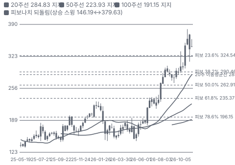

**월봉**

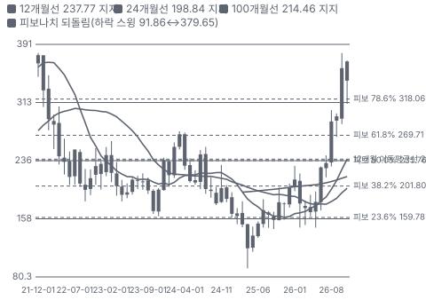

**분기 매출·EPS 실적과 컨센서스**

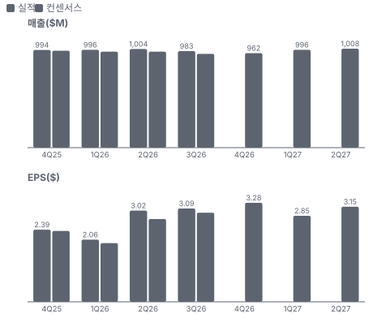

**최근 4개 분기 주가 변화 분석**

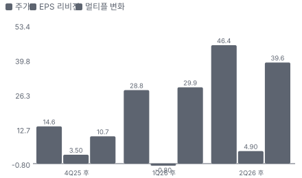

**EPS 리비전**

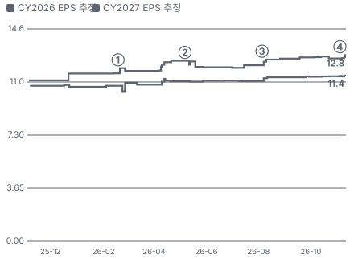

① 26-02-18 4Q25 실적·2026 가이던스 · EPS 리비전 +1%
② 26-05-07 1Q26 실적, DSA 수주 회복 · EPS 리비전 -3%
③ 26-08-05 2Q26 유기 성장 전환, 당일 +11% · EPS 리비전 +3%
④ 26-11-04 3Q26 DSA +5.9%, 당일 −7% · EPS 리비전 +2%

**밸류에이션 주가 시나리오**

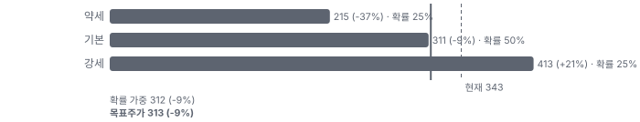

**주가별 업사이드**

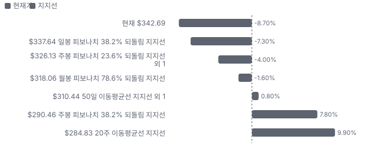
- 제품·서비스 포트폴리오

**고객 믹스(3Q26, 매출 대비)**

**공급 병목(10점, 낮을수록 병목)**

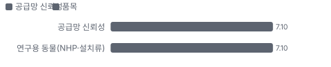

**CAPEX의 매출 대비 비중**

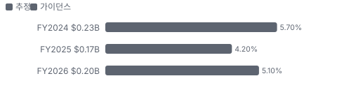

**어닝콜 변화별 주주가치 영향**

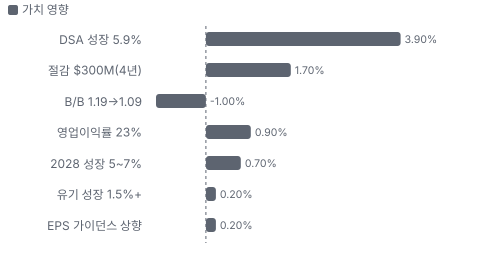

**멀티플 프리미엄(Fwd 1Y P/E, 최근 4개 분기말)**

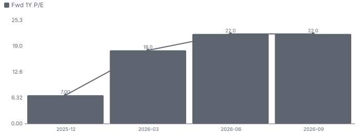

**합리적 멀티플**

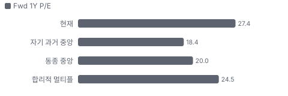

**수주·파이프라인 확실성 사다리**

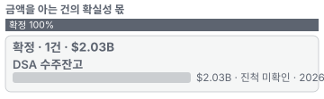

**비용 요인별 매출 대비 비중과 1년 변화**

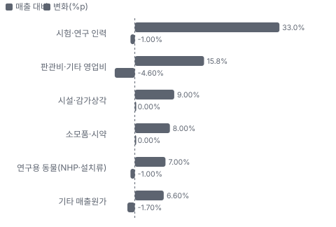

**BOM 항목 가격 +10% 시 OPM 변화**

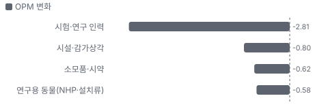

**DSA(발굴·안전성 평가) BOM 원가 몫과 가격 +10% 시 OPM**

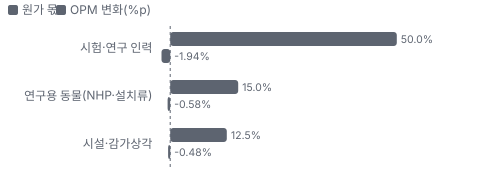

**RMS·Manufacturing(연구 모델·품질 시험) BOM 원가 몫과 가격 +10% 시 OPM**

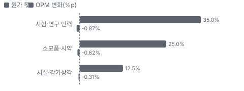

**목표주가 산정 — 기본 시나리오, 도달 확률 약 49%**

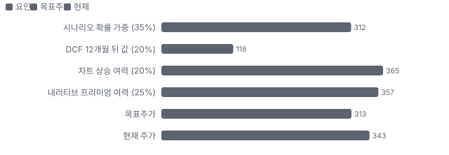

**일봉 지지·저항과 목표주가**

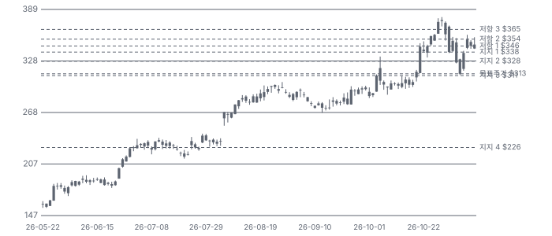

**일별 거래량 분해**

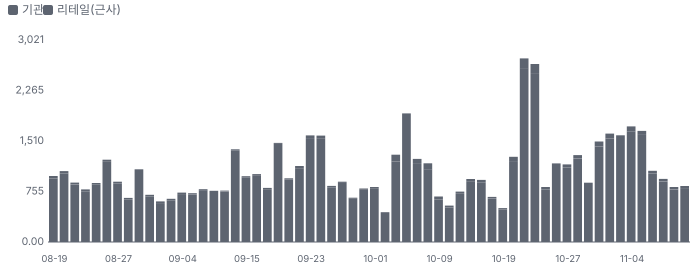

**기관 자금 흐름**

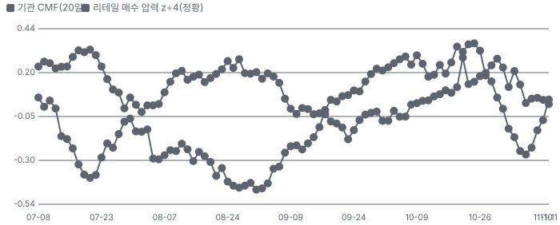

**몬테카를로**

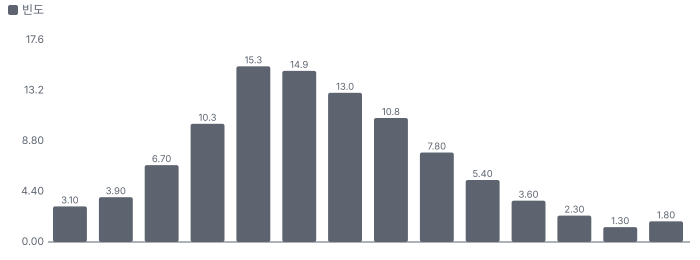

해석: 3,000번 중 0번(0%)에서 가치가 지금 주가 이상이었다. 가정을 흔들어도 지금 주가를 뒷받침하지 못하는 경우가 더 많다. 가운데 값은 0.31배이고, 열 번 중 여덟 번은 0.20~0.44배 사이에 든다.

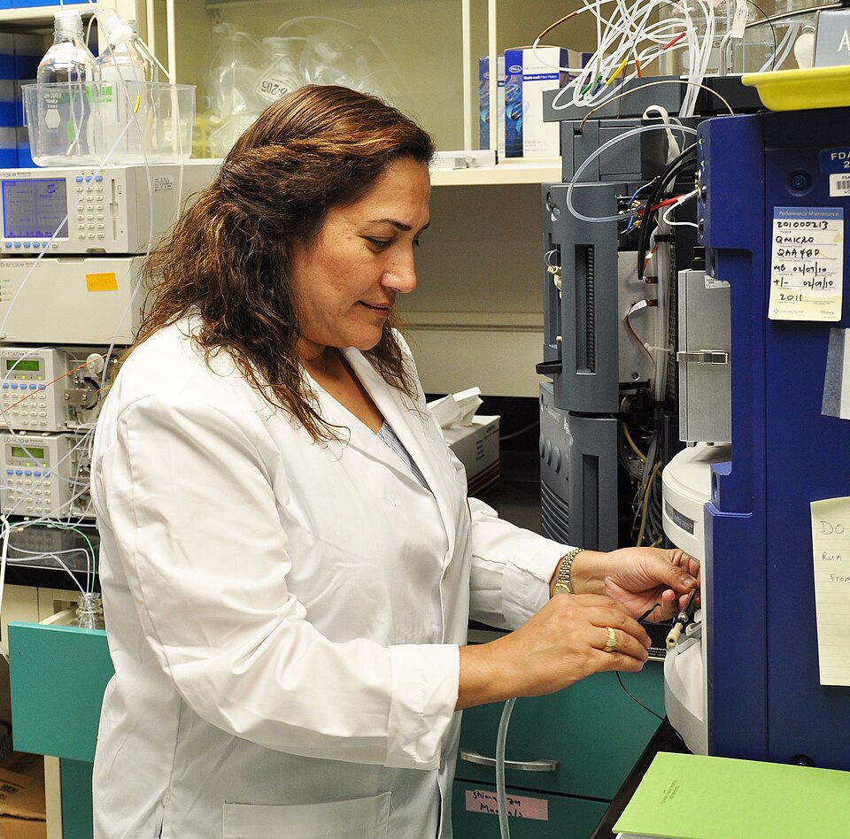
**DSA(발굴·안전성 평가)** — 독성 시험 실험실 — 같은 종류 예시(미국 FDA 국립독성연구센터, Charles River 시설 아님)
_사진: The U.S. Food and Drug Administration · Public domain · Wikimedia Commons_

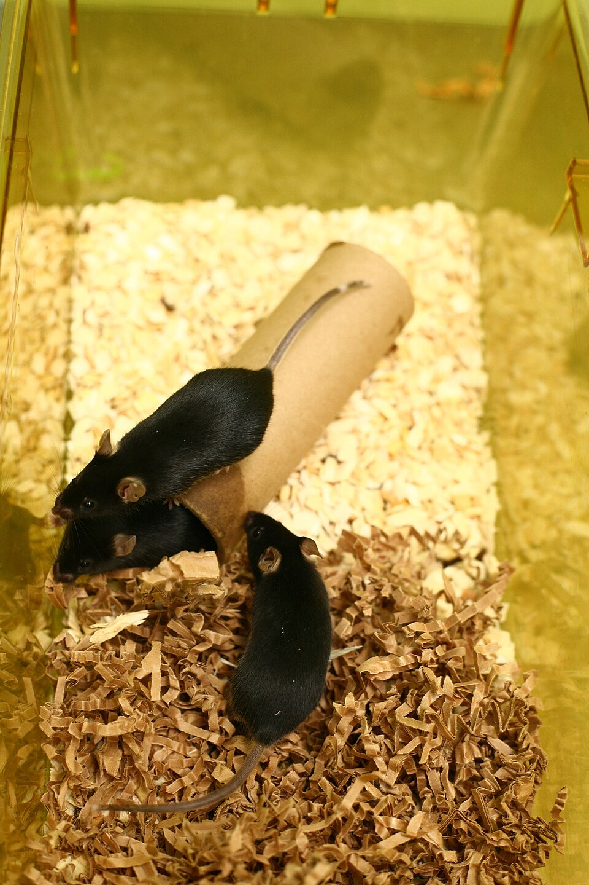
**RMS·Manufacturing(연구 모델·품질 시험)** — 사육 케이지 안의 실험용 쥐 — 같은 종류 예시(Charles River 연구 모델 아님)
_사진: Commissioned by Understanding Animal Research · CC BY-SA 4.0 · Wikimedia Commons_

## 내러티브

> **기업가치를 결정하는 이야기:** Charles River는 신약 후보가 사람에게 쓰이기 전에 거쳐야 하는 안전성 시험(독성 시험)을 대신 해 주고, 그 시험에 쓰는 실험동물과 의약품 품질 시험 제품을 판다. 2023~2025년에 바이오 투자 위축, 캄보디아 영장류 조달 문제, FDA의 동물 시험 축소 계획(2025-04)이 겹쳐 매출이 역성장했다. 2026년에 수요가 돌아오고 손실 사업을 팔아 이익률이 올랐다. 기업가치는 성장 회복(2028 5~7%)과 이익률 유지, 그리고 NAMs(동물 실험을 대체하는 새 시험법, 세포·장기칩·컴퓨터 모델) 전환 속도로 정해진다

> **멀티플·EPS 프리미엄**
> **멀티플:** Fwd 1Y P/E 27.4배로 동종 중앙(약 20배)보다 약 37% 높다. Fwd 2Y 23.9배·3Y 21.7배다 — 시장은 이익 성장이 이어진다고 본다. 1년 전 15배에서 배수가 거의 두 배가 됐다
> **EPS:** FY2027 EPS 컨센서스는 2Q 콜 직전 \$12.18에서 \$12.81로 5% 올랐다. 주가는 같은 기간 \$234 → \$343(+46%)이다 — 상승의 대부분은 배수 확대다

### 투자자들은 왜 열광했나

2025년 4월 FDA의 동물 시험 축소 계획 발표로 주가가 하루에 약 28% 떨어졌다(\$139 → \$100). 그 뒤 '규제 전환은 느리고 바이오 자금은 돌아온다'는 이야기가 퍼졌고, 2026년 2Q 유기 성장 전환(8/5 +11%)으로 숫자가 붙었다. 1년 동안 \$169 → \$343(+103%)이고 10월 장중 고점은 \$379.63이다

### 무엇이 기업가치를 바꾸나

> **구조적 체질 변화**
> **변화:** 손실·저성장 사업(CDMO(의약품 위탁 개발·생산)·Cell Solutions(세포 치료 원료 세포 공급 사업)·유럽 Discovery 일부) 매각과 'Create the Future(Charles River의 비용 절감·체질 개선 프로그램)' 절감 — 포트폴리오를 시험 서비스 중심으로 좁힘
> **증거:** 2Q26 어닝콜(2026-08-05, 요지만 자기 말로)
> **반증:** 매각 뒤에도 영업이익률이 22% 아래로 돌아간다

> **고부가 믹스 확장**
> **변화:** NHP 기반 생물의약품 독성 시험·생체분석 수요 강세, Manufacturing(의약품 품질 시험 제품·바이오의약품 시험 사업부) 영업이익률 38.6%
> **증거:** 3Q26 어닝콜(2026-11-04, 요지만 자기 말로)
> **반증:** NHP 시험 수요가 꺾인다

> **기술 혁신**
> **변화:** NAMs(가상 대조군 등) 제안 수주, 디지털 병리 — 회사가 대체 기술의 공급자가 되려 한다
> **증거:** 3Q26 어닝콜(2026-11-04, 요지만 자기 말로)
> **반증:** NAMs 시장을 다른 회사가 가져간다

> **실행 속도**
> **변화:** 해당 없음(시험 서비스라 납품 리드타임이 없고, 시험 착수 대기 기간은 회사·동종 모두 공시하지 않는다)
> **증거:** 3Q26 어닝콜(2026-11-04, 요지만 자기 말로)
> **반증:** -

> **M&A**
> **변화:** 2026 매각 완료 — 남은 포트폴리오 재검토 진행(인수 발표 없음)
> **증거:** 2Q26 어닝콜(2026-08-05, 요지만 자기 말로)
> **반증:** 고가 인수로 차입이 늘어난다

> **정책·입법 연관성**
> **재정정책:** NIH(미국 국립보건원) 연구 예산 — 학계·정부 고객(RMS(실험용 쥐 등 연구 모델과 관련 서비스 사업부))에 영향. 행정부 삭감안과 의회 세출의 차이는 이번 회차 1차 자료 미대조 3Q26 어닝콜(2026-11-04, 요지만 자기 말로) 반증: NIH 예산 삭감이 세출법으로 확정된다 의회 동의 4/10 — 하원 2/5(세출 단계 미대조 — 확인 전 2) · 상원 2/5(같은 이유).
> **행정명령:** FDA 동물 시험 단계적 축소 계획(2025-04 발표) — 행정 조치, 지침 확정·시행 단계 미대조 FDA 발표(1차 문서 미대조) 반증: FDA 최종 지침이 면제 범위를 넓힌다 의회 동의 2/10 — 하원 1/5(행정 조치 — 의회 동의 논의 확인 못 함) · 상원 1/5(같은 이유).
> **연관입법:** FDA Modernization Act 2.0(2022 시행, 동물 시험 의무 삭제) — 이미 시행된 법이고 후속 3.0 법안 단계는 미대조 미확인 반증: 후속 법안이 동물 시험 축소를 의무화한다

> **CAPEX 낙수효과**
> **변화:** 바이오 투자(최근 12개월 약 \$100B, 회사 발언)가 전임상 시험 수요로 내려온다 — 금지표대로 투자액을 매출로 바로 옮기지 않는다
> **증거:** 3Q26 어닝콜(2026-11-04, 요지만 자기 말로)
> **반증:** 바이오 자금 조달이 다시 줄어든다

### 내러티브 근거

> '바이오 자금이 돌아오고 NAMs 공포가 과장이었다 — 전임상 수요가 바닥을 지나 다시 성장한다'는 이야기. 숫자가 받쳤다(DSA 유기 성장 0.2% → 5.9%, 영업이익률 20.5% → 23%). 주가는 1년 +103%, Fwd 1Y P/E는 15배 → 27배로 올랐다. 동종 대비 멀티플 차이 +37% 중 회사 고유 몫은 +11%다. 단계는 확산, 쏠림은 높음이다.

> **바이오 자금 회복과 전임상 수요 반등** · 확인
> **논리:** 바이오 투자 회복이 IND(임상 시험 계획 승인 신청) 전 독성 시험 수요로 내려온다
> **숫자:** DSA 유기 성장 0.2% → 5.9%, 4개 분기 연속 B/B 1 이상(평균 약 1.1)
> **반증:** B/B가 1.0 아래로 내려간다

> **마진 회복(매각·NHP 원가·절감)** · 확인
> **논리:** 손실 사업 매각과 NHP 원가 하락, \$300M 절감으로 영업이익률이 20%대 중반으로 간다
> **숫자:** 영업이익률 3Q 23%, 4Q 약 +150bp
> **반증:** 4Q 영업이익률이 24% 미만

> **가격 회복** · 태동
> **논리:** 수요가 돌아와 시험 단가가 오른다
> **숫자:** 가격 효과는 빨라야 2027 하반기(회사)
> **반증:** 2027 가이던스에 가격 기여가 없다

> **반대 — NAMs·규제 전환** · 잠복
> **논리:** FDA·NIH가 동물 시험을 줄이면 DSA·RMS 수요가 구조적으로 준다
> **숫자:** 회사는 NAMs 제안을 따내고 있다고 말하지만 매출 기여는 아직 없다(3Q 콜)
> **반증:** FDA 지침이 동물 시험 면제를 일부 모달리티에 한정한다

> **반대 — AI 신약 개발** · 태동
> **논리:** AI가 후보 물질을 더 잘 거르면 전임상 시험 건수가 준다
> **숫자:** 3Q 콜 질문 5곳 중 2곳이 AI 질문
> **반증:** AI로 발굴한 후보가 오히려 시험 수요를 늘린다(회사 주장)

이미지 없음(아직 생성 전) — RMS·Manufacturing(연구 모델·품질 시험)·DSA(발굴·안전성 평가)

## 포트폴리오

| 제품·서비스 | 구분 | 무엇 | 쓰는 곳 | 돈 버는 방식 | Mix | Mix 변화(공시(3Q \$596M)) |
|---|---|---|---|---|---|---|
| DSA(발굴·안전성 평가) | 서비스 | 독성 시험·안전성 약리·병리·생체분석·발굴 서비스 | 신약 후보의 IND 신청 전 안전성 자료 | 시험 건별 계약(잔고로 쌓여 수개월에 걸쳐 매출) | 61% | 미확인 |
| RMS·Manufacturing(연구 모델·품질 시험) | 제품 | 실험용 쥐·랫드 등 연구 모델, 유전자 변형 모델, 내독소·미생물 품질 시험 제품(Microbial Solutions(의약품 무균·내독소 품질 시험 제품 사업)), 바이오의약품 시험 | 학계·제약 연구, 의약품 출하 품질 시험 | 모델 판매·시험 키트·서비스 | 39% | 미확인 |

## 고객

> **3Q26 최대 고객 중소 바이오테크(바이오) 40%, 상위 3곳 40%, 집중도 보통.** 공시·회사 발표로 확인한 몫은 매출의 0%이고, 나머지 고객 몫은 추정이거나 미분해다. 10% 이상 단일 고객은 공시하지 않는다(미확인). 3Q에는 글로벌 제약과 중소 바이오 고객 매출이 모두 유기 성장했다. RMS는 학계·정부 고객 비중이 커서 회복이 늦다

**고객별 매출 몫(3Q26)**
| 고객 | 몫 | 변화 | 근거 |
|---|---|---|---|
| 중소 바이오테크(바이오) | 35~45% | 미확인 | 추정 |
| 글로벌 제약사(대형 제약) | 미확인 | 미확인 | 회사 발표 |
| 학계·정부(학계) | 미확인 | 미확인 | 회사 발표 |
| 기타·미분해 | 60% | - | - |

> **중소 바이오테크(바이오)** · 추정
> **사는 것:** IND 전 독성 시험·NHP 시험
> **추정 근거:** DSA 고객의 큰 몫이 바이오라는 업계 통념과 3Q 콜의 바이오 자금 회복 발언으로 둔 범위(10-K 미대조)

> **글로벌 제약사(대형 제약)** · 회사 발표
> **사는 것:** DSA 안전성 시험·생체분석
> **추정 근거:** 3Q 유기 성장, 상위 10 제약사와 관계 연장

> **학계·정부(학계)** · 회사 발표
> **사는 것:** 연구 모델(RMS)·인소싱
> **추정 근거:** RMS 매출에서 비중이 크고 예산 영향으로 회복이 늦다

## 수주·파이프라인

> **2026-11-12 기준 1건.** 확정 \$2.03B. 공시 DSA 수주잔고(회사 발표) \$2.03B.

**실행 속도와 방해 요인**
| 항목 | 상태 | 실행 속도 | 방해 요인 |
|---|---|---|---|
| DSA 수주잔고 | 확정 | 미확인 | 시험 취소·연기 · 바이오 자금 흐름 |

## 마진 구조

> **GPM 36.4%, OPM 20.6%.** 3Q25 대비 GPM +2.7%p, OPM +7.3%p. 변동비는 매출의 31%이고, 매출이 10% 늘면 OPM은 +4.4%p 움직인다. 영업이익률(조정)이 3Q 23%로 1년 새 +330bp 올랐다. 원인은 매각(CDMO 손실 사업 제거)·DSA 물량·NHP 조달 원가 하락이다. 원가의 대부분은 인력과 동물·시설이다(분해는 추정)

**GPM에서 OPM까지(GAAP)**
| 기간 | GPM | 연구개발 | 판관비 | 기타 | OPM |
|---|---|---|---|---|---|
| 3Q25 | 33.7% | 0.0% | 20.4% | 0.0% | 13.3% |
| 3Q26 | 36.4% | 0.0% | 15.8% | 0.0% | 20.6% |

**마진을 결정하는 비용 요인 — 비용 +10% 시 OPM**
| 비용 | 매출 대비 | 변화 | 고정비 | OPM |
|---|---|---|---|---|
| 시험·연구 인력 | 33.0% | -1.0%p | 70% | -3.30%p |
| 판관비·기타 영업비 | 15.8% | -4.6%p | 70% | -1.58%p |
| 시설·감가상각 | 9.0% | +0.0%p | 100% | -0.90%p |
| 소모품·시약 | 8.0% | +0.0%p | 20% | -0.80%p |
| 연구용 동물(NHP·설치류) | 7.0% | -1.0%p | 0% | -0.70%p |
| 기타 매출원가 | 6.6% | -1.7%p | 50% | -0.66%p |

**비용을 움직이는 요인**
| 비용 | 요인 |
|---|---|
| 시험·연구 인력(매출원가) | 병리·독성 시험 인력, 물량 증가에 고정비 레버리지 · 근거 추정 |
| 판관비·기타 영업비(판관비) | 본사 비용 매출의 5.5%(3Q)·인수 상각·구조조정 · 근거 공시 |
| 시설·감가상각(매출원가) | 동물실·실험실 시설 · 근거 추정 |
| 소모품·시약(매출원가) | 시험량 · 근거 추정 |
| 연구용 동물(NHP·설치류, 매출원가) | 캄보디아 NHP 조달 원가 하락(3Q 콜) · 근거 추정 |
| 기타 매출원가(매출원가) | 매각 사업(CDMO) 원가 제거 · 근거 추정 |

**DSA(발굴·안전성 평가) BOM — 매출의 61%, GPM 36%(전사 3Q 총이익률 36.4% 대용(세그먼트 총이익률 미공시, 세그먼트 영업이익률 26.8%)), 항목 가격 +10% 시**
| 항목 | 원가 몫 | 전가 | 제품 GPM | OPM |
|---|---|---|---|---|
| 시험·연구 인력 | 45~55% | 미확인 | -3.2%p | -1.94%p |
| 연구용 동물(NHP·설치류) | 10~20% | 미확인 | -1.0%p | -0.58%p |
| 시설·감가상각 | 10~15% | 미확인 | -0.8%p | -0.48%p |
| 미분해 | 22% | - | - | - |

**RMS·Manufacturing(연구 모델·품질 시험) BOM — 매출의 39%, GPM 36%(전사 3Q 총이익률 대용(세그먼트 영업이익률 RMS 24.4%·Manufacturing 38.6%)), 항목 가격 +10% 시**
| 항목 | 원가 몫 | 전가 | 제품 GPM | OPM |
|---|---|---|---|---|
| 시험·연구 인력 | 30~40% | 미확인 | -2.2%p | -0.87%p |
| 소모품·시약 | 20~30% | 미확인 | -1.6%p | -0.62%p |
| 시설·감가상각 | 10~15% | 미확인 | -0.8%p | -0.31%p |
| 미분해 | 28% | - | - | - |

시험·연구 인력 가격이 +10% 오르면 영업이익은 -13.6% 움직인다. 판매가 전가를 모르는 항목은 전가 0%로 계산했다.

**BOM 항목 가격을 움직이는 것**
| 항목 | 요인 |
|---|---|
| 시험·연구 인력 | 독성·병리 시험은 노동 집약 · 근거 추정 |
| 연구용 동물(NHP·설치류) | NHP 시험 수요 강함(3Q 콜), 조달 원가 하락 · 근거 추정 |
| 시설·감가상각 | GLP(비임상 시험 관리 기준) 시설 · 근거 추정 |
| 소모품·시약 | 내독소 시험 키트·시약 · 근거 추정 |
| 시험·연구 인력 | 사육·시험 인력 · 근거 추정 |
| 시설·감가상각 | 사육 시설 · 근거 추정 |

## 공급망 병목

이미지 없음(아직 생성 전) — RMS·Manufacturing(연구 모델·품질 시험)

> **공급망 신뢰성 7.1/10, 관리 가능.** 가장 약한 고리는 연구용 동물(NHP·설치류) 7.1점이고, 품목 평균은 7.1점이다. 근거가 부족한 1건(시험·연구 인력)은 점수에서 뺐다. 핵심 투입물은 NHP(영장류)다. 2023년 캄보디아 조달 문제로 원가·물량이 흔들렸고, 지금은 캄보디아 조달 원가가 내려와 DSA 마진을 올린다. 수요는 NHP 시험이 강하다(3Q 콜)

**병목과 마진 — 품목 가격 +10% 시 OPM**
| 품목 | 점수 | 판정 | 구분 | OPM |
|---|---|---|---|---|
| 연구용 동물(NHP·설치류, 필수) | 7.1 | 관리 가능 | 가격 위험 | -0.58%p |

> **연구용 동물(NHP·설치류)** · 7.1/10
> **왜:** NHP는 생물의약품 독성 시험의 필수 모델이다
> **병목 요인:** 인증 공급사 3곳 · 캐파 균형 · 리드타임 미확인 · 재인증 12개월 · 1위 점유율 미확인 · 동남아(캄보디아) 집중 60% · 물량 확보 복수구매
> **풀리는 조건:** 미확인(NAMs 전환 시 수요 감소)

**공급사**
| 품목 | 공급사 | 몫 | 근거 |
|---|---|---|---|
| 연구용 동물(NHP·설치류) | 캄보디아 NHP 공급처(이름 미공시, 영장류 조달) | 미확인 | 회사 발표 |
| 연구용 동물(NHP·설치류) | 자체 NHP 사육(모리셔스 등, 미대조, 영장류 사육) | 미확인 | 추정 |
| 시험·연구 인력 | 자체 고용(병리학자 140명 이상, 시험 수행) | 미확인 | 회사 발표 |

## 생산능력

> **현재 명목 캐파 미확인, 가동률 미확인.** FY2026 CAPEX는 \$0.20B로 매출의 5.1%다. 시험 캐파는 북미(미국·캐나다)와 유럽(영국·프랑스 등)의 GLP 시설에 있다. 2026년에 유럽 Discovery 일부 사업장과 CDMO·Cell Solutions를 매각해 포트폴리오를 줄였다. 시설별 캐파·가동률은 공시하지 않는다

**생산시설 8곳**(이름이 확인된 주요 시설만(회사 소개). 10-K Item 2 전체 목록(100곳 이상, 추정)은 이번 회차 미대조), 미확인 8곳. 시설별 생산능력은 공개되지 않았다 — 회사 전체 캐파만 위에 적었다.

**생산시설 8곳 — 명칭·위치·생산능력**
| 시설 | 위치 | 용도 | 생산능력 | 소유·상태 |
|---|---|---|---|---|
| Wilmington 본사 | 미국 매사추세츠 윌밍턴 | 본사·RMS | 미확인 — 미공시 | 미확인 · 가동 |
| Reno 안전성 평가 | 미국 네바다 리노 | DSA 독성 시험 | 미확인 — 미공시 | 미확인 · 가동 |
| Ashland 안전성 평가 | 미국 오하이오 애슐랜드 | DSA 독성 시험 | 미확인 — 미공시 | 미확인 · 가동 |
| Mattawan 안전성 평가 | 미국 미시간 매터원 | DSA 독성 시험 | 미확인 — 미공시 | 미확인 · 가동 |
| Laval 안전성 평가 | 캐나다 퀘벡 라발 | DSA 독성 시험 | 미확인 — 미공시 | 미확인 · 가동 |
| Tranent 안전성 평가 | 영국 스코틀랜드 트래넌트 | DSA 독성 시험 | 미확인 — 미공시 | 미확인 · 가동 |
| Lyon 연구 모델 | 프랑스 리옹 | RMS | 미확인 — 미공시 | 미확인 · 가동 |
| Charleston Microbial Solutions | 미국 사우스캐롤라이나 찰스턴 | 내독소 시험 제품 | 미확인 — 미공시 | 미확인 · 가동 |

공개된 증설 계획은 확인되지 않았다.

**CAPEX와 매출 대비**
| 기간 | CAPEX | 매출 | 매출 대비 | 구분 |
|---|---|---|---|---|
| FY2024 | \$0.23B | \$4.05B | 5.7% | 추정 |
| FY2025 | \$0.17B | \$4.02B | 4.2% | 추정 |
| FY2026 | \$0.20B | \$3.94B | 5.1% | 가이던스 |

## 해자

> 해자는 '규제 시험(GLP 독성 시험)을 대규모로, 전 세계 시설에서, 연구 모델과 함께 공급한다'는 규모와 신뢰다. 신약 후보는 IND 전에 안전성 자료가 필요하고, 그 시험은 실험동물·병리 인력·검증된 시설이 있어야 한다. 위협은 NAMs와 AI로 시험량 자체가 줄어드는 것이다

> **규모·시설(규제 시험 캐파)** · 강함
> **해자:** 전임상 안전성 시험의 최대 공급사 중 하나 — 병리학자 140명 이상(2Q 콜)
> **근거:** 2Q26 어닝콜(2026-08-05, 요지만 자기 말로)
> **숫자:** DSA 매출 분기 \$596M, 잔고 \$2.03B
> **깨지는 조건:** 경쟁사·아시아 CRO(의약품 개발 위탁 연구 기관)가 가격으로 점유율을 가져간다

> **연구 모델 공급(RMS)** · 보통
> **해자:** 실험용 설치류 공급과 시험 서비스를 함께 판다
> **근거:** 3Q26 어닝콜(2026-11-04, 요지만 자기 말로)
> **숫자:** RMS 분기 매출 \$208M, 영업이익률 24.4%
> **깨지는 조건:** 학계·정부 예산 축소가 이어진다

> **NHP 조달망** · 보통
> **해자:** 영장류 조달 원가·물량을 관리할 수 있는 몇 안 되는 회사
> **근거:** 3Q26 어닝콜(2026-11-04, 요지만 자기 말로)
> **숫자:** 캄보디아 조달 원가 하락이 DSA 마진 +140bp YoY에 기여
> **깨지는 조건:** 조달 규제·수출 중단이 다시 생긴다

> **규제 관성(동물 시험 요구)** · 약화 중
> **해자:** 규제 기관이 동물 시험을 요구하는 한 수요가 유지된다
> **근거:** FDA 2025 동물 시험 단계적 축소 계획(1차 문서 미대조)
> **숫자:** 미확인
> **깨지는 조건:** FDA가 단일클론항체 등에서 동물 시험 면제를 넓힌다

## 경영진·네트워크

> CEO Birgit Girshick(내부 승진, 3Q 콜 진행)과 CFO Glenn Coleman이 이끈다. 사업 포트폴리오 정리(CDMO·Cell Solutions·유럽 일부 사업장 매각)와 'Create the Future' 절감이 핵심 과제다

> **Birgit Girshick** · CEO · 미확인
> **프로필:** DSA 사업 총괄 출신(추정), 3Q 콜 진행
> **비즈니스:** 전사
> **정계:** 미확인
> **동문:** 미확인
> **사모임:** 미확인

> **Glenn Coleman** · EVP·CFO · 미확인
> **프로필:** 3Q 콜 재무·가이던스
> **비즈니스:** 재무
> **정계:** 미확인
> **동문:** 미확인
> **사모임:** 미확인

**네트워크 정량화**
| 연결 | 강도 | 닿는 매출 | 가중 노출 | 매출 대비 | 근거 |
|---|---|---|---|---|---|
| 비즈니스: 상위 10 제약사와 관계 연장(3Q 콜) — 대형 제약·중소 바이오 고객 모두 유기 성장 | 3/5 | 미확인 | 미확인 | 미확인 | 계약 금액 미공시 3Q26 어닝콜(2026-11-04, 요지만 자기 말로) |
| 정계: NIH·학계 예산(연구 모델 수요)과 FDA 동물 시험 정책에 노출 | 2/5 | 미확인 | 미확인 | 미확인 | 로비 금액 미대조 3Q26 어닝콜(2026-11-04, 요지만 자기 말로) |

가중 노출은 연결이 닿는 매출의 크기다. 연결이 그 매출을 만들었다는 뜻이 아니며, 인과는 공개 자료로 입증하지 못한다.

## 약세 논리 및 셀온 조건

| 약세 논리 | 근거 | 반박 | 가를 자료 · 공개 시점 |
|---|---|---|---|
| 수주 반등이 꺾였다 | 순수주 \$701M → \$652M, B/B 1.19 → 1.09(3Q 콜) | B/B는 4개 분기 연속 1 이상(평균 약 1.1), 제안 건수 5개 분기 연속 증가 | 4Q26 B/B — 2027-02 실적 |
| 배수가 이미 회복을 반영했다 | Fwd 1Y P/E 27.4배 vs 동종 약 20배, 1년 전 15배 | 이익률 개선 몫(매각·NHP 원가)은 이미 확정된 부분이 크다 | 2027 EPS 가이던스 — 2027-02 |
| NAMs가 시험량을 줄인다 | FDA 동물 시험 축소 계획(2025-04), 회사도 NAMs 제안을 따내는 중 | NHP 기반 안전성 시험 수요가 3Q에 강했다(회사) | FDA 최종 지침·면제 범위 — 시점 미확정 |
| AI가 전임상 후보를 줄인다 | 3Q 콜 질문 5곳 중 2곳이 AI | 후보 발굴 속도가 빨라지면 시험 건수가 늘 수도 있다(회사 주장) | 제안 건수·바이오 IND 건수 추이 |
| RMS가 회복하지 못한다 | RMS 유기 −0.6%, 학계·정부 예산 영향 | Insourcing 정부 계약 수주로 학계·정부 매출은 안정적(3Q 콜) | NIH 세출 확정 — 2027 회계연도 |
| 가격 회복이 늦다 | 가격 효과는 빨라야 2027 하반기(회사) | 수요가 이어지면 2027 하반기부터 잔고를 거쳐 반영 | 2027 가이던스의 가격 기여 |

**데이터 한계.** 10-K·10-Q 원문(고객 구성, 시설 목록, 희석 증권, 과거 CAPEX)을 이번 회차에 직접 대조하지 못했다 — 중소 바이오 고객 비중과 FY2024·2025 CAPEX는 추정이다. 원가 분해(인력·동물·시설)는 회사가 공시하지 않아 추정이다. 전임상 비중이 큰 상장 동종이 없어 동종에 임상 CRO가 섞였다. **정책.** FDA 동물 시험 축소는 발표 단계이고 지침 확정·시행 일정은 1차 문서로 대조하지 못했다. NIH 예산은 세출 단계 미대조다. **추가 원천(11/12).** 커뮤니티 언급량은 이번 회차에 조회하지 않았다. 공매도는 유통 주식의 7.2%(2.6일분)다.

> **셀온 조건**
> **조건 1:** 4Q26 B/B가 1.0 아래 — 수요 반등이 멈췄다는 신호
> **조건 2:** 2027 가이던스 유기 성장이 2% 미만
> **조건 3:** 4Q26 조정 영업이익률이 24% 미만 — 마진 회복이 멈춘다
> **조건 4:** FDA 최종 지침이 생물의약품 독성 시험의 동물 시험 면제를 넓힌다
> **조건 5:** NHP 조달 차질(수출 규제·조사)이 다시 생긴다

## 어닝콜 변화

**직전 콜 대비 새로 나오거나 바뀐 내용 → 가치 영향**
| 항목 | 내용 | 직전 콜 | 최신 콜 | 모델 동인 이동 | 확신도 | 가치 영향 |
|---|---|---|---|---|---|---|
| 업데이트 | DSA 유기 성장 | 2Q +0.2%(3년 만의 첫 성장) | 3Q +5.9%, 4Q도 중간 한 자릿수 예상 | 1년차 성장률 +2.0% | 1.0 | +3.9% |
| 업데이트 | 연간 유기 성장 가이던스 | 0~1% | 1.5% 이상 | 기준연도 매출 +\$0.01B | 0.8 | +0.2% |
| 업데이트 | 영업이익률 | 2Q 20.5% | 3Q 23.0%, 4Q 약 +150bp | 출발 이익률 +1.5% | 1.0 | +0.9% |
| 업데이트 | EPS 가이던스 | \$11.15~11.45 | \$11.35~11.55 | 출발 이익률 +0.30% | 0.8 | +0.2% |
| 부정 | 수주 | 2Q 순수주 \$701M·B/B 1.19 | 3Q 순수주 \$652M·B/B 1.09, 잔고 \$2.03B | 1년차 성장률 -0.50% | 1.0 | -1.0% |
| 신규 | 중기 성장 경로 | 중기 목표만(투자자의 날) | 2027 점진 개선, 2028부터 5~7% | 장기 성장 수렴값 +0.50% | 0.5 | +0.7% |
| 신규 | 비용 절감 | 미확인 | 'Create the Future' 4년 누적 \$300M 이상 | 목표 이익률 +1.0% | 0.5 | +1.7% |
| **합계** | 단독 합 |  |  | 동시 적용 +6.8% |  | **+6.6%** |

**사건별 EPS 리비전**
| # | 날짜 | 구분 | 사건 | CY2026 EPS 전→후 | CY2027 EPS 전→후 | 리비전 | 주가 반응 |
|---|---|---|---|---|---|---|---|
| ① | 26-02-18 | 실적 | 4Q25 실적·2026 가이던스 | \$10.69 → \$10.90 | \$11.55 → \$11.72 | +1.5% | -0.3% |
| ② | 26-05-07 | 실적 | 1Q26 실적, DSA 수주 회복 | \$11.00 → \$10.98 | \$12.42 → \$12.00 | -3.4% | -0.0% |
| ③ | 26-08-05 | 실적 | 2Q26 유기 성장 전환, 당일 +11% | \$11.02 → \$11.28 | \$12.11 → \$12.50 | +3.2% | +11.4% |
| ④ | 26-11-04 | 실적 | 3Q26 DSA +5.9%, 당일 −7% | \$11.35 → \$11.40 | \$12.58 → \$12.81 | +1.8% | -7.3% |

**해석:** 3개 구간 누적 주가 +116% = EPS 리비전 +8% × 멀티플 +101%. 더 크게 움직인 쪽은 **멀티플**이다.

## 밸류에이션

> **목표주가 \$313, 업사이드 -9%.** 자리는 기본 시나리오이고 도달 확률은 약 49%다. 기본 \$311, 강세 \$413(+21%), 약세 \$215(-37%). DCF 기준 업사이드는 기본 -69%, 강세 -64%, 약세 -74%다(WACC 9.4%).

기준 멀티플이 Fwd 1Y P/E라 시나리오도 다음 4개 분기 EPS로 둔다. 확률은 3Q의 가이던스 상향과 B/B 하락을 함께 반영해 약세 25%·기본 50%·강세 25%에 둔다. 4Q26 EPS 컨센서스는 \$2.87~4.53으로 분산이 크다.

> **약세 \$215 (-37%)** · 확률 25%
> **가정:** 18.5배 × EPS \$11.60
> **근거:** B/B가 1.0 근처로 내려가 2027 유기 성장이 1~2%에 머물고, 가격 효과가 늦어진다. 매출 약 \$3.95B, 조정 영업이익률 22% — EPS 약 \$11.6

> **기본 \$311 (-9%)** · 확률 50%
> **가정:** 24.7배 × EPS \$12.60
> **근거:** DSA 중간 한 자릿수 성장과 절감이 이어져 매출 약 \$3.99B(다음 4개 분기 컨센서스), 조정 영업이익률 약 21.6%, 세율 23% — EPS 약 \$12.6(컨센서스 \$12.61과 같은 수준)

> **강세 \$413 (+21%)** · 확률 25%
> **가정:** 30.8배 × EPS \$13.40
> **근거:** B/B가 1.15 이상으로 돌아오고 NHP 원가 하락·\$300M 절감이 앞당겨진다. 매출 약 \$4.05B, 조정 영업이익률 23% 이상 — EPS 약 \$13.4

**멀티플 선정 — Fwd 1Y P/E**
| 단계 | 조정 | 근거 |
|---|---|---|
| 동종 중앙값 | 20.0배 | 범위 17.8~34.0배, 5곳 |
| 펀더멘털 | +11% | 성장·이익률·ROIC로 본 합리적 멀티플 24.5배와의 차이의 일부만 인정 |
| 해자 | +7% | 규모·시설(규제 시험 캐파) 강함 · 연구 모델 공급(RMS) 보통 · NHP 조달망 보통 · 규제 관성(동물 시험 요구) 약화 중 |
| 반복 매출 | +0% | 재료 없음 |
| 수주 전환·가시성 | +0% | 잔고 커버리지 0.29 · book-to-bill 0.58 → 가시성 0.43 · 전환 10.2개월(동종 12) |
| 내러티브 | +5% | 단계 확산 |
| 사이클·실행 판단 | +0% | 요인에 없는 조정은 하지 않는다. 동종보다 높은 배수는 엔진의 동종 비교로 드러난다 |
| **선정** | **24.7배** | 지금 27.4배 |

**동종 레인지**
| 회사 | Fwd 1Y P/E | Fwd 2Y P/E | Fwd 3Y P/E | 성장 | 영업이익률 | ROIC |
|---|---|---|---|---|---|---|
| IQV | 20.0 | 17.8 | 16.4 | 6% | 13% | 9% |
| ICLR | 17.8 | 15.7 | 14.1 | 2% | 12% | 7% |
| MEDP | 34.0 | 29.3 | 25.4 | 4% | 22% | - |
| LH | 19.5 | 17.3 | 16.0 | 5% | 15% | 12% |
| FTRE | 20.1 | 13.3 | 10.3 | 3% | 5% | 8% |
| **Charles River Laboratories** | 27.4 | 23.9 | 21.7 |  |  |  |

지금 주가가 요구하는 5년 매출 CAGR 35%, 기본 시나리오 5%. 몬테카를로 중앙값 업사이드 -69%.

> 의사결정 보조(투자자문 아님): ① 매수 매력: 5년 보유 가정 연 기대수익 -13.5% — 주주가 요구하는 수익률(자기자본비용) 10.0%보다 -23.5%p · 요구수익률을 넘을 확률 0% · 안전마진 0.20(비관적 경우의 기업가치가 지금 시가총액의 20%) → 정량 신호 약함 / ② 위험 예산 지표(이론): 0% — 기대수익이 요구수익률에 못 미친다(켈리 기준 — 수익·손실 확률로 계산한 이론상 최대 노출 — 0%는 참고) · 5년 뒤 나쁜 경우(하위 10%) -70% · 30% 넘게 잃을 확률 92% / ③ 상방(5년): 평균 0.48배 · 2배 이상 확률 0% · 3배 이상 0% · 10배 이상 0% · 잘 풀린 경우(상위 10%) 0.68배 이상

## 매수 위치(일봉)

> **현재가 \$343는 '지지 근접'(가장 가까운 일봉 지지 \$338에서 ATR 0.2배 위).** 이 자리에서 목표주가까지 -8.7%, 첫 일봉 저항까지 +0.9%, 다음 지지까지 하방 -1.2%, 손익비 -7.1배. 손익비는 지지 3 \$311에서 0.0배로 가장 높다(목표주가까지 +0.7%).

**가격대별 업사이드(일봉 기준)**
| 가격대 | 가격 | 목표주가까지 | 첫 저항까지 | 다음 지지까지 | 손익비 | 근거 기법(강도) |
|---|---|---|---|---|---|---|
| 현재가 | \$343 | -8.7% | +0.9% | -1.2% | -7.1 | - |
| 지지 1 | \$338 | -7.5% | +2.1% | -3.2% | -2.4 | 20일선 · 피보 38.2%(1.5) |
| 지지 2 | \$328 | -4.5% | +3.3% | -5.1% | -0.9 | 피보 23.6%(1.0) |
| 지지 3 | \$311 | +0.7% | +5.4% | -27.1% | 0.0 | 120일 지그재그 저점 · 50일선 · 스윙 저점(2.8) |
| 지지 4 | \$226 | +38.2% | +37.3% | 미확인 | 미확인 | 200일선(1.0) |

**일봉 저항**
| 저항 | 가격 | 현재가 대비 | 근거 기법(강도) |
|---|---|---|---|
| 저항 1 | \$346 | +0.9% | 피보 50.0%(1.0) |
| 저항 2 | \$354 | +3.2% | 피보 61.8%(1.0) |
| 저항 3 | \$365 | +6.5% | 피보 78.6%(1.0) |

일봉만 쓴다(주봉·월봉 제외). 손익비 = 목표주가까지 업사이드 ÷ 다음 지지까지 하방. 가격대별 기대값 참고표이며 매수·매도 시점 지시가 아니다.

## 애널리스트 토론

> **토론 결론 Neutral(규칙 등급 Neutral).** 회복(DSA 유기 성장·마진·가이던스 상향)은 1차 자료로 확인됐다. 살아남은 반박은 '배수가 이미 반영했다'와 'B/B 하락'이다 — 4Q B/B와 2027 가이던스가 가를 자료다

**패널 — 등급별 자리**
| 자리 | 핵심 논리 | 틀리는 조건 | 최종 투표 |
|---|---|---|---|
| Strong Buy | 전임상 수요 회복 초입이다 — DSA 성장 5.9%와 마진 23%가 2027 EPS \$12.8을 받친다 | 4Q DSA 유기 성장 3% 미만 | Buy |
| Buy | 절감 \$300M과 가격 회복(2027 하반기)이 아직 추정에 덜 들어갔다 | 2027 가이던스 EPS가 컨센서스 아래 | Neutral |
| Neutral | 회복은 맞지만 Fwd P/E 27배가 이미 반영했다 | 2027 EPS 컨센서스가 \$14를 넘는다 | Neutral |
| Sell | B/B가 1.19에서 1.09로 내려왔다 — 수요 반등의 속도가 꺾였다 | 4Q B/B 1.15 이상 | Neutral |
| Strong Sell | NAMs와 AI가 시험량을 구조적으로 줄인다 — 27배는 성장주 배수다 | FDA 지침이 면제를 좁게 한정 | Sell |

**투표**
| Strong Buy | Buy | Neutral | Sell | Strong Sell |
|---|---|---|---|---|
| 0 | 1 | 3 | 1 | 0 |

> **개회 · Strong Buy**
> **발언:** 3년 만에 DSA가 성장했다. 마진은 1년 새 +330bp다

> **개회 · Buy**
> **발언:** 절감과 가격은 아직 숫자에 덜 들어갔다

> **개회 · Neutral**
> **발언:** 배수가 1년 새 15배에서 27배가 됐다

> **개회 · Sell**
> **발언:** 수주 속도가 내려왔다

> **개회 · Strong Sell**
> **발언:** 규제와 AI가 시험 건수를 줄인다

> **반박1 · Strong Buy → Sell**
> **발언:** B/B는 4개 분기 연속 1을 넘었다. 평균 1.1이다

> **반박1 · Sell → Strong Buy**
> **발언:** 평균이 아니라 방향이 문제다

> **반박1 · Neutral → Buy**
> **발언:** 목표가 평균이 주가와 거의 같다. 기대가 먼저 갔다

> **반박1 · Buy → Neutral**
> **발언:** 목표가는 실적 뒤 따라 오른다

> **반박1 · Strong Sell → Strong Buy**
> **발언:** NAMs 제안을 따낸다는 건 대체가 시작됐다는 뜻이다

> **반박2 · Strong Buy → Strong Sell**
> **발언:** NHP 시험 수요는 오히려 강하다

> **반박2 · Strong Sell → Strong Buy**
> **발언:** 생물의약품 독성 시험이 NAMs 전환의 첫 대상이다

> **반박2 · Neutral → Buy**
> **발언:** 2028 5~7%는 경영진 목표다. 2027은 점진 개선뿐이다

> **반박2 · Buy → Sell**
> **발언:** 마진 개선은 매각으로 이미 확정된 몫이 크다

> **반박2 · Sell → Buy**
> **발언:** 확정된 몫은 이미 가격에 있다

> **최종 · Strong Buy** · Buy
> **발언:** 배수 부담을 인정해 Buy로 물러선다

> **최종 · Buy** · Neutral
> **발언:** 배수가 높아 Neutral로 간다

> **최종 · Neutral**
> **발언:** 4Q B/B와 2027 가이던스를 본다 — Neutral

> **최종 · Sell** · Neutral
> **발언:** 수요 방향은 아직 위다

> **최종 · Strong Sell** · Sell
> **발언:** 규제 위험을 남겨 Sell

남은 반대 의견: Strong Sell 자리는 NAMs 규제 전환을 끝까지 남겼다

패널은 등급별 논리를 대표하는 자리이고 실존 IB의 의견이 아니다.

## 커뮤니티 내러티브

커뮤니티 집계 없음 — Quantral 미조회(이번 회차)

## 시장 평가

> **셀사이드(IB 애널리스트)**
> **한 줄:** 의견은 압도적 매수지만 목표가 평균이 주가보다 3%만 높다. 3Q 콜 질문은 AI·NAMs·NHP 수급이 초점이었다
> **애널리스트 의견(16명):** Strong Buy 12 · Buy 1 · Hold 3
> **목표가 평균(15명):** \$353.27(범위 \$219~400)
> **FY2027 EPS 컨센서스:** \$12.81(8/5 \$12.18 → 11/10, +5%)

> **바이사이드(기관 투자자)**
> **한 줄:** 공매도 7%는 회복 내러티브에 대한 일부 의심이다
> **기관 보유:** 100% 이상(yfinance 1.18 — 이중 계산 포함 추정)
> **내부자 보유:** 0.5%
> **공매도:** 유통의 7.2%, 2.6일

> **언론·업계**
> **한 줄:** 실적 뒤 −7%의 원인을 짚은 1차 분석은 확인하지 못했다(B/B 하락·기대 선반영 추정)
> **주요 제목:** 3Q 상회·가이던스 상향(11/4)

## 체크리스트

| 시점 | 무엇 | 의미 |
|---|---|---|
| 2027-02 | 4Q26 실적: B/B·순수주·4Q 영업이익률(약 +150bp 예상) | 수요 반등의 속도와 마진 회복의 지속 |
| 2027-02 | 2027 가이던스: 유기 성장·영업이익률 개선 폭·EPS | Fwd P/E 27배가 정당한지 가른다 |
| 2027-상반기 | FDA 동물 시험 축소 지침의 확정·면제 범위 | NAMs 내러티브의 실제 단계 |
| 2027-05 | 1Q27 실적: DSA 성장·가격 효과 첫 신호 | 가격 회복 시점(회사는 2027 하반기) |
| 2027 회계연도 | NIH 세출 확정 | RMS 학계·정부 수요 |

## 출처
- 3Q26 어닝콜(2026-11-04, 요지만 자기 말로)
- 2Q26 어닝콜(2026-08-05, 요지만 자기 말로)
- https://www.sec.gov/cgi-bin/browse-edgar?action=getcompany&CIK=0001100682&type=10-K

_구매 등급·목표주가 모두 규칙이 계산한 모델 값으로, 개인의 보유 종목·자금 사정을 반영하지 않는다 · 공개 자료 기반 분석이며 투자 권유가 아님 · 1차 판정, 미검증 · Chiip ten-bagger_