# 텐배거 리포트 2026-11-12 — CoreWeave — 단가가 이자를 이기기 시작했다, 이제 시장은 빚의 속도를 묻는다

> 2026-11-12 · CoreWeave, Inc.(CRWV) · 기업: 엔비디아 GPU 클러스터를 대량으로 사서 데이터센터에 깔고 AI 연구소·빅테크에 다년 계약으로 빌려주는 미국 AI 전문 클라우드 회사 — 고객 계약을 담보로 GPU값을 빌려 짓는다

## Chiip View

주가는 11/11 \$60.77(종가), 시가총액 \$33.5B(기본 주식 기준), 순차입 약 \$62B다. 3Q 매출 \$3.66B·조정 영업이익 \$379M(이익률 10%)·조정 EBITDA \$2.26B(62%)가 모두 가이던스를 넘었고, FY2026 매출 가이던스를 \$13.0~13.3B로 올렸다. 핵심은 단가다 — 7월 약 25%, 분기 후반 10%를 올렸고 4~5년 계약이 MW(메가와트 — 데이터센터 IT 전력 용량 단위)당 연 \$20~25M에 묶인다. 반대쪽은 빚이다 — 4Q 이자 \$1.05~1.15B가 4Q 조정 영업이익 내재치 \$0.75~0.85B보다 크고, FY2027 조정 EPS 추정은 오히려 −\$0.82에서 −\$1.98로 깊어졌다. 다음 4개 분기 EBITDA 컨센서스 \$15.4B 기준 Fwd 1Y EV/EBITDA 7.1배로 동종보다 크게 싸지만, 그 할인은 레버리지 값이다. 목표주가는 \$128(업사이드 +111%), 구매 등급은 Buy다 — 다만 2026 수준 CAPEX가 이어진다고 보는 DCF는 지분 가치가 음수라, __이 등급은 레버리지 옵션에 대한 판단__이다. 가를 것은 3Q 10-Q의 고객 집중·구매 약정, 투자등급 대출 금리(7~7.5% 예상), 연말 활성 전력(실제 가동 중인 데이터센터 IT 전력) 1.85GW다.

## 대시보드
| 항목 | 값 | 설명 |
|---|---|---|
| 주가 | \$60.77 | 고점 대비 -56% · 1년 -31% |
| 시가총액 | \$40.56B | 완전 희석 기준 · EV \$102.60B |
| 업사이드 | +111% | 목표주가 \$128 · 다운사이드 -3% · 손익비(강세÷약세) 143.2 |
| 구매등급 | Buy | 애널리스트 37명: Strong Buy 24 · Buy 1 · Neutral 9 · Sell 1 · Strong Sell 2 |
| 멀티플 | Fwd 1Y EV/EBITDA 7.1배 | 동종 중앙값 18.5배 |
| 가이던스 4Q26 | \$4,836M | 컨센서스 \$4,686M |
| 알파 | 6.4/10 | 텐배거 가능성 점수 |
| 이벤트 | 4Q26 실적(작년 2/26 관행, 날짜 미확정) — 연말 활성 전력 1.85GW·ARR \$20~21B 확인. 그 전 11/12~ 3Q 10-Q 제출·\$4B 이상 투자등급 대출 가격 | 2027-02-25 |

## 한 장 요약
- **기업가치를 결정하는 내러티브** CoreWeave의 값은 **GPU를 빌린 돈으로 사서 빌려준 뒤, 단가와 가동률이 이자와 감가를 이기느냐**에 달렸다. 3Q가 그 답의 첫 숫자다 — 매출 \$3.66B(+168%), 조정 영업이익률 10%(한 분기 앞당김), 백로그 \$132.5B, 그리고 7월 이후 GPU 단가 +35% 안팎. 막힌 곳은 자본 구조다 — 순차입 약 \$62B, 4Q 이자 \$1.05~1.15B가 4Q 조정 영업이익 내재치(\$0.75~0.85B)보다 크다. 그래서 주가는 5월 \$138에서 −68%까지 빠졌다가 하루 +24.7%로 반등했다
- **밸류에이션 모델로 본 주가 상방은 어디까지인가?** **목표주가 \$128(+111%), 약세와 기본 사이(약세 쪽 48%)다.** 강세 \$321(+429%)는 Fwd 1Y EV/EBITDA 15.4배를 강세 EBITDA에 적용한 값이다. 기본 \$191, 약세 \$59. 손익비 143.2, DCF 기준 업사이드 -194%.
- **수주는 어디까지 왔나?** Meta 2차(2032년까지) 미확인, 100% 매출 \$21.00B · Meta 1차(2025 공개) 미확인, 100% 매출 \$14.20B · OpenAI 계약 3건(2025 공개) 미확인, 100% 매출 \$22.40B. 백로그 \$132.5B는 연 매출 가이던스의 약 10배다. 50% 이상이 올해 말까지 인도가 시작될 계약에 묶였다. 건별 진척은 공개되지 않아 공개된 계약만 따로 잡고 나머지는 한 행으로 둔다
- **누가 사 주나?** 최대 고객 Microsoft(최대 고객(2024~2025 공시)) 50%, 상위 3곳 50%. 공시·회사 발표로 확인한 몫은 0%다.
- **마진과 공급망은 어디가 약한가?** GPM 67.7%, OPM 5.7%. OPM을 가장 흔드는 BOM(제품 원가를 이루는 부품·재료 명세) 항목은 GPU 서버(엔비디아 GPU·HBM(고대역폭 메모리 — GPU 옆에 쌓는 D램) 포함)이고 가격 +10%에 -1.80%p다. 공급망 신뢰성은 3.8/10(병목 심각)이고 가장 약한 고리는 데이터센터 임차·전력이다.
- **생산능력은 얼마나 늘어나나?** 현재 명목 캐파 1,700 MW(IT(정보기술 — 여기서는 서버·네트워크 장비) 전력), 착공 이상 증설 150 MW(IT 전력). FY2027 CAPEX는 매출의 140.7%다.
- **지금 가격은 무엇을 가정하나?** 시가총액은 \$33.5B(기본 주식 기준)이고 순차입은 약 \$62B라 EV는 약 \$95B다. 다음 4개 분기 EBITDA 컨센서스 \$15.4B 기준 Fwd 1Y EV/EBITDA는 7.1배로 동종 중앙(약 18배)의 절반에도 못 미치고, Fwd 2Y는 4.6배다. 지금 가격은 EBITDA는 늘어도 그만큼 빚과 이자가 늘어 지분 몫은 크게 남지 않는다는 가정에 가깝다. 애널리스트 목표가 평균은 \$113.50(34명)이다.
- **왜 움직였나?** 1년 동안 주가는 31% 내렸고 5월 종가 고점 대비로는 한때 68% 빠졌다. 8월 2Q 실적 다음 날 +19%로 올랐지만 10월 채권 급락(수익률 15%대)과 11월 중간선거 뒤 데이터센터 규제 우려로 11/5 \$43.66(종가 저점)까지 밀렸다. 2Q 콜 이후 FY2027 매출 추정은 14% 올랐는데 주가는 33% 내렸다 — 하락은 이익이 아니라 배수와 신용 위험에서 왔다. 11/11 하루 +24.7%는 3Q 실적과 가격·선급금 발언이 만든 반등이고, 공매도가 유통의 24%라 되사기가 반등을 키웠다.
- **3Q에서 무엇이 바뀌었나?** 조정 영업이익률이 1Q 1% → 2Q 5% → 3Q 10%로 계획보다 한 분기 빨리 두 자릿수가 됐다. 백로그는 \$103.7B에서 \$132.5B로 늘었다. 새로 나온 숫자는 셋이다 — 장기 계약 MW당 연 \$20~25M, 2027년 계약이 끝나는 GPU 13만 개 재계약 시 연 약 \$4B 매출, 3개월 안 선급금·예치금 약 \$9B. 회사는 2027년까지 모회사 무담보채를 내지 않겠다고 했다. 반대로 4Q 이자 가이던스는 \$1.05~1.15B로 3Q \$846M보다 크다.
- **무엇이 바뀌면 판단이 달라지나?** 위로: \$4B 이상 투자등급 대출이 7~7.5%에 닫히고, 4Q 콜에서 신규 장기 단가가 MW당 \$20M 이상으로 유지되며, 2027 'EBITDA − 이자'가 두 배 이상이라는 안내가 숫자로 나오면 레버리지 할인이 줄어든다. 아래로: 3Q 10-Q에서 최대 고객 비중이 다시 오르거나, 투자등급 대출 금리가 8%를 넘거나, 텍사스 신규 유예가 인허가를 마친 부지까지 미치거나, 추가 모회사 자본이 \$5B를 넘으면 약세 시나리오로 옮긴다.

## 한눈에 보기

**일봉**

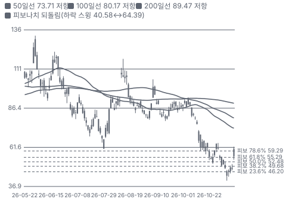

**주봉**

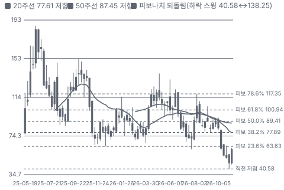

**월봉**

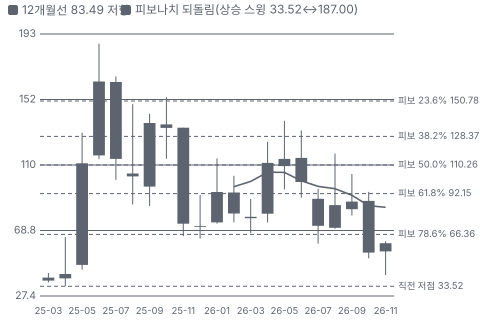

**분기 매출·EPS 실적과 컨센서스**

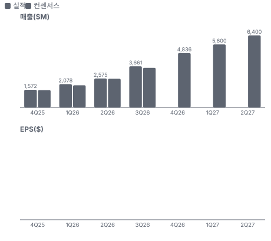

**4Q26 매출 — 지표 추세 vs 가이던스·컨센서스**

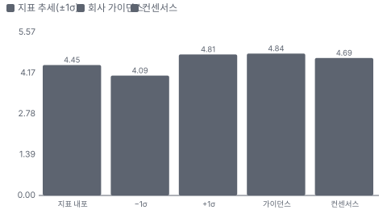

**EPS 리비전**

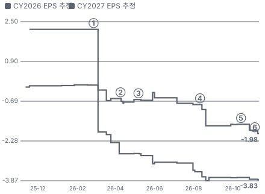

① 26-02-26 4Q25 실적·2026 CAPEX 안내 · EPS 리비전 -111%
② 26-04-09 Meta \$21B·Anthropic 다년 계약 · EPS 리비전 +25%
③ 26-05-07 1Q26 실적 · EPS 리비전 +5%
④ 26-08-11 2Q26 실적·백로그 \$104B · EPS 리비전 +105%
⑤ 26-10-14 크레딧 매도·채권 15% · EPS 리비전 +15%
⑥ 26-11-10 3Q26 실적·가격 인상 · EPS 리비전 +0%

**밸류에이션 주가 시나리오**

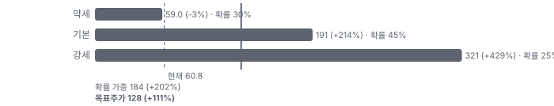

**주가별 업사이드**

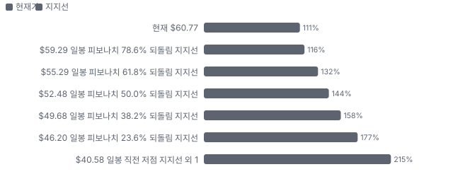
- 제품·서비스 포트폴리오

**고객 믹스(3Q26, 매출 대비)**

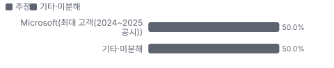

**공급 병목(10점, 낮을수록 병목)**

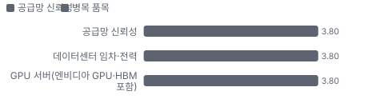

**생산능력 현재와 확충 계획(MW(IT 전력))**

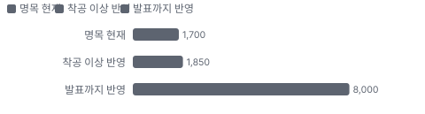

**CAPEX의 매출 대비 비중**

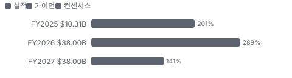

**멀티플 프리미엄(Fwd 1Y EV/EBITDA, 최근 4개 분기말)**

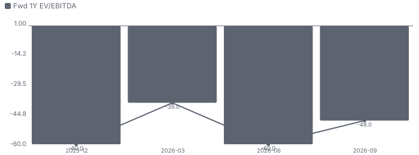

**합리적 멀티플**

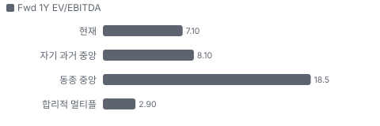

**수주·파이프라인 확실성 사다리**

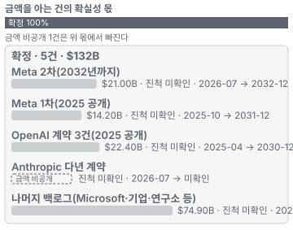

**매출 → 매출총이익 → 영업이익(매출 = 100, 최근 4분기)**

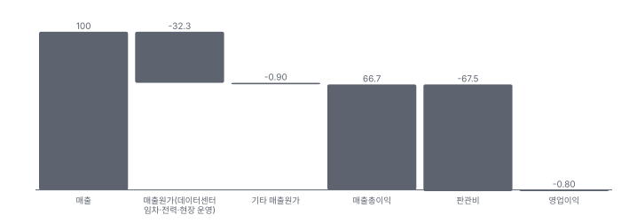

**1년 전 대비 마진 기여(비용 비중 변화의 반대)**

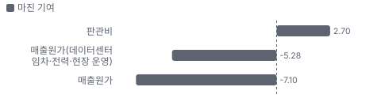

**분기 비용 비중 추이(매출 대비, 공시)**

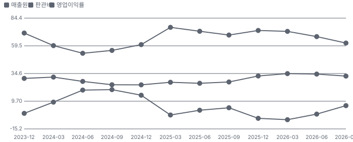

**비용 요인별 매출 대비 비중과 1년 변화**

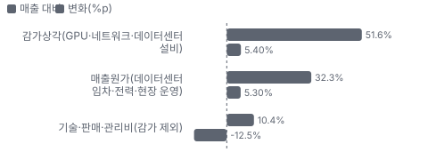

**BOM 항목 가격 +10% 시 OPM 변화**

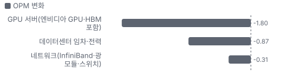

**GPU 클라우드 컴퓨팅(장기·단기 계약) BOM 원가 몫과 가격 +10% 시 OPM**

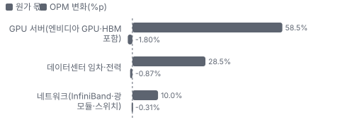

**매출·PPI·수출입 — 최근 12개 분기 같은 축(4Q23 = 100) + 다음 분기 추정**

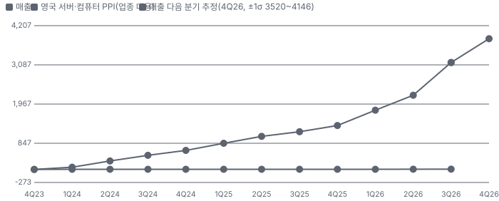

**매출과 영국 서버·컴퓨터 PPI(업종 대용) 증가율(전년 대비, 최근 16개 분기 + 다음 분기 추정)**

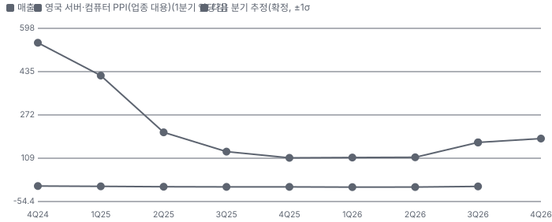

**목표주가 산정 — 약세와 기본 사이(약세 쪽 48%), 도달 확률 약 65%**

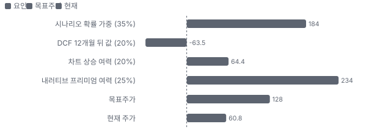

**일봉 지지·저항과 목표주가**

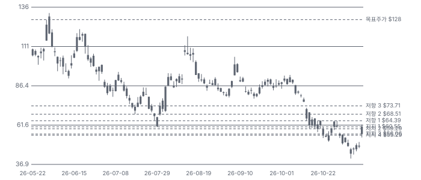

**커뮤니티 언급 수(최근 30일, 채널별)**

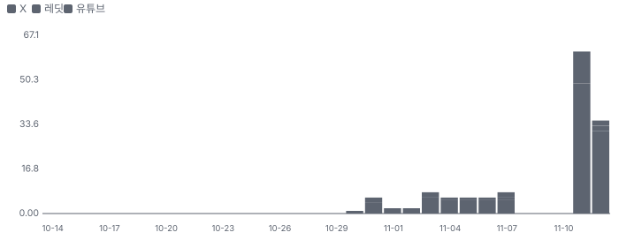

**커뮤니티 게시 수(월, 최근 12개월 — 이번 달은 진행 중)**

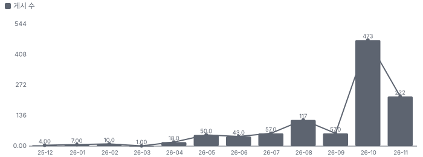

**일별 거래량 분해**

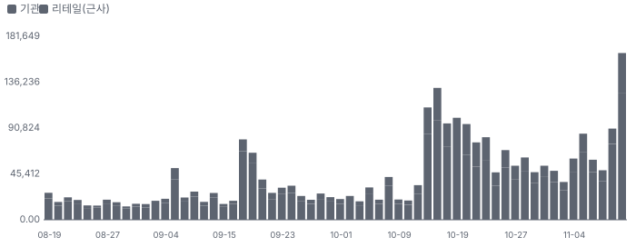

**기관 자금 흐름**

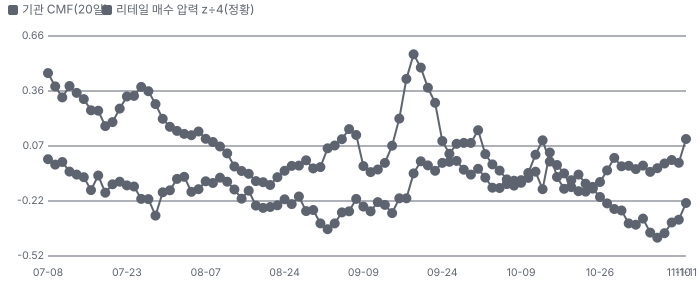

**몬테카를로**

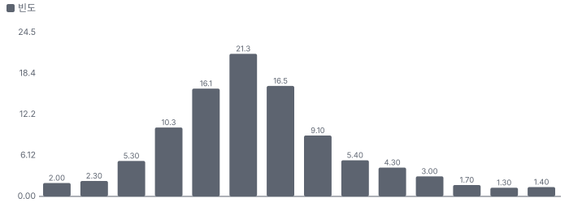

해석: 3,000번 중 180번(6%)에서 가치가 지금 주가 이상이었다. 가정을 흔들어도 지금 주가를 뒷받침하지 못하는 경우가 더 많다. 가운데 값은 -0.92배이고, 열 번 중 여덟 번은 -1.97~0.59배 사이에 든다.

## 내러티브

> **기업가치를 결정하는 이야기:** CoreWeave는 엔비디아 GPU를 대량으로 사서 데이터센터에 깔고, AI 연구소·빅테크에 4~5년 계약으로 빌려준다. 계약을 담보로 GPU값의 70~100%를 빌리고(DDTL(지연인출 기간대출 — 고객 계약을 담보로 장비를 살 때마다 꺼내 쓰고 계약 기간에 갚는 대출)), 계약 기간 동안 임대료로 갚는다 — 계약이 끝나면 다 갚은 GPU가 남는다. 그래서 기업가치는 세 숫자로 정해진다: ① MW당 연 매출(장기 \$20~25M, 단기 \$40M 이상) ② 그 매출이 감가(6년)와 이자(가중 7.9%)를 넘는 폭 ③ 계약이 끝난 GPU를 얼마에 다시 빌려주느냐. 3Q 콜은 ③에 처음 숫자를 줬다 — 구형 GPU 단가가 원 계약보다 높다

> **멀티플·EPS 프리미엄**
> **멀티플:** Fwd 1Y EV/EBITDA 7.1배로 동종 중앙(약 18배)보다 크게 낮다. Fwd 2Y 4.6배·3Y 3.1배로 내려간다 — 시장은 EBITDA 성장을 믿지 않거나, 그 EBITDA가 이자로 다 나간다고 본다
> **EPS:** FY2027 매출 컨센서스는 2Q 콜 직전 \$23.7B에서 \$26.9B로 14% 올랐지만, 조정 EPS는 −\$0.82에서 −\$1.98로 내렸다. 성장 추정이 오를수록 빚과 이자도 같이 커지는 구조라 EPS 리비전이 멀티플을 받치지 못했다

### 투자자들은 왜 열광했나

열광은 2025년 상장 직후와 2026년 4~5월이었다 — Meta \$21B·Anthropic 계약(4/9~10)과 1Q 뒤 5월 고점 \$138.25(장중). 식은 이유는 셋이다 — 이자비용과 CAPEX가 매출보다 빨리 늘었고, 10월 채권이 80달러 초반(수익률 15%대)까지 빠졌으며, 11월 중간선거 뒤 데이터센터 규제 우려가 겹쳤다. 11/11 다시 불붙은 이유는 가격 인상·선급금·재계약 숫자다

### 무엇이 기업가치를 바꾸나

> **구조적 체질 변화**
> **변화:** 고객 다변화 — 올해 신규 고객 절반 이상이 AI·기술 외 산업, Fortune 500의 10%, 백로그 10%가 금융
> **증거:** 3Q26 어닝콜(2026-11-10, 요지만 자기 말로)
> **반증:** 다음 공시에서 최대 고객 비중이 다시 오른다

> **고부가 믹스 확장**
> **변화:** 관리형 추론·스토리지·소프트웨어(Forge(CoreWeave의 AI 개발 환경, 학습·추론·평가·에이전트 개발 도구 묶음)) — 3Q 신규 클라우드 고객 70%가 이미 Forge 고객
> **증거:** 3Q26 어닝콜(2026-11-10, 요지만 자기 말로)
> **반증:** 관리형 추론 ARR(연환산 반복 매출 — 기말 월 매출을 12배 한 값)이 2027 말 \$1B에 못 미친다

> **기술 혁신**
> **변화:** Vera Rubin(엔비디아의 차세대 GPU·CPU 플랫폼, Blackwell 다음 세대) NVL72(GPU 72개를 한 랙으로 묶은 엔비디아 시스템) 첫 상용 가동(Cognition, GB200(엔비디아 Grace CPU + Blackwell GPU 결합 칩) 대비 토큰 처리량 4.8배 — 고객 측정)
> **증거:** 3Q26 어닝콜(2026-11-10, 요지만 자기 말로)
> **반증:** 하이퍼스케일러가 같은 분기에 같은 세대를 내놓는다

> **실행 속도**
> **변화:** 올해 850MW 이상 가동 — 활성 전력이 3개 분기 만에 두 배. 일부 4Q 인도를 3Q로 앞당겼다 **납품 리드타임 3~8개월.** 피어 비교 미확인. 이전 대비 미확인.
> **증거:** https://www.sec.gov/Archives/edgar/data/1769628/000176962826000461/coreweave3q26earningspress.htm
> **반증:** 연말 활성 전력이 1.85GW에 못 미친다

> **M&A**
> **변화:** 해당 없음(이번 분기 인수 발표 없음, Weights & Biases 통합 중)
> **증거:** 3Q26 어닝콜(2026-11-10, 요지만 자기 말로)
> **반증:** -

> **정책·입법 연관성**
> **재정정책:** 엔비디아 \$500B AI 인프라 금융 플랫폼 활용 가능성(Barclays) — 정부 재정이 아니다. 미국 연방 재정 지원은 확인 못 함 Barclays 크레딧 리서치 10/15 요지(노션, 라이선스) 반증: - 의회 동의 2/10 — 하원 1/5(연방 재정 지원 논의 확인 못 함) · 상원 1/5(같은 이유).
> **행정명령:** AI 데이터센터 연방 부지·인허가 가속 행정명령(2025) — 단계: 시행, 이 회사 부지 적용 여부 미확인 미확인(1차 미대조) 반증: 새 의회가 데이터센터 전력 요금 부담 입법으로 맞선다 의회 동의 2/10 — 하원 1/5(행정명령 사안 — 의회 동의 논의 확인 못 함) · 상원 1/5(같은 이유).
> **연관입법:** 해당 없음(주 단위 데이터센터 유예 공약은 있으나 이 회사 매출과 직접 이어진 연방 계류 법안을 확인하지 못했다) 미확인 반증: -

> **CAPEX 낙수효과**
> **변화:** 고객 쪽 — OpenAI·Anthropic 3Q 매출 전분기 대비 약 50% 성장(보도 인용), Meta 등 빅테크 CAPEX 상향이 임대 수요로 온다
> **증거:** Wedbush 11/11 요지(노션, 라이선스)
> **반증:** 모델 회사 매출 성장이 분기 20% 아래로 꺾인다

### 내러티브 근거

> 5월 \$138에서 11/5 \$43.66까지 −68% 뒤, 3Q 실적 하루 +24.7%. '빚으로 GPU를 사서 빌려주는 회사'라는 의심을 '가격 결정력과 선급금'이 하루에 밀어냈다 — 공매도 유통의 24%가 그 반등을 키웠다. 동종 대비 멀티플 차이 -61% 중 회사 고유 몫은 +146%다. 단계는 확산, 쏠림은 높음이다.

> **GPU 가격 결정력** · 확산
> **논리:** 공급 부족이 GPU 단가를 올려 신규·재계약 마진을 넓힌다
> **숫자:** 7월 +25%·분기 후반 +10%, 장기 계약 MW당 \$20~25M, 구형 GPU +30~50%
> **반증:** 4Q 콜에서 신규 장기 계약 단가가 MW당 \$20M 아래로 내려간다

> **구형 GPU 재계약 = 감가 약세론 반박** · 태동
> **논리:** 6년 내용연수가 과하다는 비판을 재계약 단가로 반박한다
> **숫자:** 2027년 13만 개·2028년 약 17만 개 만기, 2027 연 약 \$4B 매출 기회
> **반증:** 2027 재계약 단가가 원 계약보다 낮게 체결된다

> **선급금·계약 담보 조달** · 확산
> **논리:** 고객 돈과 계약 담보로 짓기 때문에 지분 희석·무담보채가 줄어든다
> **숫자:** 3개월 선급금·예치금 약 \$9B, 2027까지 추가 모회사 자본 \$5B 미만
> **반증:** 다음 분기 선급금 유입이 \$9B를 크게 밑돈다

> **백로그 = 매출 가시성** · 컨센서스
> **논리:** 백로그 \$132.5B가 연 매출의 10배라 성장 경로가 정해져 있다
> **숫자:** 백로그 +138% YoY, 50% 이상이 연말까지 인도 개시
> **반증:** 백로그가 2분기 연속 줄거나 대형 계약 조건이 바뀐다

> **반대: 빚으로 짓는 항공사형 모델** · 확산
> **논리:** 단기 매출로 장기 부채·고정비를 감당한다 — 최종 고객 ROI(투자수익률)가 꺾이면 GPU가 남는다
> **숫자:** 순차입 약 \$62B, 3Q 이자 \$846M·순손실 \$709M, 4Q 이자 \$1.05~1.15B
> **반증:** 2027 'EBITDA − 이자'가 두 배 이상 늘고 순레버리지가 4배 아래로 내려간다

> **반대: 데이터센터 규제** · 태동
> **논리:** 민주당 주지사·지역 투표가 신규 데이터센터를 늦춘다
> **숫자:** 지역 제한 안건 45건 중 42건 통과·우세(JPMorgan 요지)
> **반증:** 텍사스 신규 유예가 기존 인허가 부지를 소급 적용한다

이미지 없음(아직 생성 전) — Forge·Managed Inference(CoreWeave가 모델을 대신 돌려 주는 관리형 추론 서비스)·Mission Control(CoreWeave의 노드·랙·플릿 관리 소프트웨어)·GPU 클라우드 컴퓨팅(장기·단기 계약)

## 포트폴리오

| 제품·서비스 | 구분 | 무엇 | 쓰는 곳 | 돈 버는 방식 | Mix | Mix 변화(추정 — 제품별 매출 미공시) |
|---|---|---|---|---|---|---|
| GPU 클라우드 컴퓨팅(장기·단기 계약) | 서비스 | 엔비디아 GPU 클러스터(H100(엔비디아 Hopper 세대 GPU)·GB200·GB300(GB200의 개량판, Blackwell Ultra)·Vera Rubin) 임대 | AI 모델 학습·추론 | MW당 연 \$20~25M(4~5년)·\$40M+(단기) | 95% | 미확인 |
| Forge·Managed Inference·Mission Control | 소프트웨어 | AI 개발 환경·관리형 추론·클러스터 관리 소프트웨어 | 기업 고객의 개발·서비스 배포 | 사용량·구독(관리형 추론 계약 ARR \$250M 초과) | 5% | 미확인 |

## 고객

> **3Q26 최대 고객 Microsoft(최대 고객(2024~2025 공시)) 50%, 상위 3곳 50%, 집중도 집중.** 공시·회사 발표로 확인한 몫은 매출의 0%이고, 나머지 고객 몫은 추정이거나 미분해다. 고객별 매출 비중은 이번 분기에도 공개하지 않았다. 백로그 \$132.5B의 큰 몫은 공개 계약 — Meta(2건 합 약 \$35B)·OpenAI(약 \$22B, 2025 공개)·Anthropic(금액 미공개)이다. 회사는 Fortune 500의 10%가 고객이고 백로그의 10%가 금융이라고 밝혔다

**고객별 매출 몫(3Q26)**
| 고객 | 몫 | 변화 | 근거 |
|---|---|---|---|
| Microsoft(최대 고객(2024~2025 공시)) | 35~65% | 미확인 | 추정 |
| Meta(Meta) | 미확인 | 미확인 | 회사 발표 |
| OpenAI(OpenAI) | 미확인 | 미확인 | 회사 발표 |
| Anthropic(Anthropic) | 미확인 | 미확인 | 회사 발표 |
| 기업·금융·AI 네이티브 고객(기타) | 미확인 | 미확인 | 회사 발표 |
| 기타·미분해 | 50% | - | - |

> **Microsoft(최대 고객(2024~2025 공시))** · 추정
> **사는 것:** GPU 클러스터 장기 임대
> **추정 근거:** 2024 매출의 과반이 Microsoft(IPO 공시) — 2026 비중은 OpenAI·Meta 인도로 낮아지는 중(자체 추론, 원문 미대조)

> **Meta(Meta)** · 회사 발표
> **사는 것:** 추론용 GPU 클라우드(2032년 12월까지 약 \$21B 추가)
> **추정 근거:** 계약 총액만 공개 — 분기 매출 몫 미공시

> **OpenAI(OpenAI)** · 회사 발표
> **사는 것:** 학습·추론 GPU 클라우드
> **추정 근거:** 2025년 계약 3건 공개(합 약 \$22B) — 이번 회차 원문 미대조

> **Anthropic(Anthropic)** · 회사 발표
> **사는 것:** Claude 학습·추론 인프라(다년)
> **추정 근거:** 2H26부터 가동 — 금액 미공개

> **기업·금융·AI 네이티브 고객(기타)** · 회사 발표
> **사는 것:** Forge·Managed Inference·단기 계약
> **추정 근거:** 올해 신규 고객 절반 이상이 AI 연구소·기술 외 산업, 백로그 10%가 금융

## 수주·파이프라인

> **2026-09-30 기준 5건.** 확정 \$132B. 공시 매출 백로그(회사 발표) \$132B.

**실행 속도와 방해 요인**
| 항목 | 상태 | 실행 속도 | 방해 요인 |
|---|---|---|---|
| Meta 2차(2032년까지) | 확정 | 계약 → 인도 개시 수개월(추정) | Vera Rubin 인도 일정 · 데이터센터 셸 |
| Meta 1차(2025 공개) | 확정 | 미확인 | 데이터센터 셸 |
| OpenAI 계약 3건(2025 공개) | 확정 | 미확인 | 고객 자금 조달 · 데이터센터 셸 |
| Anthropic 다년 계약 | 확정 | 미확인 | 용량 배정 |
| 나머지 백로그(Microsoft·기업·연구소 등) | 확정 | 미확인 | 전력·셸 인도 · 고객 집중 |

## 마진 구조

> **GPM 67.7%, OPM 5.7%.** 3Q25 대비 GPM -5.3%p, OPM +1.9%p. 변동비는 매출의 19%이고, 매출이 10% 늘면 OPM은 +6.9%p 움직인다. 매출 100 중 GPU·데이터센터 감가상각이 52, 데이터센터 임차·전력 등 매출원가가 32를 쓴다. 영업이익은 6이지만 이자가 23이라 순손실이다 — 이익률을 정하는 건 GPU 단가 × 가동률과 감가 기간, 그리고 금리다

> **매출 100 중 매출원가 33.3, 매출총이익 66.7(최근 4분기, 공시).** 매출원가 요인 중 매출원가(데이터센터 임차·전력·현장 운영)이 매출의 32.3%로 가장 무겁고, 단가가 +10% 오르면 GPM이 -3.23%p 움직인다. 분기 회귀로 매출 1이 늘 때 매출원가는 0.34 늘고, 매출원가의 고정비 몫은 -10%다.

**비용 요인 강도 — 비중·추세·충격(+10%)·탄력**
| 비용 | 구분 | 매출 대비 | 1년 변화 | 마진 기여 | 충격 시 마진 | 매출 탄력 | 고정비 몫 |
|---|---|---|---|---|---|---|---|
| 매출원가(데이터센터 임차·전력·현장 운영) | 매출원가 요인 | 32.3% | +5.3%p | -5.3%p | -3.23%p | 미확인 | 60% |
| 판관비 | 공시 항목 | 67.5% | -2.7%p | +2.7%p | 미확인 | 0.65 | 3% |
| 매출원가 | 공시 항목 | 33.3% | +7.1%p | -7.1%p | -3.33%p | 0.34 | -10% |

매출 탄력 = 분기 비용을 매출에 회귀한 기울기(매출 1당 변동비), 고정비 몫 = 절편 ÷ 평균 비용. 표본이 8분기 미만이면 미확인. 매출원가 요인 비중은 margin 재료의 추정이 섞여 있고, 공시 매출원가와의 차이는 '기타 매출원가'로 둔다.

**GPM에서 OPM까지(GAAP)**
| 기간 | GPM | 연구개발 | 판관비 | 기타 | OPM |
|---|---|---|---|---|---|
| 3Q25 | 73.0% | 0.0% | 23.0% | 46.2% | 3.8% |
| 3Q26 | 67.7% | 0.0% | 10.4% | 51.6% | 5.7% |

**GPM·OPM 최근 4개 분기**
| 분기 | GPM | OPM |
|---|---|---|
| 2025-12 | 67.6% | -5.7% |
| 2026-03 | 65.5% | -6.9% |
| 2026-06 | 65.9% | -1.9% |
| 2026-09 | 67.7% | 5.7% |

**마진을 결정하는 비용 요인 — 비용 +10% 시 OPM**
| 비용 | 매출 대비 | 변화 | 고정비 | OPM |
|---|---|---|---|---|
| 감가상각(GPU·네트워크·데이터센터 설비) | 51.6% | +5.4%p | 95% | -5.16%p |
| 매출원가(데이터센터 임차·전력·현장 운영) | 32.3% | +5.3%p | 60% | -3.23%p |
| 기술·판매·관리비(감가 제외) | 10.4% | -12.5%p | 70% | -1.04%p |

**비용을 움직이는 요인**
| 비용 | 요인 |
|---|---|
| 감가상각(GPU·네트워크·데이터센터 설비, 판관비) | GPU 구매가 ÷ 내용연수(6년), 신규 배치가 매출보다 앞선다 · 근거 공시 |
| 매출원가(데이터센터 임차·전력·현장 운영, 매출원가) | MW당 임차료·전력 단가, 신규 사이트 램프 초기 비용 · 근거 공시 |
| 기술·판매·관리비(감가 제외, 판관비) | 인력·주식보상·Weights & Biases 통합 · 근거 공시 |

**GPU 클라우드 컴퓨팅(장기·단기 계약) BOM — 매출의 95%, GPM 68%(공시 — 3Q 매출총이익(감가 제외) \$2.478B ÷ \$3.661B), 항목 가격 +10% 시**
| 항목 | 원가 몫 | 전가 | 제품 GPM | OPM |
|---|---|---|---|---|
| GPU 서버(엔비디아 GPU·HBM 포함) | 55~62% | 0% | -1.9%p | -1.80%p |
| 데이터센터 임차·전력 | 25~32% | 미확인 | -0.9%p | -0.87%p |
| 네트워크(InfiniBand(엔비디아의 GPU 간 고속 네트워크 규격)·광 모듈·스위치) | 7~13% | 0% | -0.3%p | -0.31%p |
| 미분해 | 3% | - | - | - |

GPU 서버(엔비디아 GPU·HBM 포함) 가격이 +10% 오르면 영업이익은 -31.7% 움직인다. 판매가 전가를 모르는 항목은 전가 0%로 계산했다.

**BOM 항목 가격을 움직이는 것**
| 항목 | 요인 |
|---|---|
| GPU 서버(엔비디아 GPU·HBM 포함) | 감가로 원가에 들어온다 — 계약 체결 때 주문해 단가 고정(CFO), 계약 중 전가 없음 · 근거 추정 |
| 데이터센터 임차·전력 | 3자 데이터센터(Core Scientific·Galaxy·Applied Digital 등) MW당 임차료와 전력비 · 근거 추정 |
| 네트워크(InfiniBand·광 모듈·스위치) | GPU 클러스터 간 고속 연결 — 랙 단위로 엔비디아 구성과 함께 산다 · 근거 추정 |

**BOM 투입 물가 — PPI 전년비, 2026-11-12 수집**
| 항목 | 미국 | 일본 | 한국 | 대만 |
|---|---|---|---|---|
| GPU 서버(엔비디아 GPU·HBM 포함) | +3.0% | 미확인 | 미확인 | +57.2%* |
| 데이터센터 임차·전력 | +7.8% | -1.5% | +16.6% | +10.6%* |
| 네트워크(InfiniBand·광 모듈·스위치) | -2.2%* | 미확인 | 미확인 | 미확인 |

별표는 품목보다 넓은 업종 지수다. 지난 1년 투입 물가를 판매가 전가 뒤 원가에 그대로 넣으면 OPM은 -1.13%p 움직인다(매출원가의 92% 기준).

## 공급망 병목

> **공급망 신뢰성 3.8/10, 병목 심각.** 가장 약한 고리는 데이터센터 임차·전력 3.8점이고, 품목 평균은 3.8점이다. 근거가 부족한 1건(네트워크(InfiniBand·광 모듈·스위치))은 점수에서 뺐다. 병목은 GPU보다 **가동할 전력과 데이터센터 셸**이다. 엔비디아 GPU는 단일 공급원이지만 회사는 신세대를 가장 먼저 받는다. 데이터센터는 3자 개발사(Core Scientific·Galaxy·Applied Digital·Cipher 등)에 기대고, 이들의 인도 지연이 매출 지연이 된다. 텍사스 등 주정부의 신규 유예 공약이 다음 변수다

**병목과 마진 — 품목 가격 +10% 시 OPM**
| 품목 | 점수 | 판정 | 구분 | OPM |
|---|---|---|---|---|
| 데이터센터 임차·전력(필수) | 3.8 | 병목 심각 | 핵심 통제 품목 | -0.87%p |
| GPU 서버(엔비디아 GPU·HBM 포함, 필수) | 3.8 | 병목 심각 | 핵심 통제 품목 | -1.80%p |

> **데이터센터 임차·전력** · 3.8/10
> **왜:** 가동 전력이 매출 인식 시점을 정한다 — 셸·전력 연결이 늦으면 GPU가 놀아 감가만 쌓인다
> **병목 요인:** 인증 공급사 미확인 · 캐파 부족 · 리드타임 미확인 · 재인증 12개월 · 1위 점유율 미확인 · 미국(텍사스 다수) 집중 75% · 물량 확보 장기계약
> **풀리는 조건:** 미확인

> **GPU 서버(엔비디아 GPU·HBM 포함)** · 3.8/10
> **왜:** GPU는 엔비디아 단일 공급 — 신세대 배정이 성장 속도를 정한다
> **병목 요인:** 인증 공급사 1곳 · 캐파 빠듯 · 리드타임 미확인 · 재인증 6개월 · 1위 점유율 90% · 대만 조립(추정) 집중 80% · 물량 확보 장기계약
> **풀리는 조건:** 미확인

**공급사**
| 품목 | 공급사 | 몫 | 근거 |
|---|---|---|---|
| GPU 서버(엔비디아 GPU·HBM 포함) | NVIDIA(GPU·NVL72 랙 시스템) | 미확인 | 회사 발표 |
| GPU 서버(엔비디아 GPU·HBM 포함) | Dell(서버 조립(OEM)) | 미확인 | 보도 |
| GPU 서버(엔비디아 GPU·HBM 포함) | Supermicro(서버 조립(OEM)) | 미확인 | 보도 |
| 데이터센터 임차·전력 | Core Scientific(텍사스 등 호스팅 데이터센터) | 미확인 | 공시 |
| 데이터센터 임차·전력 | Galaxy Digital(Helios(Galaxy Digital의 텍사스 AI 데이터센터 캠퍼스) 캠퍼스(텍사스)) | 미확인 | 회사 발표 |
| 데이터센터 임차·전력 | Applied Digital(Polaris Forge(노스다코타)) | 미확인 | 회사 발표 |
| 데이터센터 임차·전력 | Cipher Digital(Black Pearl(텍사스) 임차) | 미확인 | 보도 |
| 네트워크(InfiniBand·광 모듈·스위치) | NVIDIA(InfiniBand·Spectrum-X) | 미확인 | 회사 발표 |

**무역 통계로 본 공급 지역**
| 품목 | EU 수입처 | 일본 수입처 | EU 1위 전년비 |
|---|---|---|---|
| GPU 서버(엔비디아 GPU·HBM 포함) | US 50% · TW(대만) 30% · CN(중국) 14% | アメリカ合衆国 30% · 台湾 18% | +106.2% |
| 데이터센터 임차·전력 | CN 82% · KR(한국) 11% · VN(베트남) 4% | 中華人民共和国 65% · 大韓民国 19% | +18.1% |
| 네트워크(InfiniBand·광 모듈·스위치) | CN 36% · VN 26% · TW 19% | 中華人民共和国 33% · ベトナム 18% | -8.5% |

## 생산능력

> **현재 명목 캐파 1,700 MW(IT 전력), 가동률 미확인.** 착공 이상 증설은 150 MW(IT 전력), 발표까지 합치면 6,300 MW(IT 전력)이다. 다 가동하면 지금보다 +371%, 착공 이상만이면 +9%다. FY2025 CAPEX는 \$10.31B로 매출의 200.9%다. 활성 전력 1.7GW(3Q), 연말 1.85GW 초과 목표, 계약 전력(임차·전력 계약을 마친 IT 전력, 가동 전 포함) 4.6GW(미국 밖 1.3GW). 2030 8GW 목표는 질의응답에서만 재확인

**생산시설 10곳**(하한 — 미국 주 단위 10곳(소유 PA(펜실베이니아주)·NJ(뉴저지주), 임차 ND(노스다코타주)·IL(일리노이주)·GA(조지아주)·TX(텍사스주)·NC(노스캐롤라이나주)·OK(오클라호마주)·VA(버지니아주)·NY(뉴욕주), JPMorgan 크레딧 리서치 11/4 요지). 같은 주의 복수 시설과 해외(캐나다·유럽·아시아 1.3GW 계약)는 세지 않았다. 10-K Item 2 원문은 이번 회차 미대조) — 이름·위치를 밝힌 곳 6곳, 소유 2곳 · 임차 4곳. 시설별 생산능력은 공개되지 않았다 — 회사 전체 캐파만 위에 적었다.

**생산시설 10곳 — 명칭·위치·생산능력**
| 시설 | 위치 | 용도 | 생산능력 | 소유·상태 |
|---|---|---|---|---|
| Lancaster 캠퍼스 | 미국 펜실베이니아 랭커스터 | AI 데이터센터 | 미확인 — 회사 발표 MW 수치 원문 미대조 | 소유 · 건설 중 |
| Kenilworth 캠퍼스 | 미국 뉴저지 케닐워스 | AI 데이터센터 | 미확인 — 회사 발표 MW 수치 원문 미대조 | 소유 · 건설 중 |
| Helios(Galaxy Digital) | 미국 텍사스 | AI 데이터센터 | 미확인 — 상대방(Galaxy) 발표 수치 원문 미대조 | 임차 · 가동 |
| Polaris Forge(Applied Digital) | 미국 노스다코타 엘런데일 | AI 데이터센터 | 미확인 — 상대방(Applied Digital) 발표 수치 원문 미대조 | 임차 · 가동 |
| Denton 등 Core Scientific 호스팅 | 미국 텍사스 덴턴 외 | AI 데이터센터 | 미확인 — 상대방 공시 원문 미대조 | 임차 · 가동 |
| Black Pearl(Cipher Digital) | 미국 텍사스 | AI 데이터센터 | 미확인 — JPMorgan 표 기준 2Q27 개시 예정 | 임차 · 건설 중 |

**생산능력 확충 계획**
| 계획 | 단계 | 증설 | 가동 시점 | CAPEX |
|---|---|---|---|---|
| 연말 활성 전력 목표 | 착공 | 150 MW(IT 전력) | 2026-12 | 미확인 |
| 계약 전력 중 미가동분(미국 밖 1.3GW 포함) | 발표 | 2,750 MW(IT 전력) | 2027-12 | 미확인 |
| 2030 목표(8GW) | 발표 | 3,400 MW(IT 전력) | 2030-12 | 미확인 |

남은 계획의 CAPEX 합계는 \$0.00B(금액 미확인 3건 제외)다. 합계는 FY2027 매출의 0%다.

**증설 방해 요인**
| 계획 | 방해 요인 |
|---|---|
| 연말 활성 전력 목표 | 전력 연결·장비 인도 |
| 계약 전력 중 미가동분(미국 밖 1.3GW 포함) | 인허가·주정부 유예·전력 연결 |
| 2030 목표(8GW) | 자금·전력 |

**CAPEX와 매출 대비**
| 기간 | CAPEX | 매출 | 매출 대비 | 구분 |
|---|---|---|---|---|
| FY2025 | \$10.31B | \$5.13B | 200.9% | 실적 |
| FY2026 | \$38.00B | \$13.15B | 289.0% | 가이던스 |
| FY2027 | \$38.00B | \$27.00B | 140.7% | 컨센서스 |

## 해자

> 해자는 칩이 아니라 **확보한 전력·데이터센터와 엔비디아 신세대 GPU를 가장 먼저 대량으로 돌리는 운영 능력**, 그리고 그 계약을 담보로 싸게 빌리는 금융 구조다. 기술 장벽은 낮고 자본 장벽이 높다

> **가동 전력·계약 전력** · 강함
> **해자:** 가동 1.7GW·계약 4.6GW — 상장 네오클라우드 중 가장 크다
> **근거:** 3Q 보도자료: 활성 전력 1.7GW 초과, 계약 전력 4.6GW(미국 밖 1.3GW)
> **숫자:** Nebius·IREN 계약 전력보다 수 배(동종 공시 기준 상이 — 비교 정밀도 낮음)
> **깨지는 조건:** 2027 인도 일정이 인허가·전력 연결로 분기 이상 밀린다

> **신세대 GPU 선도입·운영 소프트웨어** · 보통
> **해자:** 엔비디아 신세대(GB200·GB300·Vera Rubin)를 업계 처음으로 상용 가동한다 — Mission Control·SUNK(CoreWeave의 Slurm on Kubernetes — 학습 작업 스케줄러)가 대형 클러스터 가동률을 끌어올린다
> **근거:** 3Q 콜: Vera Rubin NVL72 첫 상용 고객 Cognition, GB200 대비 토큰 처리량 4.8배(고객 측정)
> **숫자:** 가동률·고장률은 미공시(미확인)
> **깨지는 조건:** 하이퍼스케일러가 같은 세대를 같은 시점에 내놓고 단가로 경쟁한다

> **계약 담보 자금 조달(DDTL·선급금)** · 보통
> **해자:** 투자등급 고객 계약을 담보로 CAPEX의 70~100%를 SOFR(미국 담보부 익일물 금리 — 변동금리 대출의 기준 금리)+225~550bp에 빌리고, 계약의 70%에서 선급금을 받는다
> **근거:** 3Q 콜: 가중 차입 금리 7.9%(전년 대비 −250bp), 3개월 선급금·예치금 약 \$9B
> **숫자:** 2027 남은 약정 CAPEX의 75% 이상이 투자등급·기업 고객
> **깨지는 조건:** 다음 투자등급 대출 수익률이 7.5%를 넘거나 선급금 비중이 줄어든다

## 경영진·네트워크

> 공동창업자 Michael Intrator(CEO)가 이끈다. 원자재 트레이딩·암호화폐 채굴에서 출발해 GPU 임대로 옮긴 창업팀이다. 공개 기록으로 확인한 정치적 연결이 매출을 만든 근거는 없다 — 3Q 콜에서 텍사스 주지사 당선인에게 비당파 서한을 보냈다고 밝혔다

> **Michael Intrator** · 공동창업자·CEO · 2017
> **프로필:** 천연가스 트레이딩·헤지펀드 출신, Atlantic Crypto(2017) 창업 뒤 GPU 클라우드로 전환
> **비즈니스:** 전사·고객 계약
> **정계:** 텍사스 주지사 당선인에게 데이터센터 개발 기준 협력 서한(3Q 콜, 비당파라고 설명)
> **동문:** 미확인
> **사모임:** 미확인

> **Nitin Agrawal** · CFO · 2024
> **프로필:** 자금 조달 구조(DDTL·선급금) 설계 담당
> **비즈니스:** 재무
> **정계:** 미확인
> **동문:** 미확인
> **사모임:** 미확인

**네트워크 정량화**
| 연결 | 강도 | 닿는 매출 | 가중 노출 | 매출 대비 | 근거 |
|---|---|---|---|---|---|
| 비즈니스: 엔비디아 — 지분 투자(1월 \$2B, 주당 \$87.20)·5GW AI 팩토리 협력·신세대 GPU 우선 공급 | 4/5 | 미확인 | 미확인 | 미확인 | 공급 관계는 회사 발표. 엔비디아 몫 매출·공급 배정량 미공시 딘스티커 2026-01-26(회사 보도자료 요지) |
| 비즈니스: Magnetar — 초기 투자자, 8/12 이후 장내 매도 약 \$479M(Form 4) | 2/5 | \$0.00B | \$0.00B | 0% | 매출 연결 아님 — 주식 공급(오버행) 요인 company_insider_transactions |
| 정계: 텍사스 신임 주지사(유예 공약)와 관계 구축 시도 | 1/5 | 미확인 | 미확인 | 미확인 | 서한만 확인 — 결과 미확인 3Q26 어닝콜(2026-11-10, 요지만 자기 말로) |

가중 노출은 연결이 닿는 매출의 크기다. 연결이 그 매출을 만들었다는 뜻이 아니며, 인과는 공개 자료로 입증하지 못한다.

## 약세 논리 및 셀온 조건

| 약세 논리 | 근거 | 반박 | 가를 자료 · 공개 시점 |
|---|---|---|---|
| 이자가 영업이익보다 크다 | 4Q 이자 \$1.05~1.15B vs 4Q 조정 영업이익 내재 \$0.75~0.85B, 3Q 순손실 \$709M | 회사는 2027 'EBITDA − 이자'가 두 배 이상이라고 안내했고 가중 차입 금리는 7.9%로 1년 새 −250bp | 4Q26 이자·2027 가이던스 — 2027-02 실적 |
| 성장할수록 빚이 는다 | FY2027 매출 추정 +14%에 조정 EPS 추정은 −\$0.82 → −\$1.98, 2026 CAPEX \$37~39B | CAPEX의 70~100%가 계약 담보 대출로 짝지어지고 3개월 선급금 약 \$9B가 들어온다 | 3Q 10-Q 부채 주석·선급금 유입 — 11월 중순 제출 |
| 고객이 소수에 몰려 있다 | 2024 매출 과반이 Microsoft(IPO 공시), 백로그 큰 몫이 Meta·OpenAI 공개 계약 | 올해 신규 고객 절반 이상이 AI 외 산업, Fortune 500의 10%, 백로그 10%가 금융 | 3Q 10-Q·2026 10-K 10% 초과 고객 — 11월·2027-03 |
| 공급이 따라잡으면 단가가 꺾인다 | 단기 MW당 \$40M은 부족할 때 값, Goldman Sachs가 공급 과잉 시 모델을 물었다 | 4~5년 계약이 MW당 \$20~25M에 묶이고 2027까지 대부분 매진(회사) | 4Q 콜 신규 장기 단가·재계약 단가 — 2027-02 |
| 데이터센터 규제가 인도를 늦춘다 | 텍사스·오하이오 주지사 당선인 유예 공약, 지역 제한 안건 45건 중 42건 통과·우세(JPMorgan 요지) | 2027 인도분은 인허가를 마쳤거나 가동 중인 부지라 중대 위험 없음(CEO) | 텍사스 신임 주지사 취임 뒤 첫 조치(소급 여부) — 2027-01 |
| 내부자가 계속 판다 | 8/12 이후 장내 매도 약 \$783M(Magnetar \$479M·CEO \$199M) | CEO가 11/11 방송에서 사전 매도 계획(10b5-1(내부자가 미리 정해 둔 일정대로 주식을 파는 사전 매매 계획))을 해지했다고 말했다(공시 미대조) | 다음 Form 4·10b5-1 공시 — 수시 |

**데이터 한계.** 3Q 10-Q는 11/12 18시(KST) 현재 EDGAR에 없다 — 구매 약정·10% 초과 고객·3Q 전환사채 전환 주식 수는 __미확인__으로 두었다(www.sec.gov 원문은 이번 회차 접속 거부, XBRL(공시 재무 숫자를 기계가 읽게 만든 태그 형식)은 2Q까지 대조). 제한 현금은 6/30 \$1.38B(XBRL)다. 시설별 MW와 위성 판독은 다음 회차 과제다. **정책·거시.** 데이터센터 유예는 아직 공약 단계다(금지표: 공약 → 시행 아님). 거시 국면 원천은 FRED(미국 세인트루이스 연준 경제 데이터베이스) 접속 시간 초과로 이번 회차 재료가 없다. **추가 원천(11/12).** 노션 IB 요지 — 채권 쪽은 10월 매도를 기술적 매도로 보고 2027 조달 필요 약 \$30B(담보부 \$24B)를 제시했고, 크레딧 쪽은 블루웨이브의 데이터센터 영향을 경고했다. 둘 다 시장 기대의 증거로만 썼다. 커뮤니티 대화량은 24시간 Strong(75)으로 10월 Negative(30)에서 하루 만에 돌았다.

> **셀온 조건**
> **조건 1:** \$4B 이상 투자등급 대출 수익률이 8%를 넘는다 — 계약 담보 조달 비용이 무너진다
> **조건 2:** 4Q 콜에서 신규 4~5년 계약 단가가 MW당 \$20M 아래로 내려간다 — 가격 결정력이 끝났다는 신호
> **조건 3:** 연말 활성 전력이 1.85GW에 못 미치거나 2027 인도 일정이 분기 이상 밀린다
> **조건 4:** 추가 모회사 자본(증자·전환사채)이 2027까지 \$5B를 넘는다 — 희석 위험 재발
> **조건 5:** 3Q 10-Q·10-K에서 최대 고객 비중이 다시 오르거나 대형 계약 조건이 바뀐다

## 어닝콜 변화

**직전 콜 대비 새로 나오거나 바뀐 내용 → 가치 영향**
| 항목 | 내용 | 직전 콜 | 최신 콜 | 모델 동인 이동 | 확신도 | 가치 영향 |
|---|---|---|---|---|---|---|
| 업데이트 | FY2026 매출 가이던스 | \$12.4~13.2B | \$13.0~13.3B | 기준연도 매출 +\$0.35B | 0.8 | - |
| 업데이트 | 조정 영업이익률 경로 | 3Q 가이던스 \$200~260M(약 6~7%) | 3Q 실적 \$379M(10%), 4Q 내재 약 16~17% | 출발 이익률 +3.0% | 1.0 | - |
| 신규 | 가격 인상·장기 계약 단가 | 7월 약 25% 인상만 언급 | 분기 후반 +10%, 4~5년 계약 MW당 \$20~25M | 목표 이익률 +3.0% | 0.5 | - |
| 업데이트 | 매출 백로그 | \$103.7B(6/30 RPO(잔여 이행 의무 — 계약했지만 아직 매출로 잡지 않은 금액)) | \$132.5B(9/30) | 1년차 성장률 +5.0% | 1.0 | - |
| 신규 | 고객 선급금 자금 조달 | DDTL·전환사채 중심 | 3개월 안 선급금·예치금 약 \$9B, 모회사 무담보채 2027까지 없음 | 순차입 -\$5.00B | 0.8 | - |
| 신규 | GPU 재계약 매출 | 구형 GPU 감가 우려 | 2027년 13만 개 재계약 시 연 약 \$4B 매출(추가 CAPEX 없음) | 성장 지속(감속 계수) +3.0% | 0.5 | - |
| 부정 | 이자비용 | 3Q 가이던스 \$860~940M | 3Q \$846M, 4Q \$1.05~1.15B | 출발 이익률 -1.0% | 0.8 | - |
| 업데이트 | 2026 CAPEX | \$35~39B | \$37~39B | 매출÷투하자본 -2.0% | 0.8 | - |
| **합계** | 단독 합 |  |  | 동시 적용 - |  | **+0.0%** |

**사건별 EPS 리비전**
| # | 날짜 | 구분 | 사건 | CY2026 EPS 전→후 | CY2027 EPS 전→후 | 리비전 | 주가 반응 |
|---|---|---|---|---|---|---|---|
| ① | 26-02-26 | 실적 | 4Q25 실적·2026 CAPEX 안내 | \$-0.04 → \$-1.92 | \$2.19 → \$-0.24 | -111.0% | -18.5% |
| ② | 26-04-09 | 내러티브 | Meta \$21B·Anthropic 다년 계약 | \$-2.79 → \$-2.79 | \$-0.58 → \$-0.72 | +24.8% | +3.5% |
| ③ | 26-05-07 | 실적 | 1Q26 실적 | \$-2.78 → \$-2.86 | \$-0.62 → \$-0.65 | +5.1% | -11.4% |
| ④ | 26-08-11 | 실적 | 2Q26 실적·백로그 \$104B | \$-3.51 → \$-3.74 | \$-0.82 → \$-1.67 | +105.1% | +19.3% |
| ⑤ | 26-10-14 | 내러티브 | 크레딧 매도·채권 15% | \$-3.74 → \$-3.81 | \$-1.61 → \$-1.85 | +15.1% | -15.5% |
| ⑥ | 26-11-10 | 실적 | 3Q26 실적·가격 인상 | \$-3.83 → \$-3.83 | \$-1.98 → \$-1.98 | +0.0% | +24.7% |

## 거시 지표 싱크로율

> **영국 서버·컴퓨터 PPI(업종 대용)와 전사 매출 싱크로율 91%(1분기 = 약 3개월 선행, 전년 대비, 표본 8개·t 5.3·유의·신뢰 낮음).** 이 지표가 내포하는 4Q26 전사 매출은 4.45B(±1σ 4.09B~4.81B, 확정)다. 표본 밖 검증(최근 3개 분기)에서 지표 모델 오차는 97.0%p, 기준선(직전 증가율 지속)은 19.3%p다 — **지표가 기준선을 이기지 못해(예측력 없음) 추정은 대부분 기준선이다(지표 가중 7%).** 기준선은 인수·환율 효과의 소멸을 모르므로 회사 가이던스와 차이가 크면 가이던스 쪽 설명을 먼저 본다. 가이던스는 이보다 +8.7%(범위 위), 컨센서스는 +5.3%(범위 안)다. 회사는 GPU 서버를 사서 빌려준다 — 대만 서버(HS(국제 통일 상품 분류 코드) 8471) 수출이 CAPEX와 다음 분기 활성 전력의 선행 지표가 될 수 있다(상관을 인과로 쓰지 않는다)

**지표별 싱크로율(상관계수 × 100) — 위 두 줄이 제품 연관성 × 싱크로율로 고른 PPI·수출입 세부 지표**
| 지표 | 비교 대상 | 증가율 기준 | 지표 선행 | 매출(t값) | 영업이익 | 방향 일치 | 표본·신뢰 | 표본 밖 오차(지표/기준선) | 4Q26 추정 매출 |
|---|---|---|---|---|---|---|---|---|---|
| 영국 서버·컴퓨터 PPI(업종 대용) | 전사 매출 | 전년 대비 | 1분기(3개월) | 91%(t 5.3) | -71%(1분기) | 88% | 8·낮음 | 97.0/19.3%p ✘ | +183.0% → 4.45B(확정) |
| 미국 컴퓨터 제조 PPI | 전사 매출 | 전년 대비 | 3분기(9개월) | -69%(t -2.4) | 77%(3분기) | 88% | 8·낮음 | 124.3/19.3%p ✘ | +171.2% → 4.26B(확정) |

**지표 후보 8개 — 연관성(제품 품목 일치 × 대용 감점 × 매출 비중) × 싱크로율로 고른다. 후보가 많을수록 최대 상관은 우연히 부풀 수 있다**
| 후보 | 종류 | 연관성 | 매출 분기 일치 | 싱크로율(선행) | 점수 | 출처 |
|---|---|---|---|---|---|---|
| 영국 서버·컴퓨터 PPI(업종 대용) ✔ | PPI | 0.60 | 100% | 91%(1분기) | 0.54 | 자동 |
| EU(유럽연합) 서버·컴퓨터 PPI(업종 대용) | PPI | 0.60 | 100% | 71%(1분기) | 0.43 | 자동 |
| 대만 서버·컴퓨터 PPI(업종 대용) | PPI | 0.60 | 100% | 46%(2분기) | 0.22 | 자동 |
| 미국 컴퓨터 제조 PPI | PPI | 1.00 | 100% | -69%(3분기) | 0.00 | 모델 지정 |
| EU 서버·컴퓨터 수출(HS 847150) | 수출입 | 1.00 | 92% | -85%(4분기) | 0.00 | 자동 |
| EU 서버·컴퓨터 수입(HS 847150) | 수출입 | 1.00 | 92% | -73%(4분기) | 0.00 | 자동 |
| 미국 서버·컴퓨터 수출(HS 847150) | 수출입 | 1.00 | 100% | -67%(4분기) | 0.00 | 자동 |
| 미국 서버·컴퓨터 수입(HS 847150) | 수출입 | 1.00 | 100% | -74%(4분기) | 0.00 | 자동 |

**선행 지표로 본 향후 분기 매출 전망(이미 나온 지표 값 기준, ±1σ)**
| 지표 | 대상 | 분기 | 지표 증가율 | 내포 매출 증가율 | 내포 매출 |
|---|---|---|---|---|---|
| 미국 컴퓨터 제조 PPI | 전사 매출 | 4Q26 | +1.0% | +222.8% | 5.07B(3.05B~7.09B) |
| 미국 컴퓨터 제조 PPI | 전사 매출 | 1Q27 | +0.7% | +252.7% | 7.33B(4.66B~10.00B) |
| 미국 컴퓨터 제조 PPI | 전사 매출 | 2Q27 | +2.7% | +55.5% | 4.00B(694M~7.31B) |
| EU 서버·컴퓨터 수출(HS 847150) | 전사 매출 | 4Q26 | +50.9% | +205.4% | 4.80B(3.31B~6.29B) |
| EU 서버·컴퓨터 수출(HS 847150) | 전사 매출 | 1Q27 | +55.8% | +186.6% | 5.96B(3.99B~7.92B) |
| EU 서버·컴퓨터 수출(HS 847150) | 전사 매출 | 2Q27 | +139.3% | -129.2% | -752M(-3.19B~1.69B) |
| EU 서버·컴퓨터 수입(HS 847150) | 전사 매출 | 4Q26 | +122.9% | -110.2% | -161M(-2.08B~1.75B) |
| EU 서버·컴퓨터 수입(HS 847150) | 전사 매출 | 1Q27 | +128.2% | -132.1% | -667M(-3.20B~1.86B) |
| EU 서버·컴퓨터 수입(HS 847150) | 전사 매출 | 2Q27 | +103.9% | -32.8% | 1.73B(-1.41B~4.87B) |
| 미국 서버·컴퓨터 수출(HS 847150) | 전사 매출 | 4Q26 | +82.3% | +217.3% | 4.99B(2.90B~7.07B) |
| 미국 서버·컴퓨터 수출(HS 847150) | 전사 매출 | 1Q27 | +189.2% | -57.7% | 879M(-1.88B~3.64B) |
| 미국 서버·컴퓨터 수출(HS 847150) | 전사 매출 | 2Q27 | +76.2% | +233.0% | 8.57B(5.15B~11.99B) |
| 미국 서버·컴퓨터 수출(HS 847150) | 전사 매출 | 3Q27 | +27.0% | +359.7% | 16.83B(11.97B~21.69B) |
| 미국 서버·컴퓨터 수입(HS 847150) | 전사 매출 | 4Q26 | +277.1% | -252.2% | -2.39B(-4.28B~-506M) |
| 미국 서버·컴퓨터 수입(HS 847150) | 전사 매출 | 1Q27 | +218.1% | -109.3% | -194M(-2.69B~2.30B) |
| 미국 서버·컴퓨터 수입(HS 847150) | 전사 매출 | 2Q27 | +113.0% | +145.3% | 6.32B(3.23B~9.40B) |
| 미국 서버·컴퓨터 수입(HS 847150) | 전사 매출 | 3Q27 | +112.9% | +145.4% | 8.98B(4.59B~13.37B) |
| EU 서버·컴퓨터 PPI(업종 대용) | 전사 매출 | 4Q26 | +6.3% | +538.6% | 10.04B(8.07B~12.01B) |
| 영국 서버·컴퓨터 PPI(업종 대용) | 전사 매출 | 4Q26 | +3.1% | +383.5% | 7.60B(6.42B~8.78B) |
| 대만 서버·컴퓨터 PPI(업종 대용) | 전사 매출 | 4Q26 | +37.0% | +558.0% | 10.34B(7.86B~12.83B) |
| 대만 서버·컴퓨터 PPI(업종 대용) | 전사 매출 | 1Q27 | +57.7% | +766.2% | 18.00B(14.72B~21.28B) |

지표가 k분기 앞서면 이미 발표된 지표로 k분기 뒤까지의 매출 증가율을 회귀식으로 읽는다. 표본이 작거나 t값이 2 미만이면 전망은 참고용이다.

**지표를 고른 이유**
| 지표 | 이유 |
|---|---|
| 영국 서버·컴퓨터 PPI(업종 대용) | GPU 클라우드 컴퓨팅(장기·단기 계약) ↔ 서버·컴퓨터 생산자물가 — 품목보다 넓은 업종 지수 |
| 미국 컴퓨터 제조 PPI | 서버 단가 대용 |

다음 분기 추정 = 지표 회귀와 기준선(직전 증가율 지속)을 표본 밖 오차의 역제곱으로 가중 결합한 값이다(예측 결합). 지표가 회귀에 쓴 범위를 벗어나면 범위 끝으로 자르고(외삽 제한), 세그먼트 추정은 나머지 사업을 기준선으로 더해 전사로 바꾼다. 싱크로율은 증가율의 상관계수이며 인과가 아니다. 지표 단위·통화는 원자료 그대로이고 나라끼리 더하지 않는다(EU 수입만 상대국 합계). ±1σ는 회귀 잔차 표준편차이고, 지표를 예측한 분기는 지표 예측 오차까지 더해 넓혔다.

## 밸류에이션

> **목표주가 \$128, 업사이드 +111%.** 자리는 약세와 기본 사이(약세 쪽 48%)이고 도달 확률은 약 65%다. 기본 \$191, 강세 \$321(+429%), 약세 \$59(-3%). DCF 기준 업사이드는 기본 -194%, 강세 -94%, 약세 -223%다(WACC 7.7%).

기준 멀티플이 Fwd 1Y EV/EBITDA라 시나리오도 다음 4개 분기 조정 EBITDA로 둔다. 이 회사는 EV에서 순차입 약 \$62B를 빼야 지분 가치가 나오므로 **EBITDA 1달러의 변화가 지분에는 약 2.8배로 증폭된다** — 같은 배수에서도 시나리오 간 주가 차이가 크다. 확률은 콜 톤(가이던스 2분기 연속 상향)과 남은 신용·규제 위험을 함께 반영해 약세 30%·기본 45%·강세 25%에 둔다. __DCF 내재가치와 목표주가가 다르면 그 차이는 대부분 순차입과 2027 CAPEX 가정에서 나온다__ — DCF는 2026 CAPEX 수준(\$37~39B)이 몇 년 이어진다고 보고, 시나리오는 다음 4개 분기 이익 배수만 본다.

> **약세 \$59 (-3%)** · 확률 30%
> **가정:** 9.2배 × EBITDA \$11.00B
> **근거:** 업계 신규 공급으로 단기 계약 단가가 꺾이고 데이터센터 셸·전력 연결이 1~2개 분기 늦어, 다음 4개 분기 EBITDA가 4Q 실행률(분기 약 \$3B, 연 약 \$12B) 근처에 머문다. 투자등급 대출 금리가 8%를 넘어 자산 단위 조달이 비싸진다 — EBITDA 약 \$11.0B

> **기본 \$191 (+214%)** · 확률 45%
> **가정:** 12.3배 × EBITDA \$15.40B
> **근거:** 백로그 인도와 연말 1.85GW·2027 램프가 계획대로 가고 단가가 유지된다. 다음 4개 분기 매출 약 \$24B(컨센서스 \$24.0B), EBITDA 마진 약 64% — EBITDA 약 \$15.4B(컨센서스와 같은 수준)

> **강세 \$321 (+429%)** · 확률 25%
> **가정:** 15.4배 × EBITDA \$18.00B
> **근거:** 장기 단가 MW당 \$25M 상단과 구형 GPU 재계약, 관리형 추론 확대가 겹쳐 매출 약 \$27B, EBITDA 마진 약 66% — EBITDA 약 \$18B

**멀티플 선정 — Fwd 1Y EV/EBITDA**
| 단계 | 조정 | 근거 |
|---|---|---|
| 동종 중앙값 | 18.5배 | 범위 10.7~57.6배, 5곳 |
| 펀더멘털 | -20% | 성장·이익률·ROIC로 본 합리적 멀티플 2.9배와의 차이의 일부만 인정 |
| 해자 | +7% | 가동 전력·계약 전력 강함 · 신세대 GPU 선도입·운영 소프트웨어 보통 · 계약 담보 자금 조달(DDTL·선급금) 보통 |
| 반복 매출 | +15% | 반복 매출 95%(동종 20%) · 장기 GPU 임대료(take-or-pay) · 이미 반복 단계 · 기반 가동 1.7GW·계약 4.6GW |
| 수주 전환·가시성 | -11% | 잔고 커버리지 0.29 · RPO·ACV(연간 계약 가치) 성장 − 매출 성장 0.00 → 가시성 0.14 · 전환 120개월(동종 12) |
| 내러티브 | +5% | 단계 확산 |
| 사이클·실행 판단 | -30% | Fwd 1Y EV/EBITDA 7.1배로 동종 중앙(약 18배)보다 크게 낮다. 그러나 순차입 \$62B가 시가총액의 1.8배이고 4Q 이자만 \$1.05~1.15B다 — EV 배수가 같아도 지분 몫이 훨씬 얇다. 동종 다수는 EBITDA가 막 생기는 단계라 배수가 부풀어 있다 — 레버리지·동종 왜곡 할인 |
| **선정** | **12.3배** | 지금 7.1배 |

**동종 레인지**
| 회사 | Fwd 1Y EV/EBITDA | Fwd 2Y EV/EBITDA | Fwd 3Y EV/EBITDA | 성장 | 영업이익률 | ROIC |
|---|---|---|---|---|---|---|
| NBIS | 57.6 | 19.1 | 12.3 | 403% | -6% | -1% |
| IREN | 10.9 | 4.5 | 3.0 | 452% | 0% | 0% |
| APLD | 18.5 | 16.9 | 15.7 | 82% | 11% | 1% |
| DOCN | 19.2 | 13.1 | 9.9 | 62% | 22% | 8% |
| ORCL | 10.7 | 8.4 | 6.8 | 39% | 39% | 12% |
| **CoreWeave** | 7.1 | 4.6 | 3.1 |  |  |  |

몬테카를로 중앙값 업사이드 -192%.

> 의사결정 보조(투자자문 아님): ① 매수 매력: 5년 보유 가정 연 기대수익 -100.0% — 주주가 요구하는 수익률(자기자본비용) 11.7%보다 -111.7%p · 요구수익률을 넘을 확률 5% · 안전마진 -1.97(비관적 경우의 기업가치가 지금 시가총액의 -197%) → 정량 신호 약함 / ② 위험 예산 지표(이론): 0% — 기대수익이 요구수익률에 못 미친다(켈리 기준 — 수익·손실 확률로 계산한 이론상 최대 노출 — 0%는 참고) · 5년 뒤 나쁜 경우(하위 10%) -373% · 30% 넘게 잃을 확률 88% / ③ 상방(5년): 평균 -1.07배 · 2배 이상 확률 4% · 3배 이상 2% · 10배 이상 0% · 잘 풀린 경우(상위 10%) 0.98배 이상

투입 물가 점검: 지난 1년 PPI를 BOM에 넣으면 OPM -1.13%p다(매출원가의 92% 기준).

## 매수 위치(일봉)

> **현재가 \$60.77는 '지지 근접'(가장 가까운 일봉 지지 \$60.55에서 ATR 0.0배 위).** 이 자리에서 목표주가까지 +110.6%, 첫 일봉 저항까지 +6.0%, 다음 지지까지 하방 -2.4%, 손익비 45.6배. 손익비는 지지 3 \$56.06에서 94.4배로 가장 높다(목표주가까지 +128.3%).

**가격대별 업사이드(일봉 기준)**
| 가격대 | 가격 | 목표주가까지 | 첫 저항까지 | 다음 지지까지 | 손익비 | 근거 기법(강도) |
|---|---|---|---|---|---|---|
| 현재가 | \$60.77 | +110.6% | +6.0% | -2.4% | 45.6 | - |
| 지지 1 | \$60.55 | +111.4% | +6.3% | -2.1% | 53.7 | 120일 지그재그 저점(0.8) |
| 지지 2 | \$59.29 | +115.9% | +2.1% | -5.5% | 21.2 | 피보 78.6%(1.0) |
| 지지 3 | \$56.06 | +128.3% | +5.8% | -1.4% | 94.4 | 20일선(0.5) |
| 지지 4 | \$55.29 | +131.5% | +1.4% | 미확인 | 미확인 | 피보 61.8%(1.0) |

**일봉 저항**
| 저항 | 가격 | 현재가 대비 | 근거 기법(강도) |
|---|---|---|---|
| 저항 1 | \$64.39 | +6.0% | 120일 지그재그 고점 · 스윙 고점(1.8) |
| 저항 2 | \$68.51 | +12.7% | 120일 지그재그 저점(0.8) |
| 저항 3 | \$73.71 | +21.3% | 50일선(1.0) |

일봉만 쓴다(주봉·월봉 제외). 손익비 = 목표주가까지 업사이드 ÷ 다음 지지까지 하방. 가격대별 기대값 참고표이며 매수·매도 시점 지시가 아니다.

## 애널리스트 토론

> **토론 결론 Buy(규칙 등급 Neutral).** 수요·단가(백로그 +138%, 단가 +35% 안팎)와 조달 구조(선급금 \$9B, 가중 금리 7.9%)는 1차 자료로 확인됐다. 살아남은 반박은 '이자 > 영업이익'과 '계약 없는 20% 조달'이다 — 4Q 이자·투자등급 대출 금리·연말 활성 전력이 가를 자료다

**패널 — 등급별 자리**
| 자리 | 핵심 논리 | 틀리는 조건 | 최종 투표 |
|---|---|---|---|
| Strong Buy | GPU가 모자라 단가가 오른다 — 백로그 \$132.5B와 재계약이 FY2027 EBITDA \$17.2B를 받친다 | 신규 장기 계약 단가가 MW당 \$20M 아래 | Buy |
| Buy | 선급금과 계약 담보 조달로 희석·무담보채 위험이 줄었다 | 투자등급 대출 수익률 7.5% 초과 | Buy |
| Neutral | 영업은 좋아졌지만 이자가 영업이익보다 크다 — 지분은 레버리지 옵션이다 | 2027 'EBITDA − 이자'가 두 배 이상 | Buy |
| Sell | 매출 추정이 오를수록 EPS 추정이 내린다 — 성장할수록 빚이 는다 | FY2027 EPS 추정이 위로 돈다 | Neutral |
| Strong Sell | 공급이 따라잡으면 단기 단가가 먼저 꺾이고, 남은 건 빚과 6년 감가다 | 2027 재계약 단가가 원 계약보다 높게 체결 | Sell |

**투표**
| Strong Buy | Buy | Neutral | Sell | Strong Sell |
|---|---|---|---|---|
| 0 | 3 | 1 | 1 | 0 |

> **개회 · Strong Buy**
> **발언:** 구형 A100(엔비디아 Ampere 세대 GPU, 2020년)·H100이 원 계약보다 비싸게 다시 나간다. 감가 약세론이 숫자로 깨졌다

> **개회 · Buy**
> **발언:** 선급금 \$9B 중 \$3B 이상은 이미 다 갚은 GPU에서 나온다. 이자가 붙지 않는 돈이다

> **개회 · Neutral**
> **발언:** 4Q 조정 영업이익 내재치가 \$0.8B인데 이자가 \$1.1B다. 지분은 아직 이자를 못 낸다

> **개회 · Sell**
> **발언:** 매출 추정 +14%에 EPS 추정은 두 배 넘게 깊어졌다. 성장의 대가가 빚이다

> **개회 · Strong Sell**
> **발언:** 단기 MW당 \$40M은 부족할 때의 값이다. 공급이 풀리면 거기서 먼저 꺾인다

> **반박1 · Strong Buy → Strong Sell**
> **발언:** 단기 계약은 소수다. 4~5년 계약이 MW당 \$20~25M에 묶였다

> **반박1 · Strong Sell → Strong Buy**
> **발언:** 그 4~5년 계약의 상대가 자금 조달에 기대는 AI 연구소라면 담보가 약하다

> **반박1 · Buy → Strong Sell**
> **발언:** 2027 남은 약정 CAPEX의 75% 이상이 투자등급·기업 고객이다

> **반박1 · Sell → Buy**
> **발언:** 투자등급 몫은 CAPEX 기준이다. 백로그 고객 비중은 공개하지 않았다

> **반박1 · Neutral → Sell**
> **발언:** 'EBITDA − 이자'가 2027에 두 배 이상이라는 회사 말이 맞으면 내 이자 걱정은 1년 안에 풀린다

> **반박2 · Sell → Neutral**
> **발언:** 두 배라도 출발점이 작다. 3Q EBITDA \$2.26B에서 이자 \$0.85B·CAPEX \$14.5B를 빼면 현금은 크게 마이너스다

> **반박2 · Neutral → Sell**
> **발언:** CAPEX는 계약 담보 대출로 짝지어 들어온다. 문제는 계약이 없는 20% 몫이다

> **반박2 · Strong Buy → Sell**
> **발언:** EV/EBITDA 7.1배는 동종 중앙 약 18배의 절반도 안 된다. 할인을 빼도 싸다

> **반박2 · Strong Sell → Strong Buy**
> **발언:** 동종은 EBITDA가 막 생기는 회사들이라 배수가 부풀었다. 순차입이 시가총액의 1.8배인 회사를 같은 배수로 볼 수 없다

> **반박2 · Buy → Strong Sell**
> **발언:** 그래서 할인을 주고도 확률 가중 가치가 지금 가격보다 위다

> **최종 · Strong Buy**
> **발언:** 4Q 콜에서 신규 장기 단가가 MW당 \$20M 이상이면 내 판단은 유지된다

> **최종 · Buy**
> **발언:** 다음 투자등급 대출 금리 7~7.5%가 확인되면 조달 위험 할인을 줄일 수 있다

> **최종 · Neutral**
> **발언:** 연말 1.85GW·ARR \$20~21B가 확인되기 전에는 레버리지 옵션으로 본다

> **최종 · Sell**
> **발언:** FY2027 EPS 추정이 위로 돌기 전에는 매출 상향을 믿지 않는다

> **최종 · Strong Sell**
> **발언:** 텍사스 유예가 기존 부지로 번지면 2027 인도가 흔들린다

남은 반대 의견: Strong Sell 자리는 공급 정상화 때 단기 단가 하락과 데이터센터 규제를 끝까지 남겼다

패널은 등급별 논리를 대표하는 자리이고 실존 IB의 의견이 아니다.

## 커뮤니티 내러티브

> **10월에는 '빚으로 짓는 회사·채권 15%' 이야기로 부정이 압도했고(월 점수 30), 3Q 실적 뒤 '가격 인상·선급금·구형 GPU 재계약'으로 하루 만에 강세로 돌았다(24시간 75). 반대쪽은 이자비용과 순손실 6배를 붙든다**

**채널별 내러티브와 기대 소화**
| 채널 | 주된 이야기 | 기대 | 1차 자료 대조 | 비중 |
|---|---|---|---|---|
| X | GPU 가격 인상·구형 GPU 재계약이 감가 약세론을 깼다 | 상향 | 확인 — 콜에서 Ampere(엔비디아 2020년 GPU 세대, A100)·Hopper(엔비디아 2022년 GPU 세대, H100·H200) 단가 +30~50%, 2027 재계약 연 약 \$4B | 45% |
| X | 고객 선급금 100%로 자금 문제가 풀렸다 | 상향 | 과장 — 선급금은 계약의 70%에서 받았고 '최대' 100%다. 4Q 이자 \$1.05~1.15B는 그대로 | 20% |
| X | 이자비용과 순손실 확대 — 뒤집힌 깔때기 | 하향 | 확인 — 3Q 이자 \$846M, 순손실 \$709M | 20% |
| 레딧 | 숏스퀴즈·콜옵션 수익 자랑 | 혼재 | 미확인 — 공매도 유통 대비 23.8%(yfinance)는 확인 | 60% |
| 유튜브 | AI 인프라 매도의 바닥 신호(한국 채널 다수) | 상향 | 과장 — '2028년까지 완판'은 회사 발언과 다르다(2028은 시장에 내놓은 만큼만 판매) | 70% |

**기대가 바뀐 시점:** 10월 월 점수 30(크레딧 매도·대규모 풋) → 11/11 3Q 실적 뒤 24시간 75. 계기는 가격 인상·선급금 발언

원천: Quantral(X·레딧·유튜브·서브스택 언급 집계, 작성자 적중률로 신뢰 가중). 커뮤니티 의견은 시장 기대의 증거이지 사실이 아니며, 관심 급증은 주가·펀더멘털 변화가 아니다.

## 시장 평가

> **셀사이드(IB 애널리스트)**
> **한 줄:** 매출 추정은 오르고 EPS 추정은 내렸다 — 셀사이드는 성장은 믿고 이자는 의심한다. 실적 뒤 목표가는 엇갈렸다(Rosenblatt \$160 유지, Mizuho \$88 → \$68, Stifel \$120 → \$60 — 보도 인용). 3Q 콜 질문 6곳의 초점은 공급 과잉·크레딧·규제였다
> **애널리스트 의견(37명):** Strong Buy 24 · Buy 1 · Hold 9 · Sell 1 · Strong Sell 2
> **목표가 평균(34명):** \$113.50 (범위 \$39~200)
> **FY2027 매출 컨센서스:** \$23.7B(8/10) → \$26.9B(11/9), +14%
> **FY2027 조정 EPS:** −\$0.82 → −\$1.98(이자비용 반영)

> **바이사이드(기관 투자자)**
> **한 줄:** 기관은 2Q에 더 샀지만 초기 투자자·경영진은 계속 팔았다. 11/11 CEO가 사전 매도 계획(10b5-1)을 해지했다고 방송에서 말했다(공시 미대조) — 매도 물량 부담이 줄면 수급이 바뀐다
> **13F 보유 기관(2Q):** 913곳 · 증가 380 · 감소 161
> **2Q 순매수:** +51.2M주(Blackrock +14.7M·Jane Street +5.0M)
> **내부자 장내 매도(8/12 이후):** 약 \$783M(Magnetar \$479M·CEO \$199M)
> **공매도:** 유통의 23.8%, 1.3일

> **언론·업계**
> **한 줄:** 언론은 실적을 AI 인프라 전체의 신호로 읽었다. 같은 날 투자등급 대출 보도는 '모회사 무담보채 없음' 발언과 맞는 자산 단위 조달이다
> **주요 제목:** 'CoreWeave가 AI 트레이드를 살렸다'(11/11 Bloomberg 다수)
> **자금:** \$4B 이상 투자등급 대출 추진(11/11 보도)

## 체크리스트

| 시점 | 무엇 | 의미 |
|---|---|---|
| 2026-11 중순 | 3Q 10-Q: 구매 약정·10% 초과 고객·전환사채 전환 주식·제한 현금 | 이번 리포트의 미확인 칸을 채운다 — 고객 집중과 희석의 1차 숫자 |
| 2026-11~12 | \$4B 이상 투자등급 대출 가격(회사 예상 수익률 7~7.5%) | 계약 담보 조달의 실제 비용 — 레버리지 할인 크기 |
| 2027-01 | 텍사스 신임 주지사 취임 뒤 데이터센터 조치(소급 여부) | 2027 이후 신규 부지 인도 위험 |
| 2027-02 | 4Q26 실적: 매출 \$4.69~4.99B·조정 영업이익 \$0.75~0.85B·이자 \$1.05~1.15B·활성 전력 1.85GW·ARR \$20~21B | 단가·실행·이자가 한 번에 확인된다 |
| 2027-02 | 2027 가이던스: CAPEX 규모 선택·'EBITDA − 이자' 두 배 경로 | 빚의 속도가 성장보다 느려지는지 |

## 출처
- https://www.sec.gov/Archives/edgar/data/1769628/000176962826000461/coreweave3q26earningspress.htm
- https://www.sec.gov/Archives/edgar/data/1769628/000176962826000461/crwv-20261110.htm
- https://www.sec.gov/Archives/edgar/data/1769628/000176962826000366/crwv-20260630.htm
- https://www.sec.gov/Archives/edgar/data/1769628/000176962826000429/crwv-20260917.htm
- https://www.sec.gov/Archives/edgar/data/1769628/000176962826000104/crwv-20251231.htm
- https://investors.coreweave.com/
- https://www.coreweave.com/pricing
- 라이선스 자료 요지 포함(노션 IB 리포트 — Barclays·JPMorgan·Citi·Wedbush·Goldman Sachs) — 외부 공유 금지
- 마스터 노션 자료: 미확인 Barclays_-_CRWV_-_In_the_Eye_of_the_AI_Storm_Maintain_OW.pdf (요지만, 외부 공유 금지)
- 마스터 노션 자료: 미확인 When_AI_cannibalises_hyperscalers.pdf (요지만, 외부 공유 금지)
- 마스터 노션 자료: 미확인 Bernstein_-_U.S._Data_Center_Capacity_-_Your_seat_is_skewing_your_numbers._Five_ways_to_forecast_DC_capacity_(and_our_definitive_view)_-_2_Oct_2026.pdf (요지만, 외부 공유 금지)
- 마스터 노션 자료: 미확인 Bernstein_-_Decoding_Datacenter_Contracts_-_Key_takeaways_and_transcript_from_our_discussion_with_a_legal_expert_-_30_Oct_2026.pdf (요지만, 외부 공유 금지)
- 마스터 노션 자료: 미확인 AI_Adoption_Tracker__October_2026__Adoption_Rises_to_24.6_.pdf (요지만, 외부 공유 금지)
- 마스터 노션 자료: MS MS_-_Data_Center_Capacity_Model_20_CAGR_to_Over_300_GW_by_2030E.pdf (요지만, 외부 공유 금지)
- 마스터 노션 자료: MS MS_-_Following_AIs_1.6_trillion_Money_Trail_-_Mapping_the_Revenue_Generated_by_the_Capex_Boom(1).pdf (요지만, 외부 공유 금지)
- 마스터 노션 자료: 미확인 Global_Technology__Global_Data_Center_Capacity_update__Increasing_capacity_.pdf (요지만, 외부 공유 금지)
- 마스터 노션 자료: 미확인 US_Data_Center_Bills_Tracker.xlsx (요지만, 외부 공유 금지)
- 마스터 노션 자료: JPM 2026-11-04 JPM_AI_Capex__Data_Cente_2026-11-04_5525934.pdf (요지만, 외부 공유 금지)
- 마스터 노션 자료: 미확인 Barclays_Data_centers_US_midterm_results_demonstrate_growing_NIMBYism.pdf (요지만, 외부 공유 금지)
- 마스터 노션 자료: 미확인 DeskTalk - Mapping the US data center buildout.pdf (요지만, 외부 공유 금지)
- 마스터 노션 자료: 미확인 Barclays_Powering_AI_Data_Center_Participants_Signal_Execution_Risks.pdf (요지만, 외부 공유 금지)
- 마스터 노션 자료: 미확인 2026-11-05 Jefferies G&F The case for a peak in AI capex_20261105.pdf (요지만, 외부 공유 금지)
- 마스터 노션 자료: 미확인 Top of Mind_ Is the AI investment cycle durable_.pdf (요지만, 외부 공유 금지)
- 마스터 노션 자료: 미확인 2026-11-11 2026_11_11_Wedbush_Securities_I_Daily_Views_on_Tech_Headlines_OpenAI.pdf (요지만, 외부 공유 금지)
- 3Q26 어닝콜(2026-11-10, 요지만 자기 말로)
- https://investors.coreweave.com/news/default.aspx
- https://www.sec.gov/cgi-bin/browse-edgar?action=getcompany&CIK=0001769628&type=10-K
- 딘스티커 2026-04-09(회사 보도자료 요지)
- 딘스티커 2026-04-10(회사 보도자료 요지)
- Applied Digital 발표(원문 미대조)
- Core Scientific 공시(원문 미대조)
- Galaxy 발표(원문 미대조)
- JPMorgan 크레딧 리서치(11/4) 요지
- 언론 보도(원문 미대조)

_구매 등급·목표주가 모두 규칙이 계산한 모델 값으로, 개인의 보유 종목·자금 사정을 반영하지 않는다 · 공개 자료 기반 분석이며 투자 권유가 아님 · 1차 판정, 미검증 · Chiip ten-bagger_