# 텐배거 리포트 2026-11-12 — Flex — 가이던스를 세 번 올렸는데 주가는 고점의 절반, 값은 분사되는 Axiom이 정한다

> 2026-11-12 · Flex Ltd.(FLEX) · 기업: 통신·소비자·산업·자동차·의료 회사의 전자 제품을 대신 만드는 세계 2위권 위탁 생산 회사 — 그 안에서 키운 데이터센터 랙 통합·액체냉각·전력 설비 사업(CPI)을 2027년 1분기에 Axiom으로 분사한다

## Chiip View

2Q FY27 매출 \$8.49B(+25%)·조정 EPS \$1.18(+49%)로 컨센서스를 넘었고, FY27 EPS 가이던스는 5월 \$4.21~4.51 → 7월 \$4.42~4.74 → 10월 \$4.84~5.16으로 세 번 올랐다. 그런데 주가 \$78.97은 6/30 종가 고점 \$162.07보다 51% 낮다(1년 전보다는 28% 높다). 시가총액은 기본 주식 기준 \$29.18B, 완전 희석 기준 \$29.58B, EV \$36.88B(EPC 인수 차입 포함)다. **우리가 다르게 보는 곳은 통합 회사 EPS 배수로는 분사되는 Axiom의 값이 거의 잡히지 않는다는 점이다.** 사업부 합산(SOTP(사업부별 가치 합산))은 주주가치를 시가총액의 1.49배로 잰다 — CPI(Axiom) 사업부 DCF EV 약 \$32B는 Axiom 전환우선주 투자자가 받아들인 전환 EV \$30~37.5B 범위 안이고, 그 하나만으로 지금 Flex 전체 EV의 약 87%다. 시장이 할인하는 것은 세 가지다 — EPC Power \$4.4B 전액 차입(1년 만기), 하이퍼스케일러 1곳 매출 14%와 부품 부족, AI 투자 지속성. 경쟁 가설마다 가를 자료가 있다: '차입이 분사 가치를 갉아먹는다'는 우선주 \$2B 납입 8-K(분사 전)가, 'Axiom은 전력 회사 배수를 못 받는다'는 CY1Q27(달력 기준 2027년 1분기) Axiom 첫 거래 배수가, '부품 부족이 CPI 램프를 막는다'는 2027-02 초 3Q CPI 성장 +105~115%가 가른다. **구매 등급은 Buy, 목표주가 \$99(+25%)다.** 규칙 등급도 Buy였고 애널리스트 토론은 등급을 바꾸지 않았다. 목표주가는 선정 배수 Fwd 1Y P/E 14.3배(지금 11.8배, EMS(전자제품 위탁 제조 서비스) 동종 중앙 14.4배)로 계산한 기본 \$91과 강세 \$130 사이다. 약세는 \$58(−27%), 손익비(강세 상승폭 ÷ 약세 하락폭)는 2.4다. DCF 내재가치(기본)는 +40%로 배수 계산보다 높다 — DCF는 장기 조정 영업이익률 9%대(Axiom 전력 믹스)를 넣고, 배수는 EMS 동종 배수를 적용하기 때문이다. 이 차이가 곧 분사 쟁점이다. 정량 신호는 중립이다(5년 연 기대수익 +18.3%, 자기자본비용 9.9% 대비 +8.4%p, 안전마진 0.70). 가를 것은 분사 완료와 우선주 납입, 그리고 2027년 2월 초 3Q 실적이다.

## 대시보드
| 항목 | 값 | 설명 |
|---|---|---|
| 주가 | \$78.97 | 고점 대비 -51% · 1년 +28% |
| 시가총액 | \$29.58B | 완전 희석 기준 · EV \$36.88B |
| 업사이드 | +25% | 목표주가 \$99 · 다운사이드 -27% · 손익비(강세÷약세) 2.4 |
| 구매등급 | Buy | 애널리스트 12명: Strong Buy 11 · Buy 1 · Neutral 0 · Sell 0 · Strong Sell 0 |
| 멀티플 | Fwd 1Y P/E 11.8배 | 동종 중앙값 14.4배 |
| 가이던스 3Q FY27 | \$9,020M · \$1.22 | 컨센서스 \$9,020M · \$1.22 |
| 알파 | 6.2/10 | 텐배거 가능성 점수 |
| 이벤트 | 3Q FY27(10~12월) 실적 — 날짜 미발표, 전년 2/4 기준 추정. 그 전에 Axiom Form 10 효력·Singapore 법원·주주 승인, 전환우선주 \$2B 납입 | 2027-02-04 |

## 한 장 요약
- **기업가치를 결정하는 내러티브** Flex의 값은 **분사로 떨어져 나가는 Axiom(클라우드·전력 인프라)이 독립 상장 뒤 어떤 배수를 받는가**에 달렸다. 2Q FY27 매출 \$8.49B(+25%), 조정 EPS \$1.18(+49%)였고 FY27 EPS 가이던스를 \$4.84~5.16으로 다시 올렸다. Innovation Day(Flex 투자자 행사, 2026-11-10 오스틴)에서는 Axiom CY27 매출 \$20~21B(95% 확보)를 제시했다. 그런데 주가는 6월 말 종가 고점의 49%이고 Fwd 1Y P/E 11.8배로 EMS 동종 5곳 중앙(14.4배)보다 18% 낮다 — 시장은 EPC 인수 차입·부품 부족·AI 투자 지속성을 할인한다
- **밸류에이션 모델로 본 주가 상방은 어디까지인가?** **목표주가 \$99(+25%), 기본과 강세 사이(강세 쪽 19%)다.** 강세 \$130(+65%)는 Fwd 1Y P/E 17.8배를 강세 EPS에 적용한 값이다. 기본 \$91, 약세 \$58. 손익비 2.4, DCF 기준 업사이드 +40%.
- **수주는 어디까지 왔나?** Axiom CY27 매출 목표 \$20~21B(95% 확보) 0%, 100% 매출 \$20.50B · CPI 다음 3개 분기 예약(90%+) 미확인, 100% 매출 미확인 · Cerebras CS-3(Cerebras의 웨이퍼 단위 AI 가속기 시스템) 미국 생산 확대 미확인, 100% 매출 미확인. 회사는 전사 수주잔고를 공시하지 않는다. 대신 Axiom CY27 매출의 95%를 '확보'(수주·고객 약정·고객 공동 투자 프로그램)했다고 밝혔고, 1Q 콜에서는 CPI 다음 3개 분기 매출의 90% 이상이 예약됐다고 했다
- **누가 사 주나?** 최대 고객 고객 A(14%, 미공시)(Hyperscaler 1(Innovation Day)) 14%, 상위 3곳 14%. 공시·회사 발표로 확인한 몫은 14%다.
- **마진과 공급망은 어디가 약한가?** GPM 9.7%, OPM 4.9%. OPM을 가장 흔드는 BOM(제품 원가를 이루는 부품·재료 명세) 항목은 통신·네트워크 반도체이고 가격 +10%에 -1.79%p다. 공급망 신뢰성은 3.8/10(병목 심각)이고 가장 약한 고리는 서버·랙 부품(고객 지정 연산 부품)이다.
- **생산능력은 얼마나 늘어나나?** 현재 명목 캐파 미확인, 착공 이상 증설 0 공장(시설 수)·GW(전력 변환). FY2028 CAPEX는 매출의 2.5%다.
- **지금 가격은 무엇을 가정하나?** 시가총액은 기본 주식 기준 \$29.18B, 완전 희석 기준 \$29.58B, EV \$36.88B다. Fwd 1Y P/E 11.8배로 EMS 동종 5곳 중앙(14.4배)보다 18% 낮고, 지난 3년 자기 범위(7.9~33.8배)의 아래쪽이다. 지금 가격은 회사를 EMS로 보고 그 하단 배수를 준다 — 분사되는 Axiom이 전력 인프라 회사 배수를 받는다는 가정은 거의 넣지 않았다. EPC 인수로 순차입이 약 \$7.3B로 늘어난 할인도 들어 있다.
- **왜 움직였나?** 1년 동안 28% 올랐지만 6/30 종가 고점보다는 51% 낮다. 5/6 분사 발표 날 하루 +40%가 상승의 대부분이었다. 7월 말 1Q 콜 이후로는 30% 내렸는데, 그 사이 CY2027 EPS 컨센서스는 12% 올랐다 — 하락은 이익이 아니라 배수 축소(약 −38%)가 만들었다. 11/4~5 이틀 −24%는 회사 공시가 없고 같은 날 Sanmina도 크게 내려 원인 미확인(업종 동반)이다.
- **2Q 콜에서 무엇이 바뀌었나?** FY27 가이던스가 매출 \$34.9~35.9B·조정 EPS \$4.84~5.16으로 올랐다(직전 EPS \$4.42~4.74). CPI 성장 전망은 +65~75%에서 +75~85%로, CPI 이익률 개선은 약 +100bp에서 약 +240bp로 올렸다 — 늘어난 매출의 절반은 EPC Power 인수 몫이다. Axiom 이름·경영진을 확정했고 전환우선주 \$2B로 EPC 차입 약 \$2B를 갚는다. 부품 부족 질문에 CEO는 '지난 12개월의 부족이 몇 년 더 간다'고 답했고, CFO는 단가 손해는 없다고 했다.
- **무엇이 바뀌면 판단이 달라지나?** 위로: Form 10 효력과 Axiom 상장이 CY1Q27에 이뤄지고 3Q CPI 성장이 +105%를 넘으면 할인이 줄 근거가 생긴다. 아래로: 분사가 CY2Q27(달력 기준 2027년 2분기) 뒤로 밀리거나, 우선주 납입이 늦어 EPC 차입 차환이 필요해지거나, 3Q CPI 성장이 가이던스 하단(+105%)에 못 미치면 약세 시나리오로 옮긴다.

## 한눈에 보기

**일봉**

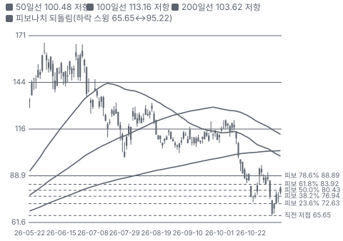

**주봉**

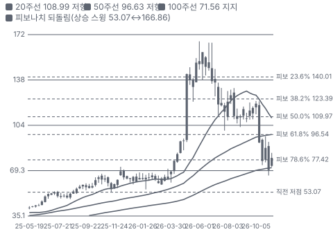

**월봉**

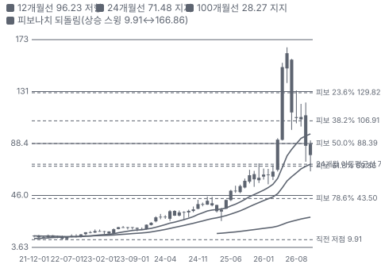

**분기 매출·EPS 실적과 컨센서스**

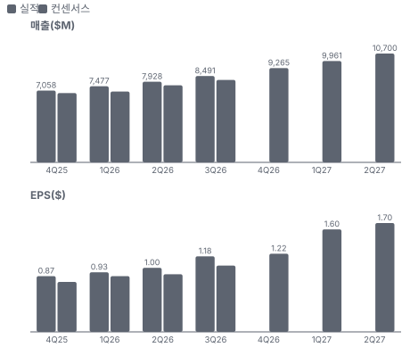

**4Q26 매출 — 지표 추세 vs 가이던스·컨센서스**

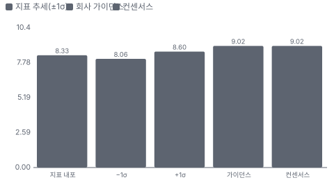

**최근 4개 분기 주가 변화 분석**

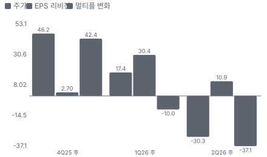

**EPS 리비전**

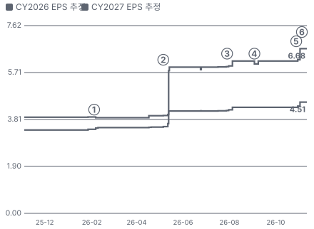

① 26-02-04 3Q FY26 실적, 당일 −10.9% · EPS 리비전 -1%
② 26-05-06 FY26 실적·분사 발표, +39.7% · EPS 리비전 +50%
③ 26-07-29 1Q FY27 실적·상향, −9.1% · EPS 리비전 +4%
④ 26-09-03 EPC Power \$4.4B 인수 발표 · EPS 리비전 +0%
⑤ 26-10-28 2Q FY27 실적·EPS 가이던스 \$5.00, +11.6% · EPS 리비전 +8%
⑥ 26-11-10 Innovation Day — Axiom CY27 \$20~21B · 실적 창과 겹침

**밸류에이션 주가 시나리오**

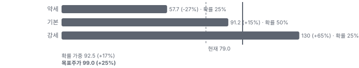

**주가별 업사이드**

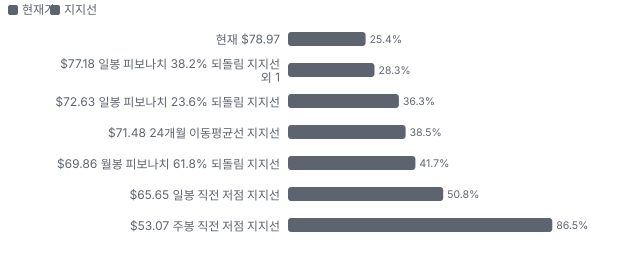
- 제품·서비스 포트폴리오

**고객 믹스(2Q FY27, 매출 대비)**

**공급 병목(10점, 낮을수록 병목)**

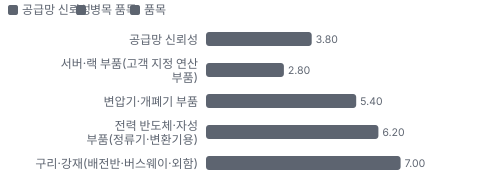

**CAPEX의 매출 대비 비중**

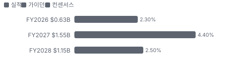

**어닝콜 변화별 주주가치 영향**

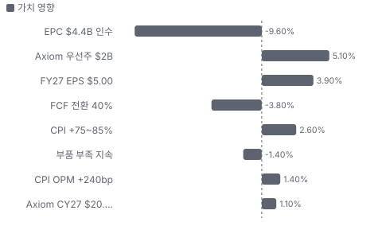

**멀티플 프리미엄(Fwd 1Y P/E, 최근 4개 분기말)**

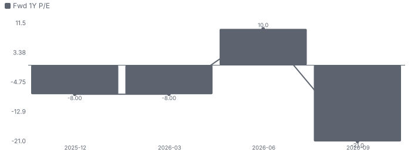

**합리적 멀티플**

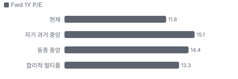

**수주·파이프라인 확실성 사다리**

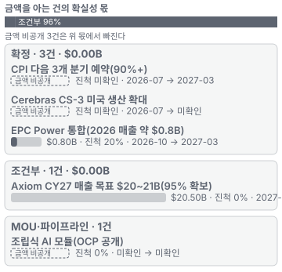

**매출 → 매출총이익 → 영업이익(매출 = 100, 최근 4분기)**

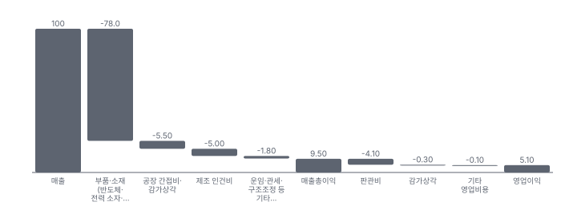

**1년 전 대비 마진 기여(비용 비중 변화의 반대)**

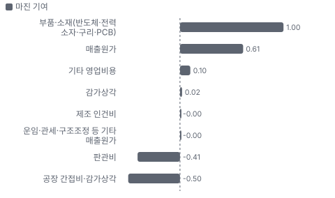

**분기 비용 비중 추이(매출 대비, 공시)**

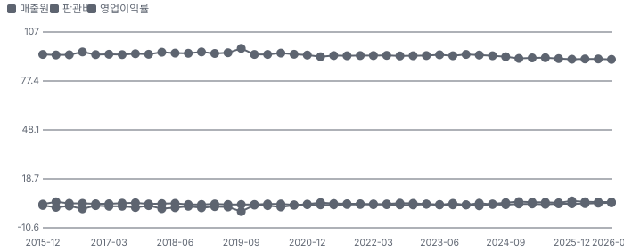

**비용 요인별 매출 대비 비중과 1년 변화**

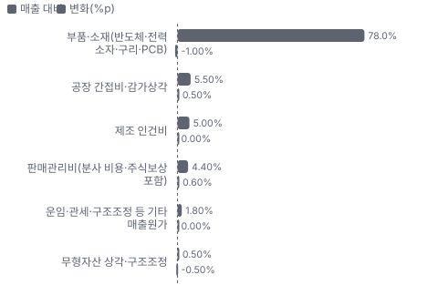

**BOM 항목 가격 +10% 시 OPM 변화**

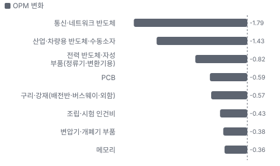

**클라우드·전력 인프라(CPI·Axiom) BOM 원가 몫과 가격 +10% 시 OPM**

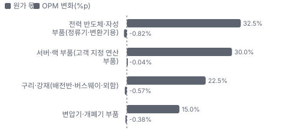

**통합 기술 솔루션(ITS) BOM 원가 몫과 가격 +10% 시 OPM**

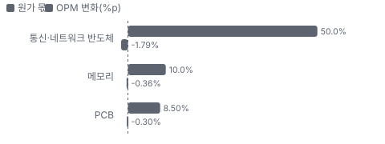

**규제 제조 솔루션(RMS) BOM 원가 몫과 가격 +10% 시 OPM**

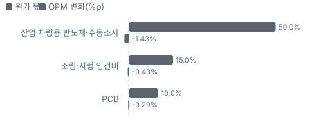

**EPC Power(전력 변환 시스템) 시너지 램프(종류별, 확률 가중)**

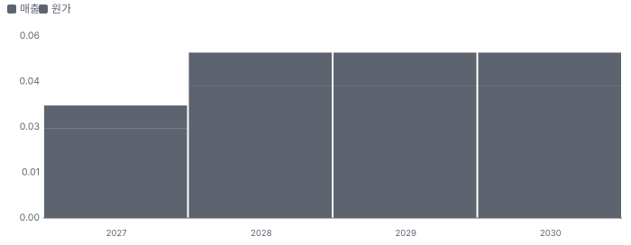

**시너지 가치 vs 웃돈**

**EPS 효과(인수 기업, 기존 대비)**

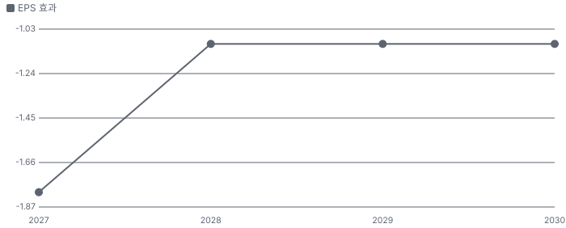

**매출·PPI·수출입 — 최근 16개 분기 같은 축(4Q22 = 100) + 다음 분기 추정**

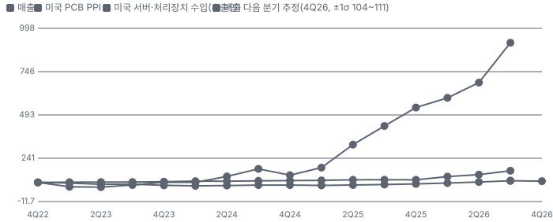

**매출과 미국 서버·처리장치 수입 증가율(전년 대비, 최근 16개 분기 + 다음 분기 추정)**

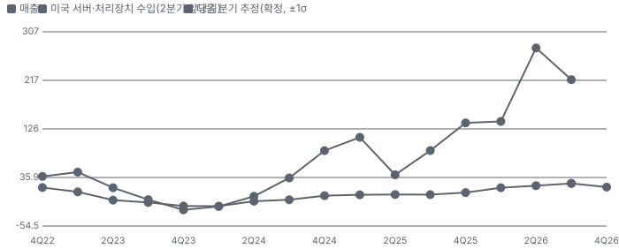

**10년 P·Q 사이클 — 추세(HP 필터) 대비 갭과 8분기 전망**

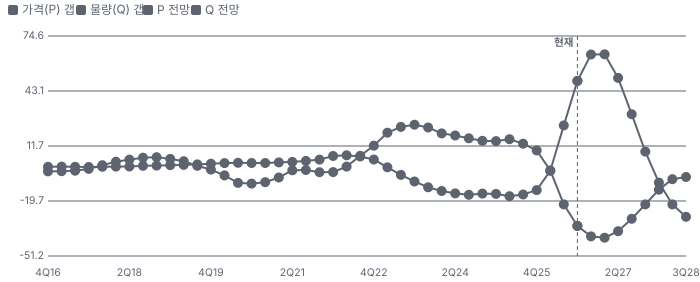

**매출 증가율의 가격·물량 분해와 8분기 전망(전년 대비)**

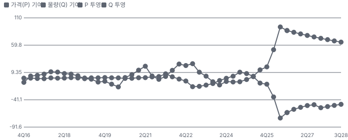

**분기별 매출 증가율 분해**

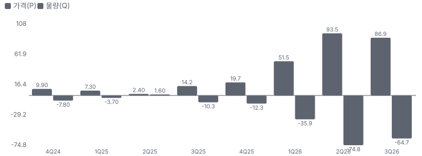

**목표주가 산정 — 기본과 강세 사이(강세 쪽 19%), 도달 확률 약 42%**

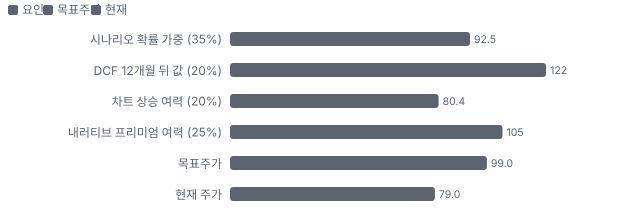

**PEG — 성장 대비 멀티플(낮을수록 성장 대비 쌈)**

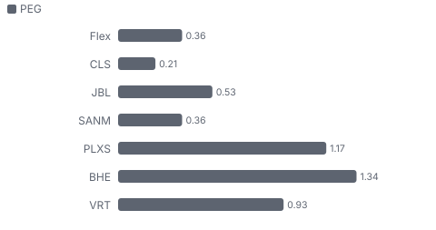

**일봉 지지·저항과 목표주가**

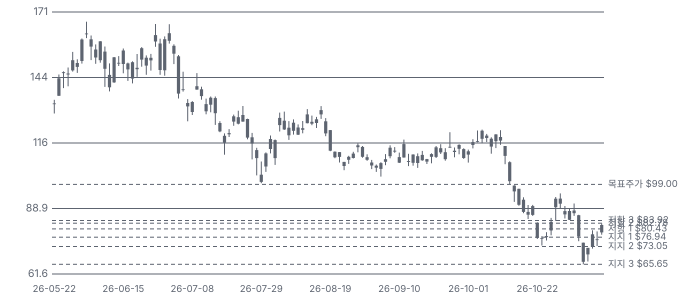

**커뮤니티 언급 수(최근 30일, 채널별)**

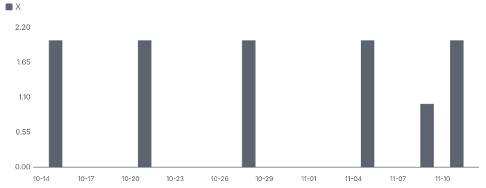

**SOTP 사업부 가치 합산(\$B)**

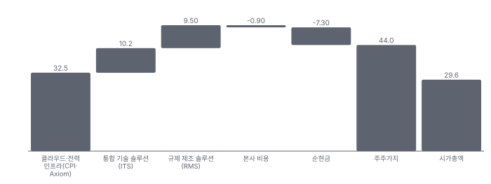

**일별 거래량 분해**

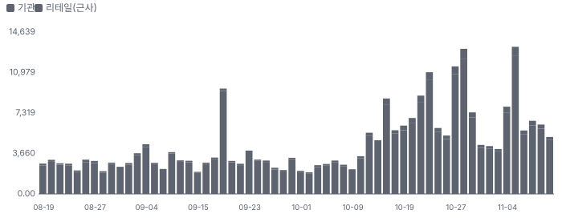

**기관 자금 흐름**

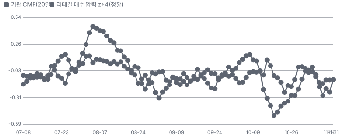

**몬테카를로**

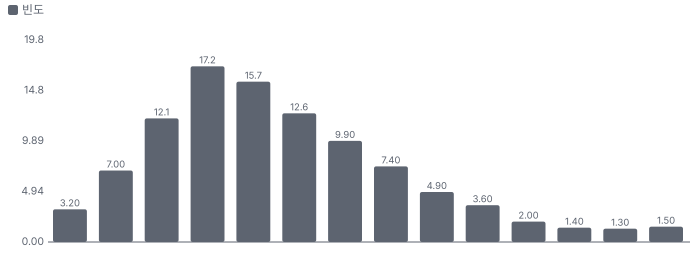

해석: 3,000번 중 2,261번(75%)에서 가치가 지금 주가 이상이었다. 가정을 흔들어도 지금 주가를 뒷받침하는 경우가 더 많다. 가운데 값은 1.38배이고, 열 번 중 여덟 번은 0.70~2.52배 사이에 든다.

## 내러티브

> **기업가치를 결정하는 이야기:** Flex는 남의 제품을 대신 만드는 세계 2위권 위탁 생산 회사다. 통신·네트워크·소비자 기기(ITS(Flex의 통합 기술 사업부, 통신·라이프스타일·소비자)), 산업·자동차·의료(RMS(Flex의 규제 제조 사업부, 산업·자동차·헬스케어))를 만들고, 그 안에서 키운 데이터센터 사업(CPI)이 따로 있다. CPI는 서버 랙 통합·액체냉각(클라우드·냉각)과 랙 전원·배전반·변전 설비·전력 변환(전력)을 판다. 2026년에 EPP(\$1.2B)와 EPC Power(\$4.4B)를 사서 전력 사슬을 넓혔고, CY1Q27에 CPI를 Axiom으로 분사한다. 가치는 세 숫자로 갈린다 — Axiom이 CY27 \$20~21B·EBITDA 13~14%를 내는가, 분사 뒤 Axiom이 전력 인프라 회사 배수(Vertiv Fwd 1Y P/E 21배)를 받는가, 그리고 잔존 Flex가 EMS 하단 배수에서 벗어나는가

> **멀티플·EPS 프리미엄**
> **멀티플:** Fwd 1Y P/E 11.8배로 EMS 동종 5곳 중앙(14.4배)보다 18% 낮고 데이터센터 전력 Vertiv(21.4배)의 절반 수준이다. Fwd 2Y 8.9배·3Y 6.6배로 내려간다. 지난 3년 자기 범위는 7.9~33.8배였고 5월 말 33.8배가 고점이었다 — 지금은 2025년 초 수준이다
> **EPS:** FY27 EPS 컨센서스는 1년 전 \$3.47(2025-11)에서 \$4.93(11/2)으로 42% 올랐고 가이던스 중간 \$5.00이 그 위다. FY28도 \$4.05 → \$7.26이다. 이익 추정은 1년 내내 올랐는데 배수는 5월 이후 더 크게 줄었다

### 투자자들은 왜 열광했나

열광은 5~6월이었다 — 5/6 FY26 실적·분사 발표 날 +39.7%(\$96.45 → \$134.73), 6/22 S&P 500 편입, 6월 말 종가 고점 \$162.07(장중 고점 6/3 \$166.86). 식은 이유는 세 가지가 겹쳤다 — 7/29 1Q 실적·상향에도 당일 −9.1%, 9/3 EPC Power \$4.4B 전액 차입 인수 발표, 10월 중순~11/5 AI 하드웨어 동반 하락(같은 날 Sanmina도 −12.6%, 원인 미확인). 5~6월 고점 구간에는 CEO를 포함한 임원 매도 약 \$111M도 공시됐다

### 무엇이 기업가치를 바꾸나

> **구조적 체질 변화**
> **변화:** 위탁 생산 회사에서 데이터센터 전력 인프라를 따로 떼어 낸다 — CPI 매출 비중 1년 새 24% → 30%, 사업부 이익 비중 32% → 43%
> **증거:** 10-Q Note 15
> **반증:** 분사 철회

> **고부가 믹스 확장**
> **변화:** 조정 영업이익률 2Q 6.0% → 7.1%(+110bp), CPI 8.3% → 10.7%, 전력 약 16%(+550bp)
> **증거:** 2Q FY27 어닝콜(2026-10-28)
> **반증:** FY27 조정 영업이익률 7.6% 아래

> **기술 혁신**
> **변화:** 800V(데이터센터 800볼트 직류 배전 구조) 직류 배전·고체 변압기 연구, 디지털 정류기(EPC)로 97% 효율 과도기 해법, OCP 조립식 AI 모듈(구축 최대 50% 단축, 회사)
> **증거:** 2Q FY27 어닝콜(2026-10-28)
> **반증:** 경쟁사 800V 솔루션이 먼저 표준이 된다

> **실행 속도**
> **변화:** 회사는 납기를 공시하지 않는다. 재고 순일수(고객 선수금 차감)가 55일 → 60일로 늘었다 — 부품 부족에 대비해 재고를 먼저 쌓은 결과(CFO) **납품 리드타임 60일.** 피어 비교 미확인. 2Q FY26(재고 순일수) 55일보다 9% 길다.
> **증거:** 2Q FY27 어닝콜(2026-10-28)
> **반증:** 재고 순일수 70일 이상

> **M&A**
> **변화:** EPP \$1.2B(5/1)·EPC Power \$4.4B(10/14) 인수 — 둘 다 차입. EPC는 FY27 EPS 증가 기여(회사)
> **증거:** https://www.sec.gov/Archives/edgar/data/866374/000086637426000042/flex-20260925.htm
> **반증:** EPC 통합 뒤 전력 이익률 하락

> **정책·입법 연관성**
> **재정정책:** 해당 없음(Flex 매출에 직접 닿는 재정 지출 미확인). 전력망 투자는 IIJA(2021년 미국 인프라 투자·일자리법) 등 간접 노출 10-Q(정부 보조 없음) 반증: 전력망 투자 예산 삭감 의회 동의 2/10 — 하원 1/5(Flex 직접 관련 법안 미확인) · 상원 1/5(Flex 직접 관련 법안 미확인).
> **행정명령:** 관세 행정명령 — 멕시코·아시아 생산 비중이 커서 원가·USMCA(미국·멕시코·캐나다 무역협정) 원산지 규칙이 중요하다 10-Q 위험 요인 반증: 멕시코산 서버·전력 설비 신규 관세 의회 동의 2/10 — 하원 1/5(의회 절차 아님) · 상원 1/5(의회 절차 아님).
> **연관입법:** 해당 없음(CHIPS(미국 반도체 생산 보조금 법) 보조금 등 Flex 수령 계약 미확인). 선거 뒤 지역 데이터센터 반발은 인허가 위험 10-Q 반증: 데이터센터 전력 우대 입법

> **CAPEX 낙수효과**
> **변화:** 하이퍼스케일러 AI 데이터센터 투자 → CPI 랙·전력 주문. 금지표대로 고객 투자를 Flex 매출로 바로 옮기지 않는다 — 확인된 것은 CPI 가이던스 +75~85%와 Axiom CY27 95% 확보
> **증거:** https://www.sec.gov/Archives/edgar/data/866374/000119312526454502/d150156dex992.htm
> **반증:** 최대 고객 데이터센터 투자 감속

### 내러티브 근거

> '위탁 생산 회사 안에 숨은 AI 데이터센터 전력 회사(Axiom)가 분사로 따로 값을 받는다'는 이야기. 5/6 분사 발표 날 +40%로 시작해 6월 말 종가 고점 \$162.07까지 갔다가, 가이던스를 두 번 올렸는데도 11/5 \$66.73까지 59% 빠졌다. 지금 시장은 EPC 인수 차입(\$4.4B)·부품 부족·AI 설비투자 지속성을 먼저 본다. 동종 대비 멀티플 차이 -18% 중 회사 고유 몫은 -11%다. 단계는 확산, 쏠림은 중간이다.

> **Axiom 분사 → 따로 평가** · 확산
> **논리:** CPI를 CY1Q27에 Axiom(나스닥 AXM)으로 떼어 전력·냉각·연산 인프라 회사로 따로 상장한다
> **숫자:** Axiom CY27 매출 \$20~21B·조정 EBITDA 13~14%, 우선주 전환 EV 상한 \$37.5B·하한 \$30B
> **반증:** Form 10 효력 지연 또는 분사 철회

> **전력 사슬 확장(EPP·EPC Power)** · 강화
> **논리:** 랙 전원에서 변전소·전력 변환까지 인수로 넓혀 800V 직류·고체 변압기 전환을 준비한다
> **숫자:** 전력 이익률 2Q 약 16%(+550bp), Axiom 전력 CY27 \$6~6.3B
> **반증:** 전력 이익률이 13% 아래로

> **가이던스 연속 상향** · 강화
> **논리:** FY27 EPS 가이던스 \$4.21~4.51(5월) → \$4.42~4.74(7월) → \$4.84~5.16(10월)
> **숫자:** FY27 EPS 중간 \$4.36 → \$5.00(+15%)
> **반증:** 3Q 실적에서 가이던스 유지·하향

> **잔존 Flex 재평가** · 태동
> **논리:** 분사 뒤 남는 Flex도 고가치 시장 비중을 24% → 35~40%로 올리고 FCF 전환 80%+로 자사주를 산다
> **숫자:** FY29 조정 영업이익률 7%+·매출 CAGR 7%+(방향)
> **반증:** RMS·ITS 성장이 한 자릿수 초반

> **반대 — 차입·실행 위험** · 확인
> **논리:** EPC 인수로 차입이 \$5.2B → \$9.6B로 늘었고 그중 \$4.4B가 1년 만기다. 우선주 \$2B 납입과 분사가 같이 맞아야 한다
> **숫자:** 순차입 약 \$7.3B, EPC 차입 만기 2027-10-13
> **반증:** 우선주 납입·분사 완료로 차입 \$2B 감소

> **반대 — AI 설비투자 지속성·부품 부족** · 확인
> **논리:** 하이퍼스케일러 한 곳이 14%이고 부품 부족이 몇 년 간다(CEO). AI 투자 속도가 꺾이면 CPI 성장이 먼저 꺾인다
> **숫자:** 고객 1곳 14%, 재고 +39%
> **반증:** CPI 3Q 성장 +105~115% 달성

이미지 없음(아직 생성 전) — 클라우드·전력 인프라(CPI·Axiom)·통합 기술 솔루션(ITS)

## 포트폴리오

| 제품·서비스 | 구분 | 무엇 | 쓰는 곳 | 돈 버는 방식 | Mix | Mix 변화(전 분기 대비) |
|---|---|---|---|---|---|---|
| 클라우드·전력 인프라(CPI·Axiom) | 제품 | AI 서버 랙 통합·액체냉각·랙 전원·배전반·변전 설비·전력 변환(PCS(전력 변환 시스템, 인버터·정류기)) | 하이퍼스케일러·AI 칩 회사·전력회사의 데이터센터와 변전소 | 랙 통합 조립 + 전력 제품 판매(이익률 약 16%) | 30% | +1.8%p |
| 통합 기술 솔루션(ITS) | 서비스 | 통신·고급 네트워크·위성 통신 장비, 라이프스타일·소비자 기기 위탁 생산 | 네트워크 장비·통신·소비자 기기 회사 | 조립 단가 + 엔지니어링 | 39% | +0.4%p |
| 규제 제조 솔루션(RMS) | 서비스 | 산업·에너지·자동차 전장·의료기기 규제 생산 | 산업 장비·자동차·의료기기 회사 | 장기 공급 계약 | 32% | -2.2%p |

**Mix 변화가 가장 큰 쪽은 규제 제조 솔루션(RMS, -2.2%p, 전 분기 대비).** 계절성 판정: 분기 매출 계절 지수 기준 없음 → 직전 분기와 비교.

## 고객

> **2Q FY27 최대 고객 고객 A(14%, 미공시)(Hyperscaler 1(Innovation Day)) 14%, 상위 3곳 14%, 집중도 분산.** 공시·회사 발표로 확인한 몫은 매출의 14%이고, 나머지 고객 몫은 추정이거나 미분해다. 고객 1곳이 2Q 매출의 14%(6개월 13%)이고 그 매출 대부분이 CPI다 — 이름 미공시. Axiom 자료는 하이퍼스케일러 두 곳(프로그램 30개+·15개+), 칩 회사 두 곳, 전력회사 15곳 이상을 보여 준다

**고객별 매출 몫(2Q FY27)**
| 고객 | 몫 | 변화 | 근거 |
|---|---|---|---|
| 고객 A(14%, 미공시)(Hyperscaler 1(Innovation Day)) | 14% | 미확인 | 공시 |
| Hyperscaler 2(미공시, Hyperscaler 2) | 미확인 | 미확인 | 회사 발표 |
| Amazon(워런트 보유) | 미확인 | 미확인 | 추정 |
| Cerebras | 미확인 | 미확인 | 회사 발표 |
| 전력회사(15곳+) | 미확인 | 미확인 | 회사 발표 |
| 기타·미분해 | 86% | - | - |

> **고객 A(14%, 미공시)(Hyperscaler 1(Innovation Day))** · 공시
> **사는 것:** CPI 클라우드·전력
> **추정 근거:** 10-Q 10% 고객 — Axiom 자료의 'Hyperscaler 1'(프로그램 30개+)과 같은 회사인지는 가설

> **Hyperscaler 2(미공시, Hyperscaler 2)** · 회사 발표
> **사는 것:** CPI
> **추정 근거:** 프로그램 15개+

> **Amazon(워런트 보유)** · 추정
> **사는 것:** 미확인
> **추정 근거:** 상업 계약 연동 워런트 — 고객 A와 같은 회사인지는 미확인

> **Cerebras** · 회사 발표
> **사는 것:** CS-3 시스템 위탁 생산
> **추정 근거:** 매출 몫 미공시

> **전력회사(15곳+)** · 회사 발표
> **사는 것:** 변전·보호 설비(EPP)
> **추정 근거:** EPP 인수로 생긴 고객군

## 수주·파이프라인

> **2026-11-12 기준 5건.** 확정 \$0.00B. 서로 겹치는 항목은 합계에서 뺐다.

**실행 속도와 방해 요인**
| 항목 | 상태 | 실행 속도 | 방해 요인 |
|---|---|---|---|
| Axiom CY27 매출 목표 \$20~21B(95% 확보) | 조건부 | 미확인 | 부품 부족 · 분사 실행 |
| CPI 다음 3개 분기 예약(90%+) | 확정 | 미확인 | 부품 부족 |
| Cerebras CS-3 미국 생산 확대 | 확정 | 미확인 | 고객 수요 |
| EPC Power 통합(2026 매출 약 \$0.8B) | 확정 | 계획대로(계획 20%, +0%p), 이대로면 2027-03 완료 | 통합 |
| 조립식 AI 모듈(OCP 공개) | 파이프라인 | 미확인 | 고객 채택 |

## 마진 구조

> **GPM 9.7%, OPM 4.9%.** 2Q FY26 대비 GPM +0.6%p, OPM +0.5%p. 변동비는 매출의 85%이고, 매출이 10% 늘면 OPM은 +0.9%p 움직인다. 매출원가가 매출의 90%다 — 대부분 고객 지정 부품을 사서 붙이는 값이라 원가가 넘어간다. 이익을 가르는 것은 믹스다: CPI 이익률 10.7%(전력 약 16%)가 RMS 6.4%·ITS 5.5%보다 높고, CPI 매출 비중이 1년 새 24% → 30%가 됐다. 원가 세부는 공시되지 않아 요인 몫은 추정이다

> **매출 100 중 매출원가 90.5, 매출총이익 9.5(최근 4분기, 공시).** 매출원가 요인 중 부품·소재(반도체·전력 소자·구리·PCB)이 매출의 78.0%로 가장 무겁고, 단가가 +10% 오르면 GPM이 -7.80%p 움직인다. 분기 회귀로 매출 1이 늘 때 매출원가는 0.85 늘고, 매출원가의 고정비 몫은 8%다.

**비용 요인 강도 — 비중·추세·충격(+10%)·탄력**
| 비용 | 구분 | 매출 대비 | 1년 변화 | 마진 기여 | 충격 시 마진 | 매출 탄력 | 고정비 몫 |
|---|---|---|---|---|---|---|---|
| 부품·소재(반도체·전력 소자·구리·PCB) | 매출원가 요인 | 78.0% | -1.0%p | +1.0%p | -7.80%p | 미확인 | 0% |
| 공장 간접비·감가상각 | 매출원가 요인 | 5.5% | +0.5%p | -0.5%p | -0.55%p | 미확인 | 80% |
| 제조 인건비 | 매출원가 요인 | 5.0% | +0.0%p | -0.0%p | -0.50%p | 미확인 | 40% |
| 운임·관세·구조조정 등 기타 매출원가 | 매출원가 요인 | 1.8% | +0.0%p | -0.0%p | -0.18%p | 미확인 | 20% |
| 매출원가 | 공시 항목 | 90.5% | -0.6%p | +0.6%p | -9.05%p | 0.85 | 8% |
| 판관비 | 공시 항목 | 4.1% | +0.4%p | -0.4%p | 미확인 | 0.03 | 7% |
| 감가상각 | 공시 항목 | 0.3% | -0.0%p | +0.0%p | 미확인 | 0.00 | 33% |
| 기타 영업비용 | 공시 항목 | 0.1% | -0.1%p | +0.1%p | 미확인 | 0.00 | -52% |

매출 탄력 = 분기 비용을 매출에 회귀한 기울기(매출 1당 변동비), 고정비 몫 = 절편 ÷ 평균 비용. 표본이 8분기 미만이면 미확인. 매출원가 요인 비중은 margin 재료의 추정이 섞여 있고, 공시 매출원가와의 차이는 '기타 매출원가'로 둔다.

**GPM에서 OPM까지(GAAP)**
| 기간 | GPM | 연구개발 | 판관비 | 기타 | OPM |
|---|---|---|---|---|---|
| 2Q FY26 | 9.2% | 0.0% | 3.8% | 1.0% | 4.4% |
| 2Q FY27 | 9.7% | 0.0% | 4.4% | 0.5% | 4.9% |

**GPM·OPM 최근 4개 분기**
| 분기 | GPM | OPM |
|---|---|---|
| 2025-12 | 9.6% | 5.5% |
| 2026-03 | 9.4% | 5.0% |
| 2026-06 | 9.4% | 4.9% |
| 2026-09 | 9.6% | 4.9% |

**마진을 결정하는 비용 요인 — 비용 +10% 시 OPM**
| 비용 | 매출 대비 | 변화 | 고정비 | OPM |
|---|---|---|---|---|
| 부품·소재(반도체·전력 소자·구리·PCB) | 78.0% | -1.0%p | 0% | -7.80%p |
| 공장 간접비·감가상각 | 5.5% | +0.5%p | 80% | -0.55%p |
| 제조 인건비 | 5.0% | +0.0%p | 40% | -0.50%p |
| 판매관리비(분사 비용·주식보상 포함) | 4.4% | +0.6%p | 70% | -0.44%p |
| 운임·관세·구조조정 등 기타 매출원가 | 1.8% | +0.0%p | 20% | -0.18%p |
| 무형자산 상각·구조조정 | 0.5% | -0.5%p | 90% | -0.05%p |

**비용을 움직이는 요인**
| 비용 | 요인 |
|---|---|
| 부품·소재(반도체·전력 소자·구리·PCB, 매출원가) | 고객 지정 부품 구매가(대부분 전가) · 근거 추정 |
| 공장 간접비·감가상각(매출원가) | 설비투자 FY27 \$1.5~1.6B, 감가상각 2Q \$156M · 근거 추정 |
| 제조 인건비(매출원가) | 약 15만 명(회사 개요) · 근거 추정 |
| 판매관리비(분사 비용·주식보상 포함, 판관비) | 분사 비용 2Q \$91M·인수 비용 \$19M·주식보상 \$43M · 근거 공시 |
| 운임·관세·구조조정 등 기타 매출원가(매출원가) | 구조조정 2Q \$15M 포함 · 근거 추정 |
| 무형자산 상각·구조조정(기타) | 상각 2Q \$27M(EPC 반영 뒤 분기 약 \$23M 추가) · 근거 공시 |

**클라우드·전력 인프라(CPI·Axiom) BOM — 매출의 30%, GPM 14%(추정 — 사업부 이익률 10.7%(2Q) + 판관비 배분 약 3%p. 사업부 총이익 미공시), 항목 가격 +10% 시**
| 항목 | 원가 몫 | 전가 | 제품 GPM | OPM |
|---|---|---|---|---|
| 전력 반도체·자성 부품(정류기·변환기용) | 25~40% | 미확인 | -2.8%p | -0.82%p |
| 서버·랙 부품(고객 지정 연산 부품) | 20~40% | 100% | -0.4%p | -0.04%p |
| 구리·강재(배전반·버스웨이·외함) | 15~30% | 미확인 | -1.9%p | -0.57%p |
| 변압기·개폐기 부품 | 10~20% | 미확인 | -1.3%p | -0.38%p |

**통합 기술 솔루션(ITS) BOM — 매출의 39%, GPM 8%(추정 — 사업부 이익률 5.5% + 판관비 배분 약 2.5%p), 항목 가격 +10% 시**
| 항목 | 원가 몫 | 전가 | 제품 GPM | OPM |
|---|---|---|---|---|
| 통신·네트워크 반도체 | 40~60% | 미확인 | -4.6%p | -1.79%p |
| 메모리 | 5~15% | 미확인 | -0.9%p | -0.36%p |
| PCB | 5~12% | 미확인 | -0.8%p | -0.30%p |
| 미분해 | 31% | - | - | - |

**규제 제조 솔루션(RMS) BOM — 매출의 32%, GPM 9%(추정 — 사업부 이익률 6.4% + 판관비 배분 약 2.5%p. 세 사업부 가중 약 10.1% ≈ 회사 조정 총이익률 9.9%), 항목 가격 +10% 시**
| 항목 | 원가 몫 | 전가 | 제품 GPM | OPM |
|---|---|---|---|---|
| 산업·차량용 반도체·수동소자 | 40~60% | 미확인 | -4.6%p | -1.43%p |
| 조립·시험 인건비 | 10~20% | 미확인 | -1.4%p | -0.43%p |
| PCB | 5~15% | 미확인 | -0.9%p | -0.29%p |
| 미분해 | 25% | - | - | - |

통신·네트워크 반도체 가격이 +10% 오르면 영업이익은 -36.7% 움직인다. 판매가 전가를 모르는 항목은 전가 0%로 계산했다.

**BOM 항목 가격을 움직이는 것**
| 항목 | 요인 |
|---|---|
| 전력 반도체·자성 부품(정류기·변환기용) | 디지털 정류기·PCS 원가 중심 · 근거 추정 |
| 구리·강재(배전반·버스웨이·외함) | critical power(데이터센터 건물·전력망 쪽 배전·보호 설비) 설비 · 근거 추정 |
| 변압기·개폐기 부품 | EPP·Anord Mardix 배전·보호 설비 · 근거 추정 |
| 서버·랙 부품(고객 지정 연산 부품) | 클라우드 랙 통합은 고객 지정 부품 원가가 그대로 넘어간다(업계 관행, 추정) · 근거 추정 |
| 통신·네트워크 반도체 | 고급 네트워크 장비 · 근거 추정 |
| PCB | 보드 원판 · 근거 추정 |
| 메모리 | 통신·라이프스타일 기기 · 근거 추정 |
| 산업·차량용 반도체·수동소자 | 산업·자동차·의료 보드 · 근거 추정 |
| 조립·시험 인건비 | 고혼합·규제 생산 · 근거 추정 |

**BOM 투입 물가 — PPI 전년비, 2026-11-12 수집**
| 항목 | 미국 | 일본 | 한국 | 대만 |
|---|---|---|---|---|
| 산업·차량용 반도체·수동소자 | -2.2% | +1.6% | +2.3% | +22.9%* |
| 구리·강재(배전반·버스웨이·외함) | +30.0% | +42.6% | +25.8% | +40.1% |
| 변압기·개폐기 부품 | +7.8% | -1.5% | +16.6% | +10.6%* |
| 서버·랙 부품(고객 지정 연산 부품) | +3.0% | 미확인 | 미확인 | +57.2%* |
| PCB | +45.8% | +11.5% | +4.5% | +12.1% |
| 메모리 | -2.2%* | +1.6%* | +418.1% | +22.9%* |

별표는 품목보다 넓은 업종 지수다. 지난 1년 투입 물가를 판매가 전가 뒤 원가에 그대로 넣으면 OPM은 -18.57%p 움직인다(매출원가의 74% 기준).

## 공급망 병목

이미지 없음(아직 생성 전) — 클라우드·전력 인프라(CPI·Axiom)

> **공급망 신뢰성 3.8/10, 병목 심각.** 가장 약한 고리는 서버·랙 부품(고객 지정 연산 부품) 2.8점이고, 품목 평균은 5.2점이다. 병목은 전력·연산 부품이다 — CEO는 '지난 12개월 이어진 부품 부족이 앞으로 몇 년 더 간다'고 했다. 회사는 재고를 39% 늘려 물량을 먼저 잡고 있고, 단가 손실은 없다고 밝혔다(CFO)

**병목과 마진 — 품목 가격 +10% 시 OPM**
| 품목 | 점수 | 판정 | 구분 | OPM |
|---|---|---|---|---|
| 서버·랙 부품(고객 지정 연산 부품, 필수) | 2.8 | 병목 심각 | 출하 차질 위험 | -0.04%p |
| 변압기·개폐기 부품(필수) | 5.4 | 병목 주의 | 출하 차질 위험 | -0.38%p |
| 전력 반도체·자성 부품(정류기·변환기용, 필수) | 6.2 | 관리 가능 | 가격 위험 | -0.82%p |
| 구리·강재(배전반·버스웨이·외함) | 7.0 | 관리 가능 | 가격 위험 | -0.57%p |

> **서버·랙 부품(고객 지정 연산 부품)** · 2.8/10
> **왜:** 플랫폼별로 칩이 정해진다 — 가속기 1위 점유 80%·대만 생산 90%는 업계 구조 추정
> **병목 요인:** 인증 공급사 2곳 · 캐파 부족 · 리드타임 미확인 · 재인증 미확인 · 1위 점유율 80% · 대만(업계 구조 — 추정) 집중 90% · 물량 확보 미확인
> **풀리는 조건:** 미확인

> **변압기·개폐기 부품** · 5.4/10
> **왜:** EPP·Anord Mardix 인수로 내재화 — 지역 몫(미국·유럽 70%)은 추정
> **병목 요인:** 인증 공급사 2곳 · 캐파 빠듯 · 리드타임 미확인 · 재인증 미확인 · 1위 점유율 미확인 · 미국·유럽 집중 70% · 물량 확보 내재화
> **풀리는 조건:** 증설 중(가동 미확인)

> **전력 반도체·자성 부품(정류기·변환기용)** · 6.2/10
> **왜:** 전력 제품 설계에 묶여 쉽게 바꾸지 못한다 — 인증 공급사 3곳·지역 몫 50%는 업계 구조 추정
> **병목 요인:** 인증 공급사 3곳 · 캐파 빠듯 · 리드타임 미확인 · 재인증 미확인 · 1위 점유율 미확인 · 미확인 집중 50% · 물량 확보 복수구매
> **풀리는 조건:** 미확인

> **구리·강재(배전반·버스웨이·외함)** · 7.0/10
> **왜:** 원자재 시장 구매 — 공급원 수·지역 몫은 추정
> **병목 요인:** 인증 공급사 3곳 · 캐파 균형 · 리드타임 미확인 · 재인증 미확인 · 1위 점유율 미확인 · 미확인 집중 40% · 물량 확보 현물
> **풀리는 조건:** 미확인

**공급사**
| 품목 | 공급사 | 몫 | 근거 |
|---|---|---|---|
| 전력 반도체·자성 부품(정류기·변환기용) | 전력 반도체 회사(이름 미공시)(SiC(탄화규소 전력 반도체)·실리콘 전력 소자) | 미확인 | 추정 |
| 구리·강재(배전반·버스웨이·외함) | 원자재 시장 구매(구리·강재) | 미확인 | 추정 |
| 변압기·개폐기 부품 | EPP·Anord Mardix(자체, 배전·보호 설비 제조) | 미확인 | 공시 |
| 서버·랙 부품(고객 지정 연산 부품) | 고객 지정 칩 회사(Silicon Provider 1·2, 이름 미공시, 가속기·CPU) | 미확인 | 회사 발표 |

**무역 통계로 본 공급 지역**
| 품목 | EU 수입처 | 일본 수입처 | EU 1위 전년비 |
|---|---|---|---|
| 전력 반도체·자성 부품(정류기·변환기용) | TW(대만) 32% · MY(말레이시아) 19% · CN(중국) 15% | 台湾 60% · 中華人民共和国 8% | +136.5% |
| 구리·강재(배전반·버스웨이·외함) | MY 69% · KR(한국) 10% · US 7% | マレーシア 58% · タイ 36% | 미확인 |
| 변압기·개폐기 부품 | CN 82% · KR 11% · VN(베트남) 4% | 中華人民共和国 65% · 大韓民国 19% | +18.1% |
| 서버·랙 부품(고객 지정 연산 부품) | US 50% · TW 30% · CN 14% | アメリカ合衆国 30% · 台湾 18% | +106.2% |

## 생산능력

> **현재 명목 캐파 미확인, 가동률 미확인.** 착공 이상 증설은 0 공장(시설 수)·GW(전력 변환), 발표까지 합치면 0 공장(시설 수)·GW(전력 변환)이다. FY2026 CAPEX는 \$0.63B로 매출의 2.3%다. 약 30개국에 공장이 있다(회사 개요) — 10-K 시설 목록 미대조라 시설 수·면적은 미확인. FY27 설비투자 \$1.5~1.6B의 약 2/3가 FY28 CPI 캐파 확보용이다(CFO). EPC Power는 15GW 넘는 공급 이력이 있고 2027년까지 미국 캐파 30GW 이상을 목표로 한다(인수 발표 보도)

**생산시설 30곳**(시설 수 미공시 — 30은 회사 개요의 생산 국가 수('30개국 이상')이지 시설 수가 아니다. 10-K Item 2 미대조) — 이름·위치를 밝힌 곳 3곳, 미확인 3곳. 시설별 생산능력은 공개되지 않았다 — 회사 전체 캐파만 위에 적었다.

**생산시설 30곳 — 명칭·위치·생산능력**
| 시설 | 위치 | 용도 | 생산능력 | 소유·상태 |
|---|---|---|---|---|
| EPC Power 본사·공장 | 미국 캘리포니아(위치 근거: 회사 발표, 미대조) | 전력 변환 시스템(PCS·인버터) | 미확인 — 15GW+ 누적 공급 이력(보도) — 연간 캐파 미공시 | 미확인 · 가동 |
| EPP(Electrical Power Products) | 미국 아이오와(위치 근거: 회사 발표, 미대조) | 변전소·발전소 보호·제어 설비 | 미확인 — 미공시 | 미확인 · 가동 |
| Anord Mardix | 아일랜드·영국·미국(위치 근거: 회사 소개, 미대조) | 데이터센터 배전반·버스웨이 | 미확인 — 미공시 | 미확인 · 가동 |

**생산능력 확충 계획**
| 계획 | 단계 | 증설 | 가동 시점 | CAPEX |
|---|---|---|---|---|
| CPI(Axiom) 캐파 확대 — FY27 설비투자의 2/3 | 착공 | 미확인 | 2027 | \$1.00B |
| EPC Power 미국 전력 변환 캐파 30GW+ — 15GW 이력 → 30GW 목표(보도) | 발표 | 미확인 | 2027 | 미확인 |
| Cerebras CS-3 미국 생산 캐파 확대(7배, 보도) | 발표 | 미확인 | 미확인 | 미확인 |
| Axiom 확장 설비투자 약 \$2B(CY26~27) | 착공 | 미확인 | 2027 | \$2.00B |

남은 계획의 CAPEX 합계는 \$3.00B(금액 미확인 2건 제외)다. 합계는 FY2028 매출의 7%다.

**증설 방해 요인**
| 계획 | 방해 요인 |
|---|---|
| CPI(Axiom) 캐파 확대 — FY27 설비투자의 2/3 | 부품 부족 |
| EPC Power 미국 전력 변환 캐파 30GW+ — 15GW 이력 → 30GW 목표(보도) | 통합·인증 |
| Cerebras CS-3 미국 생산 캐파 확대(7배, 보도) | 고객 수요 |
| Axiom 확장 설비투자 약 \$2B(CY26~27) | 실행 |

**CAPEX와 매출 대비**
| 기간 | CAPEX | 매출 | 매출 대비 | 구분 |
|---|---|---|---|---|
| FY2026 | \$0.63B | \$27.91B | 2.3% | 실적 |
| FY2027 | \$1.55B | \$35.40B | 4.4% | 가이던스 |
| FY2028 | \$1.15B | \$45.80B | 2.5% | 컨센서스 |

## M&A 시너지

> **EPC Power(전력 변환 시스템) 인수(2026-10-14, \$4.40B): 시너지가 다 나면 연 \$0.05B(확률 가중 이익 기여), 인수 배수 EV/EBITDA 22.0배 → 시너지 반영 17.6배.** 세후 시너지 가치는 통합 비용을 빼고 \$0.35B. EPS 효과는 2027년 -1.8%에서 2030년 -1.1%.

**EPC Power(전력 변환 시스템) 시너지가 생기는 길**
| 종류 | 시너지 | 연 규모 | 완성 | 확률 | 어떻게 생기나 | 근거 |
|---|---|---|---|---|---|---|
| 매출 | 하이퍼스케일러에 디지털 정류기·PCS 교차 판매 | \$0.50B(이익률 20%) | 2028 | 40% | Flex의 하이퍼스케일러 프로그램에 EPC의 전력 변환 제품을 붙여 판다 — 규모 미공시, 추정 | 2Q 콜 — 규모는 추정 |
| 원가 | 전력 부품 조달 통합 | \$0.02B | 2028 | 50% | Flex 조달망으로 전력 소자·자성 부품을 묶어 산다 — 규모 미공시, 추정 | 추정 |

시너지 가치 = 세후 이익 기여 5년 + 말기 가치(할인율 9%, 성장 0) − 통합 비용. 매출 시너지는 그 매출의 이익률만 반영하고, 모든 시너지에 실현 확률을 곱했다.

## 해자

> 해자는 '보통'이다. 위탁 생산 자체는 가격 경쟁이 세지만, Flex는 ① 랙 안 전원부터 건물 배전·전력망 변환까지 전력 사슬을 한 회사가 공급하고 ② 하이퍼스케일러 한 곳에 30개 넘는 프로그램이 걸려 있으며 ③ 30여 개국 생산·조달 규모로 부품 부족기에 물량을 확보한다

> **전력 사슬 일괄 공급(embedded·critical power·PCS)** · 보통
> **해자:** 서버 전원·랙 전원(embedded), 배전·보호 설비(critical, Anord Mardix·EPP), 전력 변환(EPC Power)을 묶어 단계마다 생기는 변환 손실을 줄인다(회사)
> **근거:** 2Q 콜·Innovation Day EX-99.2
> **숫자:** 전력 이익률 2Q 약 16%(+550bp), Axiom 전력 CY27 \$6~6.3B·이익률 mid-20s 목표
> **깨지는 조건:** 전력 이익률이 2개 분기 연속 13% 아래

> **하이퍼스케일러 다프로그램 관계** · 보통
> **해자:** 최대 하이퍼스케일러 한 곳에 30개 넘는 프로그램, 두 번째에 15개 넘게 걸려 있다 — 한 제품이 끊겨도 관계가 이어진다
> **근거:** Innovation Day EX-99.2 고객 슬라이드·10-Q(고객 1곳 14%)
> **숫자:** CY27 Axiom 매출 95% 확보(수주·고객 약정·고객 공동 투자 프로그램)
> **깨지는 조건:** 최대 고객 매출 비중이 2개 분기 연속 줄고 CPI 성장이 30% 아래

> **규모·조달력** · 보통
> **해자:** 약 15만 명·30여 개국 공장과 조달 조직으로 부품 부족기에 물량을 먼저 확보한다(CEO)
> **근거:** 2Q 콜·회사 개요
> **숫자:** 재고 \$7.3B(+39%), 단가 손실 없음(CFO)
> **깨지는 조건:** 부품 부족으로 분기 매출 가이던스 하단 미달

> **규제 산업 인증(헬스케어·자동차·산업)** · 약함
> **해자:** 의료기기·자동차는 인증 이력이 있어 공급사 교체가 느리다 — 다만 업계 공통
> **근거:** 1Q·2Q 콜(Hartung)
> **숫자:** RMS 2Q 매출 \$2.68B(+9%)·이익률 6.4%
> **깨지는 조건:** RMS 매출 역성장

## 경영진·네트워크

> Revathi Advaithi(2019~ CEO)가 분사 뒤 Axiom CEO로 가고 CFO Kevin Krumm도 Axiom CFO로 간다. 잔존 Flex는 Michael Hartung(현 최고상업책임자)이 CEO, Amy Schwetz가 CFO를 맡는다. 5~6월 주가 고점 구간에 CEO를 포함한 임원이 계획 매도를 크게 했다. 정계 연결은 공개 기록에서 확인하지 못했다

> **Revathi Advaithi** · CEO → Axiom CEO(예정) · 2019
> **프로필:** 전력·냉각·연산 사업을 인수로 키워 CPI 분사를 이끌었다. 2026-05~06 계획 매도 포함 약 \$67M 매도(Form 4 집계)
> **비즈니스:** 전사·Axiom
> **정계:** 미확인
> **동문:** 미확인
> **사모임:** 미확인

> **Kevin Krumm** · CFO → Axiom CFO(예정) · 미확인
> **프로필:** EPC 인수 자금(\$4.4B 차입)·Axiom 전환우선주 \$2B를 설계
> **비즈니스:** 재무
> **정계:** 미확인
> **동문:** 미확인
> **사모임:** 미확인

> **Michael Hartung** · 최고상업책임자 → 잔존 Flex CEO(예정) · 미확인
> **프로필:** 잔존 Flex 고가치 시장 6곳(헬스케어·에너지·통신·로봇 등) 전략
> **비즈니스:** RMS·ITS
> **정계:** 미확인
> **동문:** 미확인
> **사모임:** 미확인

> **Amy Schwetz** · 잔존 Flex CFO(예정) · 2026
> **프로필:** 분사 뒤 Flex 재무 책임자로 영입
> **비즈니스:** 재무
> **정계:** 미확인
> **동문:** 미확인
> **사모임:** 미확인

**네트워크 정량화**
| 연결 | 강도 | 닿는 매출 | 가중 노출 | 매출 대비 | 근거 |
|---|---|---|---|---|---|
| 비즈니스: Amazon — 상업 계약 연동 워런트 3,859,851주(행사가 \$51.29) 발행 | 3/5 | 미확인 | 미확인 | 미확인 | 워런트는 구매 실적에 따라 가득 — 가득 약 0.1M주(9/25) https://www.sec.gov/Archives/edgar/data/866374/000086637426000042/flex-20260925.htm |
| 비즈니스: Cerebras — CS-3 미국 생산 위탁, 캐파 확대 | 2/5 | 미확인 | 미확인 | 미확인 | 회사 발표(1Q 콜) — 매출 몫 미공시 1Q FY27 어닝콜(2026-07-29) |
| 정계: 외부 로비 회사 2곳 3Q26 합계 \$230K(무역·제조) — 하원 LD(미국 하원 로비 공시) | 1/5 | 미확인 | 미확인 | 미확인 | 로비 지출은 매출과 연결되지 않는다 lda.gov 공시(Quantral 색인) |

가중 노출은 연결이 닿는 매출의 크기다. 연결이 그 매출을 만들었다는 뜻이 아니며, 인과는 공개 자료로 입증하지 못한다.

## 약세 논리 및 셀온 조건

| 약세 논리 | 근거 | 반박 | 가를 자료 · 공개 시점 |
|---|---|---|---|
| EPC 인수 차입이 분사 가치를 갉아먹는다 | 차입 \$5.2B → \$9.6B(10/14), 그중 기간 대출 \$3.3B·브리지 \$1.1B가 2027-10-13 만기. 3Q 이자·기타 비용이 약 \$120M으로 2Q 가이던스 \$58M의 2배 | Axiom 우선주 \$2B(10/2 계약)로 약 \$2B를 갚는다. 다음 4개 분기 EBITDA 추정 \$3.9B 대비 순차입은 약 1.9배, 납입 뒤 약 1.4배 | 우선주 납입 8-K·Axiom 차입 \$2.4B 조달 — 분사 전(CY1Q27) |
| Axiom은 Vertiv만큼 배수를 받지 못한다 | Axiom 매출의 약 70%가 클라우드·냉각(CY27 \$14~14.7B)이고 이익률은 high single~low double digits. 냉각은 '아직 초기'(CEO). Vertiv TTM 영업이익률 20% | 전력 부문은 CY27 이익률 mid-20s 목표, 성장 40%+ CAGR. 우선주 투자자가 전환 EV 하한 \$30B를 받아들였다 — 지금 Flex 전체 EV 약 \$36.5B | Axiom 상장 첫 거래일 배수 — CY1Q27 |
| 하이퍼스케일러 쏠림·부품 부족 | 고객 1곳이 2Q 매출의 14%(주로 CPI). CEO는 부품 부족이 몇 년 간다고 했고 재고는 반년 새 \$5.8B → \$7.3B | 그 고객에 프로그램 30개 넘게 걸려 있고 두 번째 하이퍼스케일러도 15개 넘는다. 부족은 가이던스에 이미 넣었다(CFO) | 3Q CPI 성장 +105~115%, 재고 순일수 — 2027-02 초(3Q 실적) |
| 경영진이 고점에서 팔았다 | 5~8월 임원 매도 약 \$111M(CEO 약 \$67M, 계획 매도 포함) — 주가 \$138~154 구간 | 대부분 사전 계획 매도(10b5-1)이고 분사 뒤 CEO는 Axiom으로 간다 — 내부 정보 신호로 단정할 근거는 없다 | 분사 뒤 임원 지분·보상 구조(Form 10 최종본) |

**정책·거시.** 중간선거 영향은 0으로 나왔다 — 업종 분류가 표에 없어 노출을 관세 0.4로 datapack에 적었다. 멕시코·아시아 생산 비중이 커서 관세·USMCA가 원가 요인이고, 선거 뒤 지역 데이터센터 반발(지방 투표 41건 중 데이터센터 쪽 승리 1건, 노션 자료 Barclays 업계 메모)은 CPI 고객의 인허가 위험이다. 정책 0단계(선거 결과) 가설이다. **추가 원천(11/12).** 노션 자료실의 데이터센터 캐파 모델(MS·Bernstein)은 2030년까지 캐파가 빠르게 는다고 보지만, Barclays 업계 메모는 인허가·시공·보험이 새 병목이라고 적는다. JPMorgan의 Coherent 리뷰는 같은 시기 AI 광학 공급망에 5년 \$20B 장기 계약이 나왔다고 적는다 — 수요 쪽 근거이지 Flex 매출이 아니다. 커뮤니티 대화는 7일 Weak(50)로 조용하다. **데이터 한계.** FY26 10-K는 이번 회차에 열지 못해 구매 약정·시설 목록은 미대조다. 회사는 수주잔고와 시설별 캐파를 공시하지 않는다. 11/4~11/5 −24%는 회사 공시가 없어 원인 미확인이다(같은 날 Sanmina −12.6%·−9.4%).

> **셀온 조건**
> **조건 1:** 분사(Form 10 효력·Singapore 법원 승인)가 CY2Q27 뒤로 밀리거나 철회된다
> **조건 2:** Axiom 우선주 \$2B 납입이 무산돼 EPC 차입 \$4.4B 차환이 필요해진다
> **조건 3:** 3Q CPI 성장이 가이던스 하단 +105% 아래이거나 FY27 EPS 가이던스를 \$4.84 밑으로 낮춘다
> **조건 4:** 전력 이익률이 2개 분기 연속 13% 아래
> **조건 5:** 최대 고객의 데이터센터 투자 감속 공시와 함께 CPI 예약 비율 하락

## 어닝콜 변화

**직전 콜 대비 새로 나오거나 바뀐 내용 → 가치 영향**
| 항목 | 내용 | 직전 콜 | 최신 콜 | 모델 동인 이동 | 확신도 | 가치 영향 |
|---|---|---|---|---|---|---|
| 업데이트 | FY27 EPS 가이던스 | \$4.42~4.74(중간 \$4.58, 7/29) | \$4.84~5.16(중간 \$5.00) | 1년차 성장률 +3.0% | 0.8 | +3.9% |
| 업데이트 | CPI 성장 | +65~75%(7/29) | +75~85%(인수 몫 약 10%p) | 1년차 성장률 +2.0% | 0.8 | +2.6% |
| 업데이트 | CPI 이익률 | 연간 약 +100bp 개선 | 약 +240bp, 2Q 10.7%·전력 약 16% | 목표 이익률 +0.40% | 0.8 | +1.4% |
| 신규 | EPC Power 인수 | 발표(9/3), 종결 전 | 10/14 종결, 전액 차입 — FY27 EPS 증가 기여(회사) | 순차입 +\$4.40B | 1.0 | -9.6% |
| 신규 | 전환우선주 | 없음 | \$2B 사모(6% 현금·7% PIK, 전환 상한 EV \$37.5B) — 차입 \$2B 상환 | 순차입 -\$2.00B | 0.8 | +5.1% |
| 신규 | Axiom 목표 | SpinCo, 숫자 미공개 | CY27 매출 \$20~21B(95% 확보), 조정 EBITDA 13~14%, CY30 \$37B+ | 장기 성장 수렴값 +0.50% | 0.5 | +1.1% |
| 부정 | FCF 전환 | 분사 비용 제외 60% | 약 40%(분사 비용 포함), 설비투자 \$1.5~1.6B | 매출÷투하자본 -30.0% | 0.8 | -3.8% |
| 반복 | 부품 부족 | 어려운 조달 환경(1Q) | 몇 년 갈 수 있다(CEO), 재고 +39% | 매출÷투하자본 -10.0% | 0.5 | -1.4% |
| **합계** | 단독 합 |  |  | 동시 적용 -1.6% |  | **-0.8%** |

**사건별 EPS 리비전**
| # | 날짜 | 구분 | 사건 | CY2026 EPS 전→후 | CY2027 EPS 전→후 | 리비전 | 주가 반응 |
|---|---|---|---|---|---|---|---|
| ① | 26-02-04 | 실적 | 3Q FY26 실적, 당일 −10.9% | \$3.41 → \$3.48 | \$3.91 → \$3.88 | -0.8% | -10.9% |
| ② | 26-05-06 | 실적 | FY26 실적·분사 발표, +39.7% | \$3.50 → \$4.15 | \$3.96 → \$5.93 | +49.8% | +39.7% |
| ③ | 26-07-29 | 실적 | 1Q FY27 실적·상향, −9.1% | \$4.17 → \$4.30 | \$5.95 → \$6.18 | +4.0% | -9.1% |
| ④ | 26-09-03 | 내러티브 | EPC Power \$4.4B 인수 발표 | \$4.30 → \$4.30 | \$6.18 → \$6.18 | +0.0% | +1.8% |
| ⑤ | 26-10-28 | 실적 | 2Q FY27 실적·EPS 가이던스 \$5.00, +11.6% | \$4.30 → \$4.51 | \$6.18 → \$6.68 | +8.0% | +11.6% |
| ⑥ | 26-11-10 | 내러티브 | Innovation Day — Axiom CY27 \$20~21B | \$4.51 → \$4.51 | \$6.68 → \$6.68 | 실적 창과 겹침 | -2.7% |

**해석:** 3개 구간 누적 주가 +20% = EPS 리비전 +48% × 멀티플 -19%. 더 크게 움직인 쪽은 **EPS 리비전**이다.

## 거시 지표 싱크로율

> **미국 서버·처리장치 수입과 전사 매출 싱크로율 54%(2분기 = 약 6개월 선행, 전년 대비, 표본 33개·t 3.5·유의·신뢰 보통).** 이 지표가 내포하는 4Q26 전사 매출은 8.33B(±1σ 8.06B~8.60B, 확정)다. 표본 밖 검증(최근 6개 분기)에서 지표 모델 오차는 4.8%p, 기준선(직전 증가율 지속)은 3.6%p다 — **지표가 기준선을 이기지 못해(예측력 없음) 추정은 대부분 기준선이다(지표 가중 45%).** 기준선은 인수·환율 효과의 소멸을 모르므로 회사 가이던스와 차이가 크면 가이던스 쪽 설명을 먼저 본다. 가이던스는 이보다 +8.3%(범위 위), 컨센서스는 +8.3%(범위 위)다. CPI 매출은 미국 데이터센터 서버·전력 설비 투자를, 원가는 개폐기·PCB 가격을 따른다

**지표별 싱크로율(상관계수 × 100) — 위 두 줄이 제품 연관성 × 싱크로율로 고른 PPI·수출입 세부 지표**
| 지표 | 비교 대상 | 증가율 기준 | 지표 선행 | 매출(t값) | 영업이익 | 방향 일치 | 표본·신뢰 | 표본 밖 오차(지표/기준선) | 4Q26 추정 매출 |
|---|---|---|---|---|---|---|---|---|---|
| 미국 PCB PPI(생산자물가지수) | 전사 매출 | 전년 대비 | 0분기(0개월) | 47%(t 3.3) | 10%(0분기) | 62% | 40·보통 | 4.0/3.6%p ✘ | +25.7% → 8.87B(지표 자기회귀 추정) |
| 미국 서버·처리장치 수입 | 전사 매출 | 전년 대비 | 2분기(6개월) | 54%(t 3.5) | 15%(2분기) | 64% | 33·보통 | 4.8/3.6%p ✘ | +18.0% → 8.33B(확정) |
| 미국 변압기 PPI | 전사 매출 | 전년 대비 | 0분기(0개월) | 45%(t 3.1) | 10%(0분기) | 62% | 40·보통 | 13.2/3.6%p ✘ | +23.0% → 8.68B(지표 자기회귀 추정) |

**지표 후보 27개 — 연관성(제품 품목 일치 × 대용 감점 × 매출 비중) × 싱크로율로 고른다. 후보가 많을수록 최대 상관은 우연히 부풀 수 있다**
| 후보 | 종류 | 연관성 | 매출 분기 일치 | 싱크로율(선행) | 점수 | 출처 |
|---|---|---|---|---|---|---|
| 미국 서버·처리장치 수입 ✔ | 수출입 | 1.00 | 100% | 54%(2분기) | 0.54 | 모델 지정 |
| 미국 PCB PPI ✔ | PPI | 1.00 | 100% | 47%(0분기) | 0.47 | 모델 지정 |
| 미국 변압기 PPI | PPI | 1.00 | 100% | 45%(0분기) | 0.45 | 모델 지정 |
| 대만 인쇄회로기판 PPI | PPI | 0.39 | 100% | 74%(0분기) | 0.29 | 자동 |
| EU(유럽연합) 광 송수신 모듈·통신 기기 부분품 수출(HS(국제 통일 상품 분류 코드) 851762) | 수출입 | 0.39 | 94% | 66%(0분기) | 0.26 | 자동 |
| 미국 광 송수신 모듈·통신 기기 부분품 수입(HS 851762) | 수출입 | 0.39 | 100% | 65%(1분기) | 0.25 | 자동 |
| EU 광 송수신 모듈·통신 기기 부분품 수입(HS 851762) | 수출입 | 0.39 | 94% | 58%(0분기) | 0.22 | 자동 |
| EU 인쇄회로기판 수입(HS 853400) | 수출입 | 0.32 | 94% | 67%(0분기) | 0.21 | 자동 |
| 미국 인쇄회로기판 수출(HS 853400) | 수출입 | 0.32 | 100% | 65%(1분기) | 0.20 | 자동 |
| 미국 광 송수신 모듈·통신 기기 부분품 수출(HS 851762) | 수출입 | 0.39 | 100% | 52%(0분기) | 0.20 | 자동 |
| 미국 인쇄회로기판 수입(HS 853400) | 수출입 | 0.32 | 100% | 61%(0분기) | 0.19 | 자동 |
| 미국 HS 850440 수출(클라우드·전력 인프라(CPI·Axiom) 대용) | 수출입 | 0.30 | 100% | 65%(0분기) | 0.19 | 자동 |

**선행 지표로 본 향후 분기 매출 전망(이미 나온 지표 값 기준, ±1σ)**
| 지표 | 대상 | 분기 | 지표 증가율 | 내포 매출 증가율 | 내포 매출 |
|---|---|---|---|---|---|
| 미국 서버·처리장치 수입 | 전사 매출 | 4Q26 | +113.0% | +9.7% | 7.75B(7.01B~8.48B) |
| 미국 서버·처리장치 수입 | 전사 매출 | 1Q27 | +112.9% | +9.7% | 8.21B(7.43B~8.98B) |
| 미국 광 송수신 모듈·통신 기기 부분품 수입(HS 851762) | 전사 매출 | 4Q26 | +80.4% | +24.3% | 8.77B(8.12B~9.42B) |
| 미국 로직 반도체 PPI | 전사 매출 | 4Q26 | -3.3% | +4.1% | 7.35B(6.58B~8.12B) |
| 미국 로직 반도체 PPI | 전사 매출 | 1Q27 | -0.8% | +1.5% | 7.59B(6.77B~8.41B) |
| 미국 로직 반도체 PPI | 전사 매출 | 2Q27 | +0.6% | +0.0% | 7.93B(7.06B~8.80B) |
| 미국 로직 반도체 PPI | 전사 매출 | 3Q27 | -2.5% | +3.3% | 8.77B(7.84B~9.70B) |
| 일본 로직 반도체 PPI | 전사 매출 | 4Q26 | -0.9% | +11.1% | 7.84B(6.98B~8.70B) |
| 일본 로직 반도체 PPI | 전사 매출 | 1Q27 | +1.0% | +8.5% | 8.11B(7.19B~9.02B) |
| 일본 로직 반도체 PPI | 전사 매출 | 2Q27 | +2.5% | +6.3% | 8.43B(7.46B~9.40B) |
| 일본 로직 반도체 PPI | 전사 매출 | 3Q27 | +1.9% | +7.2% | 9.10B(8.06B~10.14B) |
| 한국 로직 반도체 PPI | 전사 매출 | 4Q26 | +0.8% | +3.8% | 7.33B(6.50B~8.15B) |
| 한국 로직 반도체 PPI | 전사 매출 | 1Q27 | +0.3% | +4.4% | 7.80B(6.93B~8.68B) |
| 한국 로직 반도체 PPI | 전사 매출 | 2Q27 | +3.3% | +0.9% | 8.00B(7.07B~8.93B) |
| 한국 로직 반도체 PPI | 전사 매출 | 3Q27 | +3.7% | +0.4% | 8.53B(7.53B~9.52B) |
| EU 인쇄회로기판 수출(HS 853400) | 전사 매출 | 4Q26 | -6.8% | +9.0% | 7.69B(6.96B~8.42B) |
| EU 인쇄회로기판 수출(HS 853400) | 전사 매출 | 1Q27 | -12.2% | +13.4% | 8.48B(7.70B~9.25B) |
| EU 인쇄회로기판 수출(HS 853400) | 전사 매출 | 2Q27 | -0.8% | +4.0% | 8.25B(7.43B~9.07B) |
| 미국 인쇄회로기판 수출(HS 853400) | 전사 매출 | 4Q26 | +3.0% | +4.1% | 7.35B(6.69B~8.00B) |
| EU HS 850440 수출(클라우드·전력 인프라(CPI·Axiom) 대용) | 전사 매출 | 4Q26 | -5.4% | +10.4% | 7.79B(7.05B~8.53B) |
| EU HS 850440 수출(클라우드·전력 인프라(CPI·Axiom) 대용) | 전사 매출 | 1Q27 | +4.5% | +5.3% | 7.87B(7.09B~8.65B) |
| 미국 구리 PPI | 전사 매출 | 4Q26 | +7.9% | +3.4% | 7.30B(6.60B~8.00B) |
| 미국 구리 PPI | 전사 매출 | 1Q27 | +18.0% | +7.0% | 8.00B(7.26B~8.74B) |
| 미국 구리 PPI | 전사 매출 | 2Q27 | +25.6% | +9.7% | 8.69B(7.91B~9.48B) |
| 미국 구리 PPI | 전사 매출 | 3Q27 | +24.4% | +9.2% | 9.28B(8.44B~10.11B) |

지표가 k분기 앞서면 이미 발표된 지표로 k분기 뒤까지의 매출 증가율을 회귀식으로 읽는다. 표본이 작거나 t값이 2 미만이면 전망은 참고용이다.

**지표를 고른 이유**
| 지표 | 이유 |
|---|---|
| 미국 PCB PPI | 보드 원가 |
| 미국 서버·처리장치 수입 | 미국 AI 랙 물량의 거울 |
| 미국 변압기 PPI | 변전·배전 설비 가격(변압기 PPI 대용) |

다음 분기 추정 = 지표 회귀와 기준선(직전 증가율 지속)을 표본 밖 오차의 역제곱으로 가중 결합한 값이다(예측 결합). 지표가 회귀에 쓴 범위를 벗어나면 범위 끝으로 자르고(외삽 제한), 세그먼트 추정은 나머지 사업을 기준선으로 더해 전사로 바꾼다. 싱크로율은 증가율의 상관계수이며 인과가 아니다. 지표 단위·통화는 원자료 그대로이고 나라끼리 더하지 않는다(EU 수입만 상대국 합계). ±1σ는 회귀 잔차 표준편차이고, 지표를 예측한 분기는 지표 예측 오차까지 더해 넓혔다.

## P·Q 사이클

> **10년 위치: Q형 기업(매출 갭 분산의 10%가 가격) — 가격은 추세 대비 +48.9%(확장, 10년 분위 100%), 물량은 -34.0%(수축, 분위 2%). P 프리미엄 +100%, Q 프리미엄 -42%(매출총이익이 정상(추세) 수준보다 요인별로 이만큼 높거나 낮다).** 전망으로 가격 갭은 4분기 뒤 +29.9%·8분기 뒤 -28.8%, 물량 갭은 -29.9%·-6.0%(물량은 컨센서스 몫 53%를 섞었다). 이익이 사이클 덕에 정상보다 높다 — 지금 이익에 높은 멀티플을 함께 주면 사이클을 두 번 세는 셈이다(IB는 정상 이익에 멀티플을 건다).

**10년 P·Q 사이클 위치·프리미엄**
| 항목 | 가격(P) | 물량(Q) |
|---|---|---|
| 추세 대비 갭(현재) | +48.9% | -34.0% |
| 사이클 시계 | 확장 | 수축 |
| 10년 분위 | 100% | 2% |
| 프리미엄(현재) | +100% | -42% |
| 프리미엄 4분기 뒤 | +100% | -37% |
| 프리미엄 8분기 뒤 | -100% | -7% |
| 갭 반감기 | 5분기 | 6분기 |
| 갭 4분기 뒤(80% 범위) | +29.9% (+16.0%~+45.4%) | -29.9% (-36.4%~-22.8%) |
| 갭 8분기 뒤(80% 범위) | -28.8% (-37.6%~-18.7%) | -6.0% (-16.5%~+5.9%) |
| 전망 모형 | 자기회귀모델(과거 2개 시점) 정상성 보정 | 자기회귀모델(과거 2개 시점) 정상성 보정 + 컨센서스(분기 컨센서스 4개 + 연간 컨센서스 성장률 FY2028→FY2029 +17%, 4분기 뒤 몫 53%) |

방법: P = 가격 지수 4분기 평균(미국 PPI 인쇄회로 조립(EMS) 대용 — 회사 판매가가 아니라 업종 가격), Q = TTM 매출 ÷ P. 추세는 로그 레벨의 HP(경기 추세를 떼어 내는 통계 필터) 필터(λ 1600)로 정상(mid-cycle) 수준을 잡는다. 프리미엄 = 요인별 매출총이익 증분 ÷ 정상 매출총이익(정상 GPM 7.2% = 10년 중앙값, 물량 증분 마진 9.0% = 전년 대비 ΔGP÷ΔRev 회귀, 가격은 전액 이익 반영). 표본 40개 TTM 분기. 전망: 가격 갭은 BIC(모형 차수를 고르는 정보 기준)로 차수를 고른 자기회귀모델(정상성 보정), 물량은 통계 갭 자기회귀모델과 컨센서스 매출 ÷ 가격 전망(매출 = P × Q)을 분산 역수로 섞는다(Bates·Granger 1969). 끝점 편향을 줄이려고 전망 경로를 이어 붙인 뒤 HP 필터를 다시 건다(Kaiser·Maravall 1999). 80% 범위는 예측 오차(TTM이 4분기씩 겹쳐 생기는 자기상관을 뉴이·웨스트 장기 분산으로 반영)와 애널리스트 범위에서 낸다. 모형 산출이며 가이던스가 아니다.

> **P 사이클 — 최근 4분기 평균 가격 기여 +62.9%, 물량 기여 -46.9%(전년 대비 로그 증가율).** P 강도 10.0/10, Q 강도 0.5/10, 최근 8분기 중 100%가 같은 요인 우세(구조적). 전망으로는 8분기 안에 전환 신호가 없다(물량은 컨센서스를 섞었다).

**P·Q 사이클 정량**
| 항목 | 가격(P) | 물량(Q) |
|---|---|---|
| 최근 4분기 평균 기여 | +62.9% | -46.9% |
| 강도(0~10, 자기 이력 z) | 10.0 | 0.5 |
| 고유 주기(자기회귀모델 과거 2개 시점일 때) | 미확인 | 미확인 |
| 다음 4분기 투영 평균 | +79.3% | -54.0% |
| 4분기 뒤 투영(80% 범위) | +75.1% (+52.5%~+97.7%) | -50.2% (-68.6%~-31.7%) |
| 장기 평균(표본 → 기저율 수축) | +43.8% → +26.4% | -25.1% → -15.3% |
| 투영 모형 | 자기회귀모델(과거 1개 시점) | 자기회귀모델(과거 1개 시점) + 컨센서스(분기 컨센서스 4개 + 연간 컨센서스 성장률 FY2028→FY2029 +17%) |

가격 근거: 미국 PPI 인쇄회로 조립(EMS) 대용 — 회사 판매가가 아니라 업종 가격. PPI를 쓰면 회사 판매가가 아니라 업종 가격 대용이다. 로그 증가율이라 가격·물량 기여의 합이 매출 증가율이다. 전망: 가격은 BIC로 차수를 고른 자기회귀모델에 이미 발표된 월간 가격을 먼저 넣고(나우캐스트), 물량은 자기회귀모델과 '컨센서스 매출 증가율 − 가격 전망'을 분산 역수로 섞는다. 장기 평균은 표본 평균을 장기 기저율(가격 연 2%·물량 연 4%) 쪽으로 줄인다 — 고성장 구간만 담긴 표본이 그 성장을 끝없이 잇지 않게. 범위는 4분기 겹친 표본의 자기상관을 반영한다. 모형 산출이며 가이던스가 아니다. 회사 판매가로 잴 수 없는 이유: 제품 단가·출하 대수를 공시하지 않는다(위탁 생산은 고객별 계약 단가) — 업종 PPI 대용으로 잰다

## 밸류에이션

> **목표주가 \$99, 업사이드 +25%.** 자리는 기본과 강세 사이(강세 쪽 19%)이고 도달 확률은 약 42%다. 기본 \$91, 강세 \$130(+65%), 약세 \$58(-27%). DCF 기준 업사이드는 기본 +40%, 강세 +105%, 약세 +2%다(WACC 8.9%).

기준 멀티플이 Fwd 1Y P/E라 시나리오도 다음 4개 분기 조정 EPS로 둔다. 확률은 가이던스를 세 번 올린 '상향' 콜 톤을 반영하되, EPC 차입 \$4.4B의 1년 만기와 분사 실행이 함께 맞아야 해 약세를 25% 남긴다. 분사는 주주에게 Axiom 주식을 나눠 주는 것이라 통합 회사 EPS로 잰 이 시나리오는 분사 뒤 두 회사 가치의 합을 대신한다 — 사업부 합산(SOTP)은 따로 계산해 밸류에이션 절에 싣는다.

> **약세 \$58 (-27%)** · 확률 25%
> **가정:** 10.7배 × EPS \$5.40
> **근거:** 부품 부족과 하이퍼스케일러 투자 감속으로 CPI 성장이 FY28에 +30%대로 꺾이고, 분사가 CY2Q27 뒤로 밀려 EPC 차입 이자가 길게 남는다. 다음 4개 분기 EPS 약 \$5.4(컨센서스 \$6.44보다 16% 낮다)

> **기본 \$91 (+15%)** · 확률 50%
> **가정:** 14.3배 × EPS \$6.40
> **근거:** 3Q 가이던스 중간 \$1.22 + 4Q 가이던스 계산 \$1.60(연간 \$5.00 − 상반기 \$2.18 − 3Q) + FY28 1·2Q 컨센서스 \$1.70·\$1.82 — 약 \$6.34~6.44

> **강세 \$130 (+65%)** · 확률 25%
> **가정:** 17.8배 × EPS \$7.30
> **근거:** CPI 3Q +115%·전력 이익률 mid-teens 유지, EPC 기여와 우선주 납입으로 이자가 줄어 다음 4개 분기 EPS 약 \$7.3(컨센서스 상단 \$7.8 아래)

**멀티플 선정 — Fwd 1Y P/E**
| 단계 | 조정 | 근거 |
|---|---|---|
| 동종 중앙값 | 14.4배 | 범위 9.4~19.4배, 5곳 |
| 펀더멘털 | -4% | 성장·이익률·ROIC로 본 합리적 멀티플 13.3배와의 차이의 일부만 인정 |
| 해자 | +3% | 전력 사슬 일괄 공급(embedded·critical power·PCS) 보통 · 하이퍼스케일러 다프로그램 관계 보통 · 규모·조달력 보통 · 규제 산업 인증(헬스케어·자동차·산업) 약함 |
| 반복 매출 | -5% | 반복 매출 3%(동종 20%) · 수리·애프터마켓·물류 서비스 · 이미 반복 단계 |
| 수주 전환·가시성 | +0% | 가시성 재료 없음 |
| 내러티브 | +5% | 단계 확산 |
| 사이클·실행 판단 | +0% | 동종 중앙 14.4배는 EMS 5곳(9.4~19.4배) 값이다 — 데이터센터 전력 Vertiv(21.4배)는 레인지에 들지 않았다. Flex 사업부 이익의 43%가 CPI(Axiom)라 EMS 중앙은 보수적이지만, 순차입 \$7.3B(EPC 차입)와 분사 실행 위험이 그 몫을 상쇄해 판단 조정은 0으로 둔다. Axiom 전환우선주 투자자가 EV 하한 \$30B를 받아들인 점은 SOTP 절에서 따로 본다 |
| **선정** | **14.3배** | 지금 11.8배 |

**동종 레인지**
| 회사 | Fwd 1Y P/E | Fwd 2Y P/E | Fwd 3Y P/E | 성장 | 영업이익률 | ROIC |
|---|---|---|---|---|---|---|
| CLS | 13.2 | 8.2 | 6.5 | 80% | 9% | - |
| JBL | 14.4 | 11.3 | 9.8 | 24% | 6% | 52% |
| SANM | 9.4 | 7.4 | 6.5 | 27% | 7% | 26% |
| PLXS | 19.4 | 16.7 | 15.0 | 17% | 6% | 15% |
| BHE | 17.7 | 15.6 | 13.4 | 18% | 6% | 13% |
| **Flex** | 11.8 | 8.9 | 6.6 |  |  |  |

> **PEG 0.36** — Fwd 1Y P/E 11.8배를 다음 해 EPS 성장 33%로 나눈 값, 동종 중앙 0.73(성장 대비 싸다). 성장률은 Fwd 1Y·2Y P/E에서 역산한 컨센서스라 다음 해 한 해 성장만 반영하고, 성장 지속 기간은 담지 않는다.

**PEG — Fwd 1Y P/E ÷ 다음 해 EPS 성장률**
| 회사 | Fwd 1Y P/E | 다음 해 EPS 성장 | PEG |
|---|---|---|---|
| **Flex** | 11.8 | +33% | 0.36 |
| CLS | 13.2 | +62% | 0.21 |
| JBL | 14.4 | +27% | 0.53 |
| SANM | 9.4 | +26% | 0.36 |
| PLXS | 19.4 | +17% | 1.17 |
| BHE | 17.7 | +13% | 1.34 |
| VRT | 21.4 | +23% | 0.93 |

지금 주가가 요구하는 5년 매출 CAGR 4%, 기본 시나리오 13%. 몬테카를로 중앙값 업사이드 +38%.

> 의사결정 보조(투자자문 아님): ① 매수 매력: 5년 보유 가정 연 기대수익 +18.3% — 주주가 요구하는 수익률(자기자본비용) 9.9%보다 +8.4%p · 요구수익률을 넘을 확률 72% · 안전마진 0.70(비관적 경우의 기업가치가 지금 시가총액의 70%) → 정량 신호 중립 / ② 위험 예산 지표(이론): 켈리 기준(수익·손실 확률로 계산한 이론상 최대 노출)의 1/4만 반영 10.0% (상한 10%) · 5년 뒤 나쁜 경우(하위 10%) +7% · 30% 넘게 잃을 확률 3% / ③ 상방(5년): 평균 2.32배 · 2배 이상 확률 55% · 3배 이상 23% · 10배 이상 0% · 잘 풀린 경우(상위 10%) 3.82배 이상

투입 물가 점검: 지난 1년 PPI를 BOM에 넣으면 OPM -18.57%p다(매출원가의 74% 기준).

## 매수 위치(일봉)

> **현재가 \$78.97는 '지지 근접'(가장 가까운 일봉 지지 \$76.94에서 ATR 0.3배 위).** 이 자리에서 목표주가까지 +25.4%, 첫 일봉 저항까지 +1.9%, 다음 지지까지 하방 -2.6%, 손익비 9.9배.

**가격대별 업사이드(일봉 기준)**
| 가격대 | 가격 | 목표주가까지 | 첫 저항까지 | 다음 지지까지 | 손익비 | 근거 기법(강도) |
|---|---|---|---|---|---|---|
| 현재가 | \$78.97 | +25.4% | +1.9% | -2.6% | 9.9 | - |
| 지지 1 | \$76.94 | +28.7% | +4.5% | -5.1% | 5.7 | 피보 38.2%(1.0) |
| 지지 2 | \$73.05 | +35.5% | +5.3% | -10.1% | 3.5 | 120일 지그재그 저점 · 피보 23.6%(1.8) |
| 지지 3 | \$65.65 | +50.8% | +11.3% | 미확인 | 미확인 | 120일 지그재그 저점 · 스윙 저점(1.8) |

**일봉 저항**
| 저항 | 가격 | 현재가 대비 | 근거 기법(강도) |
|---|---|---|---|
| 저항 1 | \$80.43 | +1.9% | 피보 50.0%(1.0) |
| 저항 2 | \$82.78 | +4.8% | 20일선(0.5) |
| 저항 3 | \$83.92 | +6.3% | 피보 61.8%(1.0) |

일봉만 쓴다(주봉·월봉 제외). 손익비 = 목표주가까지 업사이드 ÷ 다음 지지까지 하방. 가격대별 기대값 참고표이며 매수·매도 시점 지시가 아니다.

## 애널리스트 토론

> **토론 결론 Buy(규칙 등급 Buy).** 가이던스를 세 번 올렸고 Fwd 1Y P/E는 EMS 동종 중앙보다 18% 낮다. 다만 EPC 차입 \$4.4B와 분사 실행이 맞아야 하고, 하이퍼스케일러 쏠림·부품 부족이 상방을 누른다

**패널 — 등급별 자리**
| 자리 | 핵심 논리 | 틀리는 조건 | 최종 투표 |
|---|---|---|---|
| Strong Buy | Fwd 1Y P/E 11.8배로 EMS 동종 중앙 14.4배보다 18% 낮다 — 가이던스를 세 번 올렸는데 주가는 고점의 절반이다 | 3Q EPS가 \$1.19 아래 | Strong Buy |
| Buy | Axiom이 분사되면 전력 인프라 회사 배수를 받는다 — 우선주 투자자가 EV 하한 \$30B를 받아들였다 | Form 10 효력이 CY2Q27로 밀린다 | Buy |
| Neutral | 숫자는 좋지만 차입과 분사가 같이 맞아야 한다 — 가를 자료는 우선주 납입과 분사 일정 | 우선주 \$2B 납입·Form 10 효력 | Buy |
| Sell | 잔존 Flex는 EMS 하단 배수에 머물고 Axiom도 Vertiv만큼 받기 어렵다 — Axiom EBITDA 13~14%는 Vertiv EBIT 20%보다 낮다 | Axiom 상장 첫 달 배수가 Vertiv의 80% 이상 | Neutral |
| Strong Sell | 고객 1곳 14%, 부품 부족, 차입 급증 — AI 투자가 꺾이면 가장 먼저 깎인다 | 3Q CPI 성장 +105% 이상 | Sell |

**투표**
| Strong Buy | Buy | Neutral | Sell | Strong Sell |
|---|---|---|---|---|
| 1 | 2 | 1 | 1 | 0 |

> **개회 · Strong Buy**
> **발언:** 가이던스 중간 EPS \$5.00에 15.8배, 다음 4분기 기준 11.8배다. 동종 중앙 14.4배면 약 \$93이다

> **개회 · Buy**
> **발언:** Axiom 전력 이익률은 mid-20s 목표다. 전력 회사 배수가 붙는다

> **개회 · Neutral**
> **발언:** EPC 차입 \$4.4B가 1년 만기다. 우선주 \$2B가 들어와야 절반을 갚는다

> **개회 · Sell**
> **발언:** Axiom 매출의 70%는 클라우드·냉각이고 이익률은 한 자릿수다. 전력만 비싸다

> **개회 · Strong Sell**
> **발언:** 재고가 반년 새 \$5.8B에서 \$7.3B다. 부품 부족이 길어진다

> **반박1 · Strong Buy → Sell**
> **발언:** 클라우드·냉각 한 자릿수 이익률이어도 전체 EBITDA 13~14%다. Flex 지금 배수는 그 몫을 거의 안 준다

> **반박1 · Sell → Strong Buy**
> **발언:** 그 13~14%에 분사 뒤 독립 비용 1.25%p가 들어 있다. 실제 개선 폭은 작다

> **반박1 · Buy → Strong Sell**
> **발언:** CY27 매출 95%가 이미 확보됐다. 램프 위험은 작다

> **반박1 · Strong Sell → Buy**
> **발언:** '확보'에는 고객 공동 투자 프로그램까지 들어간다. 확정 주문만이 아니다

> **반박1 · Neutral → Strong Buy**
> **발언:** 그래서 3Q CPI 성장 +105~115%가 첫 시험이다

> **반박2 · Strong Buy → Strong Sell**
> **발언:** 순차입은 우선주 납입 뒤 약 \$5.3B로 준다. 조정 EBITDA \$3.9B(다음 4분기) 대비 1.4배다

> **반박2 · Strong Sell → Strong Buy**
> **발언:** 우선주는 6% 현금·7% PIK다. 빚을 다른 비싼 돈으로 바꿀 뿐이다

> **반박2 · Sell → Buy**
> **발언:** 잔존 Flex는 Axiom 지분을 24개월 안에 차입과 교환한다 — 지분 가치가 그동안 할인된다

> **반박2 · Buy → Sell**
> **발언:** 그 교환 구조가 잔존 Flex의 차입을 줄인다. 자사주 여력이 생긴다

> **반박2 · Neutral → Strong Sell**
> **발언:** 분사 일정(CY1Q27)과 첫 거래 배수가 양쪽을 가른다

> **최종 · Strong Buy**
> **발언:** 배수 할인과 가이던스 상향이 함께 있다. 등급을 지킨다

> **최종 · Buy**
> **발언:** 분사가 확인될 때까지는 Buy가 맞다

> **최종 · Neutral**
> **발언:** 차입 정리가 확인되기 전까지는 중립 근거도 남는다

> **최종 · Sell**
> **발언:** 3Q가 가이던스를 넘으면 물러선다. Neutral로 간다

> **최종 · Strong Sell**
> **발언:** 우선주 납입은 인정한다. Sell로 물러선다

남은 반대 의견: Strong Sell 자리는 고객 1곳 14%와 재고 +39%를 남겼다

패널은 등급별 논리를 대표하는 자리이고 실존 IB의 의견이 아니다.

## 커뮤니티 내러티브

> **커뮤니티 대화가 약하다 — 최근 24시간 언급 없음, 7일 강도 Weak(50). 이야기는 X의 리서치 계정 몇 곳이 Axiom 분사를 중심으로 끌고 간다. 5~6월에는 임원 매도 공시가 연이어 기록됐다** 관심 급증 2.7/10(결합 Z +0.8), 최근 7일 신뢰 가중 감성 +0.05(관측 전체 +0.31).

**채널별 내러티브와 기대 소화**
| 채널 | 주된 이야기 | 기대 | 1차 자료 대조 | 비중 |
|---|---|---|---|---|
| X | '분사하면 Axiom이 진짜 승자' — 전력·냉각 순수 기업 재평가 | 상향 | 확인(분사 CY1Q27 진행, Axiom CY27 \$20~21B 목표 — Innovation Day 8-K) | 50% |
| X | 부품 부족이 CPI 램프를 막는다 | 하향 | 확인(CEO 발언 — 다만 가이던스는 올렸다) | 20% |
| 공시 색인(내부자) | 임원이 고점에서 판다 | 하향 | 확인(5~6월 Form 4, CEO 계획 매도 포함) | 20% |
| 레딧 | S&P 500 편입(6/22) | 혼재 | 확인 | 10% |

**채널별 급증 측정(음이항 Z·CUSUM, 사건형은 포아송 꼬리확률)**
| 채널 | 최근 | 평소 | 급증 | 지속 |
|---|---|---|---|---|
| X | 3일 2건 | 하루 0.3건 | Z +0.8 | - |

**기대가 바뀐 시점:** 월간 요약 기록 없음. 언급 감성은 7/29 1Q 실적 무렵 가장 높았고, 10월 말 부품 부족 발언 뒤 약세 글이 늘었다

원천: Quantral(X·레딧·유튜브·서브스택 언급 집계, 작성자 적중률로 신뢰 가중). 커뮤니티 의견은 시장 기대의 증거이지 사실이 아니며, 관심 급증은 주가·펀더멘털 변화가 아니다.

## SOTP 사업부 가치

> **사업부 가치 합산(SOTP) 주주가치는 시가총액의 1.49배**(사업부 DCF 기준, 동종사 배수 기준 1.56배). 몬테카를로 P10 0.92 · P50 1.49 · P90 2.20배.

**사업부별 가치(\$B)**
| 사업부 | WACC | DCF 가치 | 동종사 배수 가치 | 주주가치 비중 | 정상화 마진 |
|---|---|---|---|---|---|
| 클라우드·전력 인프라(CPI·Axiom) | 10.1% | 32.5 | 30.8(28.7배 EBIT) | 74% | — |
| 통합 기술 솔루션(ITS) | 9.0% | 10.2 | 12.1(16.7배 EBIT) | 23% | — |
| 규제 제조 솔루션(RMS) | 9.0% | 9.5 | 11.4(16.7배 EBIT) | 22% | — |

사업부 합 52.2 − 소수지분 0.0 − 본사 비용 0.9 + 순현금 -7.3 + 상장 지분 0.0(시가 × (1 − 지주 할인 30%)) = 주주가치 \$44.0B. 지주 할인 민감도: 0% 1.49배 · 30% 1.49배 · 50% 1.49배.

사업부 매출·이익은 회사 IR 공시, 동종사 배수는 시세 원천의 EV ÷ 실적. 영업이익을 공시하지 않는 사업부는 가정값이라 신뢰도가 낮다. 공개 자료 기반 분석이며 투자 권유가 아님.

## 시장 평가

> **셀사이드(IB 애널리스트)**
> **한 줄:** 의견은 거의 만장일치 매수이고 목표가 평균은 지금 주가의 1.9배다. 2Q 콜 질문은 7곳 모두 CPI(Axiom)의 성장 경로·전력 경쟁력·고객 집중·설비투자에 몰렸다 — 잔존 Flex 질문은 적다
> **애널리스트 의견(12명):** Strong Buy 11 · Buy 1
> **목표가 평균(12명):** \$151 (범위 \$97~180)
> **콜 뒤 FY27 EPS 컨센서스:** \$4.72 → \$4.93(10/30 → 11/2)

> **바이사이드(기관 투자자)**
> **한 줄:** 기관 비중이 매우 높고 공매도는 낮다 — 하락은 공매도보다 기관 매도·차익 실현이 컸을 가능성(추정, 수급 절 참조). 임원은 고점 구간에 많이 팔았다
> **기관 보유:** 98%(yfinance)
> **내부자 보유:** 0.6%
> **공매도:** 유통 주식의 2.6%, 1.7일
> **임원 매도(5~8월):** 약 \$111M(CEO 약 \$67M, 계획 매도 포함 — Form 4)

> **언론·업계**
> **한 줄:** 매체는 분사 가치와 데이터센터 반발 위험을 함께 다룬다. 11/4~5 −24% 구간의 원인을 짚은 1차 자료는 찾지 못했다
> **주요 제목:** 분사 회사가 진짜 승자(Barron's 10/28)·AI 데이터센터 반발(Barron's 11/4)
> **회사 발표:** 2Q 실적(10/28)·EPC 종결(10/14)·Innovation Day(11/10)

## 체크리스트

| 시점 | 무엇 | 의미 |
|---|---|---|
| 2026-11~12 | Axiom 우선주 \$2B 납입 8-K | EPC 차입 약 \$2B 상환 — 순차입 \$7.3B → 약 \$5.3B |
| 2026-12~2027-01 | Form 10 효력·주주·Singapore 법원 승인 | 분사 일정 확정 |
| 2027-02 초(예상) | 3Q FY27 실적 — 매출 \$8.87~9.17B·EPS \$1.19~1.25·CPI +105~115% | EPC 첫 분기 기여와 부품 부족 영향 |
| CY1Q27 | Axiom(나스닥 AXM) 상장 첫 거래 | Axiom 배수 — Vertiv Fwd 1Y P/E 21배와 비교 |
| 2027-05(예상) | FY27 실적·잔존 Flex FY28 가이던스 | 잔존 Flex 조정 영업이익률 5.7~5.9% → 7%+ 경로 |
| 2027-10-13 | EPC 기간 대출·브리지 만기 | 차환 조건(Axiom 차입 \$2.4B로 이전 예정) |

## 출처
- Flex 10-Q 2Q FY27(2026-09-25, 0000866374-26-000042) — https://www.sec.gov/Archives/edgar/data/866374/000086637426000042/flex-20260925.htm
- Innovation Day 8-K(2026-11-10, Item 7.01·9.01) — https://www.sec.gov/Archives/edgar/data/866374/000119312526454502/d150156d8k.htm
- EX-99.1 Flex 투자자 발표 — https://www.sec.gov/Archives/edgar/data/866374/000119312526454502/d150156dex991.htm
- EX-99.2 Axiom 투자자 발표 — https://www.sec.gov/Archives/edgar/data/866374/000119312526454502/d150156dex992.htm
- 2Q FY27 어닝콜(2026-10-28)·1Q FY27 어닝콜(2026-07-29) — 요지만 자기 말로
- 임원 매도: SEC Form 4(2026-05~08) — 예: https://www.sec.gov/Archives/edgar/data/866374/000164910126000009/0001649101-26-000009-index.htm
- 마스터 노션 자료(IB·업계 메모 요지, 외부 공유 금지) — 라이선스 자료 요지 포함
- 마스터 노션 자료: 미확인 Taiwan_CCL__Increasing_AI_customers_in_2027E_without_any_impact_on_market_share_for_existing_projects.pdf (요지만, 외부 공유 금지)
- 마스터 노션 자료: 미확인 When_AI_cannibalises_hyperscalers.pdf (요지만, 외부 공유 금지)
- 마스터 노션 자료: 미확인 Bernstein_-_U.S._Data_Center_Capacity_-_Your_seat_is_skewing_your_numbers._Five_ways_to_forecast_DC_capacity_(and_our_definitive_view)_-_2_Oct_2026.pdf (요지만, 외부 공유 금지)
- 마스터 노션 자료: 미확인 Bernstein_-_Decoding_Datacenter_Contracts_-_Key_takeaways_and_transcript_from_our_discussion_with_a_legal_expert_-_30_Oct_2026.pdf (요지만, 외부 공유 금지)
- 마스터 노션 자료: 미확인 AI_Adoption_Tracker__October_2026__Adoption_Rises_to_24.6_.pdf (요지만, 외부 공유 금지)
- 마스터 노션 자료: MS MS_-_Data_Center_Capacity_Model_20_CAGR_to_Over_300_GW_by_2030E.pdf (요지만, 외부 공유 금지)
- 마스터 노션 자료: 미확인 Global_Technology__Global_Data_Center_Capacity_update__Increasing_capacity_.pdf (요지만, 외부 공유 금지)
- 마스터 노션 자료: 미확인 US_Data_Center_Bills_Tracker.xlsx (요지만, 외부 공유 금지)
- 마스터 노션 자료: JPM 2026-11-05 JPM_Coherent_Corp_F1Q27__2026-11-05_5527107.pdf (요지만, 외부 공유 금지)
- 마스터 노션 자료: 미확인 2026-11-02 BofA - Savita Subramanian- Equity Strategy Theme Screens There will be no moment of clarity. Investment ideas for the here and now_20261102.pdf (요지만, 외부 공유 금지)
- 마스터 노션 자료: 미확인 aapl F4Q26 boa.pdf (요지만, 외부 공유 금지)
- 마스터 노션 자료: 미확인 Barclays_Data_centers_US_midterm_results_demonstrate_growing_NIMBYism.pdf (요지만, 외부 공유 금지)
- 마스터 노션 자료: 미확인 DeskTalk - Mapping the US data center buildout.pdf (요지만, 외부 공유 금지)
- 마스터 노션 자료: 미확인 Barclays_Powering_AI_Data_Center_Participants_Signal_Execution_Risks.pdf (요지만, 외부 공유 금지)
- 1Q FY27 어닝콜(2026-07-29)
- https://www.sec.gov/Archives/edgar/data/866374/000086637426000042/flex-20260925.htm
- https://www.sec.gov/Archives/edgar/data/866374/000119312526454502/d150156dex992.htm
- 2Q FY27 어닝콜(2026-10-28)
- EPC Power 인수 발표(2026-09-03, 보도)

_구매 등급·목표주가 모두 규칙이 계산한 모델 값으로, 개인의 보유 종목·자금 사정을 반영하지 않는다 · 공개 자료 기반 분석이며 투자 권유가 아님 · 1차 판정, 미검증 · Chiip ten-bagger_