# 텐배거 리포트 2026-11-12 — LightPath — 주문은 1년 반치가 쌓였는데, 부품이 매출을 막고 있다

> 2026-11-12 · LightPath Technologies, Inc.(LPTH) · 기업: 게르마늄 대신 자체 칼코게나이드 유리(BlackDiamond)로 적외선 렌즈를 만들고, 그 렌즈로 드론·카운터 드론용 광학 조립품과 열화상 카메라(G5)까지 만드는 미국 광학 회사 — 미국 4곳·라트비아 1곳에서 생산하고 2026-10 중국 법인을 팔았다

## Chiip View

1Q FY27(7~9월) 매출 \$20.8M(+38%)·총이익률 41.4%(전년 29.8%)·조정 EBITDA \$1.3M이 나왔다. 수주잔고는 \$132.9M으로 사상 최대이고 그중 \$110.8M을 고객이 12개월 안에 인도해 달라고 했다 — 다음 4개 분기 매출 컨센서스 \$105.9M보다 크다. 그러나 매출은 모터·외부 광학·검출기 지연으로 컨센서스 \$22.5M을 7.7% 밑돌았고, 재고를 \$13.5M 늘리면서 현금이 \$93.2M에서 \$82.9M으로 줄었다. 주가 \$7.52는 실적 다음 날 −5.9%, 5/28 종가 고점 \$18.15보다 59% 낮다. 시가총액은 기본 주식 기준 \$0.53B, 완전 희석 기준 \$0.58B, EV \$0.51B(완전 희석)다. **우리가 다르게 보는 곳은 '잔고 → 이익'의 시점이다.** 시장(애널리스트 6명 중 5명 Strong Buy, 목표가 평균 \$15.40)은 FY28~29의 이익을 지금 값에 넣는다 — Fwd 1Y EV/EBITDA는 63배인데 Fwd 2Y는 약 21배다. 12개월 기준으로 보면 다음 4개 분기 EBITDA는 \$7~9M이고, 잔고가 매출이 되는 속도를 부품이 정한다. 경쟁 가설은 셋이다. '공급망 지연은 한 분기짜리다'는 2Q FY27 매출 \$24M 달성 여부(2027-02)가, '현금이 모자라 증자가 온다'는 2Q 영업현금흐름과 1월 언아웃 지급 뒤 현금(2027-02 10-Q)이, '게르마늄 대체가 프로그램 전환으로 이어진다'는 Navy CLEAR(미 해군 게르마늄 대체 광학 시제품 프로그램) 시제품 평가와 카메라 후속 주문의 BlackDiamond(LightPath의 칼코게나이드 적외선 유리 계열, 게르마늄 대체 소재) 전환(2027~2028)이 가른다. **구매 등급은 Sell, 목표주가 \$4(−43%)다.** 규칙 등급은 Strong Sell이었고, 애널리스트 토론이 잔고(B/B 약 2.0)와 총이익률 40%대가 1차 자료로 확인됐다는 이유로 한 단계 올렸다. 목표주가는 선정 배수 Fwd 1Y EV/EBITDA 26.6배(지금 63.0배, 동종 중앙값 23.0배)를 다음 4개 분기 EBITDA에 곱한 기본 \$4와 강세 \$8 사이다 — 강세(EBITDA \$16M)에서도 지금 가격과 비슷하다. DCF 내재가치(기본)는 −72%로 더 낮다 — DCF는 매출 대비 투하자본(0.82)을 그대로 써서 성장에 드는 재투자가 커 보이고, 배수는 1년 뒤 이익만 본다. 둘 다 '2~3년 뒤 이익'을 지금 값으로 인정하지 않는다는 점에서 같다. 정량 신호는 약하다(5년 연 기대수익 −15.8%, 자기자본비용 8.9% 대비 −24.8%p, 안전마진 0.18). 가를 것은 2027년 2월 2Q FY27의 매출과 현금흐름이다.

## 대시보드
| 항목 | 값 | 설명 |
|---|---|---|
| 주가 | \$7.52 | 고점 대비 -59% · 1년 -6% |
| 시가총액 | \$0.58B | 완전 희석 기준 · EV \$0.51B |
| 업사이드 | -43% | 목표주가 \$4 · 다운사이드 -78% · 손익비(강세÷약세) 0.0 |
| 구매등급 | Sell | 애널리스트 6명: Strong Buy 5 · Buy 0 · Neutral 1 · Sell 0 · Strong Sell 0 |
| 멀티플 | Fwd 1Y EV/EBITDA 63.0배 | 동종 중앙값 23.0배 |
| 가이던스 2Q FY27(2026-10~12) |  | 컨센서스 \$24M · \$-0.00 |
| 알파 | 5.8/10 | 텐배거 가능성 점수 |
| 이벤트 | 연례 주주총회(12월, 날짜 미확인) — 다음 실적은 2Q FY27(2027-02 예상). 그 사이 G5 언아웃 \$9M 지급(2027-01-01~15) | 2026-12-15 |

## 한 장 요약
- **기업가치를 결정하는 내러티브** LightPath의 값은 **게르마늄 없이 만드는 미국산 적외선 광학이 드론·카운터 드론(적 드론을 탐지·요격하는 방어 체계) 물량을 받아낼 수 있느냐**에 달렸다. 수요는 확인됐다 — 잔고 \$132.9M(12개월분 \$110.8M)이 다음 4개 분기 매출 컨센서스 \$105.9M보다 크고, 총이익률은 41.4%로 올라섰다. 막힌 곳은 공급이다 — 1Q 매출은 부품 지연으로 컨센서스를 7.7% 밑돌았고 현금은 \$10.3M 줄었다
- **밸류에이션 모델로 본 주가 상방은 어디까지인가?** **목표주가 \$4(-43%), 기본과 강세 사이(강세 쪽 9%)다.** 강세 \$8(+4%)는 Fwd 1Y EV/EBITDA 33.3배를 강세 EBITDA에 적용한 값이다. 기본 \$4, 약세 \$2. 손익비 0.0, DCF 기준 업사이드 -72%.
- **수주는 어디까지 왔나?** 카운터 드론 조립품 후속(네오 프라임) 미확인, 100% 매출 \$0.02B · 적외선 카메라 후속(글로벌 기술 기업) 미확인, 100% 매출 \$0.01B · 드론 카메라 광학 조립품 5만 개+ 0%, 100% 매출 미확인. 잔고 \$132.9M은 TTM 매출의 1.7배이고, 그중 \$110.8M을 고객이 12개월 안에 인도해 달라고 했다. CEO는 잔고 전부가 예산 통과와 무관한 자금 확정 주문이라고 강조했다. 건별 진척은 공시하지 않는다
- **누가 사 주나?** 최대 고객 최대 고객(미공시, 최대 고객 24%) 24%, 상위 3곳 47%. 공시·회사 발표로 확인한 몫은 37%다.
- **마진과 공급망은 어디가 약한가?** GPM 41.4%, OPM -8.2%. OPM을 가장 흔드는 BOM(제품 원가를 이루는 부품·재료 명세) 항목은 적외선 검출기(냉각·비냉각)이고 가격 +10%에 -0.97%p다. 공급망 신뢰성은 2.9/10(병목 심각)이고 가장 약한 고리는 게르마늄 소재다.
- **생산능력은 얼마나 늘어나나?** 현재 명목 캐파 10,000 드론 광학 조립품 개/월, 착공 이상 증설 0 드론 광학 조립품 개/월. FY2027 CAPEX는 매출의 8.2%다.
- **지금 가격은 무엇을 가정하나?** 시가총액은 기본 주식 기준 \$0.53B, 완전 희석 기준 \$0.58B이고 EV는 \$0.51B(완전 희석)다. 다음 4개 분기 EBITDA가 \$7~9M이라 Fwd 1Y EV/EBITDA는 63배로 동종 중앙값 23배의 약 2.7배다. Fwd 2Y는 약 21배로 동종과 비슷해진다 — 지금 가격은 잔고가 2년 안에 EBITDA \$20M대로 바뀐다는 가정을 담는다. 애널리스트 목표가 평균은 \$15.40이다.
- **왜 움직였나?** 5/28 종가 고점 \$18.15에서 59% 내려와 1년 전과 비슷한 자리다. 6월 \$14 증자 때 10% 주주 펀드가 \$50M을 팔았고, 8/28 −18.6%(원인 미확인) 뒤 커뮤니티 기대가 식었다. 4Q 콜 이후로는 26% 내렸다 — 같은 분기 매출 추정이 3~10% 낮아지고 FY27 EPS 추정이 흑자에서 적자로 바뀌었다. 배수와 이익 추정이 함께 내려왔다.
- **1Q에서 무엇이 바뀌었나?** 잔고가 \$110.9M에서 \$132.9M으로, 12개월 인도분이 \$85.6M에서 \$110.8M으로 늘었다. 총이익률은 39.4%에서 41.4%로 올랐고 회사는 '40%대'를 기준으로 제시했다. 드론 광학 조립품 5만 개 이상, 카운터 드론 고객 후속 \$19M+, 카메라 후속 \$11M 주문이 나왔고 중국 법인 매각을 끝냈다. 반대로 매출은 부품 지연으로 회사 기대를 밑돌았다. CEO는 공급 문제를 '보장할 수는 없지만 2Q는 훨씬 장악하고 있다'고 답했다.
- **무엇이 바뀌면 판단이 달라지나?** 위로: 2Q FY27 매출이 \$24M을 넘어 잔고 소화가 빨라지고, 영업현금흐름이 흑자로 서며, 드론 장기 공급 계약이 체결되면 다음 4개 분기 EBITDA 추정이 \$15M 이상으로 오른다. 아래로: 2Q 매출이 \$22M 아래이거나, 총이익률이 40% 밑으로 내려가거나, 현금이 \$60M 아래로 가 증자가 나오면 약세 시나리오로 옮긴다.

## 한눈에 보기

**일봉**

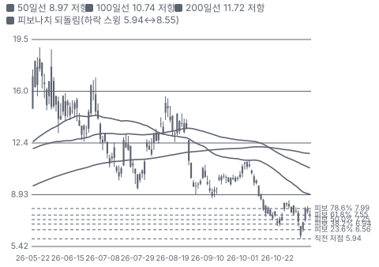

**주봉**

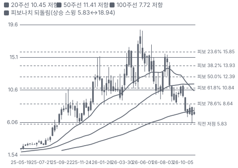

**월봉**

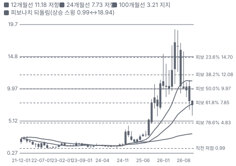

**분기 매출·EPS 실적과 컨센서스**

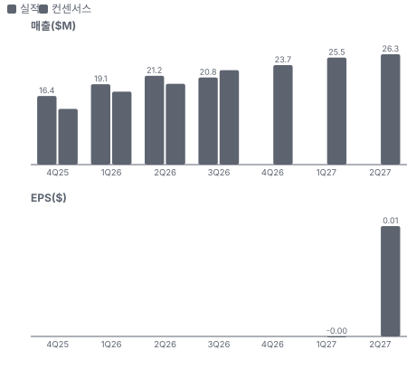

**4Q26 매출 — 지표 추세 vs 가이던스·컨센서스**

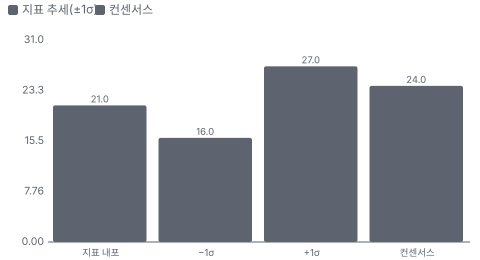

**EPS 리비전**

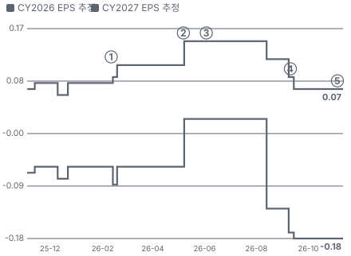

① 26-02-11 2Q FY26 실적(언아웃 손실로 EPS −\$0.20) · EPS 리비전 +41%
② 26-05-07 3Q FY26 실적, 다음 날 −4.3% · EPS 리비전 +33%
③ 26-06-03 \$14 증자·대주주 매도 · EPS 리비전 +0%
④ 26-09-10 4Q FY26 실적·잔고 \$110.9M, 다음 날 −5.0% · EPS 리비전 -12%
⑤ 26-11-10 1Q FY27 실적·잔고 \$132.9M, 다음 날 −5.9% · EPS 리비전 +0%

**밸류에이션 주가 시나리오**

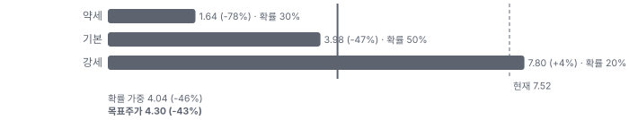

**주가별 업사이드**

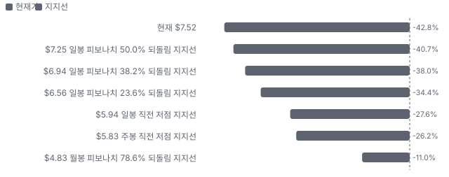
- 제품·서비스 포트폴리오

**고객 믹스(FY26, 매출 대비)**

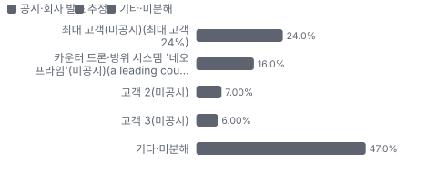

**공급 병목(10점, 낮을수록 병목)**

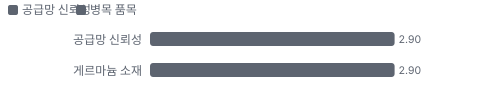

**생산능력 현재와 확충 계획(드론 광학 조립품 개/월)**

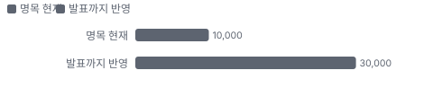

**CAPEX의 매출 대비 비중**

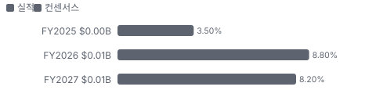

**어닝콜 변화별 주주가치 영향**

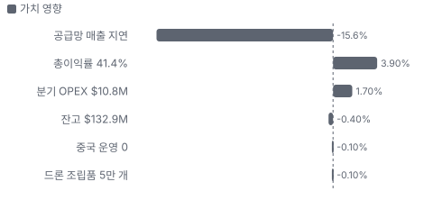

**멀티플 프리미엄(Fwd 1Y EV/EBITDA, 최근 4개 분기말)**

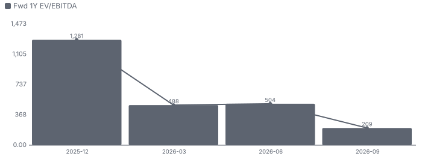

**합리적 멀티플**

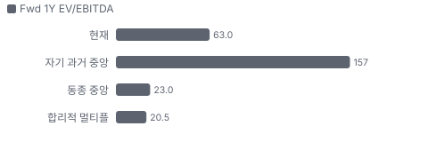

**수주·파이프라인 확실성 사다리**

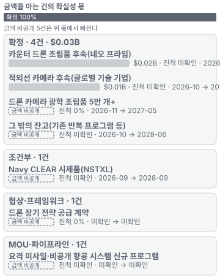

**매출 → 매출총이익 → 영업이익(매출 = 100, 최근 4분기)**

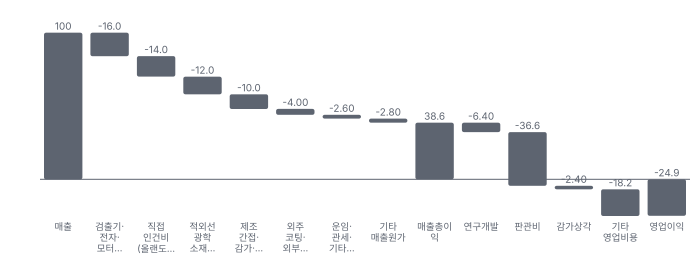

**1년 전 대비 마진 기여(비용 비중 변화의 반대)**

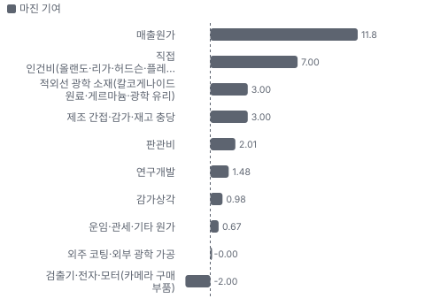

**분기 비용 비중 추이(매출 대비, 공시)**

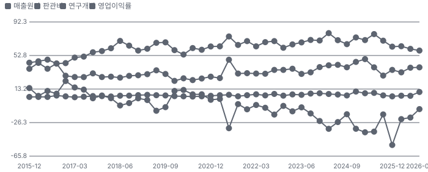

**비용 요인별 매출 대비 비중과 1년 변화**

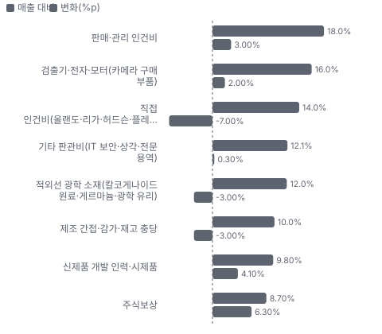

**BOM 항목 가격 +10% 시 OPM 변화**

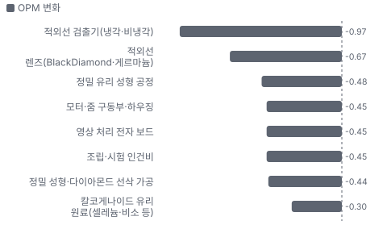

**조립품·모듈(적외선 카메라·광학 조립품) BOM 원가 몫과 가격 +10% 시 OPM**

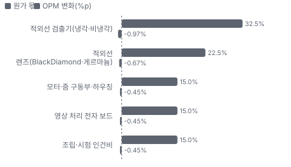

**적외선 부품(렌즈·광학 소자) BOM 원가 몫과 가격 +10% 시 OPM**

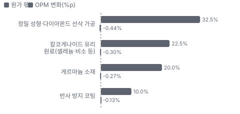

**가시광 부품(정밀 성형 유리 비구면 렌즈) BOM 원가 몫과 가격 +10% 시 OPM**

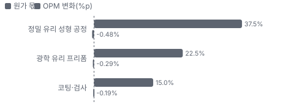

**생산시설별 면적(sq ft, 큰 순) — 생산능력 미공시라 면적을 대용으로**

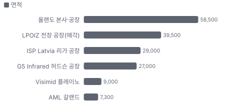

**매출·PPI·수출입 — 최근 15개 분기 같은 축(4Q22 = 100) + 다음 분기 추정**

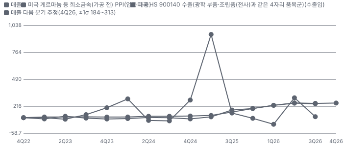

**매출과 미국 HS 900140 수출(광학 부품·조립품(전사)과 같은 4자리 품목군) 증가율(전년 대비, 최근 16개 분기 + 다음 분기 추정)**

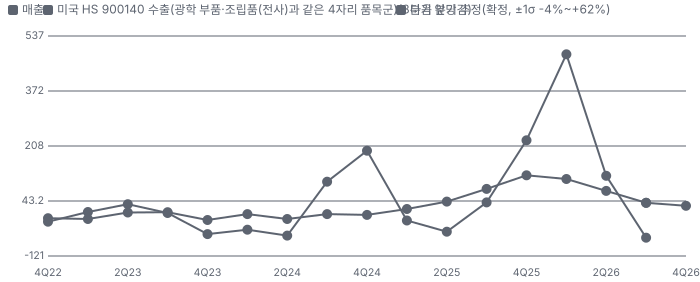

**10년 P·Q 사이클 — 추세(HP 필터) 대비 갭과 8분기 전망**

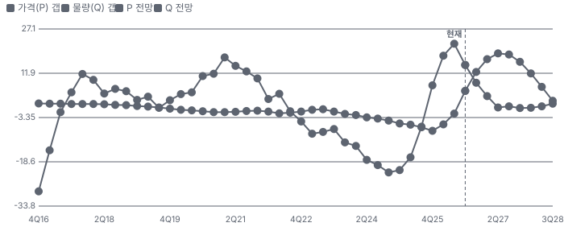

**매출 증가율의 가격·물량 분해와 8분기 전망(전년 대비)**

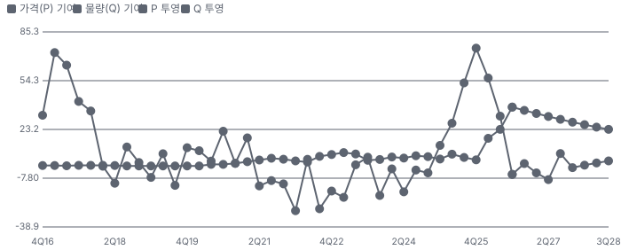

**분기별 매출 증가율 분해**

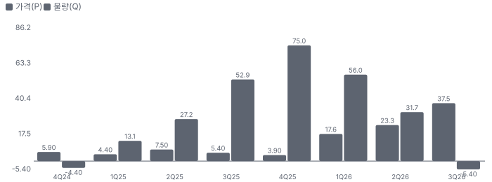

**목표주가 산정 — 기본과 강세 사이(강세 쪽 9%), 도달 확률 약 42%**

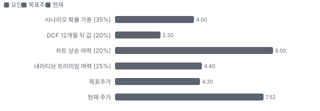

**PEG — 성장 대비 멀티플(낮을수록 성장 대비 쌈)**

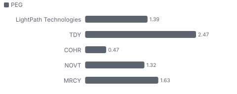

**일봉 지지·저항과 목표주가**

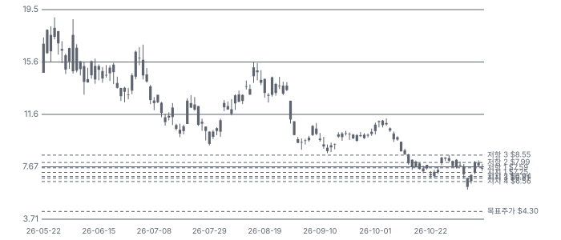

**커뮤니티 언급 수(최근 30일, 채널별)**

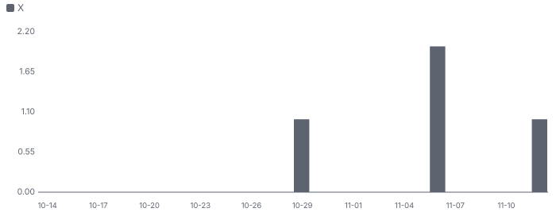

**커뮤니티 게시 수(월, 최근 4개월 — 이번 달은 진행 중)**

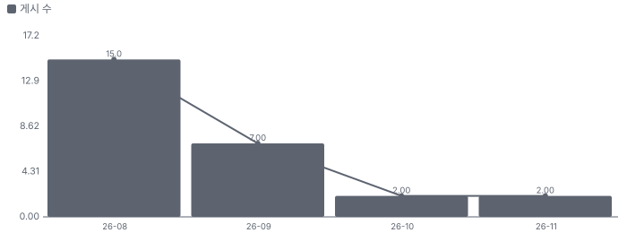

**일별 거래량 분해**

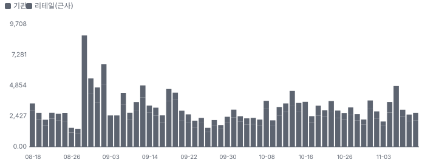

**기관 자금 흐름**

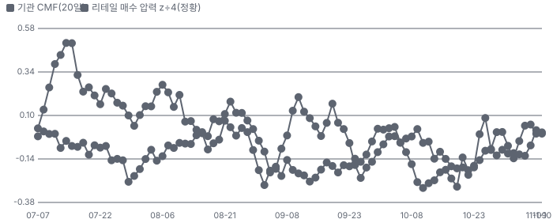

**몬테카를로**

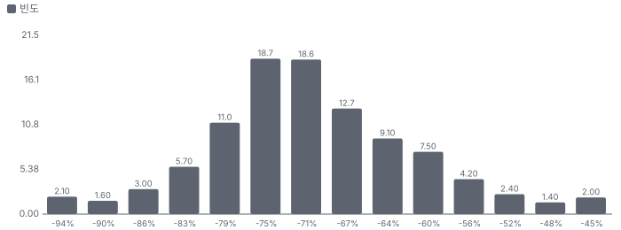

해석: 3,000번 중 0번(0%)에서 가치가 지금 주가 이상이었다. 가정을 흔들어도 지금 주가를 뒷받침하지 못하는 경우가 더 많다. 가운데 값은 0.28배이고, 열 번 중 여덟 번은 0.18~0.42배 사이에 든다.

## 내러티브

> **기업가치를 결정하는 이야기:** 회사는 유리를 직접 녹여(칼코게나이드(셀레늄·비소·황 계열 적외선 투과 유리) BlackDiamond) 적외선 렌즈를 깎고, 그 렌즈로 광학 조립품과 열화상 카메라(G5)까지 만든다. 적외선 렌즈의 표준 소재 게르마늄은 중국이 세계 공급의 60% 이상을 쥐고 미국 수출을 막았다. 미국은 2026 NDAA(미국 국방수권법)로 2027-12부터 국방 조달에서 중국산 게르마늄을 제한하고 2030까지 중국 의존 광학을 없애라고 했다. 해군연구소가 개발한 독점 유리(BDNL(NRL 라이선스 기반 LightPath 독점 BlackDiamond 유리 등급))와 중국 법인 매각으로 LightPath는 '중국 없는 적외선 광학'의 몇 안 되는 상장 공급사가 됐다. 동시에 드론과 카운터 드론이 열화상 광학을 수만 개 단위로 사기 시작했다

> **멀티플·EPS 프리미엄**
> **멀티플:** Fwd 1Y EV/EBITDA 63배로 동종 중앙(약 23배)의 약 2.7배다. 이익이 0 근처라 배수가 의미가 약하다 — Fwd 2Y 약 21배·3Y 약 15배로 내려간다. 시장은 FY28~29 이익을 지금 값에 넣고 있다
> **EPS:** FY27 EPS 컨센서스는 8월 \$0.075에서 −\$0.016으로 내려갔다. 매출 추정도 같은 분기끼리 3~10% 낮아졌다 — 1년 동안 매출 추정은 오르고(FY27 \$67M → \$96~105M) 이익 추정은 내려왔다

### 투자자들은 왜 열광했나

열광은 5월 말이었다 — 3Q 실적 뒤 4명이 FY27 매출 추정을 \$83M → \$106M으로 올렸고 5/28 종가 고점 \$18.15(장중 \$18.94)까지 갔다. 8월에는 소형주 인터뷰가 'Anduril 공급사·중국 없는 광학' 이야기를 다시 키웠다. 식은 이유는 셋이다 — 6/3 \$14 증자와 10% 주주 펀드의 \$50M 매도, 8/28 −18.6%(원인 미확인), 그리고 9월·11월 두 번 연속 매출이 추정에 못 미친 공급망 지연이다. 1년 동안 주가는 \$7.78 → \$7.52로 제자리이고, 고점 대비 −59%다

### 무엇이 기업가치를 바꾸나

> **구조적 체질 변화**
> **변화:** 부품 회사 → 카메라·조립품 회사. 조립품·모듈 매출 비중이 FY25 23% → FY26 44% → 1Q FY27 51%로 올랐다
> **증거:** FY26 10-K·1Q 콜
> **반증:** 조립품 비중이 50% 아래로 되돌아간다

> **고부가 믹스 확장**
> **변화:** 총이익률 FY25 27% → FY26 36% → 1Q FY27 41.4%. 회사는 '40%대에서 시작한다'를 기준으로 제시했다
> **증거:** 10-K·1Q 콜
> **반증:** 2Q FY27 총이익률 40% 미만

> **기술 혁신**
> **변화:** 게르마늄 없는 장파 줌 렌즈·카메라(회사는 '아마 유일'하다고 주장), Kestrel(LightPath의 소형 냉각 적외선 카메라 제품군) 소형 냉각 카메라 — 베타 출하 단계, 잔고는 \$1~2M 수준
> **증거:** 1Q 콜
> **반증:** 장파 줌 제품 주문이 1년 안에 \$10M을 넘지 못한다

> **실행 속도**
> **변화:** 잔고 ÷ 월평균 매출로 근사한 주문 → 출하 평균 대기가 19.2개월로 1년 전(약 17.2개월)보다 길어졌다(추정) — 주문이 생산보다 빠르다. 1Q는 부품 지연으로 매출이 기대를 밑돌았다 **납품 리드타임 19.2개월.** 피어 비교 미확인. 2025-09-30(잔고 \$86M ÷ 1Q FY26 월매출 \$5.0M) 17.2개월보다 12% 길다.
> **증거:** 1Q 콜·10-K
> **반증:** 2Q FY27 매출이 \$24M을 넘어 잔고 소화가 빨라진다

> **M&A**
> **변화:** G5 Infrared(카메라)·AML(적외선 소재) 인수로 카메라 회사가 됐다. CFO는 현금으로 추가 인수를 찾는다고 밝혔다 — 인수가·시너지 수치는 미확인
> **증거:** 1Q 콜
> **반증:** 추가 인수가 현금을 줄이고 증자로 이어진다

> **정책·입법 연관성**
> **재정정책:** 국방부 드론 대량 도입 사업(Drone Dominance(미 국방부 저가 드론 대량 도입 사업, \$1.1B), \$1.1B)과 카운터 드론 조달 — 고객 쪽 예산. 회사 잔고는 예산 통과와 무관한 자금 확정 주문(CEO) 1Q 콜 반증: 국방 세출이 줄어 드론 조달이 미뤄진다 의회 동의 8/10 — 하원 4/5(FY26 국방 세출 하원 통과 수준으로 판단 — 드론 사업 개별 세출선은 이번 회차에 확인 못 함(보수적으로 4)) · 상원 4/5(같은 이유로 4 — 개별 법안 번호 미대조).
> **행정명령:** 외국산 드론·부품 관세(8월, 열화상 기능이 관세 기준) — 미국산 광학에 유리. 원문 미대조 커뮤니티 정리·8/14 주가 반응(원인 추정) 반증: 관세 철회·예외 의회 동의 2/10 — 하원 1/5(의회 절차 아님) · 상원 1/5(의회 절차 아님).
> **연관입법:** 2026 NDAA — 게르마늄을 국방 조달 제한 소재에 추가(2027-12 시행), 2030까지 중국 의존 광학 유리·광학 시스템 제거 전략 수립 지시 1Q 콜(CEO 설명) — 법 조문 미대조 반증: 시행 연기·예외 확대

> **CAPEX 낙수효과**
> **변화:** 국방부 드론 대량 도입(\$1.1B)·전략자본국의 드론 제조사 투자(연 100만 대 캐파 거론) — 금지표대로 고객 투자를 LightPath 매출로 바로 옮기지 않는다. 확인된 것은 드론 조립품 5만 개 주문 한 건
> **증거:** 1Q 콜
> **반증:** 드론 제조사 증설이 열화상 없는 저가 기종에 몰린다

### 내러티브 근거

> '게르마늄 없이 만드는 미국산 적외선 광학 — 드론·카운터 드론 시대의 눈'이라는 이야기. 수요는 숫자로 나왔다(잔고 \$132.9M, B/B 2.0, 총이익률 41.4%). 주가는 5월 고점 \$18.15에서 59% 내려왔다 — 공급망 지연·현금 소진·대주주 매도가 기대를 깎았다. 동종 대비 멀티플 차이 +174% 중 회사 고유 몫은 +207%다. 단계는 확산, 쏠림은 낮음이다.

> **게르마늄 대체(BlackDiamond)** · 확산
> **논리:** 중국이 게르마늄 수출을 막고 미국 NDAA가 2027-12부터 중국산 게르마늄 조달을 제한한다 — 대체 유리를 가진 공급사가 적다
> **숫자:** 카메라 후속 \$11M에 게르마늄 → BlackDiamond 전환 계획 포함, Navy CLEAR 시제품(2년)
> **반증:** NDAA 시행 연기·예외 확대, 또는 경쟁사의 비게르마늄 소재 국방 인증

> **드론·카운터 드론 물량** · 확산
> **논리:** 국방부 드론 대량 도입(\$1.1B)과 카운터 드론 체계가 열화상 광학 조립품을 수만~수십만 개 단위로 요구한다
> **숫자:** 드론 조립품 5만 개+ 주문, 카운터 드론 고객 \$19M+, 캐파 월 1만 → 수만 개
> **반증:** 후속 드론 주문이 6개월 안에 없다

> **부품 → 카메라 믹스 전환** · 확인
> **논리:** 조립품·카메라 비중이 오를수록 자체 유리·렌즈의 부가가치를 더 가져가 총이익률이 오른다
> **숫자:** 조립품 비중 40% → 51%, 총이익률 29.8% → 41.4%
> **반증:** 조립품 비중이 오르는데 총이익률이 내려간다

> **탈중국 공급망(국방 조달 자격)** · 태동
> **논리:** 중국 법인 매각으로 중국 시설·매출이 0 — 일부 정부 프로그램 참여 요건을 채웠다
> **숫자:** 중국 법인 매각 종결(10/30), 정부와의 상호작용에서 영향이 보이기 시작(CEO)
> **반증:** 매각 뒤에도 새 국방 프로그램 수주가 없다

> **반대 — 공급망이 매출을 늦춘다** · 확인
> **논리:** 잔고는 쌓이는데 1Q 매출이 직전 분기보다 줄었다 — 모터·외부 광학·검출기 공급사가 캐파 한계다
> **숫자:** 1Q 매출 \$20.8M vs 컨센서스 \$22.5M, 조정 EBITDA \$1.3M vs \$2.2M
> **반증:** 2Q FY27 매출 \$24M 이상

> **반대 — 현금 소진·희석** · 잠복
> **논리:** 운전자본 투자로 현금이 줄고 언아웃·캐파 투자가 남았다 — 대주주 매도 뒤 추가 증자 가능성
> **숫자:** 현금 \$93.2M → \$82.9M(1Q), 1월 언아웃 현금 \$6.3M, 주식보상 \$1.8M/분기
> **반증:** 2Q 영업현금흐름 흑자·증자 없음

이미지 없음(아직 생성 전) — 조립품·모듈(적외선 카메라·광학 조립품)·적외선 부품(렌즈·광학 소자)·엔지니어링 서비스

## 포트폴리오

| 제품·서비스 | 구분 | 무엇 | 쓰는 곳 | 돈 버는 방식 | Mix | Mix 변화(공시(1Q FY27)) |
|---|---|---|---|---|---|---|
| 조립품·모듈(적외선 카메라·광학 조립품) | 제품 | G5 열화상 카메라, 드론·카운터 드론용 광학 조립품, Kestrel 소형 냉각 카메라 | 카운터 드론 감시탑·드론 카메라·요격 미사일·국경 감시 | 프로그램 주문(출하 때 인식) | 51% | +11.0%p |
| 적외선 부품(렌즈·광학 소자) | 제품 | 성형·다이아몬드 선삭 적외선 비구면 렌즈, BlackDiamond 유리 | 야간 투시·열화상·감시 장비 업체에 납품 | 카탈로그·맞춤 주문 | 23% | -4.0%p |
| 가시광 부품(정밀 성형 유리 비구면 렌즈) | 제품 | 레이저·광통신·의료기기용 정밀 성형 유리 비구면 렌즈 | 산업용 레이저·텔레콤·의료·머신 비전 | 주문 단위 판매 | 22% | -3.0%p |
| 엔지니어링 서비스 | 서비스 | 고객 맞춤 광학 설계·개발 용역 | 국방·우주 개발 프로그램 | 용역 계약 | 4% | -3.0%p |

**Mix 변화가 가장 큰 쪽은 조립품·모듈(적외선 카메라·광학 조립품)(+11.0%p, 공시(1Q FY27)).** 계절성 판정: 분기 매출 계절 지수 기준 없음 → 직전 분기와 비교.

## 고객

> **FY26 최대 고객 최대 고객(미공시, 최대 고객 24%) 24%, 상위 3곳 47%, 집중도 분산.** 공시·회사 발표로 확인한 몫은 매출의 37%이고, 나머지 고객 몫은 추정이거나 미분해다. FY26 매출의 37%가 세 고객(24%·7%·6%)이다 — 이름은 공시하지 않는다. 1년 전엔 세 곳 합이 23%였다. 1Q 콜에서 회사가 이름 없이 밝힌 두 고객이 커지고 있다 — 카운터 드론 '네오 프라임'(7월 이후 \$19M+)과 글로벌 기술 기업(카메라 \$11M)

**고객별 매출 몫(FY26)**
| 고객 | 몫 | 변화 | 근거 |
|---|---|---|---|
| 최대 고객(미공시, 최대 고객 24%) | 24% | +15%p | 공시 |
| 카운터 드론·방위 시스템 '네오 프라임'(미공시, a leading counter-UAS and defense systems supplier) | 12~20% | 미확인 | 추정 |
| 고객 2(미공시) | 7% | +0%p | 공시 |
| 고객 3(미공시) | 6% | +0%p | 공시 |
| 기타·미분해 | 47% | - | - |

> **최대 고객(미공시, 최대 고객 24%)** · 공시
> **사는 것:** 적외선 카메라·조립품(추정)
> **추정 근거:** FY26 비중 24%(FY25 최대 9%). 10-K 경영진 분석의 '글로벌 기술 고객 주문 약 \$58M'과 같은 고객일 가능성(가설)

> **카운터 드론·방위 시스템 '네오 프라임'(미공시, a leading counter-UAS and defense systems supplier)** · 추정
> **사는 것:** 광학 조립품
> **추정 근거:** 7월 이후 \$19M+ 주문 = FY26 이 고객 주문의 2배, '다음 회계연도 최대 고객 중 하나가 될 수 있다'(CEO). 범위는 \$19M ÷ FY27 컨센서스 \$96M(추정). Anduril로 보는 것은 가설 — 신임 G5 책임자가 Anduril 출신

> **고객 2(미공시)** · 공시
> **사는 것:** 미확인
> **추정 근거:** FY26 7%

> **고객 3(미공시)** · 공시
> **사는 것:** 미확인
> **추정 근거:** FY26 6%

## 수주·파이프라인

> **2026-11-12 기준 7건.** 확정 \$0.03B. 공시 수주잔고(자금 확정 주문) \$0.13B. 서로 겹치는 항목은 합계에서 뺐다.

**실행 속도와 방해 요인**
| 항목 | 상태 | 실행 속도 | 방해 요인 |
|---|---|---|---|
| 카운터 드론 조립품 후속(네오 프라임) | 확정 | 미확인 | 부품 공급(모터·검출기) · 고객 프로그램 일정 |
| 적외선 카메라 후속(글로벌 기술 기업) | 확정 | 미확인 | 외부 광학·검출기 공급 |
| 드론 카메라 광학 조립품 5만 개+ | 확정 | 미확인 | 조립품 캐파(월 1만 개 미만) |
| 그 밖의 잔고(기존 반복 프로그램 등) | 확정 | 미확인 | 공급망 · 캐파 |
| Navy CLEAR 시제품(NSTXL(미 국방 기술 시제품 계약 컨소시엄 운영 기관)) | 조건부 | 미확인 | 시제품 평가 · 프로그램 재설계 결정 |
| 드론 장기 전략 공급 계약 | 협상 | 미확인 | 고객 물량 예측 · 캐파 확충 |
| 요격 미사일·비공개 항공 시스템 신규 프로그램 | 파이프라인 | 미확인 | 프로그램 선정 |

## 마진 구조

> **GPM 41.4%, OPM -8.2%.** 1Q FY26 대비 GPM +11.7%p, OPM +5.4%p. 변동비는 매출의 52%이고, 매출이 10% 늘면 OPM은 +5.1%p 움직인다. 총이익률이 1년 새 29.8% → 41.4%로 올랐다. 회사는 원인을 조립품·모듈 비중(40% → 51%)이라고 밝혔다. 영업비용 \$10.8M(매출의 52%)이 매출총이익 \$8.6M보다 커 GAAP 영업손실이 남는다 — 그 안에 주식보상 \$1.8M과 신제품 개발 \$2.0M이 있다. 원가 세부 구성은 공시되지 않아 아래 요인은 추정이다

> **매출 100 중 매출원가 61.4, 매출총이익 38.6(최근 4분기, 공시).** 매출원가 요인 중 검출기·전자·모터(카메라 구매 부품)이 매출의 16.0%로 가장 무겁고, 단가가 +10% 오르면 GPM이 -1.60%p 움직인다. 분기 회귀로 매출 1이 늘 때 매출원가는 0.64 늘고, 매출원가의 고정비 몫은 -2%다.

**비용 요인 강도 — 비중·추세·충격(+10%)·탄력**
| 비용 | 구분 | 매출 대비 | 1년 변화 | 마진 기여 | 충격 시 마진 | 매출 탄력 | 고정비 몫 |
|---|---|---|---|---|---|---|---|
| 검출기·전자·모터(카메라 구매 부품) | 매출원가 요인 | 16.0% | +2.0%p | -2.0%p | -1.60%p | 미확인 | 0% |
| 직접 인건비(올랜도·리가·허드슨·플레이노) | 매출원가 요인 | 14.0% | -7.0%p | +7.0%p | -1.40%p | 미확인 | 50% |
| 적외선 광학 소재(칼코게나이드 원료·게르마늄·광학 유리) | 매출원가 요인 | 12.0% | -3.0%p | +3.0%p | -1.20%p | 미확인 | 0% |
| 제조 간접·감가·재고 충당 | 매출원가 요인 | 10.0% | -3.0%p | +3.0%p | -1.00%p | 미확인 | 80% |
| 외주 코팅·외부 광학 가공 | 매출원가 요인 | 4.0% | +0.0%p | -0.0%p | -0.40%p | 미확인 | 0% |
| 운임·관세·기타 원가 | 매출원가 요인 | 2.6% | -0.7%p | +0.7%p | -0.26%p | 미확인 | 0% |
| 매출원가 | 공시 항목 | 61.4% | -11.8%p | +11.8%p | -6.14%p | 0.64 | -2% |
| 판관비 | 공시 항목 | 36.6% | -2.0%p | +2.0%p | 미확인 | 0.36 | -7% |
| 기타 영업비용 | 공시 항목 | 18.2% | 미확인 | 미확인 | 미확인 | 0.23 | -100% |
| 연구개발 | 공시 항목 | 6.4% | -1.5%p | +1.5%p | 미확인 | 0.07 | -16% |
| 감가상각 | 공시 항목 | 2.4% | -1.0%p | +1.0%p | 미확인 | 0.01 | 72% |

매출 탄력 = 분기 비용을 매출에 회귀한 기울기(매출 1당 변동비), 고정비 몫 = 절편 ÷ 평균 비용. 표본이 8분기 미만이면 미확인. 매출원가 요인 비중은 margin 재료의 추정이 섞여 있고, 공시 매출원가와의 차이는 '기타 매출원가'로 둔다.

**GPM에서 OPM까지(GAAP)**
| 기간 | GPM | 연구개발 | 판관비 | 기타 | OPM |
|---|---|---|---|---|---|
| 1Q FY26 | 29.8% | 5.8% | 29.1% | 8.5% | -13.7% |
| 1Q FY27 | 41.4% | 9.8% | 38.8% | 1.1% | -8.2% |

**GPM·OPM 최근 4개 분기**
| 분기 | GPM | OPM |
|---|---|---|
| 2025-12 | 36.8% | -52.6% |
| 2026-03 | 36.3% | -22.2% |
| 2026-06 | 39.4% | -20.3% |
| 2026-09 | 41.4% | -10.4% |

**마진을 결정하는 비용 요인 — 비용 +10% 시 OPM**
| 비용 | 매출 대비 | 변화 | 고정비 | OPM |
|---|---|---|---|---|
| 판매·관리 인건비 | 18.0% | +3.0%p | 80% | -1.80%p |
| 검출기·전자·모터(카메라 구매 부품) | 16.0% | +2.0%p | 0% | -1.60%p |
| 직접 인건비(올랜도·리가·허드슨·플레이노) | 14.0% | -7.0%p | 50% | -1.40%p |
| 기타 판관비(IT(정보기술) 보안·상각·전문 용역) | 12.1% | +0.3%p | 70% | -1.21%p |
| 적외선 광학 소재(칼코게나이드 원료·게르마늄·광학 유리) | 12.0% | -3.0%p | 0% | -1.20%p |
| 제조 간접·감가·재고 충당 | 10.0% | -3.0%p | 80% | -1.00%p |
| 신제품 개발 인력·시제품 | 9.8% | +4.1%p | 90% | -0.98%p |
| 주식보상 | 8.7% | +6.3%p | 100% | -0.87%p |
| 외주 코팅·외부 광학 가공 | 4.0% | +0.0%p | 0% | -0.40%p |
| 운임·관세·기타 원가 | 2.6% | -0.7%p | 0% | -0.26%p |
| 언아웃 공정가치 변동 | 1.1% | -7.4%p | 100% | -0.11%p |

**비용을 움직이는 요인**
| 비용 | 요인 |
|---|---|
| 판매·관리 인건비(판관비) | AML 편입·영업 인력·새 경영진 · 근거 추정 |
| 검출기·전자·모터(카메라 구매 부품, 매출원가) | 카메라 조립품 비중 증가, 모터·검출기 공급 지연(1Q 콜) · 근거 추정 |
| 직접 인건비(올랜도·리가·허드슨·플레이노, 매출원가) | 물량 증가에 따른 흡수 — 중국 인력 104명 매각 · 근거 추정 |
| 기타 판관비(IT 보안·상각·전문 용역, 판관비) | 국방 고객 사이버 보안 기준 IT 투자(CFO) · 근거 추정 |
| 적외선 광학 소재(칼코게나이드 원료·게르마늄·광학 유리, 매출원가) | 게르마늄 가격(kg당 \$6,000 이상, 10-K)·BlackDiamond 전환 비율 · 근거 추정 |
| 제조 간접·감가·재고 충당(매출원가) | 공장 임차료·설비 감가(1Q D&A \$1.48M) · 근거 추정 |
| 신제품 개발 인력·시제품(연구개발) | 카메라·적외선 조립품·새 BlackDiamond 유리 개발 인력 증원 · 근거 공시 |
| 주식보상(판관비) | 경영진 성과 스톡옵션(2026-03) 등 · 근거 공시 |
| 외주 코팅·외부 광학 가공(매출원가) | 단일·소수 공급원 코팅(10-K), G5 외부 광학(1Q 콜) · 근거 추정 |
| 운임·관세·기타 원가(매출원가) | 수출 비중(해외 매출 42%) · 근거 추정 |
| 언아웃 공정가치 변동(기타) | AML 언아웃 종료, G5 \$9M 고정 · 근거 공시 |

**조립품·모듈(적외선 카메라·광학 조립품) BOM — 매출의 51%, GPM 41%(전사 1Q FY27 총이익률 대용(제품별 미공시 — 회사는 조립품이 부품보다 높다고만 밝혔다)), 항목 가격 +10% 시**
| 항목 | 원가 몫 | 전가 | 제품 GPM | OPM |
|---|---|---|---|---|
| 적외선 검출기(냉각·비냉각) | 25~40% | 미확인 | -1.9%p | -0.97%p |
| 적외선 렌즈(BlackDiamond·게르마늄) | 15~30% | 미확인 | -1.3%p | -0.67%p |
| 모터·줌 구동부·하우징 | 10~20% | 미확인 | -0.9%p | -0.45%p |
| 영상 처리 전자 보드 | 10~20% | 미확인 | -0.9%p | -0.45%p |
| 조립·시험 인건비 | 10~20% | 미확인 | -0.9%p | -0.45%p |

**적외선 부품(렌즈·광학 소자) BOM — 매출의 23%, GPM 41%(전사 1Q FY27 총이익률 대용(제품별 미공시 — 회사는 조립품이 부품보다 높다고만 밝혔다)), 항목 가격 +10% 시**
| 항목 | 원가 몫 | 전가 | 제품 GPM | OPM |
|---|---|---|---|---|
| 정밀 성형·다이아몬드 선삭 가공 | 25~40% | 미확인 | -1.9%p | -0.44%p |
| 칼코게나이드 유리 원료(셀레늄·비소 등) | 15~30% | 미확인 | -1.3%p | -0.30%p |
| 게르마늄 소재 | 10~30% | 미확인 | -1.2%p | -0.27%p |
| 반사 방지 코팅 | 5~15% | 미확인 | -0.6%p | -0.13%p |
| 미분해 | 15% | - | - | - |

**가시광 부품(정밀 성형 유리 비구면 렌즈) BOM — 매출의 22%, GPM 41%(전사 1Q FY27 총이익률 대용(제품별 미공시 — 회사는 조립품이 부품보다 높다고만 밝혔다)), 항목 가격 +10% 시**
| 항목 | 원가 몫 | 전가 | 제품 GPM | OPM |
|---|---|---|---|---|
| 정밀 유리 성형 공정 | 30~45% | 미확인 | -2.2%p | -0.48%p |
| 광학 유리 프리폼 | 15~30% | 미확인 | -1.3%p | -0.29%p |
| 코팅·검사 | 10~20% | 미확인 | -0.9%p | -0.19%p |
| 미분해 | 25% | - | - | - |

판매가 전가를 모르는 항목은 전가 0%로 계산했다.

**BOM 항목 가격을 움직이는 것**
| 항목 | 요인 |
|---|---|
| 적외선 검출기(냉각·비냉각) | 카메라 원가의 중심, 단일·소수 공급원(10-K) · 근거 추정 |
| 적외선 렌즈(BlackDiamond·게르마늄) | 자체 생산분이 늘수록 마진이 오른다 · 근거 추정 |
| 모터·줌 구동부·하우징 | 1Q 공급 지연 품목(모터) · 근거 추정 |
| 영상 처리 전자 보드 | 전자 부품은 입고 즉시 출하(CEO) · 근거 추정 |
| 조립·시험 인건비 | 허드슨·올랜도 조립 · 근거 추정 |
| 칼코게나이드 유리 원료(셀레늄·비소 등) | 여러 나라에서 구할 수 있는 원료(10-K) · 근거 추정 |
| 게르마늄 소재 | 중국 60% 이상, 수출 금지 — 회사는 게르마늄 주문을 줄였다 · 근거 추정 |
| 정밀 성형·다이아몬드 선삭 가공 | 자체 공정(올랜도·리가) · 근거 추정 |
| 반사 방지 코팅 | 일부 단일·소수 외주(10-K) · 근거 추정 |
| 광학 유리 프리폼 | CDGM·Ohara·Sumita 등 외부 유리(10-K) · 근거 추정 |
| 정밀 유리 성형 공정 | 올랜도 자체 공정 — 중국 공장 매각 뒤 일부는 매수자(현 공급사)에서 산다 · 근거 추정 |
| 코팅·검사 | 광학 성능 검사 · 근거 추정 |

**BOM 투입 물가 — PPI 전년비, 2026-11-12 수집**
| 항목 | 미국 | 일본 | 한국 | 대만 |
|---|---|---|---|---|
| 게르마늄 소재 | +48.4%* | 미확인 | 미확인 | 미확인 |
| 광학 유리 프리폼 | 미확인* | 미확인 | 미확인 | 미확인 |

별표는 품목보다 넓은 업종 지수다. 지난 1년 투입 물가를 판매가 전가 뒤 원가에 그대로 넣으면 OPM은 -4.56%p 움직인다(매출원가의 16% 기준).

## 공급망 병목

이미지 없음(아직 생성 전) — 조립품·모듈(적외선 카메라·광학 조립품)

> **공급망 신뢰성 2.9/10, 병목 심각.** 가장 약한 고리는 게르마늄 소재 2.9점이고, 품목 평균은 2.9점이다. 근거가 부족한 5건(적외선 검출기(냉각·비냉각) · 모터·줌 구동부 · 적외선 렌즈(BlackDiamond·게르마늄) · 칼코게나이드 원료(셀레늄·비소 등) · 가시광 광학 유리)은 점수에서 뺐다. 1Q 매출을 막은 것은 수요가 아니라 부품이다 — 모터, G5 카메라용 외부 광학, 검출기(CEO). 게르마늄은 중국이 세계 공급의 60% 이상이라 회사가 BlackDiamond로 바꾸는 중이다. 재고를 \$13.5M 늘려 핵심 소재를 미리 샀다

**병목과 마진 — 품목 가격 +10% 시 OPM**
| 품목 | 점수 | 판정 | 구분 | OPM |
|---|---|---|---|---|
| 게르마늄 소재 | 2.9 | 병목 심각 | 출하 차질 위험 | -0.27%p |

> **게르마늄 소재** · 2.9/10
> **왜:** BlackDiamond가 대체 경로 — 필수 품목에서 빼고 위험 요인으로 둔다
> **병목 요인:** 인증 공급사 미확인 · 캐파 부족 · 리드타임 미확인 · 재인증 미확인 · 1위 점유율 60% · 중국(세계 공급 60% 이상, 10-K) 집중 60% · 물량 확보 현물
> **풀리는 조건:** 미확인

**공급사**
| 품목 | 공급사 | 몫 | 근거 |
|---|---|---|---|
| 적외선 검출기(냉각·비냉각) | 단일·소수 공급사(이름 미공시, 검출기·센서) | 미확인 | 공시 |
| 모터·줌 구동부 | 외부 공급사(이름 미공시, 모터) | 미확인 | 회사 발표 |
| 적외선 렌즈(BlackDiamond·게르마늄) | LightPath 자체(올랜도·리가·AML, 칼코게나이드 유리·렌즈) | 미확인 | 공시 |
| 적외선 렌즈(BlackDiamond·게르마늄) | 외부 광학 공급사(G5 카메라용 일부, 적외선 광학) | 미확인 | 회사 발표 |
| 게르마늄 소재 | 게르마늄 공급사(이름 미공시, 게르마늄) | 미확인 | 공시 |
| 칼코게나이드 원료(셀레늄·비소 등) | 다수 국가 공급사(유리 원료) | 미확인 | 공시 |
| 가시광 광학 유리 | CDGM(광학 유리) | 미확인 | 공시 |
| 가시광 광학 유리 | Ohara(광학 유리) | 미확인 | 공시 |
| 가시광 광학 유리 | Sumita(광학 유리) | 미확인 | 공시 |

**무역 통계로 본 공급 지역**
| 품목 | EU 수입처 | 일본 수입처 | EU 1위 전년비 |
|---|---|---|---|
| 적외선 렌즈(BlackDiamond·게르마늄) | CN(중국) 52% · US 30% · JP(일본) 12% | 中華人民共和国 46% · アメリカ合衆国 14% | +15.2% |
| 게르마늄 소재 | US 49% · CN 35% · TW(대만) 8% | 中華人民共和国 28% · 台湾 25% | +231.9% |
| 가시광 광학 유리 | CN 52% · US 30% · JP 12% | 中華人民共和国 46% · アメリカ合衆国 14% | +15.2% |

## 생산능력

> **현재 명목 캐파 10,000 드론 광학 조립품 개/월, 가동률 미확인.** 착공 이상 증설은 0 드론 광학 조립품 개/월, 발표까지 합치면 20,000 드론 광학 조립품 개/월이다. 다 가동하면 지금보다 +200%, 착공 이상만이면 +0%다. FY2026 CAPEX는 \$0.01B로 매출의 8.8%다. 생산은 미국 4곳(올랜도·허드슨·플레이노·갈랜드)과 라트비아 리가 1곳이다(중국 공장은 10/30 매각). 회사가 밝힌 캐파 수치는 드론 광학 조립품 하나뿐 — 지금 월 1만 개 미만, 12개월 안에 월 수만 개, 장기 월 10만 개 가능성. 다른 제품 캐파·가동률은 공시하지 않는다

**생산시설 6곳**(FY26 10-K Item 2: 올랜도 58,500 sq ft(본사·제조·연구), 허드슨 27,000(G5), 플레이노 9,000(Visimid), 갈랜드 7,300(AML, 라이선스 사용), 리가 29,000(ISP Latvia(LightPath의 라트비아 적외선 광학 공장)) — 모두 임차. 전장 39,500 sq ft(LPOIZ(LightPath의 옛 중국 전장 법인, 2026-10 매각))는 2026-10-30 매각 — count 6 = 가동 5곳 + 매각된 전장 1곳(표에 남김)), 임차 6곳. 시설별 생산능력은 공개되지 않았다 — 회사 전체 캐파만 위에 적었다.

**생산시설 6곳 — 명칭·위치·생산능력**
| 시설 | 위치 | 용도 | 생산능력 | 소유·상태 |
|---|---|---|---|---|
| 올랜도 본사·공장 | 미국 플로리다 올랜도 | 본사·제조·연구개발(정밀 성형 유리·칼코게나이드) | 미확인 — 시설별 캐파 미공시 · 면적 58,500 sq ft | 임차 · 가동 |
| G5 Infrared 허드슨 공장 | 미국 뉴햄프셔 허드슨 | 적외선 카메라 엔지니어링·제조 | 미확인 — 시설별 캐파 미공시 · 면적 27,000 sq ft | 임차 · 가동 |
| Visimid 플레이노 | 미국 텍사스 플레이노 | 적외선 엔지니어링·제조 | 미확인 — 시설별 캐파 미공시 · 면적 9,000 sq ft | 임차 · 가동 |
| AML 갈랜드 | 미국 텍사스 갈랜드 | 적외선 소재 엔지니어링·제조(라이선스 사용 공간) | 미확인 — 시설별 캐파 미공시 · 면적 7,300 sq ft | 임차 · 가동 |
| ISP Latvia 리가 공장 | 라트비아 리가 | 적외선 광학 제조·관리 | 미확인 — 시설별 캐파 미공시 · 면적 29,000 sq ft | 임차 · 가동 |
| LPOIZ 전장 공장(매각) | 중국 장쑤 전장 | 가시광·적외선 부품 제조 — 매수자(현지 경영진)가 상업 제품 공급사로 남는다 | 미확인 — 시설별 캐파 미공시 · 면적 39,500 sq ft | 임차 · 매각·폐쇄 예정 |

**생산능력 확충 계획**
| 계획 | 단계 | 증설 | 가동 시점 | CAPEX |
|---|---|---|---|---|
| 드론 광학 조립품 자동화·증설 | 발표 | 20,000 드론 광학 조립품 개/월 | 2027-11 | 미확인 |
| 유리 제조·계측 설비(1Q CAPEX \$2.5M + 금융 리스 \$0.6M) | 장비 반입 | 미확인 | 2027 | \$0.00B |

남은 계획의 CAPEX 합계는 \$0.00B(금액 미확인 1건 제외)다. 합계는 FY2027 매출의 3%다.

**증설 방해 요인**
| 계획 | 방해 요인 |
|---|---|
| 드론 광학 조립품 자동화·증설 | 자동화 프로젝트 진행·인력·부품 공급 |
| 유리 제조·계측 설비(1Q CAPEX \$2.5M + 금융 리스 \$0.6M) | 미확인 |

**CAPEX와 매출 대비**
| 기간 | CAPEX | 매출 | 매출 대비 | 구분 |
|---|---|---|---|---|
| FY2025 | \$0.00B | \$0.04B | 3.5% | 실적 |
| FY2026 | \$0.01B | \$0.07B | 8.8% | 실적 |
| FY2027 | \$0.01B | \$0.10B | 8.2% | 컨센서스 |

## 해자

> 해자는 '게르마늄 없이 만드는 적외선 광학'이라는 소재 위치다. 미국 국방이 2027-12부터 중국산 게르마늄 조달을 막고 2030까지 중국 의존 광학을 없애라고 법으로 정했다. 다만 범용 BD6(범용 칼코게나이드 적외선 유리, 다른 2개사도 생산)는 다른 2개사도 만들고, 카메라 시장에는 Teledyne FLIR 같은 강자가 있다

> **NRL 칼코게나이드 독점 라이선스(BDNL)** · 보통
> **해자:** 해군연구소가 개발한 칼코게나이드 유리(BDNL 계열)를 독점 라이선스로 만든다 — 게르마늄을 대체해 중국 공급 위험을 피한다
> **근거:** 10-K Item 1: 2021-12 독점 라이선스, BD6·BD2(범용 칼코게나이드 적외선 유리 등급)는 다른 2개사도 생산, BDNL은 독점
> **숫자:** 라이선스 기간·로열티 미확인
> **깨지는 조건:** 다른 회사가 동등 성능의 비게르마늄 유리를 국방 인증 받는다

> **소재 → 렌즈 → 카메라 수직 계열화** · 보통
> **해자:** 유리를 직접 녹여 렌즈를 깎고 카메라까지 조립해 부가가치를 더 가져간다 — 조립품 비중이 오를수록 총이익률이 오른다
> **근거:** 1Q FY27 조립품·모듈 비중 51%(전년 40%), 총이익률 41.4%(전년 29.8%)
> **숫자:** 조립품 비중 +11%p ↔ 총이익률 +11.6%p
> **깨지는 조건:** 조립품 비중이 50%를 넘는데 총이익률이 40% 아래로 내려간다

> **중국 밖 공급망(국방 조달 자격)** · 보통
> **해자:** 중국 법인을 팔아 중국 시설·매출·운영이 0이다 — 일부 국방 프로그램 참여 요건이다
> **근거:** 중국 법인 매각 종결 8-K(2026-11-04), 2026 NDAA 게르마늄 조달 제한(2027-12 시행)
> **숫자:** 미확인(요건이 열어 주는 매출 미공시)
> **깨지는 조건:** NDAA 시행이 미뤄지거나 예외가 넓어진다

> **프로그램 설계 반영(디자인 윈)** · 약함
> **해자:** 카운터 드론·드론·요격 미사일 프로그램에 광학이 설계로 들어가면 바꾸기 어렵다
> **근거:** 카운터 드론 고객 후속 \$19M+, 카메라 후속 \$11M(게르마늄 → BlackDiamond 전환 계획 포함)
> **숫자:** 잔고 \$132.9M(전부 자금 확정 주문, CEO)
> **깨지는 조건:** 후속 주문이 끊기거나 고객이 내재화한다(10-K: Anduril·Teledyne FLIR 등 고객 자체 설계 역량)

## 경영진·네트워크

> CEO Sam Rubin(2020 취임)이 '부품 회사 → 적외선 카메라 회사' 전환을 이끈다. 2026-06 증자 때 10% 주주 이사 관련 펀드(North Run)가 \$14에 \$50M을 팔았다. 경영진은 Anduril 출신을 G5 사업 책임자로 데려왔다

> **Sam Rubin** · 사장·CEO · 2020
> **프로필:** 적외선 카메라·조립품 중심 전략, G5·AML 인수, 중국 법인 매각을 이끌었다
> **비즈니스:** 전사
> **정계:** 미확인
> **동문:** 미확인
> **사모임:** 미확인

> **Albert Miranda** · CFO · 미확인
> **프로필:** 인수 대상: '변곡점 이전·전략적·이익 기여·합리적 가격'을 찾는다고 밝혔다(1Q 콜)
> **비즈니스:** 재무·M&A
> **정계:** 미확인
> **동문:** 미확인
> **사모임:** 미확인

> **Scott Payette** · G5 사업 책임자 · 2026
> **프로필:** 핵심 고객 Anduril 출신(1Q 콜)
> **비즈니스:** 적외선 카메라(G5)
> **정계:** 미확인
> **동문:** 미확인
> **사모임:** 미확인

> **Todd Hammer** · 이사·10% 주주(North Run) · 미확인
> **프로필:** North Run 펀드가 2026-03 \$4.4M·05 \$3.6M·06 \$50M(\$14) 매도(Form 4)
> **비즈니스:** 이사회
> **정계:** 미확인
> **동문:** 미확인
> **사모임:** 미확인

**네트워크 정량화**
| 연결 | 강도 | 닿는 매출 | 가중 노출 | 매출 대비 | 근거 |
|---|---|---|---|---|---|
| 비즈니스: Anduril 출신 G5 책임자 영입 — '네오 프라임' 카운터 드론 고객(7월 이후 \$19M+)과의 관계 강화(고객 이름은 회사 미공시, Anduril 대응은 가설) | 3/5 | \$0.24B | \$0.14B | 186% | FY26 최대 고객 매출 24%(10-K) — 그 고객이 누구인지 미공시 1Q FY27 어닝콜·FY26 10-K |
| 정계: 로비 공시 집계 범위 밖 — 공개 기록에서 정계 연결을 확인하지 못했다 | 0/5 | 미확인 | 미확인 | 미확인 | 미확인 Easyconomics 하원 LD(미국 하원 로비 공시) 집계(대상 밖) |

가중 노출은 연결이 닿는 매출의 크기다. 연결이 그 매출을 만들었다는 뜻이 아니며, 인과는 공개 자료로 입증하지 못한다.

## 약세 논리 및 셀온 조건

| 약세 논리 | 근거 | 반박 | 가를 자료 · 공개 시점 |
|---|---|---|---|
| 부품이 매출을 계속 막는다 | 1Q 매출 \$20.8M — 4Q \$21.2M보다 낮고 컨센서스 \$22.5M을 7.7% 밑돌았다. 모터·G5용 외부 광학·검출기 지연(CEO) | 공급망 책임자를 3~4개월 전 영입해 단일 공급원에 대체 공급원을 만들고 재고를 \$13.5M 늘렸다. CEO는 '2Q는 훨씬 더 장악하고 있다'고 했다 | 2Q FY27 매출 \$24M 이상 여부 — 2027-02 실적 |
| 현금이 줄고 증자가 또 나올 수 있다 | 현금 \$93.2M → \$82.9M(1Q), 영업현금흐름 −\$8.3M, 1월 언아웃 현금 \$6.3M, 캐파 투자 확대 예고 | 재고 증가는 잔고를 위한 선구매이고 매출채권은 그대로였다. 차입은 거의 없다(장비 대출 \$0.16M) | 2Q 영업현금흐름·현금 잔고 — 2027-02 10-Q |
| 배수가 이익을 몇 년 앞서 간다 | Fwd 1Y EV/EBITDA 63배, 동종 중앙 약 23배 | Fwd 2Y는 약 21배·3Y 약 15배로 동종 아래로 내려간다 — 잔고가 그 경로의 근거다 | 2Q 조정 EBITDA(1Q \$1.3M, 컨센서스 \$2.2M을 밑돌았다) — 2027-02 |
| 고객 집중 | FY26 세 고객 37%, 최대 고객 24%(이름 미공시). 10-K는 Anduril·Teledyne FLIR 등 고객의 자체 설계 역량을 경쟁 요인으로 적었다 | 카운터 드론 고객 후속 \$19M+·카메라 후속 \$11M — 후속 주문이 이어지고 있다 | FY27 10-K의 10% 초과 고객 — 2027-09 |
| 대주주가 팔았다 | 6/3 \$14 증자 때 10% 주주 펀드(North Run)가 \$50M을 팔았다(3~5월에도 약 \$8M) | 증자로 현금 \$50M을 확보했고 물량이 한 번 정리됐다고 볼 수도 있다 — 두 해석이 갈린다 | 내부자 Form 4와 13F 보유 변화 — 2027-02(4Q 13F) |
| 범용 소재는 독점이 아니다 | BD6·BD2는 다른 2개사도 만든다(10-K). 독점은 BDNL 등급뿐 | 카메라 후속 \$11M에 게르마늄 → BlackDiamond 전환 계획, Navy CLEAR가 기존 국방 프로그램 전환을 평가한다 | CLEAR 시제품 평가·프로그램 전환 발표 — 2027~2028 |

**데이터 한계.** 회사는 매출·EPS 가이던스를 숫자로 내지 않는다(미확인) — 비교 기준은 컨센서스(추정 1~2명)와 12개월 인도 잔고뿐이다. 10-K·10-Q 본문에서 구매 약정 표와 제한 현금을 찾지 못했고(읽은 범위 기준), Series G 전환 우선주(장부 \$8.9M)의 전환 주식 수를 확인하지 못해 희석에 넣지 않았다. 중국 법인 매각가·손익도 미공시다. 인수(G5·AML) 시너지는 수치 자료가 없어 모델을 만들지 않았다. **정책·거시.** 2026 NDAA의 게르마늄 조달 제한(2027-12)과 2030 중국 의존 광학 제거 전략은 CEO 설명 기준이며 법 조문은 대조하지 않았다. **추가 원천(11/12).** 노션 자료실·게시글에 LightPath 자료는 없었다. 마스터 딘스티커(9/13)는 자폭 드론 BOM의 '탈중국 적외선 광학'으로 이 종목을 짚었다. 공매도는 유통 주식의 18.1%(3.8일분)다.

> **셀온 조건**
> **조건 1:** 2Q FY27 매출이 \$22M 아래 — 공급망 지연이 2분기째 이어진다
> **조건 2:** 총이익률이 2분기 연속 40% 아래로 내려간다(회사 기준 '40%대')
> **조건 3:** 12개월 인도 잔고가 줄거나 주문 취소가 공시된다
> **조건 4:** 현금이 \$60M 아래로 내려가거나 유상증자·ATM이 나온다
> **조건 5:** 6개월 안에 드론 조립품 후속 주문이 없다(CEO가 말한 주기)

## 어닝콜 변화

**직전 콜 대비 새로 나오거나 바뀐 내용 → 가치 영향**
| 항목 | 내용 | 직전 콜 | 최신 콜 | 모델 동인 이동 | 확신도 | 가치 영향 |
|---|---|---|---|---|---|---|
| 업데이트 | 수주잔고 | 6/30 \$110.9M(12개월분 \$85.6M) | 9/30 \$132.9M(+20% QoQ, +54% YoY), 12개월분 \$110.8M(+30%) | 1년차 성장률 +4.0% | 1.0 | -0.4% |
| 업데이트 | 총이익률 | 4Q FY26 39.4% | 1Q FY27 41.4% — 조립품·모듈 비중 51%(전년 40%) | 목표 이익률 +1.0% | 1.0 | +3.9% |
| 신규 | 드론 광학 조립품 | 언급 없음 | 5만 개 이상 주문, 캐파 월 1만 → 수만 개 계획 | 장기 성장 수렴값 +0.50% | 0.8 | -0.1% |
| 부정 | 공급망 지연 | 4Q: 매출 \$21.2M, 기대 부합 | 1Q 매출 \$20.8M — 회사 기대 하회, 모터·광학·검출기 지연 | 기준연도 매출 -\$0.03B | 1.0 | -15.6% |
| 업데이트 | 영업비용 계획 | 4Q FY26 \$12.6M | \$10.8M이 계획 수준(CFO) | 출발 이익률 +1.0% | 0.8 | +1.7% |
| 신규 | 중국 법인 매각 | 7월 매각 계약 | 10/30 종결 — 일부 정부 프로그램 참여 요건 충족 | 성장 지속(감속 계수) +2.0% | 0.5 | -0.1% |
| **합계** | 단독 합 |  |  | 동시 적용 -11.2% |  | **-10.6%** |

**사건별 EPS 리비전**
| # | 날짜 | 구분 | 사건 | CY2026 EPS 전→후 | CY2027 EPS 전→후 | 리비전 | 주가 반응 |
|---|---|---|---|---|---|---|---|
| ① | 26-02-11 | 실적 | 2Q FY26 실적(언아웃 손실로 EPS −\$0.20) | \$-0.06 → \$-0.06 | \$0.08 → \$0.11 | +40.6% | +21.5% |
| ② | 26-05-07 | 실적 | 3Q FY26 실적, 다음 날 −4.3% | \$-0.06 → \$0.02 | \$0.11 → \$0.15 | +33.3% | -4.3% |
| ③ | 26-06-03 | 내러티브 | \$14 증자·대주주 매도 | \$0.02 → \$0.02 | \$0.15 → \$0.15 | +0.0% | -2.9% |
| ④ | 26-09-10 | 실적 | 4Q FY26 실적·잔고 \$110.9M, 다음 날 −5.0% | \$-0.17 → \$-0.18 | \$0.09 → \$0.07 | -11.8% | -5.0% |
| ⑤ | 26-11-10 | 실적 | 1Q FY27 실적·잔고 \$132.9M, 다음 날 −5.9% | \$-0.18 → \$-0.18 | \$0.07 → \$0.07 | +0.0% | -5.9% |

## 거시 지표 싱크로율

> **미국 HS(국제 통일 상품 분류 코드) 900140 수출(광학 부품·조립품(전사)과 같은 4자리 품목군)와 전사 매출 싱크로율 59%(3분기 = 약 9개월 선행, 전년 대비, 표본 32개·t 4.0·유의·신뢰 보통).** 이 지표가 내포하는 4Q26 전사 매출은 21M(±1σ 16M~27M, 확정)다. 표본 밖 검증(최근 6개 분기)에서 지표 모델 오차는 59.3%p, 기준선(직전 증가율 지속)은 30.6%p다 — **지표가 기준선을 이기지 못해(예측력 없음) 추정은 대부분 기준선이다(지표 가중 19%).** 기준선은 인수·환율 효과의 소멸을 모르므로 회사 가이던스와 차이가 크면 가이던스 쪽 설명을 먼저 본다. 컨센서스는 +12.5%(범위 안)다. 회사 제품은 적외선·가시광 광학 소자와 조립품이다 — 미국 광학 렌즈·프리즘 수입과 광학 기기·렌즈 PPI(생산자물가지수)

**지표별 싱크로율(상관계수 × 100) — 위 두 줄이 제품 연관성 × 싱크로율로 고른 PPI·수출입 세부 지표**
| 지표 | 비교 대상 | 증가율 기준 | 지표 선행 | 매출(t값) | 영업이익 | 방향 일치 | 표본·신뢰 | 표본 밖 오차(지표/기준선) | 4Q26 추정 매출 |
|---|---|---|---|---|---|---|---|---|---|
| 미국 게르마늄 등 희소금속(가공 전) PPI(업종 대용) | 전사 매출 | 전년 대비 | 0분기(0개월) | 62%(t 4.7) | -23%(3분기) | 68% | 38·보통 | 39.5/31.4%p ✘ | +33.3% → 22M(지표 자기회귀 추정) |
| 미국 HS 900140 수출(광학 부품·조립품(전사)과 같은 4자리 품목군) | 전사 매출 | 전년 대비 | 3분기(9개월) | 59%(t 4.0) | -19%(3분기) | 50% | 32·보통 | 59.3/30.6%p ✘ | +28.9% → 21M(확정) |
| 미국 광학 렌즈·프리즘 수입 | 전사 매출 | 전년 대비 | 3분기(9개월) | -32%(t -1.7) | -43%(1분기) | 31% | 29·보통 | 66.0/30.6%p ✘ | +35.0% → 22M(확정) |

**지표 후보 13개 — 연관성(제품 품목 일치 × 대용 감점 × 매출 비중) × 싱크로율로 고른다. 후보가 많을수록 최대 상관은 우연히 부풀 수 있다**
| 후보 | 종류 | 연관성 | 매출 분기 일치 | 싱크로율(선행) | 점수 | 출처 |
|---|---|---|---|---|---|---|
| 미국 HS 900140 수출(광학 부품·조립품(전사)과 같은 4자리 품목군) ✔ | 수출입 | 0.70 | 100% | 59%(3분기) | 0.41 | 자동 |
| 미국 HS 900110 수입(광학 부품·조립품(전사)과 같은 4자리 품목군) | 수출입 | 0.70 | 100% | 57%(0분기) | 0.40 | 자동 |
| 미국 게르마늄 등 희소금속(가공 전) PPI(업종 대용) ✔ | PPI | 0.60 | 94% | 62%(0분기) | 0.37 | 자동 |
| 미국 HS 900110 수출(광학 부품·조립품(전사)과 같은 4자리 품목군) | 수출입 | 0.70 | 100% | 42%(0분기) | 0.29 | 자동 |
| 미국 HS 900120 수출(광학 부품·조립품(전사)과 같은 4자리 품목군) | 수출입 | 0.70 | 100% | 36%(4분기) | 0.25 | 자동 |
| 미국 광학 렌즈·프리즘 수입 | 수출입 | 1.00 | 100% | -32%(3분기) | 0.00 | 모델 지정 |
| 미국 광학 렌즈·프리즘(장착 전) 수출(HS 900190) | 수출입 | 1.00 | 100% | -23%(3분기) | 0.00 | 자동 |
| 미국 HS 900130 수출(광학 부품·조립품(전사)과 같은 4자리 품목군) | 수출입 | 0.70 | 100% | -15%(0분기) | 0.00 | 자동 |
| 미국 HS 900150 수출(광학 부품·조립품(전사)과 같은 4자리 품목군) | 수출입 | 0.70 | 100% | -16%(3분기) | 0.00 | 자동 |
| 미국 HS 900120 수입(광학 부품·조립품(전사)과 같은 4자리 품목군) | 수출입 | 0.70 | 100% | -23%(3분기) | 0.00 | 자동 |
| 미국 HS 900130 수입(광학 부품·조립품(전사)과 같은 4자리 품목군) | 수출입 | 0.70 | 100% | -18%(0분기) | 0.00 | 자동 |
| 미국 HS 900140 수입(광학 부품·조립품(전사)과 같은 4자리 품목군) | 수출입 | 0.70 | 100% | -30%(3분기) | 0.00 | 자동 |

**선행 지표로 본 향후 분기 매출 전망(이미 나온 지표 값 기준, ±1σ)**
| 지표 | 대상 | 분기 | 지표 증가율 | 내포 매출 증가율 | 내포 매출 |
|---|---|---|---|---|---|
| 미국 광학 렌즈·프리즘 수입 | 전사 매출 | 4Q26 | -2.4% | +20.3% | 20M(14M~25M) |
| 미국 광학 렌즈·프리즘 수입 | 전사 매출 | 1Q27 | +11.4% | +8.4% | 21M(14M~27M) |
| 미국 광학 렌즈·프리즘 수입 | 전사 매출 | 2Q27 | +17.0% | +3.7% | 22M(15M~29M) |
| 미국 광학 렌즈·프리즘(장착 전) 수출(HS 900190) | 전사 매출 | 4Q26 | +10.2% | +10.2% | 18M(12M~24M) |
| 미국 광학 렌즈·프리즘(장착 전) 수출(HS 900190) | 전사 매출 | 1Q27 | +10.1% | +10.3% | 21M(15M~28M) |
| 미국 광학 렌즈·프리즘(장착 전) 수출(HS 900190) | 전사 매출 | 2Q27 | +17.5% | +6.4% | 23M(15M~30M) |
| 미국 HS 900120 수출(광학 부품·조립품(전사)과 같은 4자리 품목군) | 전사 매출 | 4Q26 | -29.9% | +5.6% | 17M(12M~23M) |
| 미국 HS 900120 수출(광학 부품·조립품(전사)과 같은 4자리 품목군) | 전사 매출 | 1Q27 | -10.6% | +13.9% | 22M(15M~28M) |
| 미국 HS 900120 수출(광학 부품·조립품(전사)과 같은 4자리 품목군) | 전사 매출 | 2Q27 | +8.1% | +22.0% | 26M(19M~33M) |
| 미국 HS 900120 수출(광학 부품·조립품(전사)과 같은 4자리 품목군) | 전사 매출 | 3Q27 | -15.5% | +11.8% | 23M(16M~30M) |
| 미국 HS 900140 수출(광학 부품·조립품(전사)과 같은 4자리 품목군) | 전사 매출 | 4Q26 | -96.5% | -9.1% | 15M(10M~20M) |
| 미국 HS 900140 수출(광학 부품·조립품(전사)과 같은 4자리 품목군) | 전사 매출 | 1Q27 | -27.5% | +3.7% | 20M(14M~25M) |
| 미국 HS 900140 수출(광학 부품·조립품(전사)과 같은 4자리 품목군) | 전사 매출 | 2Q27 | -25.5% | +4.1% | 22M(16M~28M) |
| 미국 HS 900150 수출(광학 부품·조립품(전사)과 같은 4자리 품목군) | 전사 매출 | 4Q26 | +4.1% | +15.9% | 19M(13M~25M) |
| 미국 HS 900150 수출(광학 부품·조립품(전사)과 같은 4자리 품목군) | 전사 매출 | 1Q27 | +15.4% | +14.3% | 22M(15M~29M) |
| 미국 HS 900150 수출(광학 부품·조립품(전사)과 같은 4자리 품목군) | 전사 매출 | 2Q27 | +6.6% | +15.6% | 24M(17M~32M) |
| 미국 HS 900120 수입(광학 부품·조립품(전사)과 같은 4자리 품목군) | 전사 매출 | 4Q26 | +15.0% | +15.6% | 19M(13M~25M) |
| 미국 HS 900120 수입(광학 부품·조립품(전사)과 같은 4자리 품목군) | 전사 매출 | 1Q27 | +17.0% | +15.3% | 22M(15M~29M) |
| 미국 HS 900120 수입(광학 부품·조립품(전사)과 같은 4자리 품목군) | 전사 매출 | 2Q27 | -21.1% | +20.3% | 25M(18M~33M) |
| 미국 HS 900140 수입(광학 부품·조립품(전사)과 같은 4자리 품목군) | 전사 매출 | 4Q26 | +6.0% | +18.8% | 19M(14M~25M) |
| 미국 HS 900140 수입(광학 부품·조립품(전사)과 같은 4자리 품목군) | 전사 매출 | 1Q27 | -3.2% | +19.8% | 23M(16M~30M) |
| 미국 HS 900140 수입(광학 부품·조립품(전사)과 같은 4자리 품목군) | 전사 매출 | 2Q27 | -32.1% | +22.9% | 26M(19M~33M) |
| 미국 HS 900150 수입(광학 부품·조립품(전사)과 같은 4자리 품목군) | 전사 매출 | 4Q26 | +1.2% | +19.1% | 19M(14M~25M) |
| 미국 HS 900150 수입(광학 부품·조립품(전사)과 같은 4자리 품목군) | 전사 매출 | 1Q27 | +18.1% | +14.4% | 22M(15M~29M) |
| 미국 HS 900150 수입(광학 부품·조립품(전사)과 같은 4자리 품목군) | 전사 매출 | 2Q27 | +0.2% | +19.4% | 25M(18M~33M) |

지표가 k분기 앞서면 이미 발표된 지표로 k분기 뒤까지의 매출 증가율을 회귀식으로 읽는다. 표본이 작거나 t값이 2 미만이면 전망은 참고용이다.

**지표를 고른 이유**
| 지표 | 이유 |
|---|---|
| 미국 게르마늄 등 희소금속(가공 전) PPI(업종 대용) | 광학 부품·조립품(전사) ↔ 게르마늄 등 희소금속(가공 전) 생산자물가 — 품목보다 넓은 업종 지수 |
| 미국 HS 900140 수출(광학 부품·조립품(전사)과 같은 4자리 품목군) | 광학 부품·조립품(전사) 품목 같은 4자리 |
| 미국 광학 렌즈·프리즘 수입 | 미국 광학 소자 수요의 거울 |

다음 분기 추정 = 지표 회귀와 기준선(직전 증가율 지속)을 표본 밖 오차의 역제곱으로 가중 결합한 값이다(예측 결합). 지표가 회귀에 쓴 범위를 벗어나면 범위 끝으로 자르고(외삽 제한), 세그먼트 추정은 나머지 사업을 기준선으로 더해 전사로 바꾼다. 싱크로율은 증가율의 상관계수이며 인과가 아니다. 지표 단위·통화는 원자료 그대로이고 나라끼리 더하지 않는다(EU(유럽연합) 수입만 상대국 합계). ±1σ는 회귀 잔차 표준편차이고, 지표를 예측한 분기는 지표 예측 오차까지 더해 넓혔다.

## P·Q 사이클

> **10년 위치: Q형 기업(매출 갭 분산의 8%가 가격) — 가격은 추세 대비 +5.8%(확장, 10년 분위 100%), 물량은 +14.7%(둔화, 분위 92%). P 프리미엄 +19%, Q 프리미엄 +17%(매출총이익이 정상(추세) 수준보다 요인별로 이만큼 높거나 낮다).** 전망으로 가격 갭은 4분기 뒤 +18.3%·8분기 뒤 +2.4%, 물량 갭은 +0.5%·+1.4%(물량은 컨센서스 몫 67%를 섞었다). 이익이 사이클 덕에 정상보다 높다 — 지금 이익에 높은 멀티플을 함께 주면 사이클을 두 번 세는 셈이다(IB는 정상 이익에 멀티플을 건다).

**10년 P·Q 사이클 위치·프리미엄**
| 항목 | 가격(P) | 물량(Q) |
|---|---|---|
| 추세 대비 갭(현재) | +5.8% | +14.7% |
| 사이클 시계 | 확장 | 둔화 |
| 10년 분위 | 100% | 92% |
| 프리미엄(현재) | +19% | +17% |
| 프리미엄 4분기 뒤 | +52% | +1% |
| 프리미엄 8분기 뒤 | +7% | +2% |
| 갭 반감기 | 8분기 | 2분기 |
| 갭 4분기 뒤(80% 범위) | +18.3% (+13.2%~+23.5%) | +0.5% (-7.6%~+9.4%) |
| 갭 8분기 뒤(80% 범위) | +2.4% (-4.0%~+9.2%) | +1.4% (-9.2%~+13.2%) |
| 전망 모형 | 자기회귀모델(과거 2개 시점) 정상성 보정 | 자기회귀모델(과거 2개 시점) + 컨센서스(분기 컨센서스 4개 + 연간 컨센서스 성장률 FY2027→FY2028 +30%, 4분기 뒤 몫 67%) |

방법: P = 가격 지수 4분기 평균(미국 PPI 인쇄회로기판 대용 — 회사 판매가가 아니라 업종 가격), Q = TTM 매출 ÷ P. 추세는 로그 레벨의 HP(경기 추세를 떼어 내는 통계 필터) 필터(λ 1600)로 정상(mid-cycle) 수준을 잡는다. 프리미엄 = 요인별 매출총이익 증분 ÷ 정상 매출총이익(정상 GPM 35.5% = 10년 중앙값, 물량 증분 마진 41.8% = 전년 대비 ΔGP÷ΔRev 회귀, 가격은 전액 이익 반영). 표본 40개 TTM 분기. 전망: 가격 갭은 BIC(모형 차수를 고르는 정보 기준)로 차수를 고른 자기회귀모델(정상성 보정), 물량은 통계 갭 자기회귀모델과 컨센서스 매출 ÷ 가격 전망(매출 = P × Q)을 분산 역수로 섞는다(Bates·Granger 1969). 끝점 편향을 줄이려고 전망 경로를 이어 붙인 뒤 HP 필터를 다시 건다(Kaiser·Maravall 1999). 80% 범위는 예측 오차(TTM이 4분기씩 겹쳐 생기는 자기상관을 뉴이·웨스트 장기 분산으로 반영)와 애널리스트 범위에서 낸다. 모형 산출이며 가이던스가 아니다.

> **Q 사이클 — 최근 4분기 평균 가격 기여 +20.6%, 물량 기여 +39.3%(전년 대비 로그 증가율).** P 강도 9.5/10, Q 강도 7.2/10, 최근 8분기 중 75%가 같은 요인 우세(구조적). 전망으로는 1분기 뒤(4Q26) P 사이클로 전환(물량은 컨센서스를 섞었다).

**P·Q 사이클 정량**
| 항목 | 가격(P) | 물량(Q) |
|---|---|---|
| 최근 4분기 평균 기여 | +20.6% | +39.3% |
| 강도(0~10, 자기 이력 z) | 9.5 | 7.2 |
| 고유 주기(자기회귀모델 과거 2개 시점일 때) | 미확인 | 미확인 |
| 다음 4분기 투영 평균 | +32.5% | -0.9% |
| 4분기 뒤 투영(80% 범위) | +29.7% (+22.0%~+37.3%) | +7.9% (-3.5%~+19.4%) |
| 장기 평균(표본 → 기저율 수축) | -8.4% → -4.7% | +7.2% → +6.0% |
| 투영 모형 | 자기회귀모델(과거 1개 시점) | 자기회귀모델(과거 1개 시점) + 컨센서스(분기 컨센서스 4개 + 연간 컨센서스 성장률 FY2027→FY2028 +30%) |

가격 근거: 미국 PPI 인쇄회로기판 대용 — 회사 판매가가 아니라 업종 가격. PPI를 쓰면 회사 판매가가 아니라 업종 가격 대용이다. 로그 증가율이라 가격·물량 기여의 합이 매출 증가율이다. 전망: 가격은 BIC로 차수를 고른 자기회귀모델에 이미 발표된 월간 가격을 먼저 넣고(나우캐스트), 물량은 자기회귀모델과 '컨센서스 매출 증가율 − 가격 전망'을 분산 역수로 섞는다. 장기 평균은 표본 평균을 장기 기저율(가격 연 2%·물량 연 4%) 쪽으로 줄인다 — 고성장 구간만 담긴 표본이 그 성장을 끝없이 잇지 않게. 범위는 4분기 겹친 표본의 자기상관을 반영한다. 모형 산출이며 가이던스가 아니다. 회사 판매가로 잴 수 없는 이유: 제품 단가·출하 수량을 분기로 공시하지 않는다 — 업종 PPI 대용으로 잰다

## 밸류에이션

> **목표주가 \$4, 업사이드 -43%.** 자리는 기본과 강세 사이(강세 쪽 9%)이고 도달 확률은 약 42%다. 기본 \$4, 강세 \$8(+4%), 약세 \$2(-78%). DCF 기준 업사이드는 기본 -72%, 강세 -63%, 약세 -74%다(WACC 8.9%).

기준 멀티플이 Fwd 1Y EV/EBITDA라 시나리오도 다음 4개 분기 조정 EBITDA로 둔다. 다음 4개 분기 EPS 합이 약 \$0.02라 P/E는 의미가 없다. 확률은 '수요는 확보, 공급이 변수'라는 1Q 콜 내용으로 약세 30%·기본 50%·강세 20%에 둔다 — 회사는 매출 가이던스를 숫자로 내지 않는다(미확인).

> **약세 \$2 (-78%)** · 확률 30%
> **가정:** 20.0배 × EBITDA \$0.00B
> **근거:** 공급망 지연이 2분기 넘게 이어져 잔고 소화가 분기 \$21~22M에 묶인다. 매출 약 \$88M, 총이익률 38~40%, 영업비용 분기 \$10.8M — 조정 EBITDA 약 \$3M. 현금이 \$60M대로 내려가 증자 이야기가 나온다

> **기본 \$4 (-47%)** · 확률 50%
> **가정:** 26.6배 × EBITDA \$0.01B
> **근거:** 12개월 인도 잔고 \$110.8M의 약 95%를 소화해 매출 약 \$105M(다음 4개 분기 컨센서스 \$105.9M). 총이익률 40%대 초반, 분기 영업비용 \$10.8M(주식보상 \$1.8M 포함)에 감가상각을 더해 조정 EBITDA 약 \$9M — 애널리스트 분기 추정 합 \$9.4M과 같은 수준

> **강세 \$8 (+4%)** · 확률 20%
> **가정:** 33.3배 × EBITDA \$0.02B
> **근거:** 공급망이 2Q부터 풀리고 드론 조립품 캐파가 월 2만 개 이상으로 오르며 후속 드론 주문이 들어온다. 매출 약 \$120M, 총이익률 42% — 조정 EBITDA 약 \$16M

**멀티플 선정 — Fwd 1Y EV/EBITDA**
| 단계 | 조정 | 근거 |
|---|---|---|
| 동종 중앙값 | 23.0배 | 범위 16.5~327.3배, 5곳 |
| 펀더멘털 | -5% | 성장·이익률·ROIC로 본 합리적 멀티플 20.5배와의 차이의 일부만 인정 |
| 해자 | +3% | NRL 칼코게나이드 독점 라이선스(BDNL) 보통 · 소재 → 렌즈 → 카메라 수직 계열화 보통 · 중국 밖 공급망(국방 조달 자격) 보통 · 프로그램 설계 반영(디자인 윈) 약함 |
| 반복 매출 | +0% | 재료 없음 |
| 수주 전환·가시성 | +3% | 잔고 커버리지 1.00 · book-to-bill 1.00 → 가시성 1.00 · 전환 19.2개월(동종 12) |
| 내러티브 | +5% | 단계 확산 |
| 사이클·실행 판단 | +10% | +10%를 가산한다. ① 12개월 인도 잔고가 다음 4개 분기 컨센서스 매출보다 크다 ② 총이익률이 40%대로 올라섰다 ③ NDAA 게르마늄 제한(2027-12)이 소재 위치를 법으로 받친다. 다만 Fwd 1Y EBITDA가 거의 0이라 배수 자체는 의미가 약하고, 공급망 지연으로 첫 분기부터 매출이 기대를 밑돌아 가산을 크게 두지 않는다 |
| **선정** | **26.6배** | 지금 63.0배 |

**동종 레인지**
| 회사 | Fwd 1Y EV/EBITDA | Fwd 2Y EV/EBITDA | Fwd 3Y EV/EBITDA | 성장 | 영업이익률 | ROIC |
|---|---|---|---|---|---|---|
| TDY | 17.4 | 16.3 | 15.2 | 6% | 24% | 10% |
| COHR | 16.5 | 11.6 | 9.0 | 52% | 26% | 11% |
| NOVT | 23.0 | 20.2 | 18.4 | 19% | 21% | 7% |
| MRCY | 40.8 | 33.6 | 28.3 | 12% | 6% | 3% |
| KOPN | 327.3 | - | - | 46% | -5% | -13% |
| **LightPath Technologies** | 63.0 | 20.8 | 14.8 |  |  |  |

> **PEG 1.39** — Fwd 1Y P/E 399.0배를 다음 해 EPS 성장 286%로 나눈 값, 동종 중앙 1.47(동종과 비슷하다). 성장률은 Fwd 1Y·2Y P/E에서 역산한 컨센서스라 다음 해 한 해 성장만 반영하고, 성장 지속 기간은 담지 않는다.

**PEG — Fwd 1Y P/E ÷ 다음 해 EPS 성장률**
| 회사 | Fwd 1Y P/E | 다음 해 EPS 성장 | PEG |
|---|---|---|---|
| **LightPath Technologies** | 399.0 | +286% | 1.39 |
| TDY | 23.8 | +10% | 2.47 |
| COHR | 20.1 | +43% | 0.47 |
| NOVT | 30.2 | +23% | 1.32 |
| MRCY | 45.1 | +28% | 1.63 |
| KOPN | - | - | - |

몬테카를로 중앙값 업사이드 -72%.

> 의사결정 보조(투자자문 아님): ① 매수 매력: 5년 보유 가정 연 기대수익 -15.8% — 주주가 요구하는 수익률(자기자본비용) 8.9%보다 -24.8%p · 요구수익률을 넘을 확률 0% · 안전마진 0.18(비관적 경우의 기업가치가 지금 시가총액의 18%) → 정량 신호 약함 / ② 위험 예산 지표(이론): 0% — 기대수익이 요구수익률에 못 미친다(켈리 기준 — 수익·손실 확률로 계산한 이론상 최대 노출 — 0%는 참고) · 5년 뒤 나쁜 경우(하위 10%) -74% · 30% 넘게 잃을 확률 95% / ③ 상방(5년): 평균 0.42배 · 2배 이상 확률 0% · 3배 이상 0% · 10배 이상 0% · 잘 풀린 경우(상위 10%) 0.62배 이상

투입 물가 점검: 지난 1년 PPI를 BOM에 넣으면 OPM -4.56%p다(매출원가의 16% 기준).

## 매수 위치(일봉)

> **현재가 \$7.52는 '지지 근접'(가장 가까운 일봉 지지 \$7.25에서 ATR 0.4배 위).** 이 자리에서 목표주가까지 -42.8%, 첫 일봉 저항까지 +0.9%, 다음 지지까지 하방 -3.6%, 손익비 -11.7배. 손익비는 지지 1 \$7.25에서 -9.6배로 가장 높다(목표주가까지 -40.7%).

**가격대별 업사이드(일봉 기준)**
| 가격대 | 가격 | 목표주가까지 | 첫 저항까지 | 다음 지지까지 | 손익비 | 근거 기법(강도) |
|---|---|---|---|---|---|---|
| 현재가 | \$7.52 | -42.8% | +0.9% | -3.6% | -11.7 | - |
| 지지 1 | \$7.25 | -40.7% | +4.7% | -4.2% | -9.6 | 피보 50.0%(1.0) |
| 지지 2 | \$6.94 | -38.0% | +4.4% | -1.8% | -20.6 | 피보 38.2%(1.0) |
| 지지 3 | \$6.81 | -36.9% | +1.9% | -3.7% | -9.9 | 120일 지그재그 저점(0.8) |
| 지지 4 | \$6.56 | -34.4% | +3.9% | 미확인 | 미확인 | 피보 23.6%(1.0) |

**일봉 저항**
| 저항 | 가격 | 현재가 대비 | 근거 기법(강도) |
|---|---|---|---|
| 저항 1 | \$7.59 | +0.9% | 20일선 · 피보 61.8%(1.5) |
| 저항 2 | \$7.99 | +6.3% | 피보 78.6%(1.0) |
| 저항 3 | \$8.55 | +13.7% | 120일 지그재그 고점 · 스윙 고점(1.8) |

일봉만 쓴다(주봉·월봉 제외). 손익비 = 목표주가까지 업사이드 ÷ 다음 지지까지 하방. 가격대별 기대값 참고표이며 매수·매도 시점 지시가 아니다.

## 애널리스트 토론

> **토론 결론 Sell(규칙 등급 Strong Sell).** 수요(잔고·B/B 2.0)와 마진(총이익률 41.4%)은 1차 자료로 확인됐다. 살아남은 반박은 '공급망이 매출을 늦춘다'와 '현금이 줄어든다' 두 가지다 — 둘 다 2Q FY27(2027-02) 매출과 현금흐름으로 가를 수 있다. 토론은 Buy를 냈지만 규칙 등급에서 1단계까지만 옮길 수 있어 Sell로 정했다.

**패널 — 등급별 자리**
| 자리 | 핵심 논리 | 틀리는 조건 | 최종 투표 |
|---|---|---|---|
| Strong Buy | 12개월 인도 잔고가 다음 4개 분기 컨센서스 매출보다 크다 — 수요는 이미 확보됐다 | 2Q FY27 매출이 \$22M 아래 | Buy |
| Buy | 조립품 비중이 오르며 총이익률이 40%대로 올라섰다 — 매출이 붙으면 영업 레버리지가 난다 | 총이익률이 2분기 연속 40% 아래 | Buy |
| Neutral | 수요는 확인됐지만 공급이 문제다 — 첫 분기부터 부품 때문에 매출이 기대를 밑돌았다 | 2Q에 매출이 잔고 소화 경로(\$24M+)로 돌아온다 | Neutral |
| Sell | EV가 \$0.51B(완전 희석)인데 다음 4개 분기 EBITDA는 \$7~9M이다 — 배수가 이익을 몇 년 앞서 간다 | FY28 EBITDA가 \$25M을 넘는다 | Neutral |
| Strong Sell | 현금이 빠지고 대주주가 팔았다 — 증자가 또 나올 수 있다 | 2Q 영업현금흐름이 흑자로 돌아선다 | Sell |

**투표**
| Strong Buy | Buy | Neutral | Sell | Strong Sell |
|---|---|---|---|---|
| 0 | 2 | 2 | 1 | 0 |

> **개회 · Strong Buy**
> **발언:** 잔고 \$132.9M은 TTM 매출 \$77.4M의 1.7배다. 1년 반치 일이 쌓여 있다

> **개회 · Buy**
> **발언:** 총이익률이 1년 만에 11.6%p 올랐다. 조립품 비중이 오를수록 더 오른다고 회사가 밝혔다

> **개회 · Neutral**
> **발언:** 1Q 매출 \$20.8M은 4Q \$21.2M보다 낮다. 잔고가 늘었는데 매출이 줄었다 — 공급망이다

> **개회 · Sell**
> **발언:** Fwd 1Y EV/EBITDA 63배다. Teledyne은 17배, Coherent는 16배다

> **개회 · Strong Sell**
> **발언:** 1Q에 현금 \$10.3M이 줄었다. 1월에 언아웃 \$6.3M이 또 나간다

> **반박1 · Strong Buy → Sell**
> **발언:** Fwd 2Y EBITDA 컨센서스 \$21M이면 배수는 22배다. 동종 중앙과 같다

> **반박1 · Sell → Strong Buy**
> **발언:** 그 \$21M은 추정 1~2명이다. 1Q에 이미 EBITDA 컨센서스 \$2.2M을 \$1.3M으로 밑돌았다

> **반박1 · Buy → Strong Sell**
> **발언:** 재고 증가는 잔고를 위한 선구매다. 현금 소진이 아니라 매출의 선행 지표다

> **반박1 · Strong Sell → Buy**
> **발언:** 선구매라도 현금은 \$82.9M에서 1월 뒤 \$70M대로 간다. 캐파 투자도 늘린다고 했다

> **반박1 · Neutral → Strong Buy**
> **발언:** 공급망 책임자가 대체 공급원을 만들고 있다지만 회사도 '보장할 수 없다'고 했다

> **반박2 · Strong Buy → Sell**
> **발언:** NDAA가 2027-12부터 중국산 게르마늄 조달을 막는다. 대체 소재를 가진 곳이 적다

> **반박2 · Sell → Strong Buy**
> **발언:** 범용 BD6는 다른 2개사도 만든다. 독점은 BDNL 등급뿐이다

> **반박2 · Buy → Neutral**
> **발언:** 드론 조립품 캐파를 월 1만 개에서 수만 개로 올린다. 주문은 이미 5만 개다

> **반박2 · Neutral → Buy**
> **발언:** 드론 주문은 6개월마다 덩어리로 온다(CEO). 장기 계약은 아직 협상이다

> **반박2 · Strong Sell → Strong Buy**
> **발언:** 최대 고객 한 곳이 24%다. 그 고객이 내재화하면 잔고 성장이 꺾인다

> **최종 · Strong Buy** · Buy
> **발언:** 수요는 숫자로 확인됐다. 다만 공급망 지연을 인정해 Buy로 물러선다

> **최종 · Buy**
> **발언:** 총이익률 40%대가 유지되면 Buy가 맞다

> **최종 · Neutral**
> **발언:** 2Q 매출이 잔고 소화 속도를 보여 줄 때까지 판단을 미룬다

> **최종 · Sell** · Neutral
> **발언:** 배수 부담은 남지만 잔고가 하방을 받친다는 점은 인정한다

> **최종 · Strong Sell** · Sell
> **발언:** 현금 경로가 핵심이다. 증자 위험을 두고 Sell을 지킨다

남은 반대 의견: Strong Sell 자리는 대주주 매도와 현금 소진으로 추가 증자 가능성을 끝까지 남겼다

패널은 등급별 논리를 대표하는 자리이고 실존 IB의 의견이 아니다.

## 커뮤니티 내러티브

> **8월이 정점이었다 — 소형주 인터뷰 계정과 서브스택이 '중국 없는 광학, Anduril 공급사' 이야기를 퍼뜨렸다. 8/28 −18.6% 뒤 이야기가 식었고 지금은 한 계정이 실적·중국 매각을 정리하는 수준이다(대화 강도 Weak 50)** 관심 급증 0.7/10(결합 Z +0.2), 최근 7일 신뢰 가중 감성 +0.33(관측 전체 +0.41).

**채널별 내러티브와 기대 소화**
| 채널 | 주된 이야기 | 기대 | 1차 자료 대조 | 비중 |
|---|---|---|---|---|
| X | 중국 없는 적외선 광학 — 게르마늄 대체 BlackDiamond | 상향 | 확인(NRL 독점 라이선스·NDAA 게르마늄 조달 제한 2027-12, 10-K·콜) | 35% |
| X | 미국산 드론 10대 중 7대에 들어간다(CEO 인터뷰 전언) | 상향 | 미확인(회사 공시에 없는 수치) | 15% |
| 서브스택 | Anduril 공급사·매출 +109% | 상향 | 확인(FY26 매출 +93%, Anduril은 10-K에 고객 자체 설계 역량 보유 회사로 언급 — 공급 관계 금액은 미공시) | 20% |
| X | 곧 정부 자금이 온다(CEO 인터뷰 전언) | 소진 | 과장(9월 Navy CLEAR 시제품 계약은 나왔지만 금액 미공개) | 15% |
| X | 잔고 \$132.9M·총이익률 41% | 혼재 | 확인(1Q 콜) | 15% |

**채널별 급증 측정(음이항 Z·CUSUM, 사건형은 포아송 꼬리확률)**
| 채널 | 최근 | 평소 | 급증 | 지속 |
|---|---|---|---|---|
| X | 3일 1건 | 하루 0.1건 | Z +0.9 | - |
| 레딧 | 3일 0건 | 하루 0.1건 | Z -0.4 | - |
| 서브스택 | 3일 0건 | 하루 0.1건 | Z -0.4 | - |

**기대가 바뀐 시점:** 8월(대화 강도 Strong 81) 정점 → 9월 Moderate 68 → 10~11월 Weak 50. 8/28 −18.6%가 전환점

원천: Quantral(X·레딧·유튜브·서브스택 언급 집계, 작성자 적중률로 신뢰 가중). 커뮤니티 의견은 시장 기대의 증거이지 사실이 아니며, 관심 급증은 주가·펀더멘털 변화가 아니다.

## 시장 평가

> **셀사이드(IB 애널리스트)**
> **한 줄:** 의견은 강하게 한쪽이지만 추정은 1~2명이라 얇다. 1Q 콜 질문은 Craig-Hallum·Piper Sandler 두 곳 — 총이익률 지속성과 공급망·드론 주문 주기가 초점이었다
> **애널리스트 의견(6명):** Strong Buy 5 · Hold 1
> **목표가 평균(5명):** \$15.40 (범위 \$13~17)
> **추정 커버리지:** EPS·매출 1~2명 — 소형주

> **바이사이드(기관 투자자)**
> **한 줄:** 공매도 잔고가 유통의 18%로 높다. 6월 증자 때 초기 투자 펀드가 대부분을 팔았다 — 공급 물량이 한 번 정리됐다고 볼 수도, 확신이 줄었다고 볼 수도 있다(해석 두 갈래)
> **기관 보유:** 84%(yfinance)
> **내부자 보유:** 1.1%
> **10% 주주 펀드 매도:** 2026-03~06 약 \$58M(6월 \$14에 \$50M)
> **공매도:** 유통 주식의 18.1%, 3.8일

> **언론·업계**
> **한 줄:** 독립 분석은 '수요 > 공급, 매도는 과하다' 쪽이다. 회사 보도자료 전재가 많다
> **주요 제목:** 1Q FY27 실적(11/10)·드론 조립품 5만 개 주문(10/29)·중국 법인 매각 종결(10/30)
> **장문 분석:** Seeking Alpha '수요가 공급을 앞선다'(10/31)

## 체크리스트

| 시점 | 무엇 | 의미 |
|---|---|---|
| 2026-12(날짜 미확인) | 연례 주주총회 | 캐파 확충·드론 장기 공급 계약 진행 언급 여부 |
| 2027-01-01~15 | G5 언아웃 \$9M 지급(현금 \$6.3M + 주식 \$2.7M) | 현금 잔고 \$70M대로 — 증자 필요성 판단 재료 |
| 2027-02(예상) | 2Q FY27 실적 — 매출·총이익률·잔고·영업현금흐름 | 공급망이 풀렸는지 첫 확인(매출 \$24M 이상) |
| 2027 상반기 | 드론 조립품 후속 주문·장기 공급 계약 | 덩어리 주문이 반복 계약으로 바뀌는지 |
| 2027-12 | NDAA 게르마늄 조달 제한 시행 | BlackDiamond 전환 수요의 법적 시점 |

## 출처
- LightPath 1Q FY27 실적 8-K(2026-11-10, 0001437749-26-036165) — https://www.sec.gov/Archives/edgar/data/889971/000143774926036165/lpth20260922_8k.htm
- LightPath 10-Q(2026-09-30) — https://www.sec.gov/Archives/edgar/data/889971/000143774926036178/lpth20260922_10q.htm
- LightPath FY26 10-K(2026-06-30, 2026-09-11 제출) — https://www.sec.gov/Archives/edgar/data/889971/000143774926030106/lpth20260630_10k.htm
- 8-K 중국 법인 매각 종결(2026-11-04) — https://www.sec.gov/Archives/edgar/data/889971/000143774926035272/lpth20261104_8k.htm
- 1Q FY27 어닝콜(2026-11-10) — 요지만 자기 말로
- 1Q FY27 어닝콜(2026-11-10)
- https://www.sec.gov/Archives/edgar/data/889971/000143774926030106/lpth20260630_10k.htm
- https://www.sec.gov/Archives/edgar/data/889971/000143774926036178/lpth20260922_10q.htm

_구매 등급·목표주가 모두 규칙이 계산한 모델 값으로, 개인의 보유 종목·자금 사정을 반영하지 않는다 · 공개 자료 기반 분석이며 투자 권유가 아님 · 1차 판정, 미검증 · Chiip ten-bagger_