# 텐배거 리포트 2026-11-12 — Seagate — 이익은 3배가 됐는데 주가는 고점의 절반, 시장은 2028년 가격을 묻고 있다

> 2026-11-12 · Seagate Technology Holdings plc(STX) · 기업: 데이터센터용 대용량 HDD를 헤드·미디어·기판까지 직접 만드는 회사 — 열 보조 기록(HAMR) Mozaic 플랫폼을 상용 규모로 출하하는 유일한 회사이고, 출하 용량의 90%가 데이터센터다

## Chiip View

FQ1 FY27(7~9월) 매출 \$4.23B(+61%)·비GAAP GM 57.8%(직전 분기 52.7%)·EPS \$7.68이 나왔고, FQ2 가이던스는 매출 \$4.8B(+70%)·EPS \$9.20·영업이익률 50~55%다. HAMR(열 보조 자기 기록 — 레이저로 기록 밀도를 높이는 차세대 HDD 기술) 기반 Mozaic(Seagate의 HAMR 기반 대용량 HDD 플랫폼) 비중은 연말 니어라인(데이터센터용 대용량 HDD) EB(엑사바이트, 10억 GB)의 50%로 오르고, 니어라인 물량 대부분이 2028년까지 장기계약으로 배정됐다. 그런데 주가 \$551.72는 6/22 종가 고점 \$1,094.04보다 50% 낮다. 시가총액은 기본 주식 기준 \$126.65B, 완전 희석 기준 \$128.53B, EV \$129.94B(완전 희석)다. **우리가 다르게 보는 곳은 '이익이 오래 가느냐'가 아니라 '이 이익에 몇 배를 주느냐'다.** 시장(애널리스트 25명 중 19명 Strong Buy, 목표가 평균 \$1,064)은 HDD를 구조적 성장주로 본다. 하지만 주가가 이미 Fwd 1Y P/E 12.3배로 WDC 10.8배와 동종 중앙값 7.7배보다 높고, 2028년 가격은 아직 협상 전이다 — 회사는 2027년 가격만 계약으로 정했다. 경쟁 가설은 셋이다. '하락은 경쟁사 증설 우려 때문이다'는 2028년 가격 협상 결과(2027년 상반기)가, '이익이 사이클 정점이다'는 FQ2 GM과 FQ3 가이던스(2027-01)가, '메모리주와 함께 팔렸을 뿐이다'는 메모리주와 같은 날 움직이는지(11/5·11/11, 상시)가 가른다. **구매 등급은 Neutral, 목표주가 \$403(−27%)다.** 규칙 등급은 Sell이었고, 애널리스트 토론이 HAMR 선행과 2028년 물량 배정이 1차 자료로 확인됐다는 이유로 한 단계 올렸다. 목표주가는 기본 \$349와 강세 \$495 사이다 — 기본은 선정 배수 Fwd 1Y P/E 7.8배(지금 12.3배)를 다음 4개 분기 EPS 컨센서스 \$44.9에 곱한 값이다. 선정 배수는 메모리 2사가 끌어내린 동종 중앙값에서 출발해 해자 프리미엄을 얹은 값이라, 자기 과거 중앙값 21.4배보다 훨씬 낮다. 그래서 강세에서도 지금 가격보다 10% 낮다. DCF 내재가치(기본)는 −18%로 덜 낮다 — DCF는 컨센서스 3년 이익률(53~57%)을 먼저 반영하고 장기 27%로 천천히 내린다. 둘 다 지금 가격이 2028년 이후 가격 유지를 미리 담는다는 점에서 같다. 정량 신호는 약하다(5년 연 기대수익 +2.6%, 자기자본비용 10.9% 대비 −8.2%p, 안전마진 0.51). 가를 것은 2027년 1월 FQ2 실적과 2027년 상반기 2028년 가격 협상이다.

## 대시보드
| 항목 | 값 | 설명 |
|---|---|---|
| 주가 | \$551.72 | 고점 대비 -50% · 1년 +92% |
| 시가총액 | \$128.53B | 완전 희석 기준 · EV \$129.94B |
| 업사이드 | -27% | 목표주가 \$403 · 다운사이드 -62% · 손익비(강세÷약세) -0.2 |
| 구매등급 | Neutral | 애널리스트 25명: Strong Buy 19 · Buy 1 · Neutral 5 · Sell 0 · Strong Sell 0 |
| 멀티플 | Fwd 1Y P/E 12.3배 | 동종 중앙값 7.7배 |
| 가이던스 FQ2 FY27(12월 분기) | \$4,800M | 컨센서스 \$4,830M |
| 알파 | 6.0/10 | 텐배거 가능성 점수 |
| 이벤트 | FQ2 FY27 실적(날짜 미발표 — 전년 1/27 장 마감 뒤 발표 기준 추정) | 2027-01-26 |

## 한 장 요약
- **기업가치를 결정하는 내러티브** **시장이 산 이야기는 'AI가 만든 데이터는 결국 HDD에 쌓이고, HAMR을 가진 Seagate가 가격을 정한다'는 것이다.** 숫자는 나왔다. FQ1 매출 +61%, 비GAAP GM 57.8%, EPS \$7.68(약 3배)이고 FQ2 가이던스는 매출 +70%·EPS \$9.20이다. 그런데 주가는 6월 종가 고점 \$1,094에서 \$552로 −50%다. 쟁점은 수요가 아니라 ①2028년 가격 협상 때 경쟁사 증설이 인상 폭을 줄이는지 ②50%대 영업이익률이 사이클 정점인지 ③데이터센터 정치 리스크다.
- **밸류에이션 모델로 본 주가 상방은 어디까지인가?** **목표주가 \$403(-27%), 기본과 강세 사이(강세 쪽 37%)다.** 강세 \$495(-10%)는 Fwd 1Y P/E 9.7배를 강세 EPS에 적용한 값이다. 기본 \$349, 약세 \$210. 손익비 -0.2, DCF 기준 업사이드 -18%.
- **누가 사 주나?** 최대 고객 나머지 클라우드·엔터프라이즈 OEM 고객(이름 미공시) 60%, 상위 3곳 93%. 공시·회사 발표로 확인한 몫은 33%다.
- **마진과 공급망은 어디가 약한가?** GPM 50.4%, OPM 39.6%. OPM을 가장 흔드는 BOM(제품 원가를 이루는 부품·재료 명세) 항목은 기록 헤드이고 가격 +10%에 -1.24%p다. 공급망 신뢰성은 3.9/10(병목 심각)이고 가장 약한 고리는 기록 헤드다.
- **생산능력은 얼마나 늘어나나?** 현재 명목 캐파 220 EB/분기(출하), 착공 이상 증설 0 EB/분기(출하). FY2027 CAPEX는 매출의 5.1%다.
- **지금 가격은 무엇을 가정하나?** 시가총액은 기본 주식 기준 \$126.65B, 완전 희석 기준 \$128.53B이고 EV는 \$129.94B(완전 희석)다. 다음 4개 분기 EPS 컨센서스 \$44.9에 Fwd 1Y P/E 12.3배로 동종 중앙값 7.7배와 WDC 10.8배보다 높다. 지금 주가가 요구하는 5년 매출 CAGR은 16%, 기본 시나리오는 11%다 — 2028년 이후에도 가격이 버틴다는 가정을 담는다. 애널리스트 목표가 평균은 \$1,064다.
- **왜 움직였나?** 1년 동안 92% 올랐지만 6/22 종가 고점 \$1,094에서 50% 내렸다. FQ4 실적 직전 이후 주가는 −32%인데 같은 분기 EPS 추정은 31~39% 올랐다 — 하락은 전부 배수 축소다. 10/2 Toshiba 보도 날 −10.2%, 실적 뒤 3거래일 −15%, 11/5 −16.3%가 크게 깎았고, 11/9~11 반등으로 11/6 저점 대비 +20%다.
- **FQ1에서 무엇이 바뀌었나?** 비GAAP GM이 52.7%에서 57.8%로, 영업이익률이 44.6%에서 50.7%로 올랐고 FQ2 영업이익률은 50~55%로 안내했다. 회사는 외부 부품 원가 상승분까지 가격에 넘겨 가격이 예전보다 빨리 오른다고 밝혔다. 장기계약은 니어라인 물량 대부분을 2028년까지, 일부 클라우드 고객은 2030년까지 묶었고 2027년 사양·가격은 주문 생산 계약으로 정해졌다. 반대로 EB 출하 성장은 +34%에서 +21%로 둔화했다. 2028년 가격을 묻는 질문에 경영진은 '가격은 장기 수요에 달렸고 수요는 2~4분기 앞까지 강하다'고 답했지만 숫자는 내지 않았다 — 회사 답변 없음(2028 가격).
- **무엇이 바뀌면 판단이 달라지나?** 위로: FQ2(2027-01 발표) 영업이익률이 55% 근처이고 데이터센터 EB 성장이 다시 25% 이상으로 오르며, 2028년 가격 협상에서 인상이 확인되면 이익 추정과 배수가 함께 오른다. 아래로: FQ2 GM이 57.8%를 밑돌거나, 경쟁사 증설이 장비 반입·가동으로 확인되거나, 하이퍼스케일러 2027 CAPEX 가이던스가 꺾이면 약세 시나리오로 옮긴다.

## 한눈에 보기

**일봉**

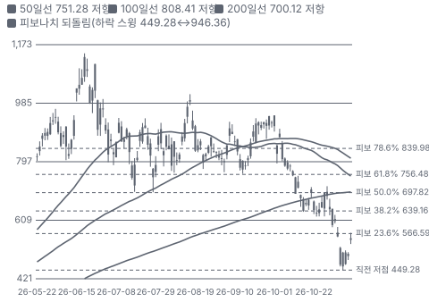

**주봉**

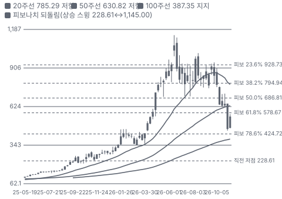

**월봉**

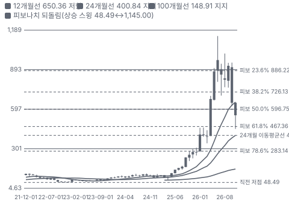

**분기 매출·EPS 실적과 컨센서스**

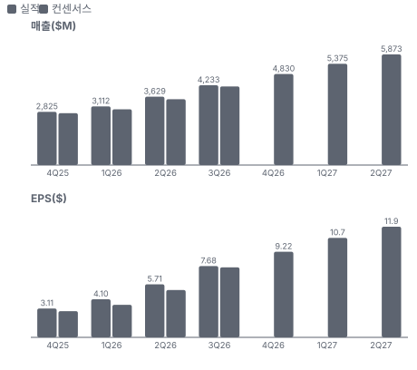

**4Q26 매출 — 지표 추세 vs 가이던스·컨센서스**

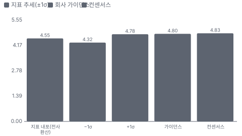

**최근 4개 분기 주가 변화 분석**

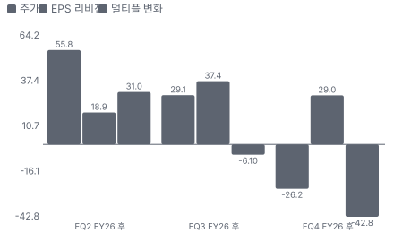

**EPS 리비전**

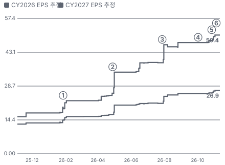

① 26-01-27 FQ2 FY26 실적 · EPS 리비전 +14%
② 26-04-28 FQ3 FY26 실적 · EPS 리비전 +35%
③ 26-07-28 FQ4 FY26 실적, GM 52.7% · EPS 리비전 +18%
④ 26-10-02 Toshiba 보도 HDD주 급락 · EPS 리비전 +0%
⑤ 26-10-27 FQ1 FY27 실적, GM 57.8% · EPS 리비전 +5%
⑥ 26-11-05 데이터센터 정치 리스크 −16% · 실적 창과 겹침

**밸류에이션 주가 시나리오**

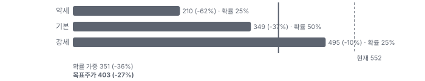

**주가별 업사이드**

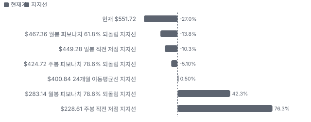
- 제품·서비스 포트폴리오

**고객 믹스(FY2026·FQ1 FY27, 매출 대비)**

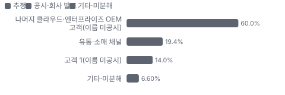

**공급 병목(10점, 낮을수록 병목)**

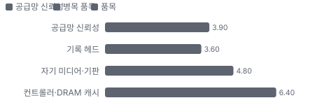

**생산능력 현재와 확충 계획(EB/분기(출하))**

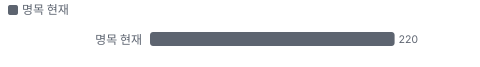

**CAPEX의 매출 대비 비중**

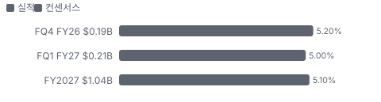

**어닝콜 변화별 주주가치 영향**

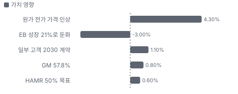

**멀티플 프리미엄(Fwd 1Y P/E, 최근 4개 분기말)**

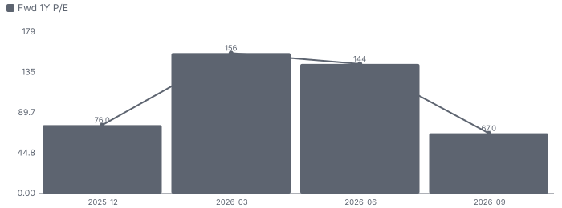

**합리적 멀티플**

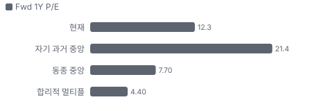

**매출 → 매출총이익 → 영업이익(매출 = 100, 최근 4분기)**

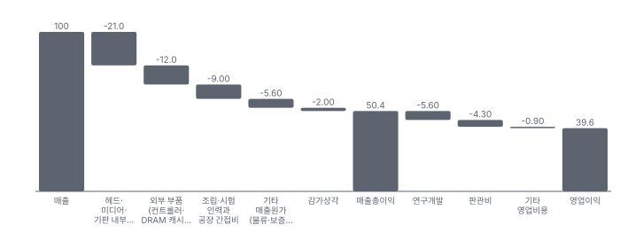

**1년 전 대비 마진 기여(비용 비중 변화의 반대)**

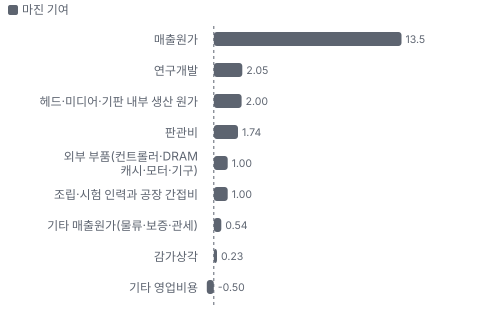

**분기 비용 비중 추이(매출 대비, 공시)**

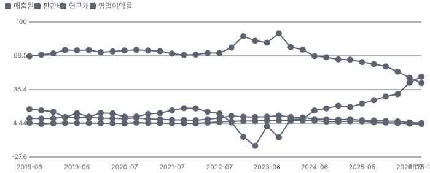

**비용 요인별 매출 대비 비중과 1년 변화**

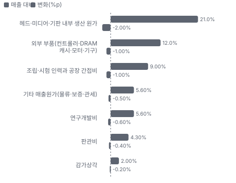

**BOM 항목 가격 +10% 시 OPM 변화**

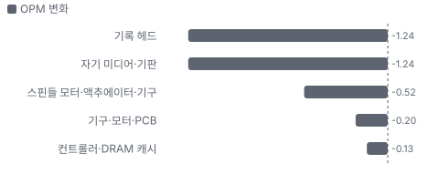

**데이터센터(니어라인 HDD·시스템) BOM 원가 몫과 가격 +10% 시 OPM**

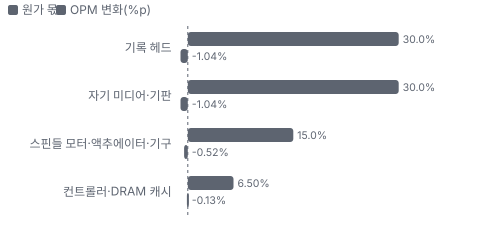

**엣지·IoT(클라이언트·감시·컨슈머 HDD) BOM 원가 몫과 가격 +10% 시 OPM**

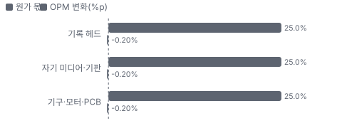

**생산시설별 면적(sq ft, 큰 순) — 생산능력 미공시라 면적을 대용으로**

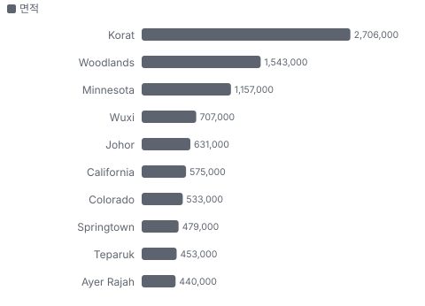

**매출·PPI·수출입 — 최근 16개 분기 같은 축(4Q22 = 100) + 다음 분기 추정**

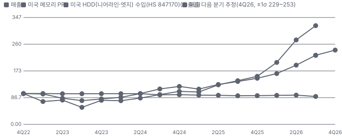

**매출과 미국 HDD(니어라인·엣지) 수입(HS 847170) 증가율(전년 대비, 최근 16개 분기 + 다음 분기 추정)**

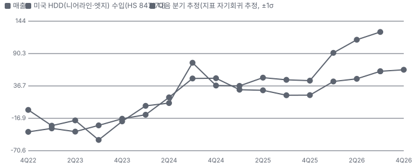

**10년 P·Q 사이클 — 추세(HP 필터) 대비 갭과 8분기 전망**

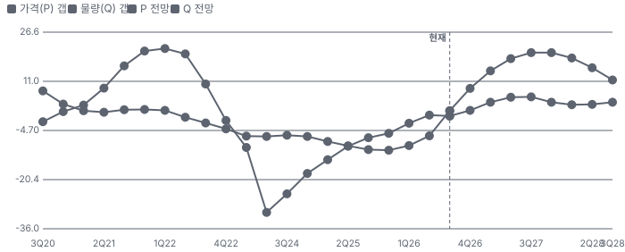

**매출 증가율의 가격·물량 분해와 8분기 전망(전년 대비)**

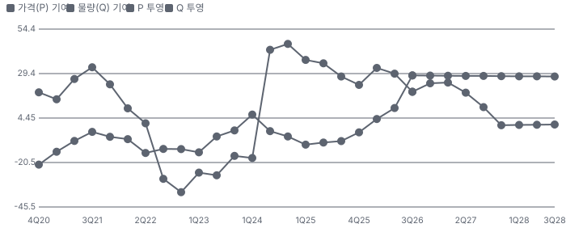

**분기별 매출 증가율 분해**

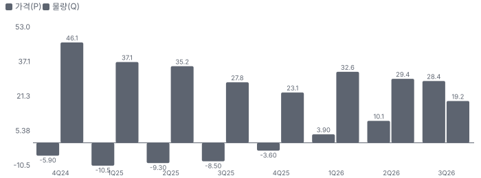

**목표주가 산정 — 기본과 강세 사이(강세 쪽 37%), 도달 확률 약 36%**

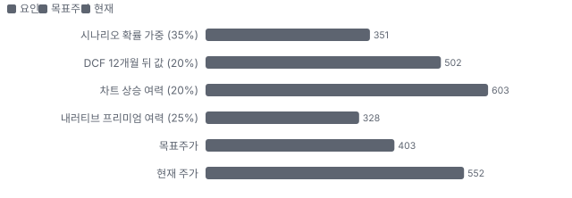

**PEG — 성장 대비 멀티플(낮을수록 성장 대비 쌈)**

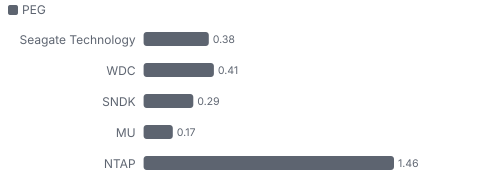

**일봉 지지·저항과 목표주가**

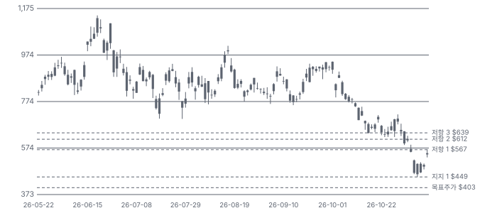

**커뮤니티 언급 수(최근 30일, 채널별)**

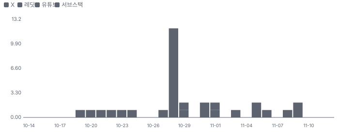

**커뮤니티 게시 수(월, 최근 7개월 — 이번 달은 진행 중)**

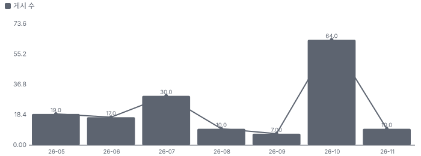

**일별 거래량 분해**

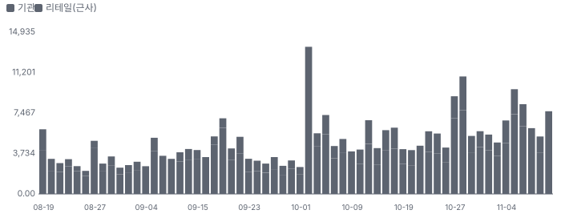

**기관 자금 흐름**

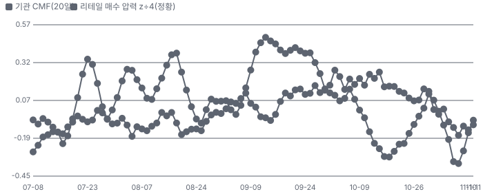

**몬테카를로**

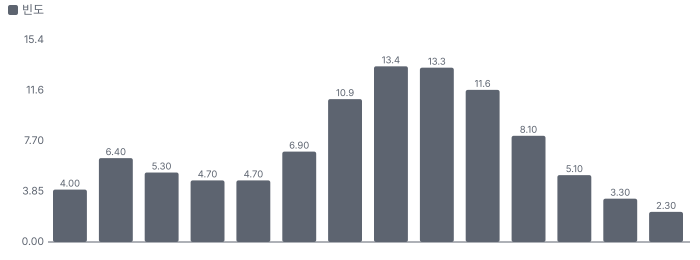

해석: 3,000번 중 50번(2%)에서 가치가 지금 주가 이상이었다. 가정을 흔들어도 지금 주가를 뒷받침하지 못하는 경우가 더 많다. 가운데 값은 0.75배이고, 열 번 중 여덟 번은 0.51~0.90배 사이에 든다.

## 내러티브

> **기업가치를 결정하는 이야기:** 값은 EB × TB당 가격 − TB당 원가다. FQ1은 220EB에 TB당 매출 약 \$19로 전년보다 약 33% 높다. 원가는 면적 밀도로 내려가야 하는데 전환 중 스크랩과 외부 부품 원가가 늦춘다. 회사는 원가 상승분까지 가격에 넘겨 마진을 넓혔다. 값을 가르는 것은 2028년 가격 협상이다.

> **멀티플·EPS 프리미엄**
> **멀티플:** Fwd 1Y P/E 12.3배로 WDC 10.8배보다 높고 NetApp 18.7배보다 낮다. 메모리 Micron 4.6배·Sandisk 3.8배보다 훨씬 높다(11/11 종가). 6월 말 38배에서 내려왔다 — 시장이 HDD를 성장주에서 사이클주로 다시 분류하는 중이다.
> **EPS:** FY2027 EPS 컨센서스는 FQ4 실적 직전 \$27.8에서 \$38.8로 +39%, FY2028은 \$49.5에서 \$62.0로 +25%다. 같은 기간 주가는 −32%다.

### 투자자들은 왜 열광했나

2025년 하반기 HDD 공급 부족·가격 인상이 확인되며 \$100 안팎에서 2026년 6월 종가 \$1,094까지 올랐다. 식은 순서는 6월 말 고점 뒤 조정, 7/28 실적 날 −8.5%, 10/2 Toshiba 보도 −10.2%, 실적 뒤 3거래일 −15%, 11/5 −16.3%다. 11/9~11 반등으로 저점 \$461에서 +20%다.

### 무엇이 기업가치를 바꾸나

> **구조적 체질 변화**
> **변화:** HDD가 PC 부품에서 데이터센터 인프라로 바뀌었다 — 출하 EB의 90%가 데이터센터다
> **증거:** FQ1 콜·KPI 표
> **반증:** 데이터센터 매출 2분기 연속 감소

> **고부가 믹스 확장**
> **변화:** HAMR(Mozaic) 비중이 니어라인 EB의 40% → 50%로 오른다
> **증거:** FQ4·FQ1 콜
> **반증:** 2026년 말 HAMR 비중 미달

> **기술 혁신**
> **변화:** Mozaic 4(44TB) 램프, Mozaic 5(50TB 이상) 2027년 말 인증, 실험실 디스크당 8TB
> **증거:** FQ1 콜
> **반증:** Mozaic 5(Seagate의 3세대 HAMR 플랫폼, 디스크당 5TB 이상) 인증 지연

> **실행 속도**
> **변화:** 리드타임은 회사가 공시하지 않는다. 커뮤니티는 52주 이상을 말하고, 회사는 물량을 2028년까지 배정했다고 밝혔다 **납품 리드타임 12개월.** 피어 비교 미확인. 이전 대비 미확인.
> **증거:** 업계 보도(니어라인 HDD 리드타임 52주 이상, 업계 공통) — 회사별 값 미확인. FQ1 콜 배정 발언
> **반증:** 고객 재고 증가

> **M&A**
> **변화:** 해당 없음(2025년 Intevac 소규모 인수뿐 — 미디어 장비 내재화)
> **증거:** 10-K
> **반증:** 대형 인수

> **정책·입법 연관성**
> **재정정책:** 해당 없음(보조금·세액공제 의존 사업이 아니다, 10-Q에 정부 지원 공시 없음)
> **행정명령:** 미국 관세·수출통제가 아시아 생산 HDD 원가와 중국 판매를 건드린다(BIS(미국 상무부 산업안보국) 화웨이 합의 이행 중) 10-Q 위험요인·BIS 합의 주석 반증: 관세를 가격에 못 넘겨 GM 하락 의회 동의 2/10 — 하원 1/5(행정부 조치로 관련 표결을 찾지 못했다) · 상원 1/5(같음).
> **연관입법:** 선거 뒤 데이터센터 건설 제한 논의(발언 단계) 업종 보도 — 법안 번호 없음 반증: 법안 발의·위원회 통과

> **CAPEX 낙수효과**
> **변화:** 하이퍼스케일러 AI CAPEX가 저장 수요로 온다. 다만 고객 투자 발표를 Seagate 매출로 바로 옮기지 않는다
> **증거:** 데이터센터 매출 +63%, 고객 1곳 14%
> **반증:** 하이퍼스케일러 CAPEX 가이던스 하향

### 내러티브 근거

> 'AI 데이터는 결국 HDD에 쌓이고, HAMR을 가진 Seagate가 가격을 정한다'가 FY2027 EPS를 \$27.8에서 \$38.8로 올렸지만 주가는 6월 종가 고점 대비 −50%다. 시장은 이익을 사이클 정점으로 보고 배수를 깎는다. 동종 대비 멀티플 차이 +60% 중 회사 고유 몫은 +180%다. 단계는 과밀, 쏠림은 높음이다.

> **AI 저장 수요(추론·KV 캐시(AI 추론 중간 결과 저장)·물리적 AI(로봇·자율주행처럼 현실에서 움직이는 AI))** · 유지
> **논리:** AI가 만든 데이터를 HDD가 가장 싸게 저장한다
> **숫자:** 데이터센터 EB +24%, 출하 EB의 90%
> **반증:** FQ2 데이터센터 EB가 전년 대비 20% 아래(2027-01)

> **HAMR 기술 선행·가격 결정력** · 유지
> **논리:** 용량 경쟁에서 1년 앞서 TB당 가격과 마진을 함께 올린다
> **숫자:** 비GAAP GM 52.7% → 57.8%, TB당 매출 +33%(EB 대비 매출)
> **반증:** FQ2 GM이 57.8% 아래

> **주주환원 확대** · 신규
> **논리:** FCF 75% 환원, 2027년부터 자사주 크게 확대
> **숫자:** FQ1 FCF \$1.48B, 자사주 한도 \$4.4B
> **반증:** 2027년 상반기 자사주 매입이 FQ1 \$400M 수준에 머문다

> **2028 공급 물결·경쟁사 증설(약세)** · 강화
> **논리:** WDC·Toshiba가 증설하면 2028년 가격 협상에서 인상 폭이 준다
> **숫자:** 10/2 −10.2%, TD Cowen 질의(경쟁사 CAPEX 8%대)
> **반증:** 경쟁사 증설이 장비 반입·가동으로 확인되지 않고 2028 가격이 오른다

> **사이클 정점 이익(약세)** · 강화
> **논리:** 영업이익률 50%대는 정점이고 메모리처럼 꺾인다
> **숫자:** Fwd 1Y P/E 38.2배(6월 말) → 12.3배(11/11)
> **반증:** FQ2 영업이익률 55% 근처와 FQ3 가이던스 상향

> **데이터센터 정치 리스크(약세)** · 신규
> **논리:** 선거 뒤 데이터센터 건설 제한 논의가 수요를 깎는다
> **숫자:** 11/5 −16.3%
> **반증:** 법안·규칙 단계 진전이 없다

이미지 없음(아직 생성 전) — 데이터센터(니어라인 HDD·시스템)·엣지·IoT(클라이언트·감시·컨슈머 HDD)

## 포트폴리오

| 제품·서비스 | 구분 | 무엇 | 쓰는 곳 | 돈 버는 방식 | Mix | Mix 변화(전 분기 대비) |
|---|---|---|---|---|---|---|
| 데이터센터(니어라인 HDD·시스템) | 제품 | Exos(Seagate의 데이터센터용 HDD 브랜드)·Mozaic 3/4 니어라인 HDD(최대 44TB)와 Lyve(Seagate의 대용량 저장 시스템·서비스 브랜드) 저장 시스템 | 하이퍼스케일러·클라우드·엔터프라이즈 OEM의 대용량 저장 | FQ1 \$3.45B(매출 81%, +63%) | 81% | +0.7%p |
| 엣지·IoT(클라이언트·감시·컨슈머 HDD) | 제품 | 감시 카메라·NAS(네트워크 연결 저장장치)·PC·외장 드라이브용 HDD와 FireCuda(Seagate의 고성능 소비자용 드라이브 브랜드)·SSD | 영상 감시·소규모 서버·개인 저장 | FQ1 \$784M(매출 19%, +52%) | 19% | -0.7%p |

**Mix 변화가 가장 큰 쪽은 데이터센터(니어라인 HDD·시스템, +0.7%p, 전 분기 대비).** 계절성 판정: 분기 매출 계절 지수 기준 없음 → 직전 분기와 비교.

## 고객

> **FY2026·FQ1 FY27 최대 고객 나머지 클라우드·엔터프라이즈 OEM 고객(이름 미공시) 60%, 상위 3곳 93%, 집중도 집중.** 공시·회사 발표로 확인한 몫은 매출의 33%이고, 나머지 고객 몫은 추정이거나 미분해다. FY2026 매출의 약 14%가 고객 1곳이다(10-K, 이름 미공시). FQ1 매출의 81%가 OEM 직판이고, 출하 EB의 90%가 데이터센터다. 클라우드 고객이 데이터센터 매출의 대부분이다(콜)

**고객별 매출 몫(FY2026·FQ1 FY27)**
| 고객 | 몫 | 변화 | 근거 |
|---|---|---|---|
| 나머지 클라우드·엔터프라이즈 OEM 고객(이름 미공시) | 55~65% | 미확인 | 추정 |
| 유통·소매 채널 | 19% | +2%p | 공시 |
| 고객 1(이름 미공시) | 14% | 미확인 | 공시 |
| 기타·미분해 | 7% | - | - |

> **나머지 클라우드·엔터프라이즈 OEM 고객(이름 미공시)** · 추정
> **사는 것:** 니어라인·엔터프라이즈 HDD
> **추정 근거:** 하이퍼스케일러·서버 OEM 직판, 고객별 몫 미공시

> **유통·소매 채널** · 공시
> **사는 것:** 엣지·엔터프라이즈·컨슈머 HDD
> **추정 근거:** 유통 비중이 늘었다

> **고객 1(이름 미공시)** · 공시
> **사는 것:** 니어라인 HDD
> **추정 근거:** 10%를 넘는 유일한 고객

## 마진 구조

> **GPM 50.4%, OPM 39.6%.** FY2026 대비 GPM +4.8%p, OPM +6.0%p. TTM 매출원가는 매출의 49.6%로 FY2026 54.4%보다 4.8%p 낮아졌다. 가격 인상과 HAMR 믹스가 외부 부품 원가 상승보다 커서다. 연구개발비는 5.6%, 판관비는 4.3%로 매출이 늘며 비중이 줄었다

> **매출 100 중 매출원가 49.6, 매출총이익 50.4(최근 4분기, 공시).** 매출원가 요인 중 헤드·미디어·기판 내부 생산 원가이 매출의 21.0%로 가장 무겁고, 단가가 +10% 오르면 GPM이 -2.10%p 움직인다. 분기 회귀로 매출 1이 늘 때 매출원가는 0.33 늘고, 매출원가의 고정비 몫은 51%다.

**비용 요인 강도 — 비중·추세·충격(+10%)·탄력**
| 비용 | 구분 | 매출 대비 | 1년 변화 | 마진 기여 | 충격 시 마진 | 매출 탄력 | 고정비 몫 |
|---|---|---|---|---|---|---|---|
| 헤드·미디어·기판 내부 생산 원가 | 매출원가 요인 | 21.0% | -2.0%p | +2.0%p | -2.10%p | 미확인 | 50% |
| 외부 부품(컨트롤러·DRAM 캐시·모터·기구) | 매출원가 요인 | 12.0% | -1.0%p | +1.0%p | -1.20%p | 미확인 | 0% |
| 조립·시험 인력과 공장 간접비 | 매출원가 요인 | 9.0% | -1.0%p | +1.0%p | -0.90%p | 미확인 | 60% |
| 기타 매출원가(물류·보증·관세) | 매출원가 요인 | 5.6% | -0.5%p | +0.5%p | -0.56%p | 미확인 | 미확인 |
| 감가상각 | 매출원가 요인 | 2.0% | -0.2%p | +0.2%p | -0.20%p | 미확인 | 100% |
| 매출원가 | 공시 항목 | 49.6% | -13.5%p | +13.5%p | -4.96%p | 0.33 | 51% |
| 연구개발 | 공시 항목 | 5.6% | -2.1%p | +2.1%p | 미확인 | 0.02 | 72% |
| 판관비 | 공시 항목 | 4.3% | -1.7%p | +1.7%p | 미확인 | 0.01 | 72% |
| 기타 영업비용 | 공시 항목 | 0.9% | +0.5%p | -0.5%p | 미확인 | -0.01 | 100% |

매출 탄력 = 분기 비용을 매출에 회귀한 기울기(매출 1당 변동비), 고정비 몫 = 절편 ÷ 평균 비용. 표본이 8분기 미만이면 미확인. 매출원가 요인 비중은 margin 재료의 추정이 섞여 있고, 공시 매출원가와의 차이는 '기타 매출원가'로 둔다.

**GPM에서 OPM까지(GAAP)**
| 기간 | GPM | 연구개발 | 판관비 | 기타 | OPM |
|---|---|---|---|---|---|
| FY2026 | 45.6% | 6.2% | 4.7% | 1.1% | 33.6% |
| TTM FQ1 FY27 | 50.4% | 5.6% | 4.3% | 0.9% | 39.6% |

**GPM·OPM 최근 4개 분기**
| 분기 | GPM | OPM |
|---|---|---|
| 2026-01 | 41.6% | 29.8% |
| 2026-04 | 46.5% | 32.1% |
| 2026-07 | 52.3% | 43.0% |
| 2026-10 | 57.3% | 48.8% |

**마진을 결정하는 비용 요인 — 비용 +10% 시 OPM**
| 비용 | 매출 대비 | 변화 | 고정비 | OPM |
|---|---|---|---|---|
| 헤드·미디어·기판 내부 생산 원가 | 21.0% | -2.0%p | 50% | -2.10%p |
| 외부 부품(컨트롤러·DRAM 캐시·모터·기구) | 12.0% | -1.0%p | 0% | -1.20%p |
| 조립·시험 인력과 공장 간접비 | 9.0% | -1.0%p | 60% | -0.90%p |
| 기타 매출원가(물류·보증·관세) | 5.6% | -0.5%p | 미확인 | -0.56%p |
| 연구개발비 | 5.6% | -0.6%p | 90% | -0.56%p |
| 판관비 | 4.3% | -0.4%p | 80% | -0.43%p |
| 감가상각 | 2.0% | -0.2%p | 100% | -0.20%p |

**비용을 움직이는 요인**
| 비용 | 요인 |
|---|---|
| 헤드·미디어·기판 내부 생산 원가(매출원가) | 면적 밀도·HAMR 공정 단계(전환 중 스크랩) · 근거 추정 |
| 외부 부품(컨트롤러·DRAM 캐시·모터·기구, 매출원가) | 외부 부품 원가 상승(FQ1 콜) · 근거 추정 |
| 조립·시험 인력과 공장 간접비(매출원가) | 단위 출하 수 · 근거 추정 |
| 기타 매출원가(물류·보증·관세, 매출원가) | 물류·보증(보증 충당금 \$218M) · 근거 추정 |
| 연구개발비(연구개발) | HAMR·Mozaic 5 개발 · 근거 공시 |
| 판관비(판관비) | 인건비 · 근거 공시 |
| 감가상각(매출원가) | 헤드·미디어 설비 · 근거 공시 |

**데이터센터(니어라인 HDD·시스템) BOM — 매출의 82%, GPM 57%(회사 전체 FQ1 GAAP GM — 부문 마진 미공시), 항목 가격 +10% 시**
| 항목 | 원가 몫 | 전가 | 제품 GPM | OPM |
|---|---|---|---|---|
| 기록 헤드 | 25~35% | 미확인 | -1.3%p | -1.04%p |
| 자기 미디어·기판 | 25~35% | 미확인 | -1.3%p | -1.04%p |
| 스핀들 모터·액추에이터·기구 | 10~20% | 미확인 | -0.6%p | -0.52%p |
| 컨트롤러·DRAM 캐시 | 4~9% | 70% | -0.2%p | -0.13%p |
| 미분해 | 19% | - | - | - |

**엣지·IoT(클라이언트·감시·컨슈머 HDD) BOM — 매출의 18%, GPM 57%(회사 전체 값(부문 마진 미공시)), 항목 가격 +10% 시**
| 항목 | 원가 몫 | 전가 | 제품 GPM | OPM |
|---|---|---|---|---|
| 기록 헤드 | 20~30% | 미확인 | -1.1%p | -0.20%p |
| 자기 미디어·기판 | 20~30% | 미확인 | -1.1%p | -0.20%p |
| 기구·모터·PCB | 20~30% | 미확인 | -1.1%p | -0.20%p |
| 미분해 | 25% | - | - | - |

기록 헤드 가격이 +10% 오르면 영업이익은 -3.1% 움직인다. 판매가 전가를 모르는 항목은 전가 0%로 계산했다.

**BOM 항목 가격을 움직이는 것**
| 항목 | 요인 |
|---|---|
| 기록 헤드 | 면적 밀도를 정하는 핵심 부품(HAMR은 레이저 포함) · 근거 추정 |
| 자기 미디어·기판 | 플래터(HDD 안 자기 디스크 원판) 수가 용량을 정한다 · 근거 추정 |
| 컨트롤러·DRAM 캐시 | 메모리 가격 상승분을 가격에 넘긴다 · 근거 추정 |
| 스핀들 모터·액추에이터·기구 | 정밀 기구 부품 · 근거 추정 |
| 기록 헤드 | PMR(수직 자기 기록, 기존 HDD 기록 방식) 헤드 · 근거 추정 |
| 자기 미디어·기판 | 플래터 · 근거 추정 |
| 기구·모터·PCB | 부품 · 근거 추정 |

**BOM 투입 물가 — PPI 전년비, 2026-11-12 수집**
| 항목 | 미국 | 일본 | 한국 | 대만 |
|---|---|---|---|---|
| 컨트롤러·DRAM 캐시 | -2.2%* | +3.9%* | +418.1% | +22.9%* |
| 기구·모터·PCB | +45.8% | +11.3% | +4.5% | +12.1% |

별표는 품목보다 넓은 업종 지수다. 지난 1년 투입 물가를 판매가 전가 뒤 원가에 그대로 넣으면 OPM은 -3.20%p 움직인다(매출원가의 9% 기준).

## 공급망 병목

이미지 없음(아직 생성 전) — 데이터센터(니어라인 HDD·시스템)

> **공급망 신뢰성 3.9/10, 병목 심각.** 가장 약한 고리는 기록 헤드 3.6점이고, 품목 평균은 4.4점이다. 근거가 부족한 1건(스핀들 모터·액추에이터·기구)은 점수에서 뺐다. 병목은 HAMR 헤드·미디어 공정이다. 전환 중에는 부품이 공장에 더 오래 머물러 처리량이 준다(FQ1 콜). 단기 원가 압력은 외부 부품이고 회사는 이를 가격에 넘긴다. 구매 약정은 \$2.6B로 FY26 말보다 \$0.5B 늘었다(10-Q)

**병목과 마진 — 품목 가격 +10% 시 OPM**
| 품목 | 점수 | 판정 | 구분 | OPM |
|---|---|---|---|---|
| 기록 헤드(필수) | 3.6 | 병목 심각 | 핵심 통제 품목 | -1.24%p |
| 자기 미디어·기판(필수) | 4.8 | 병목 주의 | 핵심 통제 품목 | -1.24%p |
| 컨트롤러·DRAM 캐시 | 6.4 | 관리 가능 | 일반 | -0.13%p |

> **기록 헤드** · 3.6/10
> **왜:** 면적 밀도·용량을 정한다
> **병목 요인:** 인증 공급사 1곳 · 캐파 빠듯 · 리드타임 미확인 · 재인증 미확인 · 1위 점유율 100% · 북아일랜드·미국(공시 시설) 집중 60% · 물량 확보 내재화
> **풀리는 조건:** 미확인

> **자기 미디어·기판** · 4.8/10
> **왜:** 플래터 수 = 용량
> **병목 요인:** 인증 공급사 2곳 · 캐파 빠듯 · 리드타임 미확인 · 재인증 미확인 · 1위 점유율 80% · 싱가포르·말레이시아 집중 90% · 물량 확보 내재화
> **풀리는 조건:** 미확인

> **컨트롤러·DRAM 캐시** · 6.4/10
> **왜:** 원가 하락 속도를 늦춘다 — 가격 전가 중
> **병목 요인:** 인증 공급사 3곳 · 캐파 빠듯 · 리드타임 미확인 · 재인증 미확인 · 1위 점유율 40% · 한국·미국·대만(추정) 집중 60% · 물량 확보 미확인
> **풀리는 조건:** 미확인

**공급사**
| 품목 | 공급사 | 몫 | 근거 |
|---|---|---|---|
| 기록 헤드 | Seagate 자체(전량(HAMR 포함)) | 미확인 | 공시 |
| 자기 미디어·기판 | Seagate 자체(미디어(싱가포르)·기판(말레이시아)) | 미확인 | 공시 |
| 자기 미디어·기판 | 외부 기판 공급사(미공시, 일부) | 미확인 | 추정 |
| 컨트롤러·DRAM 캐시 | 외부 반도체 공급사(미공시)(SoC(시스템 반도체 칩)·캐시 메모리) | 미확인 | 회사 발표 |
| 스핀들 모터·액추에이터·기구 | 단일·제한 공급원(미공시, 모터·정밀 부품) | 미확인 | 공시 |

**무역 통계로 본 공급 지역**
| 품목 | EU 수입처 | 일본 수입처 | EU 1위 전년비 |
|---|---|---|---|
| 컨트롤러·DRAM 캐시 | TW(대만) 45% · KR(한국) 21% · CN(중국) 16% | 台湾 52% · 大韓民国 28% | +365.5% |

## 생산능력

> **현재 명목 캐파 220 EB/분기(출하), 가동률 미확인.** 착공 이상 증설은 0 EB/분기(출하), 발표까지 합치면 0 EB/분기(출하)이다. 다 가동하면 지금보다 +0%, 착공 이상만이면 +0%다. FQ1 FY27 CAPEX는 \$0.21B로 매출의 5.0%다. 회사는 명목 캐파를 밝히지 않는다. FQ1 출하 220EB(+21%)를 지금 처리량으로 본다. 늘리는 방식은 단위 캐파가 아니라 면적 밀도(Mozaic 3(Seagate의 1세대 HAMR 플랫폼, 디스크당 3TB) → 4 → 5)이고 장기 EB 공급 성장 목표는 연 25% 안팎이다. CAPEX는 매출의 4~6%를 유지한다

**생산시설 10곳**(FY2026 10-K Item 2 — 주요 시설 표(제조·제품 개발, 2026-07-03 기준, 전체 약 980만 sq ft)), 소유 2곳 · 임차 4곳 · 소유·임차 4곳. 시설별 생산능력은 공개되지 않았다 — 회사 전체 캐파만 위에 적었다.

**생산시설 10곳 — 명칭·위치·생산능력**
| 시설 | 위치 | 용도 | 생산능력 | 소유·상태 |
|---|---|---|---|---|
| Springtown | 영국 북아일랜드 | 기록 헤드 제조 | 미확인 — 시설별 캐파 미공시(10-K Item 2는 면적·용도만) · 면적 479,000 sq ft | 소유 · 가동 |
| California | 미국 캘리포니아 | 제품 개발·관리 | 미확인 — 시설별 캐파 미공시(10-K Item 2는 면적·용도만) · 면적 575,000 sq ft | 임차 · 가동 |
| Colorado | 미국 콜로라도 | 제품 개발·관리 | 미확인 — 시설별 캐파 미공시(10-K Item 2는 면적·용도만) · 면적 533,000 sq ft | 임차 · 가동 |
| Minnesota | 미국 미네소타 | 기록 헤드 제조·제품 개발 | 미확인 — 시설별 캐파 미공시(10-K Item 2는 면적·용도만) · 면적 1,157,000 sq ft | 소유·임차 · 가동 |
| Wuxi | 중국 Wuxi | 드라이브·하위 조립 제조 | 미확인 — 시설별 캐파 미공시(10-K Item 2는 면적·용도만) · 면적 707,000 sq ft | 임차 · 가동 |
| Johor | 말레이시아 Johor | 기판 제조(토지 임차) | 미확인 — 시설별 캐파 미공시(10-K Item 2는 면적·용도만) · 면적 631,000 sq ft | 소유 · 가동 |
| Woodlands | 싱가포르 Woodlands | 미디어 제조·관리(토지 임차) | 미확인 — 시설별 캐파 미공시(10-K Item 2는 면적·용도만) · 면적 1,543,000 sq ft | 소유·임차 · 가동 |
| Ayer Rajah | 싱가포르 Ayer Rajah | 제품 개발·관리 | 미확인 — 시설별 캐파 미공시(10-K Item 2는 면적·용도만) · 면적 440,000 sq ft | 임차 · 가동 |
| Korat | 태국 Korat | 드라이브·하위 조립 제조 | 미확인 — 시설별 캐파 미공시(10-K Item 2는 면적·용도만) · 면적 2,706,000 sq ft | 소유·임차 · 가동 |
| Teparuk | 태국 Teparuk | 드라이브 하위 조립 제조 | 미확인 — 시설별 캐파 미공시(10-K Item 2는 면적·용도만) · 면적 453,000 sq ft | 소유·임차 · 가동 |

**생산능력 확충 계획**
| 계획 | 단계 | 증설 | 가동 시점 | CAPEX |
|---|---|---|---|---|
| Mozaic 5(디스크당 5TB 이상, 10디스크 50TB 이상) 인증 출하 | 발표 | 미확인 | 2027 하반기 말 | 미확인 |

남은 계획의 CAPEX 합계는 \$0.00B(금액 미확인 1건 제외)다. 합계는 FY2027 매출의 0%다.

**증설 방해 요인**
| 계획 | 방해 요인 |
|---|---|
| Mozaic 5(디스크당 5TB 이상, 10디스크 50TB 이상) 인증 출하 | 헤드·미디어 공정 성숙 |

**CAPEX와 매출 대비**
| 기간 | CAPEX | 매출 | 매출 대비 | 구분 |
|---|---|---|---|---|
| FQ4 FY26 | \$0.19B | \$3.63B | 5.2% | 실적 |
| FQ1 FY27 | \$0.21B | \$4.23B | 5.0% | 실적 |
| FY2027 | \$1.04B | \$20.40B | 5.1% | 컨센서스 |

## 해자

> 해자는 HAMR 양산 선행과 헤드·미디어·기판 수직계열화다. 3사 과점은 증설 규율이 깨지면 시험받는다.

> **HAMR 양산 선행** · 강함
> **해자:** 열 보조 기록 HDD를 상용 규모로 출하하는 유일한 회사다
> **근거:** Mozaic 3는 모든 주요 클라우드 고객에서 인증·가동, Mozaic 4(최대 44TB)는 2개 CSP(대형 클라우드 서비스 사업자)에 램프(FQ4·FQ1 콜). WDC는 HAMR 1세대 고객 인증을 2027년 1분기로 잡았다(WDC FQ1 콜)
> **숫자:** 니어라인 EB 중 HAMR 40%(FY26 말) → 50%(2026년 말 목표)
> **깨지는 조건:** WDC HAMR이 2027년 상반기 같은 용량으로 인증·양산

> **헤드·미디어·기판 수직계열화** · 강함
> **해자:** 기록 헤드·자기 미디어·기판을 직접 만든다
> **근거:** 10-K Item 2: 헤드(북아일랜드 Springtown·미네소타), 미디어(싱가포르 Woodlands), 기판(말레이시아 Johor). CFO: 'HAMR 기술은 살 수 없어 직접 해야 한다'
> **숫자:** FQ1 비GAAP GM 57.8%, CAPEX 매출의 5%
> **깨지는 조건:** 외부 헤드·미디어 공급사가 HAMR급 부품을 제3자에 공급

> **3사 과점(Seagate·WDC·Toshiba)** · 보통
> **해자:** 니어라인 HDD는 세 회사만 만든다
> **근거:** 10-K 경쟁 항목. CEO: 의미 있는 HDD 캐파를 시장에 내는 것은 R&D·투자가 큰 복잡한 과정
> **숫자:** 10/2 Toshiba 보도 하루 −10.2%
> **깨지는 조건:** 경쟁사 단위 캐파 증설이 장비 반입·가동으로 확인되고 가격이 꺾인다

> **장기공급계약(LTA(장기공급계약)·BTO(주문 생산 계약, 사양·가격을 미리 정함))** · 보통
> **해자:** 물량은 2028년, 사양·가격은 2027년까지 묶었다
> **근거:** FQ1 콜: 니어라인 EB 대부분 2028년까지 배정, 일부 2030년, BTO가 2027년 가격을 정함
> **숫자:** 고객 쪽 의무 금액은 미공시(회사 쪽 구매 약정 \$2.6B)
> **깨지는 조건:** 2028년 가격 협상에서 인상 폭 축소

## 경영진·네트워크

> 창업자 없는 전문경영인 회사다. CEO 겸 의장 Dave Mosley(2017년 CEO)와 CFO Gianluca Romano가 이끈다. 공개 자료로 확인한 정치 연결은 없다. CEO가 11/2 3만 주(약 \$18.2M)를 장내 매도했다

> **Dave Mosley(William D. Mosley)** · 의장·CEO · 2017-10
> **프로필:** Seagate 운영·기술 총괄 → 사장 → CEO, 이후 의장 겸임
> **비즈니스:** HDD 운영·기술 경력
> **정계:** 미확인
> **동문:** 미확인
> **사모임:** 미확인

> **Gianluca Romano** · CFO · 2019
> **프로필:** 전 Diebold Nixdorf CFO
> **비즈니스:** 제조업 재무
> **정계:** 미확인
> **동문:** 미확인
> **사모임:** 미확인

> **John C. Morris** · CTO · 미확인
> **프로필:** HAMR·기록 기술 총괄
> **비즈니스:** 기록 기술
> **정계:** 미확인
> **동문:** 미확인
> **사모임:** 미확인

**네트워크 정량화**
| 연결 | 강도 | 닿는 매출 | 가중 노출 | 매출 대비 | 근거 |
|---|---|---|---|---|---|
| 정계: 정부·의회 직책 연결 | 0/5 | 미확인 | 미확인 | 미확인 | 위임장·회사 소개에서 찾지 못했다. 하원 로비 공시는 분기 \$80K(외부 회사, 무역 쟁점) Easyconomics 하원 로비 공시 집계 1Q26~Q3 |

가중 노출은 연결이 닿는 매출의 크기다. 연결이 그 매출을 만들었다는 뜻이 아니며, 인과는 공개 자료로 입증하지 못한다.

## 약세 논리 및 셀온 조건

| 약세 논리 | 근거 | 반박 | 가를 자료 · 공개 시점 |
|---|---|---|---|
| 2028년 공급 물결로 가격이 꺾인다 | TD Cowen 질의: 경쟁사는 CAPEX를 매출의 8%대로 올린다고 했다. 10/2 Toshiba 보도 하루 −10.2% | Seagate는 CAPEX 4~6%로 면적 밀도만으로 EB를 늘린다. 경쟁사 증설은 장비 반입·가동 근거가 아직 없다(금지표: 투자 발표 → 공급 증가) | 2028년 가격 협상 결과(회사가 '앞으로 몇 분기'라고 함) · 2027-01 FQ2 콜 |
| 50%대 영업이익률은 사이클 정점이다 | GAAP GM 57%는 10년 최고, 2023-03 분기 영업적자 −\$315M. 메모리 동종 Fwd 1Y P/E 4~5배 | 지금은 단위 캐파를 늘리지 않는 3사 과점이고 HAMR은 살 수 없는 기술이다(CFO). 2023년은 재고 조정기였다 | FQ2 GM 57.8% 이상 · 2027-01 |
| EB 성장이 둔화한다 | 출하 EB +34%(FQ4) → +21%(FQ1), Cantor 질의 | 회사는 Mozaic 4 고객 인증 전 제품을 쌓아 두고 있어 FQ2에 의미 있게 늘어난다고 했다. 장기 목표 25% 유지 | FQ2 출하 EB(220EB 대비) · 2027-01 |
| 경영진이 판다 | CEO 11/2 3만 주(약 \$18.2M), 최근 장내 매도 155건·매수 0 | 옵션 행사와 함께한 매도이고 10b5-1 계획 여부는 미확인 — 매도만으로 펀더멘털 변화로 읽지 않는다 | 다음 Form 4·위임장 · 수시 |
| 데이터센터 정치 리스크 | 11/5 −16.3%, 출하 EB의 90%가 데이터센터 | 발언 단계이고 법안·규칙 진전이 없다(금지표: 법안 발의 → 시행) | 하이퍼스케일러 2027 CAPEX 가이던스 · 2027-01~02 |

경쟁 가설은 셋이다. '하락은 경쟁사 증설 우려 때문이다'는 2028년 가격 협상 결과(2027년 상반기)가, '이익이 정점이다'는 FQ2 GM과 FQ3 가이던스(2027-01)가, '메모리주와 함께 팔렸을 뿐이다'는 11/5·11/11처럼 메모리주와 같은 날 움직이는지(일별 상관, 상시)가 가른다.

> **셀온 조건**
> **조건 1:** FQ2 비GAAP GM이 57.8% 아래 — 가격 전가가 원가를 못 따라간다
> **조건 2:** 2028년 가격 협상에서 인상이 없거나 회사가 가격 '안정'을 말한다
> **조건 3:** 경쟁사 단위 캐파 증설이 장비 반입·가동으로 확인된다
> **조건 4:** 데이터센터 EB 성장이 2분기 연속 20% 아래
> **조건 5:** 하이퍼스케일러가 2027 CAPEX 가이던스를 낮춘다

## 어닝콜 변화

**직전 콜 대비 새로 나오거나 바뀐 내용 → 가치 영향**
| 항목 | 내용 | 직전 콜 | 최신 콜 | 모델 동인 이동 | 확신도 | 가치 영향 |
|---|---|---|---|---|---|---|
| 업데이트 | 매출총이익률 |  |  | 출발 이익률 +4.0% | 1.0 | +0.8% |
| 부정 | EB 출하 성장 |  |  | 1년차 성장률 -3.0% | 1.0 | -3.0% |
| 신규 | 가격 결정 |  |  | 1년차 성장률 +4.0% | 0.8 | +4.3% |
| 업데이트 | 장기계약 기간 |  |  | 장기 성장 수렴값 +0.50% | 0.5 | +1.1% |
| 업데이트 | HAMR 비중 |  |  | 목표 이익률 +1.0% | 0.8 | +0.6% |
| 반복 | Mozaic 5 |  |  | 장기 성장 수렴값 — | 0.8 | +0.0% |
| 반복 | CAPEX |  |  | 매출÷투하자본 — | 0.8 | +0.0% |
| **합계** | 단독 합 |  |  | 동시 적용 +3.6% |  | **+3.7%** |

**사건별 EPS 리비전**
| # | 날짜 | 구분 | 사건 | CY2026 EPS 전→후 | CY2027 EPS 전→후 | 리비전 | 주가 반응 |
|---|---|---|---|---|---|---|---|
| ① | 26-01-27 | 실적 | FQ2 FY26 실적 | \$14.25 → \$15.76 | \$19.73 → \$22.52 | +14.1% | +19.1% |
| ② | 26-04-28 | 실적 | FQ3 FY26 실적 | \$16.67 → \$20.62 | \$25.69 → \$34.65 | +34.9% | +11.1% |
| ③ | 26-07-28 | 실적 | FQ4 FY26 실적, GM 52.7% | \$21.38 → \$24.96 | \$38.65 → \$45.42 | +17.5% | +2.3% |
| ④ | 26-10-02 | 내러티브 | Toshiba 보도 HDD주 급락 | \$25.51 → \$25.51 | \$47.19 → \$47.19 | +0.0% | -10.2% |
| ⑤ | 26-10-27 | 실적 | FQ1 FY27 실적, GM 57.8% | \$25.83 → \$26.85 | \$48.10 → \$50.39 | +4.8% | +4.5% |
| ⑥ | 26-11-05 | 내러티브 | 데이터센터 정치 리스크 −16% | \$26.85 → \$26.85 | \$50.39 → \$50.39 | 실적 창과 겹침 | -16.3% |

**해석:** 3개 구간 누적 주가 +48% = EPS 리비전 +111% × 멀티플 -30%. 더 크게 움직인 쪽은 **EPS 리비전**이다.

## 거시 지표 싱크로율

> **미국 HDD(니어라인·엣지) 수입(HS(국제 통일 상품 분류 코드) 847170)와 데이터센터(니어라인 HDD·시스템) 싱크로율 98%(0분기 = 약 0개월 선행, 전년 대비, 표본 5개·t 8.4·유의·신뢰 참고용).** 이 지표가 내포하는 4Q26 데이터센터(니어라인 HDD·시스템)은 3.64B(±1σ 3.40B~3.87B, 지표 자기회귀 추정)다. 세그먼트 추정에 나머지 사업(직전 증가율 지속)을 더한 전사 매출은 4.55B(4.32B~4.78B)다. 가이던스는 이보다 +5.5%(범위 위), 컨센서스는 +6.1%(범위 위)다. HDD는 저장장치(HS 847170) 품목이고, 원가에 메모리·PCB가 들어간다

**지표별 싱크로율(상관계수 × 100) — 위 두 줄이 제품 연관성 × 싱크로율로 고른 PPI·수출입 세부 지표**
| 지표 | 비교 대상 | 증가율 기준 | 지표 선행 | 매출(t값) | 영업이익 | 방향 일치 | 표본·신뢰 | 표본 밖 오차(지표/기준선) | 4Q26 추정 매출 |
|---|---|---|---|---|---|---|---|---|---|
| 미국 메모리 PPI(생산자물가지수) | 데이터센터(니어라인 HDD·시스템) | 전년 대비 | 2분기(6개월) | 90%(t 3.6) | -24%(1분기) | 0% | 5·참고용 | 미확인 | +80.3% → 4.01B(확정) |
| 미국 HDD(니어라인·엣지) 수입(HS 847170) | 데이터센터(니어라인 HDD·시스템) | 전년 대비 | 0분기(0개월) | 98%(t 8.4) | 34%(1분기) | 100% | 5·참고용 | 미확인 | +63.5% → 3.64B(지표 자기회귀 추정) |
| EU(유럽연합) 저장장치 수입 | 데이터센터(니어라인 HDD·시스템) | 전년 대비 | 3분기(9개월) | -75%(t -2.0) | 34%(1분기) | 100% | 5·참고용 | 미확인 | +47.9% → 3.29B(확정) |

**지표 후보 5개 — 연관성(제품 품목 일치 × 대용 감점 × 매출 비중) × 싱크로율로 고른다. 후보가 많을수록 최대 상관은 우연히 부풀 수 있다**
| 후보 | 종류 | 연관성 | 매출 분기 일치 | 싱크로율(선행) | 점수 | 출처 |
|---|---|---|---|---|---|---|
| 미국 HDD(니어라인·엣지) 수입(HS 847170) ✔ | 수출입 | 1.00 | 100% | 98%(0분기) | 0.98 | 자동 |
| EU HDD(니어라인·엣지) 수출(HS 847170) | 수출입 | 1.00 | 94% | 92%(4분기) | 0.92 | 자동 |
| 미국 메모리 PPI ✔ | PPI | 1.00 | 100% | 90%(2분기) | 0.90 | 모델 지정 |
| 미국 HDD(니어라인·엣지) 수출(HS 847170) | 수출입 | 1.00 | 100% | 83%(0분기) | 0.83 | 자동 |
| EU 저장장치 수입 | 수출입 | 1.00 | 94% | -75%(3분기) | 0.00 | 모델 지정 |

**선행 지표로 본 향후 분기 매출 전망(이미 나온 지표 값 기준, ±1σ)**
| 지표 | 대상 | 분기 | 지표 증가율 | 내포 매출 증가율 | 내포 매출 |
|---|---|---|---|---|---|
| EU 저장장치 수입 | 데이터센터(니어라인 HDD·시스템) | 4Q26 | +20.5% | +47.9% | 3.29B(3.03B~3.55B) |
| EU 저장장치 수입 | 데이터센터(니어라인 HDD·시스템) | 1Q27 | +63.4% | +3.7% | 2.59B(2.29B~2.89B) |
| 미국 메모리 PPI | 데이터센터(니어라인 HDD·시스템) | 4Q26 | +0.6% | +80.3% | 4.01B(3.83B~4.18B) |
| 미국 메모리 PPI | 데이터센터(니어라인 HDD·시스템) | 1Q27 | -2.5% | +54.8% | 3.87B(3.67B~4.07B) |
| EU HDD(니어라인·엣지) 수출(HS 847170) | 데이터센터(니어라인 HDD·시스템) | 4Q26 | +21.9% | +54.2% | 3.43B(3.27B~3.59B) |
| EU HDD(니어라인·엣지) 수출(HS 847170) | 데이터센터(니어라인 HDD·시스템) | 1Q27 | +49.3% | +75.6% | 4.39B(4.21B~4.57B) |
| EU HDD(니어라인·엣지) 수출(HS 847170) | 데이터센터(니어라인 HDD·시스템) | 2Q27 | +29.0% | +59.7% | 4.68B(4.47B~4.90B) |

지표가 k분기 앞서면 이미 발표된 지표로 k분기 뒤까지의 매출 증가율을 회귀식으로 읽는다. 표본이 작거나 t값이 2 미만이면 전망은 참고용이다.

**지표를 고른 이유**
| 지표 | 이유 |
|---|---|
| 미국 메모리 PPI | HDD 안 DRAM·NAND 캐시 원가와 저장 반도체 가격 사이클 |
| 미국 HDD(니어라인·엣지) 수입(HS 847170) | HDD(니어라인·엣지) 품목 일치 |
| EU 저장장치 수입 | HDD가 속한 품목 — 데이터센터 저장 수요의 거울 |

다음 분기 추정 = 지표 회귀와 기준선(직전 증가율 지속)을 표본 밖 오차의 역제곱으로 가중 결합한 값이다(예측 결합). 지표가 회귀에 쓴 범위를 벗어나면 범위 끝으로 자르고(외삽 제한), 세그먼트 추정은 나머지 사업을 기준선으로 더해 전사로 바꾼다. 싱크로율은 증가율의 상관계수이며 인과가 아니다. 지표 단위·통화는 원자료 그대로이고 나라끼리 더하지 않는다(EU 수입만 상대국 합계). ±1σ는 회귀 잔차 표준편차이고, 지표를 예측한 분기는 지표 예측 오차까지 더해 넓혔다.

## P·Q 사이클

> **10년 위치: Q형 기업(매출 갭 분산의 23%가 가격) — 가격은 추세 대비 +1.6%(확장, 10년 분위 71%), 물량은 -0.1%(회복, 분위 57%). P 프리미엄 +5%, Q 프리미엄 0%(매출총이익이 정상(추세) 수준보다 요인별로 이만큼 높거나 낮다).** 전망으로 가격 갭은 4분기 뒤 +20.1%·8분기 뒤 +11.4%, 물량 갭은 +6.0%·+4.3%(물량은 컨센서스 몫 78%를 섞었다).

**10년 P·Q 사이클 위치·프리미엄**
| 항목 | 가격(P) | 물량(Q) |
|---|---|---|
| 추세 대비 갭(현재) | +1.6% | -0.1% |
| 사이클 시계 | 확장 | 회복 |
| 10년 분위 | 71% | 57% |
| 프리미엄(현재) | +5% | 0% |
| 프리미엄 4분기 뒤 | +72% | +11% |
| 프리미엄 8분기 뒤 | +40% | +8% |
| 갭 반감기 | 미확인 | 미확인 |
| 갭 4분기 뒤(80% 범위) | +20.1% (+7.3%~+34.3%) | +6.0% (-5.4%~+18.9%) |
| 갭 8분기 뒤(80% 범위) | +11.4% (-8.4%~+35.6%) | +4.3% (-12.1%~+23.7%) |
| 전망 모형 | 자기회귀모델(과거 2개 시점) 정상성 보정 | 자기회귀모델(과거 1개 시점) + 컨센서스(분기 컨센서스 4개 + 연간 컨센서스 성장률 FY2027→FY2028 +28%, 4분기 뒤 몫 78%) |

방법: P = 가격 지수 4분기 평균(출하량 공시), Q = TTM 매출 ÷ P. 추세는 로그 레벨의 HP(추세 분리 필터) 필터(λ 1600)로 정상(mid-cycle) 수준을 잡는다. 프리미엄 = 요인별 매출총이익 증분 ÷ 정상 매출총이익(정상 GPM 29.5% = 10년 중앙값, 물량 증분 마진 53.3% = 전년 대비 ΔGP÷ΔRev 회귀, 가격은 전액 이익 반영). 표본 21개 TTM 분기. 전망: 가격 갭은 BIC(모형 차수를 고르는 정보 기준)로 차수를 고른 자기회귀모델(정상성 보정), 물량은 통계 갭 자기회귀모델과 컨센서스 매출 ÷ 가격 전망(매출 = P × Q)을 분산 역수로 섞는다(Bates·Granger 1969). 끝점 편향을 줄이려고 전망 경로를 이어 붙인 뒤 HP 필터를 다시 건다(Kaiser·Maravall 1999). 80% 범위는 예측 오차(TTM이 4분기씩 겹쳐 생기는 자기상관을 뉴이·웨스트 장기 분산으로 반영)와 애널리스트 범위에서 낸다. 모형 산출이며 가이던스가 아니다.

> **Q 사이클 — 최근 4분기 평균 가격 기여 +9.7%, 물량 기여 +26.1%(전년 대비 로그 증가율).** P 강도 7.8/10, Q 강도 6.1/10, 최근 8분기 중 88%가 같은 요인 우세(구조적). 전망으로는 1분기 뒤(4Q26) P 사이클로 전환(물량은 컨센서스를 섞었다). 회사가 분기 HDD 출하 EB를 공시한다 — 가격 = 매출 ÷ EB(TB당 매출)

**P·Q 사이클 정량**
| 항목 | 가격(P) | 물량(Q) |
|---|---|---|
| 최근 4분기 평균 기여 | +9.7% | +26.1% |
| 강도(0~10, 자기 이력 z) | 7.8 | 6.1 |
| 고유 주기(자기회귀모델 과거 2개 시점일 때) | 미확인 | 미확인 |
| 다음 4분기 투영 평균 | +28.2% | +19.4% |
| 4분기 뒤 투영(80% 범위) | +28.1% (+9.0%~+47.2%) | +10.6% (-7.2%~+28.4%) |
| 장기 평균(표본 → 기저율 수축) | +70.8% → +30.5% | +12.5% → +8.0% |
| 투영 모형 | 자기회귀모델(과거 1개 시점) | 자기회귀모델(과거 1개 시점) + 컨센서스(분기 컨센서스 4개 + 연간 컨센서스 성장률 FY2027→FY2028 +28%) |

가격 근거: 출하량 공시. PPI를 쓰면 회사 판매가가 아니라 업종 가격 대용이다. 로그 증가율이라 가격·물량 기여의 합이 매출 증가율이다. 전망: 가격은 BIC로 차수를 고른 자기회귀모델에 이미 발표된 월간 가격을 먼저 넣고(나우캐스트), 물량은 자기회귀모델과 '컨센서스 매출 증가율 − 가격 전망'을 분산 역수로 섞는다. 장기 평균은 표본 평균을 장기 기저율(가격 연 2%·물량 연 4%) 쪽으로 줄인다 — 고성장 구간만 담긴 표본이 그 성장을 끝없이 잇지 않게. 범위는 4분기 겹친 표본의 자기상관을 반영한다. 모형 산출이며 가이던스가 아니다.

## 밸류에이션

> **목표주가 \$403, 업사이드 -27%.** 자리는 기본과 강세 사이(강세 쪽 37%)이고 도달 확률은 약 36%다. 기본 \$349, 강세 \$495(-10%), 약세 \$210(-62%). DCF 기준 업사이드는 기본 -18%, 강세 -28%, 약세 -49%다(WACC 10.8%).

기준 멀티플이 Fwd 1Y P/E라 시나리오도 다음 4개 분기 비GAAP EPS로 둔다. 확률은 FQ1 콜 톤(가이던스 상향)과 2028년 가격이 아직 정해지지 않았다는 점을 함께 반영해 약세 25%·기본 50%·강세 25%로 둔다. 회사는 연간 가이던스를 내지 않는다.

> **약세 \$210 (-62%)** · 확률 25%
> **가정:** 5.8배 × EPS \$36.00
> **근거:** 2028년 가격 협상에서 인상 폭이 줄고 경쟁사 증설 소식이 이어져 가격 상승이 멈춘다. 분기 매출이 \$4.8~5.0B에서 정체하고 비GAAP 영업이익률 50% — 다음 4개 분기 EPS 약 \$36

> **기본 \$349 (-37%)** · 확률 50%
> **가정:** 7.8배 × EPS \$44.90
> **근거:** FQ2 가이던스(EPS \$9.20)대로 가고 HAMR 믹스와 원가 전가로 분기 EPS가 \$10.7·\$11.9·\$12.7로 오른다 — 다음 4개 분기 컨센서스 합 \$44.9와 같다

> **강세 \$495 (-10%)** · 확률 25%
> **가정:** 9.7배 × EPS \$51.00
> **근거:** Mozaic 4 비중이 빨리 오르고 2028년 가격이 올라 영업이익률이 57% 이상, 2027년 자사주 확대로 주식 수가 줄어 다음 4개 분기 EPS 약 \$51

**멀티플 선정 — Fwd 1Y P/E**
| 단계 | 조정 | 근거 |
|---|---|---|
| 동종 중앙값 | 7.7배 | 범위 3.8~18.7배, 4곳 |
| 펀더멘털 | -20% | 성장·이익률·ROIC로 본 합리적 멀티플 4.4배와의 차이의 일부만 인정 |
| 해자 | +11% | HAMR 양산 선행 강함 · 헤드·미디어·기판 수직계열화 강함 · 3사 과점(Seagate·WDC·Toshiba) 보통 · 장기공급계약(LTA·BTO) 보통 |
| 반복 매출 | +0% | 재료 없음 |
| 수주 전환·가시성 | +0% | 가시성 재료 없음 |
| 내러티브 | -5% | 단계 과밀 |
| 사이클·실행 판단 | +15% | 동종 중앙값은 메모리 2사(Micron·Sandisk, Fwd 1Y P/E 4~5배)에 끌려 내려간다. Seagate는 HAMR 양산이 경쟁사보다 1년 이상 앞서고 니어라인 물량 대부분이 2028년까지 장기계약으로 배정돼 이익 가시성이 메모리보다 길다. 가장 가까운 WDC(10.8배)보다 조금 위를 허용한다 |
| **선정** | **7.8배** | 지금 12.3배 |

**동종 레인지**
| 회사 | Fwd 1Y P/E | Fwd 2Y P/E | Fwd 3Y P/E | 성장 | 영업이익률 | ROIC |
|---|---|---|---|---|---|---|
| WDC | 10.8 | 8.6 | 7.6 | 65% | 55% | 76% |
| SNDK | 3.8 | 3.3 | 2.8 | 89% | 81% | 152% |
| MU | 4.6 | 3.6 | 3.3 | 111% | 84% | 94% |
| NTAP | 18.7 | 16.6 | 15.6 | 10% | 31% | 476% |
| **Seagate Technology** | 12.3 | 9.3 | 8.2 |  |  |  |

> **PEG 0.38** — Fwd 1Y P/E 12.3배를 다음 해 EPS 성장 33%로 나눈 값, 동종 중앙 0.35(동종과 비슷하다). 성장률은 Fwd 1Y·2Y P/E에서 역산한 컨센서스라 다음 해 한 해 성장만 반영하고, 성장 지속 기간은 담지 않는다.

**PEG — Fwd 1Y P/E ÷ 다음 해 EPS 성장률**
| 회사 | Fwd 1Y P/E | 다음 해 EPS 성장 | PEG |
|---|---|---|---|
| **Seagate Technology** | 12.3 | +33% | 0.38 |
| WDC | 10.8 | +26% | 0.41 |
| SNDK | 3.8 | +13% | 0.29 |
| MU | 4.6 | +27% | 0.17 |
| NTAP | 18.7 | +13% | 1.46 |

지금 주가가 요구하는 5년 매출 CAGR 16%, 기본 시나리오 11%. 몬테카를로 중앙값 업사이드 -25%.

> 의사결정 보조(투자자문 아님): ① 매수 매력: 5년 보유 가정 연 기대수익 +2.6% — 주주가 요구하는 수익률(자기자본비용) 10.9%보다 -8.2%p · 요구수익률을 넘을 확률 0% · 안전마진 0.51(비관적 경우의 기업가치가 지금 시가총액의 51%) → 정량 신호 약함 / ② 위험 예산 지표(이론): 0% — 기대수익이 요구수익률에 못 미친다(켈리 기준 — 수익·손실 확률로 계산한 이론상 최대 노출 — 0%는 참고) · 5년 뒤 나쁜 경우(하위 10%) -21% · 30% 넘게 잃을 확률 2% / ③ 상방(5년): 평균 1.14배 · 2배 이상 확률 0% · 3배 이상 0% · 10배 이상 0% · 잘 풀린 경우(상위 10%) 1.40배 이상

투입 물가 점검: 지난 1년 PPI를 BOM에 넣으면 OPM -3.20%p다(매출원가의 9% 기준).

## 매수 위치(일봉)

> **현재가 \$552는 '중간'(가장 가까운 일봉 지지 \$449에서 ATR 1.9배 위).** 이 자리에서 목표주가까지 -27.0%, 첫 일봉 저항까지 +2.7%, 다음 지지까지 하방 -18.6%, 손익비 -1.5배.

**가격대별 업사이드(일봉 기준)**
| 가격대 | 가격 | 목표주가까지 | 첫 저항까지 | 다음 지지까지 | 손익비 | 근거 기법(강도) |
|---|---|---|---|---|---|---|
| 현재가 | \$552 | -27.0% | +2.7% | -18.6% | -1.5 | - |
| 지지 1 | \$449 | -10.3% | +26.1% | 미확인 | 미확인 | 120일 지그재그 저점 · 스윙 저점(1.8) |

**일봉 저항**
| 저항 | 가격 | 현재가 대비 | 근거 기법(강도) |
|---|---|---|---|
| 저항 1 | \$567 | +2.7% | 피보 23.6%(1.0) |
| 저항 2 | \$612 | +10.9% | 20일선(0.5) |
| 저항 3 | \$639 | +15.8% | 피보 38.2%(1.0) |

일봉만 쓴다(주봉·월봉 제외). 손익비 = 목표주가까지 업사이드 ÷ 다음 지지까지 하방. 가격대별 기대값 참고표이며 매수·매도 시점 지시가 아니다.

## 애널리스트 토론

> **토론 결론 Neutral(규칙 등급 Sell).** 토론 다수는 Buy~Neutral이다. 규칙 등급에서 한 단계까지만 옮긴다

**패널 — 등급별 자리**
| 자리 | 핵심 논리 | 틀리는 조건 | 최종 투표 |
|---|---|---|---|
| Strong Buy | Fwd 1Y P/E 12.3배에 FQ2 가이던스 매출 +70% — 6월 38배에서 이익은 올랐는데 배수만 3분의 1이 됐다 | FQ2 매출이 \$4.7B 아래 | Buy |
| Buy | HAMR은 1년 앞섰고 물량은 2028년까지 배정됐다 — 가격 결정력이 계약으로 묶였다 | 2028 가격 협상에서 인상 폭 축소 | Buy |
| Neutral | 이익은 맞지만 정점 이익에 몇 배를 줄지는 2028년 가격이 가른다 | FQ2 EB 성장 가속과 2028 가격 인상 확인 | Neutral |
| Sell | HDD도 가격이 꺾이면 이익률이 반토막 난다 — 메모리 동종은 4배다 | FQ3 가이던스에서 GM 상향 지속 | Neutral |
| Strong Sell | 데이터센터 정치 리스크와 고객 집중이 겹쳤다 | 하이퍼스케일러 2027 CAPEX 가이던스 상향 | Sell |

**투표**
| Strong Buy | Buy | Neutral | Sell | Strong Sell |
|---|---|---|---|---|
| 0 | 2 | 2 | 1 | 0 |

> **개회 · Strong Buy**
> **발언:** FY2027 EPS \$38.8에 14배, Fwd 1Y로는 12배다. 이익 추정은 3개월 새 39% 올랐다

> **개회 · Buy**
> **발언:** HAMR은 경쟁사보다 1년 앞섰고 물량은 2028년까지 배정됐다

> **개회 · Neutral**
> **발언:** 시장이 묻는 건 이익이 아니라 지속 기간이다. Toshiba 보도 하루에 −10%였다

> **개회 · Sell**
> **발언:** 2023년에 이 회사는 분기 영업적자를 냈다. GM 57%는 10년 최고다

> **개회 · Strong Sell**
> **발언:** 데이터센터 건설이 정치 쟁점이 됐다. 출하의 90%가 데이터센터다

> **반박1 · Buy → Sell**
> **발언:** 2023년은 재고 조정기다. 지금은 단위 캐파를 늘리지 않는 과점이고 HAMR은 살 수 없는 기술이다

> **반박1 · Sell → Strong Buy**
> **발언:** 12배는 정점 이익 기준이다. 메모리 동종은 4배다

> **반박1 · Neutral → Buy**
> **발언:** BTO 가격은 2027년까지만이다. 2028년 가격은 아직 협상 전이다

> **반박2 · Strong Buy → Neutral**
> **발언:** 경쟁사 증설은 보도와 CAPEX 발언뿐이다. 장비 반입·가동 근거가 없다

> **반박2 · Strong Sell → Buy**
> **발언:** 배정은 물량 약속이지 2028년 가격 약속이 아니다

> **반박2 · Neutral → Strong Sell**
> **발언:** 정치 발언은 법안 단계가 아니다. 가를 자료는 1월 FQ2와 2028 가격 협상이다

> **최종 · Strong Buy** · Buy
> **발언:** Buy로 물러선다. 동종을 메모리까지 넓히면 12배를 싸다고 단정하기 어렵다

> **최종 · Buy**
> **발언:** Buy를 유지한다. HAMR 선행은 숫자로 확인됐다

> **최종 · Neutral**
> **발언:** Neutral을 유지한다. 2028 가격 전에는 증명이 없다

> **최종 · Sell** · Neutral
> **발언:** Neutral로 물러선다. WDC보다 기술이 앞선 것은 인정한다

> **최종 · Strong Sell** · Sell
> **발언:** Sell로 물러선다. 정치 리스크는 아직 발언 단계다

남은 반대 의견: Buy 두 자리 — HAMR 선행과 2028 배정이면 WDC 대비 프리미엄이 정당하다

패널은 등급별 논리를 대표하는 자리이고 실존 IB의 의견이 아니다.

## 커뮤니티 내러티브

> **커뮤니티는 'HDD가 진짜 병목, 리드타임 52주 이상'으로 기대를 소화하다가 10월 Toshiba 보도와 실적 뒤 하락, 11월 메모리주 급락에서 '저가 매수냐 정점이냐'로 갈렸다** 관심 급증 0.0/10(결합 Z -1.2), 최근 7일 신뢰 가중 감성 -0.05(관측 전체 +0.21).

**채널별 내러티브와 기대 소화**
| 채널 | 주된 이야기 | 기대 | 1차 자료 대조 | 비중 |
|---|---|---|---|---|
| X | 메모리가 아니라 HDD가 데이터센터의 진짜 병목이다 | 상향 | 부분 확인 — 니어라인 EB 대부분 2028년까지 배정(FQ1 콜). 리드타임 52주는 회사 미공시 | 45% |
| X | 메모리주 급락은 매수 기회다(IB 노트 인용) | 상향 | 미확인 — 가격 논쟁이고 회사 숫자 변경은 없다 | 25% |
| 레딧 | 실적이 좋아도 주가가 빠진다 — 사이클 정점 논쟁 | 혼재 | 확인(가격) — 실적 다음 날 +4.5% 뒤 3거래일 −15% | 60% |
| 유튜브 | AI 저장 수요가 장기 이야기를 지킨다 | 상향 | 부분 확인 — 데이터센터 EB +24%(FQ1) | 50% |

**채널별 급증 측정(음이항 Z·CUSUM, 사건형은 포아송 꼬리확률)**
| 채널 | 최근 | 평소 | 급증 | 지속 |
|---|---|---|---|---|
| X | 3일 0건 | 하루 1.2건 | Z -1.0 | - |
| 레딧 | 3일 0건 | 하루 0.1건 | Z -0.6 | - |
| 유튜브 | 3일 0건 | 하루 0.2건 | Z -0.8 | - |
| 서브스택 | 3일 0건 | 하루 0.1건 | Z -0.4 | - |
| 의회 매매 | 30일 1건 | 30일당 0.5건 | p 0.394 | - |

**기대가 바뀐 시점:** 6월 Morgan Stanley 수요 급증 노트 뒤 과열(47, 약함) → 7월 실적·목표가 상향(65) → 8월 2028 배정 발언(89, 강함) → 9월 관망(73) → 10월 Toshiba·실적 뒤 하락 논쟁(67) → 11월 메모리주 급락 뒤 저가 매수론(78)

원천: Quantral(X·레딧·유튜브·서브스택 언급 집계, 작성자 적중률로 신뢰 가중). 커뮤니티 의견은 시장 기대의 증거이지 사실이 아니며, 관심 급증은 주가·펀더멘털 변화가 아니다.

## 시장 평가

> **셀사이드(IB 애널리스트)**
> **한 줄:** 추정은 오르고 목표가도 높다 — 주가만 배수를 깎는다
> **애널리스트 의견:** 25명 — 강력 매수 19·매수 1·보유 5·매도 0 — 의견은 거의 바뀌지 않았다
> **목표가 평균·범위:** \$1,064 (\$677~\$1,600, 23명) — 현재가의 약 2배 — 기대의 증거일 뿐 Chiip 목표가 아니다
> **FQ1 콜 질문 증권사:** Cantor Fitzgerald·Morgan Stanley·Evercore·TD Cowen·Citi·Bernstein·Bank of America — 초점: 가격 지속·CAPEX·EB 둔화

> **바이사이드(기관 투자자)**
> **한 줄:** 공매도는 적다 — 하락은 롱 이탈과 경영진 매도가 겹친 것이다
> **기관 보유 비중:** 87% — 대형 기관 중심
> **공매도 비중:** 유통의 3.7% — 낮다
> **내부자 장내 매도:** 최근 기록 155건, 매수 0 — CEO 11/2 3만 주

> **언론·업계**
> **한 줄:** 언론은 수요보다 2028년 공급 증가를 쟁점으로 잡았다
> **언론·커뮤니티 제목(14일):** 의견 변경 7건 + 기술 커뮤니티 5건 — 'Toshiba보다 2028 공급 물결이 위험' 류

## 체크리스트

| 시점 | 무엇 | 의미 |
|---|---|---|
| 2026-12-23 | 배당 기준일(\$0.76) | 배당 +3% 확정 |
| 2027-01(날짜 미발표) | FQ2 FY27 실적 — 매출·GM·출하 EB·FQ3 가이던스 | 가격 전가와 Mozaic 4 램프의 첫 확인(EPS \$9.20, 영업이익률 50~55%) |
| 2027-01~02 | 하이퍼스케일러 2027 CAPEX 가이던스 | 데이터센터 수요의 상류 신호 |
| 2027 상반기 | 2028년 사양·가격 협상 | 약세 논리의 핵심 — 인상 폭 |
| 2027 하반기 말 | Mozaic 5(50TB 이상) 고객 인증 출하 | 기술 선행 유지 여부 |
| 수시 | WDC HAMR 인증(2027년 1분기 계획)·Toshiba 증설 | 선행 격차와 공급 증가 |

## 출처
- Seagate FQ1 FY27 10-Q(2026-10-29 제출) — https://www.sec.gov/Archives/edgar/data/1137789/000113778926000309/stx-20261002.htm
- Seagate FQ1 FY27 실적 8-K(Item 2.02, 2026-10-27, 0001137789-26-000300) — https://www.sec.gov/Archives/edgar/data/1137789/000113778926000300/stx-20261027.htm
- Seagate FY2026 10-K(2026-08-04 제출) — https://www.sec.gov/Archives/edgar/data/1137789/000113778926000159/stx-20260703.htm
- FQ1 FY27(2026-10-27)·FQ4 FY26(2026-07-28) 어닝콜 — 요지만 자기 말로
- Form 4 — CEO 2026-11-02 장내 매도(SEC EDGAR)
- 라이선스 자료 요지 포함 — 외부 공유 금지
- 마스터 노션 자료: MS MS_-_Following_AIs_1.6_trillion_Money_Trail_-_Mapping_the_Revenue_Generated_by_the_Capex_Boom(1).pdf (요지만, 외부 공유 금지)
- 마스터 노션 자료: 미확인 Bernstein - Global Memory & Storage - HBF Deep Dive - Could HBF be the solution to the Memory bottleneck - 27 Oct 2026.pdf (요지만, 외부 공유 금지)
- 마스터 노션 자료: 미확인 2026-11-02 BofA - Savita Subramanian- Equity Strategy Theme Screens There will be no moment of clarity. Investment ideas for the here and now_20261102.pdf (요지만, 외부 공유 금지)
- 10-Q 채널 매출(OEM \$3,414M, 80.7%)에서 FY26 고객 1 몫을 뺀 근사 — 기간이 달라 범위로
- 10-Q 채널별 매출(유통 \$626M + 소매 \$193M, 전년 \$279M + \$170M)
- FY2026 10-K 위험요인
- 10-Q 매출원가 총액 × 업계 HDD 원가 구조 — 회사 미공시
- FQ1 콜 원가 발언 — 몫은 미공시
- FQ1 콜(외부 부품 원가 상승 품목, CFO: 가시성이 있으면 가격에 반영 — 전가율 0.7은 추정) — 몫 미공시
- 업계 HDD 원가 구조 — 미공시
- 업계 일반
- 업계 일반 — 미공시
- 업계 일반 — 회사 미공시(임직원 약 3만 명 중 2.5만 명 아시아, 10-K)
- 총액과의 차이
- 10-K Item 2
- 10-K Item 2(Woodlands 미디어·Johor 기판). 외부 몫은 추정
- 10-K Item 2: 헤드 제조 = Springtown(북아일랜드)·미네소타
- 10-K 단일·제한 공급원 위험요인, 10-Q 장기 구매 약정
- 10-K 수직계열화·Item 2
- 10-K 위험요인
- 10-Q 구매 약정·FQ1 콜
- FQ1 콜(외부 부품 원가 상승)
- FQ1 콜
- FQ1·FQ4 콜
- https://www.sec.gov/Archives/edgar/data/1137789/000113778926000159/stx-20260703.htm

_구매 등급·목표주가 모두 규칙이 계산한 모델 값으로, 개인의 보유 종목·자금 사정을 반영하지 않는다 · 공개 자료 기반 분석이며 투자 권유가 아님 · 1차 판정, 미검증 · Chiip ten-bagger_