# 텐배거 리포트 2026-11-12 — Vishay — 부품 사이클의 첫 수요는 받았는데, 시장은 현금과 선주문을 의심한다

> 2026-11-12 · Vishay Intertechnology, Inc.(VSH) · 기업: MOSFET·다이오드·광전자 같은 개별 반도체와 저항·탄탈륨 커패시터·인덕터 같은 수동 부품을 함께 만드는 미국 부품 회사 — 유럽·이스라엘·미주·아시아에 공장을 두고 유통·OEM·EMS로 판다

## Chiip View

주가는 11/11 \$29.14, 시가총액 \$4.47B, 순현금 약 \$0.41B다. 3Q26 매출 \$978.9M(+24% YoY)·총이익률 25.5%는 사상 최대이고 수주잔고 \$2.2B(6.6개월치)·B/B(수주 ÷ 출하 비율) 1.29가 4Q 가이던스 \$990M·총이익률 26%를 받친다. 그런데 2026 FCF가 0 근처라는 안내와 선주문 의심에 실적 뒤 이틀 −19%, 6월 고점 대비 −58%다. 다음 4개 분기 EPS 컨센서스 \$1.98 기준 Fwd P/E 14.7배로 동종보다 낮다 — 가를 것은 2027년 2월 4Q B/B·유통 재고·2027 FCF 계획이다.

## 대시보드
| 항목 | 값 | 설명 |
|---|---|---|
| 주가 | \$29.14 | 고점 대비 -55% · 1년 +105% |
| 시가총액 | \$5.30B | 완전 희석 기준 · EV \$4.89B |
| 업사이드 | +34% | 목표주가 \$39 · 다운사이드 -18% · 손익비(강세÷약세) 8.7 |
| 구매등급 | Buy | 애널리스트 8명: Strong Buy 3 · Buy 2 · Neutral 2 · Sell 1 · Strong Sell 0 |
| 멀티플 | Fwd 1Y P/E 14.7배 | 동종 중앙값 18.5배 |
| 가이던스 4Q26 | \$1M | 컨센서스 미확인 |
| 알파 | 6.0/10 | 텐배거 가능성 점수 |
| 이벤트 | 4Q26 실적 예정(2월 첫째 주 관행, 날짜 미확정) — 2027 CAPEX 계획·후공정 발표 여부 | 2027-02-04 |

## 한 장 요약
- **기업가치를 결정하는 내러티브** Vishay의 값은 **부품 상승 사이클의 첫 수요를 캐파·유통 재고로 받아 이익률을 사이클 고점까지 끌어올릴 수 있느냐**에 달렸다. 수요는 확인됐다 — 3Q 매출 \$978.9M(+24% YoY)은 사상 최대이고, 잔고 \$2.2B·B/B 1.29, 총이익률 25.5%(4Q 가이던스 26%)다. 막힌 곳은 현금과 수요의 질이다 — 2026 FCF는 0 근처이고, 주문 일부는 고객이 2027 공급을 확보하려 앞당긴 것일 수 있다. 실적 뒤 이틀 동안 −19%가 그 의심을 담았다
- **밸류에이션 모델로 본 주가 상방은 어디까지인가?** **목표주가 \$39(+34%), 약세와 기본 사이(약세 쪽 31%)다.** 강세 \$74(+154%)는 Fwd 1Y P/E 29.6배를 강세 EPS에 적용한 값이다. 기본 \$46, 약세 \$24. 손익비 8.7, DCF 기준 업사이드 -9%.
- **수주는 어디까지 왔나?** 회사 전체 수주잔고 미확인, 100% 매출 \$2.20B. 잔고 \$2.2B는 분기 매출의 약 2.2배(6.6개월치)다. 개별 수주 건은 공시하지 않는다 — 회사 전체 잔고를 한 행으로 잡는다. 일부는 고객이 2027 공급을 확보하려고 앞당긴 주문이라 최종 소비와 다를 수 있다
- **누가 사 주나?** 최대 고객 AI 칩셋·서버 전원 고객(이름 미공시, AI 고객) 5%, 상위 3곳 5%. 공시·회사 발표로 확인한 몫은 0%다.
- **마진과 공급망은 어디가 약한가?** GPM 25.5%, OPM 9.4%. OPM을 가장 흔드는 BOM(제품 원가를 이루는 부품·재료 명세) 항목은 인건비(제조)이고 가격 +10%에 -1.16%p다. 공급망 신뢰성은 5.3/10(병목 주의)이고 가장 약한 고리는 외주 후공정(웨이퍼를 잘라 패키징·테스트하는 조립 공정)·외부 파운드리다.
- **생산능력은 얼마나 늘어나나?** 현재 명목 캐파 미확인, 착공 이상 증설 0 미공시(제품군별 수량 단위 다양). FY2026 CAPEX는 매출의 10.1%다.
- **지금 가격은 무엇을 가정하나?** 시가총액은 \$4.47B, 순현금은 약 \$0.41B다. 다음 4개 분기 EPS 컨센서스 \$1.98 기준 Fwd 1Y P/E는 14.7배로 동종 중앙값(18.5배)보다 약 20% 낮고, Fwd 2Y 12.7배·3Y 11.4배로 내려간다. 지금 가격은 이익 회복이 2027년까지만 이어지고 그 뒤 사이클이 꺾인다는 가정에 가깝다. 애널리스트 목표가 평균은 \$36.63(8명)이다.
- **왜 움직였나?** 1년 동안 72% 올랐지만 6월 고점 대비 58% 내려왔다. 4~6월에는 1Q 실적과 'AI 전력·부품 부족' 이야기로 4배 가까이 올랐고, 그 뒤 7월 유상증자, 8월 2Q 실적(−14.6%), 11월 3Q 실적(이틀 −19%)이 이어졌다. 같은 기간 FY2027 EPS 추정은 15% 올랐다 — 하락은 이익 추정이 아니라 배수 축소에서 왔다.
- **3Q에서 무엇이 바뀌었나?** 매출이 가이던스 상단을 넘었고 총이익률이 23.3%에서 25.5%로 올라 연말 목표 24%를 이미 넘었다. 수주잔고 \$2.2B·B/B 1.29, 유통 POS(유통업체의 고객 판매 시점 데이터) 수량 +57%, EMS(전자제품 위탁 생산 업체) 주문 사상 최대가 나왔다. 반대로 2026 FCF는 0 근처로 안내했고, 자동차는 다음 분기 보합, 회사도 이중 주문을 관찰한다고 밝혔다. 12인치 팹은 2027 하반기 생산으로 그대로다.
- **무엇이 바뀌면 판단이 달라지나?** 위로: 4Q B/B가 1.2 이상으로 유지되고 유통 재고 주수가 늘지 않으며, 2027 FCF 계획이 매출의 5% 이상이면 다음 4개 분기 EPS 추정이 \$2.2 이상으로 오른다. 아래로: B/B가 1.0 아래로 내려가거나, 총이익률이 25% 밑으로 떨어지거나, 추가 증자·전환사채가 나오면 약세 시나리오로 옮긴다.

## 한눈에 보기

**일봉**

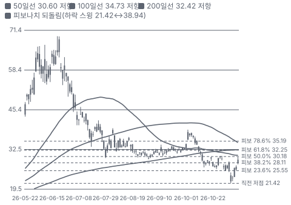

**주봉**

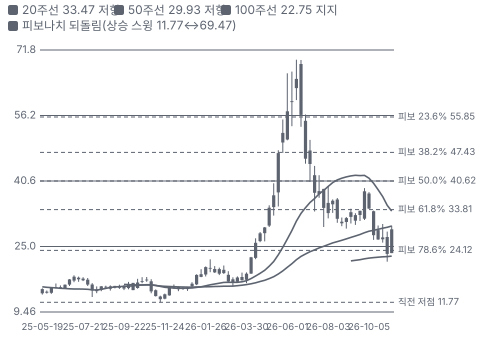

**월봉**

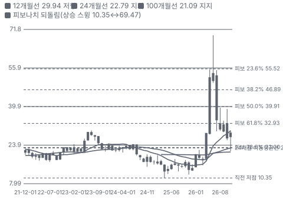

**분기 매출·EPS 실적과 컨센서스**

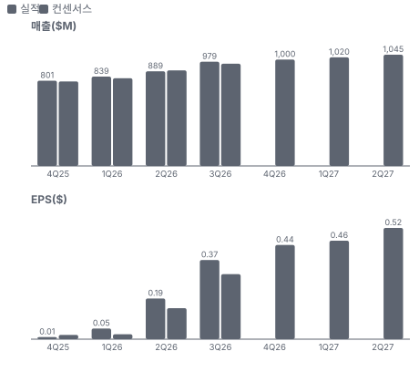

**4Q26 매출 — 지표 추세 vs 가이던스·컨센서스**

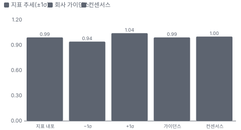

**최근 4개 분기 주가 변화 분석**

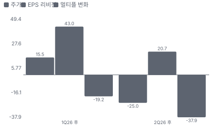

**EPS 리비전**

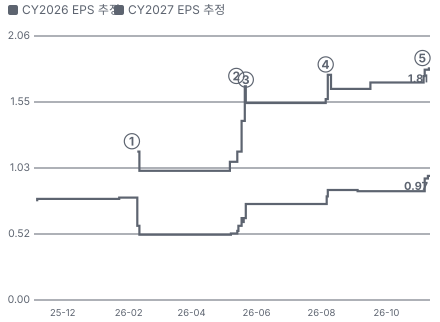

① 26-02-04 4Q25 실적·흑자 근처 · EPS 리비전 -
② 26-05-13 1Q26 실적, 당일 +14.5% · EPS 리비전 +42%
③ 26-05-22 AI 전력·부품 부족 이야기 · 실적 창과 겹침
④ 26-08-05 2Q26 실적, 당일 −14.6% · EPS 리비전 +7%
⑤ 26-11-04 3Q26 사상 최대 매출, 이틀 −19% · EPS 리비전 +7%

**밸류에이션 주가 시나리오**

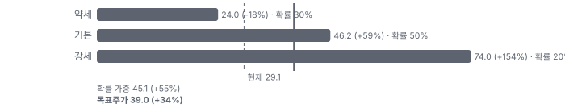

**주가별 업사이드**

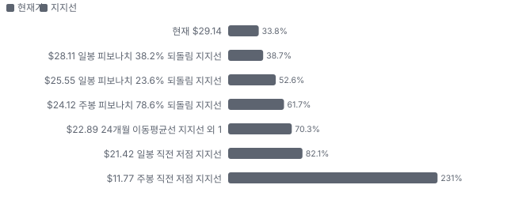
- 제품·서비스 포트폴리오

**고객 믹스(3Q26, 매출 대비)**

**공급 병목(10점, 낮을수록 병목)**

**CAPEX의 매출 대비 비중**

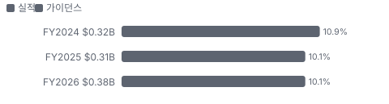

**어닝콜 변화별 주주가치 영향**

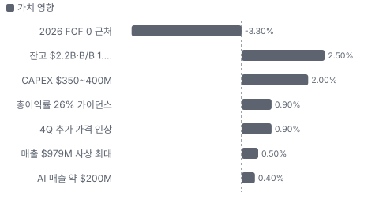

**멀티플 프리미엄(Fwd 1Y P/E, 최근 4개 분기말)**

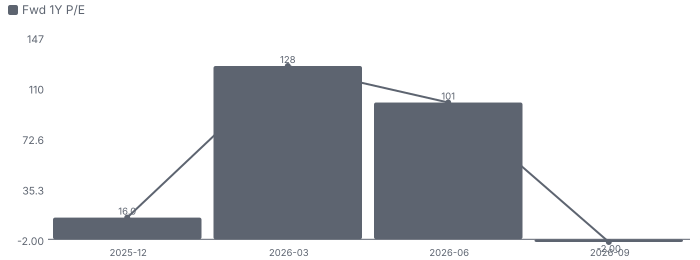

**합리적 멀티플**

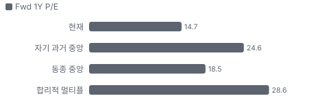

**수주·파이프라인 확실성 사다리**

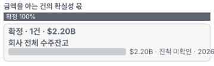

**매출 → 매출총이익 → 영업이익(매출 = 100, 최근 4분기)**

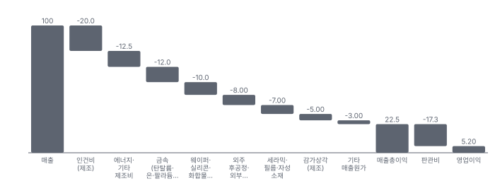

**1년 전 대비 마진 기여(비용 비중 변화의 반대)**

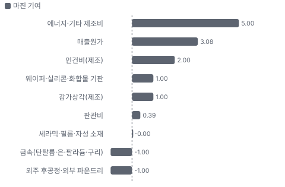

**분기 비용 비중 추이(매출 대비, 공시)**

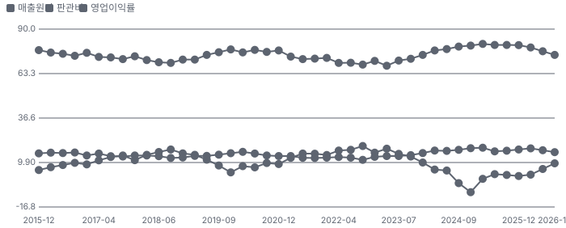

**비용 요인별 매출 대비 비중과 1년 변화**

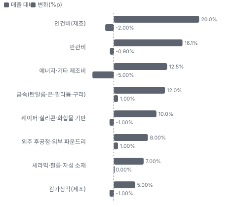

**BOM 항목 가격 +10% 시 OPM 변화**

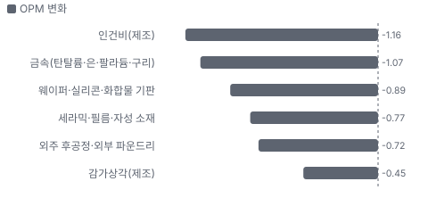

**수동 부품(저항·커패시터·인덕터) BOM 원가 몫과 가격 +10% 시 OPM**

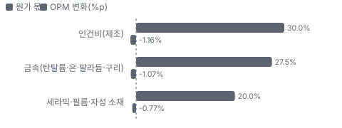

**개별 반도체(MOSFET·다이오드·광전자) BOM 원가 몫과 가격 +10% 시 OPM**

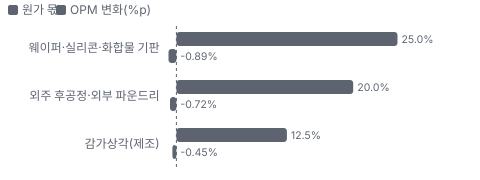

**매출·PPI·수출입 — 최근 16개 분기 같은 축(4Q22 = 100) + 다음 분기 추정**

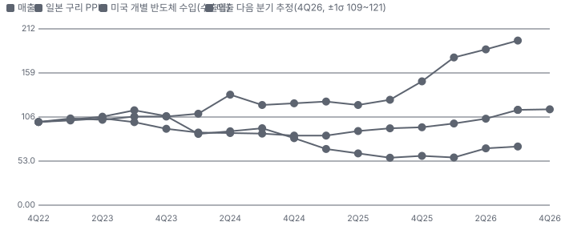

**매출과 미국 개별 반도체 수입 증가율(전년 대비, 최근 16개 분기 + 다음 분기 추정)**

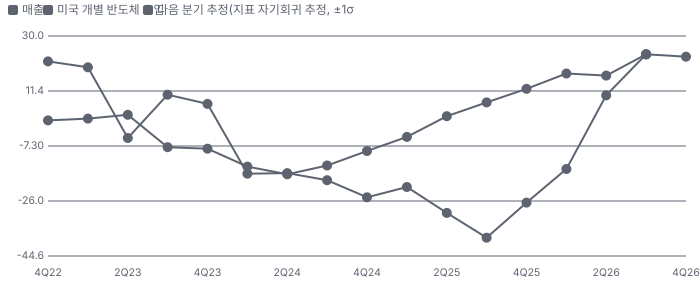

**10년 P·Q 사이클 — 추세(HP 필터) 대비 갭과 8분기 전망**

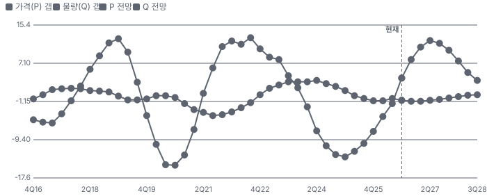

**매출 증가율의 가격·물량 분해와 8분기 전망(전년 대비)**

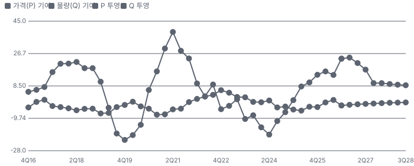

**분기별 매출 증가율 분해**

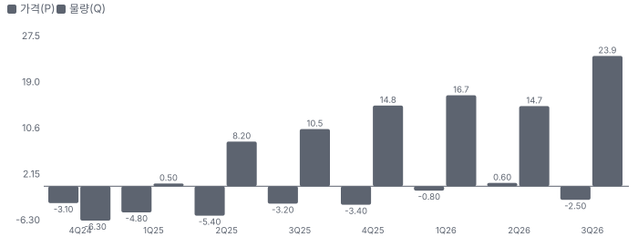

**목표주가 산정 — 약세와 기본 사이(약세 쪽 31%), 도달 확률 약 58%**

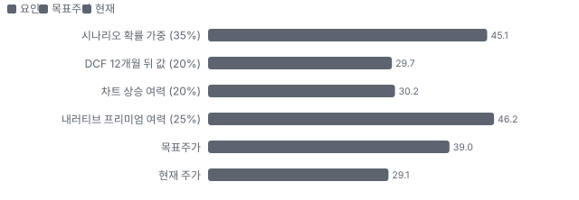

**PEG — 성장 대비 멀티플(낮을수록 성장 대비 쌈)**

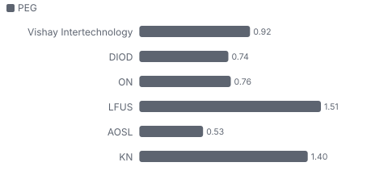

**일봉 지지·저항과 목표주가**

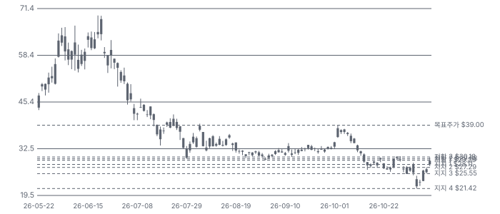

**일별 거래량 분해**

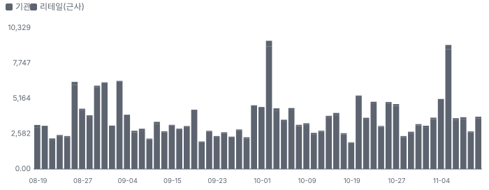

**기관 자금 흐름**

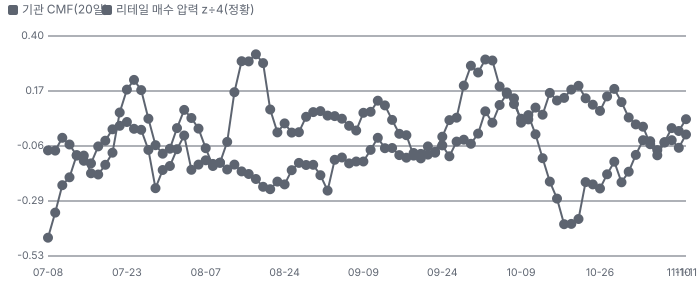

**몬테카를로**

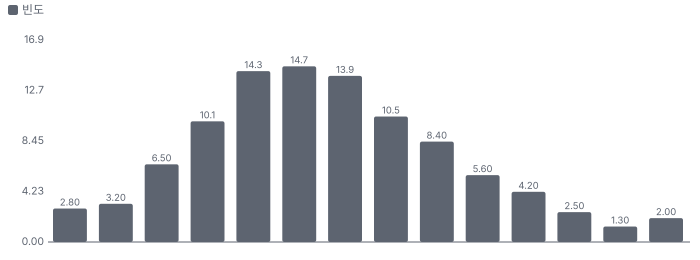

해석: 3,000번 중 738번(25%)에서 가치가 지금 주가 이상이었다. 가정을 흔들어도 지금 주가를 뒷받침하지 못하는 경우가 더 많다. 가운데 값은 0.85배이고, 열 번 중 여덟 번은 0.62~1.15배 사이에 든다.

## 내러티브

> **기업가치를 결정하는 이야기:** Vishay는 전자제품의 전력 회로에 들어가는 '작고 많은' 부품을 만든다 — MOSFET(전류를 켜고 끄는 전력용 트랜지스터)·다이오드 같은 개별 반도체와 저항·탄탈륨 커패시터·인덕터 같은 수동 부품이다. 부품 하나는 싸지만 AI 서버 전원 한 장, 전기차 인버터 하나에 수백~수천 개가 들어간다. 부품 시장은 2년 주기로 재고가 쌓였다 빠지는 경기순환을 탄다. 회사는 2023~2025 불황에 \$2.6B 투자 계획과 유통 재고 선투자를 밀어붙였고, 2026 상승기에 그 재고와 캐파로 점유율을 받고 있다. 기업가치는 사이클 고점 이익률(과거 영업이익률 약 18~20%)에 다시 닿을지, 그리고 12인치 팹·후공정 내재화로 고점을 높일 수 있을지로 정해진다

> **멀티플·EPS 프리미엄**
> **멀티플:** Fwd 1Y P/E 14.7배로 동종 중앙(약 17배)보다 약 13% 낮다. Fwd 2Y 12.7배·3Y 11.4배로 내려간다 — 시장은 이익 회복을 반만 믿는다(경기순환 할인)
> **EPS:** FY2027 EPS 컨센서스는 2Q 콜 당일 \$1.57에서 \$1.81로 15% 올랐고, FY2026은 \$0.75 → \$0.98(+30%)이다. 이익 추정은 오르는데 주가는 내려 배수가 줄었다

### 투자자들은 왜 열광했나

열광은 4~6월이었다 — 1Q 실적(5/13 +14.5%) 뒤 'AI 전력·부품 부족' 이야기가 붙어 3월 말 \$18에서 6월 \$69.47(장중)까지 4배 가까이 올랐다. 식은 이유는 셋이다 — 6월 이후 과열 해소, 7월 유상증자, 8/5 2Q 실적(−14.6%)과 11/4~5 3Q 실적(이틀 −19%)에서 나온 FCF 0·자동차 보합·선주문 의심이다. 1년 동안 주가는 \$16.98 → \$29.14로 +72%이지만 고점 대비 −58%다

### 무엇이 기업가치를 바꾸나

> **구조적 체질 변화**
> **변화:** Vishay 3.0(고객·제품 확대와 캐파·유통 재고 선투자를 묶은 Vishay 경영 전략) — 고객 수·고객당 채택 품목 확대, 유통 SKU(판매 품목 단위) 확대, 캐파 선투자. CEO는 성장의 대부분이 경기 회복이 아닌 이 변화라고 주장한다(검증 자료 미공시)
> **증거:** 3Q26 어닝콜(2026-11-04, 요지만 자기 말로)
> **반증:** 다음 하강기에 점유율이 2023~2024 수준으로 돌아간다

> **고부가 믹스 확장**
> **변화:** AI 서버 전원·고전압·SiC(실리콘카바이드) 쪽으로 믹스가 이동 — AI 매출 \$100M → \$200M, SiC MOSFET·다이오드(650~1,700V) 출시
> **증거:** 3Q26 어닝콜(2026-11-04, 요지만 자기 말로)
> **반증:** AI·SiC 매출이 총매출의 10%를 넘지 못한다

> **기술 혁신**
> **변화:** 12인치 MOSFET(업계에서 드문 대구경 개별 소자 팹), Newport(Vishay가 인수한 영국 웨일스 웨이퍼 팹) SiC 8인치 전환
> **증거:** 3Q26 어닝콜(2026-11-04, 요지만 자기 말로)
> **반증:** 12인치 수율이 2027 하반기 생산을 못 받친다

> **실행 속도**
> **변화:** 리드타임을 대부분 제품 26주 이하로 줄이는 중 — EMS는 리드타임으로 공급사를 고른다(CEO) **납품 리드타임 16~26주.** 피어 비교 미확인. 이전 대비 미확인.
> **증거:** 3Q26 어닝콜(2026-11-04, 요지만 자기 말로)
> **반증:** 리드타임이 다시 30주 이상으로 늘어난다

> **M&A**
> **변화:** 대상과 여러 차례 미팅, 4Q 추가(3Q 콜) — 발표 없음
> **증거:** 3Q26 어닝콜(2026-11-04, 요지만 자기 말로)
> **반증:** 인수가 비싸고 증자로 이어진다

> **정책·입법 연관성**
> **재정정책:** 독일·영국 팹 정부 보조금 가능성(CFO) — 단계: 발표 전, 계약·지급 미확인 3Q26 어닝콜(2026-11-04, 요지만 자기 말로) 반증: 보조금 없이 순 CAPEX가 그대로 의회 동의 2/10 — 하원 1/5(미국 의회 사안이 아니다(유럽 보조금) — 미국 의회 논의 없음) · 상원 1/5(같은 이유).
> **행정명령:** 미국 관세(전자부품) — 생산 다수가 미국 밖이라 원가 부담·가격 전가 문제 회사 공시 원문 미대조 반증: 관세 비용이 총이익률을 1%p 이상 깎는다 의회 동의 2/10 — 하원 1/5(행정명령 사안 — 의회 동의 논의 확인 못 함) · 상원 1/5(같은 이유).
> **연관입법:** 해당 없음(이 회사 매출과 직접 이어진 계류 법안을 확인하지 못했다) 미확인 반증: -

> **CAPEX 낙수효과**
> **변화:** 하이퍼스케일러 AI 투자·전력망 투자가 서버 전원·HVDC(고압 직류 송전) 부품 수요로 내려온다 — 금지표대로 고객 투자를 Vishay 매출로 바로 옮기지 않는다. 확인된 것은 AI 매출 약 \$200M 목표
> **증거:** 3Q26 어닝콜(2026-11-04, 요지만 자기 말로)
> **반증:** AI 서버 전원 부품 점유율 자료가 낮게 나온다

### 내러티브 근거

> 'AI 서버·전력망·방산이 개별 반도체와 수동 부품을 빨아들이는 부품 슈퍼사이클 — 불황기에 캐파와 유통 재고를 먼저 깐 Vishay가 첫 수요를 받는다'는 이야기. 숫자는 나왔다(3Q 매출 +24%, B/B 1.29, 총이익률 25.5%). 그러나 주가는 6월 고점 \$69.47에서 58% 내려왔다 — 6월의 과열, 7월 유상증자, FCF 0 가이던스가 기대를 깎았다. 동종 대비 멀티플 차이 -21% 중 회사 고유 몫은 -49%다. 단계는 컨센서스, 쏠림은 중간이다.

> **AI 서버·전력 인프라 부품 수요** · 확산
> **논리:** AI 서버 전원·고전압 전력망·HVDC가 MOSFET·인덕터·고분자 탄탈 수요를 키운다
> **숫자:** AI 매출 2025 약 \$100M → 2026 약 \$200M 목표, 산업 +43% YoY
> **반증:** AI 매출이 2027에 \$300M을 넘지 못한다

> **Vishay 3.0 — 캐파·유통 재고 선투자** · 확인
> **논리:** 불황기에 깐 캐파와 유통 재고로 상승기 첫 수요를 점유한다
> **숫자:** 유통 POS 수량 +57% YoY, EMS 주문 사상 최대, SKU 1만7천 개 추가
> **반증:** B/B가 1.0 아래로 내려간다

> **가격 인상과 총이익률 회복** · 확인
> **논리:** 금속 원가를 가격으로 넘기고 물량 레버리지로 총이익률이 사이클 고점(약 30%)으로 간다
> **숫자:** 총이익률 19.5%(3Q25) → 25.5%(3Q26) → 26% 가이던스
> **반증:** 4Q 총이익률이 25% 아래

> **12인치 팹·후공정 내재화** · 태동
> **논리:** 자체 12인치 MOSFET 팹과 후공정 내재화가 외주 마진을 거둬들인다
> **숫자:** 웨이퍼 35% 외부, 12인치 2027 하반기 생산
> **반증:** 12인치 생산 개시가 2028로 밀린다

> **반대 — 이중 주문·재고 확보 선주문** · 잠복
> **논리:** 고객이 2027 공급을 잡으려 주문을 앞당겼다 — 잔고가 최종 소비보다 부풀었을 수 있다
> **숫자:** 주문 가시성 최대 18개월, 회사도 이중 주문 관찰 중
> **반증:** B/B 1.2 이상이 2개 분기 더 유지되고 유통 재고 주수가 늘지 않는다

> **반대 — 자본집약·FCF 0** · 확인
> **논리:** CAPEX와 유동화 축소로 2026 FCF가 0이고 증자·전환사채로 주주가 희석됐다
> **숫자:** 2026 CAPEX \$350~400M, FCF 손익분기, 7월 유상증자
> **반증:** 2027 FCF가 매출의 5% 이상

이미지 없음(아직 생성 전) — 수동 부품(저항·커패시터·인덕터)·개별 반도체(MOSFET·다이오드·광전자)

## 포트폴리오

| 제품·서비스 | 구분 | 무엇 | 쓰는 곳 | 돈 버는 방식 | Mix | Mix 변화(공시(3Q 콜)) |
|---|---|---|---|---|---|---|
| 수동 부품(저항·커패시터·인덕터) | 제품 | 정밀·전력 저항, 탄탈륨·고분자 탄탈·필름·세라믹 커패시터, IHLP(Vishay의 저프로파일 고전류 전력 인덕터 제품군) 전력 인덕터 | AI 서버 전원·전력망·자동차 인버터·방산 전자 | 부품 단가 × 대량 물량(유통·OEM·EMS) | 52% | 미확인 |
| 개별 반도체(MOSFET·다이오드·광전자) | 제품 | 저·중전압 TrenchFET(Vishay Siliconix의 트렌치 구조 저전압 MOSFET 제품군)·고전압 슈퍼 정션(고전압 MOSFET의 내부 구조, 전하 균형) MOSFET, 정류·보호 다이오드, 광커플러·적외선 센서, SiC 소자(출시 중) | 서버 전원·전기차·산업 모터·통신 장비 | 부품 단가 × 물량 | 48% | 미확인 |

## 고객

> **3Q26 최대 고객 AI 칩셋·서버 전원 고객(이름 미공시, AI 고객) 5%, 상위 3곳 5%, 집중도 분산.** 공시·회사 발표로 확인한 몫은 매출의 0%이고, 나머지 고객 몫은 추정이거나 미분해다. 10% 이상 단일 고객은 공시하지 않는다. 매출은 유통(Arrow·Avnet·TTI 등)·OEM·EMS로 나뉘고, 3Q 매출 증가분의 76%가 유통이었다. 시장별로는 산업(+43% YoY)·항공방산(+23%)·자동차(+7%)가 컸다

**고객별 매출 몫(3Q26)**
| 고객 | 몫 | 변화 | 근거 |
|---|---|---|---|
| AI 칩셋·서버 전원 고객(이름 미공시, AI 고객) | 5% | +2%p | 추정 |
| 유통 경로(Arrow·Avnet·TTI 등, 유통) | 미확인 | 미확인 | 회사 발표 |
| EMS 고객(이름 미공시, EMS) | 미확인 | 미확인 | 회사 발표 |
| OEM 고객(이름 미공시, OEM) | 미확인 | 미확인 | 회사 발표 |
| 기타·미분해 | 95% | - | - |

> **AI 칩셋·서버 전원 고객(이름 미공시, AI 고객)** · 추정
> **사는 것:** MOSFET·인덕터·고분자 탄탈
> **추정 근거:** AI 매출 2026 약 \$200M ÷ 연 매출 약 \$3.7B(추정). 2025 약 \$100M ÷ \$3.07B

> **유통 경로(Arrow·Avnet·TTI 등, 유통)** · 회사 발표
> **사는 것:** 전 품목 — SKU 1만7천 개 추가
> **추정 근거:** 3Q 유통 매출 +9% QoQ·+30% YoY, 증가분의 76%

> **EMS 고객(이름 미공시, EMS)** · 회사 발표
> **사는 것:** 산업·항공방산·자동차 프로그램 부품
> **추정 근거:** EMS 주문 사상 최대, +27% YoY

> **OEM 고객(이름 미공시, OEM)** · 회사 발표
> **사는 것:** 자동차·산업·의료
> **추정 근거:** +14% YoY

## 수주·파이프라인

> **2026-11-12 기준 1건.** 확정 \$2.20B. 공시 수주잔고(회사 발표) \$2.20B.

**실행 속도와 방해 요인**
| 항목 | 상태 | 실행 속도 | 방해 요인 |
|---|---|---|---|
| 회사 전체 수주잔고 | 확정 | 미확인 | 이중 주문·선주문 취소 가능성 · 후공정·파운드리 캐파 |

## 마진 구조

> **GPM 25.5%, OPM 9.4%.** 3Q25 대비 GPM +6.0%p, OPM +7.0%p. 변동비는 매출의 54%이고, 매출이 10% 늘면 OPM은 +3.3%p 움직인다. 총이익률이 1년 새 19.5% → 25.5%로 올랐다. 원인은 물량(+20% YoY)과 가격(+4% YoY)이다. 감가상각이 분기 약 \$54M으로 무겁고, 범용품을 외부 구매로 돌리며 일부 자산을 가속 상각했다

> **매출 100 중 매출원가 77.5, 매출총이익 22.5(최근 4분기, 공시).** 매출원가 요인 중 인건비(제조)이 매출의 20.0%로 가장 무겁고, 단가가 +10% 오르면 GPM이 -2.00%p 움직인다. 분기 회귀로 매출 1이 늘 때 매출원가는 0.65 늘고, 매출원가의 고정비 몫은 12%다.

**비용 요인 강도 — 비중·추세·충격(+10%)·탄력**
| 비용 | 구분 | 매출 대비 | 1년 변화 | 마진 기여 | 충격 시 마진 | 매출 탄력 | 고정비 몫 |
|---|---|---|---|---|---|---|---|
| 인건비(제조) | 매출원가 요인 | 20.0% | -2.0%p | +2.0%p | -2.00%p | 미확인 | 60% |
| 에너지·기타 제조비 | 매출원가 요인 | 12.5% | -5.0%p | +5.0%p | -1.25%p | 미확인 | 40% |
| 금속(탄탈륨·은·팔라듐·구리) | 매출원가 요인 | 12.0% | +1.0%p | -1.0%p | -1.20%p | 미확인 | 0% |
| 웨이퍼·실리콘·화합물 기판 | 매출원가 요인 | 10.0% | -1.0%p | +1.0%p | -1.00%p | 미확인 | 30% |
| 외주 후공정·외부 파운드리 | 매출원가 요인 | 8.0% | +1.0%p | -1.0%p | -0.80%p | 미확인 | 0% |
| 세라믹·필름·자성 소재 | 매출원가 요인 | 7.0% | +0.0%p | -0.0%p | -0.70%p | 미확인 | 0% |
| 감가상각(제조) | 매출원가 요인 | 5.0% | -1.0%p | +1.0%p | -0.50%p | 미확인 | 100% |
| 매출원가 | 공시 항목 | 77.5% | -3.1%p | +3.1%p | -7.75%p | 0.65 | 12% |
| 판관비 | 공시 항목 | 17.3% | -0.4%p | +0.4%p | 미확인 | 0.13 | 15% |

매출 탄력 = 분기 비용을 매출에 회귀한 기울기(매출 1당 변동비), 고정비 몫 = 절편 ÷ 평균 비용. 표본이 8분기 미만이면 미확인. 매출원가 요인 비중은 margin 재료의 추정이 섞여 있고, 공시 매출원가와의 차이는 '기타 매출원가'로 둔다.

**GPM에서 OPM까지(GAAP)**
| 기간 | GPM | 연구개발 | 판관비 | 기타 | OPM |
|---|---|---|---|---|---|
| 3Q25 | 19.5% | 0.0% | 17.0% | 0.0% | 2.4% |
| 3Q26 | 25.5% | 0.0% | 16.1% | 0.0% | 9.4% |

**GPM·OPM 최근 4개 분기**
| 분기 | GPM | OPM |
|---|---|---|
| 2025-12 | 19.6% | 1.8% |
| 2026-04 | 21.0% | 2.6% |
| 2026-07 | 23.3% | 6.0% |
| 2026-10 | 25.5% | 9.4% |

**마진을 결정하는 비용 요인 — 비용 +10% 시 OPM**
| 비용 | 매출 대비 | 변화 | 고정비 | OPM |
|---|---|---|---|---|
| 인건비(제조) | 20.0% | -2.0%p | 60% | -2.00%p |
| 판관비 | 16.1% | -0.9%p | 70% | -1.61%p |
| 에너지·기타 제조비 | 12.5% | -5.0%p | 40% | -1.25%p |
| 금속(탄탈륨·은·팔라듐·구리) | 12.0% | +1.0%p | 0% | -1.20%p |
| 웨이퍼·실리콘·화합물 기판 | 10.0% | -1.0%p | 30% | -1.00%p |
| 외주 후공정·외부 파운드리 | 8.0% | +1.0%p | 0% | -0.80%p |
| 세라믹·필름·자성 소재 | 7.0% | +0.0%p | 0% | -0.70%p |
| 감가상각(제조) | 5.0% | -1.0%p | 100% | -0.50%p |

**비용을 움직이는 요인**
| 비용 | 요인 |
|---|---|
| 인건비(제조, 매출원가) | 멕시코·아시아·이스라엘·독일 공장 인력, 물량 증가에 고정비 레버리지 · 근거 추정 |
| 판관비(판관비) | 4Q 가이던스 \$157M ±\$3M · 근거 공시 |
| 에너지·기타 제조비(매출원가) | 기타(분해 불가 몫) · 근거 추정 |
| 금속(탄탈륨·은·팔라듐·구리, 매출원가) | 금속 시세 — 회사·경쟁사 모두 가격 인상으로 전가(3Q 콜) · 근거 추정 |
| 웨이퍼·실리콘·화합물 기판(매출원가) | 자체 팹 가동률·외부 파운드리 단가 · 근거 추정 |
| 외주 후공정·외부 파운드리(매출원가) | 웨이퍼 35% 외부 파운드리 + 후공정 외주 마진 · 근거 추정 |
| 세라믹·필름·자성 소재(매출원가) | 소재 단가 · 근거 추정 |
| 감가상각(제조, 매출원가) | 분기 D&A 약 \$54M 중 제조분(추정) — 일부 가속 상각 · 근거 추정 |

**수동 부품(저항·커패시터·인덕터) BOM — 매출의 52%, GPM 26%(전사 3Q26 총이익률 대용(제품군별 총이익률은 10-Q 세그먼트 주석 미대조)), 항목 가격 +10% 시**
| 항목 | 원가 몫 | 전가 | 제품 GPM | OPM |
|---|---|---|---|---|
| 인건비(제조) | 25~35% | 미확인 | -2.2%p | -1.16%p |
| 금속(탄탈륨·은·팔라듐·구리) | 20~35% | 미확인 | -2.0%p | -1.07%p |
| 세라믹·필름·자성 소재 | 15~25% | 미확인 | -1.5%p | -0.77%p |
| 미분해 | 22% | - | - | - |

**개별 반도체(MOSFET·다이오드·광전자) BOM — 매출의 48%, GPM 26%(전사 3Q26 총이익률 대용(제품군별 총이익률은 10-Q 세그먼트 주석 미대조)), 항목 가격 +10% 시**
| 항목 | 원가 몫 | 전가 | 제품 GPM | OPM |
|---|---|---|---|---|
| 웨이퍼·실리콘·화합물 기판 | 20~30% | 미확인 | -1.9%p | -0.89%p |
| 외주 후공정·외부 파운드리 | 15~25% | 미확인 | -1.5%p | -0.72%p |
| 감가상각(제조) | 10~15% | 미확인 | -0.9%p | -0.45%p |
| 미분해 | 43% | - | - | - |

인건비(제조) 가격이 +10% 오르면 영업이익은 -12.4% 움직인다. 판매가 전가를 모르는 항목은 전가 0%로 계산했다.

**BOM 항목 가격을 움직이는 것**
| 항목 | 요인 |
|---|---|
| 금속(탄탈륨·은·팔라듐·구리) | 탄탈륨 커패시터·후막 저항 전극의 핵심 원가 (전가: 부분(분기마다 가격 인상으로 전가, 3Q 콜)) · 근거 추정 |
| 세라믹·필름·자성 소재 | 커패시터 유전체·인덕터 코어 · 근거 추정 |
| 인건비(제조) | 권선·조립 공정 노동 집약 · 근거 추정 |
| 웨이퍼·실리콘·화합물 기판 | 자체 팹(Itzehoe(Vishay의 독일 반도체 팹 소재지)·Newport) + 외부 파운드리 35% · 근거 추정 |
| 외주 후공정·외부 파운드리 | 후공정 외주 마진 — 내재화가 마진 과제(3Q 콜) · 근거 추정 |
| 감가상각(제조) | 팹 장비 상각 (전가: 해당 없음) · 근거 추정 |

## 공급망 병목

이미지 없음(아직 생성 전) — 수동 부품(저항·커패시터·인덕터)·개별 반도체(MOSFET·다이오드·광전자)

> **공급망 신뢰성 5.3/10, 병목 주의.** 가장 약한 고리는 외주 후공정·외부 파운드리 5.3점이고, 품목 평균은 5.3점이다. 근거가 부족한 3건(금속(탄탈륨·은·팔라듐·구리) · 고분자 탄탈륨 커패시터(전도성 고분자 전극을 쓴 저저항 탄탈륨 커패시터) 장비 · 12인치 MOSFET 팹 장비(Itzehoe))은 점수에서 뺐다. 수요보다 공급이 빠듯하다 — 유통 재고는 출하 즉시 팔리고(아시아 12주), 회사는 리드타임을 26주 이하로 줄이려 한다. 병목은 후공정 외주와 외부 파운드리(웨이퍼 35%), 그리고 고분자 탄탈륨 장비(2027 내내 도착)다

**병목과 마진 — 품목 가격 +10% 시 OPM**
| 품목 | 점수 | 판정 | 구분 | OPM |
|---|---|---|---|---|
| 외주 후공정·외부 파운드리(필수) | 5.3 | 병목 주의 | 핵심 통제 품목 | -0.72%p |

> **외주 후공정·외부 파운드리** · 5.3/10
> **왜:** 웨이퍼 35% 외부, 후공정 외주 마진이 총이익률을 깎는다
> **병목 요인:** 인증 공급사 미확인 · 캐파 빠듯 · 리드타임 미확인 · 재인증 6개월 · 1위 점유율 미확인 · 아시아(추정) 집중 80% · 물량 확보 복수구매
> **풀리는 조건:** 미확인(후공정 내재화 발표 대기)

**공급사**
| 품목 | 공급사 | 몫 | 근거 |
|---|---|---|---|
| 외주 후공정·외부 파운드리 | 한국 외부 파운드리(이름 미공시)(MOSFET 웨이퍼(AI 고객용)) | 미확인 | 회사 발표 |
| 외주 후공정·외부 파운드리 | 후공정 외주처(이름 미공시, 패키징·테스트) | 미확인 | 회사 발표 |
| 금속(탄탈륨·은·팔라듐·구리) | 원료 공급사(이름 미공시, 탄탈륨 분말·귀금속) | 미확인 | 추정 |
| 고분자 탄탈륨 커패시터 장비 | 장비 공급사(이름 미공시, 생산 장비) | 미확인 | 회사 발표 |
| 12인치 MOSFET 팹 장비(Itzehoe) | 반도체 장비 공급사(이름 미공시, 12인치 전공정 장비) | 미확인 | 회사 발표 |

**무역 통계로 본 공급 지역**
| 품목 | EU 수입처 | 일본 수입처 | EU 1위 전년비 |
|---|---|---|---|
| 외주 후공정·외부 파운드리 | CN(중국) 33% · MY(말레이시아) 28% · JP 22% | マレーシア 25% · 中華人民共和国 19% | +0.6% |
| 금속(탄탈륨·은·팔라듐·구리) | MY 69% · KR(한국) 10% · US 7% | マレーシア 58% · タイ 36% | 미확인 |
| 고분자 탄탈륨 커패시터 장비 | JP 46% · CN 24% · KR 13% | 中華人民共和国 48% · 大韓民国 21% | -2.1% |

## 생산능력

> **현재 명목 캐파 미확인, 가동률 미확인.** 착공 이상 증설은 0 미공시(제품군별 수량 단위 다양), 발표까지 합치면 0 미공시(제품군별 수량 단위 다양)이다. FY2025 CAPEX는 \$0.31B로 매출의 10.1%다. 생산은 유럽(독일·영국·체코), 이스라엘, 미주(미국·멕시코), 아시아(대만·중국·필리핀 등)에 걸친다. 증설의 핵심은 독일 12인치 MOSFET 팹(2027 하반기 생산), 영국 Newport 웨이퍼 분기 +10%, 일본 고분자 탄탈, 멕시코 라구나 수동 부품이다. 캐파 수치는 공시하지 않는다

**생산시설 11곳**(이름이 확인된 주요 시설만 센다(3Q 콜·회사 소개). 10-K Item 2 전체 목록(수십 곳)은 이번 회차 미대조), 미확인 8곳 · 소유 3곳. 시설별 생산능력은 공개되지 않았다 — 회사 전체 캐파만 위에 적었다.

**생산시설 11곳 — 명칭·위치·생산능력**
| 시설 | 위치 | 용도 | 생산능력 | 소유·상태 |
|---|---|---|---|---|
| Malvern 본사 | 미국 펜실베이니아 맬번 | 본사 | 미확인 — 본사 | 미확인 · 가동 |
| Itzehoe 8인치 팹 | 독일 이체호 | MOSFET 웨이퍼 | 미확인 — 미공시 | 소유 · 가동 |
| Itzehoe 12인치 팹 | 독일 이체호 | MOSFET 웨이퍼(12인치) | 미확인 — 2027 생산 개시 예정 | 소유 · 건설 중 |
| Newport 웨이퍼 팹 | 영국 웨일스 뉴포트 | 실리콘·SiC 웨이퍼 | 미확인 — 분기 +10% 증산 중 — 3Q 콜 | 소유 · 가동 |
| Selb 공장 | 독일 젤프 | 저항·수동 부품(추정) | 미확인 — 미공시 | 미확인 · 가동 |
| Heilbronn 공장 | 독일 하일브론 | 광전자·다이오드(추정) | 미확인 — 미공시 | 미확인 · 가동 |
| La Laguna 공장 | 멕시코 라구나(토레온 권역) | 수동 부품 | 미확인 — 증설 중 — 3Q 콜 | 미확인 · 증설 중 |
| Juárez 공장 | 멕시코 시우다드후아레스 | 수동 부품 | 미확인 — 자동차 인증 진행(3Q 콜) | 미확인 · 가동 |
| 일본 고분자 탄탈륨 공장 | 일본(지명 미확인) | 고분자 탄탈륨 커패시터 | 미확인 — 증설 중 — 3Q 콜 | 미확인 · 증설 중 |
| Kaohsiung 공장 | 대만 가오슝 | 개별 반도체 후공정(추정) | 미확인 — 미공시 | 미확인 · 가동 |
| 이스라엘 공장들 | 이스라엘(디모나 등) | 수동 부품(추정) | 미확인 — 미공시 | 미확인 · 가동 |

**생산능력 확충 계획**
| 계획 | 단계 | 증설 | 가동 시점 | CAPEX |
|---|---|---|---|---|
| Itzehoe 12인치 MOSFET 팹 | 장비 반입 | 미확인 | 2027-09 | 미확인 |
| 일본 고분자 탄탈륨 증설 | 장비 반입 | 미확인 | 2027-12 | 미확인 |

남은 계획의 CAPEX 합계는 \$0.00B(금액 미확인 2건 제외)다. 합계는 FY2026 매출의 0%다.

**증설 방해 요인**
| 계획 | 방해 요인 |
|---|---|
| Itzehoe 12인치 MOSFET 팹 | 장비 연결·인증·후공정 캐파 |
| 일본 고분자 탄탈륨 증설 | 장비 도착(2027 내내) |

**CAPEX와 매출 대비**
| 기간 | CAPEX | 매출 | 매출 대비 | 구분 |
|---|---|---|---|---|
| FY2024 | \$0.32B | \$2.94B | 10.9% | 실적 |
| FY2025 | \$0.31B | \$3.07B | 10.1% | 실적 |
| FY2026 | \$0.38B | \$3.71B | 10.1% | 가이던스 |

## 해자

> 해자는 '한 고객의 전력 회로에 들어가는 개별 반도체와 수동 부품을 한 회사가 거의 다 공급한다'는 폭이다. 품목 하나하나는 경쟁이 치열하지만, 저항·탄탈륨·인덕터·MOSFET를 함께 인증받은 공급사를 바꾸는 비용은 크다. 숫자로 확인되는 것은 유통 재고 선투자와 리드타임이다

> **제품 폭(한 공급사로 전력 회로 BOM 대부분)** · 보통
> **해자:** MOSFET·다이오드·저항·인덕터·커패시터·광전자를 모두 만든다 — 고객 BOM에 여러 품목을 동시에 넣는다(Vishay 3.0)
> **근거:** 3Q 콜: 매출 52%가 수동 부품, 고전압 설계에 전 기술 동시 요청
> **숫자:** 고객당 채택 품목 수는 미공시(미확인)
> **깨지는 조건:** 경쟁사가 품목별 저가로 BOM을 쪼개 가져간다

> **인증·전환 비용(자동차·방산·의료)** · 강함
> **해자:** 자동차 AEC(자동차 전자부품 신뢰성 규격 기구) 등급·방산 인증 부품은 재인증에 수개월~수년이 걸린다
> **근거:** Newport 자동차 고객 인증 3건 A 등급(3Q 콜)
> **숫자:** 재인증 기간 미공시(업계 통상 6~24개월, 추정)
> **깨지는 조건:** 고객이 인증 없이 저가 아시아 공급사로 전환한다

> **유통 재고·리드타임 선투자** · 보통
> **해자:** 2023~2025 불황기에 유통 재고와 캐파를 먼저 깔아 이번 상승기의 첫 수요를 받았다
> **근거:** 3Q 콜: 유통 POS 수량 +57% YoY, SKU 1만7천 개 추가, 리드타임 26주 이하 목표
> **숫자:** 유통 재고 18주(아시아 12·유럽 15·미주 35)
> **깨지는 조건:** 경쟁사 리드타임이 더 짧아지고 EMS 주문 점유율이 꺾인다

> **저항·탄탈륨 등 틈새 품목의 상위 점유** · 미확인
> **해자:** 정밀 저항·탄탈륨에서 상위 공급사라고 알려져 있다
> **근거:** 회사 소개·업계 통념 — 점유율 1차 자료 미대조
> **숫자:** 미확인
> **깨지는 조건:** 점유율 자료가 하위권을 보인다

## 경영진·네트워크

> CEO Joel Smejkal(2023 취임, 영업 출신)이 'Vishay 3.0' — 고객 확대·유통 선투자·캐파 선행 투자 — 를 이끈다. 창업 가문(Zandman)이 Class B 주식으로 의결권을 쥐는 구조다(비율 미대조)

> **Joel Smejkal** · 사장·CEO · 2023
> **프로필:** 영업·마케팅 총괄 출신, Vishay 3.0 전략(유통 재고·캐파 선투자)
> **비즈니스:** 전사
> **정계:** 미확인
> **동문:** 미확인
> **사모임:** 미확인

> **Dave McConnell** · CFO · 미확인
> **프로필:** 3Q 콜 재무 답변(CAPEX·FCF·유동화)
> **비즈니스:** 재무
> **정계:** 미확인
> **동문:** 미확인
> **사모임:** 미확인

> **Marc Zandman** · 이사회 의장 · 미확인
> **프로필:** 창업자 Felix Zandman의 아들 — Class B 주식 보유(의결권 구조, 비율 미대조)
> **비즈니스:** 지배구조
> **정계:** 미확인
> **동문:** 미확인
> **사모임:** 미확인

**네트워크 정량화**
| 연결 | 강도 | 닿는 매출 | 가중 노출 | 매출 대비 | 근거 |
|---|---|---|---|---|---|
| 비즈니스: 유통 3사(Arrow·Avnet·TTI 등) 경로가 매출의 큰 몫 — 3Q 매출 증가분의 76%가 유통 | 3/5 | 미확인 | 미확인 | 미확인 | 유통 비중 수치 미공시(3Q 콜은 증가분 기여만) 3Q26 어닝콜(2026-11-04, 요지만 자기 말로) |
| 정계: 독일·영국 팹 보조금(EU(유럽연합) 반도체·영국) 가능성 언급 — CFO '두 프로젝트 모두 정부 보조금 가능성 높다' | 2/5 | 미확인 | 미확인 | 미확인 | 보조금 계약·금액 미확인(발표 → 계약 → 지급 단계 미분리) 3Q26 어닝콜(2026-11-04, 요지만 자기 말로) |

가중 노출은 연결이 닿는 매출의 크기다. 연결이 그 매출을 만들었다는 뜻이 아니며, 인과는 공개 자료로 입증하지 못한다.

## 약세 논리 및 셀온 조건

| 약세 논리 | 근거 | 반박 | 가를 자료 · 공개 시점 |
|---|---|---|---|
| 주문이 선주문으로 부풀었다 | 가시성 최대 18개월, 고객이 2027 공급 확보용 주문(3Q 콜), 회사도 이중 주문 관찰 | 유통 POS 수량 +57% YoY, 유통 재고 18주로 늘지 않았다 — 출하 즉시 팔린다(CEO) | 4Q26 B/B·유통 재고 주수 — 2027-02 실적 |
| FCF가 0이다 | 2026 CAPEX \$350~400M, 매출채권 유동화(매출채권을 금융사에 넘겨 현금을 먼저 받는 거래) 4Q 대폭 축소, 연간 FCF 손익분기 안내 | 3Q 단독 FCF \$98M, 영업현금흐름 \$146M — 연간 0은 유동화 상환이라는 일회성이 크다 | 2027 CAPEX·FCF 계획 — 2027-02 실적 |
| 사이클 정점 근처에서 희석했다 | 7월 유상증자, 2030년 만기 전환사채(전환 주식 약 27M주 추정, 미대조) | 증자 대금 약 \$300M으로 회전신용을 갚아 순현금이 약 \$0.41B다 | 10-K 희석 증권 주석 — 2027-02 |
| 가격 인상은 원가 전가일 뿐이다 | 구리 PPI(생산자물가지수) 전년비 +30%(9월), 금속 원가 압력 지속(3Q 콜) | 총이익률이 1년 새 +6%p — 물량 레버리지와 가격이 원가보다 빨랐다 | 4Q 총이익률 26% 달성 여부 — 2027-02 |
| 자동차가 먼저 꺾인다 | 4Q 자동차 보합 전망, 차량 생산 대수 보합 | EV 인버터·ADAS(첨단 운전자 보조 시스템) 탑재량은 늘고 산업·방산·AI가 더 크게 자란다(산업 +43%, 항공방산 +23%) | 4Q 시장별 매출 — 2027-02 |
| 12인치 팹이 늦어진다 | 장비 설치 지연으로 CAPEX 일부 2027 이연 | 장비 약 90% 준비, 2027 초 엔지니어링 웨이퍼 계획 유지 | 12인치 엔지니어링 웨이퍼 시작 — 2027-1H |

**데이터 한계.** 10-K·10-Q 원문(세그먼트별 총이익률, 희석 증권, 리스, 시설 목록 전체)을 이번 회차에 직접 대조하지 못했다 — 전환사채 전환 주식 수와 리스는 추정·미포함으로 두었다. 고객 집중도는 공시하지 않는다. 수주잔고에서 선주문 비중은 회사도 수치로 내지 않는다. **정책·거시.** 독일·영국 팹 보조금은 CFO의 '가능성이 높다'는 발언뿐이고 계약·지급 단계는 미확인이다. 구리 PPI는 미국 +30%, 일본 +54% YoY(9월)로 원가 압력이 크다. **추가 원천(11/12).** 노션 자료실에는 Vishay 직접 자료가 없었고 대만 동박적층판·JPM 반도체 업종 리포트 요지를 업종 비교로만 썼다. 커뮤니티 대화량은 최근 7일 없음이다. 공매도는 유통 주식의 12.9%(4.0일분)다.

> **셀온 조건**
> **조건 1:** 4Q26 B/B가 1.0 아래 — 선주문 해소가 시작됐다는 신호
> **조건 2:** 4Q26 총이익률이 25% 아래 — 가격 인상이 원가를 따라가지 못한다
> **조건 3:** 유통 재고가 20주 이상으로 늘어난다 — 출하가 소비를 앞선다
> **조건 4:** 추가 유상증자 또는 새 전환사채 발행
> **조건 5:** 12인치 팹 엔지니어링 웨이퍼 시작이 2027 하반기 이후로 밀린다

## 어닝콜 변화

**직전 콜 대비 새로 나오거나 바뀐 내용 → 가치 영향**
| 항목 | 내용 | 직전 콜 | 최신 콜 | 모델 동인 이동 | 확신도 | 가치 영향 |
|---|---|---|---|---|---|---|
| 업데이트 | 분기 매출 | 2Q \$888.6M·3Q 가이던스 \$945~975M | 3Q \$978.9M(+10.2% QoQ, +23.8% YoY) — 가이던스 상단 초과 | 기준연도 매출 +\$0.02B | 1.0 | +0.5% |
| 업데이트 | 총이익률 | 2Q 조정 23.3%, 연말 목표 24% | 3Q 25.5%, 4Q 가이던스 26.0% ±0.5%p | 출발 이익률 +1.5% | 0.8 | +0.9% |
| 신규 | 수주잔고 | 2Q 콜 잔고 수치 미확인 | 잔고 \$2.2B(6.6개월), B/B 1.29, 주문 +15% QoQ, EMS 주문 사상 최대 | 1년차 성장률 +3.0% | 0.8 | +2.5% |
| 업데이트 | 가격 | 1Q부터 분기마다 인상 | 3Q ASP +2% QoQ·+4% YoY, 4Q 추가 인상 예정 | 목표 이익률 +0.50% | 0.8 | +0.9% |
| 부정 | FCF | 2Q FCF \$10M | 3Q FCF \$98M이지만 연간 FCF 손익분기 — 매출채권 유동화 축소·CAPEX | 매출÷투하자본 -10.0% | 0.8 | -3.3% |
| 업데이트 | CAPEX | 2026 계획 \$400~440M | \$350~400M(12인치 팹 장비 설치 지연으로 일부 2027 이연) | 매출÷투하자본 +5.0% | 0.8 | +2.0% |
| 신규 | AI 매출 | 2025 약 \$100M | 2026 약 \$200M 목표(BofA 질문에 답변) | 장기 성장 수렴값 +0.50% | 0.5 | +0.4% |
| **합계** | 단독 합 |  |  | 동시 적용 +3.5% |  | **+3.7%** |

**사건별 EPS 리비전**
| # | 날짜 | 구분 | 사건 | CY2026 EPS 전→후 | CY2027 EPS 전→후 | 리비전 | 주가 반응 |
|---|---|---|---|---|---|---|---|
| ① | 26-02-04 | 실적 | 4Q25 실적·흑자 근처 | \$0.80 → \$0.51 | - → \$1.01 | - | -4.2% |
| ② | 26-05-13 | 실적 | 1Q26 실적, 당일 +14.5% | \$0.52 → \$0.75 | \$1.08 → \$1.54 | +42.2% | +14.5% |
| ③ | 26-05-22 | 내러티브 | AI 전력·부품 부족 이야기 | \$0.64 → \$0.75 | \$1.67 → \$1.54 | 실적 창과 겹침 | +12.0% |
| ④ | 26-08-05 | 실적 | 2Q26 실적, 당일 −14.6% | \$0.75 → \$0.86 | \$1.54 → \$1.65 | +7.0% | -14.6% |
| ⑤ | 26-11-04 | 실적 | 3Q26 사상 최대 매출, 이틀 −19% | \$0.85 → \$0.97 | \$1.70 → \$1.81 | +7.0% | -5.1% |

**해석:** 2개 구간 누적 주가 -13% = EPS 리비전 +73% × 멀티플 -50%. 더 크게 움직인 쪽은 **EPS 리비전**이다.

## 거시 지표 싱크로율

> **미국 개별 반도체 수입과 전사 매출 싱크로율 69%(0분기 = 약 0개월 선행, 전년 대비, 표본 35개·t 5.5·유의·신뢰 보통).** 이 지표가 내포하는 4Q26 전사 매출은 985M(±1σ 936M~1.04B, 지표 자기회귀 추정)다. 표본 밖 검증(최근 6개 분기)에서 지표 모델 오차는 19.9%p, 기준선(직전 증가율 지속)은 4.9%p다 — **지표가 기준선을 이기지 못해(예측력 없음) 추정은 대부분 기준선이다(지표 가중 6%).** 기준선은 인수·환율 효과의 소멸을 모르므로 회사 가이던스와 차이가 크면 가이던스 쪽 설명을 먼저 본다. 가이던스는 이보다 +0.5%(범위 안), 컨센서스는 +1.5%(범위 안)다. 회사 제품은 개별 반도체와 수동 부품이다 — 해당 품목 무역(HS(국제 품목 분류 코드) 854129·853224)과 미국 PPI(반도체·커패시터·저항 제조업)

**지표별 싱크로율(상관계수 × 100) — 위 두 줄이 제품 연관성 × 싱크로율로 고른 PPI·수출입 세부 지표**
| 지표 | 비교 대상 | 증가율 기준 | 지표 선행 | 매출(t값) | 영업이익 | 방향 일치 | 표본·신뢰 | 표본 밖 오차(지표/기준선) | 4Q26 추정 매출 |
|---|---|---|---|---|---|---|---|---|---|
| 일본 구리 PPI | 전사 매출 | 전년 대비 | 0분기(0개월) | 73%(t 4.9) | 34%(0분기) | 61% | 23·보통 | 6.6/4.9%p ✘ | +21.7% → 975M(나우캐스트 1개월) |
| 미국 개별 반도체 수입 | 전사 매출 | 전년 대비 | 0분기(0개월) | 69%(t 5.5) | -25%(4분기) | 80% | 35·보통 | 19.9/4.9%p ✘ | +23.0% → 985M(지표 자기회귀 추정) |
| 미국 반도체 PPI | 전사 매출 | 전년 대비 | 3분기(9개월) | -29%(t -1.8) | -20%(3분기) | 28% | 40·보통 | 8.1/4.9%p ✘ | +19.0% → 953M(확정) |

**지표 후보 26개 — 연관성(제품 품목 일치 × 대용 감점 × 매출 비중) × 싱크로율로 고른다. 후보가 많을수록 최대 상관은 우연히 부풀 수 있다**
| 후보 | 종류 | 연관성 | 매출 분기 일치 | 싱크로율(선행) | 점수 | 출처 |
|---|---|---|---|---|---|---|
| 미국 개별 반도체 수입 ✔ | 수출입 | 1.00 | 100% | 69%(0분기) | 0.69 | 모델 지정 |
| 미국 수동 부품(커패시터·저항·인덕터) 수출(HS 853224) | 수출입 | 0.52 | 100% | 78%(0분기) | 0.41 | 자동 |
| 일본 구리 PPI ✔ | PPI | 0.52 | 100% | 73%(0분기) | 0.38 | 자동 |
| 미국 개별 반도체(MOSFET·트랜지스터·다이오드) 수출(HS 854129) | 수출입 | 0.48 | 100% | 79%(0분기) | 0.38 | 자동 |
| 한국 구리 PPI | PPI | 0.52 | 100% | 71%(0분기) | 0.37 | 자동 |
| 미국 구리 PPI | PPI | 0.52 | 100% | 69%(0분기) | 0.36 | 자동 |
| 영국 구리 PPI | PPI | 0.52 | 100% | 67%(0분기) | 0.35 | 자동 |
| EU 수동 부품(커패시터·저항·인덕터) 수입(HS 853224) | 수출입 | 0.52 | 94% | 61%(0분기) | 0.32 | 자동 |
| EU 개별 반도체(MOSFET·트랜지스터·다이오드) 수입(HS 854129) | 수출입 | 0.48 | 94% | 63%(0분기) | 0.30 | 자동 |
| EU HS 853290 수출(수동 부품(저항·커패시터·인덕터)과 같은 4자리 품목군) | 수출입 | 0.36 | 94% | 75%(0분기) | 0.27 | 자동 |
| 대만 구리 PPI | PPI | 0.52 | 100% | 50%(0분기) | 0.26 | 자동 |
| EU HS 853222 수입(수동 부품(저항·커패시터·인덕터)과 같은 4자리 품목군) | 수출입 | 0.36 | 94% | 64%(0분기) | 0.23 | 자동 |

**선행 지표로 본 향후 분기 매출 전망(이미 나온 지표 값 기준, ±1σ)**
| 지표 | 대상 | 분기 | 지표 증가율 | 내포 매출 증가율 | 내포 매출 |
|---|---|---|---|---|---|
| 미국 반도체 PPI | 전사 매출 | 4Q26 | -0.8% | +3.3% | 828M(712M~943M) |
| 미국 반도체 PPI | 전사 매출 | 1Q27 | +0.6% | +1.5% | 852M(731M~973M) |
| 미국 반도체 PPI | 전사 매출 | 2Q27 | -2.5% | +5.7% | 939M(810M~1.07B) |
| EU 수동 부품(커패시터·저항·인덕터) 수출(HS 853224) | 전사 매출 | 4Q26 | -2.5% | +7.0% | 857M(760M~954M) |
| EU 수동 부품(커패시터·저항·인덕터) 수출(HS 853224) | 전사 매출 | 1Q27 | +9.2% | +2.5% | 860M(758M~961M) |
| EU 수동 부품(커패시터·저항·인덕터) 수출(HS 853224) | 전사 매출 | 2Q27 | +28.9% | -5.2% | 843M(735M~950M) |
| 미국 수동 부품(커패시터·저항·인덕터) 수입(HS 853224) | 전사 매출 | 4Q26 | -85.6% | -2.8% | 778M(653M~903M) |
| EU 개별 반도체(MOSFET·트랜지스터·다이오드) 수출(HS 854129) | 전사 매출 | 4Q26 | +6.8% | +5.5% | 845M(731M~959M) |
| EU 개별 반도체(MOSFET·트랜지스터·다이오드) 수출(HS 854129) | 전사 매출 | 1Q27 | +8.5% | +4.8% | 879M(760M~998M) |
| EU 개별 반도체(MOSFET·트랜지스터·다이오드) 수출(HS 854129) | 전사 매출 | 2Q27 | +13.6% | +2.6% | 912M(786M~1.04B) |
| EU HS 853210 수출(수동 부품(저항·커패시터·인덕터)과 같은 4자리 품목군) | 전사 매출 | 4Q26 | -2.0% | +2.2% | 818M(697M~940M) |
| EU HS 853210 수출(수동 부품(저항·커패시터·인덕터)과 같은 4자리 품목군) | 전사 매출 | 1Q27 | +0.5% | +1.4% | 851M(724M~979M) |
| EU HS 853210 수출(수동 부품(저항·커패시터·인덕터)과 같은 4자리 품목군) | 전사 매출 | 2Q27 | +4.6% | +0.2% | 890M(755M~1.03B) |
| EU HS 853230 수출(수동 부품(저항·커패시터·인덕터)과 같은 4자리 품목군) | 전사 매출 | 4Q26 | -47.4% | +15.1% | 922M(814M~1.03B) |
| EU HS 853230 수출(수동 부품(저항·커패시터·인덕터)과 같은 4자리 품목군) | 전사 매출 | 1Q27 | +31.9% | +0.2% | 841M(728M~954M) |
| EU HS 853210 수입(수동 부품(저항·커패시터·인덕터)과 같은 4자리 품목군) | 전사 매출 | 4Q26 | +65.8% | +5.5% | 845M(716M~973M) |
| EU HS 853210 수입(수동 부품(저항·커패시터·인덕터)과 같은 4자리 품목군) | 전사 매출 | 1Q27 | -29.6% | +1.2% | 850M(715M~984M) |

지표가 k분기 앞서면 이미 발표된 지표로 k분기 뒤까지의 매출 증가율을 회귀식으로 읽는다. 표본이 작거나 t값이 2 미만이면 전망은 참고용이다.

**지표를 고른 이유**
| 지표 | 이유 |
|---|---|
| 일본 구리 PPI | 수동 부품(저항·커패시터·인덕터) ↔ 구리 생산자물가 |
| 미국 개별 반도체 수입 | 수요 거울 |
| 미국 반도체 PPI | 제품 가격 대용 |

다음 분기 추정 = 지표 회귀와 기준선(직전 증가율 지속)을 표본 밖 오차의 역제곱으로 가중 결합한 값이다(예측 결합). 지표가 회귀에 쓴 범위를 벗어나면 범위 끝으로 자르고(외삽 제한), 세그먼트 추정은 나머지 사업을 기준선으로 더해 전사로 바꾼다. 싱크로율은 증가율의 상관계수이며 인과가 아니다. 지표 단위·통화는 원자료 그대로이고 나라끼리 더하지 않는다(EU 수입만 상대국 합계). ±1σ는 회귀 잔차 표준편차이고, 지표를 예측한 분기는 지표 예측 오차까지 더해 넓혔다.

## P·Q 사이클

> **10년 위치: Q형 기업(매출 갭 분산의 1%가 가격) — 가격은 추세 대비 -0.9%(회복, 10년 분위 28%), 물량은 +3.9%(확장, 분위 65%). P 프리미엄 -4%, Q 프리미엄 +7%(매출총이익이 정상(추세) 수준보다 요인별로 이만큼 높거나 낮다).** 전망으로 가격 갭은 4분기 뒤 -0.7%·8분기 뒤 +0.3%, 물량 갭은 +11.4%·+3.4%(물량은 컨센서스 몫 50%를 섞었다).

**10년 P·Q 사이클 위치·프리미엄**
| 항목 | 가격(P) | 물량(Q) |
|---|---|---|
| 추세 대비 갭(현재) | -0.9% | +3.9% |
| 사이클 시계 | 회복 | 확장 |
| 10년 분위 | 28% | 65% |
| 프리미엄(현재) | -4% | +7% |
| 프리미엄 4분기 뒤 | -3% | +22% |
| 프리미엄 8분기 뒤 | +1% | +6% |
| 갭 반감기 | 5분기 | 미확인 |
| 갭 4분기 뒤(80% 범위) | -0.7% (-2.6%~+1.2%) | +11.4% (+6.3%~+16.8%) |
| 갭 8분기 뒤(80% 범위) | +0.3% (-2.1%~+2.8%) | +3.4% (-2.6%~+9.8%) |
| 전망 모형 | 자기회귀모델(과거 2개 시점) | 자기회귀모델(과거 2개 시점) 정상성 보정 + 컨센서스(분기 컨센서스 4개 + 연간 컨센서스 성장률 FY2027→FY2028 +10%, 4분기 뒤 몫 50%) |

방법: P = 가격 지수 4분기 평균(미국 PPI 반도체·관련 소자 대용 — 회사 판매가가 아니라 업종 가격), Q = TTM 매출 ÷ P. 추세는 로그 레벨의 HP(경기 추세를 떼어 내는 통계 필터) 필터(λ 1600)로 정상(mid-cycle) 수준을 잡는다. 프리미엄 = 요인별 매출총이익 증분 ÷ 정상 매출총이익(정상 GPM 26.2% = 10년 중앙값, 물량 증분 마진 49.4% = 전년 대비 ΔGP÷ΔRev 회귀, 가격은 전액 이익 반영). 표본 40개 TTM 분기. 전망: 가격 갭은 BIC(모형 차수를 고르는 정보 기준)로 차수를 고른 자기회귀모델(정상성 보정), 물량은 통계 갭 자기회귀모델과 컨센서스 매출 ÷ 가격 전망(매출 = P × Q)을 분산 역수로 섞는다(Bates·Granger 1969). 끝점 편향을 줄이려고 전망 경로를 이어 붙인 뒤 HP 필터를 다시 건다(Kaiser·Maravall 1999). 80% 범위는 예측 오차(TTM이 4분기씩 겹쳐 생기는 자기상관을 뉴이·웨스트 장기 분산으로 반영)와 애널리스트 범위에서 낸다. 모형 산출이며 가이던스가 아니다.

> **Q 사이클 — 최근 4분기 평균 가격 기여 -1.5%, 물량 기여 +17.5%(전년 대비 로그 증가율).** P 강도 5.4/10, Q 강도 6.5/10, 최근 8분기 중 88%가 같은 요인 우세(구조적). 전망으로는 8분기 안에 전환 신호가 없다(물량은 컨센서스를 섞었다).

**P·Q 사이클 정량**
| 항목 | 가격(P) | 물량(Q) |
|---|---|---|
| 최근 4분기 평균 기여 | -1.5% | +17.5% |
| 강도(0~10, 자기 이력 z) | 5.4 | 6.5 |
| 고유 주기(자기회귀모델 과거 2개 시점일 때) | 미확인 | 15.1분기 |
| 다음 4분기 투영 평균 | -1.7% | +18.4% |
| 4분기 뒤 투영(80% 범위) | -1.4% (-5.9%~+3.2%) | +10.1% (+2.8%~+17.5%) |
| 장기 평균(표본 → 기저율 수축) | -1.9% → -0.5% | +7.8% → +6.3% |
| 투영 모형 | 자기회귀모델(과거 1개 시점) | 자기회귀모델(과거 2개 시점) + 컨센서스(분기 컨센서스 4개 + 연간 컨센서스 성장률 FY2027→FY2028 +10%) |

가격 근거: 미국 PPI 반도체·관련 소자 대용 — 회사 판매가가 아니라 업종 가격. PPI를 쓰면 회사 판매가가 아니라 업종 가격 대용이다. 로그 증가율이라 가격·물량 기여의 합이 매출 증가율이다. 전망: 가격은 BIC로 차수를 고른 자기회귀모델에 이미 발표된 월간 가격을 먼저 넣고(나우캐스트), 물량은 자기회귀모델과 '컨센서스 매출 증가율 − 가격 전망'을 분산 역수로 섞는다. 장기 평균은 표본 평균을 장기 기저율(가격 연 2%·물량 연 4%) 쪽으로 줄인다 — 고성장 구간만 담긴 표본이 그 성장을 끝없이 잇지 않게. 범위는 4분기 겹친 표본의 자기상관을 반영한다. 모형 산출이며 가이던스가 아니다. 회사 판매가로 잴 수 없는 이유: 제품 ASP·출하량을 분기 수치로 공시하지 않는다(3Q 콜은 YoY 물량 +20%·ASP +4%만) — 업종 PPI 대용으로 잰다

## 밸류에이션

> **목표주가 \$39, 업사이드 +34%.** 자리는 약세와 기본 사이(약세 쪽 31%)이고 도달 확률은 약 58%다. 기본 \$46, 강세 \$74(+154%), 약세 \$24(-18%). DCF 기준 업사이드는 기본 -9%, 강세 -8%, 약세 -24%다(WACC 11.5%).

기준 멀티플이 Fwd 1Y P/E라 시나리오도 다음 4개 분기 EPS로 둔다. 확률은 3Q 콜의 강한 수요 숫자와 회사 스스로 밝힌 이중 주문 관찰을 함께 반영해 약세 30%·기본 50%·강세 20%에 둔다. 다음 4개 분기 EPS 컨센서스는 범위가 넓다 — 4Q26만 해도 \$0.35~0.44로 갈린다.

> **약세 \$24 (-18%)** · 확률 30%
> **가정:** 17.8배 × EPS \$1.35
> **근거:** 선주문이 풀리며 1H27 B/B가 1.0 아래로 내려가고 유통이 재고를 줄인다. 매출 약 \$3.9B, 총이익률 24%, 판관비 분기 \$157M — EPS 약 \$1.35(컨센서스 하단)

> **기본 \$46 (+59%)** · 확률 50%
> **가정:** 23.7배 × EPS \$1.95
> **근거:** 잔고 \$2.2B 소화와 가격 인상이 이어져 매출 약 \$4.15B(다음 4개 분기 컨센서스 \$4.13B), 총이익률 26~27%, 유효세율 30% — EPS 약 \$1.95(컨센서스 \$1.98과 같은 수준)

> **강세 \$74 (+154%)** · 확률 20%
> **가정:** 29.6배 × EPS \$2.50
> **근거:** AI·산업·방산 수요가 이어지고 가격이 금속 원가를 앞서 총이익률이 28~29%(과거 사이클 고점 근처)로 간다. 매출 약 \$4.4B — EPS 약 \$2.5

**멀티플 선정 — Fwd 1Y P/E**
| 단계 | 조정 | 근거 |
|---|---|---|
| 동종 중앙값 | 18.5배 | 범위 14.8~1028.7배, 5곳 |
| 펀더멘털 | +20% | 성장·이익률·ROIC로 본 합리적 멀티플 28.6배와의 차이의 일부만 인정 |
| 해자 | +7% | 제품 폭(한 공급사로 전력 회로 BOM 대부분) 보통 · 인증·전환 비용(자동차·방산·의료) 강함 · 유통 재고·리드타임 선투자 보통 · 저항·탄탈륨 등 틈새 품목의 상위 점유 미확인 |
| 반복 매출 | +0% | 재료 없음 |
| 수주 전환·가시성 | +6% | 잔고 커버리지 0.31 · book-to-bill 0.98 → 가시성 0.65 · 전환 6.6개월(동종 12) |
| 내러티브 | +0% | 단계 컨센서스 |
| 사이클·실행 판단 | -5% | −5%를 뺀다. ① 2026 FCF가 0 근처다(CAPEX·유동화 축소) ② 수주의 일부가 재고 확보용 선주문일 수 있다 ③ 전환사채 희석 미대조. 반대로 총이익률 26% 가이던스·B/B 1.29는 동종 수준의 배수를 받칠 근거다 |
| **선정** | **23.7배** | 지금 14.7배 |

**동종 레인지**
| 회사 | Fwd 1Y P/E | Fwd 2Y P/E | Fwd 3Y P/E | 성장 | 영업이익률 | ROIC |
|---|---|---|---|---|---|---|
| DIOD | 14.8 | 12.3 | 10.6 | 32% | 14% | 7% |
| ON | 16.5 | 13.5 | 10.6 | 16% | 26% | 15% |
| LFUS | 18.5 | 16.5 | 15.2 | 16% | 24% | 18% |
| AOSL | 1028.7 | 50.7 | 28.1 | 8% | 1% | 1% |
| KN | 20.3 | 17.7 | 15.1 | 14% | 24% | 13% |
| **Vishay Intertechnology** | 14.7 | 12.7 | 11.4 |  |  |  |

> **PEG 0.92** — Fwd 1Y P/E 14.7배를 다음 해 EPS 성장 16%로 나눈 값, 동종 중앙 0.76(성장 대비 비싸다). 성장률은 Fwd 1Y·2Y P/E에서 역산한 컨센서스라 다음 해 한 해 성장만 반영하고, 성장 지속 기간은 담지 않는다.

**PEG — Fwd 1Y P/E ÷ 다음 해 EPS 성장률**
| 회사 | Fwd 1Y P/E | 다음 해 EPS 성장 | PEG |
|---|---|---|---|
| **Vishay Intertechnology** | 14.7 | +16% | 0.92 |
| DIOD | 14.8 | +20% | 0.74 |
| ON | 16.5 | +22% | 0.76 |
| LFUS | 18.5 | +12% | 1.51 |
| AOSL | 1028.7 | +1930% | 0.53 |
| KN | 20.3 | +14% | 1.40 |

지금 주가가 요구하는 5년 매출 CAGR 14%, 기본 시나리오 9%. 몬테카를로 중앙값 업사이드 -15%.

> 의사결정 보조(투자자문 아님): ① 매수 매력: 5년 보유 가정 연 기대수익 +7.1% — 주주가 요구하는 수익률(자기자본비용) 11.5%보다 -4.4%p · 요구수익률을 넘을 확률 18% · 안전마진 0.62(비관적 경우의 기업가치가 지금 시가총액의 62%) → 정량 신호 약함 / ② 위험 예산 지표(이론): 0% — 기대수익이 요구수익률에 못 미친다(켈리 기준 — 수익·손실 확률로 계산한 이론상 최대 노출 — 97%는 참고) · 5년 뒤 나쁜 경우(하위 10%) -1% · 30% 넘게 잃을 확률 1% / ③ 상방(5년): 평균 1.41배 · 2배 이상 확률 6% · 3배 이상 0% · 10배 이상 0% · 잘 풀린 경우(상위 10%) 1.88배 이상

## 매수 위치(일봉)

> **현재가 \$29.14는 '지지 근접'(가장 가까운 일봉 지지 \$28.11에서 ATR 0.4배 위).** 이 자리에서 목표주가까지 +33.8%, 첫 일봉 저항까지 +0.5%, 다음 지지까지 하방 -3.5%, 손익비 9.6배. 손익비는 지지 1 \$28.11에서 13.3배로 가장 높다(목표주가까지 +38.7%).

**가격대별 업사이드(일봉 기준)**
| 가격대 | 가격 | 목표주가까지 | 첫 저항까지 | 다음 지지까지 | 손익비 | 근거 기법(강도) |
|---|---|---|---|---|---|---|
| 현재가 | \$29.14 | +33.8% | +0.5% | -3.5% | 9.6 | - |
| 지지 1 | \$28.11 | +38.7% | +4.2% | -2.9% | 13.3 | 피보 38.2%(1.0) |
| 지지 2 | \$27.29 | +42.9% | +3.0% | -6.4% | 6.7 | 20일선(0.5) |
| 지지 3 | \$25.55 | +52.6% | +6.8% | -16.2% | 3.3 | 피보 23.6%(1.0) |
| 지지 4 | \$21.42 | +82.1% | +19.3% | 미확인 | 미확인 | 120일 지그재그 저점 · 스윙 저점(1.8) |

**일봉 저항**
| 저항 | 가격 | 현재가 대비 | 근거 기법(강도) |
|---|---|---|---|
| 저항 1 | \$29.29 | +0.5% | 120일 지그재그 저점(0.8) |
| 저항 2 | \$29.68 | +1.9% | 120일 지그재그 저점(0.8) |
| 저항 3 | \$30.18 | +3.6% | 피보 50.0%(1.0) |

일봉만 쓴다(주봉·월봉 제외). 손익비 = 목표주가까지 업사이드 ÷ 다음 지지까지 하방. 가격대별 기대값 참고표이며 매수·매도 시점 지시가 아니다.

## 애널리스트 토론

> **토론 결론 Buy(규칙 등급 Buy).** 수요(잔고·B/B 1.29)와 마진(총이익률 25.5% → 26%)은 1차 자료로 확인됐다. 살아남은 반박은 'FCF 0과 선주문 비중'이다 — 4Q B/B와 유통 재고 주수가 가를 자료다

**패널 — 등급별 자리**
| 자리 | 핵심 논리 | 틀리는 조건 | 최종 투표 |
|---|---|---|---|
| Strong Buy | 부품 사이클 상승 초입이다 — 잔고 6.6개월치와 총이익률 26%가 2027 EPS \$1.8을 받친다 | 4Q 매출 \$975M 미만 | Buy |
| Buy | Fwd P/E 14.7배는 동종보다 13% 싸다 — 이익 추정은 오르는데 배수가 줄었다 | FY2027 EPS 추정이 하향으로 돈다 | Buy |
| Neutral | 수요는 강하지만 선주문 비중을 모른다 — 4Q·1Q B/B를 보고 판단한다 | 1Q27 B/B 1.2 이상 | Neutral |
| Sell | FCF 0과 CAPEX \$350~400M — 자본집약 사이클 기업의 고점 근처 이익을 사고 있다 | 2027 FCF가 매출의 5% 이상 | Neutral |
| Strong Sell | 부품 사이클은 2년마다 꺾인다 — 선주문이 풀리면 B/B가 1 아래로 간다 | 유통 재고 주수가 안 늘고 B/B 1.2 유지 | Sell |

**투표**
| Strong Buy | Buy | Neutral | Sell | Strong Sell |
|---|---|---|---|---|
| 0 | 2 | 2 | 1 | 0 |

> **개회 · Strong Buy**
> **발언:** 매출 +24%, 총이익률 +6%p다. 상승 사이클의 교과서다

> **개회 · Buy**
> **발언:** 이익 추정이 올라도 주가가 내려 배수가 동종보다 싸졌다

> **개회 · Neutral**
> **발언:** 잔고 \$2.2B 중 선주문이 얼마인지 모른다

> **개회 · Sell**
> **발언:** FCF가 0이다. 이익이 현금이 되지 않는다

> **개회 · Strong Sell**
> **발언:** 부품 사이클 정점에서 증자까지 했다

> **반박1 · Strong Buy → Sell**
> **발언:** 3Q FCF는 \$98M이다. 연간 0은 유동화 상환 때문이다

> **반박1 · Sell → Strong Buy**
> **발언:** 유동화 상환도 현금이다. CAPEX는 2027에도 12인치 팹과 후공정에 든다

> **반박1 · Buy → Strong Sell**
> **발언:** 유통 POS 수량이 +57%다. 최종 소비가 받친다

> **반박1 · Strong Sell → Buy**
> **발언:** POS는 유통의 판매다. 고객 재고로 쌓였는지는 모른다

> **반박1 · Neutral → Strong Sell**
> **발언:** 유통 재고가 18주로 늘지 않은 건 선주문이 아직 쌓이지 않았다는 뜻이기도 하다

> **반박2 · Strong Buy → Sell**
> **발언:** 가격 인상이 분기마다 이어진다. 총이익률 30%도 가능하다

> **반박2 · Sell → Strong Buy**
> **발언:** 가격 인상은 금속 원가 전가다. 마진 확대는 물량 덕이다

> **반박2 · Buy → Neutral**
> **발언:** 12인치 팹이 돌면 외주 마진을 거둬들인다

> **반박2 · Neutral → Buy**
> **발언:** 12인치는 2027 하반기, 비자동차부터다. 이익 기여는 2028이다

> **반박2 · Strong Sell → Strong Buy**
> **발언:** 자동차 다음 분기 보합이다. 첫 둔화 신호다

> **최종 · Strong Buy** · Buy
> **발언:** FCF 경로를 인정해 Buy로 물러선다

> **최종 · Buy**
> **발언:** 배수 할인이 이익 상향을 덜 반영한다 — Buy

> **최종 · Neutral**
> **발언:** 4Q B/B와 유통 재고를 본다 — Neutral

> **최종 · Sell** · Neutral
> **발언:** 배수가 이미 싸다는 점은 인정한다

> **최종 · Strong Sell** · Sell
> **발언:** 사이클 위험을 두고 Sell을 지킨다

남은 반대 의견: Strong Sell 자리는 부품 사이클의 2년 주기와 자동차 보합을 끝까지 남겼다

패널은 등급별 논리를 대표하는 자리이고 실존 IB의 의견이 아니다.

## 커뮤니티 내러티브

커뮤니티 집계 없음 — Quantral 7일·24시간 언급 없음, 월간 요약 없음(2026-11-12 조회)

## 시장 평가

> **셀사이드(IB 애널리스트)**
> **한 줄:** 추정은 3분기 연속 올랐다. 3Q 콜 질문은 6곳(Oppenheimer·Needham·Truist·BofA·Raymond James) — 이중 주문, 경기순환 vs 구조 개선, 후공정·CAPEX가 초점이었다
> **애널리스트 의견(8명):** Strong Buy 3 · Buy 2 · Hold 2 · Sell 1
> **목표가 평균(8명):** \$36.63 (범위 \$23~45)
> **FY2027 EPS 컨센서스:** \$1.81(8/5 \$1.57 → 11/10, +15%)

> **바이사이드(기관 투자자)**
> **한 줄:** 공매도가 유통의 13%로 높다 — 사이클 정점 베팅과 전환사채 헤지가 섞였을 수 있다(해석 두 갈래)
> **기관 보유:** 유통 주식 대비 100% 이상(yfinance 1.15 — 이중 계산 포함 추정)
> **내부자 보유:** 1.2%(Class B 의결권 별도)
> **공매도:** 유통의 12.9%, 4.0일

> **언론·업계**
> **한 줄:** 회사 보도자료 전재가 많다. 실적 뒤 하락 원인을 짚은 1차 분석은 확인하지 못했다(원인 추정)
> **주요 제목:** 3Q 사상 최대 매출(11/4)·이틀 −19%
> **장문 분석:** 미확인

## 체크리스트

| 시점 | 무엇 | 의미 |
|---|---|---|
| 2026-12 | 후공정 내재화 발표(CEO '연말까지') | 외주 마진 회수 — 총이익률 고점을 올릴 근거 |
| 2027-02 | 4Q26 실적: 매출 \$975M~1.005B·총이익률 25.5~26.5%·B/B·유통 재고 | 선주문 여부와 마진 지속성을 동시에 가른다 |
| 2027-02 | 2027 CAPEX·FCF 계획, 보조금 계약 여부 | 자본집약 할인이 풀릴지 |
| 2027-1H | Itzehoe 12인치 엔지니어링 웨이퍼 | 2027 하반기 생산 일정의 실현 여부 |
| 2027-05 | 1Q27 실적: AI 매출 경로(2026 약 \$200M 목표 대비) | AI 서버 전원 부품 내러티브의 숫자 확인 |

## 출처
- 마스터 노션 자료: 미확인 Taiwan_CCL__Increasing_AI_customers_in_2027E_without_any_impact_on_market_share_for_existing_projects.pdf (요지만, 외부 공유 금지)
- 마스터 노션 자료: 미확인 Bernstein_-_US_Networking_-_Connecting_the_dots..._A_primer_on_networking_equipment_in_the_age_of_AI_-_8_Oct_2026.pdf (요지만, 외부 공유 금지)
- 마스터 노션 자료: JPM 2026-11-05 JPM_Arm_Holdings_Plc_Lic_2026-11-05_5524008.pdf (요지만, 외부 공유 금지)
- 마스터 노션 자료: 미확인 aapl F4Q26 boa.pdf (요지만, 외부 공유 금지)
- 마스터 노션 자료: JPM 2026-11-09 JPM_Semiconductors_Septe_2026-11-09_5521351.pdf (요지만, 외부 공유 금지)
- 3Q26 어닝콜(2026-11-04, 요지만 자기 말로)
- https://www.sec.gov/cgi-bin/browse-edgar?action=getcompany&CIK=0000103730&type=10-K

_구매 등급·목표주가 모두 규칙이 계산한 모델 값으로, 개인의 보유 종목·자금 사정을 반영하지 않는다 · 공개 자료 기반 분석이며 투자 권유가 아님 · 1차 판정, 미검증 · Chiip ten-bagger_