# 텐배거 리포트 2026-11-13 — AppLovin — 2Q의 실수는 지웠다, 남은 질문은 소비재 확장과 Unity의 추격

> 2026-11-13 · AppLovin Corporation(APP) · 기업: 모바일 게임·소비재 광고를 AI 광고 엔진 AXON으로 집행하는 광고 플랫폼 — 광고주용 AppDiscovery·Ads Manager와 퍼블리셔 지면 경매 MAX를 함께 운영(2025년 게임 사업 매각 뒤 단일 사업)

## Chiip View

주가는 11/12 \$393.68, 시가총액 \$130.4B, 현금 \$3.17B·차입 \$3.52B다. 3Q 매출 \$2.18B(+55%)·조정 EBITDA \$1.84B(마진 84%)로 가이던스 상단을 크게 넘었고, 4Q 매출 \$2.365~2.395B를 안내했다. 다음 4개 분기 조정 EBITDA 컨센서스 \$8.77B 기준 Fwd 1Y EV/EBITDA 15.5배로 동종 중앙(약 13배)보다 약 20% 높다. 광고 매출은 2위 Unity Grow의 약 5배로 지면·데이터 우위가 숫자로 확인되지만, 2Q 콜 이후 FY2027 EPS 추정은 그대로여서 반등은 배수 회복이다 — 가를 것은 4Q 소비재 성장과 Unity Vector(Unity의 AI 광고 추천·입찰 모델)의 추격 속도다.

## 대시보드
| 항목 | 값 | 설명 |
|---|---|---|
| 주가 | \$393.68 | 고점 대비 -46% · 1년 -33% |
| 시가총액 | \$132.39B | 완전 희석 기준 · EV \$132.74B |
| 업사이드 | +11% | 목표주가 \$437 · 다운사이드 -27% · 손익비(강세÷약세) 2.1 |
| 구매등급 | Neutral | 애널리스트 31명: Strong Buy 22 · Buy 2 · Neutral 7 · Sell 0 · Strong Sell 0 |
| 멀티플 | Fwd 1Y EV/EBITDA 15.5배 | 동종 중앙값 13.4배 |
| 가이던스 4Q26 |  | 컨센서스 미확인 |
| 알파 | 6.5/10 | 텐배거 가능성 점수 |
| 이벤트 | 4Q26 실적(2월 중순 관행, 날짜 미확정) | 2027-02-11 |

## 한 장 요약
- **기업가치를 결정하는 내러티브** AppLovin의 값은 **AI 광고 엔진 AXON(AppLovin의 AI 광고 추천 엔진)이 게임에서 쌓은 지면·데이터 우위를 소비재로 넓히면서, 빠르게 크는 Unity Vector에 몫을 내주지 않느냐**에 달렸다. 3Q는 2Q 부진을 지웠다 — 매출 +55%(+14% QoQ), 조정 EBITDA 마진 84%, FCF \$1.4B. 주가는 10월 말 저점 \$228에서 \$394로 올랐지만 1년 전보다는 33% 낮고, Fwd 1Y EV/EBITDA 15.5배로 동종 중앙(약 13배)보다 약 20% 높다
- **밸류에이션 모델로 본 주가 상방은 어디까지인가?** **목표주가 \$437(+11%), 기본 시나리오다.** 강세 \$615(+56%)는 Fwd 1Y EV/EBITDA 21.1배를 강세 EBITDA에 적용한 값이다. 기본 \$440, 약세 \$286. 손익비 2.1, DCF 기준 업사이드 +6%.
- **누가 사 주나?** 최대 고객 모바일 게임 광고주(게임) 80%, 상위 3곳 100%. 공시·회사 발표로 확인한 몫은 0%다.
- **마진과 공급망은 어디가 약한가?** GPM 89.0%, OPM 78.2%. OPM을 가장 흔드는 BOM(제품 원가를 이루는 부품·재료 명세) 항목은 데이터센터·연산 비용이고 가격 +10%에 -0.09%p다. 공급망 신뢰성은 5.6/10(병목 주의)이고 가장 약한 고리는 광고 인벤토리(앱 광고 지면)다.
- **지금 가격은 무엇을 가정하나?** 시가총액 \$130.4B에 순차입 약 \$0.3B다. 다음 4개 분기 조정 EBITDA 컨센서스 \$8.77B 기준 Fwd 1Y EV/EBITDA는 15.5배로 동종 중앙(약 13배)보다 약 20% 높고, Fwd 2Y 12.5배·3Y 10.2배다. 지금 가격은 회사의 장기 연 30% 성장 목표가 2027~2028년에도 이어진다는 경로를 가정한다. 애널리스트 목표가 평균은 \$463(31명)이다.
- **왜 움직였나?** 1년 동안 약 −33% 내렸다. 2월 4Q25와 8월 2Q 부진 뒤 각각 −20%, 10월 Unity 데이터 분쟁 가처분 기각과 Unity Vector 추격 우려로 10월 말 \$228까지 밀렸다. 3Q가 가이던스를 크게 넘자 닷새 만에 +72% 반등했다. 2Q 콜 이후 FY2027 EPS 추정은 거의 그대로라, 하락과 반등 모두 배수의 움직임이다.
- **3Q에서 무엇이 바뀌었나?** 2Q의 +4% QoQ가 3Q +14%로 재가속했고, 매출이 가이던스 상단을 약 \$100M 넘었다. 새 세대 모델을 부분 적용했다고 처음 밝혔고, CTV(인터넷 연결 TV 광고)를 다시 꺼냈다. 자사주 매입을 \$1.4B로 늘렸다. 반대로 4Q 매출 가이던스는 +8~10% QoQ로 3Q보다 낮다 — 회사는 계절성과 학습 연산 투자를 이유로 들었다.
- **무엇이 바뀌면 판단이 달라지나?** 위로: 4Q 매출이 \$2.4B를 넘고 소비재 몫이 공시되거나 커지며 2027 EBITDA 추정이 \$10B를 넘으면 강세로 간다. 아래로: 4Q가 가이던스 하단 아래이거나, Unity Vector가 분기 +30% 이상을 이어 가며 AppLovin 성장이 한 자릿수로 꺾이거나, 집단소송·중재에서 불리한 결과가 나오면 약세로 옮긴다.

## 한눈에 보기

**일봉**

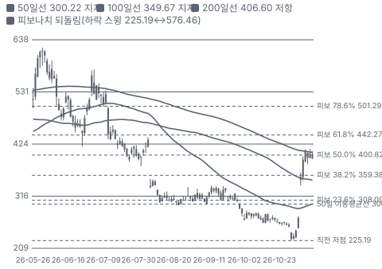

**주봉**

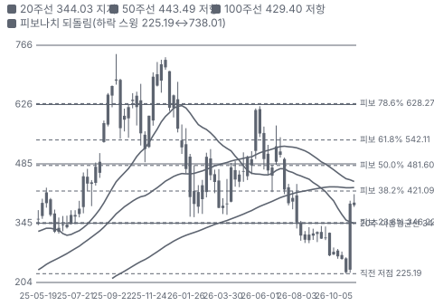

**월봉**

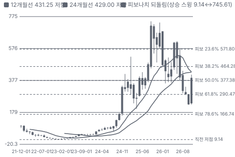

**분기 매출·EPS 실적과 컨센서스**

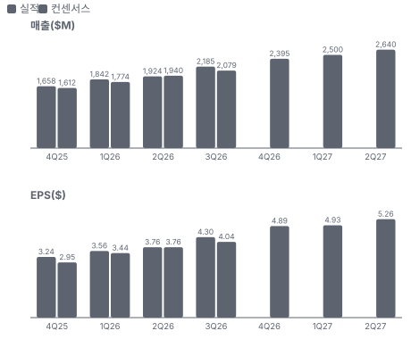

**최근 4개 분기 주가 변화 분석**

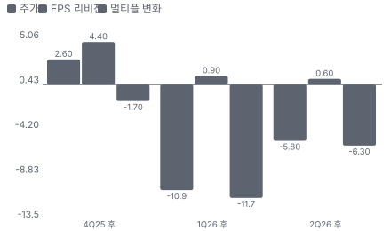

**EPS 리비전**

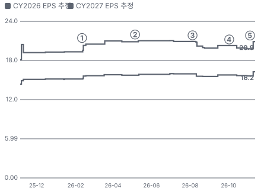

① 26-02-11 4Q25 뒤 하루 −20% · EPS 리비전 +6%
② 26-05-06 1Q26 상회 · EPS 리비전 +1%
③ 26-08-05 2Q26 미달, −20% · EPS 리비전 -3%
④ 26-10-02 Unity 가처분 기각 · EPS 리비전 -2%
⑤ 26-11-04 3Q26 상회, +31% · EPS 리비전 +6%

**밸류에이션 주가 시나리오**

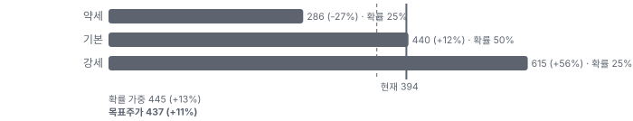

**주가별 업사이드**

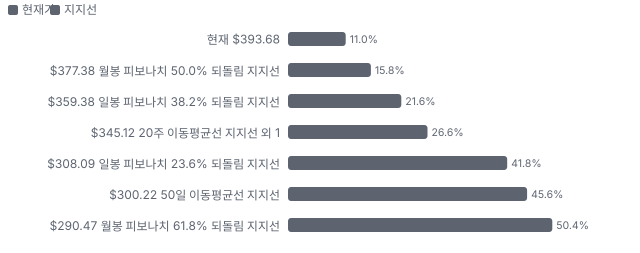
- 제품·서비스 포트폴리오

**고객 믹스(3Q26, 매출 대비)**

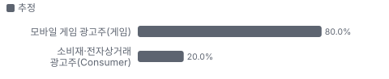

**공급 병목(10점, 낮을수록 병목)**

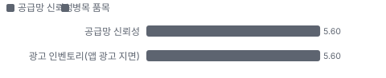

**어닝콜 변화별 주주가치 영향**

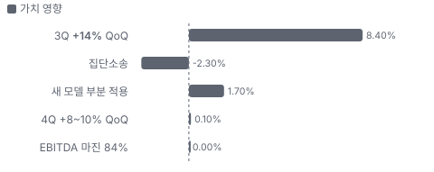

**멀티플 프리미엄(Fwd 1Y EV/EBITDA, 최근 4개 분기말)**

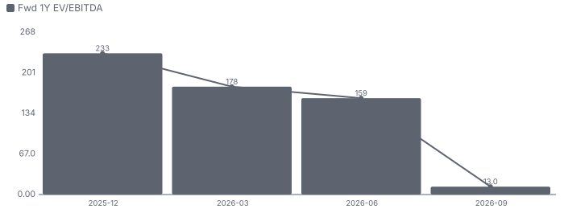

**합리적 멀티플**

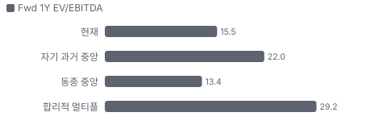

**매출 → 매출총이익 → 영업이익(매출 = 100, 최근 4분기)**

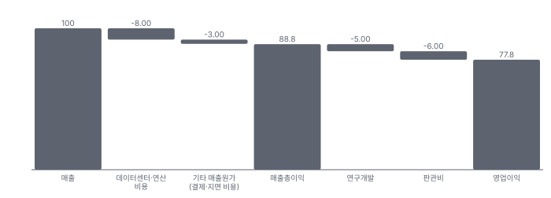

**분기 비용 비중 추이(매출 대비, 공시)**

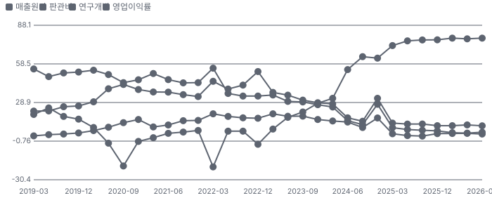

**비용 요인별 매출 대비 비중 1년 변화**

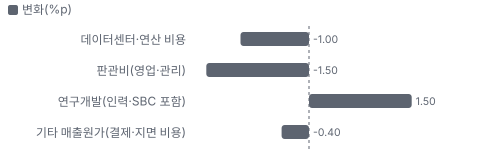

**BOM 항목 가격 +10% 시 OPM 변화**

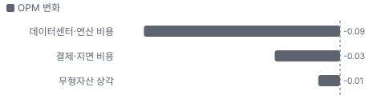

**광고 플랫폼(AXON — AppDiscovery·MAX·Ads Manager) BOM 원가 몫**

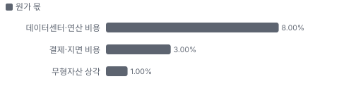

**목표주가 산정 — 기본 시나리오, 도달 확률 약 51%**

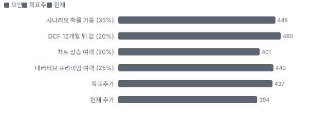

**PEG — 성장 대비 멀티플(낮을수록 성장 대비 쌈)**

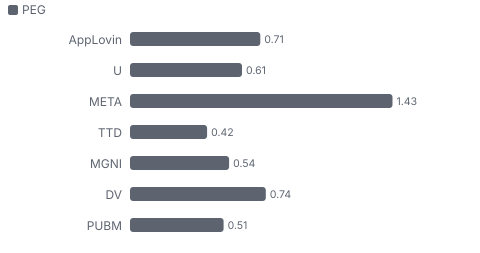

**일봉 지지·저항과 목표주가**

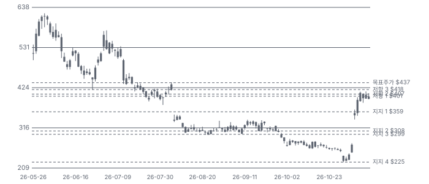

**커뮤니티 언급 수(최근 30일, 채널별)**

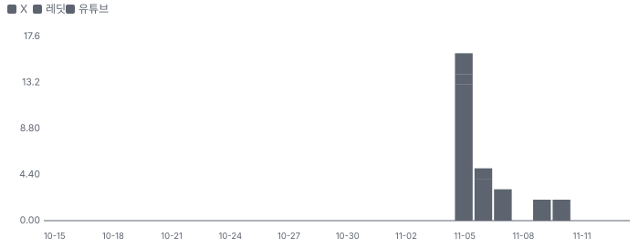

**커뮤니티 게시 수(월, 최근 4개월)**

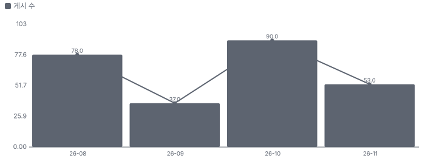

**일별 거래량 분해**

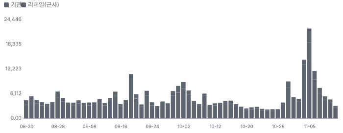

**기관 자금 흐름**

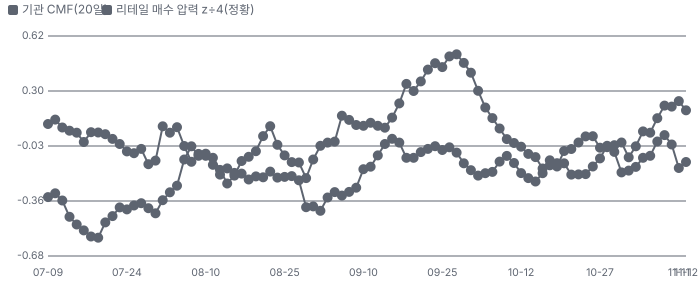

**몬테카를로**

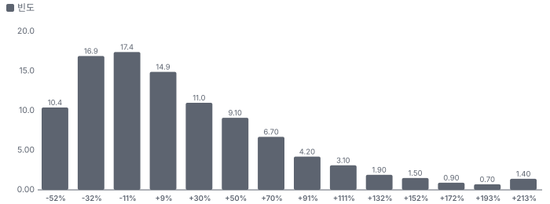

해석: 3,000번 중 1,634번(54%)에서 가치가 지금 주가 이상이었다. 지금 주가를 뒷받침하는 경우와 그렇지 않은 경우가 반반에 가깝다. 가운데 값은 1.05배이고, 열 번 중 여덟 번은 0.58~1.98배 사이에 든다.

## 내러티브

> **기업가치를 결정하는 이야기:** AppLovin은 모바일 게임사가 신규 이용자를 사는 광고(AppDiscovery(AppLovin의 앱 이용자 확보 광고 상품))와 퍼블리셔 광고 지면을 경매하는 중개(MAX(AppLovin의 광고 중개, 미디에이션 플랫폼))를 AI 엔진 AXON으로 묶은 광고 플랫폼이다. 2025년 게임 사업을 팔아 순수 광고 회사가 됐고, Ads Manager(AppLovin의 셀프서브 광고 관리 도구)로 소비재·전자상거래 광고주를 받기 시작했다. 기업가치는 모델 개선 속도, 게임 밖 광고주 확장, 그리고 MAX 지면 우위가 Unity 같은 2위의 추격을 견디느냐로 정해진다

> **멀티플·EPS 프리미엄**
> **멀티플:** Fwd 1Y EV/EBITDA 15.5배로 동종 중앙(약 13배)보다 약 20% 높다. Fwd 1Y P/E는 19.0배로 Unity(22.0배)보다 낮다 — 1년 전 Fwd P/E 약 45배에서 크게 내려왔다
> **EPS:** FY2027 EPS 컨센서스는 2Q 콜 직전 \$20.89에서 \$20.86으로 거의 같다. 같은 기간 주가는 \$419.70 → \$393.68(−6%)이다 — 2Q 뒤 −20%와 3Q 뒤 +72%는 이익이 아니라 배수의 하락과 회복이었다

### 투자자들은 왜 열광했나

2025년 AXON이 게임 광고에서 증명되며 주가가 \$700대까지 갔다. 2026년 2월 4Q25 뒤 −20%, 8월 2Q 부진 뒤 −20%, 10월 Unity 데이터 분쟁 가처분 기각과 Unity Vector 추격 우려로 10월 말 \$228까지 밀렸다. 3Q가 가이던스 상단을 크게 넘자 닷새 만에 +72% 반등했다

### 무엇이 기업가치를 바꾸나

> **구조적 체질 변화**
> **변화:** 2025년 게임 사업 매각으로 순수 광고 플랫폼 — 조정 EBITDA 마진 84%
> **증거:** 3Q26 어닝콜(2026-11-04, 요지만 자기 말로)
> **반증:** -

> **고부가 믹스 확장**
> **변화:** 소비재·전자상거래 광고(Ads Manager) 세 자릿수 성장, 추천 프로그램·제휴로 광고주 확보
> **증거:** 3Q26 어닝콜(2026-11-04, 요지만 자기 말로) · 2Q26 어닝콜(2026-08-05, 요지만 자기 말로)
> **반증:** 소비재 성장이 두 자릿수로 꺾인다

> **기술 혁신**
> **변화:** 새 세대 모델 아키텍처 부분 적용 — 데이터가 적은 신규·소형 광고주에서 개선이 크다
> **증거:** 3Q26 어닝콜(2026-11-04, 요지만 자기 말로)
> **반증:** 전환 완료 뒤에도 분기 성장이 한 자릿수

> **실행 속도**
> **변화:** 해당 없음(납품 사업이 아니다 — 광고는 즉시 집행) **납품 리드타임 미확인.** 피어 비교 미확인. 이전 대비 미확인.
> **증거:** 3Q26 어닝콜(2026-11-04, 요지만 자기 말로)
> **반증:** -

> **M&A**
> **변화:** 해당 없음(최근 인수 없음 — 2025년 앱 사업 매각)
> **증거:** https://www.sec.gov/cgi-bin/browse-edgar?action=getcompany&CIK=0001751008&type=10-K
> **반증:** -

> **정책·입법 연관성**
> **재정정책:** 해당 없음(재정 지출과 연결된 매출 없음) 미확인 반증: - 의회 동의 2/10 — 하원 1/5(직접 관련 법안 없음) · 상원 1/5(같은 이유).
> **행정명령:** 해당 없음 — 개인정보·앱스토어 정책이 광고 추적에 간접 영향(확인 못 함) 미확인 반증: - 의회 동의 2/10 — 하원 1/5(논의 없음) · 상원 1/5(같은 이유).
> **연관입법:** 해당 없음 — 아동 온라인 보호·개인정보 입법이 광고 타기팅에 간접 영향(확인 못 함) 미확인 반증: -

> **CAPEX 낙수효과**
> **변화:** 해당 없음(고객 CAPEX가 아니라 광고 예산이 매출이 된다)
> **증거:** 3Q26 어닝콜(2026-11-04, 요지만 자기 말로)
> **반증:** -

### 내러티브 근거

> 'AI 광고 모델이 게임에서 증명했고 이제 소비재로 간다'는 이야기. 2Q 부진과 Unity 추격·소송으로 1년에 −33%, 10월 말 \$228까지 밀렸다가 3Q +55% 성장으로 닷새 만에 +72% 반등했다. FY2027 EPS 추정은 2Q 콜 전과 거의 같아 오름의 대부분은 배수 회복이다. 동종 대비 멀티플 차이 +16% 중 회사 고유 몫은 -47%다. 단계는 컨센서스, 쏠림은 중간이다.

> **AXON 모델 재가속** · 확인
> **논리:** 새 세대 모델이 부분 적용만으로 3Q +14% QoQ — 전환은 아직 앞에 있다
> **숫자:** 3Q 매출 \$2.18B(+55%), 가이던스 상단 +\$100M
> **반증:** 4Q가 가이던스 하단(\$2.365B) 아래

> **소비재·웹 광고 확장** · 진행
> **논리:** 게임 밖 광고주가 세 자릿수로 늘어 성장 여력을 연다
> **숫자:** 소비재 지출 세 자릿수 YoY(몫 미공시)
> **반증:** 1Q27 소비재가 계절성 이상으로 꺾인다

> **현금 창출·자사주** · 확인
> **논리:** FCF가 매출의 약 65%, 주가가 내려갈수록 더 산다
> **숫자:** 3Q FCF \$1.4B·자사주 \$1.4B, 희석 주식 8개 분기 감소
> **반증:** 자사주가 FCF의 50% 아래로 줄어든다

> **반대 — Unity Vector 추격** · 잠복
> **논리:** Unity Vector가 분기 +40% 커지며 몫을 가져간다 — 2Q 부진 때 'AppLovin이 다음 Trade Desk가 된다'는 약세론
> **숫자:** 3Q 광고 매출 AppLovin \$2.18B(+55%) vs Unity Grow \$457M(+44%, 전략 Grow +90%)
> **반증:** 두 회사 모두 고성장을 이어 간다(회사는 '나눠 먹기가 아니다')

> **반대 — 소송·데이터 분쟁** · 잠복
> **논리:** AI 모델 성능 과장 집단소송과 Unity 데이터 분쟁 패소(가처분)가 신뢰를 깎는다
> **숫자:** 10/2 가처분 기각 뒤 9일 연속 하락(보도)
> **반증:** 집단소송 기각·중재 승소

## 포트폴리오

| 제품·서비스 | 구분 | 무엇 | 쓰는 곳 | 돈 버는 방식 | Mix | Mix 변화(전 분기 대비) |
|---|---|---|---|---|---|---|
| 광고 플랫폼(AXON — AppDiscovery·MAX·Ads Manager) | 소프트웨어 | AI 광고 엔진 AXON이 게임·소비재 광고를 앱 지면에 경매로 배치 | 광고주의 신규 이용자·구매 확보, 퍼블리셔의 지면 수익 | 광고 집행액 기준 순매출 | 100% | +0.0%p |

**Mix 변화가 가장 큰 쪽은 광고 플랫폼(AXON — AppDiscovery·MAX·Ads Manager, +0.0%p, 전 분기 대비).** 계절성 판정: 분기 매출 계절 지수 기준 없음 → 직전 분기와 비교.

## 고객

> **3Q26 최대 고객 모바일 게임 광고주(게임) 80%, 상위 3곳 100%, 집중도 집중.** 공시·회사 발표로 확인한 몫은 매출의 0%이고, 나머지 고객 몫은 추정이거나 미분해다. 단일 고객 집중은 공시되지 않는다. 광고주는 신규 이용자를 사는 모바일 게임사가 대부분이고, 소비재·전자상거래 광고주가 세 자릿수 성장으로 늘고 있다(몫 미공시)

**고객별 매출 몫(3Q26)**
| 고객 | 몫 | 변화 | 근거 |
|---|---|---|---|
| 모바일 게임 광고주(게임) | 80% | -8%p | 추정 |
| 소비재·전자상거래 광고주(Consumer) | 20% | +8%p | 추정 |

> **모바일 게임 광고주(게임)** · 추정
> **사는 것:** AppDiscovery·AXON 광고
> **추정 근거:** 소비재 몫이 미공시라 게임 몫을 약 80%로 둔 추정 — 1년 전 약 88%(추정)

> **소비재·전자상거래 광고주(Consumer)** · 추정
> **사는 것:** Axon Ads Manager(AppLovin의 셀프서브 광고 관리 도구) 웹·앱 광고
> **추정 근거:** 지출이 세 자릿수 YoY·두 자릿수 QoQ 증가(회사) — 몫은 추정

## 마진 구조

> **GPM 89.0%, OPM 78.2%.** 3Q25 대비 GPM +1.4%p, OPM +1.4%p. 변동비는 매출의 10%이고, 매출이 10% 늘면 OPM은 +1.1%p 움직인다. GAAP 영업이익률 3Q 78.2%로 1년 전(76.8%)보다 +1.4%p. 매출원가(데이터센터·결제)는 매출의 11%, 판관비 6.1%, 연구개발 4.7%다 — 매출이 +55% 느는 동안 비용은 +31% 늘었다

> **매출 100 중 매출원가 11.2, 매출총이익 88.8(최근 4분기, 공시).** 매출원가 요인 중 데이터센터·연산 비용이 매출의 8.0%로 가장 무겁고, 단가가 +10% 오르면 GPM이 -0.80%p 움직인다. 분기 회귀로 매출 1이 늘 때 매출원가는 0.06 늘고, 매출원가의 고정비 몫은 76%다.

**비용 요인 강도 — 비중·추세·충격(+10%)·탄력**
| 비용 | 구분 | 매출 대비 | 1년 변화 | 마진 기여 | 충격 시 마진 | 매출 탄력 | 고정비 몫 |
|---|---|---|---|---|---|---|---|
| 데이터센터·연산 비용 | 매출원가 요인 | 8.0% | -1.0%p | +1.0%p | -0.80%p | 미확인 | 50% |
| 기타 매출원가(결제·지면 비용) | 매출원가 요인 | 3.0% | -0.4%p | +0.4%p | -0.30%p | 미확인 | 20% |
| 매출원가 | 공시 항목 | 11.2% | -5.4%p | +5.4%p | -1.12%p | 0.06 | 76% |
| 판관비 | 공시 항목 | 6.0% | -6.3%p | +6.3%p | 미확인 | -0.04 | 100% |
| 연구개발 | 공시 항목 | 5.0% | -1.5%p | +1.5%p | 미확인 | 0.03 | 68% |

매출 탄력 = 분기 비용을 매출에 회귀한 기울기(매출 1당 변동비), 고정비 몫 = 절편 ÷ 평균 비용. 표본이 8분기 미만이면 미확인. 매출원가 요인 비중은 margin 재료의 추정이 섞여 있고, 공시 매출원가와의 차이는 '기타 매출원가'로 둔다.

**GPM에서 OPM까지(GAAP)**
| 기간 | GPM | 연구개발 | 판관비 | 기타 | OPM |
|---|---|---|---|---|---|
| 3Q25 | 87.6% | 3.1% | 7.6% | 0.0% | 76.8% |
| 3Q26 | 89.0% | 4.7% | 6.1% | 0.0% | 78.2% |

**GPM·OPM 최근 4개 분기**
| 분기 | GPM | OPM |
|---|---|---|
| 2025-12 | 88.9% | 76.9% |
| 2026-03 | 88.9% | 78.2% |
| 2026-06 | 88.3% | 77.7% |
| 2026-09 | 89.0% | 78.2% |

**마진을 결정하는 비용 요인 — 비용 +10% 시 OPM**
| 비용 | 매출 대비 | 변화 | 고정비 | OPM |
|---|---|---|---|---|
| 데이터센터·연산 비용 | 8.0% | -1.0%p | 50% | -0.80%p |
| 판관비(영업·관리) | 6.1% | -1.5%p | 60% | -0.61%p |
| 연구개발(인력·SBC 포함) | 4.7% | +1.5%p | 80% | -0.47%p |
| 기타 매출원가(결제·지면 비용) | 3.0% | -0.4%p | 20% | -0.30%p |

**비용을 움직이는 요인**
| 비용 | 요인 |
|---|---|
| 데이터센터·연산 비용(매출원가) | 학습·추론 연산 — 3Q 비중 하락(콜) · 근거 추정 |
| 판관비(영업·관리, 판관비) | 매출 증가에 고정비 레버리지 · 근거 공시 |
| 연구개발(인력·SBC 포함, 연구개발) | 새 모델 개발 인력 · 근거 공시 |
| 기타 매출원가(결제·지면 비용, 매출원가) | 결제 수수료·지면 관련 비용 · 근거 추정 |

**광고 플랫폼(AXON — AppDiscovery·MAX·Ads Manager) BOM — 매출의 100%, GPM 89%(회사 GPM 89.0%(3Q26 GAAP)), 항목 가격 +10% 시**
| 항목 | 원가 몫 | 전가 | 제품 GPM | OPM |
|---|---|---|---|---|
| 데이터센터·연산 비용 | 6~10% | 미확인 | -0.1%p | -0.09%p |
| 결제·지면 비용 | 2~4% | 미확인 | -0.0%p | -0.03%p |
| 무형자산 상각 | 0~2% | 미확인 | -0.0%p | -0.01%p |
| 미분해 | 88% | - | - | - |

데이터센터·연산 비용 가격이 +10% 오르면 영업이익은 -0.1% 움직인다. 판매가 전가를 모르는 항목은 전가 0%로 계산했다.

**BOM 항목 가격을 움직이는 것**
| 항목 | 요인 |
|---|---|
| 데이터센터·연산 비용 | 모델 학습·추론 · 근거 추정 |
| 결제·지면 비용 | 결제 수수료·지면 비용 · 근거 추정 |
| 무형자산 상각 | 인수 기술 상각 · 근거 추정 |

## 공급망 병목

이미지 없음(검수 실패) — 광고 플랫폼(AXON — AppDiscovery·MAX·Ads Manager)

> **공급망 신뢰성 5.6/10, 병목 주의.** 가장 약한 고리는 광고 인벤토리(앱 광고 지면) 5.6점이고, 품목 평균은 5.6점이다. 근거가 부족한 2건(모델 학습·서빙 연산(데이터센터) · 광고 성과 측정(어트리뷰션))은 점수에서 뺐다. 공급망 병목은 부품이 아니라 '광고 지면'과 '모델 학습 연산'이다. 지면은 자사 MAX가 쥐고 있어 가장 덜 막히는 쪽이고, 외부에 열린 지면 공급원이 많지 않다는 것이 성장의 한계다(3Q 콜)

**병목과 마진 — 품목 가격 +10% 시 OPM**
| 품목 | 점수 | 판정 | 구분 | OPM |
|---|---|---|---|---|
| 광고 인벤토리(앱 광고 지면, 필수) | 5.6 | 병목 주의 | 출하 차질 위험 | 미확인 |

> **광고 인벤토리(앱 광고 지면)** · 5.6/10
> **왜:** 광고 매출 = 지면 × 전환율 × 단가
> **병목 요인:** 인증 공급사 2곳 · 캐파 빠듯 · 리드타임 미확인 · 재인증 미확인 · 1위 점유율 미확인 · 미국(2Q 매출 51%) 집중 51% · 물량 확보 내재화
> **풀리는 조건:** 소비재·웹 지면 확대(진행 중)

**공급사**
| 품목 | 공급사 | 몫 | 근거 |
|---|---|---|---|
| 광고 인벤토리(앱 광고 지면) | MAX(자사 미디에이션, 퍼블리셔 지면 경매) | 미확인 | 회사 발표 |
| 광고 인벤토리(앱 광고 지면) | 외부 지면·웹 지면(소비재 광고용 추가 지면) | 미확인 | 회사 발표 |
| 모델 학습·서빙 연산(데이터센터) | 데이터센터·GPU 공급사(이름 미공시, 학습·추론 연산) | 미확인 | 회사 발표 |
| 광고 성과 측정(어트리뷰션) | Adjust(자사, 모바일 광고 성과 측정) | 미확인 | 회사 발표 |

## 해자

> 해자는 광고 중개 MAX가 쥔 지면(퍼블리셔 광고 요청이 먼저 지나가는 길)과 그 위에서 쌓인 데이터·모델(AXON)이다. 3Q 광고 매출 \$2.18B로 2위 Unity Grow(\$457M)의 약 5배이고 조정 EBITDA 마진 84%다. 약점은 게임 광고 의존, 데이터 분쟁·집단소송, 그리고 빠르게 크는 Unity Vector다

> **지면 장악(MAX 미디에이션)** · 강함
> **해자:** 퍼블리셔 광고 경매를 MAX가 운영 — 2Q에 퍼블리셔 수익 +두 자릿수 QoQ, 워터폴 점유 유지(회사)
> **근거:** 2Q26 어닝콜(2026-08-05, 요지만 자기 말로)
> **숫자:** MAX 점유율 수치 미공시
> **깨지는 조건:** 주요 퍼블리셔가 다른 미디에이션(LevelPlay(Unity의 광고 중개, 미디에이션 플랫폼) 등)으로 옮긴다

> **규모의 모델·데이터(AXON)** · 강함
> **해자:** 광고 매출 규모가 2위의 약 5배 — 데이터 밀도와 모델 학습량에서 앞선다
> **근거:** 3Q26 어닝콜(2026-11-04, 요지만 자기 말로) · Unity 3Q26 어닝콜(2026-11-05, 요지만 자기 말로)
> **숫자:** 3Q 광고 매출 AppLovin \$2.18B vs Unity Grow \$457M
> **깨지는 조건:** Unity Vector가 분기 +30% 이상을 2개 분기 더 이어 격차가 3배 아래로

> **비용 구조·현금 창출** · 강함
> **해자:** 조정 EBITDA 마진 84%, FCF가 매출의 약 65% — 모델 투자와 자사주를 동시에
> **근거:** 3Q26 어닝콜(2026-11-04, 요지만 자기 말로)
> **숫자:** 3Q FCF \$1.4B, 자사주 \$1.4B
> **깨지는 조건:** 학습 연산 비용이 매출보다 빨리 늘어 마진이 80% 아래

> **게임 의존·법적 위험(약점)** · 약점
> **해자:** 매출 대부분이 게임 광고이고, 집단소송과 Unity와의 데이터 분쟁이 걸려 있다
> **근거:** https://digiday.com/marketing/mobile-ad-giants-applovin-and-unity-locked-in-legal-dispute-over-data-collection/
> **숫자:** 소비재 매출 몫 미공시(세 자릿수 성장만 공개)
> **깨지는 조건:** 소비재 매출 몫이 공시되고 20%를 넘는다

## 경영진·네트워크

> 공동 창업자 Adam Foroughi가 CEO다. 2021년 상장 뒤 앱 사업을 팔고(2025) 광고 플랫폼에 집중했다. CFO는 Matt Stumpf. 자사주 매입으로 희석 주식 수가 8개 분기 연속 줄었다

> **Adam Foroughi** · 공동 창업자·CEO · 2012
> **프로필:** 회사 창업, 3Q 콜에서 새 모델 아키텍처·장기 30% 성장 설명
> **비즈니스:** 전사
> **정계:** 미확인
> **동문:** 미확인
> **사모임:** 미확인

> **Matt Stumpf** · CFO · 미확인
> **프로필:** 3Q 콜 재무·가이던스·자사주
> **비즈니스:** 재무
> **정계:** 미확인
> **동문:** 미확인
> **사모임:** 미확인

**네트워크 정량화**
| 연결 | 강도 | 닿는 매출 | 가중 노출 | 매출 대비 | 근거 |
|---|---|---|---|---|---|
| 정계: 하원의원 매매 공시 — Ro Khanna 매수(10월), Gilbert Cisneros 매도(10월) — 회사 매출과 연결 없음 | 1/5 | 미확인 | 미확인 | 미확인 | 의회 매매 공시(개인 거래) https://disclosures-clerk.house.gov/public_disc/ptr-pdfs/2026/20035788.pdf |

가중 노출은 연결이 닿는 매출의 크기다. 연결이 그 매출을 만들었다는 뜻이 아니며, 인과는 공개 자료로 입증하지 못한다.

## 약세 논리 및 셀온 조건

| 약세 논리 | 근거 | 반박 | 가를 자료 · 공개 시점 |
|---|---|---|---|
| Unity Vector가 몫을 가져간다 | Unity Vector +126% YoY·+40% QoQ, 전략 Grow +90% | 광고 매출은 AppLovin \$2.18B vs Unity Grow \$457M(약 5배). 회사는 시장이 나눠 먹기가 아니라고 했고 3Q 두 회사 모두 최고 분기 | 두 회사 4Q 광고 매출 성장 — 2027-02 |
| 반등은 배수뿐이다 | FY2027 EPS 추정 \$20.89 → \$20.86(2Q 콜 전 → 11/9) | Fwd 1Y P/E 19배는 1년 전 약 45배보다 낮다 — 배수가 회복할 여지 | 4Q 실적 뒤 EPS 추정 상향 여부 — 2027-02 |
| Unity 데이터 분쟁에서 졌다 | 법원이 Unity 데이터 수집 금지 가처분을 기각(보도), 10월 9일 연속 하락 | 가처분만 기각 — 본안 중재는 진행 중. Unity는 9월 MAX 입찰 수집을 끄기로 했다(보도) | 중재 결과 — 시점 미정 |
| 집단소송 | AI 모델 성능 과장 주장 — 대표 원고 신청 11/16 | 로펌 공고 단계이고 사실 판단은 없다. SEC 문의는 2Q 콜에서 종결 설명 | 소송 진행·기각 여부 — 수시 |
| 4Q 가이던스가 느리다 | 4Q +8~10% QoQ vs 3Q +14% | 회사는 계절성·학습 연산 투자를 들었고, 16개 분기 중 14번 가이던스 상단을 넘었다(회사) | 4Q 매출 — 2027-02 |

> **셀온 조건**
> **조건 1:** 4Q26 매출이 가이던스 하단(\$2.365B) 아래
> **조건 2:** Unity Vector가 분기 +30% 이상을 이어 가며 AppLovin 분기 성장이 한 자릿수로 꺾인다 — 몫을 내주기 시작했다는 신호
> **조건 3:** 조정 EBITDA 마진이 80% 아래(학습 연산 비용이 매출보다 빠르게 증가)
> **조건 4:** 집단소송·중재에서 불리한 판단이 나온다
> **조건 5:** 자사주 매입이 FCF의 절반 아래로 줄어든다

## 어닝콜 변화

**직전 콜 대비 새로 나오거나 바뀐 내용 → 가치 영향**
| 항목 | 내용 | 직전 콜 | 최신 콜 | 모델 동인 이동 | 확신도 | 가치 영향 |
|---|---|---|---|---|---|---|
| 업데이트 | 매출 성장 재가속 | 2Q +4% QoQ(중간값 아래) | 3Q +14% QoQ(+55% YoY), 가이던스 상단 +\$100M | 1년차 성장률 +4.0% | 1.0 | +8.4% |
| 업데이트 | 4Q 가이던스 | 3Q 가이던스(2Q 콜) | 4Q 매출 \$2.365~2.395B, 조정 EBITDA \$1.995~2.025B | 기준연도 매출 +\$0.01B | 0.8 | +0.1% |
| 신규 | 새 모델 아키텍처 | 2Q 모델 개선 지연 | 새 세대 모델 부분 적용 — 전환은 아직 앞에 있다 | 장기 성장 수렴값 +1.0% | 0.5 | +1.7% |
| 업데이트 | 조정 EBITDA 마진 | 2Q 약 84% | 3Q 84%(+1.9%p YoY), 데이터센터 비용 비중 하락 | 출발 이익률 +0.50% | 1.0 | +0.0% |
| 반복 | 자사주 매입 | 2Q 매입 축소(\$0.55B) | 3Q \$1.4B(4.1M주), 누적 104M주·평균 \$90 | 순차입 — | 1.0 | +0.0% |
| 부정 | 증권 집단소송 | SEC 문의 종결(2Q 콜) | AI 모델 성능 과장 주장 집단소송 — 대표 원고 신청 11/16 | 할인율(WACC) +0.20% | 0.3 | -2.3% |
| **합계** | 단독 합 |  |  | 동시 적용 +7.8% |  | **+7.9%** |

**사건별 EPS 리비전**
| # | 날짜 | 구분 | 사건 | CY2026 EPS 전→후 | CY2027 EPS 전→후 | 리비전 | 주가 반응 |
|---|---|---|---|---|---|---|---|
| ① | 26-02-11 | 실적 | 4Q25 뒤 하루 −20% | \$15.14 → \$15.65 | \$19.30 → \$20.48 | +6.1% | -19.7% |
| ② | 26-05-06 | 실적 | 1Q26 상회 | \$15.72 → \$15.86 | \$20.84 → \$21.00 | +0.8% | +6.4% |
| ③ | 26-08-05 | 실적 | 2Q26 미달, −20% | \$15.93 → \$15.56 | \$20.89 → \$20.18 | -3.4% | -19.7% |
| ④ | 26-10-02 | 내러티브 | Unity 가처분 기각 | \$15.76 → \$15.67 | \$20.25 → \$19.90 | -1.7% | -4.7% |
| ⑤ | 26-11-04 | 실적 | 3Q26 상회, +31% | \$15.61 → \$16.25 | \$19.76 → \$20.86 | +5.6% | +31.0% |

**해석:** 3개 구간 누적 주가 -14% = EPS 리비전 +6% × 멀티플 -19%. 더 크게 움직인 쪽은 **멀티플**이다.

## 밸류에이션

> **목표주가 \$437, 업사이드 +11%.** 자리는 기본 시나리오이고 도달 확률은 약 51%다. 기본 \$440, 강세 \$615(+56%), 약세 \$286(-27%). DCF 기준 업사이드는 기본 +6%, 강세 +76%, 약세 -34%다(WACC 10.4%).

기준 멀티플을 Unity 리포트와 같은 Fwd 1Y EV/EBITDA로 둔다. 확률은 3Q의 큰 상회와 2Q 부진·소송·Unity 추격을 함께 반영해 약세 25%·기본 50%·강세 25%에 둔다. ==2Q 콜 이후 이익 추정은 그대로라 판단의 열쇠는 배수가 아니라 다음 이익 상향이다==.

> **약세 \$286 (-27%)** · 확률 25%
> **가정:** 12.7배 × EBITDA \$7.60B
> **근거:** 새 모델 효과가 4Q로 끝나고 소비재가 1Q 계절성에 꺾인다. Unity와 지면 경쟁이 붙어 성장이 연 20%대로. 매출 약 \$9.3B, 조정 EBITDA 약 \$7.6B

> **기본 \$440 (+12%)** · 확률 50%
> **가정:** 16.9배 × EBITDA \$8.77B
> **근거:** 모델 전환이 가이던스대로 이어지고 소비재가 커진다. 매출 약 \$10.4B(다음 4개 분기 컨센서스), 조정 EBITDA 약 \$8.77B(마진 약 85%)

> **강세 \$615 (+56%)** · 확률 25%
> **가정:** 21.1배 × EBITDA \$9.80B
> **근거:** 새 모델 전환이 끝나며 게임·소비재가 함께 가속한다. 매출 약 \$11.5B, 조정 EBITDA 약 \$9.8B

**멀티플 선정 — Fwd 1Y EV/EBITDA**
| 단계 | 조정 | 근거 |
|---|---|---|
| 동종 중앙값 | 13.4배 | 범위 9.8~21.2배, 6곳 |
| 펀더멘털 | +20% | 성장·이익률·ROIC로 본 합리적 멀티플 29.2배와의 차이의 일부만 인정 |
| 해자 | +12% | 지면 장악(MAX 미디에이션) 강함 · 규모의 모델·데이터(AXON) 강함 · 비용 구조·현금 창출 강함 · 게임 의존·법적 위험(약점) 약점 |
| 반복 매출 | -6% | 반복 매출 0%(동종 20%) · 해당 없음(광고 집행 — 계약 반복 매출 없음) · 이미 반복 단계 · 기반 광고주·퍼블리셔 수 미공시 |
| 수주 전환·가시성 | +0% | 재료 없음 |
| 내러티브 | +0% | 단계 컨센서스 |
| 사이클·실행 판단 | +0% | 요인에 없는 조정은 하지 않는다 |
| **선정** | **16.9배** | 지금 15.5배 |

**동종 레인지**
| 회사 | Fwd 1Y EV/EBITDA | Fwd 2Y EV/EBITDA | Fwd 3Y EV/EBITDA | 성장 | 영업이익률 | ROIC |
|---|---|---|---|---|---|---|
| U | 21.2 | 15.6 | 12.3 | 41% | 31% | 20% |
| META | 11.7 | 9.7 | 8.2 | 21% | 34% | 25% |
| TTD | 12.2 | 9.9 | 9.6 | -8% | 14% | 33% |
| MGNI | 16.2 | 12.6 | 10.3 | 13% | 23% | 16% |
| DV | 9.8 | 8.6 | 8.2 | 8% | 14% | 10% |
| PUBM | 14.6 | 10.8 | 9.9 | 11% | 6% | 15% |
| **AppLovin** | 15.5 | 12.5 | 10.2 |  |  |  |

> **PEG 0.71** — Fwd 1Y P/E 19.0배를 다음 해 EPS 성장 27%로 나눈 값, 동종 중앙 0.57(성장 대비 비싸다). 성장률은 Fwd 1Y·2Y P/E에서 역산한 컨센서스라 다음 해 한 해 성장만 반영하고, 성장 지속 기간은 담지 않는다.

**PEG — Fwd 1Y P/E ÷ 다음 해 EPS 성장률**
| 회사 | Fwd 1Y P/E | 다음 해 EPS 성장 | PEG |
|---|---|---|---|
| **AppLovin** | 19.0 | +27% | 0.71 |
| U | 22.0 | +36% | 0.61 |
| META | 19.2 | +13% | 1.43 |
| TTD | 12.6 | +30% | 0.42 |
| MGNI | 21.7 | +40% | 0.54 |
| DV | 12.8 | +17% | 0.74 |
| PUBM | 22.4 | +44% | 0.51 |

지금 주가가 요구하는 5년 매출 CAGR 18%, 기본 시나리오 20%. 몬테카를로 중앙값 업사이드 +5%.

> 의사결정 보조(투자자문 아님): ① 매수 매력: 5년 보유 가정 연 기대수익 +13.6% — 주주가 요구하는 수익률(자기자본비용) 10.4%보다 +3.2%p · 요구수익률을 넘을 확률 51% · 안전마진 없음(비관적 경우(하위 10%) 가치가 시총의 58%) → 정량 신호 중립 / ② 위험 예산 지표(이론): 켈리 기준(수익·손실 확률로 계산한 이론상 최대 노출)의 1/4만 반영 10.0% (상한 10%) · 5년 뒤 나쁜 경우(하위 10%) -10% · 30% 넘게 잃을 확률 3% / ③ 상방(5년): 평균 1.89배 · 2배 이상 확률 36% · 3배 이상 12% · 10배 이상 0% · 잘 풀린 경우(상위 10%) 3.17배 이상

## 매수 위치(일봉)

> **현재가 \$394는 '중간'(가장 가까운 일봉 지지 \$359에서 ATR 1.4배 위).** 이 자리에서 목표주가까지 +11.0%, 첫 일봉 저항까지 +1.8%, 다음 지지까지 하방 -8.7%, 손익비 1.3배. 손익비는 지지 2 \$308에서 14.5배로 가장 높다(목표주가까지 +41.8%).

**가격대별 업사이드(일봉 기준)**
| 가격대 | 가격 | 목표주가까지 | 첫 저항까지 | 다음 지지까지 | 손익비 | 근거 기법(강도) |
|---|---|---|---|---|---|---|
| 현재가 | \$394 | +11.0% | +1.8% | -8.7% | 1.3 | - |
| 지지 1 | \$359 | +21.6% | +11.5% | -14.3% | 1.5 | 피보 38.2%(1.0) |
| 지지 2 | \$308 | +41.8% | +16.6% | -2.9% | 14.5 | 피보 23.6%(1.0) |
| 지지 3 | \$299 | +46.0% | +3.0% | -24.7% | 1.9 | 20일선 · 50일선(1.5) |
| 지지 4 | \$225 | +94.1% | +32.9% | 미확인 | 미확인 | 120일 지그재그 저점 · 스윙 저점(1.8) |

**일봉 저항**
| 저항 | 가격 | 현재가 대비 | 근거 기법(강도) |
|---|---|---|---|
| 저항 1 | \$401 | +1.8% | 피보 50.0%(1.0) |
| 저항 2 | \$407 | +3.3% | 200일선(1.0) |
| 저항 3 | \$418 | +6.3% | 120일 지그재그 저점(0.8) |

일봉만 쓴다(주봉·월봉 제외). 손익비 = 목표주가까지 업사이드 ÷ 다음 지지까지 하방. 가격대별 기대값 참고표이며 매수·매도 시점 지시가 아니다.

## 애널리스트 토론

> **토론 결론 Neutral(규칙 등급 Neutral).** 재가속·마진·현금은 1차 자료로 확인됐다. 그러나 닷새 +72% 반등으로 배수가 동종보다 약 20% 높아졌고 2Q 콜 이후 이익 추정은 그대로다 — 살아남은 반박은 '반등은 배수뿐'과 'Unity의 추격·데이터 분쟁'이다. 4Q 실적과 Unity 4Q가 가를 자료다

**패널 — 등급별 자리**
| 자리 | 핵심 논리 | 틀리는 조건 | 최종 투표 |
|---|---|---|---|
| Strong Buy | 새 모델은 부분 적용만으로 +14% QoQ — 전환이 끝나면 이익 상향이 다시 시작된다 | 4Q 매출이 가이던스 하단 아래 | Buy |
| Buy | FCF가 매출의 약 65%이고 자사주로 주식 수가 줄어 하방이 단단하다 | 자사주가 FCF의 절반 아래로 | Neutral |
| Neutral | 실적은 좋지만 닷새 +72%로 배수가 이미 돌아왔고 이익 추정은 그대로다 | 4Q 뒤 2027 EBITDA 추정이 \$10B를 넘는다 | Neutral |
| Sell | Unity Vector가 분기 +40%로 크고 데이터 분쟁에서도 졌다 — 몫 이동이 시작됐다 | 두 회사 모두 4Q 광고 매출 +40% 이상 | Neutral |
| Strong Sell | 집단소송과 게임 의존 — 2Q처럼 모델 개선이 한 번 멈추면 −20%가 반복된다 | 소송 기각·소비재 몫 20% 이상 공시 | Sell |

**투표**
| Strong Buy | Buy | Neutral | Sell | Strong Sell |
|---|---|---|---|---|
| 0 | 1 | 3 | 1 | 0 |

> **개회 · Strong Buy**
> **발언:** 부분 적용만으로 재가속했다

> **개회 · Buy**
> **발언:** 현금과 자사주가 받친다

> **개회 · Neutral**
> **발언:** 배수는 돌아왔고 이익 추정은 그대로다

> **개회 · Sell**
> **발언:** Unity가 빠르게 따라온다

> **개회 · Strong Sell**
> **발언:** 소송과 게임 의존이 남았다

> **반박1 · Strong Buy → Sell**
> **발언:** 광고 매출이 Unity의 약 5배다 — 같은 분기에 둘 다 최고였다

> **반박1 · Sell → Strong Buy**
> **발언:** 작은 쪽이 +90%로 크면 격차는 줄어든다

> **반박1 · Neutral → Buy**
> **발언:** 자사주는 하방을 줄이지만 상방을 만들지는 않는다

> **반박1 · Buy → Neutral**
> **발언:** Fwd 1Y P/E 19배는 1년 전 약 45배의 절반 아래다

> **반박1 · Strong Sell → Strong Buy**
> **발언:** 4Q 가이던스 +8~10% QoQ는 3Q보다 낮다

> **반박2 · Strong Buy → Strong Sell**
> **발언:** 회사는 계절성과 학습 투자를 이유로 들었고 대부분 상단을 넘었다

> **반박2 · Strong Sell → Strong Buy**
> **발언:** 그 기록은 2Q에 한 번 깨졌다

> **반박2 · Neutral → Sell**
> **발언:** 가처분 기각은 본안 판단이 아니다

> **반박2 · Sell → Neutral**
> **발언:** 그래도 Unity가 데이터 수집을 멈추지 않아도 된다는 뜻이다

> **반박2 · Buy → Strong Sell**
> **발언:** 소송은 로펌 공고 단계다

> **최종 · Strong Buy** · Buy
> **발언:** 목표가가 주가와 가깝다 — Buy로 물러선다

> **최종 · Buy** · Neutral
> **발언:** 이익 상향이 다시 보일 때까지 Neutral

> **최종 · Neutral**
> **발언:** 4Q와 Unity 4Q를 함께 본다 — Neutral

> **최종 · Sell** · Neutral
> **발언:** 두 회사가 함께 크는 동안은 Neutral

> **최종 · Strong Sell** · Sell
> **발언:** 소송 위험을 남겨 Sell

남은 반대 의견: Strong Buy 자리는 새 모델 전환이 끝나면 이익 상향이 다시 온다고 끝까지 남겼다

패널은 등급별 논리를 대표하는 자리이고 실존 IB의 의견이 아니다.

## 커뮤니티 반응

통계: 관심 급증 0.0/10(결합 Z -1.3), 최근 7일 신뢰 가중 감성 +0.53, 최근 언급 2건.

> **3Q 뒤 '가장 미움받던 주식의 반전'으로 소화 — 바닥 매수 자랑과 조기 매도 후회가 섞이고, 경쟁 논쟁은 'Unity와 함께 큰다'로 기울었다**

**강세** — 매출 +55%·순이익률 66%·조정 EBITDA 마진 84%로 성장과 수익성이 함께 확인됐다 근거로 드는 것: 3Q 실적 발표 수치. (X, 2026-11-04)

**새 쟁점** — AppLovin과 Unity가 같은 분기에 최고 실적 — 2Q 뒤 'Vector(Unity의 AI 광고 추천·입찰 모델)가 몫을 뺏는다'는 약세론이 약해졌다 근거로 드는 것: 두 회사 3Q 실적 비교. (X, 2026-11-05)

**시장과 다른 점** — 200주 이동평균 아래로 떨어진 우량주라 반등은 예정된 것이었다는 차트 논리 근거로 드는 것: 주가 기술 지표. (X, 2026-11-05) [사실관계 미확인]

**약세** — Alphabet 같은 대형 플랫폼 경쟁을 이유로 피하라는 방송 논평이 있었다 근거로 드는 것: 방송 논평(월간 요약). (X, 2026-10-15) [사실관계 미확인]

**약세** — 2Q 부진 뒤 하루 −20%대 — '실적 상회·상향 기계'가 처음 흔들렸다 근거로 드는 것: 2Q 실적·주가. (레딧 r/wallstreetbets, 2026-08-06)

**기대가 바뀐 시점:** 8월 2Q 부진 뒤 'AppLovin이 다음 Trade Desk가 되고 Vector가 몫을 가져간다'는 약세론이 우세했고, 11월 3Q 뒤 '둘 다 최고 분기'로 바뀌었다

커뮤니티 의견은 시장 기대의 증거이지 사실이 아니며, 관심 급증은 주가·펀더멘털 변화가 아니다.

## 시장 평가

> **셀사이드(IB 애널리스트)**
> **한 줄:** 매수 우위지만 Hold 7명으로 Unity보다 갈린다. 3Q 콜 질문은 새 모델의 여력, 소비재 연말 예산, 지면·단가, 그리고 2Q 뒤 생긴 경쟁 우려에 모였다
> **애널리스트 의견(31명):** Strong Buy 22 · Buy 2 · Hold 7
> **목표가 평균(31명):** \$463(범위 \$284~710)
> **FY2027 EPS 컨센서스:** \$20.86(2Q 콜 전 \$20.89 → 11/9, 거의 같음)

> **바이사이드(기관 투자자)**
> **한 줄:** 회사가 가장 큰 매수자다 — 주가가 내려간 3Q에 매입을 늘렸다
> **기관 보유:** 약 76%(yfinance)
> **공매도:** 유통 주식의 약 3.8%
> **자사주:** 3Q \$1.4B, 누적 104M주

> **언론·업계**
> **한 줄:** 소송 공고는 로펌 홍보 성격이 강하고 사실 판단은 아직 없다
> **주요 제목:** 3Q +31%(11/5), Unity 가처분 기각(10/2), 집단소송 공고(11월)

## 체크리스트

| 시점 | 무엇 | 의미 |
|---|---|---|
| 2027-02 | 4Q26 실적: 매출(가이던스 \$2.365~2.395B)·조정 EBITDA·소비재 성장 | 모델 전환과 소비재 확장이 이어지는지 |
| 2027-02 | Unity 4Q Vector 성장(가이던스 +21~23% QoQ) | 2위의 추격 속도 — 몫 이동 여부 |
| 2027-05 | 1Q27 실적: 전자상거래 계절 둔화 폭 | 소비재 성장의 질 |
| 수시 | 집단소송·Unity 중재 진행 | 법적 위험의 크기 |
| 분기마다 | 자사주 매입 규모·희석 주식 수 | 현금 환원 속도 |

## 출처
- 마스터 노션 자료: MS MS_-_Following_AIs_1.6_trillion_Money_Trail_-_Mapping_the_Revenue_Generated_by_the_Capex_Boom(1).pdf (요지만, 외부 공유 금지)
- 3Q26 어닝콜(2026-11-04, 요지만 자기 말로)
- https://www.sec.gov/cgi-bin/browse-edgar?action=getcompany&CIK=0001751008&type=10-K

_구매 등급·목표주가 모두 규칙이 계산한 모델 값으로, 개인의 보유 종목·자금 사정을 반영하지 않는다 · 공개 자료 기반 분석이며 투자 권유가 아님 · 1차 판정, 미검증 · Chiip ten-bagger_