# 텐배거 리포트 2026-11-13 — Life Time — 회비를 올려도 회원이 더 자주 온다, 남은 질문은 배수와 회원 수

> 2026-11-13 · Life Time Group Holdings, Inc.(LTH) · 기업: 미국·캐나다에 대형 고급 피트니스·라이프스타일 클럽 196곳(헬스·수영·테니스·피클볼·스파·키즈)을 직접 지어 회원제로 운영하는 회사 — 매출의 70%가 월 회비, 28%가 트레이닝·카페·스파 같은 센터 내 지출

## Chiip View

주가는 11/12 \$45.54, 시가총액 \$10.23B, 차입 \$1.49B(리스 별도 \$2.81B)다. 3Q26 매출 \$893.5M(+14.2%)·조정 EBITDA \$256.3M(마진 28.7%)로 연간 가이던스를 또 올렸고, 순차입 배수는 1.3배로 낮아졌다. 평균 월 회비 \$244(+11.9%)에도 월 방문이 +4% 늘어 가격 결정력이 숫자로 확인됐다. 반면 센터 회원은 858,747명으로 전 분기보다 약간 줄었고(의료 연계 회원 정리), 다음 4개 분기 조정 EBITDA 컨센서스 \$1.04B 기준 Fwd 1Y EV/EBITDA 14.4배로 동종 중앙(약 11.7배)보다 높다 — 가를 것은 4Q 회원 증가(+2.4~3.1% 가이던스)와 2027 가이던스다.

## 대시보드
| 항목 | 값 | 설명 |
|---|---|---|
| 주가 | \$45.54 | 고점 대비 -5% · 1년 +76% |
| 시가총액 | \$10.59B | 완전 희석 기준 · EV \$11.77B |
| 업사이드 | -10% | 목표주가 \$41 · 다운사이드 -41% · 손익비(강세÷약세) 0.4 |
| 구매등급 | Neutral | 애널리스트 16명: Strong Buy 13 · Buy 2 · Neutral 1 · Sell 0 · Strong Sell 0 |
| 멀티플 | Fwd 1Y EV/EBITDA 14.4배 | 동종 중앙값 10.8배 |
| 가이던스 FY2026 |  | 컨센서스 미확인 |
| 알파 | 6.0/10 | 텐배거 가능성 점수 |
| 이벤트 | 4Q26 실적·2027 가이던스(2월 말 관행, 날짜 미확정) | 2027-02-24 |

## 한 장 요약
- **기업가치를 결정하는 내러티브** Life Time의 값은 **고급 대형 클럽의 회비 인상력과 연 14곳 개장이 5년 넘게 이어지고, 그 자금을 매각 후 재임차로 대며 잉여현금흐름을 지키느냐**에 달렸다. 3Q는 그 방향을 확인했다 — 매출 +14.2%, 동일 센터 +8.7%, 조정 EBITDA 마진 28.7%, 연간 가이던스 상향. 주가는 1년 +76%로 Fwd 1Y EV/EBITDA 14.4배가 됐고, 동종(약 11~12배)보다 높다
- **밸류에이션 모델로 본 주가 상방은 어디까지인가?** **목표주가 \$41(-10%), 기본과 강세 사이(강세 쪽 7%)다.** 강세 \$54(+18%)는 Fwd 1Y EV/EBITDA 12.6배를 강세 EBITDA에 적용한 값이다. 기본 \$40, 약세 \$27. 손익비 0.4, DCF 기준 업사이드 -80%.
- **누가 사 주나?** 최대 고객 센터 회원(개인·가족, 회원) 95%, 상위 3곳 95%. 공시·회사 발표로 확인한 몫은 95%다.
- **마진과 공급망은 어디가 약한가?** GPM 46.9%, OPM 17.7%. OPM을 가장 흔드는 BOM(제품 원가를 이루는 부품·재료 명세) 항목은 센터 인력(트레이너·운영)이고 가격 +10%에 -2.06%p다. 공급망 신뢰성은 7.3/10(관리 가능)이고 가장 약한 고리는 신규 클럽 부지·건설이다.
- **생산능력은 얼마나 늘어나나?** 현재 명목 캐파 196 센터, 착공 이상 증설 28 센터. FY2027 CAPEX는 매출의 32.3%다.
- **지금 가격은 무엇을 가정하나?** 시가총액 \$10.23B에 차입 \$1.49B, 리스 \$2.81B다. 다음 4개 분기 조정 EBITDA 컨센서스 \$1.04B 기준 Fwd 1Y EV/EBITDA는 14.4배로 동종 중앙(약 11.7배)보다 약 23% 높고, Fwd 2Y 12.9배·3Y 11.6배다. 지금 가격은 연 14곳 개장과 회비 인상이 함께 이어져 EBITDA가 연 10% 넘게 느는 경로를 가정한다. 애널리스트 목표가 평균은 \$57.13(15명)이다.
- **왜 움직였나?** 1년 동안 약 +76% 올랐다. 2026년 5월 1Q 실적 뒤 이틀 동안 +28% 오른 것이 대부분이다 — 회비 인상과 마진 개선이 예상보다 빨랐다. 그 뒤 5개월은 \$38~48에서 옆으로 움직였고, 같은 기간 FY2027 EPS 추정은 4% 올랐다. 5월 이후에는 이익 추정 상향이 배수를 따라잡았다.
- **3Q에서 무엇이 바뀌었나?** 동일 센터 매출 가이던스가 +7.9~8.3%에서 +8.5~8.7%로, 조정 EBITDA 마진 중간값이 28.2%에서 28.4%로 올랐다. 2027년에 14곳을 새로 열고 대부분 이미 착공했다는 계획이 처음 나왔다. 매각 후 재임차 연 \$400M 목표는 그대로다. 반대로 센터 회원은 2Q 860,041명에서 3Q 858,747명으로 줄었다.
- **무엇이 바뀌면 판단이 달라지나?** 위로: 4Q 센터 회원이 +3% 이상 늘고 2027 가이던스가 동일 센터 +7% 이상·EBITDA 마진 29% 이상이면 2027 EBITDA 추정이 \$1.1B 이상으로 오른다. 아래로: 회원이 2개 분기 연속 줄거나, 평균 회비 성장이 5% 아래로 둔화하거나, 재임차 조건 악화로 순차입 배수가 2배를 넘으면 약세 시나리오로 옮긴다.

## 한눈에 보기

**일봉**

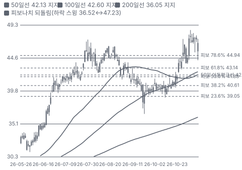

**주봉**

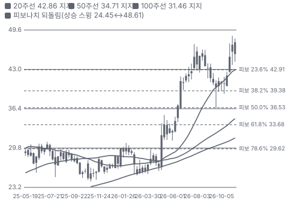

**월봉**

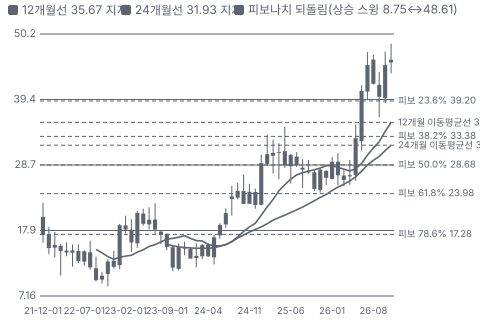

**분기 매출·EPS 실적과 컨센서스**

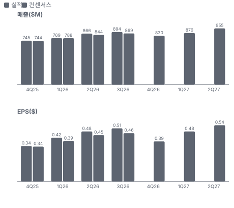

**최근 4개 분기 주가 변화 분석**

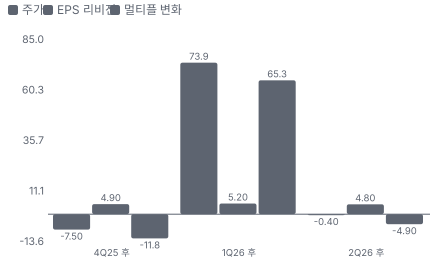

**EPS 리비전**

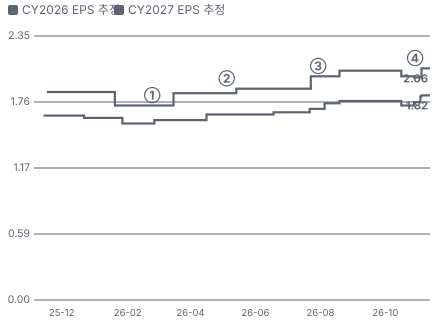

① 26-02-24 4Q25 실적·2026 가이던스 · EPS 리비전 +0%
② 26-05-05 1Q26 상회, 이틀 +28% · EPS 리비전 +2%
③ 26-07-30 2Q26 가이던스 상향 · EPS 리비전 +0%
④ 26-10-29 3Q26 상회·상향, 당일 +5% · EPS 리비전 +4%

**밸류에이션 주가 시나리오**

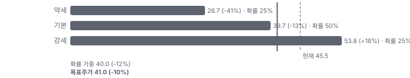

**주가별 업사이드**

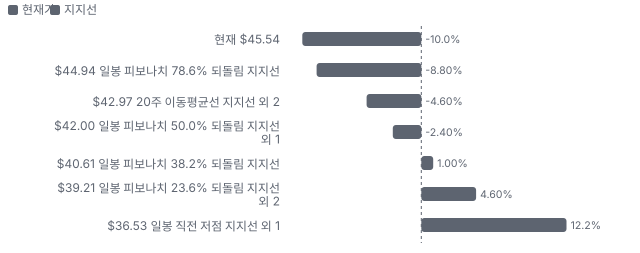
- 제품·서비스 포트폴리오

**고객 믹스(3Q26, 매출 대비)**

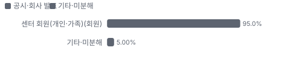

**공급 병목(10점, 낮을수록 병목)**

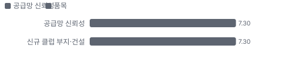

**생산능력 현재와 확충 계획(센터)**

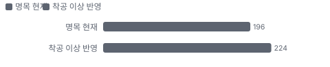

**CAPEX의 매출 대비 비중**

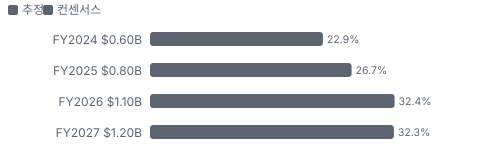

**어닝콜 변화별 주주가치 영향**

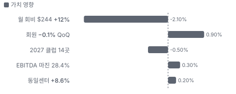

**멀티플 프리미엄(Fwd 1Y EV/EBITDA, 최근 4개 분기말)**

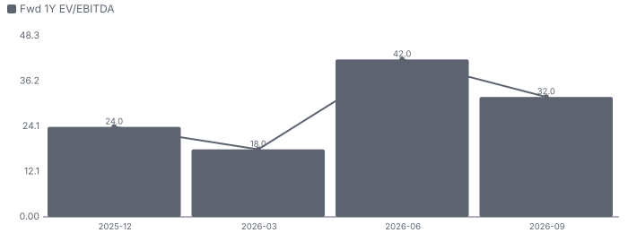

**합리적 멀티플**

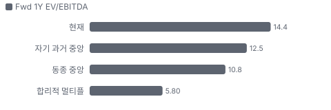

**매출 → 매출총이익 → 영업이익(매출 = 100, 최근 4분기)**

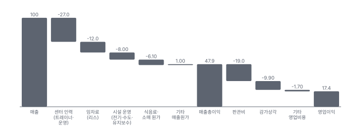

**분기 비용 비중 추이(매출 대비, 공시)**

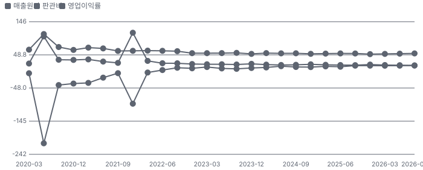

**비용 요인별 매출 대비 비중 1년 변화**

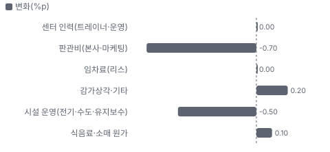

**BOM 항목 가격 +10% 시 OPM 변화**

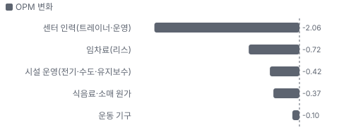

**회원 회비·가입비 BOM 원가 몫**

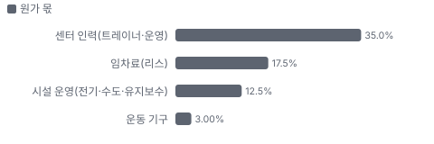

**센터 내 사업(트레이닝·카페·스파 등) BOM 원가 몫**

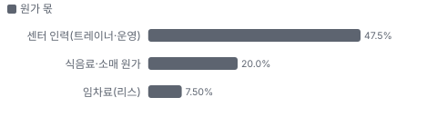

**목표주가 산정 — 기본과 강세 사이(강세 쪽 7%), 도달 확률 약 47%**

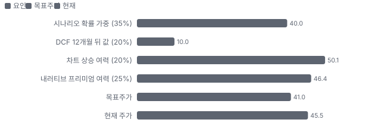

**PEG — 성장 대비 멀티플(낮을수록 성장 대비 쌈)**

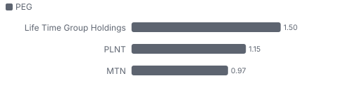

**일봉 지지·저항과 목표주가**

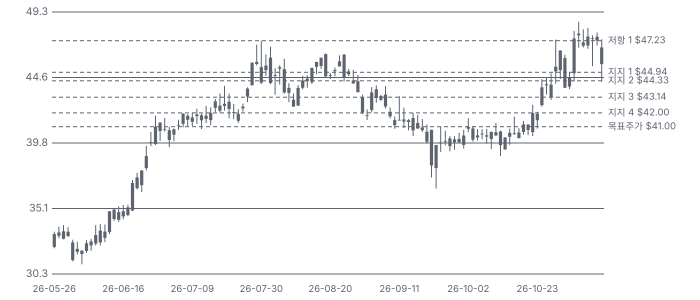

**일별 거래량 분해**

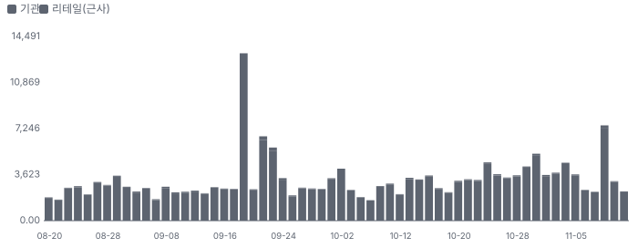

**기관 자금 흐름**

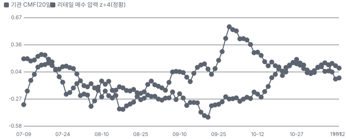

**몬테카를로**

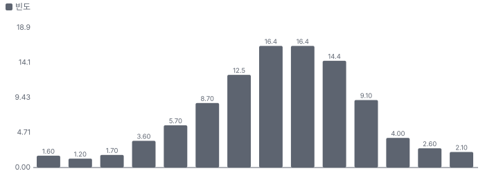

해석: 3,000번 중 0번(0%)에서 가치가 지금 주가 이상이었다. 가정을 흔들어도 지금 주가를 뒷받침하지 못하는 경우가 더 많다. 가운데 값은 0.24배이고, 열 번 중 여덟 번은 0.02~0.43배 사이에 든다.

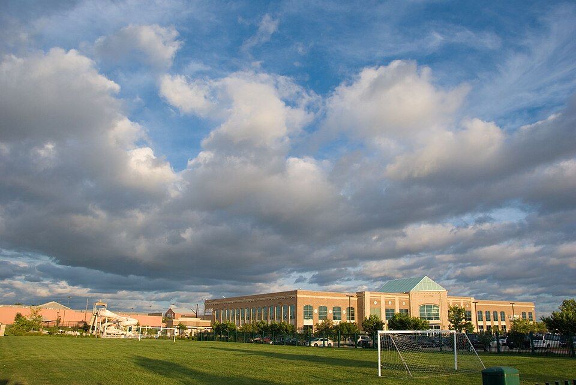
**회원 회비·가입비** — Life Time 클럽 건물 외관
_사진: Alicia Lee · CC BY-SA 2.0 · Wikimedia Commons_

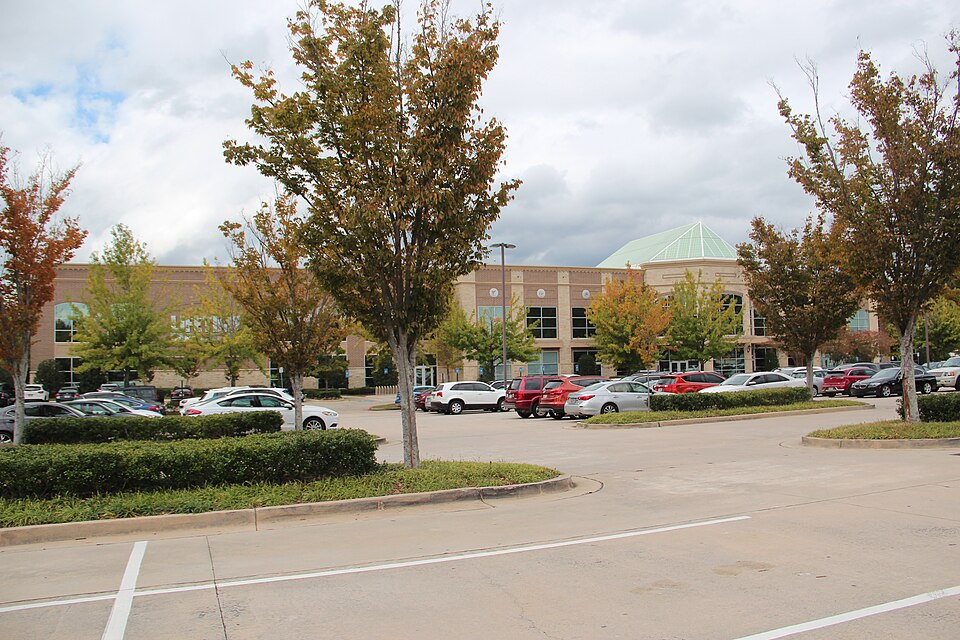
**Life Time 클럽(조지아 알파레타)** — Life Time 클럽 외관 — 조지아 알파레타(2017)
_사진: Thomson200 · CC0 · Wikimedia Commons_

## 내러티브

> **기업가치를 결정하는 이야기:** Life Time은 미국·캐나다에 196개의 대형 고급 클럽(평균 약 9.6만 sq ft)을 직접 지어 운영한다. 헬스장·수영장·테니스·피클볼·스파·카페·키즈 공간을 한 건물에 넣고 가족 단위 월 회비를 받는다. 매출의 70%는 회비, 28%는 트레이닝·카페·스파 같은 센터 내 지출이다. 기업가치는 회비 인상 여력, 신규 클럽 개장 속도, 그리고 개장 자금을 매각 후 재임차로 회수해 차입을 늘리지 않는 재무 구조로 정해진다

> **멀티플·EPS 프리미엄**
> **멀티플:** Fwd 1Y EV/EBITDA 14.4배로 동종 중앙(약 11.7배)보다 약 23% 높다. Fwd 1Y P/E는 23.6배다. 1년 전 약 11배에서 배수가 올랐다
> **EPS:** FY2027 EPS 컨센서스는 2Q 콜 직전 \$1.99에서 \$2.07로 4% 올랐다. 같은 기간 주가는 \$45.71 → \$45.54로 거의 그대로다 — 5월 급등 뒤에는 이익 추정 상향이 배수를 따라잡았다

### 투자자들은 왜 열광했나

2026년 5월 1Q 실적 뒤 이틀 동안 +28%(5/4 \$26.28 → 5/6 \$33.59) 올랐다. 회비 인상과 마진 개선이 예상보다 빨랐고 자체 현금으로 개장하는 구조가 확인됐다. 그 뒤 \$40~47 사이에서 움직였고 11월 고점은 \$48.61이다

### 무엇이 기업가치를 바꾸나

> **구조적 체질 변화**
> **변화:** 개장 자금을 차입 대신 매각 후 재임차(연 \$400M)와 영업현금으로 — 순차입 배수 1.3배, 잉여현금흐름 플러스
> **증거:** 3Q26 어닝콜(2026-10-29, 요지만 자기 말로)
> **반증:** 순차입 배수가 2배를 넘는다

> **고부가 믹스 확장**
> **변화:** 회비 단가 +12%와 센터 내 지출 +16.6% — 저가 의료 연계 회원은 줄인다
> **증거:** 3Q26 어닝콜(2026-10-29, 요지만 자기 말로)
> **반증:** 회비 성장이 5% 아래로 둔화한다

> **기술 혁신**
> **변화:** LT Digital(Life Time 회원용 앱, 운동 기록·예약·코칭) 앱·MIORA(Life Time의 장수·건강관리 클리닉 사업) 장수 클리닉 — 매출 기여 수치 미공시
> **증거:** 3Q26 어닝콜(2026-10-29, 요지만 자기 말로)
> **반증:** 새 사업 매출이 공시되지 않거나 적자를 키운다

> **실행 속도**
> **변화:** 해당 없음(납품 사업이 아니다 — 클럽 착공부터 개장까지 기간은 회사·동종 모두 공시하지 않는다) **납품 리드타임 미확인.** 피어 비교 미확인. 이전 대비 미확인.
> **증거:** 3Q26 어닝콜(2026-10-29, 요지만 자기 말로)
> **반증:** -

> **M&A**
> **변화:** 해당 없음(최근 큰 인수 없음 — 직접 개장)
> **증거:** https://www.sec.gov/cgi-bin/browse-edgar?action=getcompany&CIK=0001869198&type=10-Q
> **반증:** -

> **정책·입법 연관성**
> **재정정책:** 해당 없음(재정 지출과 직접 연결된 매출 없음) — 소비자 감세·환급이 고소득층 지출에 주는 간접 영향만 미확인 반증: - 의회 동의 2/10 — 하원 1/5(직접 관련 법안 없음) · 상원 1/5(같은 이유).
> **행정명령:** 해당 없음 — 관세 행정명령은 운동 기구·건설 자재 원가에만 간접 노출(추정) 미확인 반증: - 의회 동의 2/10 — 하원 1/5(논의 없음) · 상원 1/5(같은 이유).
> **연관입법:** 해당 없음(직접 관련 입법 확인 못 함) 미확인 반증: -

> **CAPEX 낙수효과**
> **변화:** 해당 없음(고객이 기업이 아닌 개인 회원 — 다른 회사의 CAPEX가 매출로 내려오지 않는다)
> **증거:** 3Q26 어닝콜(2026-10-29, 요지만 자기 말로)
> **반증:** -

### 내러티브 근거

> '고소득층의 생활 거점 클럽은 경기와 무관하게 회비를 올릴 수 있고, 이제 자체 현금으로 개장 자금을 댄다'는 이야기. 숫자가 받쳤다(평균 회비 +12%, EBITDA 마진 28.7%, 순차입 배수 1.3배). 주가는 1년 +76%, Fwd 1Y EV/EBITDA는 약 11배 → 14.4배. 동종 대비 멀티플 차이 +33% 중 회사 고유 몫은 +147%다. 단계는 확산, 쏠림은 중간이다.

> **회비 인상과 고급화** · 확인
> **논리:** 회원 수보다 회원당 매출을 키운다 — 평균 회비 +12%
> **숫자:** 평균 월 회비 \$244(+11.9%), 회원당 매출 \$1,016(+12%)
> **반증:** 회원 수가 2개 분기 연속 줄고 회비 성장이 둔화한다

> **자체 현금으로 개장(재무 체질)** · 확인
> **논리:** 매각 후 재임차와 영업현금으로 개장 자금을 대며 잉여현금흐름이 플러스로 돌았다
> **숫자:** 순차입 배수 1.3배, 2030 FCF 연 \$400M 목표
> **반증:** 재임차 조건 악화로 차입이 다시 늘어난다

> **센터 내 지출 확대(트레이닝·피클볼·MIORA)** · 확인
> **논리:** 센터 안에서 쓰는 돈이 회비보다 빨리 는다
> **숫자:** 센터 내 매출 \$249.0M(+16.6% YoY)
> **반증:** 센터 내 매출 성장이 10% 아래로 떨어진다

> **개장 속도(연 14곳)** · 확인
> **논리:** 2026·2027 각 14곳 — 물량 성장 약 7%
> **숫자:** 2027 14곳 대부분 착공
> **반증:** 2027 개장이 10곳 아래로 밀린다

> **반대 — 소비 둔화·고가 회비 탄력** · 잠복
> **논리:** 고가 회비는 경기 둔화 때 해지가 늘 수 있다
> **숫자:** 3Q 센터 회원 −0.1% QoQ(의료 회원 정리 포함)
> **반증:** 4Q 회원 증가가 가이던스(+2.4~3.1%)를 맞춘다

## 포트폴리오

| 제품·서비스 | 구분 | 무엇 | 쓰는 곳 | 돈 버는 방식 | Mix | Mix 변화(전 분기 대비) |
|---|---|---|---|---|---|---|
| 회원 회비·가입비 | 시설 | 대형 고급 클럽 월 회원권(가족 단위) | 운동·수영·테니스·피클볼·키즈 | 월 회비(평균 \$244) + 가입비 | 70% | +0.7%p |
| 센터 내 사업(트레이닝·카페·스파 등) | 서비스 | 개인 트레이닝, LifeCafe(클럽 안 식음료 매장), LifeSpa(클럽 안 스파·미용 서비스), 키즈 아카데미, 피클볼 리그, MIORA 클리닉 | 회원의 추가 지출 | 건별·패키지 결제 | 28% | +0.1%p |

**Mix 변화가 가장 큰 쪽은 기타 서비스(디지털·이벤트 등, -0.8%p, 전 분기 대비).** 계절성 판정: 분기 매출 계절 지수 기준 없음 → 직전 분기와 비교.

## 고객

> **3Q26 최대 고객 센터 회원(개인·가족, 회원) 95%, 상위 3곳 95%, 집중도 집중.** 공시·회사 발표로 확인한 몫은 매출의 95%이고, 나머지 고객 몫은 추정이거나 미분해다. 개인 회원이 고객이다 — 단일 고객 집중은 없다. 센터 회원 858,747명(의료 보험 연계 회원 정리 중), 평균 월 회비 \$244

**고객별 매출 몫(3Q26)**
| 고객 | 몫 | 변화 | 근거 |
|---|---|---|---|
| 센터 회원(개인·가족, 회원) | 95% | +0%p | 회사 발표 |
| 의료 보험 연계 회원(qualified medical) | 미확인 | 미확인 | 회사 발표 |
| 기타·미분해 | 5% | - | - |

> **센터 회원(개인·가족, 회원)** · 회사 발표
> **사는 것:** 월 회비·센터 내 서비스
> **추정 근거:** 회비 + 센터 내 매출 = 센터 매출 \$871.1M(전체의 97.5%)

> **의료 보험 연계 회원(qualified medical)** · 회사 발표
> **사는 것:** 보험사 프로그램 회원권
> **추정 근거:** 회사가 줄이고 있다 — 회원 수 증가율을 낮추는 요인

## 마진 구조

> **GPM 46.9%, OPM 17.7%.** 3Q25 대비 GPM -0.2%p, OPM +0.4%p. 변동비는 매출의 24%이고, 매출이 10% 늘면 OPM은 +5.3%p 움직인다. GAAP 영업이익률은 3Q 17.7%로 1년 새 +4.4%p 올랐다. 회비 단가 인상과 센터 내 지출 증가가 고정비(인력·임차·시설)를 덮은 결과다. 매출원가(센터 운영비)는 매출의 약 53%로 거의 그대로이고 판관비·감가 비중이 내려왔다(분해는 추정)

> **매출 100 중 매출원가 52.1, 매출총이익 47.9(최근 4분기, 공시).** 매출원가 요인 중 센터 인력(트레이너·운영)이 매출의 27.0%로 가장 무겁고, 단가가 +10% 오르면 GPM이 -2.70%p 움직인다. 분기 회귀로 매출 1이 늘 때 매출원가는 0.45 늘고, 매출원가의 고정비 몫은 19%다.

**비용 요인 강도 — 비중·추세·충격(+10%)·탄력**
| 비용 | 구분 | 매출 대비 | 1년 변화 | 마진 기여 | 충격 시 마진 | 매출 탄력 | 고정비 몫 |
|---|---|---|---|---|---|---|---|
| 센터 인력(트레이너·운영) | 매출원가 요인 | 27.0% | +0.0%p | -0.0%p | -2.70%p | 미확인 | 60% |
| 임차료(리스) | 매출원가 요인 | 12.0% | +0.0%p | -0.0%p | -1.20%p | 미확인 | 100% |
| 시설 운영(전기·수도·유지보수) | 매출원가 요인 | 8.0% | -0.5%p | +0.5%p | -0.80%p | 미확인 | 80% |
| 식음료·소매 원가 | 매출원가 요인 | 6.1% | +0.1%p | -0.1%p | -0.61%p | 미확인 | 0% |
| 매출원가 | 공시 항목 | 52.1% | -0.6%p | +0.6%p | -5.21%p | 0.45 | 19% |
| 판관비 | 공시 항목 | 19.0% | -0.7%p | +0.7%p | 미확인 | 0.07 | 73% |
| 감가상각 | 공시 항목 | 9.9% | +0.0%p | -0.0%p | 미확인 | 0.03 | 73% |
| 기타 영업비용 | 공시 항목 | 1.7% | -1.1%p | +1.1%p | 미확인 | 0.01 | 44% |

매출 탄력 = 분기 비용을 매출에 회귀한 기울기(매출 1당 변동비), 고정비 몫 = 절편 ÷ 평균 비용. 표본이 8분기 미만이면 미확인. 매출원가 요인 비중은 margin 재료의 추정이 섞여 있고, 공시 매출원가와의 차이는 '기타 매출원가'로 둔다.

**GPM에서 OPM까지(GAAP)**
| 기간 | GPM | 연구개발 | 판관비 | 기타 | OPM |
|---|---|---|---|---|---|
| 3Q25 | 47.1% | 0.0% | 18.8% | 10.9% | 17.3% |
| 3Q26 | 46.9% | 0.0% | 18.1% | 11.1% | 17.7% |

**GPM·OPM 최근 4개 분기**
| 분기 | GPM | OPM |
|---|---|---|
| 2025-12 | 49.1% | 17.4% |
| 2026-03 | 48.4% | 17.1% |
| 2026-06 | 47.6% | 17.3% |
| 2026-09 | 46.9% | 17.7% |

**마진을 결정하는 비용 요인 — 비용 +10% 시 OPM**
| 비용 | 매출 대비 | 변화 | 고정비 | OPM |
|---|---|---|---|---|
| 센터 인력(트레이너·운영) | 27.0% | +0.0%p | 60% | -2.70%p |
| 판관비(본사·마케팅) | 18.1% | -0.7%p | 70% | -1.81%p |
| 임차료(리스) | 12.0% | +0.0%p | 100% | -1.20%p |
| 감가상각·기타 | 11.1% | +0.2%p | 100% | -1.11%p |
| 시설 운영(전기·수도·유지보수) | 8.0% | -0.5%p | 80% | -0.80%p |
| 식음료·소매 원가 | 6.1% | +0.1%p | 0% | -0.61%p |

**비용을 움직이는 요인**
| 비용 | 요인 |
|---|---|
| 센터 인력(트레이너·운영, 매출원가) | 센터 직원·트레이너 급여 — 트레이닝 매출과 함께 늘어난다 · 근거 추정 |
| 판관비(본사·마케팅, 판관비) | 매출 증가에 고정비 레버리지 · 근거 공시 |
| 임차료(리스, 매출원가) | 매각 후 재임차로 늘지만 매출 대비 약 12% 유지(2Q 콜) · 근거 공시 |
| 감가상각·기타(기타) | 신규 클럽 감가상각 · 근거 공시 |
| 시설 운영(전기·수도·유지보수, 매출원가) | 에너지 단가·수영장 운영 · 근거 추정 |
| 식음료·소매 원가(매출원가) | LifeCafe·소매 판매량 · 근거 추정 |

**회원 회비·가입비 BOM — 매출의 70%, GPM 52%(회사 GPM 46.9%(3Q26)에서 회비 몫을 높게 둔 추정), 항목 가격 +10% 시**
| 항목 | 원가 몫 | 전가 | 제품 GPM | OPM |
|---|---|---|---|---|
| 센터 인력(트레이너·운영) | 30~40% | 미확인 | -1.7%p | -1.17%p |
| 임차료(리스) | 15~20% | 미확인 | -0.8%p | -0.58%p |
| 시설 운영(전기·수도·유지보수) | 10~15% | 미확인 | -0.6%p | -0.42%p |
| 운동 기구 | 2~4% | 미확인 | -0.1%p | -0.10%p |
| 미분해 | 32% | - | - | - |

**센터 내 사업(트레이닝·카페·스파 등) BOM — 매출의 28%, GPM 33%(인력 비중이 커 회사 GPM보다 낮게 둔 추정), 항목 가격 +10% 시**
| 항목 | 원가 몫 | 전가 | 제품 GPM | OPM |
|---|---|---|---|---|
| 센터 인력(트레이너·운영) | 40~55% | 미확인 | -3.2%p | -0.89%p |
| 식음료·소매 원가 | 15~25% | 미확인 | -1.3%p | -0.37%p |
| 임차료(리스) | 5~10% | 미확인 | -0.5%p | -0.14%p |
| 미분해 | 25% | - | - | - |

센터 인력(트레이너·운영) 가격이 +10% 오르면 영업이익은 -11.6% 움직인다. 판매가 전가를 모르는 항목은 전가 0%로 계산했다.

**BOM 항목 가격을 움직이는 것**
| 항목 | 요인 |
|---|---|
| 센터 인력(트레이너·운영) | 트레이너·운영 인력 임금 · 근거 추정 |
| 임차료(리스) | 재임차 임대료(연 인상 조항) · 근거 추정 |
| 시설 운영(전기·수도·유지보수) | 상업용 전력·수도 요금 · 근거 추정 |
| 운동 기구 | 기구 교체 단가(수입 의존) · 근거 추정 |
| 식음료·소매 원가 | 식자재·소매 상품 단가 · 근거 추정 |

**BOM 투입 물가 — PPI 전년비, 2026-11-13 수집**
| 항목 | 미국 | 일본 | 한국 | 대만 |
|---|---|---|---|---|
| 시설 운영(전기·수도·유지보수) | +2.9%* | 미확인 | 미확인 | 미확인 |
| 운동 기구 | +2.2%* | 미확인 | 미확인 | 미확인 |

별표는 품목보다 넓은 업종 지수다. 지난 1년 투입 물가를 판매가 전가 뒤 원가에 그대로 넣으면 OPM은 -0.14%p 움직인다(매출원가의 10% 기준).

## 공급망 병목

이미지 없음(검수 실패) — 회원 회비·가입비

> **공급망 신뢰성 7.3/10, 관리 가능.** 가장 약한 고리는 신규 클럽 부지·건설 7.3점이고, 품목 평균은 7.3점이다. 근거가 부족한 2건(매각 후 재임차 자금 · 운동 기구)은 점수에서 뺐다. 공급망 병목은 부품이 아니라 '새 클럽을 지을 땅·인허가·건설'과 '매각 후 재임차 자금'이다. 운동 기구·식음료는 여러 공급사에서 산다(공급사 이름 미공시)

**병목과 마진 — 품목 가격 +10% 시 OPM**
| 품목 | 점수 | 판정 | 구분 | OPM |
|---|---|---|---|---|
| 신규 클럽 부지·건설(필수) | 7.3 | 관리 가능 | 일반 | 미확인 |

> **신규 클럽 부지·건설** · 7.3/10
> **왜:** 성장의 유일한 물량 동인이 신규 클럽이다
> **병목 요인:** 인증 공급사 미확인 · 캐파 균형 · 리드타임 미확인 · 재인증 6개월 · 1위 점유율 미확인 · 미국 집중 100% · 물량 확보 내재화
> **풀리는 조건:** 2027분 대부분 착공(3Q 콜)

**공급사**
| 품목 | 공급사 | 몫 | 근거 |
|---|---|---|---|
| 신규 클럽 부지·건설 | 지역 시공사(이름 미공시, 클럽 건설) | 미확인 | 추정 |
| 매각 후 재임차 자금 | 부동산 투자자(이름 미공시, 클럽 건물 매입·재임대) | 미확인 | 회사 발표 |
| 운동 기구 | 기구 제조사(이름 미공시, 운동 기구) | 미확인 | 추정 |

**무역 통계로 본 공급 지역**
| 품목 | EU 수입처 | 일본 수입처 | EU 1위 전년비 |
|---|---|---|---|
| 운동 기구 | CN(중국) 88% · US 6% · TW(대만) 4% | 中華人民共和国 72% · 大韓民国 8% | +17.4% |

## 생산능력

> **현재 명목 캐파 196 센터, 가동률 미확인.** 착공 이상 증설은 28 센터, 발표까지 합치면 28 센터이다. 다 가동하면 지금보다 +14%, 착공 이상만이면 +14%다. FY2027 CAPEX는 \$1.20B로 매출의 32.3%다. 196개 센터, 총 1,890만 sq ft(3Q26). 2026년 14곳(4Q 7곳), 2027년 14곳을 연다. 센터별 가동률은 공시하지 않고 회원 수·방문 횟수로 수요를 본다

**생산시설 196곳**(센터 수(3Q26 KPI). 10-K Item 2 소유·임차 구분은 이번 회차 미대조) — 이름·위치를 밝힌 곳 1곳, 미확인 1곳. 시설별 생산능력은 공개되지 않았다 — 회사 전체 캐파만 위에 적었다.

**생산시설 196곳 — 명칭·위치·생산능력**
| 시설 | 위치 | 용도 | 생산능력 | 소유·상태 |
|---|---|---|---|---|
| 본사(Chanhassen) | 미국 미네소타 찬하센 | 본사 | 미확인 — 미공시 | 미확인 · 가동 |

**생산능력 확충 계획**
| 계획 | 단계 | 증설 | 가동 시점 | CAPEX |
|---|---|---|---|---|
| 2026 신규 클럽(남은 4Q 7곳 포함 연 14곳) | 착공 | 14 센터 | 2026-12 | 미확인 |
| 2027 신규 클럽 | 착공 | 14 센터 | 2027-12 | 미확인 |

남은 계획의 CAPEX 합계는 \$0.00B(금액 미확인 2건 제외)다. 합계는 FY2027 매출의 0%다.

**증설 방해 요인**
| 계획 | 방해 요인 |
|---|---|
| 2026 신규 클럽(남은 4Q 7곳 포함 연 14곳) | 개장 지연 · 초기 적자 |
| 2027 신규 클럽 | 대부분 착공 — 일부 인허가 · 금리(재임차 조건) |

**CAPEX와 매출 대비**
| 기간 | CAPEX | 매출 | 매출 대비 | 구분 |
|---|---|---|---|---|
| FY2024 | \$0.60B | \$2.62B | 22.9% | 추정 |
| FY2025 | \$0.80B | \$3.00B | 26.7% | 추정 |
| FY2026 | \$1.10B | \$3.38B | 32.4% | 컨센서스 |
| FY2027 | \$1.20B | \$3.71B | 32.3% | 컨센서스 |

## 해자

> 해자는 '큰 부지에 직접 짓는 대형 클럽(평균 약 9.6만 sq ft)'이라는 물리적 규모와, 고소득층 회원이 가족 단위로 쓰는 생활 거점이라는 습관이다. 같은 동네에 비슷한 시설을 지으려면 수천만 달러와 몇 년의 인허가가 든다. 위협은 소비 둔화와 리스·차입이라는 재무 구조다

> **부지·시설 규모(진입 장벽)** · 강함
> **해자:** 196개 센터, 총 1,890만 sq ft — 센터당 평균 약 9.6만 sq ft
> **근거:** 손익·KPI(3Q26 10-Q)
> **숫자:** 센터 196곳·1,890만 sq ft(3Q26)
> **깨지는 조건:** 경쟁사가 같은 상권에 대형 고급 클럽을 연다

> **가격 결정력(회비 인상)** · 강함
> **해자:** 평균 월 회비가 1년 새 약 12% 올랐는데 회원 방문은 늘었다
> **근거:** 3Q26 어닝콜(2026-10-29, 요지만 자기 말로)
> **숫자:** 평균 월 회비 \$244(+11.9%), 월 방문 13회(+4%)
> **깨지는 조건:** 회비 인상 뒤 해지율이 오른다(공시 시)

> **센터 내 지출(생태계)** · 보통
> **해자:** 트레이닝·카페·스파·피클볼 등 센터 안 지출이 매출의 약 28%
> **근거:** 손익·KPI(3Q26 10-Q)
> **숫자:** 센터 내 매출 \$249.0M(3Q, +16.6% YoY)
> **깨지는 조건:** 센터 내 매출 성장이 회비 성장보다 낮아진다

> **재무 구조(리스·차입)** · 약점
> **해자:** 리스 부채 \$2.8B와 차입 \$1.5B — 매각 후 재임차로 성장 자금을 대므로 임차료가 고정비로 쌓인다
> **근거:** 10-Q 2026-09-30(컨센서스 표준화)
> **숫자:** 순차입 배수 1.3배(리스 제외), 임차료 매출의 약 12%(2Q 콜)
> **깨지는 조건:** 금리 상승으로 재임차 조건이 나빠진다

## 경영진·네트워크

> 창업자 Bahram Akradi가 1992년부터 회장·CEO다. 2015년 사모펀드(Leonard Green·TPG) 비공개 전환과 2021년 재상장을 이끌었다. CFO는 Erik Weaver

> **Bahram Akradi** · 창업자·회장·CEO · 1992
> **프로필:** 회사 창업, 3Q 콜에서 회원 참여·개장 계획 설명
> **비즈니스:** 전사
> **정계:** 미확인
> **동문:** 미확인
> **사모임:** 미확인

> **Erik Weaver** · EVP·CFO · 미확인
> **프로필:** 3Q 콜 재무·가이던스·매각 후 재임차
> **비즈니스:** 재무
> **정계:** 미확인
> **동문:** 미확인
> **사모임:** 미확인

**네트워크 정량화**
| 연결 | 강도 | 닿는 매출 | 가중 노출 | 매출 대비 | 근거 |
|---|---|---|---|---|---|
| 비즈니스: 부동산 투자자와의 매각 후 재임차 거래(연 \$400M) — 성장 자금 조달 경로 | 3/5 | 미확인 | 미확인 | 미확인 | 거래 상대 미공시 3Q26 어닝콜(2026-10-29, 요지만 자기 말로) |
| 금융: 대주주 사모펀드(Leonard Green·TPG, 재상장 뒤 지분 보유 — 현재 지분율 미대조) | 2/5 | 미확인 | 미확인 | 미확인 | 위임장 미대조 https://www.sec.gov/cgi-bin/browse-edgar?action=getcompany&CIK=0001869198&type=10-K |

가중 노출은 연결이 닿는 매출의 크기다. 연결이 그 매출을 만들었다는 뜻이 아니며, 인과는 공개 자료로 입증하지 못한다.

## 약세 논리 및 셀온 조건

| 약세 논리 | 근거 | 반박 | 가를 자료 · 공개 시점 |
|---|---|---|---|
| 회원 수가 늘지 않고 회비만 오른다 | 센터 회원 860,041 → 858,747(2Q → 3Q) | 줄어든 몫은 저가 의료 연계 회원 정리 — 이를 빼면 4Q +4.8~5.2% 예상(회사) | 4Q26 센터 회원 — 2027-02 실적 |
| 배수가 동종보다 높다 | Fwd 1Y EV/EBITDA 14.4배 vs 동종 중앙 약 11.7배 | 동종 중 성장·마진을 함께 내는 곳이 없다(동종 다수가 역성장·적자) | 2027 EBITDA 가이던스 — 2027-02 |
| 리스는 숨은 차입이다 | 리스 부채 \$2.81B, 임차료 매출의 약 12%(2Q 콜) | 재임차로 받은 현금으로 차입을 줄여 순차입 1.3배 | 4Q 재임차 \$135M 체결 조건 — 2027-02 |
| 고가 회비는 경기에 약하다 | UBS의 소비 둔화 질문(3Q 콜) | 월 방문 13회(+4%) — 이용 빈도가 해지 위험을 낮춘다 | 동일 센터 매출 성장률 — 분기마다 |
| 대주주 지분 매도 | 사모펀드 대주주(Leonard Green·TPG) 잔여 지분(지분율 미대조) | 재상장 뒤 여러 번 매도를 소화했다(추정) | 13G·Form 4·2차 매도 공시 |

> **셀온 조건**
> **조건 1:** 4Q26 센터 회원 증가가 가이던스 하단(+2.4%) 아래 — 회비 인상이 회원을 밀어내기 시작했다는 신호
> **조건 2:** 평균 월 회비 성장이 5% 아래로 둔화
> **조건 3:** 2027 개장이 10곳 아래로 밀리거나 개장 비용으로 EBITDA 마진이 27% 아래
> **조건 4:** 재임차 조건 악화로 순차입 배수(리스 제외)가 2배를 넘는다
> **조건 5:** 동일 센터 매출 성장이 5% 아래로 떨어진다

## 어닝콜 변화

**직전 콜 대비 새로 나오거나 바뀐 내용 → 가치 영향**
| 항목 | 내용 | 직전 콜 | 최신 콜 | 모델 동인 이동 | 확신도 | 가치 영향 |
|---|---|---|---|---|---|---|
| 업데이트 | 동일 센터 매출 가이던스 | +7.9~8.3% | +8.5~8.7% | 기준연도 매출 +\$0.00B | 0.8 | +0.2% |
| 업데이트 | 조정 EBITDA 마진 | 중간 28.2% | 중간 28.4%(3Q 28.7%) | 출발 이익률 +0.20% | 0.8 | +0.3% |
| 업데이트 | 회비 단가 | 2Q 평균 회비 상승(수치 미대조) | 평균 월 회비 \$244(+11.9%), 회원당 매출 \$1,016(+12%) | 1년차 성장률 +0.50% | 1.0 | -2.1% |
| 신규 | 2027 개장 계획 | 2027 착공 진행(수치 없음) | 2027 신규 14곳, 대부분 착공 | 장기 성장 수렴값 +0.50% | 0.8 | -0.5% |
| 반복 | 매각 후 재임차 | 연 \$400M | 연 \$400M(4Q \$135M 남음) | 매출÷투하자본 — | 0.8 | +0.0% |
| 부정 | 회원 수 | 2Q 센터 회원 860,041 | 3Q 858,747(의료 회원 정리), 4Q +2.4~3.1% 예상 | 1년차 성장률 -0.20% | 1.0 | +0.9% |
| **합계** | 단독 합 |  |  | 동시 적용 -1.3% |  | **-1.3%** |

**사건별 EPS 리비전**
| # | 날짜 | 구분 | 사건 | CY2026 EPS 전→후 | CY2027 EPS 전→후 | 리비전 | 주가 반응 |
|---|---|---|---|---|---|---|---|
| ① | 26-02-24 | 실적 | 4Q25 실적·2026 가이던스 | \$1.57 → \$1.60 | \$1.73 → \$1.73 | +0.0% | -2.0% |
| ② | 26-05-05 | 실적 | 1Q26 상회, 이틀 +28% | \$1.65 → \$1.65 | \$1.84 → \$1.88 | +2.2% | +11.8% |
| ③ | 26-07-30 | 실적 | 2Q26 가이던스 상향 | \$1.70 → \$1.75 | \$1.99 → \$1.99 | +0.0% | -3.3% |
| ④ | 26-10-29 | 실적 | 3Q26 상회·상향, 당일 +5% | \$1.76 → \$1.82 | \$1.98 → \$2.06 | +4.1% | +5.1% |

**해석:** 3개 구간 누적 주가 +60% = EPS 리비전 +16% × 멀티플 +39%. 더 크게 움직인 쪽은 **멀티플**이다.

## 밸류에이션

> **목표주가 \$41, 업사이드 -10%.** 자리는 기본과 강세 사이(강세 쪽 7%)이고 도달 확률은 약 47%다. 기본 \$40, 강세 \$54(+18%), 약세 \$27(-41%). DCF 기준 업사이드는 기본 -80%, 강세 -66%, 약세 -80%다(WACC 9.0%).

기준 멀티플이 Fwd 1Y EV/EBITDA라 시나리오도 다음 4개 분기 조정 EBITDA로 둔다. 확률은 세 분기 연속 가이던스 상향과 회원 수 정체를 함께 반영해 약세 25%·기본 50%·강세 25%에 둔다. 4Q26 조정 EPS 컨센서스는 \$0.33~0.56으로 범위가 넓다 — 4Q에 7곳이 문을 열어 개장 비용이 몰린다.

> **약세 \$27 (-41%)** · 확률 25%
> **가정:** 7.5배 × EBITDA \$0.98B
> **근거:** 소비 둔화로 회원이 줄고 동일 센터 성장이 5%대로 낮아진다. 신규 클럽 초기 적자가 겹쳐 조정 EBITDA 약 \$0.98B(마진 약 27.5%)

> **기본 \$40 (-13%)** · 확률 50%
> **가정:** 10.0배 × EBITDA \$1.04B
> **근거:** 회비 인상과 개장이 가이던스대로 이어진다. 매출 약 \$3.64B(다음 4개 분기 컨센서스), 조정 EBITDA 약 \$1.04B(마진 약 28.5%)

> **강세 \$54 (+18%)** · 확률 25%
> **가정:** 12.6배 × EBITDA \$1.09B
> **근거:** 회원 증가가 4%대로 돌아오고 센터 내 지출이 +15% 이상 이어진다. 매출 약 \$3.72B, 조정 EBITDA 약 \$1.09B(마진 약 29.3%)

**멀티플 선정 — Fwd 1Y EV/EBITDA**
| 단계 | 조정 | 근거 |
|---|---|---|
| 동종 중앙값 | 10.8배 | 범위 8.8~11.1배, 4곳 |
| 펀더멘털 | -20% | 성장·이익률·ROIC로 본 합리적 멀티플 5.8배와의 차이의 일부만 인정 |
| 해자 | +10% | 부지·시설 규모(진입 장벽) 강함 · 가격 결정력(회비 인상) 강함 · 센터 내 지출(생태계) 보통 · 재무 구조(리스·차입) 약점 |
| 반복 매출 | -2% | 반복 매출 70%(동종 75%) · 월 회원 회비 · 이미 반복 단계 · 기반 센터 회원 858,747명(3Q26) |
| 수주 전환·가시성 | +0% | 재료 없음 |
| 내러티브 | +5% | 단계 확산 |
| 사이클·실행 판단 | +0% | 요인에 없는 조정은 하지 않는다 |
| **선정** | **10.0배** | 지금 14.4배 |

**동종 레인지**
| 회사 | Fwd 1Y EV/EBITDA | Fwd 2Y EV/EBITDA | 성장 | 영업이익률 | ROIC |
|---|---|---|---|---|---|
| MTN | 11.1 | 10.3 | 9% | 16% | 10% |
| PLAY | 8.8 | 8.8 | 2% | 5% | 5% |
| VAC | 10.7 | 10.0 | 5% | 32% | 17% |
| MODG | 10.9 | 12.4 | 0% | 10% | 9% |
| **Life Time Group Holdings** | 14.4 | 12.9 |  |  |  |

> **PEG 1.50** — Fwd 1Y P/E 23.6배를 다음 해 EPS 성장 16%로 나눈 값, 동종 중앙 1.06(성장 대비 비싸다). 성장률은 Fwd 1Y·2Y P/E에서 역산한 컨센서스라 다음 해 한 해 성장만 반영하고, 성장 지속 기간은 담지 않는다.

**PEG — Fwd 1Y P/E ÷ 다음 해 EPS 성장률**
| 회사 | Fwd 1Y P/E | 다음 해 EPS 성장 | PEG |
|---|---|---|---|
| **Life Time Group Holdings** | 23.6 | +16% | 1.50 |
| PLNT | 17.2 | +15% | 1.15 |
| XPOF | 9.1 | - | - |
| LUCK | - | - | - |
| MTN | 27.3 | +28% | 0.97 |
| FUN | - | - | - |
| PLAY | - | - | - |
| VAC | 11.0 | - | - |
| MODG | 14.7 | - | - |

몬테카를로 중앙값 업사이드 -76%.

> 의사결정 보조(투자자문 아님): ① 매수 매력: 5년 보유 가정 연 기대수익 -18.8% — 주주가 요구하는 수익률(자기자본비용) 9.4%보다 -28.2%p · 요구수익률을 넘을 확률 0% · 안전마진 0.02(비관적 경우의 기업가치가 지금 시가총액의 2%) → 정량 신호 약함 / ② 위험 예산 지표(이론): 0% — 기대수익이 요구수익률에 못 미친다(켈리 기준 — 수익·손실 확률로 계산한 이론상 최대 노출 — 0%는 참고) · 5년 뒤 나쁜 경우(하위 10%) -97% · 30% 넘게 잃을 확률 93% / ③ 상방(5년): 평균 0.35배 · 2배 이상 확률 0% · 3배 이상 0% · 10배 이상 0% · 잘 풀린 경우(상위 10%) 0.65배 이상

투입 물가 점검: 지난 1년 PPI(생산자물가지수)를 BOM에 넣으면 OPM -0.14%p다(매출원가의 10% 기준).

## 매수 위치(일봉)

> **현재가 \$45.54는 '지지 근접'(가장 가까운 일봉 지지 \$44.94에서 ATR 0.3배 위).** 이 자리에서 목표주가까지 -10.0%, 첫 일봉 저항까지 +3.7%, 다음 지지까지 하방 -1.3%, 손익비 -7.6배. 손익비는 지지 3 \$43.14에서 -1.9배로 가장 높다(목표주가까지 -5.0%).

**가격대별 업사이드(일봉 기준)**
| 가격대 | 가격 | 목표주가까지 | 첫 저항까지 | 다음 지지까지 | 손익비 | 근거 기법(강도) |
|---|---|---|---|---|---|---|
| 현재가 | \$45.54 | -10.0% | +3.7% | -1.3% | -7.6 | - |
| 지지 1 | \$44.94 | -8.8% | +5.1% | -1.4% | -6.4 | 피보 78.6%(1.0) |
| 지지 2 | \$44.33 | -7.5% | +1.4% | -2.7% | -2.8 | 20일선(0.5) |
| 지지 3 | \$43.14 | -5.0% | +2.7% | -2.6% | -1.9 | 피보 61.8%(1.0) |
| 지지 4 | \$42.00 | -2.4% | +2.7% | 미확인 | 미확인 | 50일선 · 피보 50.0%(2.0) |

**일봉 저항**
| 저항 | 가격 | 현재가 대비 | 근거 기법(강도) |
|---|---|---|---|
| 저항 1 | \$47.23 | +3.7% | 120일 지그재그 고점 · 스윙 고점(1.8) |

일봉만 쓴다(주봉·월봉 제외). 손익비 = 목표주가까지 업사이드 ÷ 다음 지지까지 하방. 가격대별 기대값 참고표이며 매수·매도 시점 지시가 아니다.

## 애널리스트 토론

> **토론 결론 Neutral(규칙 등급 Neutral).** 회비 인상·마진·개장 계획은 1차 자료로 확인됐다. 그러나 동종 레인지로 고른 배수(Fwd EV/EBITDA 10배)로는 목표가 \$41이 주가보다 10% 낮다 — 살아남은 반박은 '배수가 이미 실행을 반영했다'와 '회원 수 정체·리스 고정비'다. 4Q 회원 수와 2027 가이던스가 가를 자료다

**패널 — 등급별 자리**
| 자리 | 핵심 논리 | 틀리는 조건 | 최종 투표 |
|---|---|---|---|
| Strong Buy | 회비 인상력과 연 14곳 개장이 함께 가는 드문 소비 성장주다 | 4Q 회원 증가가 가이던스 하단 아래 | Buy |
| Buy | 잉여현금흐름이 플러스로 돌아 배수가 더 오를 여지가 있다 | 재임차 조건 악화로 차입 증가 | Neutral |
| Neutral | 좋은 회사지만 Fwd EV/EBITDA 14.4배가 동종보다 23% 높다 | 2027 EBITDA 컨센서스가 \$1.1B를 넘는다 | Neutral |
| Sell | 회원 수가 늘지 않고 회비만 오른다 — 해지가 나오면 꺾인다 | 4Q 회원 +2.4% 이상 | Neutral |
| Strong Sell | 리스 \$2.8B는 숨은 차입이다 — 경기 둔화 때 고정비가 이익을 깎는다 | 경기 둔화에도 동일 센터 매출 +5% 이상 | Sell |

**투표**
| Strong Buy | Buy | Neutral | Sell | Strong Sell |
|---|---|---|---|---|
| 0 | 1 | 3 | 1 | 0 |

> **개회 · Strong Buy**
> **발언:** 회비와 회원당 매출이 1년 새 12% 올랐다

> **개회 · Buy**
> **발언:** 이제 자체 현금으로 클럽을 짓는다

> **개회 · Neutral**
> **발언:** 배수가 동종보다 높다

> **개회 · Sell**
> **발언:** 회원 수가 3Q에 줄었다

> **개회 · Strong Sell**
> **발언:** 리스가 숨은 차입이다

> **반박1 · Strong Buy → Sell**
> **발언:** 회원 감소는 저가 의료 연계 회원을 정리한 것이다. 제외하면 +4.8~5.2%다

> **반박1 · Sell → Strong Buy**
> **발언:** 그 숫자는 4Q 가이던스일 뿐 실적이 아니다

> **반박1 · Neutral → Buy**
> **발언:** 목표가 평균 \$57이면 +25%지만 사모펀드 매도가 남았다

> **반박1 · Buy → Neutral**
> **발언:** 매도 물량은 이미 여러 번 소화됐다

> **반박1 · Strong Sell → Strong Buy**
> **발언:** 임차료 12%는 경기와 무관하게 나간다

> **반박2 · Strong Buy → Strong Sell**
> **발언:** 방문 횟수가 +4% — 회원이 더 자주 온다

> **반박2 · Strong Sell → Strong Buy**
> **발언:** 방문 증가는 해지 위험을 낮추지만 경기 둔화 시험은 아직 없다

> **반박2 · Neutral → Buy**
> **발언:** 5월 이후 주가는 옆으로 갔다 — 이익이 배수를 따라잡는 중이다

> **반박2 · Buy → Neutral**
> **발언:** 그래서 지금이 배수 부담이 줄어든 구간이다

> **반박2 · Sell → Buy**
> **발언:** 회비 인상이 멈추면 성장은 개장 7%뿐이다

> **최종 · Strong Buy** · Buy
> **발언:** 실행은 확인됐지만 선정 배수 10배 기준 목표가 \$41이 주가 아래다 — Buy로 물러선다

> **최종 · Buy** · Neutral
> **발언:** 배수가 동종 레인지 위라 Neutral로 간다

> **최종 · Neutral**
> **발언:** 4Q 회원 수와 2027 가이던스를 본다 — Neutral

> **최종 · Sell** · Neutral
> **발언:** 4Q 회원 수를 보겠다 — Neutral

> **최종 · Strong Sell** · Sell
> **발언:** 리스 위험을 남겨 Sell

남은 반대 의견: Strong Buy 자리는 회비 인상력이 동종과 다른 배수를 정당화한다고 끝까지 남겼다

패널은 등급별 논리를 대표하는 자리이고 실존 IB의 의견이 아니다.

## 커뮤니티 반응

언급 적음 — Quantral 24h·7d 언급 없음(2026-11-13) — 최근 신호는 'X 게시글이 올해 +69% 상승과 경영진 실행을 짚었다'는 한 줄뿐

## 시장 평가

> **셀사이드(IB 애널리스트)**
> **한 줄:** 의견은 거의 만장일치 매수이고 목표가 하단(\$52)도 주가보다 14% 높다. 3Q 콜 질문은 소비 둔화·재임차 시장·회원 수 바닥이 초점이었다
> **애널리스트 의견(16명):** Strong Buy 13 · Buy 2 · Hold 1
> **목표가 평균(15명):** \$57.13(범위 \$52~69)
> **FY2027 EPS 컨센서스:** \$2.07(7/29 \$1.99 → 11/4, +4%)

> **바이사이드(기관 투자자)**
> **한 줄:** 사모펀드 대주주의 잔여 지분 매도(오버행)가 주가 상단을 누르는 요인이다(추정)
> **기관 보유:** 미확인
> **대주주:** Leonard Green·TPG(재상장 뒤 지분 매도 진행 — 현재 지분 미대조)

> **언론·업계**
> **한 줄:** 5월 급등 원인은 1Q 상회와 연간 가이던스 상향 — 1차 보도 대조는 회사 발표만
> **주요 제목:** 1Q 상회 뒤 이틀 +28%(5/5~6), 3Q 상회·상향(10/29)

## 체크리스트

| 시점 | 무엇 | 의미 |
|---|---|---|
| 2027-02 | 4Q26 실적: 센터 회원 증가(가이던스 +2.4~3.1%)·평균 회비·동일 센터 매출 | 회비 인상과 회원 증가가 함께 가는지 |
| 2027-02 | 2027 가이던스: 동일 센터 성장·개장 14곳·EBITDA 마진·재임차 목표 | Fwd 14배 배수가 정당한지 가른다 |
| 2026-12 | 4Q 신규 7곳 개장·재임차 \$135M 체결 | 개장 속도와 자금 조달 조건 |
| 2027-05 | 1Q27 실적: 1월 가입 시즌 회원 증가 | 연초 가입이 회비 인상 뒤에도 유지되는지 |
| 수시 | 대주주 지분 매도(2차 매도·13G) | 주가 상단 물량 부담 |

## 출처
- 2Q26 어닝콜(2026-07-30, 요지만 자기 말로)
- 10-Q 2026-09-30 미대조
- 10-Q 2026-09-30 미대조(추정)
- 3Q26 어닝콜(2026-10-29, 요지만 자기 말로)
- https://www.sec.gov/cgi-bin/browse-edgar?action=getcompany&CIK=0001869198&type=10-K

_구매 등급·목표주가 모두 규칙이 계산한 모델 값으로, 개인의 보유 종목·자금 사정을 반영하지 않는다 · 공개 자료 기반 분석이며 투자 권유가 아님 · 1차 판정, 미검증 · Chiip ten-bagger_