# 텐배거 리포트 2026-11-13 — Unity — 엔진 회사가 AI 광고 회사가 됐다, 남은 질문은 Vector의 지속성과 AppLovin과의 격차

> 2026-11-13 · Unity Software Inc.(U) · 기업: 게임 엔진(Unity 런타임·에디터, Create — 구독)과 모바일 앱 광고 플랫폼(Grow — AI 광고 모델 Vector·광고 중개 LevelPlay)을 함께 파는 회사 — 3Q 매출의 73%가 광고, 27%가 엔진 구독

## Chiip View

주가는 11/12 \$50.18, 시가총액 \$22.27B, 현금 \$2.65B·차입 \$2.24B(11/15 만기 \$558M 현금 상환)다. 3Q 전략 매출 \$597M(+59%)·조정 EBITDA \$257M(마진 41%)로 가이던스를 크게 넘었고, 4Q도 매출 +65~67%·마진 42%를 안내했다. 다음 4개 분기 조정 EBITDA 컨센서스는 \$1.40B이고, Fwd 1Y EV/EBITDA는 21.2배로 동종 중앙(약 15배)보다 약 40% 높다. 이 배수는 \$1.40B 기준이 아니다 — \$1.40B로 다시 계산하면 15.6~17.6배다. 성장 속도가 배수를 받치지만, 매출의 약 70%가 Vector(Unity의 AI 광고 추천·입찰 모델) 한 동인에 걸렸고 광고 규모는 AppLovin의 약 5분의 1이다 — 가를 것은 4Q Vector 성장(+21~23% QoQ 가이던스)과 2027 전망이다.

## 대시보드
| 항목 | 값 | 설명 |
|---|---|---|
| 주가 | \$50.18 | 고점 대비 -3% · 1년 +25% |
| 시가총액 | \$25.11B | 완전 희석 기준 · EV \$24.70B |
| 업사이드 | +4% | 목표주가 \$52 · 다운사이드 -34% · 손익비(강세÷약세) 1.6 |
| 구매등급 | Neutral | 애널리스트 25명: Strong Buy 20 · Buy 2 · Neutral 3 · Sell 0 · Strong Sell 0 |
| 멀티플 | Fwd 1Y EV/EBITDA 21.2배 | 동종 중앙값 15.1배 |
| 가이던스 4Q26 |  | 컨센서스 미확인 |
| 알파 | 6.5/10 | 텐배거 가능성 점수 |
| 이벤트 | 4Q26 실적·2027 전망(2월 중순 관행, 날짜 미확정) | 2027-02-11 |

## 한 장 요약
- **기업가치를 결정하는 내러티브** Unity의 값은 **AI 광고 모델 Vector가 AppLovin의 독주 속에서 2위 자리를 얼마나 빨리, 얼마나 오래 키우느냐**에 달렸다. 3Q는 그 속도를 확인했다 — Vector +126% YoY(+40% QoQ), 전략 매출 +59%, 조정 EBITDA 마진 41%, 첫 GAAP 흑자. 주가는 3월 저점 \$17에서 \$50으로 올라 Fwd 1Y EV/EBITDA 21배가 됐고, 동종 중앙(약 15배)보다 높다. Silver Lake·PIF(사우디아라비아 국부펀드) 인수 협의 보도는 확인되지 않은 변수다
- **밸류에이션 모델로 본 주가 상방은 어디까지인가?** **목표주가 \$52(+4%), 약세와 기본 사이(약세 쪽 6%)다.** 강세 \$78(+55%)는 Fwd 1Y EV/EBITDA 23.3배를 강세 EBITDA에 적용한 값이다. 기본 \$53, 약세 \$33. 손익비 1.6, DCF 기준 업사이드 -34%.
- **누가 사 주나?** 최대 고객 모바일 게임 퍼블리셔(광고주)(Grow(Unity의 광고·수익화 사업부) 고객) 72%, 상위 3곳 99%. 공시·회사 발표로 확인한 몫은 99%다.
- **마진과 공급망은 어디가 약한가?** GPM 81.9%, OPM 16.2%. OPM을 가장 흔드는 BOM(제품 원가를 이루는 부품·재료 명세) 항목은 클라우드·광고 서빙 비용이고 가격 +10%에 -0.16%p다. 공급망 신뢰성은 5.3/10(병목 주의)이고 가장 약한 고리는 클라우드 컴퓨팅(모델 학습·광고 서빙)이다.
- **지금 가격은 무엇을 가정하나?** 시가총액 \$22.27B에 순현금 약 \$0.4B다. 다음 4개 분기 조정 EBITDA 컨센서스는 \$1.40B다. Fwd 1Y EV/EBITDA는 21.2배로 동종 중앙(약 15배)보다 약 40% 높고, Fwd 2Y 15.6배·3Y 12.3배다. 조정 EBITDA \$1.40B로 다시 계산하면 Fwd 1Y는 15.6배(EV \$21.9B)~17.6배(완전 희석 EV \$24.7B)다 — 컨센서스 배수와의 차이는 주식보상비용(SBC) 처리 등 EBITDA 기준 차이로 추정(미확인). 지금 가격은 Vector가 2027년에도 연 50% 안팎으로 커져 조정 EBITDA가 1년 새 두 배 가까이 느는 경로를 가정한다. 애널리스트 목표가 평균은 \$57.84(24명)다.
- **왜 움직였나?** 1년 동안 약 +25% 올랐지만 길은 V자였다. 1월 Google AI 월드 모델 공개와 2월 2026 전망 실망으로 3월 \$17까지 떨어졌다가, 2Q·3Q 실적이 연속으로 가이던스를 크게 넘으며 약 3배가 됐다. 2Q 콜 이후 +41% 오른 몫의 대부분은 이익 추정 상향(FY2027 EPS +56%)이고, 배수는 오히려 내려왔다.
- **3Q에서 무엇이 바뀌었나?** Vector 분기 성장이 가이던스 +19~21%의 두 배인 +40%였고, 4Q 가이던스를 +21~23%로 올렸다. 조정 EBITDA 마진은 안내(약 33%)보다 높은 41%였고 4Q 42%를 안내했다. GAAP 흑자를 한 분기 당겨 달성했고, Google과 만든 Unity Spark(Google과 만든 브라우저 기반 게임 제작 플랫폼)가 처음 나왔다. 반대로 Create(Unity의 엔진·창작 도구 구독 사업부) 성장은 4Q +4~6%로 둔화를 안내했다.
- **무엇이 바뀌면 판단이 달라지나?** 위로: 4Q Vector가 +23%를 넘고 2027 전망이 전략 매출 +40% 이상·조정 EBITDA 마진 45% 이상이면 2027 EBITDA 추정이 \$1.6B를 넘는다. 아래로: Vector 분기 성장이 10% 아래로 꺾이거나, AppLovin과의 가격 경쟁으로 마진이 40% 아래로 내려오거나, 인수 협의 결렬 보도로 인수 기대 몫이 빠지면 약세 시나리오로 옮긴다.

## 한눈에 보기

**일봉**

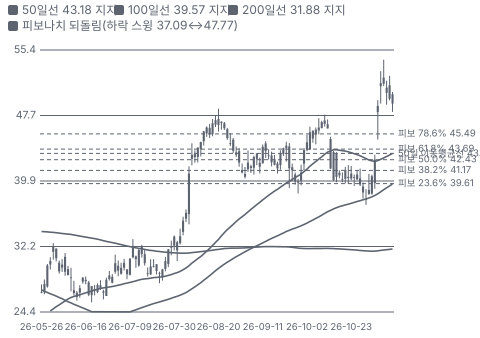

**주봉**

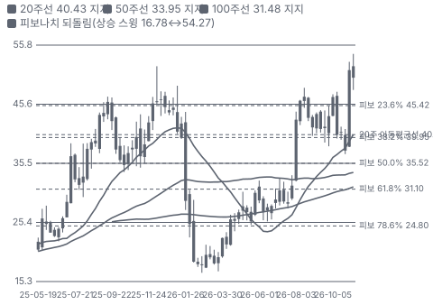

**월봉**

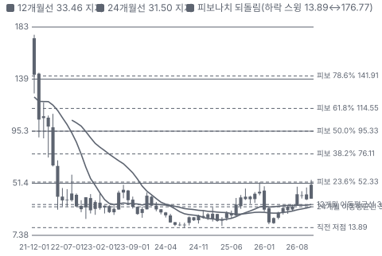

**분기 매출·EPS 실적과 컨센서스**

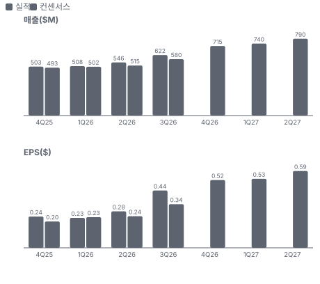

**최근 4개 분기 주가 변화 분석**

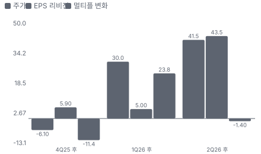

**EPS 리비전**

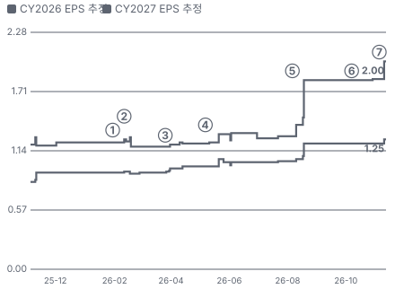

① 26-01-30 Google Genie 공개, 하루 −24% · EPS 리비전 +0%
② 26-02-11 4Q25·2026 전망 실망 −26% · EPS 리비전 -3%
③ 26-03-26 1Q 잠정·비전략 광고 철수 · EPS 리비전 +2%
④ 26-05-07 1Q26 상회·손상 반영 · EPS 리비전 +7%
⑤ 26-08-06 2Q26 상회, 당일 +15% · EPS 리비전 +43%
⑥ 26-10-07 Google·Spark 협력 · EPS 리비전 +0%
⑦ 26-11-05 3Q26 상회·첫 GAAP 흑자 · EPS 리비전 +9%

**밸류에이션 주가 시나리오**

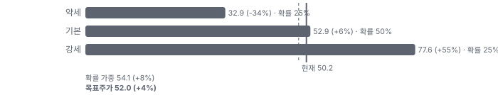

**주가별 업사이드**

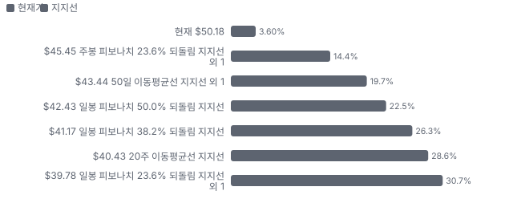
- 제품·서비스 포트폴리오

**고객 믹스(3Q26, 매출 대비)**

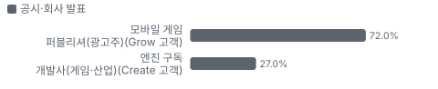

**공급 병목(10점, 낮을수록 병목)**

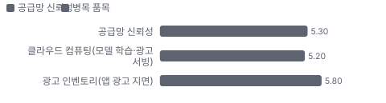

**어닝콜 변화별 주주가치 영향**

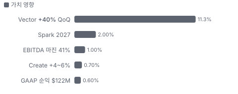

**멀티플 프리미엄(Fwd 1Y EV/EBITDA, 최근 4개 분기말)**

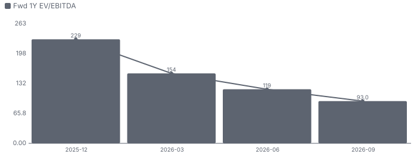

**합리적 멀티플**

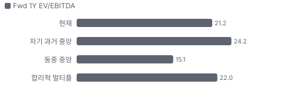

**매출 → 매출총이익 → 영업이익(매출 = 100, 최근 4분기)**

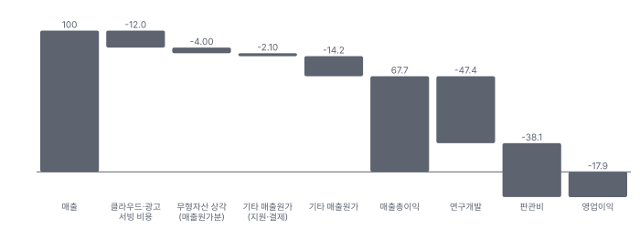

**분기 비용 비중 추이(매출 대비, 공시)**

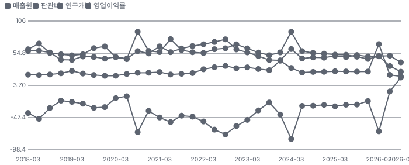

**비용 요인별 매출 대비 비중 1년 변화**

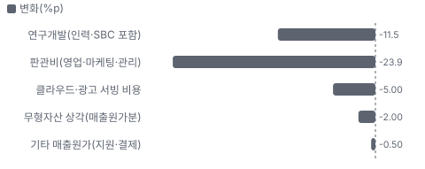

**BOM 항목 가격 +10% 시 OPM 변화**

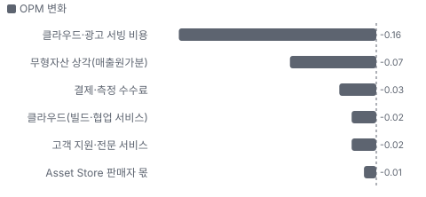

**광고·수익화(Grow — Vector·LevelPlay) BOM 원가 몫**

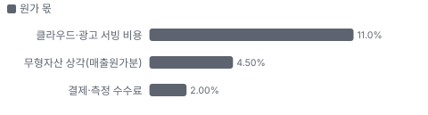

**엔진·창작 도구 구독(Create) BOM 원가 몫**

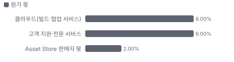

**목표주가 산정 — 약세와 기본 사이(약세 쪽 6%), 도달 확률 약 52%**

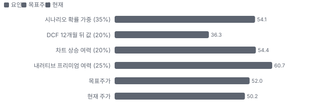

**PEG — 성장 대비 멀티플(낮을수록 성장 대비 쌈)**

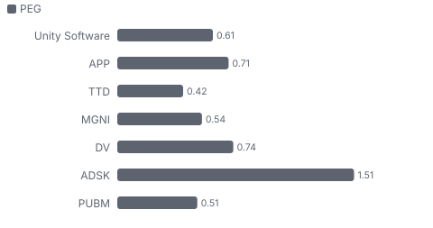

**일봉 지지·저항과 목표주가**

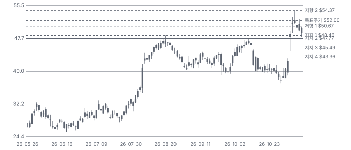

**커뮤니티 언급 수(최근 30일, 채널별)**

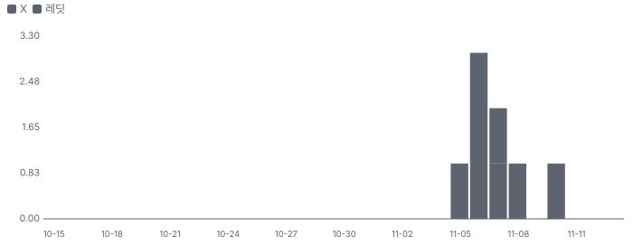

**일별 거래량 분해**

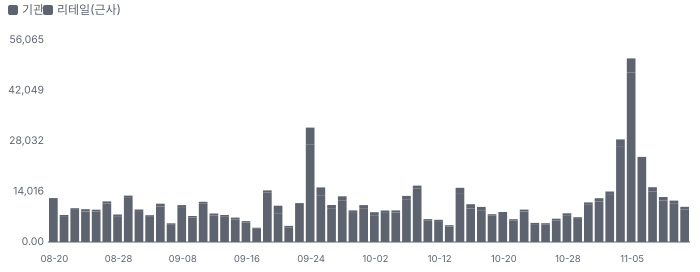

**기관 자금 흐름**

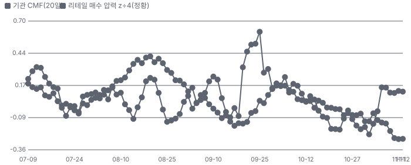

**몬테카를로**

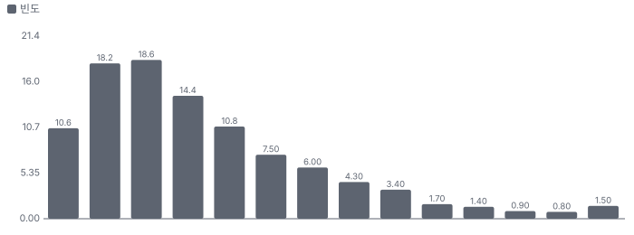

해석: 3,000번 중 585번(20%)에서 가치가 지금 주가 이상이었다. 가정을 흔들어도 지금 주가를 뒷받침하지 못하는 경우가 더 많다. 가운데 값은 0.65배이고, 열 번 중 여덟 번은 0.39~1.22배 사이에 든다.

## 내러티브

> **기업가치를 결정하는 이야기:** Unity는 모바일·PC·콘솔 게임을 만드는 엔진(Create, 구독)과 그 게임에 광고를 붙여 신규 이용자를 사고팔게 하는 광고 사업(Grow)을 함께 한다. 2024년 새 경영진이 비전략 광고·퍼블리싱을 정리하고 AI 광고 모델 Vector에 집중했다. 기업가치는 Vector의 성장 속도와 지속성, 엔진이 모으는 런타임 데이터가 광고 성과로 이어지는지, 그리고 AI 제작 도구가 엔진의 자리를 키우는지 깎는지로 정해진다

> **멀티플·EPS 프리미엄**
> **멀티플:** Fwd 1Y EV/EBITDA 21.2배로 동종 중앙(약 15.1배)보다 약 40% 높다. Fwd 1Y P/E는 22.0배로 AppLovin(19.0배)보다 높다 — 성장 속도(4Q 매출 +65%)가 배수를 받친다
> **EPS:** FY2027 EPS 컨센서스는 2Q 콜 직전 \$1.28에서 \$2.00으로 56% 올랐다. 같은 기간 주가는 \$35.47 → \$50.18(+41%)이다 — 오름의 대부분이 이익 추정 상향이고 배수는 오히려 내려왔다

### 투자자들은 왜 열광했나

1월 30일 Google AI 월드 생성 모델 공개로 하루 −24%, 2월 2026 전망 실망으로 −26% 떨어져 3월 \$17까지 갔다. 3월 26일 1Q 잠정 상회와 비전략 광고 철수 발표 뒤 반등했고, 2Q(+15%)·3Q(+15%) 실적이 연속으로 가이던스를 크게 넘었다. 11월 인수설이 더해졌다

### 무엇이 기업가치를 바꾸나

> **구조적 체질 변화**
> **변화:** 비전략 광고(ironSource 광고망)·퍼블리싱(Supersonic(Unity가 2026년 8월 매각한 게임 퍼블리싱 사업)) 정리 → AI 광고 Vector 집중, 첫 GAAP 흑자
> **증거:** 3Q26 어닝콜(2026-11-05, 요지만 자기 말로)
> **반증:** 비전략 정리 뒤 전략 매출 성장이 20% 아래로

> **고부가 믹스 확장**
> **변화:** Grow 비중 69%(전략 매출) — 고마진 광고 모델 매출이 커지며 조정 EBITDA 마진 +18%p YoY
> **증거:** 3Q26 어닝콜(2026-11-05, 요지만 자기 말로)
> **반증:** 광고 단가 인하로 마진이 꺾인다

> **기술 혁신**
> **변화:** Vector 분기 20건 넘는 모델 개선, 런타임 신호 투입(2Q 말), 엔진을 코딩 에이전트에 개방
> **증거:** 2Q26 어닝콜(2026-08-06, 요지만 자기 말로) · 3Q26 어닝콜(2026-11-05, 요지만 자기 말로)
> **반증:** 개선 속도가 둔화해 Vector QoQ가 한 자릿수로

> **실행 속도**
> **변화:** 해당 없음(납품 사업이 아니다 — 광고는 즉시 집행, 엔진은 내려받기) **납품 리드타임 미확인.** 피어 비교 미확인. 이전 대비 미확인.
> **증거:** 3Q26 어닝콜(2026-11-05, 요지만 자기 말로)
> **반증:** -

> **M&A**
> **변화:** 매각(Supersonic)·축소(ironSource 광고망) — 인수자 쪽으로는 Silver Lake·PIF 협의 보도(미확인)
> **증거:** https://www.reuters.com/world/silver-lake-pif-have-held-recent-talks-buy-gaming-software-provider-unity-2026-11-05/
> **반증:** 협의 결렬 보도

> **정책·입법 연관성**
> **재정정책:** 해당 없음(재정 지출과 직접 연결된 매출 없음) 미확인 반증: - 의회 동의 2/10 — 하원 1/5(직접 관련 법안 없음) · 상원 1/5(같은 이유).
> **행정명령:** 해당 없음 — 미·중 기술 규제가 중국 매출(25%)에 간접 노출(추정) 미확인 반증: - 의회 동의 2/10 — 하원 1/5(논의 없음) · 상원 1/5(같은 이유).
> **연관입법:** 해당 없음 — 아동 온라인 보호·개인정보 입법이 광고 타기팅에 간접 영향(확인 못 함) 미확인 반증: -

> **CAPEX 낙수효과**
> **변화:** 해당 없음(고객 CAPEX가 아니라 게임사 마케팅 예산이 매출이 된다)
> **증거:** 3Q26 어닝콜(2026-11-05, 요지만 자기 말로)
> **반증:** -

### 내러티브 근거

> '게임 엔진 회사가 AI 광고 회사로 바뀌었다'는 이야기. Vector가 1년 새 +126% 크며 전략 매출 성장이 +59%로 7개 분기 연속 빨라졌고, 첫 GAAP 흑자가 났다. 주가는 3월 저점 \$17에서 \$50으로 약 3배, 그 위에 Silver Lake·PIF 인수설이 얹혔다. 동종 대비 멀티플 차이 +41% 중 회사 고유 몫은 -3%다. 단계는 확산, 쏠림은 중간이다.

> **Vector — AI 광고 모델의 성장** · 확인
> **논리:** 엔진 회사가 AI 광고 회사로 — Vector +126% YoY, 4Q도 +21~23% QoQ
> **숫자:** 전략 Grow \$432M(+90%), 4Q 가이던스 +105~107%
> **반증:** Vector QoQ 성장이 10% 아래로 떨어진다

> **마진 레버리지·첫 GAAP 흑자** · 확인
> **논리:** 매출이 고정비를 덮어 조정 EBITDA 마진 29% → 41% → 42%
> **숫자:** 3Q 조정 EBITDA \$257M(+134%), GAAP 순이익 \$122M
> **반증:** 4Q 조정 EBITDA가 \$290M 아래

> **AI 제작 도구의 수혜자(Spark(Google과 만든 브라우저 기반 게임 제작 플랫폼)·에이전트)** · 가설
> **논리:** AI가 게임 제작을 쉽게 하면 엔진 이용과 광고 수요가 함께 는다
> **숫자:** 8월 이후 DAU(일간 활성 이용자) +25%(회사), Spark 2027 정식
> **반증:** Spark 가격·이용 지표가 나오지 않거나 Create 성장이 5% 아래로

> **인수설(Silver Lake·PIF)** · 미확인
> **논리:** 사모·국부펀드가 인수 협의 — 주당 약 \$54 보도(커뮤니티 전언)
> **숫자:** Reuters 협의 보도만, 가격 미확인
> **반증:** 회사·인수자 부인 또는 협의 결렬 보도

> **반대 — AI가 엔진을 대체한다** · 잠복
> **논리:** AI 월드 생성 모델이 엔진 없이 게임을 만든다
> **숫자:** 1/30 Genie(Google의 AI 월드 생성 모델) 공개 뒤 하루 −24%
> **반증:** AI 도구가 Unity 위에서 돌며 DAU·Create가 는다

> **반대 — AppLovin 데이터 분쟁** · 잠복
> **논리:** AppLovin이 Unity의 Ad Quality SDK(Unity의 광고 품질 점검 소프트웨어 개발 키트)가 MAX(AppLovin의 광고 중개, 미디에이션 플랫폼) 광고 데이터를 모아 Vector 학습에 썼다며 중재·법원 가처분을 냈다 — 법원은 가처분을 기각(보도), 본안 중재는 진행 중
> **숫자:** Unity는 9월 MAX 입찰에서 수집을 끄기로 했고 모델 재학습은 거부(보도)
> **반증:** 중재에서 모델 재학습·데이터 삭제 명령이 나온다

> **반대 — AppLovin과의 광고 경쟁** · 잠복
> **논리:** 규모가 큰 AppLovin AXON(AppLovin의 AI 광고 추천 엔진)이 지면·데이터에서 앞선다 — 가격 경쟁이 오면 Unity가 약자
> **숫자:** 3Q 광고 매출 Unity Grow \$457M vs AppLovin \$2.18B(약 5분의 1)
> **반증:** AppLovin과 Unity가 함께 시장을 키운다(둘 다 고성장 지속)

## 포트폴리오

| 제품·서비스 | 구분 | 무엇 | 쓰는 곳 | 돈 버는 방식 | Mix | Mix 변화(전 분기 대비) |
|---|---|---|---|---|---|---|
| 광고·수익화(Grow — Vector·LevelPlay(Unity의 광고 중개, 미디에이션 플랫폼)) | 서비스 | AI 광고 추천·입찰(Vector)과 광고 중개(LevelPlay) | 게임 퍼블리셔의 신규 이용자 확보·광고 수익 | 광고 집행액의 수수료 | 73% | +2.3%p |
| 엔진·창작 도구 구독(Create) | 소프트웨어 | Unity 엔진·에디터·Asset Store(Unity의 3D 모델·도구 장터)·AI 도구 | 게임·산업용 3D 콘텐츠 제작 | 좌석당 구독(Pro·Enterprise) | 27% | -2.3%p |

**Mix 변화가 가장 큰 쪽은 광고·수익화(Grow — Vector·LevelPlay, +2.3%p, 전 분기 대비).** 계절성 판정: 분기 매출 계절 지수 기준 없음 → 직전 분기와 비교.

## 고객

> **3Q26 최대 고객 모바일 게임 퍼블리셔(광고주, Grow 고객) 72%, 상위 3곳 99%, 집중도 집중.** 공시·회사 발표로 확인한 몫은 매출의 99%이고, 나머지 고객 몫은 추정이거나 미분해다. 단일 고객 집중은 없다. Grow 고객은 신규 이용자를 사는 모바일 게임 퍼블리셔(광고주)이고, Create 고객은 엔진 구독 개발사다. 지역으로는 중국(대중화권) 매출이 3Q \$157.4M로 전체의 25%다

**고객별 매출 몫(3Q26)**
| 고객 | 몫 | 변화 | 근거 |
|---|---|---|---|
| 모바일 게임 퍼블리셔(광고주, Grow 고객) | 72% | +7%p | 회사 발표 |
| 엔진 구독 개발사(게임·산업, Create 고객) | 27% | -5%p | 회사 발표 |

> **모바일 게임 퍼블리셔(광고주, Grow 고객)** · 회사 발표
> **사는 것:** Vector 광고·LevelPlay
> **추정 근거:** Grow \$457M ÷ 매출 \$622.1M(3Q, 비전략 포함) — 1년 전 \$318.3M ÷ \$470.6M

> **엔진 구독 개발사(게임·산업, Create 고객)** · 회사 발표
> **사는 것:** Unity Pro·Enterprise 구독
> **추정 근거:** Create \$165.1M ÷ \$622.1M(3Q) — 1년 전 \$152.4M ÷ \$470.6M

## 마진 구조

> **GPM 81.9%, OPM 16.2%.** 3Q25 대비 GPM +7.5%p, OPM +42.9%p. 변동비는 매출의 26%이고, 매출이 10% 늘면 OPM은 +5.2%p 움직인다. GAAP 영업이익률이 3Q 16.2%로 1년 전(−26.7%)에서 흑자로 돌았다. 매출이 +32% 느는 동안 판관비는 −32%, 연구개발비는 +3%에 그쳤다 — Supersonic 매각·광고망 종료로 마케팅 비용이 빠졌다. 매출원가(클라우드·광고 서빙)는 매출의 18%로 1년 전 26%에서 내려왔다

> **매출 100 중 매출원가 32.3, 매출총이익 67.7(최근 4분기, 공시).** 매출원가 요인 중 클라우드·광고 서빙 비용이 매출의 12.0%로 가장 무겁고, 단가가 +10% 오르면 GPM이 -1.20%p 움직인다. 분기 회귀로 매출 1이 늘 때 매출원가는 0.34 늘고, 매출원가의 고정비 몫은 -18%다.

**비용 요인 강도 — 비중·추세·충격(+10%)·탄력**
| 비용 | 구분 | 매출 대비 | 1년 변화 | 마진 기여 | 충격 시 마진 | 매출 탄력 | 고정비 몫 |
|---|---|---|---|---|---|---|---|
| 클라우드·광고 서빙 비용 | 매출원가 요인 | 12.0% | -5.0%p | +5.0%p | -1.20%p | 미확인 | 40% |
| 무형자산 상각(매출원가분) | 매출원가 요인 | 4.0% | -2.0%p | +2.0%p | -0.40%p | 미확인 | 100% |
| 기타 매출원가(지원·결제) | 매출원가 요인 | 2.1% | -0.5%p | +0.5%p | -0.21%p | 미확인 | 50% |
| 연구개발 | 공시 항목 | 47.4% | -2.4%p | +2.4%p | 미확인 | 0.46 | 12% |
| 판관비 | 공시 항목 | 38.1% | -13.9%p | +13.9%p | 미확인 | 0.47 | 16% |
| 매출원가 | 공시 항목 | 32.3% | +6.6%p | -6.6%p | -3.23%p | 0.34 | -18% |

매출 탄력 = 분기 비용을 매출에 회귀한 기울기(매출 1당 변동비), 고정비 몫 = 절편 ÷ 평균 비용. 표본이 8분기 미만이면 미확인. 매출원가 요인 비중은 margin 재료의 추정이 섞여 있고, 공시 매출원가와의 차이는 '기타 매출원가'로 둔다.

**GPM에서 OPM까지(GAAP)**
| 기간 | GPM | 연구개발 | 판관비 | 기타 | OPM |
|---|---|---|---|---|---|
| 3Q25 | 74.4% | 51.9% | 49.3% | 0.0% | -26.7% |
| 3Q26 | 81.9% | 40.4% | 25.4% | 0.0% | 16.2% |

**GPM·OPM 최근 4개 분기**
| 분기 | GPM | OPM |
|---|---|---|
| 2025-12 | 74.3% | -21.2% |
| 2026-03 | 30.8% | -69.1% |
| 2026-06 | 79.6% | -5.9% |
| 2026-09 | 81.9% | 16.2% |

**마진을 결정하는 비용 요인 — 비용 +10% 시 OPM**
| 비용 | 매출 대비 | 변화 | 고정비 | OPM |
|---|---|---|---|---|
| 연구개발(인력·SBC 포함) | 40.4% | -11.5%p | 80% | -4.04%p |
| 판관비(영업·마케팅·관리) | 25.4% | -23.9%p | 60% | -2.54%p |
| 클라우드·광고 서빙 비용 | 12.0% | -5.0%p | 40% | -1.20%p |
| 무형자산 상각(매출원가분) | 4.0% | -2.0%p | 100% | -0.40%p |
| 기타 매출원가(지원·결제) | 2.1% | -0.5%p | 50% | -0.21%p |

**비용을 움직이는 요인**
| 비용 | 요인 |
|---|---|
| 연구개발(인력·SBC 포함, 연구개발) | 엔지니어 인건비·주식 보상 · 근거 공시 |
| 판관비(영업·마케팅·관리, 판관비) | Supersonic 매각으로 마케팅 비용 축소(3Q 조정 S&M −\$22M QoQ) · 근거 공시 |
| 클라우드·광고 서빙 비용(매출원가) | Vector 연산·서빙 — 3Q 클라우드 레버리지로 조정 GPM +2%p · 근거 추정 |
| 무형자산 상각(매출원가분, 매출원가) | ironSource 인수 무형 — 4Q \$50M·2027 분기 \$15M(전체) · 근거 추정 |
| 기타 매출원가(지원·결제, 매출원가) | 고객 지원·결제 수수료 · 근거 추정 |

**광고·수익화(Grow — Vector·LevelPlay) BOM — 매출의 74%, GPM 80%(회사 GPM 81.9%(3Q26 GAAP) 근처로 둔 추정 — 사업부 원가 미공시), 항목 가격 +10% 시**
| 항목 | 원가 몫 | 전가 | 제품 GPM | OPM |
|---|---|---|---|---|
| 클라우드·광고 서빙 비용 | 8~14% | 미확인 | -0.2%p | -0.16%p |
| 무형자산 상각(매출원가분) | 3~6% | 미확인 | -0.1%p | -0.07%p |
| 결제·측정 수수료 | 1~3% | 미확인 | -0.0%p | -0.03%p |
| 미분해 | 82% | - | - | - |

**엔진·창작 도구 구독(Create) BOM — 매출의 26%, GPM 85%(구독 소프트웨어 — 회사 GPM보다 약간 높게 둔 추정), 항목 가격 +10% 시**
| 항목 | 원가 몫 | 전가 | 제품 GPM | OPM |
|---|---|---|---|---|
| 클라우드(빌드·협업 서비스) | 4~8% | 미확인 | -0.1%p | -0.02%p |
| 고객 지원·전문 서비스 | 4~8% | 미확인 | -0.1%p | -0.02%p |
| Asset Store 판매자 몫 | 1~3% | 미확인 | -0.0%p | -0.01%p |
| 미분해 | 86% | - | - | - |

클라우드·광고 서빙 비용 가격이 +10% 오르면 영업이익은 -1.0% 움직인다. 판매가 전가를 모르는 항목은 전가 0%로 계산했다.

**BOM 항목 가격을 움직이는 것**
| 항목 | 요인 |
|---|---|
| 클라우드·광고 서빙 비용 | 모델 학습·실시간 입찰 연산 · 근거 추정 |
| 무형자산 상각(매출원가분) | ironSource 기술 무형 상각 · 근거 추정 |
| 결제·측정 수수료 | 광고 성과 측정·결제 · 근거 추정 |
| 클라우드(빌드·협업 서비스) | 클라우드 빌드·버전 관리 · 근거 추정 |
| 고객 지원·전문 서비스 | 엔터프라이즈 지원 인력 · 근거 추정 |
| Asset Store 판매자 몫 | 장터 거래 중 판매자 배분 · 근거 추정 |

## 공급망 병목

이미지 없음(검수 실패) — 엔진·창작 도구 구독(Create)

> **공급망 신뢰성 5.3/10, 병목 주의.** 가장 약한 고리는 클라우드 컴퓨팅(모델 학습·광고 서빙) 5.2점이고, 품목 평균은 5.5점이다. 근거가 부족한 1건(광고 성과 측정(어트리뷰션))은 점수에서 뺐다. Unity의 공급망 병목은 부품이 아니라 '광고를 띄울 지면(인벤토리)'과 '모델 학습·서빙 클라우드'다. 지면은 퍼블리셔가 어떤 광고 중개(미디에이션)를 쓰느냐에 달렸는데, 시장의 큰 몫을 경쟁사 AppLovin의 MAX가 쥐고 있다(점유율 미공시, 추정)

**병목과 마진 — 품목 가격 +10% 시 OPM**
| 품목 | 점수 | 판정 | 구분 | OPM |
|---|---|---|---|---|
| 클라우드 컴퓨팅(모델 학습·광고 서빙, 필수) | 5.2 | 병목 주의 | 출하 차질 위험 | 미확인 |
| 광고 인벤토리(앱 광고 지면, 필수) | 5.8 | 병목 주의 | 출하 차질 위험 | 미확인 |

> **클라우드 컴퓨팅(모델 학습·광고 서빙)** · 5.2/10
> **왜:** Vector 모델 학습·실시간 입찰 연산
> **병목 요인:** 인증 공급사 1곳 · 캐파 균형 · 리드타임 미확인 · 재인증 6개월 · 1위 점유율 미확인 · 지역 집중 미확인 · 물량 확보 장기계약
> **풀리는 조건:** -

> **광고 인벤토리(앱 광고 지면)** · 5.8/10
> **왜:** 광고 매출 = 지면 × 낙찰률 × 단가 — 지면이 막히면 Vector 성장이 멈춘다. AppLovin은 Unity SDK(앱에 넣는 소프트웨어 개발 키트)의 MAX 데이터 수집을 문제 삼아 중재를 걸었다(법원 가처분은 기각, 보도)
> **병목 요인:** 인증 공급사 2곳 · 캐파 빠듯 · 리드타임 미확인 · 재인증 미확인 · 1위 점유율 미확인 · EMEA(지역 매출 최대 몫 30%) 집중 30% · 물량 확보 내재화
> **풀리는 조건:** 미확인

**공급사**
| 품목 | 공급사 | 몫 | 근거 |
|---|---|---|---|
| 광고 인벤토리(앱 광고 지면) | LevelPlay(자사 미디에이션, 퍼블리셔 지면 중개) | 미확인 | 회사 발표 |
| 광고 인벤토리(앱 광고 지면) | AppLovin MAX(경쟁사 미디에이션, Vector가 입찰 참여하는 외부 지면) | 미확인 | 추정 |
| 클라우드 컴퓨팅(모델 학습·광고 서빙) | Google Cloud(클라우드 인프라) | 미확인 | 회사 발표 |
| 광고 성과 측정(어트리뷰션) | AppsFlyer(모바일 광고 성과 측정) | 미확인 | 회사 발표 |

## 해자

> 해자는 '엔진을 쓰는 개발자 기반'과 그 엔진이 실행 중 모으는 런타임 데이터다. 월 약 30억 명이 Unity로 만든 게임을 하고, 2Q 말부터 그 신호를 Vector에 넣기 시작했다. 약점은 광고 규모에서 AppLovin에 뒤지고, AI 생성형 제작 도구가 엔진의 자리를 흔들 수 있다는 점이다

> **개발자 기반·전환 비용** · 강함
> **해자:** 한 번 만들면 25개 넘는 플랫폼(모바일·콘솔·웹·VR(가상현실))에 내보내는 엔진 — 개발 중인 게임을 다른 엔진으로 옮기기 어렵다
> **근거:** 3Q26 어닝콜(2026-11-05, 요지만 자기 말로)
> **숫자:** Unity로 만든 게임 월 이용자 약 30억 명(회사 주장)
> **깨지는 조건:** 주요 퍼블리셔가 신작을 다른 엔진·AI 생성 도구로 옮긴다

> **런타임 데이터(광고 모델 입력)** · 보통
> **해자:** 엔진이 게임 안 행동 신호를 Vector 학습에 넣는다 — 경쟁 광고망에는 없는 입력
> **근거:** 2Q26 어닝콜(2026-08-06, 요지만 자기 말로)
> **숫자:** 2Q 말 처음 도입 — 효과 수치 미공시
> **깨지는 조건:** 런타임 신호 도입 뒤에도 Vector 성장이 업계 평균으로 내려오거나, AppLovin 중재에서 데이터 사용이 제한된다

> **AI 광고 모델 성능** · 보통
> **해자:** Vector 매출 +126% YoY·광고주 계정 +27% QoQ — 그러나 규모는 AppLovin의 약 5분의 1
> **근거:** 3Q26 어닝콜(2026-11-05, 요지만 자기 말로)
> **숫자:** 3Q 광고 매출 Unity Grow \$457M vs AppLovin \$2.18B — 약 5분의 1
> **깨지는 조건:** 광고 경쟁이 가격 싸움으로 바뀌어 성장이 꺾인다

> **AI 대체 위험(약점)** · 약점
> **해자:** AI 월드 생성 모델이 엔진을 건너뛸 수 있다는 우려 — 1/30 하루 −24%
> **근거:** 2026-01-30 주가·커뮤니티 기록(Quantral)
> **숫자:** 1~3월 고점 대비 약 −65%
> **깨지는 조건:** AI 제작 도구가 Unity 위에서 돌며 DAU를 늘린다(8월 이후 +25%)

## 경영진·네트워크

> CEO Matt Bromberg(2024-05 취임, 전 Zynga COO·EA 임원)와 CFO Jarrod Yahes가 비전략 사업 정리와 Vector 집중을 이끌었다. 경영진은 사전 계획(10b5-1)으로 주식을 꾸준히 팔고 있다

> **Matt Bromberg** · CEO·이사 · 2024
> **프로필:** 전 Zynga COO·EA 임원(공개 경력) — 비전략 광고 철수·Vector 집중
> **비즈니스:** 전사
> **정계:** 미확인
> **동문:** 미확인
> **사모임:** 미확인

> **Jarrod Yahes** · SVP·CFO · 2024
> **프로필:** 3Q 콜 재무·가이던스·자본 배분
> **비즈니스:** 재무
> **정계:** 미확인
> **동문:** 미확인
> **사모임:** 미확인

**네트워크 정량화**
| 연결 | 강도 | 닿는 매출 | 가중 노출 | 매출 대비 | 근거 |
|---|---|---|---|---|---|
| 비즈니스: Google 전략 협력(Spark) — 배포·클라우드 파트너 | 3/5 | 미확인 | 미확인 | 미확인 | 가격·매출 배분 미공개 https://www.businesswire.com/news/home/20261007399251/en/ |
| 비즈니스: Meta VR 다년 협력 연장(2026-04) | 2/5 | 미확인 | 미확인 | 미확인 | 계약 금액 미공개 https://www.businesswire.com/news/home/20260408903873/en |
| 금융: Silver Lake·PIF 인수 협의 보도(2026-11-05) — 회사 확인 없음 | 2/5 | 미확인 | 미확인 | 미확인 | 보도만 https://www.reuters.com/world/silver-lake-pif-have-held-recent-talks-buy-gaming-software-provider-unity-2026-11-05/ |

가중 노출은 연결이 닿는 매출의 크기다. 연결이 그 매출을 만들었다는 뜻이 아니며, 인과는 공개 자료로 입증하지 못한다.

## 약세 논리 및 셀온 조건

| 약세 논리 | 근거 | 반박 | 가를 자료 · 공개 시점 |
|---|---|---|---|
| 매출이 Vector 하나에 걸렸다 | 전략 매출의 69%가 Grow, 그 성장의 대부분이 Vector | 엔진(Create)이 광고 데이터를 주는 구조라 둘은 따로 놀지 않는다 | 4Q Vector 분기 성장 — 2027-02 |
| AppLovin이 규모로 앞선다 | 3Q 광고 매출 Unity Grow \$457M vs AppLovin \$2.18B(약 5분의 1) | 전략 Grow +90%로 AppLovin(+55%)보다 빠르다 — 작은 기반에서 몫을 넓히는 중. AppLovin도 3Q 콜에서 시장은 나눠 먹기가 아니라고 밝혔다 | 두 회사 4Q 광고 매출 성장률 — 2027-02 |
| AppLovin과 데이터 분쟁 | AppLovin이 Unity Ad Quality SDK의 MAX 광고 데이터 수집을 문제 삼아 중재·가처분 신청(보도) | 법원이 가처분을 기각했다(보도). Unity는 9월 MAX 입찰 수집을 끄기로 했다 | 중재 결과 — 시점 미정 |
| AI가 엔진을 대체한다 | 1/30 Google Genie 공개 뒤 하루 −24% | 8월 이후 DAU +25%, 코딩 에이전트가 Unity 위에서 돈다(회사) | Spark 베타 지표·Create 성장 — 2027 |
| 배수가 동종보다 높다 | Fwd 1Y EV/EBITDA 21.2배 vs 동종 중앙 약 15배 | Fwd 2Y 15.6배 — 1년 성장으로 배수가 빠르게 내려온다 | 2027 EBITDA 전망 — 2027-02 |
| 인수설이 꺼지면 빠진다 | 11/6 Reuters 협의 보도 뒤 +5.5% | 실적 급등(11/5 +15%)이 보도보다 먼저였다 | 회사·인수자 발표 또는 결렬 보도 — 수시 |

> **셀온 조건**
> **조건 1:** 4Q26 Vector 분기 성장이 가이던스 하단(+21%) 아래 — 성장 속도가 정점을 지났다는 신호
> **조건 2:** 조정 EBITDA 마진이 40% 아래로 내려온다(광고 가격 경쟁 또는 클라우드 비용)
> **조건 3:** 2027 전망이 전략 매출 +30% 아래
> **조건 4:** Create 성장이 0% 이하로 떨어진다(엔진 기반 약화)
> **조건 5:** AppLovin 중재에서 Vector 모델 재학습·데이터 삭제 명령이 나온다
> **조건 6:** 인수 협의가 결렬되고 실적 모멘텀도 꺾인다

## 어닝콜 변화

**직전 콜 대비 새로 나오거나 바뀐 내용 → 가치 영향**
| 항목 | 내용 | 직전 콜 | 최신 콜 | 모델 동인 이동 | 확신도 | 가치 영향 |
|---|---|---|---|---|---|---|
| 업데이트 | Vector 성장 속도 | 3Q 가이던스 +19~21% QoQ | 3Q +40% QoQ(+126% YoY), 4Q 가이던스 +21~23% | 1년차 성장률 +8.0% | 1.0 | +11.3% |
| 업데이트 | 조정 EBITDA 마진 | 3Q 약 33% 안내 | 3Q 41%, 4Q 42% | 출발 이익률 +6.0% | 1.0 | +1.0% |
| 신규 | GAAP 흑자 | 4Q26 흑자 목표 → 3Q로 당김 | 3Q 순이익 \$122M(마진 20%) | 목표 이익률 +1.0% | 1.0 | +0.6% |
| 신규 | Unity Spark·Google | Unity 7(에이전트 협업을 넣은 차세대 엔진 버전) 베타 4Q26(2Q 콜) | Google 협력 Spark 비공개 베타, 2027 정식 — 가격 미공개 | 장기 성장 수렴값 +1.0% | 0.5 | +2.0% |
| 부정 | Create 성장 | 3Q +7~10% 가이던스(실제 +11%) | 4Q +4~6%, 연 약 9% | 성장 지속(감속 계수) +1.0% | 0.8 | +0.7% |
| 반복 | 전환사채 상환 | 11월 상환 예정(2Q 콜) | 11/15 만기분 현금 상환 | 순차입 — | 0.8 | +0.0% |
| **합계** | 단독 합 |  |  | 동시 적용 +16.1% |  | **+15.7%** |

**사건별 EPS 리비전**
| # | 날짜 | 구분 | 사건 | CY2026 EPS 전→후 | CY2027 EPS 전→후 | 리비전 | 주가 반응 |
|---|---|---|---|---|---|---|---|
| ① | 26-01-30 | 내러티브 | Google Genie 공개, 하루 −24% | \$0.93 → \$0.93 | \$1.22 → \$1.22 | +0.0% | -24.2% |
| ② | 26-02-11 | 실적 | 4Q25·2026 전망 실망 −26% | \$0.93 → \$0.92 | \$1.22 → \$1.18 | -3.2% | -26.3% |
| ③ | 26-03-26 | 내러티브 | 1Q 잠정·비전략 광고 철수 | \$0.93 → \$0.97 | \$1.18 → \$1.20 | +1.7% | -3.8% |
| ④ | 26-05-07 | 실적 | 1Q26 상회·손상 반영 | \$0.99 → \$1.06 | \$1.21 → \$1.30 | +7.2% | -2.0% |
| ⑤ | 26-08-06 | 실적 | 2Q26 상회, 당일 +15% | \$1.04 → \$1.21 | \$1.28 → \$1.82 | +42.9% | +15.1% |
| ⑥ | 26-10-07 | 내러티브 | Google·Spark 협력 | \$1.21 → \$1.21 | \$1.82 → \$1.82 | +0.0% | +1.1% |
| ⑦ | 26-11-05 | 실적 | 3Q26 상회·첫 GAAP 흑자 | \$1.21 → \$1.25 | \$1.83 → \$2.00 | +9.2% | +14.9% |

**해석:** 3개 구간 누적 주가 +73% = EPS 리비전 +60% × 멀티플 +8%. 더 크게 움직인 쪽은 **EPS 리비전**이다.

## 밸류에이션

> **목표주가 \$52, 업사이드 +4%.** 자리는 약세와 기본 사이(약세 쪽 6%)이고 도달 확률은 약 52%다. 기본 \$53, 강세 \$78(+55%), 약세 \$33(-34%). DCF 기준 업사이드는 기본 -34%, 강세 +9%, 약세 -55%다(WACC 10.3%).

기준 멀티플이 Fwd 1Y EV/EBITDA라 시나리오도 다음 4개 분기 조정 EBITDA로 둔다. 확률은 세 분기 연속 큰 상회와 단일 동인 의존을 함께 반영해 약세 25%·기본 50%·강세 25%에 둔다. 인수설은 확인 전이라 어느 시나리오에도 넣지 않았다 — ==인수가 성사되면 가격은 시나리오가 아니라 제시 가격이 정한다==.

> **약세 \$33 (-34%)** · 확률 25%
> **가정:** 14.0배 × EBITDA \$1.15B
> **근거:** Vector 분기 성장이 10% 안팎으로 꺾이고 AppLovin과 지면 경쟁이 붙는다. 매출 약 \$2.8B, 조정 EBITDA 약 \$1.15B(마진 약 41%)

> **기본 \$53 (+6%)** · 확률 50%
> **가정:** 18.6배 × EBITDA \$1.40B
> **근거:** 4Q 가이던스대로 Vector가 분기 +20% 안팎을 이어 가다 2027년 중반부터 둔화한다. 매출 약 \$3.08B(다음 4개 분기 컨센서스), 조정 EBITDA 약 \$1.40B(마진 약 45%)

> **강세 \$78 (+55%)** · 확률 25%
> **가정:** 23.3배 × EBITDA \$1.65B
> **근거:** 런타임 신호와 Spark로 광고주가 계속 늘어 Vector가 분기 +25%를 이어 간다. 매출 약 \$3.4B, 조정 EBITDA 약 \$1.65B(마진 약 48%)

**멀티플 선정 — Fwd 1Y EV/EBITDA**
| 단계 | 조정 | 근거 |
|---|---|---|
| 동종 중앙값 | 15.1배 | 범위 9.8~16.2배, 6곳 |
| 펀더멘털 | +20% | 성장·이익률·ROIC로 본 합리적 멀티플 22.0배와의 차이의 일부만 인정 |
| 해자 | +7% | 개발자 기반·전환 비용 강함 · 런타임 데이터(광고 모델 입력) 보통 · AI 광고 모델 성능 보통 · AI 대체 위험(약점) 약점 |
| 반복 매출 | -7% | 반복 매출 28%(동종 50%) · 엔진 구독(Create) · 이미 반복 단계 · 기반 Unity로 만든 게임 월 이용자 약 30억 명(회사 주장), RPO(잔여 이행 의무, 계약상 앞으로 인식할 매출) \$597M(3Q, 다음 12개월 49%) |
| 수주 전환·가시성 | +0% | 재료 없음 |
| 내러티브 | +5% | 단계 확산 |
| 사이클·실행 판단 | +0% | 요인에 없는 조정은 하지 않는다 |
| **선정** | **18.6배** | 지금 21.2배 |

**동종 레인지**
| 회사 | Fwd 1Y EV/EBITDA | Fwd 2Y EV/EBITDA | Fwd 3Y EV/EBITDA | 성장 | 영업이익률 | ROIC |
|---|---|---|---|---|---|---|
| APP | 15.5 | 12.5 | 10.2 | 36% | 80% | 150% |
| TTD | 12.2 | 9.9 | 9.6 | -8% | 14% | 35% |
| MGNI | 16.2 | 12.6 | 10.3 | 13% | 23% | 17% |
| DV | 9.8 | 8.6 | 8.2 | 8% | 14% | 11% |
| ADSK | 16.1 | 14.5 | 12.5 | 14% | 40% | 164% |
| PUBM | 14.6 | 10.8 | 9.9 | 11% | 6% | 16% |
| **Unity Software** | 21.2 | 15.6 | 12.3 |  |  |  |

> **PEG 0.61** — Fwd 1Y P/E 22.0배를 다음 해 EPS 성장 36%로 나눈 값, 동종 중앙 0.63(동종과 비슷하다). 성장률은 Fwd 1Y·2Y P/E에서 역산한 컨센서스라 다음 해 한 해 성장만 반영하고, 성장 지속 기간은 담지 않는다.

**PEG — Fwd 1Y P/E ÷ 다음 해 EPS 성장률**
| 회사 | Fwd 1Y P/E | 다음 해 EPS 성장 | PEG |
|---|---|---|---|
| **Unity Software** | 22.0 | +36% | 0.61 |
| APP | 19.0 | +27% | 0.71 |
| TTD | 12.6 | +30% | 0.42 |
| MGNI | 21.7 | +40% | 0.54 |
| DV | 12.8 | +17% | 0.74 |
| ADSK | 19.2 | +13% | 1.51 |
| PUBM | 22.4 | +44% | 0.51 |

지금 주가가 요구하는 5년 매출 CAGR 32%, 기본 시나리오 18%. 몬테카를로 중앙값 업사이드 -35%.

> 의사결정 보조(투자자문 아님): ① 매수 매력: 5년 보유 가정 연 기대수익 +3.4% — 주주가 요구하는 수익률(자기자본비용) 10.3%보다 -6.9%p · 요구수익률을 넘을 확률 18% · 안전마진 없음(비관적 경우(하위 10%) 가치가 시총의 39%) → 정량 신호 약함 / ② 위험 예산 지표(이론): 0% — 기대수익이 요구수익률에 못 미친다(켈리 기준 — 수익·손실 확률로 계산한 이론상 최대 노출 — 0%는 참고) · 5년 뒤 나쁜 경우(하위 10%) -39% · 30% 넘게 잃을 확률 19% / ③ 상방(5년): 평균 1.18배 · 2배 이상 확률 9% · 3배 이상 1% · 10배 이상 0% · 잘 풀린 경우(상위 10%) 1.94배 이상

## 매수 위치(일봉)

> **현재가 \$50.18는 '지지 근접'(가장 가까운 일봉 지지 \$48.46에서 ATR 0.6배 위).** 이 자리에서 목표주가까지 +3.6%, 첫 일봉 저항까지 +1.0%, 다음 지지까지 하방 -3.4%, 손익비 1.1배. 손익비는 지지 1 \$48.46에서 5.1배로 가장 높다(목표주가까지 +7.3%).

**가격대별 업사이드(일봉 기준)**
| 가격대 | 가격 | 목표주가까지 | 첫 저항까지 | 다음 지지까지 | 손익비 | 근거 기법(강도) |
|---|---|---|---|---|---|---|
| 현재가 | \$50.18 | +3.6% | +1.0% | -3.4% | 1.1 | - |
| 지지 1 | \$48.46 | +7.3% | +4.6% | -1.4% | 5.1 | 120일 지그재그 고점(0.8) |
| 지지 2 | \$47.77 | +8.9% | +1.4% | -4.8% | 1.9 | 120일 지그재그 고점 · 스윙 고점(1.8) |
| 지지 3 | \$45.49 | +14.3% | +5.0% | -4.7% | 3.1 | 피보 78.6%(1.0) |
| 지지 4 | \$43.36 | +19.9% | +4.9% | 미확인 | 미확인 | 20일선 · 50일선 · 피보 61.8%(2.5) |

**일봉 저항**
| 저항 | 가격 | 현재가 대비 | 근거 기법(강도) |
|---|---|---|---|
| 저항 1 | \$50.67 | +1.0% | 피보 확장 127.2%(0.8) |
| 저항 2 | \$54.37 | +8.3% | 피보 확장 161.8%(0.8) |

일봉만 쓴다(주봉·월봉 제외). 손익비 = 목표주가까지 업사이드 ÷ 다음 지지까지 하방. 가격대별 기대값 참고표이며 매수·매도 시점 지시가 아니다.

## 애널리스트 토론

> **토론 결론 Neutral(규칙 등급 Neutral).** Vector 성장·마진·현금은 1차 자료로 확인됐다. 그러나 Fwd 1Y EV/EBITDA 21배는 동종보다 약 40% 높고 다음 4개 분기 컨센서스가 이미 마진 45%를 담았다 — 살아남은 반박은 '배수가 성장을 반영했다'와 'Vector 단일 동인·AppLovin 규모 격차'다. 4Q Vector 성장과 2027 전망이 가를 자료다

**패널 — 등급별 자리**
| 자리 | 핵심 논리 | 틀리는 조건 | 최종 투표 |
|---|---|---|---|
| Strong Buy | Vector는 7개 분기 된 제품이고 아직 초기다 — 성장 가속이 이어지면 Fwd 2Y 15.6배는 싸다 | 4Q Vector가 +21% 아래 | Buy |
| Buy | 마진 레버리지와 순현금이 하방을 받친다 | 마진이 40% 아래로 내려온다 | Neutral |
| Neutral | 좋은 실적이지만 Fwd 1Y EV/EBITDA 21배가 동종보다 약 40% 높고 인수설이 가격에 섞였다 | 2027 EBITDA 전망이 \$1.6B를 넘는다 | Neutral |
| Sell | 매출의 약 70%가 Vector 하나 — 규모 5배인 AppLovin과 가격 경쟁이 오면 약자다 | 두 회사 모두 4Q 광고 매출 +40% 이상 | Neutral |
| Strong Sell | AI 월드 생성 모델이 엔진 회사를 대체한다 — 1월의 −24%가 예고였다 | Spark·에이전트로 DAU와 Create가 함께 는다 | Sell |

**투표**
| Strong Buy | Buy | Neutral | Sell | Strong Sell |
|---|---|---|---|---|
| 0 | 1 | 3 | 1 | 0 |

> **개회 · Strong Buy**
> **발언:** Vector가 가이던스의 두 배로 컸고 4Q도 올렸다

> **개회 · Buy**
> **발언:** 이익과 현금이 매출을 따라왔다 — 첫 GAAP 흑자

> **개회 · Neutral**
> **발언:** 배수가 동종보다 40% 높고 인수설이 끼어 있다

> **개회 · Sell**
> **발언:** 광고 규모는 AppLovin의 5분의 1이고 Create는 둔화한다

> **개회 · Strong Sell**
> **발언:** AI가 엔진을 대체하면 광고 데이터도 사라진다

> **반박1 · Strong Buy → Sell**
> **발언:** AppLovin도 3Q 콜에서 시장은 나눠 먹기가 아니라고 했고, 같은 분기 둘 다 컸다

> **반박1 · Sell → Strong Buy**
> **발언:** 둘 다 큰 것은 지면 가치가 오른 국면이라서다 — 4Q 가이던스 +21~23%는 3Q +40%보다 낮다

> **반박1 · Neutral → Buy**
> **발언:** 마진 42%는 이미 컨센서스에 들어 있다 — 다음 4개 분기 EBITDA \$1.40B

> **반박1 · Buy → Neutral**
> **발언:** 2Q 콜 이후 주가 +41% 중 대부분이 이익 상향이었다 — 배수는 내려왔다

> **반박1 · Strong Sell → Strong Buy**
> **발언:** DAU +25%는 회사 숫자일 뿐 매출 지표가 아니다

> **반박2 · Strong Buy → Strong Sell**
> **발언:** 코딩 에이전트가 Unity 위에서 돈다 — AI는 엔진을 쓰는 쪽이다

> **반박2 · Strong Sell → Strong Buy**
> **발언:** Spark 가격도 이용 지표도 아직 없다

> **반박2 · Neutral → Sell**
> **발언:** Create 둔화는 매출의 27%라 전체 성장을 바꾸지 못한다

> **반박2 · Sell → Neutral**
> **발언:** 그래서 Vector 하나에 더 기대게 됐다는 게 내 요점이다

> **반박2 · Buy → Strong Sell**
> **발언:** 순현금 \$0.4B와 분기 FCF \$220M면 AI 우려가 와도 버틴다

> **최종 · Strong Buy** · Buy
> **발언:** 성장은 확인됐지만 목표가가 주가와 가깝다 — Buy로 물러선다

> **최종 · Buy** · Neutral
> **발언:** 배수가 동종 레인지 위라 Neutral

> **최종 · Neutral**
> **발언:** 4Q Vector와 2027 전망을 본다 — Neutral

> **최종 · Sell** · Neutral
> **발언:** AppLovin과 함께 크는 동안은 Neutral

> **최종 · Strong Sell** · Sell
> **발언:** AI 대체 위험을 남겨 Sell

남은 반대 의견: Strong Buy 자리는 Fwd 2Y 15.6배면 성장 대비 싸다고 끝까지 남겼다

패널은 등급별 논리를 대표하는 자리이고 실존 IB의 의견이 아니다.

## 커뮤니티 반응

통계: 관심 급증 0.0/10(결합 Z -0.9), 최근 7일 신뢰 가중 감성 +0.54.

> **3Q 숫자는 대체로 그대로 받아들이고, 관심은 인수 가격과 거절 시 되돌림, 그리고 AppLovin과의 상대 강도에 모였다**

**강세** — 3Q는 매출 +32%, 전략 Grow +90%, Vector +40% QoQ, GAAP 첫 흑자로 숫자가 서사를 따라잡았다 근거로 드는 것: 3Q 실적 발표 수치 정리. (X, 2026-11-06)

**새 쟁점** — Silver Lake가 약 \$25B(주당 약 \$54)를 제시했다는 전언 — 회사가 거절하면 옵션 프리미엄이 되살아난다는 베팅 근거로 드는 것: Reuters 협의 보도 + 커뮤니티 전언 가격. (레딧 r/wallstreetbets, 2026-11-06) [사실관계 미확인]

**시장과 다른 점** — AppLovin 3Q 콜은 더 나은 광고 예측이 정해진 예산을 나눠 먹는 게 아니라 지면의 가치를 키운다는 증거 — Unity와 AppLovin이 함께 클 수 있다 근거로 드는 것: AppLovin 3Q 콜(11/4) 해석. (X, 2026-11-08) [사실관계 미확인]

**약세** — Unity와 AppLovin의 주가 격차가 커졌으니 Unity 매도·AppLovin 매수 짝 거래가 맞다 근거로 드는 것: 8월 두 종목 상대 주가. (X, 2026-08-18)

**약세** — Google Genie 같은 AI 월드 모델이 엔진 회사를 대체할 수 있다는 공포로 1~2월 반토막 근거로 드는 것: 1/30 하루 −24%, 2월 −26%. (유튜브, 2026-02-05)

**기대가 바뀐 시점:** 1월 30일 Google Genie 공개 뒤 'AI가 엔진을 대체' 우려가 지배했고, 8월 2Q 실적 뒤 'Vector 광고 회사'로 이야기가 바뀌었다

커뮤니티 의견은 시장 기대의 증거이지 사실이 아니며, 관심 급증은 주가·펀더멘털 변화가 아니다.

## 시장 평가

> **셀사이드(IB 애널리스트)**
> **한 줄:** 의견은 압도적 매수이고 2Q 뒤 목표가 상향이 잇따랐다(BofA \$50 → \$65, Raymond James 상향). 3Q 콜 질문은 Vector 성장의 지속성·가이던스 보수성·Google 협력의 수익 구조에 모였다
> **애널리스트 의견(25명):** Strong Buy 20 · Buy 2 · Hold 3
> **목표가 평균(24명):** \$57.84(범위 \$33~72)
> **FY2027 EPS 컨센서스:** \$2.00(2Q 콜 전 \$1.28 → 11/10, +56%)

> **바이사이드(기관 투자자)**
> **한 줄:** 기관 비중이 높고 경영진은 사전 계획으로 꾸준히 판다 — 매도 자체는 계획 매도라 신호로 쓰지 않는다
> **기관 보유:** 약 89%(yfinance)
> **공매도:** 유통 주식의 약 7%
> **내부자:** CEO·CFO·COO 사전 계획 매도 지속(11/6 CEO \$5.1M)

> **언론·업계**
> **한 줄:** 인수설은 Reuters 보도이고 회사 확인은 없다
> **주요 제목:** 3Q 상회 +15%(11/5), Silver Lake·PIF 인수 협의(Reuters 11/5)

## 체크리스트

| 시점 | 무엇 | 의미 |
|---|---|---|
| 2027-02 | 4Q26 실적: Vector 분기 성장(가이던스 +21~23%)·조정 EBITDA \$290~295M·Create | 성장 가속이 이어지는지 |
| 2027-02 | 2027 첫 전망: 전략 매출·조정 EBITDA 마진·SBC \$75M/분기 | Fwd 21배 배수가 정당한지 가른다 |
| 2027-02 | AppLovin 4Q 광고 매출 성장률 | 두 회사가 함께 크는지, Unity가 몫을 가져오는지 |
| 수시 | Silver Lake·PIF 인수 협의 — 회사 발표·결렬 보도 | 인수 기대 몫의 유무 |
| 수시 | AppLovin 중재 결과(Ad Quality SDK 데이터) | Vector 학습 데이터 제한 여부 |
| 2026-12 | Unity Spark 비공개 베타·Unity 7 베타 | AI 제작 도구가 엔진 이용을 늘리는지 |

## 정정 기록 — Chiip Proviser 23:40

| 무엇을(전 → 후) | 왜 | 근거 |
|---|---|---|
| Chiip View·요약 '지금 가격은 무엇을 가정하나?': '조정 EBITDA 컨센서스 \$1.40B 기준 Fwd 1Y EV/EBITDA 21.2배' → '컨센서스 \$1.40B, 21.2배(\$1.40B로 다시 계산하면 15.6~17.6배)' | 21.2배는 \$1.40B로 나온 값이 아니다. 같은 리포트의 EV로 나누면 \$21.9B ÷ \$1.40B = 15.6배, 완전 희석 EV \$24.7B ÷ \$1.40B = 17.6배다. 21.2배가 맞으려면 분모가 약 \$1.03~1.16B여야 한다 | datapack forward.ntm.ebitda \$1,402M · multiples_now.ev_ebitda_fwd 21.22(둘 다 2026-11-13). 같은 방식으로 재면 APP는 15.5배가 SBC를 뺀 EBITDA로 맞는다 — 기준 차이는 추정. 동종 배수도 같은 컨센서스 기준이라 '동종보다 약 40% 높다'와 목표주가·등급은 그대로 |

## 출처
- 마스터 노션 자료: MS MS_-_Following_AIs_1.6_trillion_Money_Trail_-_Mapping_the_Revenue_Generated_by_the_Capex_Boom(1).pdf (요지만, 외부 공유 금지)
- 2Q26 어닝콜(2026-08-06, 요지만 자기 말로)
- 3Q26 어닝콜(2026-11-05, 요지만 자기 말로)
- https://www.businesswire.com/news/home/20261007399251/en/
- 업계 구조(추정)

_구매 등급·목표주가 모두 규칙이 계산한 모델 값으로, 개인의 보유 종목·자금 사정을 반영하지 않는다 · 공개 자료 기반 분석이며 투자 권유가 아님 · 1차 판정, 미검증 · Chiip ten-bagger_