# 텐배거 리포트 2026-11-14 — 실적은 분기 최대인데 주가는 6주 만에 −55% — 두산은 CCL 업종 배수와 함께 내려갔다

> 2026-11-14 · 두산(000150) · 기업: AI 서버용 CCL을 만드는 전자BG를 직접 운영하고 두산에너빌리티·두산로보틱스를 거느린 지주회사

## Chiip View

3Q 전자BG(두산의 CCL 사업부) 매출 ₩802.0B(+82%)·영업이익 ₩235.3B로 분기 최대다. 그런데 주가는 9/30 종가 1,368,000원에서 11/13 종가 610,000원으로 −55%다. 하락은 두산 숫자가 아니라 **CCL(동박적층판, 회로기판의 기초 소재) 동종 배수 급락**(대만·중국·홍콩 5사 한 달 −24~−44%)과 두산에너빌리티 지분가치에서 왔다. 지금 상장 지분 시가 ₩10.85T가 우선주 포함 시가총액 ₩9.31T보다 크다. 다만 전자BG OPM이 30.1 → 29.8 → 29.3%로 두 분기 연속 내렸고, 새 캐파는 2028년 하반기에야 나온다. 1월 말 4Q 실적의 전자BG OPM과 매출 계획 ₩814.6B 달성이 가른다.

## 대시보드
| 항목 | 값 | 설명 |
|---|---|---|
| 주가 | ₩610,000 | 고점 대비 -72% · 1년 -39% |
| 시가총액 | ₩9T | 완전 희석 기준 · EV ₩9T |
| 업사이드 | +46% | 목표주가 ₩887,618 · 다운사이드 -24% · 손익비(강세÷약세) 4.4 |
| 구매등급 | Buy | 애널리스트 12명: Strong Buy 9 · Buy 2 · Neutral 1 · Sell 0 · Strong Sell 0 |
| 멀티플 | Fwd 1Y P/E 14.5배 | 동종 중앙값 23.0배 |
| 가이던스 4Q26 |  | 컨센서스 ₩8263.00 |
| 알파 | 6.2/10 | 텐배거 가능성 점수 |
| 이벤트 | 4Q26 잠정실적(예상 — 회사 미발표, 지난해 1월 말 패턴) | 2027-01-29 |

## 한 장 요약
- **기업가치를 결정하는 내러티브** **실적은 최대인데 주가는 6주 만에 반 토막이 났다.** 3Q 전자BG 매출 ₩802.0B(+82%)·영업이익 ₩235.3B는 분기 최대다. 그러나 주가는 9/30 종가 1,368,000원에서 11/13 종가 610,000원으로 −55%다. 하락은 두산 숫자가 아니라 **CCL 동종 배수 급락**(대만·중국·홍콩 5사 한 달 −24~−44%)과 **두산에너빌리티 지분가치**에서 왔다. 시장이 묻는 것은 '얼마나 버나'가 아니라 '이 이익률이 얼마나 가나'다.
- **밸류에이션 모델로 본 주가 상방은 어디까지인가?** **목표주가 ₩887,618(+46%), 기본과 강세 사이(강세 쪽 20%)다.** 강세 ₩1,240,573(+103%)는 Fwd 1Y P/E 22.2배를 강세 EPS에 적용한 값이다. 기본 ₩797,511, 약세 ₩465,215. 손익비 4.4, DCF 기준 업사이드 +84%.
- **수주는 어디까지 왔나?** - SK실트론 70.6% 인수 — 미확정
- CCL 증설(김제(전북 도시, 두산 광모듈용 CCL 신공장 예정지)·창수(중국 장쑤성 도시, 두산 CCL 법인 소재지) 등) — 미확정
- 광모듈용 CCL 연간 — 미확정
회사는 수주잔고를 공개하지 않는다. 확인되는 것은 증설 투자 계획(약 ₩970B, 창수 협약 11/6)과 SK실트론 계약이다. 고객 물량은 증권사 추정이다.
- **누가 사 주나?** 최대 고객 엔비디아(AI 가속기 보드 공급망, IR 'AI 가속기向') 32%, 상위 3곳 79%. 공시·회사 발표로 확인한 몫은 10%다.
- **마진과 공급망은 어디가 약한가?** GPM 37.2%, OPM 26.7%. OPM을 가장 흔드는 BOM(제품 원가를 이루는 부품·재료 명세) 항목은 동박이고 가격 +10%에 -1.95%p다. 공급망 신뢰성은 2.4/10(병목 심각)이고 가장 약한 고리는 유리섬유 직물(T-글래스(저열팽창 유리섬유 천))이다.
- **생산능력은 얼마나 늘어나나?** 현재 명목 캐파 100 CCL 캐파 지수(2026-09 = 100, 회사 IR), 착공 이상 증설 0 CCL 캐파 지수(2026-09 = 100, 회사 IR). FY2028 CAPEX는 매출의 7.8%다.
- **지금 가격은 무엇을 가정하나?** 상장 두 자회사 지분 시가 ₩10.85T(11/13)에 NAV(순자산가치) 할인 38%를 걸면 ₩6.73T다. 그러면 자체사업에 붙은 값은 약 ₩3.16T이고 FY2027 자체사업 영업이익 추정 약 ₩1.03T의 약 3배다. 할인 없이 지분을 시가로 치면 자체사업 값은 0보다 작다(시가총액은 보통주 기본 + 우선주 ₩9.31T, 별도 순차입 ₩0.58T 기준). **시장은 지주 할인을 38%보다 훨씬 크게 걸거나, 전자BG 이익률이 곧 꺾인다고 보고 있다.**
- **왜 움직였나?** 9/30 이후 −55%의 대부분은 실적 발표 전에 나왔다. 11/5 −17%, 11/6 −11%로 이틀에 −27%였고 공시는 없었다. 같은 기간 대만·중국·홍콩 CCL 동종이 한 달 −24~−44% 내렸다. 11/10 증권사 4곳은 실적 추정이 아니라 동종 배수 하락을 이유로 목표가를 45~50% 낮췄다. 11/11 +8%, 11/13 −8.5%는 원인 미확인이다.
- **3Q에서 무엇이 바뀌었나?** 좋아진 것은 전자BG 매출 분기 최대(₩802.0B), 광모듈용 CCL 전분기 대비 약 +70%, 4Q 매출 계획 ₩902.0B를 처음 숫자로 낸 것이다. 나빠진 것은 전자BG OPM 29.3%로 두 분기 연속 하락, 별도 순현금 ₩12B → 순차입 ₩582B 전환이다. 캐파는 2029년 2.7배지만 2027년 말까지는 +20%뿐이다.
- **무엇이 바뀌면 판단이 바뀌나?** 4Q 전자BG OPM이 29% 아래로 내려가거나 4Q 매출이 계획 ₩814.6B에 못 미치면 '부족이 가격을 지킨다'는 이야기가 깨진다. SK실트론 종결로 별도 차입이 ₩2T 이상 늘어나면 NAV 할인이 더 커질 수 있다. 반대로 CCL 동종 배수가 먼저 반등하는데 두산이 함께 오르면 하락이 업종 배수 탓이었다는 해석이 맞다.

## 한눈에 보기

**일봉**

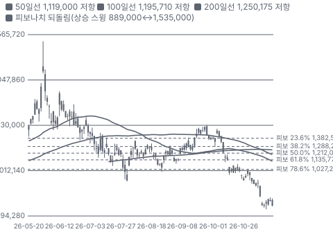

**주봉**

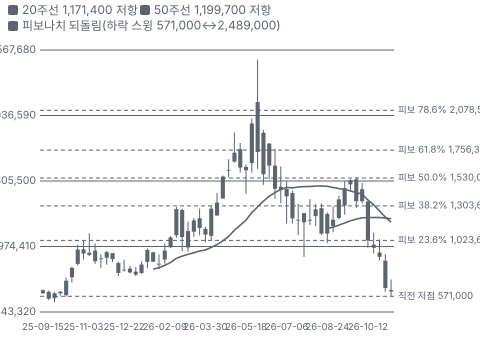

**월봉**

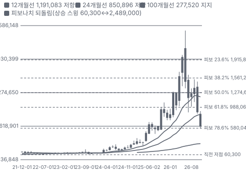

**분기 매출·EPS 실적과 컨센서스**

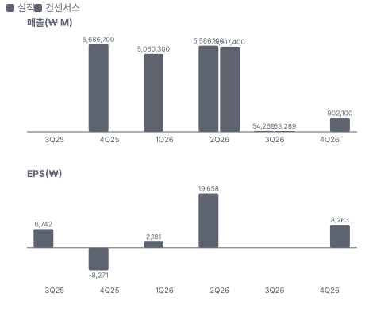

**멀티플 프리미엄(현재값 — 최근 4개 분기 추이 재료 없음)**

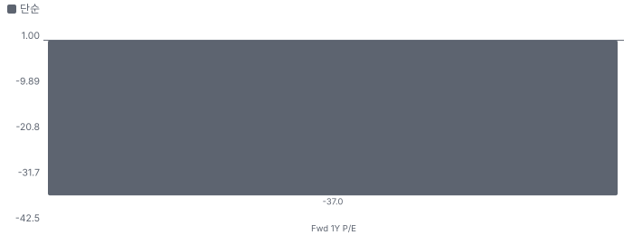

**합리적 멀티플**

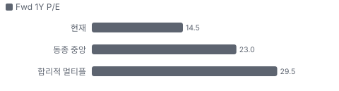

**밸류에이션 주가 시나리오**

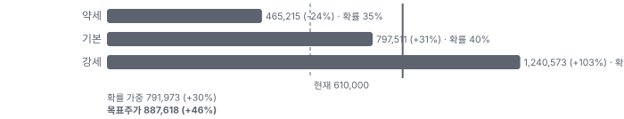

**주가별 업사이드**

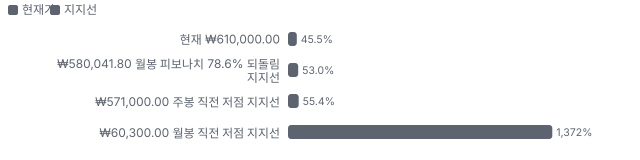
- 제품·서비스 포트폴리오

**고객 믹스(3Q26, 매출 대비)**

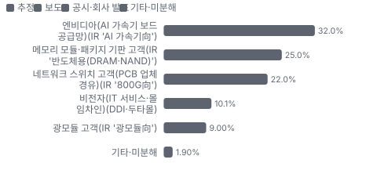

**공급 병목(10점, 낮을수록 병목)**

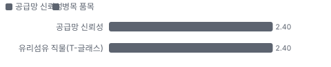

**생산능력 현재와 확충 계획(CCL 캐파 지수(2026-09 = 100, 회사 IR))**

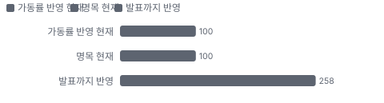

**CAPEX의 매출 대비 비중**

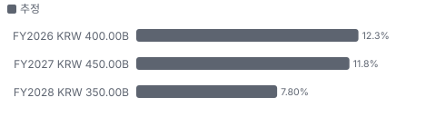

**어닝콜 변화별 주주가치 영향**

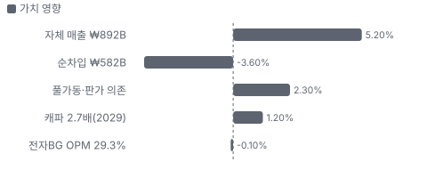

**수주·파이프라인 확실성 사다리**

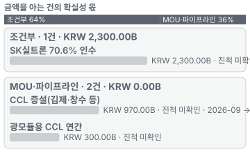

**비용 요인별 매출 대비 비중 1년 변화**

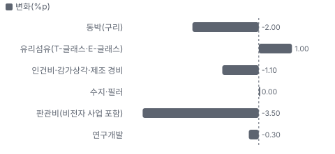

**BOM 항목 가격 +10% 시 OPM 변화**

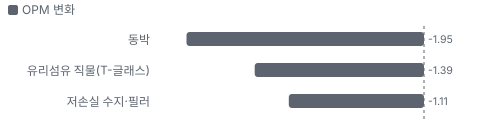

**CCL(전자BG) BOM 원가 몫**

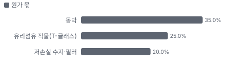

**투입 원가 물가·판매가 물가·회사 가격 — 1년 변화(항목별 최근 달)**

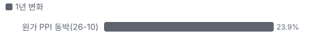

**목표주가 산정 — 기본과 강세 사이(강세 쪽 20%), 도달 확률 약 38%**

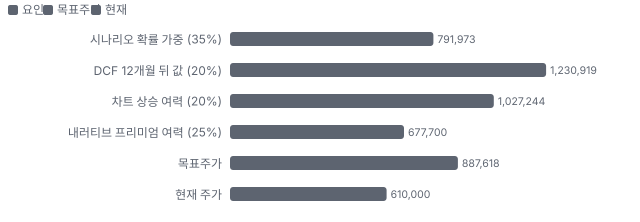

**PEG — 성장 대비 멀티플(낮을수록 성장 대비 쌈)**

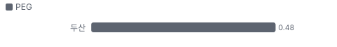

**일봉 지지·저항과 목표주가**

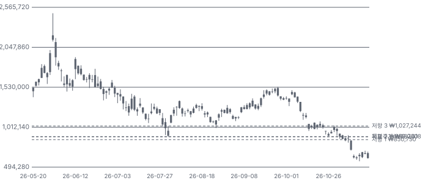

**몬테카를로**

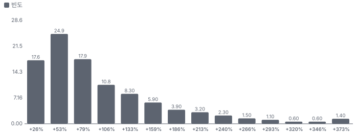

해석: 3,000번 중 2,997번(100%)에서 가치가 지금 주가 이상이었다. 가정을 흔들어도 지금 주가를 뒷받침하는 경우가 더 많다. 가운데 값은 1.75배이고, 열 번 중 여덟 번은 1.31~3.06배 사이에 든다.

## 내러티브

> **기업가치를 결정하는 이야기:** 두산의 값은 세 덩어리다. 전자BG가 버는 돈, 두산에너빌리티·두산로보틱스 지분, 그리고 SK실트론을 사며 늘어날 차입이다. 지금 상장 지분 시가(₩10.85T)가 우선주 포함 시가총액(₩9.31T)보다 크다. 지분에 할인을 걸지 않으면 시장은 전자BG에 값을 거의 주지 않는다.

> **멀티플·EPS 프리미엄**
> **멀티플:** Fwd 1Y P/E 14.5배로 CCL 동종 중앙값(약 23배, 11/02 추정 이익 유지 가정)보다 낮다. 동종 배수 자체가 한 달 사이 25~45% 내렸다.
> **EPS:** FY2026 지배 EPS 약 ₩34,300(컨센서스), FY2027 ₩45,000·FY2028 ₩58,000은 추정이다. 공개 FY2027 EPS 컨센서스와 리비전 이력은 미확인이다.

### 투자자들은 왜 열광했나

2025년 9월 59만 원대에서 2026년 6월 1일 장중 248.9만 원까지 4.2배 올랐다. 엔비디아 블랙웰(엔비디아 현행 AI 가속기 플랫폼) CCL 공급과 전자BG 이익 급증이 이유였다. 식은 이유는 세 가지다. 대규모 차입 인수(SK실트론), 두산에너빌리티 체코 협상 종료(10/29), 그리고 11월 AI 투자 수익성 우려 속 CCL 동종 동반 급락이다. 3Q 실적은 식은 이유가 아니다.

### 무엇이 기업가치를 바꾸나

> **구조적 체질 변화**
> **변화:** 중공업 지주에서 CCL·웨이퍼·테스트를 가진 반도체 소재 회사로 옮겨 간다.
> **증거:** SK실트론 70.61% ₩2.3T, 100% 기준 최대 ₩3.3T
> **반증:** 종결 뒤에도 시장이 지주 할인을 그대로 둔다

> **고부가 믹스 확장**
> **변화:** AI 가속기·광모듈용 CCL 비중이 늘어 이익률이 오른다. 단가가 아니라 믹스와 물량 효과다.
> **증거:** 광모듈용 CCL 전분기 대비 약 +70%(S저널), 매출의 10%. 그러나 전자BG OPM 30.1 → 29.3%
> **반증:** 4Q 전자BG OPM 29% 미만

> **기술 혁신**
> **변화:** 절연층을 13㎛로 줄이고 M9(M8 다음 저손실 CCL 등급)급을 개발했다.
> **증거:** 전자BG 인터뷰, 하나 9/28. 고객 인증 물량은 미확인
> **반증:** M10(M9 다음 CCL 등급) 공급사에서 빠진다

> **실행 속도**
> **변화:** 해당 없음(회사·동종 모두 납기 미공시 — 증설 속도로 대신 잰다: 캐파 2027년 말 +20%, 2028년 말 2.1배, 2029년 말 2.7배, IR)
> **증거:** 3Q IR 캐파 계획, 11/6 창수 협약
> **반증:** 4Q 신규 라인 양산이 늦어진다

> **M&A**
> **변화:** SK실트론을 삼정KPMG(회계법인) 평가 하단 ₩2.3T에 샀다. EBITDA 초과분 공유 언아웃이 붙었다.
> **증거:** 비즈워치 8/4. 2027~2034년 초과분의 40% × 70.61%
> **반증:** 순차입 ₩2.6T를 떠안은 뒤 웨이퍼 업황이 꺾인다

> **정책·입법 연관성**
> **재정정책:** 해당 없음(두산 CCL 매출과 연결된 미국 재정 사업을 찾지 못했다).
> **행정명령:** 해당 없음(두산을 직접 겨냥한 행정명령을 찾지 못했다).
> **연관입법:** 해당 없음(개정 상법의 자사주 소각 규정 외에 매출을 바꾸는 법안을 찾지 못했다).

> **고객의 지출 예산**
> **변화:** 고객(빅테크·CSP(클라우드 서비스 사업자))의 데이터센터 CAPEX가 엔비디아 서버 → PCB 업체 → CCL로 내려온다.
> **사업별 예산:** CCL(전자BG) — 고객 CAPEX(빅테크 데이터센터 서버·네트워크 투자), 매출의 90%: AI 가속기·800G(800기가비트 광통신 규격) 스위치·광모듈 출하 · 비전자(DDI(두산디지털이노베이션, IT 서비스 사업)·두타몰(두산의 동대문 패션몰)) — 고객 OPEX(그룹사 IT(정보기술) 운영비·임차료), 매출의 10%: 그룹 IT 예산
> **증거:** 11월 AI 투자 수익성 우려가 CCL 동종 배수를 먼저 내렸다(보도). 고객별 매출은 미공시
> **반증:** 북미 CSP CAPEX 삭감

### 내러티브 근거

> AI 서버 CCL 병목을 쥔 회사라는 이야기다. 증권사 12곳 중 11곳이 매수이지만 주가는 6월 고점의 36% 수준이다. 동종 대비 멀티플 차이 -37% 중 회사 고유 몫은 -51%다. 단계는 소멸, 쏠림은 낮음이다.

> **엔비디아 CCL 병목** · 유지
> **논리:** AI 서버 고급 CCL은 물량이 모자라 두산이 다 판다
> **숫자:** 3Q 전자BG의 AI 가속기 몫 32%(보도), 전자BG 매출 ₩802.0B(IR)
> **반증:** 4Q 전자BG 매출이 계획 ₩814.6B 미달

> **광모듈 CCL 2번째 성장축** · 강화
> **논리:** 800G·1.6T(1.6테라비트 광통신 규격) 광트랜시버가 새 매출을 만든다
> **숫자:** 3Q 전자BG의 10%, 전분기 대비 약 +70%(S저널)
> **반증:** 연 매출 ₩300B 미달

> **지주 할인 축소** · 유지
> **논리:** 소각과 사업 재편으로 NAV 할인이 줄어든다
> **숫자:** 대신 할인 38%. 소각 후 발행주식 1,851만 주
> **반증:** 두산에너빌리티 지분 매각·PRS(주가수익스와프, 지분 담보 자금 조달) 추가로 지분가치가 줄어든다

> **반도체 소재 회사 전환** · 유지
> **논리:** CCL·웨이퍼·테스트를 묶어 AI 반도체 회사로 재평가된다
> **숫자:** SK실트론 EBITDA ₩600B 이상(DS, 2025년 기준)
> **반증:** 인수 종결 뒤 차입이 늘고 시너지 숫자가 없다

> **반대: 값은 CCL이 아니라 자회사가 흔든다** · 강화
> **논리:** 시가총액의 대부분이 상장 자회사 지분가치라 원전 뉴스에 끌려간다
> **숫자:** 상장 지분 시가 ₩10.85T > 우선주 포함 시가총액 ₩9.31T(11/13)
> **반증:** 자회사 주가가 빠지는 날 두산이 덜 빠진다

> **반대: 2차 공급사 진입** · 강화
> **논리:** 루빈(엔비디아 차세대 AI 가속기) 세대에서 대만 업체가 물량을 가져간다
> **숫자:** 상장 지분 시가 ₩10.85T > 우선주 포함 시가총액 ₩9.31T(11/13)
> **반증:** 메리츠 ₩277.3B를 넘는 3Q 엔비디아향이 확인된다

> **반대: CCL 배수가 업종째 꺾였다** · 강화
> **논리:** AI 투자 수익성 우려로 CCL 동종 배수가 한 달 25~45% 내렸다 — 두산만 버틸 이유가 없다
> **숫자:** EMC −24%·ITEQ −34%·TUC −42%·Shengyi −44%·Kingboard −42%(1개월, TradingView)
> **반증:** 동종 배수가 먼저 반등하는데 두산이 따라가지 못한다

## 포트폴리오

| 제품·서비스 | 구분 | 무엇 | 쓰는 곳 | 돈 버는 방식 | Mix | Mix 변화(전년 대비) |
|---|---|---|---|---|---|---|
| CCL(전자BG) | 제품 | PCB의 기초 소재 — 동박과 절연층을 붙인 판 | AI 가속기 보드 32%·스위치 25%·광모듈 10%·메모리 | 3Q ₩802.0B, 영업이익 ₩235.3B(OPM 29.3%) | 90% | +6.0%p |
| 비전자(DDI·두타몰) | 서비스 | 그룹 IT 서비스와 동대문 패션몰 | 그룹사·임차인 | 3Q ₩90.2B | 10% | -6.0%p |
| 상장 자회사 지분 | 서비스 | 두산에너빌리티(가스터빈·원전)·두산로보틱스 | 지분가치 | 시가 약 ₩10.85T(11/13) | 미확인 | 미확인 |
| SK실트론(인수 대기) | 기술 | 실리콘·SiC(실리콘 카바이드 전력 반도체 소재) 웨이퍼 | 메모리·전력 반도체 | 인수가 ₩2.3T(70.6%) | 미확인 | 미확인 |

**Mix 변화가 가장 큰 쪽은 CCL(전자BG, +6.0%p, 전년 대비).** 계절성 판정: 분기 매출 계절 지수 기준 있음 → 전년 같은 분기와 비교.

## 고객

> **3Q26 최대 고객 엔비디아(AI 가속기 보드 공급망, IR 'AI 가속기向') 32%, 상위 3곳 79%, 집중도 보통.** 공시·회사 발표로 확인한 몫은 매출의 10%이고, 나머지 고객 몫은 추정이거나 미분해다. 고객별 매출은 공시되지 않는다. 확인되는 것은 용도별 구성(네트워크보드 57%, 그중 AI 가속기 32%, 광모듈 10% — 보도)이다. 엔비디아 몫은 증권사 추정뿐이다.

**고객별 매출 몫(3Q26)**
| 고객 | 몫 | 변화 | 근거 |
|---|---|---|---|
| 엔비디아(AI 가속기 보드 공급망, IR 'AI 가속기向') | 28~36% | 미확인 | 추정 |
| 메모리 모듈·패키지 기판 고객(IR '반도체용(DRAM·NAND)') | 20~30% | 미확인 | 추정 |
| 네트워크 스위치 고객(PCB 업체 경유, IR '800G向') | 22% | 미확인 | 보도 |
| 비전자(IT 서비스·몰 임차인, DDI·두타몰) | 10% | -6%p | 공시 |
| 광모듈 고객(IR '광모듈向') | 9% | 미확인 | 보도 |
| 기타·미분해 | 2% | - | - |

> **엔비디아(AI 가속기 보드 공급망, IR 'AI 가속기向')** · 추정
> **사는 것:** GPU 컴퓨트 보드용 고급 CCL(PCB 업체 경유)
> **추정 근거:** 3Q 전자BG 매출의 AI 가속기 32%(보도)를 자체사업 기준으로 환산(0.32 × 0.899 ≈ 0.29). 엔비디아 외 가속기 몫은 미확인

> **메모리 모듈·패키지 기판 고객(IR '반도체용(DRAM·NAND)')** · 추정
> **사는 것:** 메모리 모듈·패키지용 CCL
> **추정 근거:** 전자BG 나머지(약 33%)에서 모바일·기타를 뺀 범위

> **네트워크 스위치 고객(PCB 업체 경유, IR '800G向')** · 보도
> **사는 것:** 800G 스위치 보드 CCL
> **추정 근거:** 전자BG 25% × 0.899

> **비전자(IT 서비스·몰 임차인, DDI·두타몰)** · 공시
> **사는 것:** IT 서비스·임대
> **추정 근거:** IR 분기 실적표

> **광모듈 고객(IR '광모듈向')** · 보도
> **사는 것:** 광트랜시버 기판 CCL
> **추정 근거:** 전자BG 10% × 0.899, 전분기 대비 약 +70%(S저널)

## 수주·파이프라인

> **2026-11-14 기준 3건.** 건별 확정 금액은 공개되지 않았다. 서로 겹치는 항목은 합계에서 뺐다.

**수주 목록**
| 상태 | 계약 | 계약 총액 | 진척 | 기간 | 비고 |
|---|---|---|---|---|---|
| 조건부 | SK실트론 70.6% 인수 | KRW 2,300.00B | 비공개 | 2026-07 → 2027-01 | - |
| 파이프라인 | CCL 증설(김제·창수 등) | KRW 970.00B | 비공개 | 2026-09 → 2028-12 | (다른 항목과 겹칠 수 있어 합계에서 뺌) |
| 파이프라인 | 광모듈용 CCL 연간 | KRW 300.00B | 비공개 | - | (다른 항목과 겹칠 수 있어 합계에서 뺌) |

**실행 속도와 방해 요인**
| 항목 | 상태 | 실행 속도 | 방해 요인 |
|---|---|---|---|
| SK실트론 70.6% 인수 | 조건부 | 계약 7/31, 9월 말 차입에 대금 미반영 — 종결 시점 미확인 | 잔여 29.4% 협상 · 인수금융 · 언아웃 |
| CCL 증설(김제·창수 등) | 파이프라인 | 캐파 2029년 2.7배(IR) | 착공·장비 반입 미확인 · 중국 공장 규제 |
| 광모듈용 CCL 연간 | 파이프라인 | 3Q 전분기 대비 약 +70%(S저널) | 1.6T 전환 시점 |

## 마진 구조

> **GPM 37.2%, OPM 26.7%.** 3Q25 대비 GPM +2.1%p, OPM +5.9%p. 변동비는 매출의 56%이고, 매출이 10% 늘면 OPM은 +1.6%p 움직인다. 3Q 전자BG OPM 29.3%로 1Q 30.1%·2Q 29.8%에서 두 분기 연속 내렸다. 풀가동이라 가동률로 더 벌 몫이 없고(대신), 원가는 동박·유리섬유·수지가 대부분이다. 회사는 원가 구성을 밝히지 않아 비용 몫은 모두 추정이다.

**GPM에서 OPM까지(자체사업(회사 IR) — 매출원가 미공시)**
| 기간 | GPM | 연구개발 | 판관비 | 기타 | OPM |
|---|---|---|---|---|---|
| 3Q25 | 35.1% | 1.9% | 12.5% | 0.0% | 20.7% |
| 3Q26 | 37.2% | 1.6% | 9.0% | 0.0% | 26.7% |

**마진을 결정하는 비용 요인 — 비용 +10% 시 OPM**
| 비용 | 매출 대비 | 변화 | 고정비 | OPM |
|---|---|---|---|---|
| 동박(구리) | 22.0% | -2.0%p | 0% | -2.20%p |
| 유리섬유(T-글래스·E-글래스) | 15.0% | +1.0%p | 0% | -1.50%p |
| 인건비·감가상각·제조 경비 | 13.8% | -1.1%p | 80% | -1.38%p |
| 수지·필러 | 12.0% | +0.0%p | 0% | -1.20%p |
| 판관비(비전자 사업 포함) | 9.0% | -3.5%p | 60% | -0.90%p |
| 연구개발 | 1.6% | -0.3%p | 90% | -0.16%p |

**비용을 움직이는 요인**
| 비용 | 요인 |
|---|---|
| 동박(구리, 매출원가) | 구리 시세·동박 가공비 · 근거 추정 |
| 유리섬유(T-글래스·E-글래스, 매출원가) | 닛토보 등 소수 공급사 가격·물량 배분 · 근거 추정 |
| 인건비·감가상각·제조 경비(매출원가) | 풀가동 — 물량 대비 고정비 희석은 이미 끝났다 · 근거 추정 |
| 수지·필러(매출원가) | 저손실 수지(PPO(저손실 수지 계열) 등) 가격 · 근거 추정 |
| 판관비(비전자 사업 포함, 판관비) | DDI·두타몰 운영비 · 근거 추정 |
| 연구개발(연구개발) | M9·M10급 개발 · 근거 추정 |

**CCL(전자BG) BOM — 매출의 90%, GPM 38%(추정 — 제품 GPM 미공시, OPM 29.3%에 판관·연구 약 8~9%p를 더했다), 항목 가격 +10% 시**
| 항목 | 원가 몫 | 전가 | 제품 GPM | OPM |
|---|---|---|---|---|
| 동박 | 30~40% | 미확인 | -2.2%p | -1.95%p |
| 유리섬유 직물(T-글래스) | 20~30% | 미확인 | -1.6%p | -1.39%p |
| 저손실 수지·필러 | 15~25% | 미확인 | -1.2%p | -1.11%p |
| 미분해 | 20% | - | - | - |

동박 가격이 +10% 오르면 영업이익은 -7.3% 움직인다. 판매가 전가를 모르는 항목은 전가 0%로 계산했다.

**BOM 항목 가격을 움직이는 것**
| 항목 | 요인 |
|---|---|
| 동박 | 구리 시세 — 교보는 원재료 전가가 꾸준히 반영 중이라 봤다 · 근거 추정 |
| 유리섬유 직물(T-글래스) | 고급 저열팽창 원단은 닛토보가 대부분 — 물량 배분이 가격보다 중요 · 근거 추정 |
| 저손실 수지·필러 | M8(저손실 CCL 등급)~M10 등급을 가르는 소재 · 근거 추정 |

**투입 물가 — 미국 PPI 3·6·12개월(2026-10, 개정 반영)과 해외 전년비**
| 항목 | 미국 3개월 | 6개월 | 12개월 | 전가 못 할 때 OPM | 일본 | 한국 | 대만 |
|---|---|---|---|---|---|---|---|
| 동박 | +3.4% | +7.2% | +23.9% | - | +42.6% | +25.8% | +40.1% |

별표는 품목보다 넓은 업종 지수다. 연결한 투입 원가의 미국 PPI(생산자물가지수)는 1년 새 가중 +23.9%이고, 판매가로 넘기지 못하면 GPM -5.3%p·OPM -5.3%p가 움직인다. 물가 지수를 붙이지 못한 매출원가 항목은 유리섬유(T-글래스·E-글래스), 수지·필러, 인건비·감가상각·제조 경비다(미연결).

## 공급망 병목

> **공급망 신뢰성 2.4/10, 병목 심각.** 가장 약한 고리는 유리섬유 직물(T-글래스) 2.4점이고, 품목 평균은 2.4점이다. 근거가 부족한 3건(동박 · 저손실 수지·필러 · CCL 생산 캐파(자기))은 점수에서 뺐다. 병목은 두 곳이다. 자기 캐파(풀가동, 새 라인은 2028년 하반기)와 고급 유리섬유(T-글래스) 조달이다. 동박·수지는 공급사가 여럿이다. 공급사 이름·계약 물량은 공시되지 않는다.

**병목과 마진 — 품목 가격 +10% 시 OPM**
| 품목 | 점수 | 판정 | 구분 | OPM |
|---|---|---|---|---|
| 유리섬유 직물(T-글래스, 필수) | 2.4 | 병목 심각 | 핵심 통제 품목 | -1.39%p |

> **유리섬유 직물(T-글래스)** · 2.4/10
> **왜:** M9급 이상 CCL의 핵심 원단
> **병목 요인:** 인증 공급사 미확인 · 캐파 빠듯 · 리드타임 104주(평시 26주) · 재인증 미확인 · 1위 점유율 90% · 일본 집중 90% · 물량 확보 미확인
> **풀리는 조건:** 미확인 — 대체 원단 인증 공시 없음

**공급사**
| 품목 | 공급사 | 몫 | 근거 |
|---|---|---|---|
| 유리섬유 직물(T-글래스) | 닛토보(Nittobo, 저열팽창 유리섬유) | 미확인 | 보도 |
| 동박 | 미공시(국내외 동박사)(HVLP(초저조도 동박) 저조도 동박) | 미확인 | 추정 |
| 저손실 수지·필러 | 미공시(PPO·탄화수소 수지) | 미확인 | 추정 |
| CCL 생산 캐파(자기) | 두산 전자BG(증평(충북 도시, 두산 CCL 주력 공장)·김천(경북 도시, 두산 CCL 공장)·중국·태국)(자가 생산) | 미확인 | 회사 발표 |

**무역 통계로 본 공급 지역**
| 품목 | EU 수입처 | 일본 수입처 | EU 1위 전년비 |
|---|---|---|---|
| 동박 | MY(말레이시아) 69% · KR(한국) 10% · US 7% | マレーシア 58% · タイ 36% | 미확인 |

## 생산능력

> **현재 명목 캐파 100 CCL 캐파 지수(2026-09 = 100, 회사 IR), 가동률 100%.** 착공 이상 증설은 0 CCL 캐파 지수(2026-09 = 100, 회사 IR), 발표까지 합치면 158 CCL 캐파 지수(2026-09 = 100, 회사 IR)이다. 다 가동하면 지금보다 +158%, 착공 이상만이면 +0%다. FY2028 CAPEX는 KRW 350.00B로 매출의 7.8%다. 회사 IR은 캐파를 지수로만 낸다. 2026년 9월 100 → 2026년 말 110 → 2027년 말 119.9 → 2028년 말 211 → 2029년 말 268(2.7배). 2027년까지 +20%뿐이고 큰 증가는 2028년이다. 공장은 풀가동이다.

**생산시설 5곳**(IR 캐파 계획의 지역(국내 증평·김제, 중국, 태국)과 2Q 보도의 김천 공장), 소유 2곳 · 미확인 3곳. 시설별 생산능력은 공개되지 않았다 — 회사 전체 캐파만 위에 적었다.

**생산시설 5곳 — 명칭·위치·생산능력**
| 시설 | 위치 | 용도 | 생산능력 | 소유·상태 |
|---|---|---|---|---|
| 증평 공장 | 충북 증평 | CCL 제조(AI 가속기·네트워크용) | 미확인 — 공장별 캐파 미공시 — 2Q 보도 가동률 122% | 소유 · 가동 |
| 김천 공장 | 경북 김천 | CCL 제조 | 미확인 — 공장별 캐파 미공시 — 2Q 보도 가동률 106% | 미확인 · 가동 |
| 김제 신공장 | 전북 김제 | 광모듈용 CCL | 미확인 — 투자 계획만 공개 | 미확인 · 계획 |
| 중국 창수 법인 | 중국 장쑤성 창수 | CCL 제조(AI 가속기·네트워크용) | 미확인 — 공장별 캐파 미공시 | 소유 · 증설 중 |
| 태국 신공장 | 태국 | CCL 제조 | 미확인 — 공장별 캐파 미공시 | 미확인 · 건설 중 |

**생산능력 확충 계획**
| 계획 | 단계 | 증설 | 가동 시점 | CAPEX |
|---|---|---|---|---|
| 중국·국내 추가(2027년 말) | 발표 | 10 CCL 캐파 지수(2026-09 = 100, 회사 IR) | 2027-12 | 미확인 |
| 국내 김제(광모듈용)·중국 창수(AI 가속기·네트워크용) | 발표 | 91 CCL 캐파 지수(2026-09 = 100, 회사 IR) | 2028-12 | KRW 970.00B |
| 2029년 추가 램프 | 발표 | 57 CCL 캐파 지수(2026-09 = 100, 회사 IR) | 2029-12 | 미확인 |

남은 계획의 CAPEX 합계는 KRW 970.00B(금액 미확인 2건 제외)다. 금액을 아는 계획의 단위당 CAPEX는 KRW 10.65B/CCL 캐파 지수(2026-09 = 100, 회사 IR)이다. 합계는 FY2028 매출의 22%다.

**증설 방해 요인**
| 계획 | 방해 요인 |
|---|---|
| 중국·국내 추가(2027년 말) | 장비 반입 일정 미공시 |
| 국내 김제(광모듈용)·중국 창수(AI 가속기·네트워크용) | 착공·장비 반입 미확인, 중국 공장 규제 위험, 창수 협약은 11/6 체결(약 ₩550B) |
| 2029년 추가 램프 | 위와 같다 |

**CAPEX와 매출 대비**
| 기간 | CAPEX | 매출 | 매출 대비 | 구분 |
|---|---|---|---|---|
| FY2026 | KRW 400.00B | KRW 3,261.80B | 12.3% | 추정 |
| FY2027 | KRW 450.00B | KRW 3,800.00B | 11.8% | 추정 |
| FY2028 | KRW 350.00B | KRW 4,500.00B | 7.8% | 추정 |

## 해자

> 해자는 엔비디아 공급망 인증과 얇은 절연층 기술이다. 3Q에 AI 가속기 몫 32%·분기 최대 매출로 지위는 확인됐지만, 이익률이 두 분기 연속 내려 가격 협상력은 숫자로 확인되지 않는다. 핵심 원단 T-글래스는 남의 손에 있다.

> **엔비디아 인증 지위** · 보통
> **해자:** 블랙웰 컴퓨트 트레이(GPU가 들어가는 서버 보드 묶음)용 CCL을 사실상 단독으로 공급했고 베라 루빈(엔비디아 차세대 AI 가속기 플랫폼) 공급망에도 들어갔다.
> **근거:** 3Q 전자BG 매출의 AI 가속기 32%(보도), 분기 최대 ₩802.0B(IR). 루빈 세대 2차 공급사 진입 여부는 증권사 간에 엇갈리고 회사 확인은 없다
> **숫자:** AI 가속기 몫 = 자체사업 매출의 약 29%(3Q, 0.32 × 0.899)
> **깨지는 조건:** 루빈 램프에서 Elite Material이나 TUC가 컴퓨트 트레이 물량을 나눠 가진다

> **얇은 절연층 기술** · 보통
> **해자:** 유기 필러를 넣어 절연 두께를 18㎛에서 13㎛로 줄였다.
> **근거:** 전자BG 사장 인터뷰 보도. '13㎛는 두산만 가능'은 회사 쪽 말이고 고객·경쟁사 확인은 없다
> **숫자:** 18㎛ → 13㎛
> **깨지는 조건:** 대만 업체가 같은 두께로 고객 인증을 받는다

> **풀가동 캐파** · 보통
> **해자:** 공급이 모자라 가동률이 100%를 넘고, 다음 증설분은 2028년에 나온다. 그때까지는 수요가 넘친다.
> **근거:** IR 캐파 지수 2027년 말 119.9 → 2028년 말 211. 2028년 하반기부터 순차 가동
> **숫자:** 캐파 2029년 2.7배(IR)
> **깨지는 조건:** Elite Material·중국 업체의 증설이 먼저 가동돼 2027년에 공급이 풀린다

> **T-글래스 조달** · 약함
> **해자:** 고급 CCL의 핵심 원단은 Nittobo가 세계 약 90%를 쥔다. 두산도 부족을 인정했다.
> **근거:** 전자BG 사장 9/11 인터뷰, 닛토보 점유율 보도. 두산의 장기 공급 계약 물량은 미확인
> **숫자:** 리드타임 약 2년(딘스티커 10/6)
> **깨지는 조건:** 해당 없음 — 조달 물량이 공시되면 판정을 올린다

> **가격 협상력** · 미확인
> **해자:** 공급 부족이라 판가를 올릴 수 있다
> **근거:** DB는 증설 뒤에도 수요 초과로 협상력 유지를 봤지만, 교보는 협상력이 분기 실적에 뚜렷하지 않다고 봤다. 전자BG OPM 30.1 → 29.8 → 29.3%
> **숫자:** OPM −0.8%p(1Q→3Q)
> **깨지는 조건:** 4Q OPM 29% 미만

## 경영진·네트워크

> 오너 경영 지주사다. 엔비디아와의 관계는 공급 계약이 핵심이고 오너 연결이 만든 매출은 입증되지 않는다.

> **박정원** · 두산그룹 회장 · 2016
> **프로필:** 1962년생. 고려대 경영학과, 보스턴대 MBA. 1985년 입사, 2012~2016년 ㈜두산 회장, 2016년 3월 그룹 회장
> **비즈니스:** 최대주주. 본인 7.87%, 특수관계인 포함 약 41%. 2020년 위기 때 비주력 사업을 팔았다
> **정계:** 미확인
> **동문:** 고려대·대일고. 사업 연결은 미확인
> **사모임:** 미확인

> **박두병** · 초대 회장(작고) · 미확인
> **프로필:** 박정원 회장의 조부
> **비즈니스:** 미확인
> **정계:** 미확인
> **동문:** 미확인
> **사모임:** 미확인

**네트워크 정량화**
| 연결 | 강도 | 닿는 매출 | 가중 노출 | 매출 대비 | 근거 |
|---|---|---|---|---|---|
| 비즈니스: 엔비디아향 CCL 공급 관계 | 2/5 | ₩1,110.00B | ₩444.00B | 15% | 메리츠 2026년 엔비디아향 매출 전망. 공급 계약이지 인맥이 아니다 이투데이 10/1, 로이터 6/8 제목 |

가중 노출은 연결이 닿는 매출의 크기다. 연결이 그 매출을 만들었다는 뜻이 아니며, 인과는 공개 자료로 입증하지 못한다.

## 약세 논리 및 셀온 조건

| 약세 논리 | 근거 | 가를 자료 |
|---|---|---|
| CCL 배수는 업종째 꺾였다 | AI 투자 수익성 우려로 EMC −24%·ITEQ −34%·TUC −42%·Shengyi −44%·Kingboard −42%(1개월)다. 두산만 따로 오를 이유가 없다 | 동종 배수 바닥, 빅테크 4Q CAPEX 가이던스(1~2월) |
| 이익률이 정점을 지났다 | 전자BG OPM 30.1 → 29.8 → 29.3%. 교보는 협상력이 분기 실적에 뚜렷하지 않다고 봤다. 구리 PPI는 전년 대비 미국 +24%·한국 +26%다 | 4Q 전자BG OPM(1월 말), LTA 조건 공개 |
| 싸 보이는 것은 할인 착시다 | 지분 시가가 시가총액보다 크다는 계산은 팔 수 없는 지분을 시가로 친 값이다. 로보틱스 지분 일부는 PRS 담보다 | NAV 할인 변화, 추가 담보·매각 공시 |
| 엔비디아 몫을 나눈다 | 증권가 일부는 '주요 고객사 내 점유율 하락 우려'를 하락 이유로 들었다. 회사 확인은 없고 고객별 매출은 미공시다 | 4Q AI 가속기 비중(3Q 32%), 루빈 램프 |
| 차입 인수 | SK실트론 70.6% ₩2.3T 대금이 9월 말 차입에 아직 없다. 들어오면 별도 순차입이 ₩0.58T에서 ₩2T대로 커질 수 있다 | 인수 종결 공시(2027-01-31 예정), 인수금융 조건 |
| 자료 한계 | 자체사업 투하자본·CAPEX·원가 구성, FY2027·28 EPS는 추정이다. DART(금융감독원 전자공시) 분기보고서 원문은 열람하지 못했다(뷰어 차단). 동종 Fwd P/E는 11/02 추정 이익이 그대로라는 가정의 근사다 | DART 분기보고서, 동종 추정 갱신 |

> **셀온 조건**
> **조건 1:** 전자BG OPM이 4Q에 29% 아래로 내려가 세 분기 연속 하락한다.
> **조건 2:** 4Q 전자BG 매출이 회사 계획 ₩814.6B에 못 미친다.
> **조건 3:** 엔비디아향 CCL 일부를 다른 공급사가 가져갔다는 사실이 회사·고객 자료로 확인된다.
> **조건 4:** SK실트론 종결 뒤 별도 순차입이 ₩2.5T를 넘고 신용등급 전망이 내려간다.

## 어닝콜 변화

**직전 콜 대비 새로 나오거나 바뀐 내용 → 가치 영향**
| 항목 | 내용 | 직전 콜 | 최신 콜 | 모델 동인 이동 | 확신도 | 가치 영향 |
|---|---|---|---|---|---|---|
| 업데이트 | 전자BG 영업이익률 두 분기 연속 하락 | 30.1%(1Q)·29.8%(2Q) | 29.3%(3Q) | 출발 이익률 -0.50% | 1.0 | -0.1% |
| 업데이트 | 자체사업 매출 분기 최대 | ₩765.2B(2Q) | ₩892.2B(3Q, +16.6% 순차) | 1년차 성장률 +2.0% | 1.0 | +5.2% |
| 신규 | 4Q 매출 계획 숫자 | 연간 ₩3.2T 이상(숫자만) | 4Q ₩902.0B, 연간 ₩3,261.8B | 기준연도 매출 — | 0.8 | +0.0% |
| 업데이트 | CCL 캐파 계획 | ₩968.4B 증설(9/17) | 2028년까지 약 ₩970B, 2029년 2.7배 | 장기 성장 수렴값 +1.0% | 0.8 | +1.2% |
| 부정 | 별도 순차입 전환 | 순현금 ₩12.0B(2Q) | 순차입 ₩582.2B(3Q) | 순차입 +594.20 BKRW(십억 원 단위) | 1.0 | -3.6% |
| 부정 | 증설 전 물량 한계 | 가동률 100% 초과(2Q) | 성장은 판가·믹스에 달렸다(대신) | 성장 지속(감속 계수) +2.0% | 0.5 | +2.3% |
| **합계** | 단독 합 |  |  | 동시 적용 +4.2% |  | **+5.0%** |

**실적 발표 예상 변동폭:** 지난 2번 실적 발표 때 주가는 하루에 평균 ±8.4%(최대 12.6%, 오른 날 1번) 움직였다.

**실적 발표 예상 변동폭 — 과거 실적 발표 다음 거래일 주가 변화**
| 분기 | 발표일 | 주가 변화 |
|---|---|---|
| 2Q26 | 2026-07-27 | -12.6% |
| 3Q26 | 2026-11-09 | +4.1% |

## P·Q 사이클

> **가격·물량을 나눌 표본이 부족하다(전년 대비 3분기).** 가격 근거(제품 PPI)의 이력이 쌓이면 다시 잰다.

## 밸류에이션

> **목표주가 ₩887,618, 업사이드 +46%.** 자리는 기본과 강세 사이(강세 쪽 20%)이고 도달 확률은 약 38%다. 기본 ₩797,511, 강세 ₩1,240,573(+103%), 약세 ₩465,215(-24%). DCF 기준 업사이드는 기본 +84%, 강세 +170%, 약세 +46%다(WACC 9.6%).

공개된 FY2027 EPS 컨센서스를 찾지 못해 세 EPS는 추정이다. 확률은 다음 해 매출 성장 분포에서 계산한 값이다. DCF는 자체사업에 상장 지분을 38% 할인해 더한 값이고, P/E 경로는 지배 연결 이익이다. 두 값이 다른 이유는 DCF가 CCL 호황이 몇 년 이어지는 경로를 담는 반면 P/E는 2027년 한 해만 보고 지주 할인을 배수 조정으로 낮췄기 때문이다.

시나리오 확률: 다음 해 매출 성장 분포로 계산 — 약세 +13.4% 아래·강세 +21.9% 위 확률. 내부 관점(컨센서스 +16.5%, σ 8.2%: 범위 16.9% ÷ d2(10) × 1.5) 100% — 외부 관점 꺼짐(SEC 전 상장사 표본 없음)

> **약세 ₩465,215 (-24%)** · 확률 35%
> **가정:** 13.3배 × EPS ₩35000.00
> **근거:** 전자BG OPM이 26%대로 내려가고 2028년 증설 전까지 물량이 묶인다. 두산에너빌리티 이익이 기대에 못 미친다

> **기본 ₩797,511 (+31%)** · 확률 40%
> **가정:** 17.7배 × EPS ₩45000.00
> **근거:** 전자BG 2027 매출 약 ₩3.44T(대신), OPM 29% 안팎 유지. 지배 EPS는 추정이다

> **강세 ₩1,240,573 (+103%)** · 확률 25%
> **가정:** 22.2배 × EPS ₩56000.00
> **근거:** 광모듈·1.6T 믹스와 LTA 가격으로 OPM이 31%를 넘고, 증설 일부가 2027년 말 앞당겨 들어온다

**멀티플 선정 — Fwd 1Y P/E**
| 단계 | 조정 | 근거 |
|---|---|---|
| 동종 중앙값 | 23.0배 | 범위 10.2~31.7배, 6곳 |
| 펀더멘털 | +14% | 성장·이익률·ROIC로 본 합리적 멀티플 29.5배와의 차이의 일부만 인정 |
| 해자 | +3% | 엔비디아 인증 지위 보통 · 얇은 절연층 기술 보통 · 풀가동 캐파 보통 · T-글래스 조달 약함 · 가격 협상력 미확인 |
| 반복 매출 | +0% | 재료 없음 |
| 수주 전환·가시성 | +0% | 가시성 재료 없음 |
| 내러티브 | -10% | 단계 소멸 |
| 사이클·실행 판단 | -30% | 동종 중앙값은 순수 CCL 회사 값이다. 두산은 지주 구조(NAV 할인 38%, 대신)이고 지배 연결 EPS에 두산에너빌리티 지분 이익이 섞여 있다. 3Q에 전자BG 이익률이 두 분기 연속 내렸고 증설 전 물량이 막혀 있다 |
| **선정** | **17.7배** | 지금 14.5배 |

**동종 레인지**
| 회사 | Fwd 1Y P/E | 성장 | 영업이익률 | ROIC |
|---|---|---|---|---|
| Elite Material | 31.7 | 26% | 26% | 43% |
| ITEQ | 28.8 | 41% | 9% | 13% |
| TUC | 23.6 | 87% | 23% | - |
| Shengyi | 22.3 | 14% | 22% | 28% |
| Kingboard Laminates | 10.2 | 40% | 21% | 22% |
| 이수페타시스 | 22.3 | 26% | 20% | 23% |
| **두산** | 14.5 |  |  |  |

> **PEG 0.48** — Fwd 1Y P/E 14.5배를 다음 해 EPS 성장 30%로 나눈 값. 성장률은 Fwd 1Y·2Y P/E에서 역산한 컨센서스라 다음 해 한 해 성장만 반영하고, 성장 지속 기간은 담지 않는다.

**PEG — Fwd 1Y P/E ÷ 다음 해 EPS 성장률**
| 회사 | Fwd 1Y P/E | 다음 해 EPS 성장 | PEG |
|---|---|---|---|
| **두산** | 14.5 | +30% | 0.48 |
| Elite Material | 31.7 | - | - |
| ITEQ | 28.8 | - | - |
| TUC | 23.6 | - | - |
| Shengyi | 22.3 | - | - |
| Kingboard Laminates | 10.2 | - | - |
| 이수페타시스 | 22.3 | - | - |

몬테카를로 중앙값 업사이드 +75%.

> 의사결정 보조(투자자문 아님): ① 매수 매력: 5년 보유 가정 연 기대수익 +22.5% — 주주가 요구하는 수익률(자기자본비용) 9.9%보다 +12.6%p · 요구수익률을 넘을 확률 93% · 안전마진 24%(비관적 경우(하위 10%) 가치 = 시총의 1.31배) → 정량 신호 강함 / ② 위험 예산 지표(이론): 켈리 기준(수익·손실 확률로 계산한 이론상 최대 노출)의 1/4만 반영 10.0% (상한 10%) · 5년 뒤 나쁜 경우(하위 10%) +66% · 30% 넘게 잃을 확률 0% / ③ 상방(5년): 평균 2.75배 · 2배 이상 확률 69% · 3배 이상 30% · 10배 이상 0% · 잘 풀린 경우(상위 10%) 4.39배 이상

투입 물가 점검: 지난 1년 PPI를 BOM에 넣으면 OPM -6.59%p다(매출원가의 31% 기준).

## 매수 위치(일봉)

> **현재가 ₩610,000는 '지지선 미확인'.** 이 자리에서 목표주가까지 +45.5%, 첫 일봉 저항까지 +39.5%, 다음 지지까지 하방 미확인.

**가격대별 업사이드(일봉 기준)**
| 가격대 | 가격 | 목표주가까지 | 첫 저항까지 | 다음 지지까지 | 손익비 | 근거 기법(강도) |
|---|---|---|---|---|---|---|
| 현재가 | ₩610,000 | +45.5% | +39.5% | 미확인 | 미확인 | - |

**일봉 저항**
| 저항 | 가격 | 현재가 대비 | 근거 기법(강도) |
|---|---|---|---|
| 저항 1 | ₩850,750 | +39.5% | 20일선(0.5) |
| 저항 2 | ₩889,000 | +45.7% | 120일 지그재그 저점 · 스윙 저점(1.8) |
| 저항 3 | ₩1,027,244 | +68.4% | 피보 78.6%(1.0) |

일봉만 쓴다(주봉·월봉 제외). 손익비 = 목표주가까지 업사이드 ÷ 다음 지지까지 하방. 가격대별 기대값 참고표이며 매수·매도 시점 지시가 아니다.

## 애널리스트 토론

> **토론 결론 Buy(규칙 등급 Strong Buy).** 투표 중앙은 Neutral이다. 이익 추정과 지분 대비 할인은 숫자로 확인됐지만, 전자BG 이익률 방향과 실트론 차입 조건은 1월 말 전에는 가릴 수 없다. 토론은 Neutral를 냈지만 규칙 등급에서 1단계까지만 옮길 수 있어 Buy로 정했다.

**패널 — 등급별 자리**
| 자리 | 핵심 논리 | 틀리는 조건 | 최종 투표 |
|---|---|---|---|
| Strong Buy | 상장 지분 시가가 시가총액보다 크다 — 분기 최대 실적의 CCL을 공짜로 받는 셈이다 | NAV 할인이 50%를 넘어 굳는다 | Buy |
| Buy | 하락은 동종 배수 탓이지 두산 이익 탓이 아니다 — 증권사 4곳 모두 추정은 그대로 두고 배수만 내렸다 | 4Q 전자BG 매출이 계획 ₩814.6B 미달 | Buy |
| Neutral | 수요는 확인됐지만 이익률 방향이 반대다 — 4Q OPM을 보고 정해도 늦지 않다 | 4Q 전자BG OPM 30% 이상 회복 | Neutral |
| Sell | 풀가동 회사의 배수는 이익률이 꺾이는 순간 먼저 내린다 — 업종이 그 신호를 냈다 | LTA 가격 인상 조건 공개 | Neutral |
| Strong Sell | 차입 인수와 자회사 변동성이 겹친다 — 지주 할인은 더 커진다 | 실트론 종결 뒤 별도 순차입 ₩1.5T 이하 | Sell |

**투표**
| Strong Buy | Buy | Neutral | Sell | Strong Sell |
|---|---|---|---|---|
| 0 | 2 | 2 | 1 | 0 |

> **개회 · Strong Buy**
> **발언:** 지분 시가 ₩10.85T가 우선주 포함 시총 ₩9.31T보다 ₩1.5T 크다. 순차입 ₩0.58T를 더해도 자체사업은 음수다.

> **개회 · Buy**
> **발언:** 증권사 4곳이 목표가를 45~50% 내렸지만 이유는 모두 동종 배수였다. 이익 추정을 내린 곳은 없다.

> **개회 · Neutral**
> **발언:** 전자BG OPM은 두 분기 연속 내렸다. 매출은 최대인데 이익률은 반대로 간다.

> **개회 · Sell**
> **발언:** 동종 다섯 곳이 한 달에 24~44% 빠졌다. 업종 배수는 이익률 정점을 먼저 반영한다.

> **개회 · Strong Sell**
> **발언:** 실트론 대금 ₩2.3T가 들어오면 별도 순차입이 ₩2T대가 된다. 그때 할인율 38%는 낮다.

> **반박1 · Strong Buy → Strong Sell**
> **발언:** 실트론은 원가 ₩2.3T 자산으로 들어온다. 차입과 자산이 같이 늘어 NAV는 그대로다.

> **반박1 · Strong Sell → Strong Buy**
> **발언:** 장부 NAV는 그대로지만 시장은 비상장 자산에 더 큰 할인을 건다. 그 차이가 주당 값이다.

> **반박1 · Neutral → Buy**
> **발언:** 추정이 그대로라는 건 아직 4Q 원가를 반영하지 않았다는 뜻일 수 있다. 구리 가격이 전년보다 20% 넘게 올랐다.

> **반박1 · Buy → Sell**
> **발언:** 교보는 환율을 빼면 OPM이 30%를 넘는다고 봤다. 하락폭 0.8%p는 원가보다 환율 몫이 크다.

> **반박1 · Sell → Buy**
> **발언:** 환율은 4Q에도 고를 수 없는 변수다. 교보의 환율 조정치는 회사 숫자가 아니다.

> **반박2 · Strong Buy → Neutral**
> **발언:** OPM 29.3%도 동종 최고 수준이다. 이익률이 0.8%p 내렸다고 배수가 반 토막 날 이유는 없다.

> **반박2 · Neutral → Strong Buy**
> **발언:** 수준이 아니라 방향이다. 4Q가 세 번째 하락이면 시장은 정점으로 읽는다.

> **반박2 · Sell → Strong Buy**
> **발언:** 지분 시가는 두산에너빌리티 주가에 달렸다. 그 주가가 10% 빠지면 계산이 바로 바뀐다.

> **반박2 · Buy → Strong Sell**
> **발언:** 실트론 종결은 1월 말 예정이다. 그 전에 4Q 실적이 먼저 나온다 — 순서상 이익이 먼저 확인된다.

> **반박2 · Strong Sell → Buy**
> **발언:** 인수금융 조건이 공개되지 않았다. 이자 부담을 모른 채 EPS를 세울 수 없다.

> **최종 · Strong Buy** · Buy
> **발언:** 지분 대비 할인은 받아들이지만 방향은 바뀌지 않는다.

> **최종 · Buy** · Buy
> **발언:** 4Q 매출 계획 달성이 첫 확인이다.

> **최종 · Neutral** · Neutral
> **발언:** 이익률 방향은 4Q 전에는 가릴 수 없다.

> **최종 · Sell** · Neutral
> **발언:** 이익 추정이 유지됐다는 반박은 받아들인다. 배수 위험은 남는다.

> **최종 · Strong Sell** · Sell
> **발언:** 실트론은 자산으로 들어온다는 반박을 받아들인다. 할인 위험은 남는다.

남은 반대 의견: Buy 두 표 — 동종보다 낮은 Fwd 1Y P/E 14.5배와 시총보다 큰 지분 시가

패널은 등급별 논리를 대표하는 자리이고 실존 IB의 의견이 아니다.

## 커뮤니티 반응

통계: 집계 없음.

> **최근 7일 추적 커뮤니티 언급은 없다(점수 없음 — 낮은 점수가 아니다). 기록은 10월 블로그의 '지주 안에 숨은 AI 소재' 강세 글과 11/9 증권사 공개 채널의 '매수 유지·목표가 하향'뿐이다.**

**채널별 내러티브와 기대 소화**
| 채널 | 주된 이야기 | 기대 | 1차 자료 대조 | 비중 |
|---|---|---|---|---|
| 블로그 | 중후장대 지주 안에 숨은 AI 소재 회사 | 상향 | 확인 — 전자BG가 자체사업 매출의 90%(3Q IR) | 50% |
| 증권사 공개 채널 | 실적은 최대, 목표가는 동종 배수 하락으로 반토막 | 혼재 | 확인 — 3Q IR 숫자와 일치 | 50% |

**기대가 바뀐 시점:** 10월 초 '숨은 AI 지주' 강세 글 → 11월 5~6일 이틀 −27% → 11/10 증권사 목표가 일제 하향. 강세 글은 그 뒤 없다

커뮤니티 의견은 시장 기대의 증거이지 사실이 아니며, 관심 급증은 주가·펀더멘털 변화가 아니다.

## 시장 평가

> **셀사이드(IB 애널리스트)**
> **한 줄:** 목표가와 주가의 거리가 벌어졌다. 숫자 전망보다 지분가치 가정이 주가를 끌어 내린 쪽이다
> **애널리스트 의견:** 매수 11, 중립 1 — 매도 없음
> **목표가 평균:** ₩2,229,167 — 현재가 대비 +150%. 기대의 증거다
> **목표가 일부:** 대신 ₩1.97M, 메리츠 ₩2.40M, 하나 ₩2.42M — 모두 SOTP(사업별 가치 합산). 대신 NAV 할인 38%

> **바이사이드(기관 투자자)**
> **한 줄:** 기관 순매수 자료는 받지 못했다. 바이사이드 층은 대부분 미확인이다
> **외국인 소진율:** 21.35% — 10/30 기준
> **드러켄밀러 면담:** 9/22 보도 — 면담 사실만 있다. 지분 취득은 미확인

> **언론·업계**
> **한 줄:** 10/15 −13.5%는 공시 없이 나왔고 보도도 원인을 특정하지 못했다
> **주요 보도:** SK실트론 인수, ₩968.4B 증설, 체코 협상 종료 — CCL보다 자회사 뉴스가 주가를 흔든다

## 체크리스트

| 시점 | 무엇 | 의미 |
|---|---|---|
| 2026년 11월 말 | CCL 동종(EMC·TUC·Shengyi) 11월 매출·주가 | 업종 배수가 바닥을 찾는가 |
| 2026-12 | 국내·태국 보강 라인(캐파 지수 100 → 110) | 증설 전 물량 숨통 |
| 2027-01-29(예상) | 4Q26 잠정실적 | 전자BG OPM 29% 유지, 매출 계획 ₩814.6B 달성 |
| 2027-01-31(예정) | SK실트론 인수 종결 | 별도 차입 규모와 NAV 할인 |
| 2027년 1~2월 | 빅테크 4Q 실적·2027 CAPEX 가이던스 | AI 투자 수익성 우려가 풀리는가 |
| 2028년 하반기 | 김제·창수 증설 가동 | 캐파 2.1배가 물량으로 차는가 |

## 출처
- 두산 2026년 3분기 경영실적(IR): https://file.irgo.co.kr/data/BOARD/ATTACH_PDF/6B575YSU2NY_W2UXJMJMB9XPK9UH_K_X6MB2026119162047.pdf
- 비즈워치 11/10 — 증권사 목표가 하향 종합: https://news.bizwatch.co.kr/article/market/2026/11/10/0008
- S저널 11/10 — 전자BG 분기 OPM·창수 투자: https://www.s-journal.co.kr/news/articleView.html?idxno=45199
- 데일리스포츠한국 11/10 — 대신증권 판가·믹스: https://www.dailysportshankook.co.kr/news/articleView.html?idxno=435375
- 아시아타임즈 11/10 — 교보증권 마진·원재료: https://www.asiatime.co.kr/article/20261110500339
- 글로벌이코노믹 11/10 — 용도별 매출 구성: https://www.g-enews.com/article/Securities/2026/11/202611101117363641923c501012_1
- 뉴시스 7/31 — SK실트론 매각 계약: https://mobile.newsis.com/view/NISX20260731_0003732225
- TradingView KRX:000150·034020·454910·000155 시세(11/13): https://www.tradingview.com/symbols/KRX-000150/
- https://file.irgo.co.kr/data/BOARD/ATTACH_PDF/6B575YSU2NY_W2UXJMJMB9XPK9UH_K_X6MB2026119162047.pdf
- https://www.dailysportshankook.co.kr/news/articleView.html?idxno=435375
- https://www.g-enews.com/article/Securities/2026/11/202611101117363641923c501012_1
- https://www.s-journal.co.kr/news/articleView.html?idxno=45199
- 뉴시스 7/31·딜사이트
- CCL 원가 구조 업계 통념
- CCL 원가 구조 업계 통념(추정)
- 대신 '가동률 레버리지 소진'(보도)
- 업계 통념
- 업계 통념(추정)
- 추정
- https://www.asiatime.co.kr/article/20261110500339
- 업계
- 업계 보도(추정 포함)
- 전자BG 사장 9/11 인터뷰 보도·업계

_구매 등급·목표주가 모두 규칙이 계산한 모델 값으로, 개인의 보유 종목·자금 사정을 반영하지 않는다 · 공개 자료 기반 분석이며 투자 권유가 아님 · 1차 판정, 미검증 · Chiip ten-bagger_