# 텐배거 리포트 2026-11-14 — 실적 다음 날 +11%, 그래도 공모가의 59% — Cerebras는 칩이 아니라 데이터센터 준공 속도로 값이 매겨진다

> 2026-11-14 · Cerebras Systems(CBRS) · 기업: 웨이퍼 한 장 크기의 AI 칩(WSE)과 이를 넣은 CS-3 시스템을 팔고, 자체 데이터센터에서 추론 클라우드를 운영하는 회사

## Chiip View

3Q 코어 매출 \$231M은 가이던스 중간값을 7% 넘었고, 4Q 코어 매출 가이던스 \$310~330M은 컨센서스 \$269M보다 15% 이상 높다. 실적 다음 날 주가는 +11.2% 올라 \$108.72다. 그러나 이 가격은 2027년 EPS의 88.0배로 동종 중앙값 21.2배의 4배를 넘는다. **목표주가 \$32(업사이드 −71%), 구매 등급 Sell**이다 — 규칙 등급 Strong Sell을 토론이 1단계 올렸다. 목표주가는 첫 흑자 해(2027년) EPS에 동종 배수를 곱한 값이라 2028년 이후 성장을 거의 담지 못한다. 그 몫을 담는 DCF로 봐도 기본 업사이드는 −35%이고, 강세 경로에서만 +79%다. 지금 가격은 데이터센터가 제때 지어지고 OpenAI 의존이 줄어드는 강세 경로를 먼저 산 값이다. 12월 신규 용량 가동과 1Q27 클라우드 매출, 실적 뒤 컨센서스 상향 폭이 가른다.

## 대시보드
| 항목 | 값 | 설명 |
|---|---|---|
| 주가 | \$108.72 | 고점 대비 -65% · 상장 첫날 종가 대비 -65% |
| 시가총액 | \$34.31B | 완전 희석 기준 · EV \$28.40B |
| 업사이드 | -71% | 목표주가 \$32 · 다운사이드 -93% · 손익비(강세÷약세) -0.6 |
| 구매등급 | Sell | 애널리스트 11명: Strong Buy 9 · Buy 1 · Neutral 1 · Sell 0 · Strong Sell 0 |
| 멀티플 | Fwd 1Y P/E 88.0배 | 동종 중앙값 21.2배 |
| 가이던스 4Q26 | \$320M | 컨센서스 \$269M |
| 알파 | 6.2/10 | 텐배거 가능성 점수 |
| 이벤트 | 4Q26 실적(2027년 2~3월 예상, 회사 미발표) | 날짜 미발표 |

## 한 장 요약
- **기업가치를 결정하는 내러티브** Cerebras는 웨이퍼 한 장을 통째로 칩으로 만들어 추론을 가장 빠르게 한다는 이야기로 상장했다. 공모가 \$185, 첫날 종가 \$311, 3Q 실적 당일 11/12 종가 \$97.75, 다음 날 11/13 종가 \$108.72(+11.2%)다. 3Q는 코어 매출 \$231M(가이던스 중간값 +7%), 4Q 가이던스는 \$310~330M으로 컨센서스 \$269M보다 높다. 그러나 최대 고객 OpenAI의 용량 공급이 늦어 지연 크레딧을 RPO(잔여 이행의무, 확정 주문 잔액)에서 뺐고, 4Q 클라우드 매출은 데이터센터 부족으로 정체한다. 숫자는 좋아졌는데 이야기는 아직 '용량을 제때 짓느냐'에 묶여 있다.
- **밸류에이션 모델로 본 주가 상방은 어디까지인가?** **목표주가 \$32(-71%), 기본과 강세 사이(강세 쪽 25%)다.** 강세 \$50(-54%)는 Fwd 1Y P/E 26.9배를 강세 EPS에 적용한 값이다. 기본 \$27, 약세 \$7. 손익비 -0.6, DCF 기준 업사이드 -35%.
- **수주는 어디까지 왔나?** 잔여 이행의무 \$26.10B(RPO)
- Oracle 하드웨어·OCI(Oracle 클라우드 인프라) 추론 — 확정 · 금액 비공개 · 진척 비공개 (다른 항목과 겹칠 수 있어 합계에서 뺌)
- Microsoft 클라우드 계약 — 확정 · 금액 비공개 · 진척 비공개 (다른 항목과 겹칠 수 있어 합계에서 뺌)
- OpenAI 옵션 1.25GW — 미확정
- AWS Bedrock(Trainium(AWS 자체 AI 칩) 결합) — 미확정
- AMD Helios(AMD 랙 단위 AI 플랫폼) 분리형 추론 — 미확정
- 하드웨어 대형 후보 — 미확정
확정은 RPO \$26.1B(9/30, OpenAI 지연 크레딧 차감 후)이고 대부분 OpenAI다. 10월 뒤 계약한 Oracle 하드웨어 주문(회사 표현 '크다')과 Microsoft 클라우드는 RPO에 없다. 금액은 공개되지 않았다.
- **누가 사 주나?** 최대 고객 MBZUAI(추정, Customer A) 38%, 상위 3곳 72%. 공시·회사 발표로 확인한 몫은 34%다.
- **마진과 공급망은 어디가 약한가?** GPM 14.2%, OPM -265.0%. OPM을 가장 흔드는 BOM(제품 원가를 이루는 부품·재료 명세) 항목은 CS(Cerebras 시스템 제품군) 시스템 감가상각(자체 보유 웨이퍼 시스템)이고 가격 +10%에 -1.43%p다. 공급망 신뢰성은 3.0/10(병목 심각)이고 가장 약한 고리는 WSE(Cerebras 웨이퍼 한 장 크기 칩) 웨이퍼(TSMC 5nm)다.
- **생산능력은 얼마나 늘어나나?** 현재 명목 캐파 미확인, 착공 이상 증설 0 MW(데이터센터 전산 부하 용량). 9M 2026 CAPEX는 매출의 179.0%다.
- **지금 가격은 무엇을 가정하나?** 지금 가격은 2027년 컨센서스 EPS \$1.235의 88.0배, 2028년 EPS \$6.15의 17.7배다. 동종 Fwd 1Y 중앙값은 21.2배다. **시장은 2028년에 EPS가 약 5배로 뛰는 경로를 거의 다 값에 넣었다.** DCF 기본(WACC 11.9%)으로도 지금 가격은 내재가치보다 높고(업사이드 −35%), 강세 경로에서만 지금 가격을 넘는다(+79%).
- **왜 움직였나?** 상장 첫날 종가 대비 −65%다. 10/28 공개 숏 리포트, 11/5 AI 반도체 동반 급락(CBRS −11.0%), 11/9 락업 전량 해제가 겹쳤다. 3Q 실적 다음 날은 4Q 가이던스가 컨센서스를 크게 넘어 +11.2%였고, 거래량은 128거래일 평균의 4.4배였다. 실적 뒤 컨센서스는 아직 갱신되지 않았다.
- **3Q에서 무엇이 바뀌었나?** 좋아진 것은 FY26 코어 매출 가이던스 \$940~960M(직전 \$880~890M), 코어 영업이익률 가이던스 −10~−8%(직전 −19~−17%), Microsoft 클라우드 계약과 Oracle 하드웨어 주문이다. 장기 코어 영업이익률 40%를 처음 숫자로 냈다. 나빠진 것은 OpenAI 용량 지연 크레딧과 4Q 클라우드 매출 정체다. 3Q 영업현금은 −\$341M, 설비투자는 \$497M이다.
- **무엇이 바뀌면 판단이 바뀌나?** 12월 신규 용량이 일정대로 켜지고 1Q27 클라우드 매출이 다시 두 자릿수로 늘면 '용량이 매출 상한'이라는 걱정이 풀린다. 반대로 OpenAI 지연이 90일을 넘겨 취소권이 행사되거나 4Q 코어 총마진이 가이던스 하단 47%에 못 미치면 판단이 내려간다.

## 한눈에 보기

**일봉**

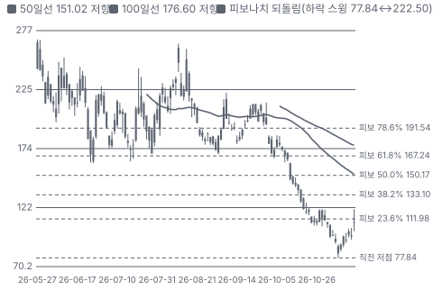

**주봉**

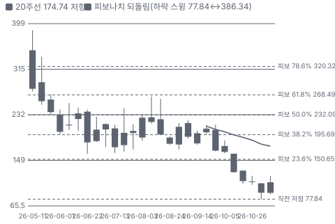

**월봉**

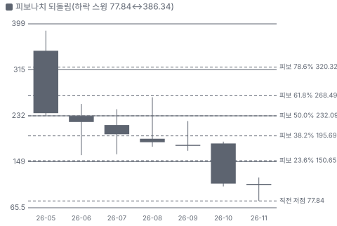

**분기 매출·EPS 실적과 컨센서스**

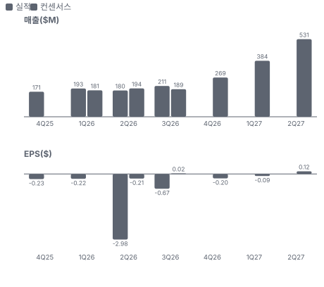

**EPS 리비전**

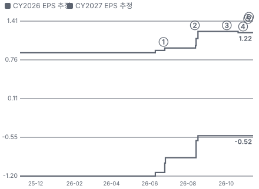

① 26-06-23 1Q26 첫 실적 · EPS 리비전 +5%
② 26-08-12 2Q26 실적, FY26 상향 · EPS 리비전 +29%
③ 26-10-02 최고속 등급 NVIDIA 이전 보도 · EPS 리비전 +0%
④ 26-10-28 Culper 숏 공개 · EPS 리비전 +0%
⑤ 26-11-05 회사, 웨이퍼 수명 숏 반박 · EPS 리비전 +0%
⑥ 26-11-12 3Q26 실적, 4Q·FY26 상향, Microsoft 계약 · EPS 리비전 +0%

**멀티플 프리미엄(현재값 — 최근 4개 분기 추이 재료 없음)**

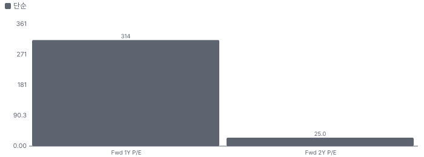

**합리적 멀티플**

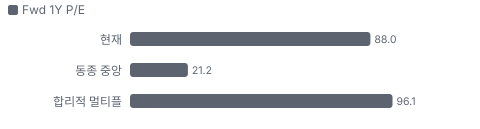

**밸류에이션 주가 시나리오**

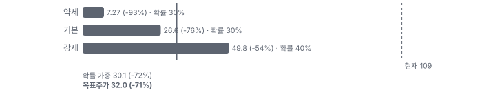

**주가별 업사이드**

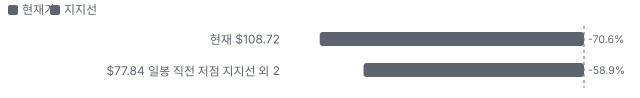
- 제품·서비스 포트폴리오

**고객 믹스(3Q26, 매출 대비)**

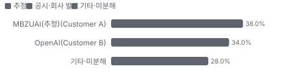

**공급 병목(10점, 낮을수록 병목)**

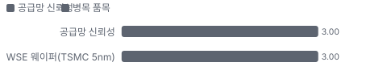

**CAPEX의 매출 대비 비중**

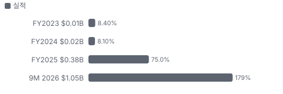

**어닝콜 변화별 주주가치 영향**

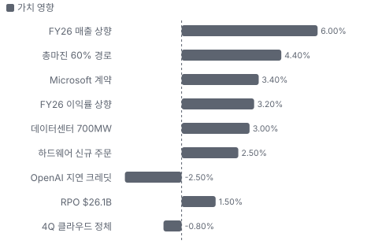

**수주·파이프라인 확실성 사다리**

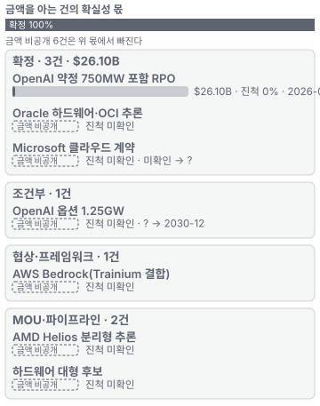

**매출 → 매출총이익 → 영업이익(매출 = 100, 최근 4분기)**

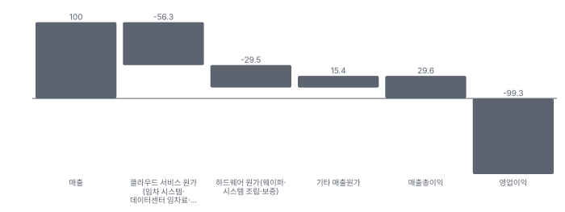

**분기 비용 비중 추이(매출 대비, 공시)**

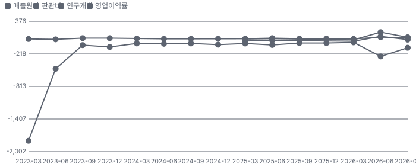

**비용 요인별 매출 대비 비중 1년 변화**

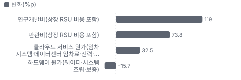

**BOM 항목 가격 +10% 시 OPM 변화**

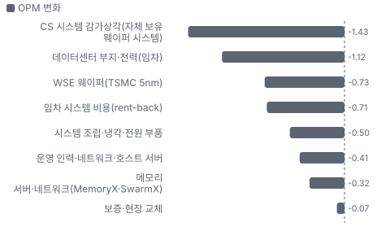

**추론 클라우드 BOM 원가 몫**

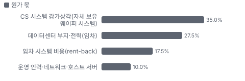

**CS-3·CS-4 시스템 BOM 원가 몫**

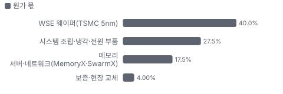

**자산 구성 — 3Q26 분기말 투하자본 \$2,274.3M**

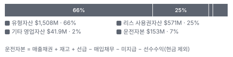

**자산별 변화율 — 최근 3개 분기(1Q26 = 0%)**

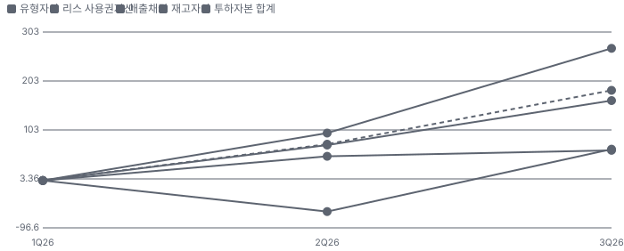

**분기 감가 비율 연율(유형자산 총액 대비)**

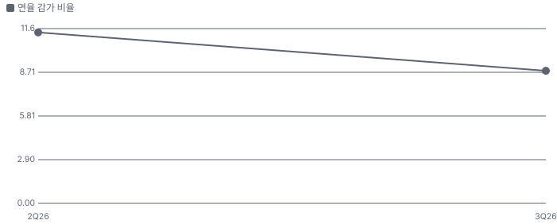

**매출 증가율의 가격·물량 분해와 8분기 전망(전년 대비)**

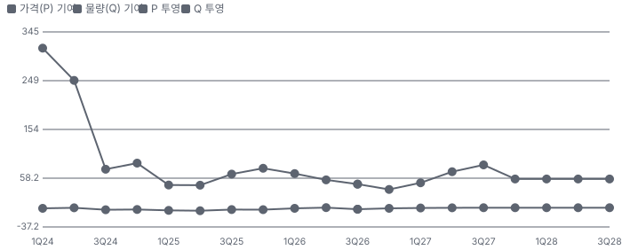

**분기별 매출 증가율 분해**

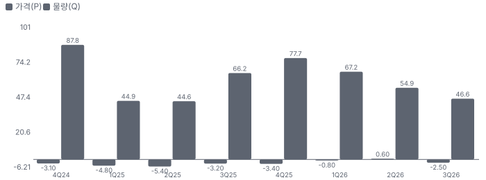

**목표주가 산정 — 기본과 강세 사이(강세 쪽 25%), 도달 확률 약 47%**

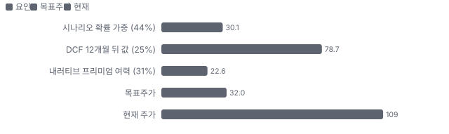

**PEG — 성장 대비 멀티플(낮을수록 성장 대비 쌈)**

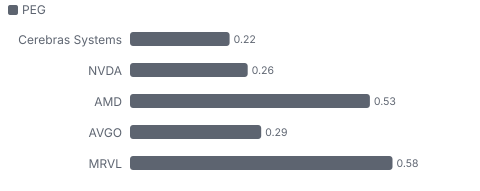

**커뮤니티 언급 수(최근 30일, 채널별)**

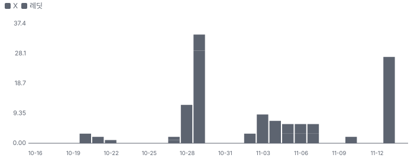

**커뮤니티 게시 수(월, 최근 7개월 — 이번 달은 진행 중)**

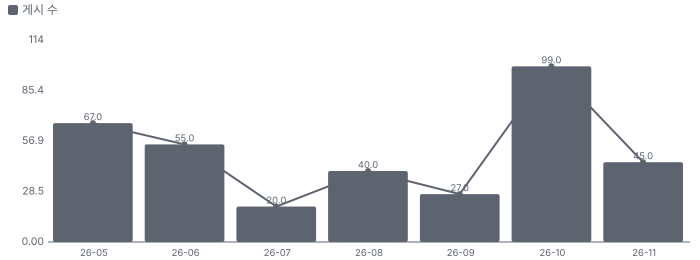

**일별 거래량 분해**

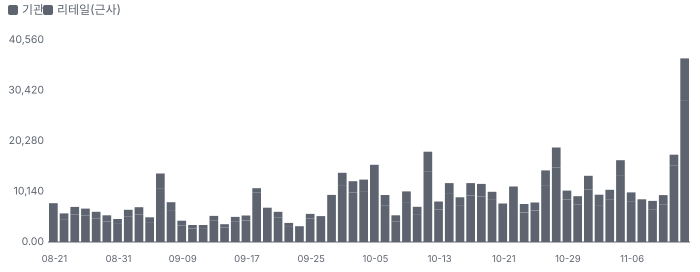

**기관 자금 흐름**

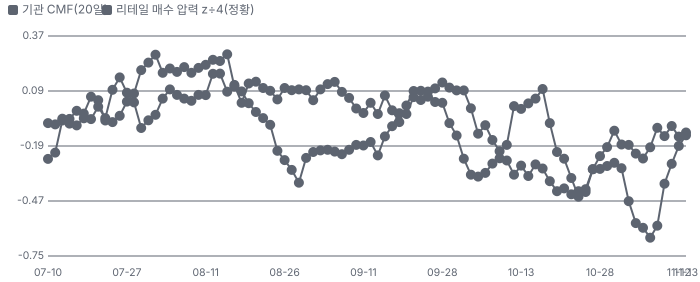

**몬테카를로**

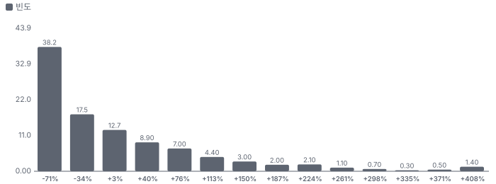

해석: 3,000번 중 1,159번(39%)에서 가치가 지금 주가 이상이었다. 가정을 흔들어도 지금 주가를 뒷받침하지 못하는 경우가 더 많다. 가운데 값은 0.71배이고, 열 번 중 여덟 번은 0.21~2.43배 사이에 든다.

## 내러티브

> **기업가치를 결정하는 이야기:** 주가는 2028년 EPS × 멀티플이다. EPS는 RPO \$25.4B가 일정대로 데이터센터에 깔리는지, 임차 시스템이 빠지며 총마진이 60%로 가는지가 정한다. 멀티플은 '대체 불가능한 속도'인지 '또 하나의 가속기 임대업'인지가 정한다.

> **멀티플·EPS 프리미엄**
> **멀티플:** Fwd 1Y(2027년) P/E 72.6배는 동종 중앙값 21.2배의 3배가 넘는다. Fwd 2Y(2028년)는 14.6배로 동종 Fwd 2Y 중앙값 약 14배와 같다(11/6 주가 기준). 시장은 2028년 숫자에 프리미엄을 주지 않는다.
> **EPS:** 2026년 1·2Q 모두 매출·EPS가 컨센서스를 넘었다. FY27 EPS는 8/11 \$0.96에서 \$1.235로 올랐다. 다만 추정 대부분이 8월에 고정돼 있고 애널리스트가 2~4명이다.

### 투자자들은 왜 열광했나

OpenAI \$20B 이상 계약, 상장 첫날 +68%, GPU 대비 15배라는 숫자가 겹쳤다. 희소한 비 NVIDIA 추론 종목이었다. 식은 이유는 세 가지다. 실적마다 마진 가이던스가 실망을 줬고(첫 실적 다음 날 −19.6%, 둘째 −11.8%), 8/19부터 2주마다 락업 물량이 풀렸고, 9/30~10/2 OpenAI의 최고속 등급이 NVIDIA로 갔다는 보도가 결정타였다.

### 무엇이 기업가치를 바꾸나

> **구조적 체질 변화**
> **변화:** 하드웨어 판매에서 클라우드로 옮겼다. 코어 클라우드 비중은 2Q 61%다. 대신 자본 집약적이 됐다
> **증거:** 1H 설비투자 \$549M > GAAP 매출 \$374M
> **반증:** 설비투자 ÷ 매출이 2027년에도 1배를 넘는다

> **고부가 믹스 확장**
> **변화:** 빠른 토큰에 프리미엄이 붙는다는 주장이다. 코어 총마진 목표 60% 이상. 지금은 임차 시스템으로 2Q 40.6%, 3Q 38~40%다
> **증거:** 2Q 콜
> **반증:** 4Q 코어 총마진이 반등하지 않는다

> **기술 혁신**
> **변화:** CS-4(Cerebras 4세대 시스템, 웨이퍼 3장)는 같은 WSE-3(Cerebras 3세대 웨이퍼 칩) 실리콘을 클럭을 올려 3장 묶었다. 새 공정이 아니다. CS-5(Cerebras 차기 시스템)는 2027 하반기 목표다
> **증거:** 회사 보도자료, 2Q 콜
> **반증:** CS-5 지연 또는 NVIDIA SRAM(칩 안의 고속 메모리) 계열 추론 칩의 독립 측정 우위

> **실행 속도**
> **변화:** 회사가 공개한 납품 지표는 OpenAI 계약에서 첫 생산 투입까지 35일이다. 시범 규모이지 전체 납기가 아니다. 750MW 납기는 공개되지 않았고 동종 비교는 불가능하다 **납품 리드타임 35일.** 피어 비교 미확인. 이전 대비 미확인.
> **증거:** 1Q 콜
> **반증:** 미네소타 40MW가 2027년 2분기를 넘긴다

> **M&A**
> **변화:** 해당 없음(큰 인수가 없다. 자금은 데이터센터와 시스템에 쓴다)
> **증거:** 10-Q
> **반증:** 대형 인수 발표

> **정책·입법 연관성**
> **재정정책:** OBBBA(2025년 7월 제정 재정조정법) 설비 즉시 상각은 자체 보유 설비가 많은 이 회사에 현금세 이연 효과가 있다. 지금은 적자라 당장 효과는 작다 2025년 7월 제정 법률 반증: 법 개정 의회 동의 10/10 — 하원 5/5(OBBBA 본회의 통과) · 상원 5/5(OBBBA 본회의 통과).
> **행정명령:** 수출 통제가 UAE(아랍에미리트) 고객 매출을 좌우한다. 10-Q는 수출 허가를 보장하지 못한다고 적었다. 2026-01-14 Section 232(미국 무역확장법 안보 관세 조항) 포고문은 미국 내 100MW 초과 데이터센터 용도를 면제한다. 재검토 결과는 미확인이다 10-Q 위험 요인, 포고문 해설 반증: UAE 허가 지연이나 면제 축소 의회 동의 2/10 — 하원 1/5(이 조치를 입법한 법안 확인 안 됨) · 상원 1/5(이 조치를 입법한 법안 확인 안 됨).
> **연관입법:** 해당 없음(회사 매출에 직접 닿는 입법을 확인하지 못했다. GAIN AI Act·Chip Security Act(미국 칩 위치 확인 법안) 진행은 미확인)

> **고객의 지출 예산**
> **변화:** AI 데이터센터 투자의 수혜지만 공급사보다 임대 사업자 위치에 가깝다. 고객 투자 → 이 회사 매출은 RPO 안의 OpenAI만 확인된다
> **사업별 예산:** 사업별 CAPEX·OPEX 구분 미확인
> **증거:** 10-Q Note 3
> **반증:** AWS 물량이 RPO에 잡히지 않는다

### 내러티브 근거

> '가장 빠른 추론은 Cerebras뿐' 이야기가 상장 프리미엄을 만들었고, 10월에 최대 고객의 선택과 공개 숏이 그 이야기를 흔들었다. EPS 추정은 그대로인데 주가는 8/11 이후 −62%다. 11/5 회사가 웨이퍼 수명 숏을 자체 수치로 반박했다. 동종 대비 멀티플 차이 +314% 중 회사 고유 몫은 -8%다. 단계는 소멸, 쏠림은 낮음이다.

> **가장 빠른 추론(웨이퍼 스케일)** · 약화
> **논리:** 웨이퍼 한 장 칩의 메모리 대역폭으로 추론 토큰 속도에서 GPU보다 빠르다는 이야기
> **숫자:** Fwd 1Y P/E 72.6배, 2Y 14.6배(11/6)
> **반증:** OpenAI 최신 모델 최고속 등급이 Cerebras로 돌아온다는 확인이면 이 약화가 풀린다

> **OpenAI 대형 계약** · 유지
> **논리:** 750MW 약정·최대 2GW 옵션으로 매출이 관계사(G42) 의존에서 벗어난다
> **숫자:** RPO \$25.4B, 완전 희석 EV 약 \$20.9B의 약 1.2배
> **반증:** RPO 감소 또는 납기 지연 공시

> **웨이퍼 수명·교체 CAPEX(약세)** · 유지
> **논리:** 상시 고온 운용으로 수명이 짧아 계약 손익분기를 못 넘는다
> **숫자:** 손익분기 수명 2.1~4.2년(공개 숏 입력 기준) vs 회사 공개 CS-3(Cerebras 3세대 시스템) 퇴역 0.5% 미만
> **반증:** 10-Q 내용연수 유지·손상 없음(11/12)

> **Oracle OCI 제휴(고객 다변화)** · 태동
> **논리:** Oracle 클라우드에서 Cerebras 추론을 제공 — 관계사·OpenAI 의존에서 벗어나는 첫 대형 채널
> **숫자:** 계약 규모 미공개(미확인)
> **반증:** OCI 매출 기여가 4Q26·1Q27 공시에 안 보임

> **OpenAI 최고속 등급 이전(약세)** · 강화
> **논리:** 가장 빠른 등급이 NVIDIA로 갔다면 속도 독점 이야기가 깨진다
> **숫자:** 9/25~10/2 −19.5%, 8/11 이후 주가 −62%, FY27 EPS 추정 +29%
> **반증:** OpenAI가 Cerebras 물량 확대를 공시하거나 RPO가 늘어난다

## 포트폴리오

| 제품·서비스 | 구분 | 무엇 | 쓰는 곳 | 돈 버는 방식 | Mix | Mix 변화(전년 대비) |
|---|---|---|---|---|---|---|
| 추론 클라우드 | 서비스 | 자체 시스템을 임차 데이터센터에 깔아 토큰을 판다 | OpenAI, 코딩·에이전트 스타트업, 기업 | 2Q 코어 \$127.7M, +287%. 코어 마진 41.8% | 67% | +38.6%p |
| CS-3·CS-4 시스템 | 제품 | 웨이퍼 칩 기반 랙 시스템을 고객 시설에 판매 | G42·MBZUAI, 연구소, 정부 | 2Q 코어 \$82.1M, +17%. 코어 마진 38.8% | 33% | -38.6%p |
| WSE 웨이퍼 스케일 엔진 | 기술 | 웨이퍼 전체를 한 칩으로 쓰고 SRAM을 칩 안에 둔다. TSMC 5nm | 디코드(토큰 생성) 구간 | 시스템 원가 미공개 | 미확인 | 미확인 |
| 분리형 추론 | 기술 | 프리필은 GPU·Trainium, 디코드는 WSE가 맡는 구성 | AWS, AMD Helios | 매출 미확인, 회사는 토큰 5배 주장 | 미확인 | 미확인 |

**Mix 변화가 가장 큰 쪽은 CS-3·CS-4 시스템(-38.6%p, 전년 대비).** 계절성 판정: 분기 매출 계절 지수 기준 있음 → 전년 같은 분기와 비교.

## 고객

> **3Q26 최대 고객 MBZUAI(추정, Customer A) 38%, 상위 3곳 72%, 집중도 집중.** 공시·회사 발표로 확인한 몫은 매출의 34%이고, 나머지 고객 몫은 추정이거나 미분해다. 3Q GAAP 매출의 72%가 두 고객이다. Customer A 38%(2Q 34%)·OpenAI 34%(2Q 32%). 10% 넘는 고객은 2Q 셋에서 3Q 둘로 줄었다. 하이퍼스케일러 3곳(AWS·Oracle·Microsoft)은 아직 매출 몫이 공시되지 않는다

**고객별 매출 몫(3Q26)**
| 고객 | 몫 | 변화 | 근거 |
|---|---|---|---|
| MBZUAI(추정, Customer A) | 38% | +4%p | 추정 |
| OpenAI(Customer B) | 34% | +2%p | 공시 |
| Customer C(이름 미공시) | 미확인 | 미확인 | 공시 |
| G42(추정, Customer D) | 미확인 | 미확인 | 추정 |
| 기타·미분해 | 28% | - | - |

> **MBZUAI(추정, Customer A)** · 추정
> **사는 것:** CS 시스템·클라우드(UAE 연구·정부)
> **추정 근거:** 공시 표기는 Customer A다. UAE 본사 고객이라는 10-Q 서술과 이전 회차 대조로 MBZUAI로 본 가설

> **OpenAI(Customer B)** · 공시
> **사는 것:** 추론 클라우드 용량(750MW 약정)
> **추정 근거:** 2Q까지 관계 거래로 확인된 OpenAI를 Customer B로 본다 — 3Q 관계 거래 금액은 미대조

> **Customer C(이름 미공시)** · 공시
> **사는 것:** 미확인
> **추정 근거:** 이름 미공시

> **G42(추정, Customer D)** · 추정
> **사는 것:** CS 시스템
> **추정 근거:** 공시 표기는 Customer D. 2Q26 단일 분기 몫은 10% 미만이라 미공시

## 수주·파이프라인

> **2026-09-30 기준 7건.** 확정 \$26.10B. 공시 잔여 이행의무(RPO) \$26.10B. 서로 겹치는 항목은 합계에서 뺐다.

**수주 목록**
| 상태 | 계약 | 계약 총액 | 진척 | 기간 | 비고 |
|---|---|---|---|---|---|
| 확정 | OpenAI 약정 750MW 포함 RPO | \$26.10B | 0% | 2026-02 → ? | - |
| 확정 | Oracle 하드웨어·OCI 추론 | 금액 비공개 | 비공개 | - | (다른 항목과 겹칠 수 있어 합계에서 뺌) |
| 확정 | Microsoft 클라우드 계약 | 금액 비공개 | 비공개 | 미확인 → ? | (다른 항목과 겹칠 수 있어 합계에서 뺌) |
| 조건부 | OpenAI 옵션 1.25GW | 금액 비공개 | 비공개 | ? → 2030-12 | (다른 항목과 겹칠 수 있어 합계에서 뺌) |
| 프레임워크 | AWS Bedrock(Trainium 결합) | 금액 비공개 | 비공개 | - | (다른 항목과 겹칠 수 있어 합계에서 뺌) |
| 파이프라인 | AMD Helios 분리형 추론 | 금액 비공개 | 비공개 | - | (다른 항목과 겹칠 수 있어 합계에서 뺌) |
| 파이프라인 | 하드웨어 대형 후보 | 금액 비공개 | 비공개 | - | (다른 항목과 겹칠 수 있어 합계에서 뺌) |

**실행 속도와 방해 요인**
| 항목 | 상태 | 실행 속도 | 방해 요인 |
|---|---|---|---|
| OpenAI 약정 750MW 포함 RPO | 확정 | RPO의 22%가 2028년 6월까지, 43%가 그다음 24개월, 나머지는 그 뒤 | 데이터센터 준공 지연 — 크레딧·90일 이상 지연 분 취소권(5% 미만) · OpenAI 작업 배정 |
| Oracle 하드웨어·OCI 추론 | 확정 | 4Q 출하 시작, 2027년 상반기까지. OCI 추론 서비스는 2027년 여름 출시 예정 | Oracle 데이터센터 준비 |
| Microsoft 클라우드 계약 | 확정 | 계약 서명(2026-11-12 발표), 제공 시점·금액 미공개 | 데이터센터 용량 |
| OpenAI 옵션 1.25GW | 조건부 | 2030년 말까지 분할 행사, 합계 최대 2.0GW | OpenAI 행사 결정 · 모델별 칩 선택 |
| AWS Bedrock(Trainium 결합) | 프레임워크 | 2027년 1분기 제공 목표. RPO에 없고 워런트 270만 주는 지급액 조건 | AWS 데이터센터 배치 · 수요 불확실 |
| AMD Helios 분리형 추론 | 파이프라인 | 4Q 배치 목표, 회사는 구매자가 있다고 말했다 | Helios 일정 · 실제 처리량 5배 입증 |
| 하드웨어 대형 후보 | 파이프라인 | 회사는 후기 단계 수억 달러 규모라고 말했다 | 고객 데이터센터 일정 |

## 마진 구조

> **GPM 14.2%, OPM -265.0%.** 2Q25 대비 GPM -16.9%p, OPM -209.6%p. 2Q26 GAAP 매출원가는 매출의 85.8%로 1년 전 68.9%보다 16.9%p 올랐다. 클라우드 원가(임차 시스템·데이터센터·감가상각)가 23.8%에서 56.3%로 커진 몫이 크다. 연구개발비·판관비는 상장 때 RSU 비용 약 \$377M이 잡혀 매출의 2.8배다 — 일회성 몫이 커서 영업이익률 −265%는 정상 수준이 아니다

> **매출 100 중 매출원가 70.4, 매출총이익 29.6(최근 4분기, 공시).** 매출원가 요인 중 클라우드 서비스 원가(임차 시스템·데이터센터 임차료·전력·시스템 감가상각)이 매출의 56.3%로 가장 무겁고, 단가가 +10% 오르면 GPM이 -5.63%p 움직인다. 분기 회귀로 매출 1이 늘 때 매출원가는 0.72 늘고, 매출원가의 고정비 몫은 -9%다.

**비용 요인 강도 — 비중·추세·충격(+10%)·탄력**
| 비용 | 구분 | 매출 대비 | 1년 변화 | 마진 기여 | 충격 시 마진 | 매출 탄력 | 고정비 몫 |
|---|---|---|---|---|---|---|---|
| 클라우드 서비스 원가(임차 시스템·데이터센터 임차료·전력·시스템 감가상각) | 매출원가 요인 | 56.3% | +32.5%p | -32.5%p | -5.63%p | 미확인 | 미확인 |
| 하드웨어 원가(웨이퍼·시스템 조립·보증) | 매출원가 요인 | 29.5% | -15.7%p | +15.7%p | -2.95%p | 미확인 | 미확인 |
| 매출원가 | 공시 항목 | 70.4% | +9.3%p | -9.3%p | -7.04%p | 0.72 | -9% |

매출 탄력 = 분기 비용을 매출에 회귀한 기울기(매출 1당 변동비), 고정비 몫 = 절편 ÷ 평균 비용. 표본이 8분기 미만이면 미확인. 매출원가 요인 비중은 margin 재료의 추정이 섞여 있고, 공시 매출원가와의 차이는 '기타 매출원가'로 둔다.

**GPM에서 OPM까지(GAAP, 아래는 최근 4개 분기)**
| 기간 | GPM | 연구개발 | 판관비 | 기타 | OPM |
|---|---|---|---|---|---|
| 2Q25 | 31.1% | 58.9% | 27.6% | 0.0% | -55.4% |
| 2Q26 | 14.2% | 177.8% | 101.4% | 0.0% | -265.0% |
| 2025-12 | 41.0% | - | - | - | -19.7% |
| 2026-03 | 44.6% | - | - | - | -7.8% |
| 2026-06 | 14.2% | - | - | - | -265.0% |
| 2026-09 | 20.0% | - | - | - | -106.3% |

**비용을 움직이는 요인**
| 비용 | 요인 |
|---|---|
| 연구개발비(상장 RSU 비용 포함, 연구개발) | CS-4·CS-5 개발 인력, 2Q 상장 시점 RSU 일괄 인식 · 근거 공시 |
| 판관비(상장 RSU 비용 포함, 판관비) | 상장 회사 비용·영업 인력, 2Q RSU 일괄 인식 · 근거 공시 |
| 클라우드 서비스 원가(임차 시스템·데이터센터 임차료·전력·시스템 감가상각, 매출원가) | 클라우드 비중 확대, 임차 시스템(rent-back) 부담 약 5%p(2Q 콜), 데이터센터 리스 개시 · 근거 공시 |
| 하드웨어 원가(웨이퍼·시스템 조립·보증, 매출원가) | 하드웨어 매출 감소, 고객 워런트 상각이 GAAP 하드웨어 매출을 깎는다 · 근거 공시 |

**추론 클라우드 BOM — 매출의 70%, GPM 42%(코어 클라우드 총마진 41.8%(2Q 콜, 회사 조정 기준). GAAP은 19.5%(\$24.6M/\$126.0M) — SBC·워런트 상각 차이. rev_share는 GAAP 2Q 클라우드 ÷ 총매출(코어 기준 61%)), 항목 가격 +10% 시**
| 항목 | 원가 몫 | 전가 | 제품 GPM | OPM |
|---|---|---|---|---|
| CS 시스템 감가상각(자체 보유 웨이퍼 시스템) | 25~45% | 미확인 | -2.0%p | -1.43%p |
| 데이터센터 부지·전력(임차) | 20~35% | 미확인 | -1.6%p | -1.12%p |
| 임차 시스템 비용(rent-back) | 10~25% | 미확인 | -1.0%p | -0.71%p |
| 운영 인력·네트워크·호스트 서버 | 5~15% | 미확인 | -0.6%p | -0.41%p |
| 미분해 | 10% | - | - | - |

**CS-3·CS-4 시스템 BOM — 매출의 30%, GPM 39%(코어 하드웨어 총마진 38.8%(2Q 콜). GAAP은 1.8%(\$1.0M/\$54.1M) — 워런트 상각·SBC 차이), 항목 가격 +10% 시**
| 항목 | 원가 몫 | 전가 | 제품 GPM | OPM |
|---|---|---|---|---|
| WSE 웨이퍼(TSMC 5nm) | 30~50% | 미확인 | -2.4%p | -0.73%p |
| 시스템 조립·냉각·전원 부품 | 20~35% | 미확인 | -1.7%p | -0.50%p |
| 메모리 서버·네트워크(MemoryX·SwarmX) | 10~25% | 미확인 | -1.1%p | -0.32%p |
| 보증·현장 교체 | 2~6% | 미확인 | -0.2%p | -0.07%p |
| 미분해 | 11% | - | - | - |

판매가 전가를 모르는 항목은 전가 0%로 계산했다.

**BOM 항목 가격을 움직이는 것**
| 항목 | 요인 |
|---|---|
| CS 시스템 감가상각(자체 보유 웨이퍼 시스템) | 내용연수 3~5년 가정이 몫을 정한다. 공개 숏의 수명 논쟁이 바로 이 항목이다 · 근거 추정 |
| 데이터센터 부지·전력(임차) | MW당 임차료와 전력 단가, 가동률 · 근거 추정 |
| 임차 시스템 비용(rent-back) | 자체 데이터센터가 서기 전까지 남의 시설·시스템을 빌려 쓴다 · 근거 추정 |
| 운영 인력·네트워크·호스트 서버 | 클러스터 운영과 프리필용 서버 · 근거 추정 |
| WSE 웨이퍼(TSMC 5nm) | TSMC 5nm 웨이퍼 가격과 웨이퍼 단위 수율 보정(여분 코어) 비용 · 근거 추정 |
| 시스템 조립·냉각·전원 부품 | 웨이퍼 한 장에 kW급 전력을 넣고 빼는 맞춤 부품 · 근거 추정 |
| 메모리 서버·네트워크(MemoryX·SwarmX) | 외부 가중치 저장용 서버의 DRAM·플래시 가격 · 근거 추정 |
| 보증·현장 교체 | 웨이퍼 교체가 잦으면 커진다(공개 숏 논점) · 근거 추정 |

**투입 물가 — 미국 PPI 3·6·12개월(2026-10, 개정 반영)과 해외 전년비**
| 항목 | 미국 3개월 | 6개월 | 12개월 | 전가 못 할 때 OPM | 일본 | 한국 | 대만 |
|---|---|---|---|---|---|---|---|
| 운영 인력·네트워크·호스트 서버 | +0.0% | +3.0% | +3.1% | - | 미확인 | 미확인 | +57.2%* |
| WSE 웨이퍼(TSMC 5nm) | -0.7% | -5.7% | -2.7% | - | +1.6% | +2.3% | +22.9%* |
| 메모리 서버·네트워크(MemoryX·SwarmX) | -0.7% | -5.7% | -2.7%* | - | +1.6%* | +418.1% | +22.9%* |

별표는 품목보다 넓은 업종 지수다. 지난 1년 투입 물가를 판매가 전가 뒤 원가에 넣으면 OPM은 -13.59%p 움직인다(매출원가의 17% 기준). 물가 지수를 붙이지 못한 매출원가 항목은 클라우드 서비스 원가(임차 시스템·데이터센터 임차료·전력·시스템 감가상각), 하드웨어 원가(웨이퍼·시스템 조립·보증)다(미연결).

## 자산 구성

> **3Q26 분기말 투하자본 \$2,274.3M** — 유형자산 66%, 리스 사용권자산 25%. 최근 3개 분기(1Q26 → 3Q26) 가장 크게 늘어난 자산은 매출채권(+270%), 투하자본 합계 +184%.

**자산·운전자본 항목별 분기말 잔액 — 최근 12개 분기와 다음 4개 분기 추정**
| 항목 | 1Q26 | 1년 전 | 3Q26(최근) | 추정 | 3개 분기 변화 | 다음 4개 분기 변화 |
|---|---|---|---|---|---|---|
| 매출채권 | \$62.6M | 미확인 | \$231.8M | — | +270% | — |
| 재고자산 | \$89.0M | 미확인 | \$146.1M | — | +64% | — |
| 선급·기타 유동자산 | \$77.9M | 미확인 | \$542.8M | — | +597% | — |
| 매입채무 | \$50.3M | 미확인 | \$237.0M | — | +371% | — |
| 미지급비용 | \$171.0M | 미확인 | \$296.0M | — | +73% | — |
| 선수수익(계약부채) | \$149.9M | 미확인 | \$234.3M | — | +56% | — |
| 유형자산 | \$572.4M | 미확인 | \$1,507.8M | — | +163% | — |
| 리스 사용권자산 | \$353.3M | 미확인 | \$571.2M | — | +62% | — |

**유형·무형자산 항목별 가치(2026-09-30 vs 2026-06-30)**
| 구분 | 항목 | 총액 2026-09-30 | 누적상각 | 순액 | 총액 2026-06-30 | 총액 1년 변화 | 공시 내용연수 |
|---|---|---|---|---|---|---|---|
| 유형 | 유형자산 합계(항목 미분해) | \$1,627.3M | 총계만 공시 | 총계만 공시 | \$1,077.8M | +51.0% | 미확인 |
| 유형 합계 | 유형자산 | \$1,627.3M | \$119.5M | \$1,507.8M | \$1,077.8M | +51.0% | 경과율 7%(상각 대상 기준) |

**분기 감가 비율(감가상각 ÷ 평균 유형자산 총액)**
| 분기 | 감가상각 | 평균 유형자산(총액) | 분기 비율 | 연율 | 연율의 역수 |
|---|---|---|---|---|---|
| 2Q26 | \$24.4M | \$858.6M | 2.84% | 11.36% | 8.8년 |
| 3Q26 | \$29.8M | \$1,352.5M | 2.20% | 8.81% | 11.4년 |

감가상각 기준: 손익계산서 감가상각·상각비(SEC 공시 데이터, 4분기 = 연간 − 1~3분기).

미공시·미분해: 분기 감가상각·유형자산(순액) 9분기 · 분기 매출·영업이익 8분기 · 유형자산 항목별 총액·내용연수(10-K 주석에서 모델이 채움) · 무형자산 항목(10-K 주석에서 모델이 채움) — 이 칸은 비우고 나머지로 계산했다.

## 공급망 병목

> **공급망 신뢰성 3.0/10, 병목 심각.** 가장 약한 고리는 WSE 웨이퍼(TSMC 5nm) 3.0점이고, 품목 평균은 3.0점이다. 근거가 부족한 3건(시스템 조립·냉각·전원 부품 · 데이터센터 부지·전력(임차) · 메모리 서버·네트워크(MemoryX·SwarmX))은 점수에서 뺐다. 병목은 웨이퍼가 아니라 데이터센터 공간이다. CEO가 2Q 콜에서 업계 전체의 병목이라고 말했다. 웨이퍼는 TSMC 단일 공급이지만 5nm는 3nm·CoWoS(TSMC 첨단 패키징)·HBM(GPU 옆에 쌓는 고대역폭 메모리) 병목 밖이다. 10-Q는 부품·제조 대부분을 생산 능력 보장 없는 발주로 산다고 적었다 — 물량을 묶어 두지 않았다

**병목과 마진 — 품목 가격 +10% 시 OPM**
| 품목 | 점수 | 판정 | 구분 | OPM |
|---|---|---|---|---|
| WSE 웨이퍼(TSMC 5nm, 필수) | 3.0 | 병목 심각 | 핵심 통제 품목 | -0.73%p |

> **WSE 웨이퍼(TSMC 5nm)** · 3.0/10
> **왜:** 웨이퍼 한 장이 칩이라 다른 파운드리로 옮기려면 설계부터 다시 해야 한다(재인증 24개월은 추정). 1년 초과 구매 약정은 \$10.3M뿐이다
> **병목 요인:** 인증 공급사 1곳 · 캐파 균형 · 리드타임 미확인 · 재인증 24개월 · 1위 점유율 90% · 대만 집중 100% · 물량 확보 현물
> **풀리는 조건:** 미확인 — 2026년 말 10배는 회사 발언이고 장비·물량 배정 확인 전이다

**공급사**
| 품목 | 공급사 | 몫 | 근거 |
|---|---|---|---|
| WSE 웨이퍼(TSMC 5nm) | TSMC(WSE-3 웨이퍼 제조(5nm)) | 미확인 | 공시 |
| 시스템 조립·냉각·전원 부품 | 위탁 조립사(이름 원문 미대조, 시스템 조립) | 미확인 | 추정 |
| 데이터센터 부지·전력(임차) | Zone Frontier(미네소타 40MW 캠퍼스(1Q27 매출 개시, 2Q27 전량)) | 미확인 | 회사 발표 |
| 데이터센터 부지·전력(임차) | 그 밖의 임대 사업자(미공시, 코로케이션·임차 시스템) | 미확인 | 공시 |
| 메모리 서버·네트워크(MemoryX·SwarmX) | 외부 서버·메모리 공급사(미공시, 가중치 저장 서버) | 미확인 | 추정 |

**무역 통계로 본 공급 지역**
| 품목 | EU 수입처 | 일본 수입처 | EU 1위 전년비 |
|---|---|---|---|
| WSE 웨이퍼(TSMC 5nm) | TW(대만) 32% · MY(말레이시아) 19% · CN(중국) 15% | 台湾 60% · 中華人民共和国 8% | +136.5% |
| 메모리 서버·네트워크(MemoryX·SwarmX) | TW 45% · KR(한국) 21% · CN 16% | 台湾 52% · 大韓民国 28% | +365.5% |

## 생산능력

> **현재 명목 캐파 미확인, 가동률 미확인.** 착공 이상 증설은 0 MW(데이터센터 전산 부하 용량), 발표까지 합치면 740 MW(데이터센터 전산 부하 용량)이다. 9M 2026 CAPEX는 \$1.05B로 매출의 179.0%다. 회사는 지금 가동 중인 MW를 밝히지 않는다. 2027년 말까지 받을 데이터센터는 총 700MW(gross)로 2Q의 600MW+에서 늘었고, 2027년 신규분의 75% 이상이 미국 밖이다. 제조 능력은 2026년 말 연초의 10배라고 했다. CAPEX는 3Q 한 분기 \$497M으로 그 분기 매출의 2.4배다

**생산시설 2곳**(회사 공시·발표·콜에서 이름과 위치가 확인된 시설만 센다. 회사는 공장·데이터센터를 소유하지 않는다(10-Q 리스 주석). 3Q 콜이 말한 노르웨이·핀란드·캐나다·프랑스 데이터센터는 시설명·용량이 공개되지 않아 세지 않았다), 위탁 1곳 · 임차 1곳. 시설별 생산능력은 1곳만 공개됐다.

**생산시설 2곳 — 명칭·위치·생산능력**
| 시설 | 위치 | 용도 | 생산능력 | 소유·상태 |
|---|---|---|---|---|
| TSMC 웨이퍼 생산(WSE-3 5나노, WSE-5 5나노) | 대만(팹 위치 미공시) | 웨이퍼 제조 | 미확인 — 웨이퍼 약정은 '충분하다'고만 했다(3Q 콜) — 수량 미공시 | 위탁 · 가동 |
| Zone Frontier 미네소타 캠퍼스 | 미국 미네소타 | 추론 클라우드 데이터센터 | 40 MW | 임차 · 건설 중 |

**생산능력 확충 계획**
| 계획 | 단계 | 증설 | 가동 시점 | CAPEX |
|---|---|---|---|---|
| 확보 데이터센터(2027년 말까지 총 700MW) | 발표 | 700 MW(데이터센터 전산 부하 용량) | 2027-12 | 미확인 |
| 미네소타 Zone Frontier 캠퍼스 | 발표 | 40 MW(데이터센터 전산 부하 용량) | 2027-03 | 미확인 |

남은 계획의 CAPEX 합계는 \$0.00B(금액 미확인 2건 제외)다. 합계는 9M 2026 매출의 0%다.

**증설 방해 요인**
| 계획 | 방해 요인 |
|---|---|
| 확보 데이터센터(2027년 말까지 총 700MW) | 부지 준공·전력 연결·시스템 생산 |
| 미네소타 Zone Frontier 캠퍼스 | 준공·전력 |

**CAPEX와 매출 대비**
| 기간 | CAPEX | 매출 | 매출 대비 | 구분 |
|---|---|---|---|---|
| FY2023 | \$0.01B | \$0.08B | 8.4% | 실적 |
| FY2024 | \$0.02B | \$0.29B | 8.1% | 실적 |
| FY2025 | \$0.38B | \$0.51B | 75.0% | 실적 |
| 9M 2026 | \$1.05B | \$0.58B | 179.0% | 실적 |

## 해자

> 해자는 칩 자체보다 '속도 + 공급망 우회 + 계약'의 묶음이다. 속도 해자가 가장 중요한데 최대 고객의 선택이 그것을 시험하고 있다.

> **웨이퍼 스케일 SRAM 구조의 디코드 속도** · 보통
> **해자:** 칩 안의 SRAM이 메모리 대역폭 병목을 없애 토큰 생성이 GPU보다 빠르다. 회사는 GPU 대비 15배, GPT-5.6 Sol(OpenAI 대형 모델) 10배를 주장한다.
> **근거:** OpenAI가 8월 GPT-5.6 Sol Ultrafast(OpenAI 모델의 최고속 서비스 등급)를 Cerebras로 서빙했다는 보도가 있다. 그러나 10월 GPT-6.1 Sol(OpenAI 최신 대형 모델) Ultrafast는 NVIDIA GPU로 간다는 보도가 나왔다. OpenAI·회사의 확인이나 부인은 찾지 못했다.
> **숫자:** CS-4 메모리 대역폭 129.6PB/s, CS-3의 6배(회사 수치)
> **깨지는 조건:** NVIDIA가 같은 모델을 같은 속도로 낸다는 독립 측정 또는 OpenAI의 물량 축소

> **HBM·CoWoS·3nm를 쓰지 않는 공급망** · 보통
> **해자:** 업계 공통 병목을 비켜 가 5nm 웨이퍼만 확보하면 늘릴 수 있다.
> **근거:** 2Q 콜에서 2026년 말 제조 능력 10배 초과, 2027년 추가 3~4배 계약을 말했다. 그러나 10-Q는 부품·제조 대부분이 생산 능력 보장 없는 발주 방식이고 단일 공급원이 있다고 적었다.
> **숫자:** 1년 초과 구매 약정 \$10.3M뿐
> **깨지는 조건:** TSMC 5nm 배정 축소나 Flex(미국 전자제품 위탁 생산사)·Sanmina(미국 전자제품 위탁 생산사) 조립 지연

> **OpenAI 계약과 지분 결속** · 보통
> **해자:** 750MW 약정, \$1.0B 운전자금 대출, 3,345만 주 워런트가 양쪽을 묶는다.
> **근거:** RPO \$25.4B. 다만 10-Q상 기간은 3~4년, 최대 5년이고 대부분이 한 고객이다. 약정은 용량 구매이지 특정 모델 전담이 아니다.
> **숫자:** 워런트 중 1,003만 주를 7월 행사
> **깨지는 조건:** 납기 지연으로 계약 해지 조항 발동이나 잔고 감소

> **프런티어 모델 서빙 소프트웨어** · 약함
> **해자:** 비공개 대형 모델을 서빙하며 쌓은 운영 역량이다. 회사는 계약 뒤 35일 만에 생산 투입했다고 말한다.
> **근거:** 회사 주장 중심이다. GPU의 소프트웨어 생태계와 비교한 독립 자료는 확인하지 못했다.
> **숫자:** 미확인
> **깨지는 조건:** 새 모델 서빙이 GPU보다 몇 달씩 늦는다

> **데이터센터 확보 속도** · 약함
> **해자:** 추론은 GW급 단일 부지가 필요 없어 작은 부지를 빨리 모을 수 있다.
> **근거:** 모두 임차다. 고정 리스 \$690M에 미개시 \$1.5B, 3Q 추가 \$753M. 경쟁사도 같은 시장에서 부지를 찾는다.
> **숫자:** 확보 600MW+ vs 약정 750MW·옵션 합계 2.0GW
> **깨지는 조건:** 미네소타 40MW 등 개별 부지가 2027년 일정을 놓친다

## 경영진·네트워크

> 창업자 경영 회사다. Feldman이 회장·CEO이고 공동 창업자 Lie가 CTO다. 벤처 이사들이 초기부터 이사회에 있다. 연결이 매출을 만들었다는 증거는 없다.

> **Andrew D. Feldman** · 공동 창업자·회장·CEO · 2016-04
> **프로필:** 56세. Stanford MBA·BA(학사). SeaMicro CEO(2007~12), AMD 인수 뒤 AMD 부사장. Riverstone Networks 재직 건으로 2007년 12월 회계 통제 회피 1건 유죄 인정, 2008년 SEC와 합의. 투자설명서에 공시된 사실이다
> **비즈니스:** SeaMicro·AMD 인맥이 초기 팀의 뿌리다. AMD는 지금 Helios 결합 파트너다
> **정계:** 미확인
> **동문:** Stanford
> **사모임:** 미확인

> **Sean Lie** · 공동 창업자·CTO · 2016(CTO 2022-04)
> **프로필:** AMD 데이터센터 서버 수석 아키텍트, SeaMicro IO(입출력) 패브릭 리드. 10/27 60,000주 약 \$6.9M 장내 매도
> **비즈니스:** AMD·SeaMicro 경력
> **정계:** 미확인
> **동문:** 미확인
> **사모임:** 미확인

> **Eric Vishria** · 선임 사외이사, Benchmark 파트너 · 2016-05
> **프로필:** 초기 투자자 측 이사. 감사위원
> **비즈니스:** Benchmark 포트폴리오
> **정계:** 미확인
> **동문:** 미확인
> **사모임:** 미확인

**네트워크 정량화**
| 연결 | 강도 | 닿는 매출 | 가중 노출 | 매출 대비 | 근거 |
|---|---|---|---|---|---|
| 비즈니스: AMD 경력 인맥과 AMD Helios 결합. 금액 미공개이고 인맥이 제휴를 만들었다는 증거는 없다 | 2/5 | 미확인 | 미확인 | 미확인 | 금액 미공개 424B4, 2Q 콜 |
| 비즈니스: OpenAI 지분 결속. 워런트 3,345만 주와 대출 \$1.0B는 문서로 확인되는 계약 연결이다 | 5/5 | \$0.23B | \$0.23B | 30% | OpenAI 2Q 매출 \$56.8M 연환산 10-Q Note 3·12 |
| 정계: UAE 고객(G42·MBZUAI)의 미국 수출 허가 의존. 경영진의 정치적 연결은 공개 기록으로 확인하지 못했다 | 1/5 | \$0.18B | \$0.04B | 5% | MBZUAI 1H 비중 49% × 1H GAAP 매출 \$0.37B 10-Q 위험 요인 |

가중 노출은 연결이 닿는 매출의 크기다. 연결이 그 매출을 만들었다는 뜻이 아니며, 인과는 공개 자료로 입증하지 못한다.

## 약세 논리 및 셀온 조건

| 약세 논리 | 근거 | 가를 자료 |
|---|---|---|
| 매출 상한은 칩이 아니라 건물이다 | 4Q 클라우드 매출은 데이터센터 부족으로 정체하고, 700MW 대부분은 2027년 중반부터 켜진다 | 12월 신규 용량 가동, 1Q27 클라우드 매출 |
| 최대 고객이 이미 늦었다 | OpenAI 용량 공급 지연으로 크레딧을 RPO에서 뺐고, 90일 넘게 늦은 몫은 OpenAI가 취소할 수 있다(회사는 올해 5% 미만이라고 했다) | 4Q RPO·크레딧 규모, 취소권 행사 여부 |
| 고객 집중 | 3Q GAAP 매출의 Customer A 38%·OpenAI 34%로 두 곳이 72%다 | 2027년 하이퍼스케일러 매출 비중 |
| 칩 회사가 아니라 자본 집약 클라우드다 | 3Q 영업현금 −\$341M·설비투자 \$497M으로 한 분기 설비투자가 GAAP 매출 \$211M의 2.4배다. 동종 P/E로 보면 이익의 질을 과대평가한다 | 2027년 영업현금 흑자 전환, 고객 비용 보전 조건 |
| 가이던스 상향의 질 | 4Q 상향의 큰 몫은 Oracle 하드웨어 출하로 반복되지 않을 수 있다 | 1Q27 하드웨어·클라우드 매출 구성 |
| 유통 물량 | 11/9 IPO 락업이 전량 해제돼 매도 가능 물량이 늘었다 | 락업 해제 뒤 내부자 매도 공시(Form 4) |

> **셀온 조건**
> **조건 1:** OpenAI가 지연분 취소권을 행사하거나 크레딧이 4Q에 더 커진다.
> **조건 2:** 4Q 코어 총마진이 가이던스 하단 47%에 못 미친다.
> **조건 3:** 12월 신규 용량 가동이 늦어져 1Q27 클라우드 매출이 다시 정체한다.
> **조건 4:** 실적 뒤 컨센서스 FY2027 EPS가 \$1.0 아래로 내려간다.

## 어닝콜 변화

**직전 콜 대비 새로 나오거나 바뀐 내용 → 가치 영향**
| 항목 | 내용 | 직전 콜 | 최신 콜 | 모델 동인 이동 | 확신도 | 가치 영향 |
|---|---|---|---|---|---|---|
| 업데이트 | FY26 코어 매출 가이던스 중간값 상향 | \$885M | \$950M | 기준연도 매출 +\$0.07B | 0.8 | +6.0% |
| 업데이트 | FY26 코어 영업이익률 가이던스 상향, 4Q 손익분기 | −18% | −9% | 출발 이익률 +9.0% | 0.8 | +3.2% |
| 업데이트 | 4Q 코어 총마진 48%, 곧 50% 초과, 장기 60%·영업이익률 40% | 장기 총마진 60%+ | 4Q 48%·영업이익률 40% 목표 | 목표 이익률 +2.0% | 0.5 | +4.4% |
| 신규 | Microsoft 클라우드 계약 — 하이퍼스케일러 3곳, 금액 미공개 | 협의 중 | 계약 | 1년차 성장률 +4.0% | 0.5 | +3.4% |
| 신규 | Oracle 등 새 하드웨어 주문, 4Q~2027 상반기 출하(현재 가격·마진) | 언급 없음 | 4Q 출하 개시 | 1년차 성장률 +3.0% | 0.8 | +2.5% |
| 부정 | OpenAI 용량 지연 — 크레딧을 RPO에서 차감, 90일 이상 지연 분 취소 가능(5% 미만) | 일정대로 | 2027 하반기 정상화 | 1년차 성장률 -3.0% | 0.8 | -2.5% |
| 부정 | 4Q 클라우드 매출 전분기 수준 — 데이터센터 부족 | +13% q/q(3Q) | 정체 | 기준연도 매출 -\$0.01B | 0.8 | -0.8% |
| 업데이트 | 2027년 말까지 쓸 데이터센터 600MW+ → 총 700MW(gross), 75% 이상 해외 | 600MW+ | 700MW | 장기 성장 수렴값 +1.0% | 0.5 | +3.0% |
| 업데이트 | RPO 증가(지연 크레딧 차감 후, Oracle 미포함) | \$25.4B | \$26.1B | 장기 성장 수렴값 +0.50% | 1.0 | +1.5% |
| 반복 | 2027 코어 매출 3배 — 표현 유지 | 3배 초과 | 3배 | 1년차 성장률 — | 0.8 | +0.0% |
| **합계** | 단독 합 |  |  | 동시 적용 +22.3% |  | **+20.7%** |

**사건별 EPS 리비전**
| # | 날짜 | 구분 | 사건 | CY2026 EPS 전→후 | CY2027 EPS 전→후 | 리비전 | 주가 반응 |
|---|---|---|---|---|---|---|---|
| ① | 26-06-23 | 실적 | 1Q26 첫 실적 | \$-1.14 → \$-0.89 | \$0.92 → \$0.96 | +4.9% | -19.6% |
| ② | 26-08-12 | 실적 | 2Q26 실적, FY26 상향 | \$-0.89 → \$-0.52 | \$0.96 → \$1.24 | +28.6% | -11.8% |
| ③ | 26-10-02 | 내러티브 | 최고속 등급 NVIDIA 이전 보도 | \$-0.52 → \$-0.52 | \$1.24 → \$1.24 | +0.0% | -1.8% |
| ④ | 26-10-28 | 내러티브 | Culper 숏 공개 | \$-0.52 → \$-0.52 | \$1.22 → \$1.22 | +0.0% | -5.7% |
| ⑤ | 26-11-05 | 내러티브 | 회사, 웨이퍼 수명 숏 반박 | \$-0.52 → \$-0.52 | \$1.22 → \$1.22 | +0.0% | -11.0% |
| ⑥ | 26-11-12 | 실적 | 3Q26 실적, 4Q·FY26 상향, Microsoft 계약 | \$-0.52 → \$-0.52 | \$1.22 → \$1.22 | +0.0% | +11.2% |

**실적 발표 예상 변동폭:** 지난 3번 실적 발표 때 주가는 하루에 평균 ±14.2%(최대 19.6%, 오른 날 1번) 움직였다.

**실적 발표 예상 변동폭 — 과거 실적 발표 다음 거래일 주가 변화**
| 분기 | 발표일 | 주가 변화 |
|---|---|---|
| 1Q26 | 2026-06-23 | -19.6% |
| 2Q26 | 2026-08-12 | -11.8% |
| 3Q26 | 2026-11-12 | +11.2% |

## P·Q 사이클

> **Q 사이클 — 최근 4분기 평균 가격 기여 -1.5%, 물량 기여 +61.6%(전년 대비 로그 증가율).** P 강도 5.9/10, Q 강도 4.1/10, 최근 8분기 중 100%가 같은 요인 우세(구조적). 전망으로는 8분기 안에 전환 신호가 없다(물량은 컨센서스를 섞었다).

**P·Q 사이클 정량**
| 항목 | 가격(P) | 물량(Q) |
|---|---|---|
| 최근 4분기 평균 기여 | -1.5% | +61.6% |
| 강도(0~10, 자기 이력 z) | 5.9 | 4.1 |
| 고유 주기(자기회귀모델 과거 2개 시점일 때) | 미확인 | 미확인 |
| 다음 4분기 투영 평균 | -0.1% | +60.2% |
| 4분기 뒤 투영(80% 범위) | +0.4% (-2.3%~+3.1%) | +84.3% (+71.5%~+97.2%) |
| 장기 평균(표본 → 기저율 수축) | -2.7% → +0.5% | +78.2% → +23.2% |
| 투영 모형 | 자기회귀모델(과거 1개 시점) | 자기회귀모델(과거 2개 시점) + 컨센서스(분기 컨센서스 4개 + 연간 컨센서스 성장률 FY2027→FY2028 +131%) |

가격 근거: 미국 PPI(생산자물가지수) 반도체·관련 소자 대용 — 회사 판매가가 아니라 업종 가격. PPI를 쓰면 회사 판매가가 아니라 업종 가격 대용이다. 로그 증가율이라 가격·물량 기여의 합이 매출 증가율이다. 전망: 가격은 BIC(모형 차수를 고르는 정보 기준)로 차수를 고른 자기회귀모델에 이미 발표된 월간 가격을 먼저 넣고(나우캐스트), 물량은 자기회귀모델과 '컨센서스 매출 증가율 − 가격 전망'을 분산 역수로 섞는다. 장기 평균은 표본 평균을 장기 기저율(가격 연 2%·물량 연 4%) 쪽으로 줄인다 — 고성장 구간만 담긴 표본이 그 성장을 끝없이 잇지 않게. 범위는 4분기 겹친 표본의 자기상관을 반영한다. 모형 산출이며 가이던스가 아니다. 회사 판매가로 잴 수 없는 이유: 토큰 단가·시스템 출하 대수·가동 MW를 공시하지 않아 가격과 물량을 나눌 수 없다. 매출은 소수 계약의 인식 일정을 따른다

10년 위치·프리미엄: TTM 표본 12개로 20개에 못 미친다 — quarters.js로 분기 44개를 다시 받으면 나온다.

## 밸류에이션

> **목표주가 \$32, 업사이드 -71%.** 자리는 기본과 강세 사이(강세 쪽 25%)이고 도달 확률은 약 47%다. 기본 \$27, 강세 \$50(-54%), 약세 \$7(-93%). DCF 기준 업사이드는 기본 -35%, 강세 +79%, 약세 -75%다(WACC 11.9%).

기준 멀티플이 Fwd 1Y P/E라 시나리오도 FY2027 조정 EPS로 둔다. 기본은 컨센서스 \$1.235, 약세는 컨센서스 최저 \$1.0보다 낮은 \$0.45, 강세는 최고 \$1.5보다 높은 \$1.85다. 확률은 다음 해 매출 성장 분포에서 계산한 값이다. **DCF 기본(약 \$70, 업사이드 −35%)과 시나리오 기본 \$27이 크게 다른 이유는 시점이다** — 2027년은 이 회사의 첫 흑자 해이고 2028년 EPS 컨센서스는 그 5배다. 시나리오는 첫 흑자 해 EPS에 동종 배수 21.5배를 곱해 2028년 이후 성장을 거의 담지 못하고, DCF는 2027~2030년 매출 램프와 목표 영업이익률 22%를 담는다. 그래서 목표주가는 하방을 크게 보이게 하고, 판단은 DCF 기본·강세와 함께 읽어야 한다.

시나리오 확률: 다음 해 매출 성장 분포로 계산 — 약세 +180.3% 아래·강세 +219.6% 위 확률. 내부 관점(컨센서스 +208.0%, σ 57.2%: 범위 78.5% ÷ d2(4) × 1.5) 100% — 외부 관점 꺼짐(SEC 전 상장사 표본 없음)

> **약세 \$7 (-93%)** · 확률 30%
> **가정:** 16.2배 × EPS \$0.45
> **근거:** 4Q 가이던스 상향의 큰 몫이 Oracle 하드웨어 일회성이고, 2027년 신규 데이터센터 가동이 반년 늦어 클라우드 매출이 2.2배에 그친다. OpenAI 지연 크레딧이 더 커진다

> **기본 \$27 (-76%)** · 확률 30%
> **가정:** 21.5배 × EPS \$1.24
> **근거:** 2027 코어 매출 3배(회사 표현) 안팎, 컨센서스 FY2027 EPS \$1.235. 700MW 용량이 2027년 중반부터 차례로 켜진다

> **강세 \$50 (-54%)** · 확률 40%
> **가정:** 26.9배 × EPS \$1.85
> **근거:** 4Q 가이던스가 컨센서스 상향으로 이어지고, Microsoft·AWS·Oracle 하이퍼스케일러 매출이 2027년 OpenAI 의존을 낮춘다. 코어 총마진이 4Q 48%에서 50%대로 오른다

**멀티플 선정 — Fwd 1Y P/E**
| 단계 | 조정 | 근거 |
|---|---|---|
| 동종 중앙값 | 21.2배 | 범위 15.0~42.2배, 4곳 |
| 펀더멘털 | +20% | 성장·이익률·ROIC로 본 합리적 멀티플 96.1배와의 차이의 일부만 인정 |
| 해자 | +2% | 웨이퍼 스케일 SRAM 구조의 디코드 속도 보통 · HBM·CoWoS·3nm를 쓰지 않는 공급망 보통 · OpenAI 계약과 지분 결속 보통 · 프런티어 모델 서빙 소프트웨어 약함 · 데이터센터 확보 속도 약함 |
| 반복 매출 | +13% | 반복 매출 63%(동종 20%) · 추론 클라우드 사용량·용량 계약 · 이미 반복 단계 · 기반 미확인(가동 MW·시스템 대수 미공시) |
| 수주 전환·가시성 | -13% | RPO·ACV(연간 계약 가치) 성장 − 매출 성장 0.00 → 가시성 0.00 · 전환 42개월(동종 12) |
| 내러티브 | -10% | 단계 소멸 |
| 사이클·실행 판단 | -10% | 최대 고객이 가장 빠른 등급을 다른 칩에 맡겼다는 보도가 부정되지 않았고 고객 두 곳이 2Q 매출의 66%다. 클라우드 설비투자가 매출보다 커서 이익의 질도 동종보다 낮다 |
| **선정** | **21.5배** | 지금 88.0배 |

**동종 레인지**
| 회사 | Fwd 1Y P/E | Fwd 2Y P/E | 성장 | 영업이익률 | ROIC |
|---|---|---|---|---|---|
| NVDA | 15.0 | 9.4 | 89% | 64% | 91% |
| AMD | 42.2 | 23.4 | 59% | 31% | 17% |
| AVGO | 16.9 | 10.6 | 77% | 66% | 34% |
| MRVL | 25.6 | 17.7 | 63% | 39% | 15% |
| **Cerebras Systems** | 88.0 | 17.7 |  |  |  |

> **PEG 0.22** — Fwd 1Y P/E 88.0배를 다음 해 EPS 성장 398%로 나눈 값, 동종 중앙 0.41(성장 대비 싸다). 성장률은 Fwd 1Y·2Y P/E에서 역산한 컨센서스라 다음 해 한 해 성장만 반영하고, 성장 지속 기간은 담지 않는다.

**PEG — Fwd 1Y P/E ÷ 다음 해 EPS 성장률**
| 회사 | Fwd 1Y P/E | 다음 해 EPS 성장 | PEG |
|---|---|---|---|
| **Cerebras Systems** | 88.0 | +398% | 0.22 |
| NVDA | 15.0 | +59% | 0.26 |
| AMD | 42.2 | +80% | 0.53 |
| AVGO | 16.9 | +59% | 0.29 |
| MRVL | 25.6 | +44% | 0.58 |
| CRWV | - | - | - |

지금 주가가 요구하는 5년 매출 CAGR 115%, 기본 시나리오 93%. 몬테카를로 중앙값 업사이드 -29%.

> 의사결정 보조(투자자문 아님): ① 매수 매력: 5년 보유 가정 연 기대수익 +13.3% — 주주가 요구하는 수익률(자기자본비용) 11.9%보다 +1.4%p · 요구수익률을 넘을 확률 38% · 안전마진 없음(비관적 경우(하위 10%) 가치가 시총의 21%) → 정량 신호 약함 / ② 위험 예산 지표(이론): 켈리 기준(수익·손실 확률로 계산한 이론상 최대 노출)의 1/4만 반영 10.0% (상한 10%) · 5년 뒤 나쁜 경우(하위 10%) -66% · 30% 넘게 잃을 확률 35% / ③ 상방(5년): 평균 1.87배 · 2배 이상 확률 33% · 3배 이상 20% · 10배 이상 1% · 잘 풀린 경우(상위 10%) 4.27배 이상

투입 물가 점검: 지난 1년 PPI를 BOM에 넣으면 OPM -13.59%p다(매출원가의 17% 기준).

## 애널리스트 토론

> **토론 결론 Sell(규칙 등급 Strong Sell).** 목표주가 \$32가 첫 흑자 해 EPS에 동종 Fwd 1Y 배수를 곱한 값이라 하방을 과장한다는 Buy 자리·Neutral 자리 자리 반박이 살아남았다. 그러나 배수를 뺀 DCF 기본도 −35%라 지금 가격은 강세 경로를 먼저 산 값이다. 규칙 등급 Strong Sell 자리 자리에서 한 단계 올린 Sell 자리로 조율한다

**패널 — 등급별 자리**
| 자리 | 핵심 논리 | 틀리는 조건 | 최종 투표 |
|---|---|---|---|
| Strong Buy | 4Q 가이던스 하단 \$310M이 컨센서스 \$269M보다 15% 높고 추정 대부분이 아직 8월 값이다. 2028년 EPS \$6.15를 보면 지금 가격은 Fwd 2Y 17.7배로 동종 Fwd 2Y 중앙값 약 14배와 크게 다르지 않다 | 실적 뒤 컨센서스 갱신에서도 FY2028 EPS가 오르지 않는다 | Buy |
| Buy | 목표주가 \$32는 첫 흑자 해(2027년) EPS \$1.235에 동종 Fwd 1Y 배수 21.5배를 곱한 값이다. 성장으로 본 합리적 멀티플은 96.1배이고 DCF 강세는 +79%다 | 4Q 코어 총마진이 47% 아래로 나온다 | Neutral |
| Neutral | 수요와 마진은 확인됐지만 매출 상한은 데이터센터 준공이다. 700MW 대부분이 2027년 중반부터라 그 전에는 증거가 없다 | 12월 신규 용량이 일정대로 켜지고 1Q27 클라우드가 다시 두 자릿수로 늘어난다 | Neutral |
| Sell | 배수 방식을 빼고 DCF만 봐도 기본 −35%다. 실적 다음 날 +11.2%로 Fwd 1Y P/E가 88배가 됐고, 최대 고객 물량은 이미 늦었다 | 4Q RPO가 Oracle·Microsoft 편입으로 크게 늘고 크레딧이 줄어든다 | Sell |
| Strong Sell | 목표주가 \$32(−71%), 약세 \$7(−93%)이고 손익비가 음수다. 3Q 영업현금 −\$341M·설비투자 \$497M, 두 고객이 매출의 72%인 자본 집약 클라우드다 | 2027년 상반기 영업현금이 흑자로 돌고 하이퍼스케일러 매출이 10%를 넘는다 | Sell |

**투표**
| Strong Buy | Buy | Neutral | Sell | Strong Sell |
|---|---|---|---|---|
| 0 | 1 | 2 | 2 | 0 |

> **개회 · Strong Buy**
> **발언:** 가이던스 하단이 컨센서스보다 15% 높다. 추정이 따라오면 2027·28 EPS가 먼저 움직인다.

> **개회 · Buy**
> **발언:** \$32는 첫 흑자 해 EPS에 동종 배수를 곱한 값이다. 3배 성장하는 회사에 맞는 잣대가 아니다.

> **개회 · Neutral**
> **발언:** 마진 저점은 지났다. 그러나 4Q 클라우드 정체는 매출이 칩이 아니라 건물에 묶였다는 뜻이다.

> **개회 · Sell**
> **발언:** 배수를 빼도 DCF 기본이 −35%다. 실적 다음 날 +11%로 기대가 더 앞서 갔다.

> **개회 · Strong Sell**
> **발언:** 규칙은 Strong Sell 자리 자리이다. 목표 −71%, 약세 −93%, 손익비가 음수다.

> **반박1 · Sell → Strong Buy**
> **발언:** 4Q 상향의 큰 몫은 Oracle 하드웨어 출하다. 2027 클라우드 램프는 데이터센터가 정한다.

> **반박1 · Strong Sell → Buy**
> **발언:** 합리적 멀티플 96배는 성장 가정 하나에 걸린 숫자다. 그래서 규칙이 절반만 인정한다.

> **반박1 · Buy → Strong Sell**
> **발언:** 약세 \$7은 2027 EPS \$0.45에 배수를 깎아 곱한 값이다. 현금·투자 \$7.4B만 완전 희석 주당 약 \$23이다.

> **반박1 · Neutral → Strong Buy**
> **발언:** Fwd 2Y 17.7배가 동종과 크게 다르지 않다는 건 2028년 숫자에 프리미엄이 없다는 뜻이지 싸다는 뜻은 아니다.

> **반박2 · Strong Buy → Neutral**
> **발언:** 700MW는 계약된 용량이고 12월부터 켜진다. 증거는 1Q27 클라우드 매출에서 먼저 나온다.

> **반박2 · Buy → Sell**
> **발언:** OpenAI 취소 가능 몫은 올해 5% 미만이고 크레딧은 이미 RPO에서 뺐다.

> **반박2 · Sell → Buy**
> **발언:** DCF 강세 +79%가 열려 있어도 기본이 −35%면 지금 가격은 강세 쪽을 이미 산 값이다.

> **반박2 · Neutral → Strong Sell**
> **발언:** 목표주가가 첫 흑자 해 배수에 묶인 건 맞다. 그 왜곡만으로 Strong Sell 자리 자리을 고르기는 약하다.

> **최종 · Strong Buy** · Buy
> **발언:** 하드웨어 일회성 반박은 받아들인다. 2028 EPS 근거는 남지만 Buy 자리로 내린다.

> **최종 · Buy** · Neutral
> **발언:** DCF 기본 −35% 반박은 맞다. 1Q27 클라우드 증거 전에는 Neutral 자리이다.

> **최종 · Neutral**
> **발언:** Neutral 자리 유지. 가를 자료는 12월 용량 가동과 4Q RPO·크레딧이다.

> **최종 · Sell**
> **발언:** Sell 자리 유지. DCF 기본도 지금 가격보다 낮다.

> **최종 · Strong Sell** · Sell
> **발언:** 첫 흑자 해 배수 왜곡 반박은 일부 받아들인다. DCF 기본 −35%를 근거로 Sell 자리로 올린다.

남은 반대 의견: Buy 자리·Neutral 자리 두 자리 — 2028년 EPS와 DCF 강세 +79%는 배수 방식에 잡히지 않는다

패널은 등급별 논리를 대표하는 자리이고 실존 IB의 의견이 아니다.

## 커뮤니티 반응

통계: 관심 급증 3.8/10(결합 Z +1.2), 최근 7일 신뢰 가중 감성 +0.36, 최근 언급 27건.

> **3Q 실적 뒤 X가 하룻밤 사이 강세로 돌았다(Quantral 24시간 85, 신뢰 계정 4곳 긍정·0곳 부정). 주된 이야기는 '4Q 가이던스와 하이퍼스케일러 3곳'이고, 약세 쪽은 'OpenAI 납기 지연'과 '락업 뒤 물량'으로 옮겨 갔다. 실적 전 레딧의 '상장 물린 개인' 이야기는 잦아들었다**

**강세** — 코어 매출이 가이던스를 7% 넘겼고 4Q는 전분기보다 약 40% 늘어난다 — 하드웨어 저가 계약이 끝나 마진이 돌아선다 근거로 드는 것: 3Q 콜 CFO 숫자(4Q 코어 총마진 47~49%). (X, 2026-11-12)

**강세** — HBM을 쓰지 않아 메모리 품귀가 오히려 경쟁사 원가를 올리는 구조적 이점이다 근거로 드는 것: CEO의 '2028년까지 메모리 부족' 발언. (X, 2026-11-12) [사실관계 미확인]

**약세** — OpenAI가 계약상 클라우드 대신 하드웨어 구매로 바꿀 수 있고, 첫 물량은 이미 늦었다 근거로 드는 것: 콜 질의응답(TD(캐나다 금융그룹 약칭) Cowen 질문에 CEO가 권리가 있다고 답한 것으로 전해짐). (X, 2026-11-12) [사실관계 미확인]

**새 쟁점** — 지연 크레딧을 RPO에서 미리 뺐고 아직 취소 통지는 0건이다 — 보수적으로 잡았다는 주장 근거로 드는 것: 콜 질의응답 요지. (X, 2026-11-12) [사실관계 미확인]

**시장과 다른 점** — 시간외 +15~18%로 반응했지만 Street 추정은 아직 바뀌지 않았다 — 4Q 매출 컨센서스 \$269M이 가이던스 하단보다 13% 낮다 근거로 드는 것: X 시간외 언급(정규장 반응 미확인), 컨센서스 분기 추정. (X, 2026-11-13) [사실관계 미확인]

**기대가 바뀐 시점:** 8월 2Q 실적·AMD 결합으로 정점(월간 80) → 9월 말 최고속 등급 NVIDIA 이전 보도로 꺾임(37) → 10월 공개 숏으로 가장 부정적(27, 글 99건) → 11/12 3Q 실적·Microsoft 계약 뒤 하루 만에 강세(11월 부분월 84, 24시간 85)

커뮤니티 의견은 시장 기대의 증거이지 사실이 아니며, 관심 급증은 주가·펀더멘털 변화가 아니다.

## 시장 평가

> **셀사이드(IB 애널리스트)**
> **한 줄:** 목표가와 주가의 차이가 세 배에 가깝다. 11/12 실적 뒤 하향이 몰릴 수 있다. EPS 추정이 8월에 멈춰 있어 강세 합의는 10월 사건을 아직 담지 않았다
> **애널리스트 의견:** 11명 — 강력 매수 9·매수 1·보유 1·매도 0 — 상장 주관사 중심 강세 합의, 의견 기준일 10/2
> **목표가 평균·범위:** \$260(중앙 \$280, \$149~\$325, 11/4) — 11/6 종가 대비 평균 +190%. 주가를 따라가지 못한 값이다
> **최근 목표가 조정:** TD Cowen 10/19 하향, UBS 11/2 \$330→\$250(Buy 유지) — TD Cowen 하향 폭은 확인하지 못했다
> **2Q 콜 질문 증권사:** UBS, TD Cowen, Barclays, Needham, Morgan Stanley, Mizuho — 고객 집중·분리형 경제성·AWS·램프

> **바이사이드(기관 투자자)**
> **한 줄:** 8/19~10/28 단계 해제 뒤 남은 물량이 약 11/10(투자설명서 기준)에 풀린다. 9월 말 13F는 11/16 전후 공개된다. 벤처·성장 펀드가 언제 파느냐가 수급을 정한다
> **13F 기관 보유(2Q26):** 395곳 · 8,680만 주 — Eclipse 5.0%·Fidelity 3.7%·Altimeter(미국 성장주 펀드) 3.2%·Coatue(미국 기술주 헤지펀드) 3.1%
> **펀드 레터:** 3Q 신규 편입 5건, 약세 언급 1건 — Liontrust 계열이 상장 뒤 조정에서 신규 편입했다고 적었다
> **내부자 장내 거래:** 매도 26건 · 매수 0건 — CFO 9/29 \$6.6M, CTO 10/27 \$6.9M
> **공매도 비중(유통 주식):** 17.7% — 기준일 미확인

> **언론·업계**
> **한 줄:** 언론 관심이 성장에서 '최대 고객이 떠나나'와 수명으로 옮겨 갔다
> **최대 고객 이슈:** 9/30~10/2 — GPT-6.1 Sol Ultrafast의 NVIDIA 서빙 보도
> **숏 리포트:** Culper 2026-10-28 — 웨이퍼 수명 공격
> **공학 쪽 독립 글:** Irrational Analysis 10/28 — 일부 맞고 일부 틀리다는 제목
> **회사 반박:** 2026-11-05 — CS-3 웨이퍼 퇴역 0.5% 미만(회사 자체 수치)

## 체크리스트

| 시점 | 무엇 | 의미 |
|---|---|---|
| 2026년 11~12월 | 실적 뒤 컨센서스 FY2027·28 EPS 변경 | 추정 상향이 배수보다 먼저 오는가 |
| 2026년 12월 | 신규 데이터센터 용량 가동(회사 일정) | 4Q 클라우드 정체가 일시적인가 |
| 2026년 11~12월 | 락업 해제 뒤 내부자 매도(Form 4) | 유통 물량 부담 |
| 2027년 2~3월(회사 미발표) | 4Q26 실적·2027 가이던스 | 2027 매출 3배를 숫자로 내는가, RPO·크레딧 |
| 2027년 중반 | 700MW 주요 용량 가동 | 2027 클라우드 램프의 상한 |

## 출처
- 마스터 노션 자료: 미확인 Americas_Utilities__US_Power_Pipeline__September_capacity_additions_accelerate_led_by_solar_and_storage.pdf (요지만, 외부 공유 금지)
- 마스터 노션 자료: 미확인 When_AI_cannibalises_hyperscalers.pdf (요지만, 외부 공유 금지)
- 마스터 노션 자료: 미확인 Bernstein_-_US_Networking_-_Connecting_the_dots..._A_primer_on_networking_equipment_in_the_age_of_AI_-_8_Oct_2026.pdf (요지만, 외부 공유 금지)
- 마스터 노션 자료: 미확인 Bernstein_-_U.S._Data_Center_Capacity_-_Your_seat_is_skewing_your_numbers._Five_ways_to_forecast_DC_capacity_(and_our_definitive_view)_-_2_Oct_2026.pdf (요지만, 외부 공유 금지)
- 마스터 노션 자료: 미확인 Bernstein_-_Decoding_Datacenter_Contracts_-_Key_takeaways_and_transcript_from_our_discussion_with_a_legal_expert_-_30_Oct_2026.pdf (요지만, 외부 공유 금지)
- 마스터 노션 자료: 미확인 Americas_Clean_Technology__Solar__A_quick_snapshot_of_potential_implications_of_2026_midterm_elections(1).pdf (요지만, 외부 공유 금지)
- 마스터 노션 자료: 미확인 AI_Adoption_Tracker__October_2026__Adoption_Rises_to_24.6_.pdf (요지만, 외부 공유 금지)
- 마스터 노션 자료: MS MS_-_Data_Center_Capacity_Model_20_CAGR_to_Over_300_GW_by_2030E.pdf (요지만, 외부 공유 금지)
- 마스터 노션 자료: MS MS_-_Following_AIs_1.6_trillion_Money_Trail_-_Mapping_the_Revenue_Generated_by_the_Capex_Boom(1).pdf (요지만, 외부 공유 금지)
- 마스터 노션 자료: 미확인 Americas_Technology__Semiconductors__SIA_data_shows_mostly_below-seasonal_trends_in_September_following_a_strong_August.pdf (요지만, 외부 공유 금지)
- 마스터 노션 자료: 미확인 Global_Technology__Global_Data_Center_Capacity_update__Increasing_capacity_.pdf (요지만, 외부 공유 금지)
- 마스터 노션 자료: 미확인 US_Data_Center_Bills_Tracker.xlsx (요지만, 외부 공유 금지)
- 마스터 노션 자료: UBS UBS_Memory_Semis_Monthly：October_'26_Edition：_Is_the_Wall_of_Worry.pdf (요지만, 외부 공유 금지)
- 마스터 노션 자료: 미확인 JP Morgan SemiconductorsSemi Cap Equipment 3Q26 Sector Preview.pdf (요지만, 외부 공유 금지)
- 마스터 노션 자료: 미확인 Bernstein - Global Memory & Storage - HBF Deep Dive - Could HBF be the solution to the Memory bottleneck - 27 Oct 2026.pdf (요지만, 외부 공유 금지)
- 마스터 노션 자료: 미확인 South Korea Tech_ Memory Pricing Tracker_ Oct. 2026_ 4Q26 DRAM ASP forecast for PC higher, server_mobile in-line, NAND lower ....pdf (요지만, 외부 공유 금지)
- 마스터 노션 자료: 미확인 South Korea Tech_ October 2026 export tracker_ Another record-high DRAM exports at US\$34bn (+595_ yoy).pdf (요지만, 외부 공유 금지)
- 마스터 노션 자료: JPM 2026-11-03 JPM_Memory_Market_Update_2026-11-03_5522344.pdf (요지만, 외부 공유 금지)
- 마스터 노션 자료: 미확인 Global_Semiconductors_2027E_Global_Memory_Supply_Demand_Projection.pdf (요지만, 외부 공유 금지)
- 마스터 노션 자료: 미확인 Barclays_Intel_Corp_Large_Expectations_Checked_by_Near_Term_Setbacks.pdf (요지만, 외부 공유 금지)
- 마스터 노션 자료: 미확인 Barclays_Data_centers_US_midterm_results_demonstrate_growing_NIMBYism.pdf (요지만, 외부 공유 금지)
- 마스터 노션 자료: JPM 2026-11-09 JPM_Semiconductors_Septe_2026-11-09_5521351.pdf (요지만, 외부 공유 금지)
- 마스터 노션 자료: 미확인 DeskTalk - Mapping the US data center buildout.pdf (요지만, 외부 공유 금지)
- 마스터 노션 자료: 미확인 Barclays_Powering_AI_Data_Center_Participants_Signal_Execution_Risks.pdf (요지만, 외부 공유 금지)
- 마스터 노션 자료: 미확인 2026-11-10 MS - The State of AI Financing- Hyperscalers Are Back_20261110.pdf (요지만, 외부 공유 금지)
- 마스터 노션 자료: JPM JPM_Who_is_buying_all_the hyperscaler bonds.pdf (요지만, 외부 공유 금지)
- 마스터 노션 자료: BofA 2026-11-11 BofA_Taiwan Semiconductor Manufacturing Co. Capital budget toward advanced nodes_ investing into frontier labs and semis chain_20261111.pdf (요지만, 외부 공유 금지)
- 마스터 노션 자료: 미확인 Bernstein - Data Center Pipeline Probabilities - Gigawatts versus Bragawatts - what_s really getting built (Oct_26).pdf (요지만, 외부 공유 금지)
- 10-Q 1H26 10%, 2Q25 18%
- 10-Q 고객 집중 3Q26 34%(Customer B), 2Q26 32%
- 3Q26 10% 고객 목록에 없음(2Q 10%)
- 10-Q Note 3
- 10-Q XBRL RPO·3Q 콜
- 2Q 콜
- 2Q 콜 CFO
- 2Q 콜, 10-Q Note 12
- 3Q 콜 CEO·회사 발표(2026-11-12)
- 3Q 콜(2026-11-12), 2026-10-27 회사 보도자료 — 회사가 '서명한 계약'이라 했지만 금액 미공개
- 10-Q 리스 주석(고정 리스 \$690M, 미개시 \$1.5B) — 원가 몫 미공시
- 10-Q 보증 충당 1H 추가 \$8.4M, 사용 \$5.8M, 잔액 \$12.0M
- 2Q 콜 — 임차 시스템이 코어 총마진을 약 5%p 깎는다
- 2Q26 감가상각 \$24.4M(현금흐름표)과 1H 설비투자 \$549M — 서비스 원가 내 몫은 회사 미공시
- 업계 일반 — 회사 미공시
- 회사 미공시 — 수냉·전원 공급 모듈·섀시
- 회사 미공시 — 웨이퍼 1장이 칩 1개라 웨이퍼 원가 비중이 크다(구조상 추정)
- 회사 제품 자료 — 원가 몫 미공시
- SEC 공시 데이터(10-K·10-Q) 자동 초안 — scripts/tenbagger/asset_pack.py
- 10-Q 공급 위험 서술 — 일부 부품 단일 공급원
- 10-Q 리스 주석
- 10-Q 리스 주석, 2Q 콜
- 10-Q 위험 요인
- 424B4 위험 요인(단일 파운드리)
- 424B4·10-Q 위험 요인, 2Q 콜
- Zone Frontier 주주 공지 2026-10-30
- 업계 일반
- 2Q 콜·10-Q
- 2Q26 10-Q 리스 주석, Zone Frontier 주주 공지(2026-10-30), 3Q26 어닝콜(2026-11-12)
- 3Q26 어닝콜(2026-11-12) — 노르웨이·핀란드 추가, 상파울루 협상 막바지
- Zone Frontier 주주 공지 2026-10-30(1Q27 매출 개시, 2Q27 40MW 전량)

_구매 등급·목표주가 모두 규칙이 계산한 모델 값으로, 개인의 보유 종목·자금 사정을 반영하지 않는다 · 공개 자료 기반 분석이며 투자 권유가 아님 · 1차 판정, 미검증 · Chiip ten-bagger_