# 텐배거 리포트 2026-11-14 — 첫 흑자는 냈는데 왜 공모가의 39%인가

> 2026-11-14 · ERock(EROC) · 기업: 데이터센터·유틸리티·상업시설에 천연가스 현장 발전 설비를 설계·조립·운영하는 회사

## Chiip View

납품은 증명되기 시작했고 다음 주문은 아직이다. 3Q 매출 \$152.8M은 2Q의 3.8배이고 조정 EBITDA \$12.6M으로 처음 흑자를 냈으며 연간 가이던스를 유지했다. 반면 매출은 컨센서스 \$167M보다 8.6% 낮았고 잔고는 \$1.7B에서 \$1.6B로 줄었으며 3Q 매출의 68%가 한 거래처다. CFO는 2027년이 2025년 가격으로 이미 고정됐다고 했다. 그래서 값을 가르는 것은 2027년이 아니라 Atlas까지 합친 2028년 상반기 연 2.1GW를 누가 채우느냐다. 구매 등급은 Buy(규칙 등급과 같음), 목표주가 \$11로 업사이드 +30%, 약세 \$5(−35%), 손익비 3.6이다. DCF 내재가치(기본)는 현재가보다 11% 낮아 시나리오 기본 \$12(+38%)와 방향이 다르다. DCF는 오늘 시점 값이고 고객 선수금 \$324M을 순현금에서 뺐으며 5년 뒤 성장이 빠르게 식는다고 가정하기 때문이다. 지금 주가는 5년 매출 CAGR 47%를 요구해 기본 43%보다 높다. 10배 후보가 아니라 2028년 주문을 증명해야 하는 후보다.

## 대시보드
| 항목 | 값 | 설명 |
|---|---|---|
| 주가 | \$8.41 | 고점 대비 -55% · 상장 첫날 종가 대비 -55% |
| 시가총액 | \$2.29B | 완전 희석 기준 · EV \$1.74B |
| 업사이드 | +30% | 목표주가 \$11 · 다운사이드 -35% · 손익비(강세÷약세) 3.6 |
| 구매등급 | Buy | 애널리스트 8명: Strong Buy 7 · Buy 0 · Neutral 1 · Sell 0 · Strong Sell 0 |
| 멀티플 | Fwd 1Y P/E 22.7배 | 동종 중앙값 18.0배 |
| 가이던스 4Q26 | \$226M | 컨센서스 \$221M |
| 알파 | 6.5/10 | 텐배거 가능성 점수 |
| 이벤트 | 4Q26 실적(날짜 미공지, 3월 중순 추정) | 2027-03-11 |

## 한 장 요약
- **기업가치를 결정하는 내러티브** ERock의 기업가치는 **잔고 \$1.6B가 제때 납품되느냐 × 2028년 공장 2.1GW를 채울 주문이 오느냐**로 정해진다. 3Q 매출은 \$152.8M으로 2Q의 3.8배가 됐고 첫 흑자(조정 EBITDA \$12.6M)를 냈다. 연간 가이던스도 유지했다. 그런데 매출은 컨센서스 \$167M에 못 미쳤고 잔고는 \$1.7B에서 \$1.6B로 줄었다. 주가는 실적 날 −5.5%, 공모가 \$21.50 대비 **−61%**인 \$8.41(11/13)이다. 시장의 질문은 이제 '납품할 수 있나'에서 '2028년분 주문이 어디서 오나, 12/7 해제 물량을 누가 받나'로 옮겨 갔다.
- **밸류에이션 모델로 본 주가 상방은 어디까지인가?** **목표주가 \$11(+30%), 약세와 기본 사이(약세 쪽 12%)다.** 강세 \$19(+127%)는 Fwd 1Y P/E 20.1배를 강세 EPS에 적용한 값이다. 기본 \$12, 약세 \$5. 손익비 3.6, DCF 기준 업사이드 -11%.
- **수주는 어디까지 왔나?** 수주잔고 \$1.60B
- El Paso 366MW(EPE(El Paso Electric, 미국 텍사스·뉴멕시코 유틸리티)·Meta) — 확정 · \$0.29B · 진척 38%
- Anthropic 470MW(금액 추정) — 확정 · \$0.40B · 진척 비공개
- 그 밖의 잔고 — 확정 · \$0.91B · 진척 비공개
- 분기 뒤 신규 수주 \$300M+ — 미확정
- Anthropic 설치·서비스 — 미확정
- 상장 때 언급된 고객 후속 단계 — 미확정
- 유틸리티·데이터센터 파이프라인 — 미확정
건별 진척은 공개되지 않는다. 3Q 매출의 68%가 한 거래처이고 회사는 3Q 증가가 주로 El Paso 램프라고 했다. 잔고는 \$1.6B(9/30)이고 분기 뒤 \$300M 이상이 더해졌지만 4Q 잔고에 반영된다.
- **누가 사 주나?** 최대 고객 거래처 1(이름 미공시, counterparty 1) 68%, 상위 3곳 100%. 공시·회사 발표로 확인한 몫은 100%다.
- **마진과 공급망은 어디가 약한가?** GPM 24.1%, OPM 4.5%. OPM을 가장 흔드는 BOM(제품 원가를 이루는 부품·재료 명세) 항목은 엔진 롱블록이고 가격 +10%에 -1.95%p다. 공급망 신뢰성은 3.2/10(병목 심각)이고 가장 약한 고리는 엔진 롱블록이다.
- **생산능력은 얼마나 늘어나나?** 현재 명목 캐파 미확인, 착공 이상 증설 0 GW/년(발전기 조립). FY2027 CAPEX는 매출의 2.8%다.
- **지금 가격은 무엇을 가정하나?** 완전 희석 시가총액은 \$2.29B다(대시보드와 같은 기준, Class A(상장 주식)만 세면 \$0.41B). 현금흐름으로 풀면 지금 주가는 5년 매출 CAGR **47%**를 요구하고 기본 시나리오는 43%다. FY2027 매출 컨센서스 \$1.44B는 대부분 잔고로 받쳐지지만 FY2028 \$2.17B는 아직 잔고 밖이다. Fwd 2Y P/E 10.1배는 시장이 그 추정을 크게 믿지 않는다는 뜻이다. 몬테카를로 중앙값은 현재가보다 13% 낮다.
- **왜 움직였나?** 8/17 종가 \$17.40 이후 업종 급락과 푸에르토리코 사건으로 11/5 종가 \$6.64(상장 뒤 종가 최저)까지 내려갔다. 11/9 +15.9%, 11/11 +12.2%로 반등했는데 원인 사건은 확인되지 않았다. 3Q 발표 날(11/12)은 −5.5%였다. 흑자 전환과 Atlas 발표보다 매출 미달과 잔고 감소가 크게 읽혔다. 공모가 \$21.50 대비 −61%, 상장 첫날 종가 \$18.75 대비 −55%다.
- **3Q 콜에서 무엇이 바뀌었나?** 좋아진 것은 흑자 전환, 분기 뒤 신규 수주 \$300M 이상, 엔진 롱블록 2027~28 고정가 계약, 최근 가격 책정 건 마진 20% 중반 이상이다. 새로 나온 것은 Atlas 공장(2028 상반기 연 0.9GW, CAPEX \$20~30M)과 브리지 전력 기간이 5~7년으로 길어진다는 말이다. 나빠진 것은 잔고 감소, 거래처 1곳 68%로 커진 고객 집중, 3Q 영업현금흐름 −\$20.8M이다. 회사는 2027년이 이미 가격 고정이라 상향 여지가 작다고 했고, Anthropic 설치·서비스 후속 계약과 푸에르토리코 건은 말하지 않았다.
- **무엇이 바뀌면 판단이 달라지나?** 4Q 매출이 가이던스 \$211~240M 안이고 4Q 잔고가 \$2.0B 이상이며 2028년분 대형 주문이 공시되면 기본~강세 쪽이다. 2028년 연 매출 \$250M을 마진 20%로 더 채우면 시가총액의 약 28%에 해당하는 가치다(추정). 4Q 매출이 \$211M 아래이거나 12/7 뒤 등록 매각이 나오면 약세 쪽이다. 고객 집중 할인은 FY2026 10-K 고객 비중(2027-03), 브리지 일회성은 연결 뒤 계약 형태, 해제 물량은 Form 144·S-3로 가른다.

## 한눈에 보기

**일봉**

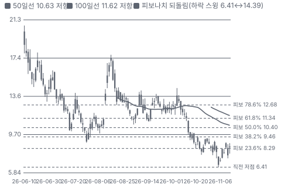

**주봉**

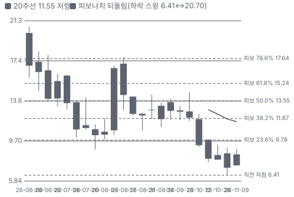

**월봉**

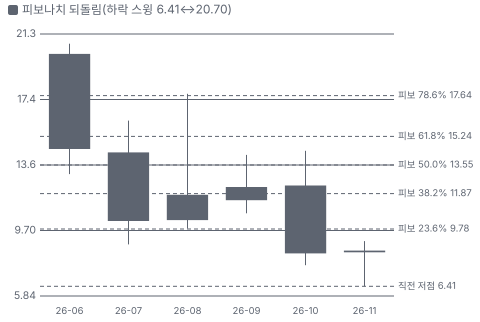

**분기 매출·EPS 실적과 컨센서스**

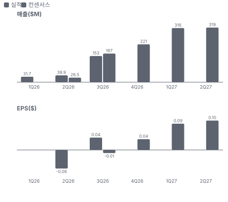

**EPS 리비전**

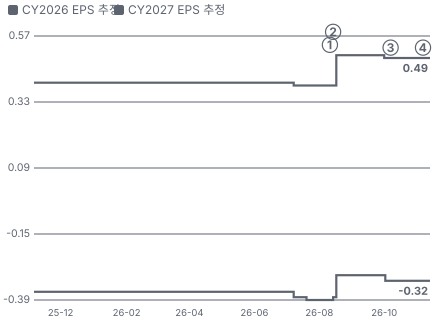

① 26-08-11 2Q26 실적, 잔고 \$1.7B·첫 가이던스 · EPS 리비전 +27%
② 26-08-14 푸에르토리코 계약 승인 철회 · 실적 창과 겹침
③ 26-10-07 HD건설기계 엔진 공급 계약 · EPS 리비전 +0%
④ 26-11-12 3Q26 실적, 가이던스 유지·Atlas 0.9GW · EPS 리비전 +0%

**멀티플 프리미엄(현재값 — 최근 4개 분기 추이 재료 없음)**

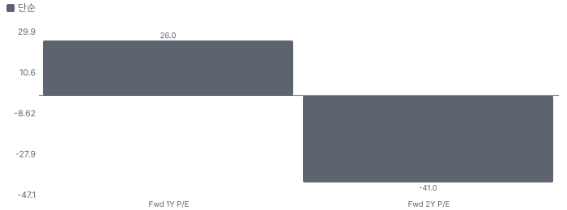

**합리적 멀티플**

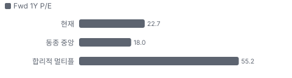

**밸류에이션 주가 시나리오**

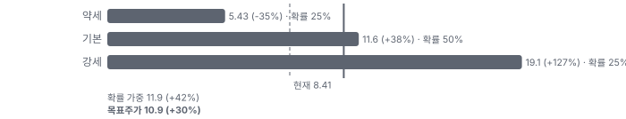

**주가별 업사이드**

- 제품·서비스 포트폴리오

**고객 믹스(3Q26, 매출 대비)**

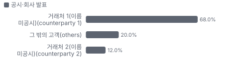

**공급 병목(10점, 낮을수록 병목)**

**CAPEX의 매출 대비 비중**

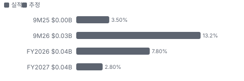

**어닝콜 변화별 주주가치 영향**

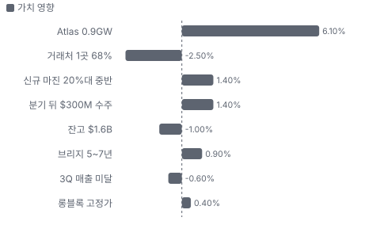

**수주·파이프라인 확실성 사다리**

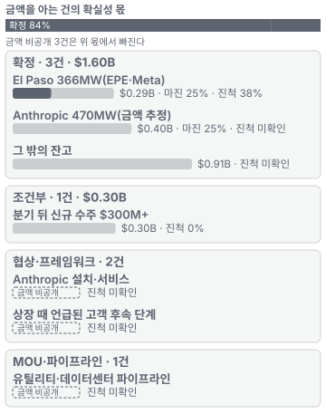

**비용 요인별 매출 대비 비중 1년 변화**

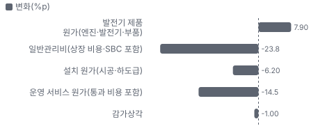

**BOM 항목 가격 +10% 시 OPM 변화**

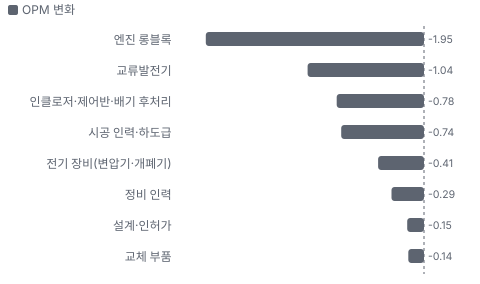

**RockBlock BOM 원가 몫**

**설치(ESI) BOM 원가 몫**

**운영·유지보수·자산 관리 BOM 원가 몫**

**자산 구성 — 3Q26 분기말 투하자본 −\$189.2M**

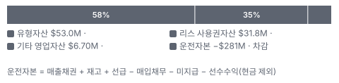

**자산별 변화율 — 최근 2개 분기(2Q26 = 0%)**

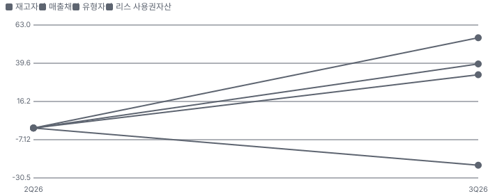

**분기 감가 비율 연율(유형자산 총액 대비)**

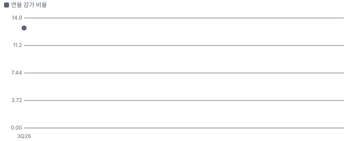

**생산시설별 면적(sq ft, 큰 순) — 생산능력 미공시라 면적을 대용으로**

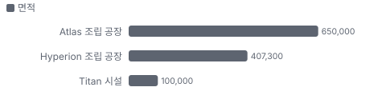

**목표주가 산정 — 약세와 기본 사이(약세 쪽 12%), 도달 확률 약 54%**

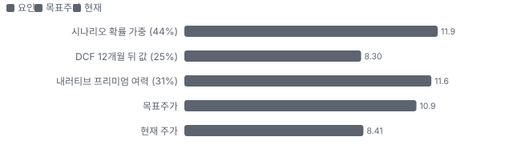

**PEG — 성장 대비 멀티플(낮을수록 성장 대비 쌈)**

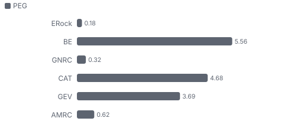

**수주/출하 비율 × 재고 일수 — 분기별(B/B 100 = 수주와 출하가 같다)**

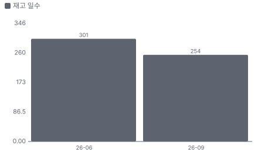

**일별 거래량 분해**

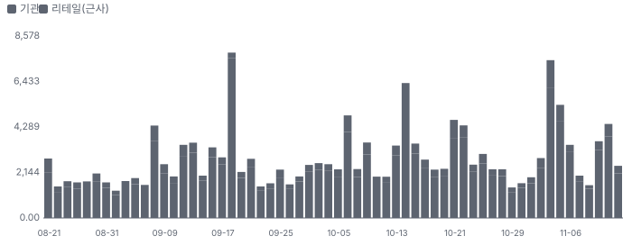

**기관 자금 흐름**

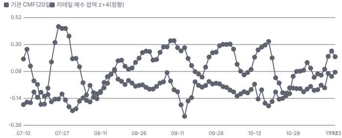

**몬테카를로**

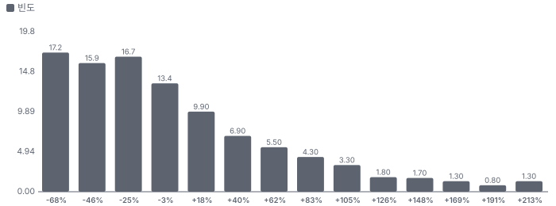

해석: 3,000번 중 1,239번(41%)에서 가치가 지금 주가 이상이었다. 지금 주가를 뒷받침하는 경우와 그렇지 않은 경우가 반반에 가깝다. 가운데 값은 0.87배이고, 열 번 중 여덟 번은 0.35~1.95배 사이에 든다.

## 내러티브

> **기업가치를 결정하는 이야기:** 이 회사는 천연가스 발전기를 조립해 파는 회사다. 그래서 값은 수요 전망이 아니라 세 숫자로 갈린다. 납품 속도(연 1.2GW 조립 능력), MW(메가와트)당 가격(계약 사례 약 \$0.8M, Chiip 계산), 잔고 뒤의 신규 주문이다. 전력망 대기가 끝나도 현장 발전기가 백업·피크 전력으로 남으면 일회성 장비 판매가 반복 서비스로 이어진다. 남지 않으면 호황기 장비주로 평가받는다.

> **멀티플·EPS 프리미엄**
> **멀티플:** 시가총액은 자료마다 다르다(11/13 종가 기준). Class A만 세면 \$0.41B, A+B는 \$1.85B, 교환 가능한 Class M(경영진·기존 주주의 교환 가능 유닛)까지 넣은 완전 희석은 **\$2.29B**다. 이 리포트는 대시보드와 같은 완전 희석을 쓴다. Fwd 1Y P/E 22.7배는 동종 중앙값보다 높지만 이익이 막 시작되는 구간이라서다. Fwd 2Y 10.1배, Fwd 3Y 6.5배로 내려가므로 시장은 FY2028 추정을 크게 믿지 않는다.
> **EPS:** EPS는 FY2026 −\$0.32, FY2027 \$0.44, FY2028 \$1.05(2~3명)다. 3Q 뒤 2027년 분기 EPS 추정은 분기마다 \$0.02~0.03 올랐지만 FY2027 연간은 \$0.49에서 \$0.44로 내려갔다. 분기 합과 연간 추정이 따로 움직일 만큼 표본이 적다.

### 투자자들은 왜 열광했나

세 가지가 겹쳤다. 전력망 접속 대기가 길어졌고, 터빈 납기가 길어졌고, AI 고객이 직접 전력을 사기 시작했다. 8/11 2Q 발표 뒤 주가는 8/17 종가 \$17.40까지 갔다. 식은 이유는 셋이다. 8/14 푸에르토리코 계약 승인 철회로 사흘 −25%, 10월 AI 전력 업종 동반 급락, 다가오는 12/7 보호예수 해제다. 11/5 종가 \$6.64가 상장 뒤 종가 최저다. 11/9 +15.9%, 11/11 +12.2%로 반등했지만 원인 사건은 확인되지 않았다. 3Q 발표 날(11/12)은 −5.5%였다. 매출 미달과 잔고 감소가 흑자 전환·Atlas 발표를 상쇄했다.

### 무엇이 기업가치를 바꾸나

> **구조적 체질 변화**
> **변화:** 소형 백업 전원 회사에서 대형 데이터센터 전력 장비 회사로 바뀌는 중
> **증거:** 잔고 증가는 거의 전부 데이터센터 고객이다(10-Q). 유틸리티·상업 고객 잔고는 오히려 줄었다. 파이프라인은 2Q에 3배 이상 늘었고 회사는 조립 능력을 연말 1.2GW로 늘린다
> **반증:** 2026 매출 가이던스 하향

> **고부가 믹스 확장**
> **변화:** 서비스 꼬리 매출이 쌓이지만 아직 믹스를 바꾸지 못한다
> **증거:** 연환산 반복 서비스 매출 \$24.7M(3Q), 설치 기반 1,104MW, 갱신율 100%. 2Q 감가상각 전 마진은 제품 약 25%, 설치 약 22%, 서비스 약 18%다(Chiip 계산). 회사는 서비스를 고마진이라 말하지만 숫자는 아직 그렇지 않다. 협상 중 계약의 가격 상승은 2028년 이후 반영된다
> **반증:** 서비스 마진이 2027년에도 20% 아래

> **기술 혁신**
> **변화:** 저배출 천연가스 발전 묶음 RockBlock(ERock의 천연가스 발전기 모듈)과 제어 소프트웨어 Granite(ERock 발전기 운영·제어 소프트웨어)
> **증거:** RockBlock은 500kW 단위로 쌓고 설치 면적이 비슷한 가스 설비의 약 절반이다. 회사는 10초 전 부하, CARB-DG(캘리포니아 대기자원위원회 분산 발전 배출 인증) 충족을 내세운다. 왕복동 엔진 자체는 표준 기술이고 Caterpillar·INNIO·Wärtsilä가 같은 시장에 있어 기술 독점으로 보기는 어렵다
> **반증:** 대형 고객이 경쟁사 엔진으로 옮긴다

> **실행 속도**
> **변화:** 신규 계약 납품 12~18개월은 강점이지만 생산이 2028년 초까지 찼다. 지금 주문하면 더 늦을 수 있다 **납품 리드타임 12~18개월.** 피어 중앙값 39개월보다 62% 짧다(가스터빈(회사 콜) 48개월 · Caterpillar 가스 프라임 장비(2차 자료) 24~36개월). 이전 대비 미확인.
> **증거:** 10-Q는 신규 계약 대부분을 12~18개월 납품으로 적는다. 콜 기준 가스터빈 납기는 4년 이상이고, 2차 자료 기준 Caterpillar 가스 프라임 장비는 2028년 하반기~2029년까지 밀렸다. 기준이 주문→납품이라 주문→가동 값은 뺐다
> **반증:** 3Q 매출이 컨센서스 \$167M의 80% 아래로 나온다

> **M&A**
> **변화:** 해당 없음 — 이번 구간의 내러티브 동인이 아니다
> **증거:** 순현금을 인수에 쓴다는 계획은 확인되지 않았다. 다만 IPO 순수입 \$554M 중 약 \$185M은 기존 주주 지분 재매입에 쓰였다
> **반증:** 대형 인수 발표

> **정책·입법 연관성**
> **재정정책:** 해당 없음(보조금·세액공제에 기댄 수요가 아니다. 수요는 민간 AI 투자에서 나온다)
> **행정명령:** 에너지부가 2025-10-23 FERC(미국 연방에너지규제위원회)에 20MW 초과 대형 부하 연결 규칙을 지시했다. 행정명령이 아니라 장관 지시이고 최종 상태는 미확인이다. 대형 부하가 망 증설비를 부담하면 현장 발전의 상대 가치가 오른다 에너지부 지시, 로펌 해설 반증: FERC가 관할을 거부하거나 법원이 막는다 의회 동의 2/10 — 하원 1/5(의결 기록 미확인) · 상원 1/5(의결 기록 미확인).
> **연관입법:** 주법이 먼저다. 텍사스 SB 6(텍사스 대형 부하 관리법)은 75MW 이상 대형 부하에 위기 때 부하 차단을 요구한다. 주지사의 8/3 지시로 Batch Zero(텍사스 전력망 운영기구의 대형 부하 일괄 연결 심사) 분류 통지가 미뤄졌고 감사 보고는 12/10, 공공요금위원회 보고는 12/17이다. 연방 SPEED Act(미국 연방 인허가 절차 단축 법안)는 2025-12 하원 통과 뒤 상원 정체로 파악된다 Utility Dive·Troutman 해설, 2Q 콜. 회사는 영향이 없었다고 했다 반증: 감사가 현장 발전 결합 부하까지 제한한다

> **고객의 지출 예산**
> **변화:** 하이퍼스케일러·AI 기업 투자가 현장 전력 주문으로 내려온다
> **사업별 예산:** 사업별 CAPEX·OPEX 구분 미확인
> **증거:** 공급 관계가 확인된 곳만 적는다. Meta의 El Paso 투자 \$10B → El Paso Electric → ERock 366MW, Anthropic 470MW 직접 주문, 지역 유틸리티 366MW \$290M. 고객 투자 총액이 ERock 매출이 되는 것은 아니고, 계약이 있는 몫만 매출이다
> **반증:** 고객이 납기 연기·계약 취소

### 내러티브 근거

> '전력망을 기다리지 않고 데이터센터를 켠다'는 이야기는 Meta·Anthropic 주문으로 숫자가 됐다. 지금 가격을 가르는 쟁점은 수요가 아니라 납품 실행, 잔고 다음 주문, 12/7 보호예수 해제다. 동종 대비 멀티플 차이 +26% 중 회사 고유 몫은 -59%다. 단계는 확산 낮음(공모가 대비 −61%, 리테일 언급 집계 거의 없음, Class A 유통 주식이 적어 작은 수급에도 크게 움직임 — 하루 평균 변동 약 8%), 쏠림은 낮음(공모가 대비 −67%, 리테일 언급 집계 거의 없음, 다만 Class A 유통 주식이 적어 작은 수급에도 크게 움직임)이다.

> **전력 대기 우회(Speed-to-Power)** · 강화
> **논리:** 전력망 접속에 수년이 걸리는 동안 현장 발전으로 데이터센터를 먼저 켠다. 터빈보다 납기가 짧다.
> **숫자:** 북버지니아 접속 대기 약 7년(10-Q), 신규 계약 납품 12~18개월(10-Q)
> **반증:** 하이퍼스케일러가 현장 발전 계약을 줄이거나 접속 대기가 짧아진다

> **Anthropic·Meta 대형 고객** · 유지
> **논리:** AI 대형 고객이 직접 주문하면서 잔고가 8배가 됐다. 3Q 뒤 \$300M 이상 신규 수주가 붙었지만 잔고는 분기 기준 줄었다.
> **숫자:** 잔고 \$0.2B → \$1.6B(1년), Anthropic 470MW, El Paso 366MW, 3Q 매출의 68%가 한 거래처
> **반증:** 2026년 안에 잔고가 늘지 않거나 고객이 납기를 미룬다

> **증설 레버리지** · 유지
> **논리:** 조립 중심 공장이라 적은 설비투자로 연 1.2GW까지 늘린다.
> **숫자:** Hyperion(ERock 휴스턴 신규 조립 공장) 2026년 말 연 1.2GW, Atlas 2028 상반기 0.9GW에 \$20~30M, 9M26 CAPEX \$29.6M, 계약부채 \$491M
> **반증:** Atlas 착공이 2027년 상반기까지 확인되지 않거나 4Q 가이던스(\$211~240M)를 못 맞춘다

> **서비스 꼬리 매출** · 유지
> **논리:** 설치 기반이 늘면 유지보수 매출이 쌓인다.
> **숫자:** 연환산 반복 서비스 매출 \$24.7M(+17% YoY), 3Q 서비스 매출 \$16.5M. 브리지 기간이 5~7년으로 늘면 서비스 매출은 백업의 약 3배(회사 발언)
> **반증:** 대형 고객이 유지보수를 직접 하거나 별도 입찰로 뺀다

> **반대 내러티브: 브리지 전력은 일회성이다** · 유지
> **논리:** 전력망이 연결되면 수요가 끝나고, 잔고는 고객 몇 곳에 몰려 있으며, 경쟁사도 같은 시장으로 들어온다.
> **숫자:** 3Q 거래처 2곳이 매출의 80%, 한 고객이 매출채권의 48%. Bloom은 연 2GW 증설
> **반증:** 2028년분 신규 주문이 Anthropic·Meta 밖에서 \$0.5B 이상 나온다

> **반대 내러티브: 지배구조와 수급** · 강화
> **논리:** 유통 주식이 적고 12/7 해제 물량이 그 약 6.9배이며, 푸에르토리코 사건이 끝나지 않았다.
> **숫자:** 유동 주식 약 2,791만 주 vs Class A 2,027만 + Class B(기존 주주의 교환 가능 주식) 1억 7,123만 주 해제
> **반증:** 해제 뒤 대주주 등록 매각이 없고 사건이 회사 책임 없이 종결

## 포트폴리오

| 제품·서비스 | 구분 | 무엇 | 쓰는 곳 | 돈 버는 방식 | Mix | Mix 변화(전년 대비) |
|---|---|---|---|---|---|---|
| RockBlock | 제품 | 자체 설계 천연가스 발전기를 쌓아 올리는 모듈. 1.5~3.5MW 묶음, 최소 500kW 단위 | 데이터센터 브리지 전력·백업 전력·유틸리티 피크 전력 | 장비 판매. 공개 사례 366MW \$290M, 약 \$0.79M/MW(Chiip 계산). 3Q 제품 매출 \$109.2M | 71% | +8.2%p |
| 설치(ESI(설계·시공·설치 서비스)) | 서비스 | 설계·인허가·시공·시운전을 일괄로 맡는다 | 대형 현장 구축 | 진행 기준 매출, 2Q \$10.4M. 10-Q 잔여 수행 의무 약 \$1.8B는 설치·서비스 기준이다 | 18% | -2.8%p |
| 운영·유지보수·자산 관리 | 서비스 | 설치 뒤 장기 운영과 정비 | 설치 기반 1,104MW | 연환산 반복 매출 \$23.6M, 계약 5~15년. Anthropic 건은 별도 계약 예정이라고 CEO가 말했다 | 11% | -5.4%p |
| Granite | 기술 | 발전기에 들어가는 제어·운영 소프트웨어 | 원격 감시와 전력망 지원 운전 | 별도 매출로 공시되지 않는다 | 미확인 | 미확인 |

**Mix 변화가 가장 큰 쪽은 RockBlock(+8.2%p, 전년 대비).** 계절성 판정: 분기 매출 계절 지수 기준 있음 → 전년 같은 분기와 비교.

## 고객

> **3Q26 최대 고객 거래처 1(이름 미공시, counterparty 1) 68%, 상위 3곳 100%, 집중도 집중.** 공시·회사 발표로 확인한 몫은 매출의 100%이고, 나머지 고객 몫은 추정이거나 미분해다. 3Q 매출의 80%가 거래처 2곳이다(68·12%, 이름 미공시). 2Q에는 4곳이 65%였다. 매출채권의 48%가 한 고객이다. 회사는 3Q 증가가 주로 El Paso(EPE·Meta) 램프라고 했다 — 68% 거래처를 El Paso Electric으로 보는 것은 가설이다

**고객별 매출 몫(3Q26)**
| 고객 | 몫 | 변화 | 근거 |
|---|---|---|---|
| 거래처 1(이름 미공시, counterparty 1) | 68% | +40%p | 공시 |
| 그 밖의 고객(others) | 20% | -15%p | 공시 |
| 거래처 2(이름 미공시, counterparty 2) | 12% | -1%p | 공시 |

> **거래처 1(이름 미공시, counterparty 1)** · 공시
> **사는 것:** 발전기·설치(추정)
> **추정 근거:** El Paso Electric(Meta 데이터센터 366MW)일 가능성 — 회사가 3Q 증가 원인으로 El Paso를 지목(가설)

> **그 밖의 고객(others)** · 공시
> **사는 것:** C&I 백업·브리지, 서비스
> **추정 근거:** H-E-B·Wistron·의료 시스템 등 C&I(회사 사례)

> **거래처 2(이름 미공시, counterparty 2)** · 공시
> **사는 것:** 미확인
> **추정 근거:** 이름 미공시

## 수주·파이프라인

> **2026-09-30 기준 7건.** 확정 \$1.60B, 미확정 \$0.30B. 공시 수주잔고 \$1.60B. 서로 겹치는 항목은 합계에서 뺐다.

**수주 목록**
| 상태 | 계약 | 계약 총액 | 진척 | 기간 | 비고 |
|---|---|---|---|---|---|
| 확정 | El Paso 366MW(EPE·Meta) | \$0.29B | 38% | - | - |
| 확정 | Anthropic 470MW(금액 추정) | \$0.40B | 비공개 | - | - |
| 확정 | 그 밖의 잔고 | \$0.91B | 비공개 | - | - |
| 조건부 | 분기 뒤 신규 수주 \$300M+ | \$0.30B | 0% | - | - |
| 협상 | Anthropic 설치·서비스 | 금액 비공개 | 비공개 | - | - |
| 협상 | 상장 때 언급된 고객 후속 단계 | 금액 비공개 | 비공개 | - | - |
| 파이프라인 | 유틸리티·데이터센터 파이프라인 | 금액 비공개 | 비공개 | - | (다른 항목과 겹칠 수 있어 합계에서 뺌) |

**실행 속도와 방해 요인**
| 항목 | 상태 | 실행 속도 | 방해 요인 |
|---|---|---|---|
| El Paso 366MW(EPE·Meta) | 확정 | 토목 대부분 완료, 11월 발전기 현장 도착, 2027년 중반 설치 완료 목표(3Q 콜) | 조립 램프(설치 기반 분기 45MW → 목표 분기 300MW) · 일부 부품 단일 공급원 · 취소·연기 조건 비공개 |
| Anthropic 470MW(금액 추정) | 확정 | 생산 매진 2028년 초까지 | 장비만 계약, 설치·서비스 별도 · 조립 램프(설치 기반 분기 45MW → 목표 분기 300MW) · 일부 부품 단일 공급원 |
| 그 밖의 잔고 | 확정 | 회사는 대부분 2027년 말까지 전환된다고 함 | 조립 램프(설치 기반 분기 45MW → 목표 분기 300MW) · 일부 부품 단일 공급원 · 취소·연기 조건 비공개 |
| 분기 뒤 신규 수주 \$300M+ | 조건부 | 2028년 납품 중심(추정 — 생산이 2028년 초까지 매진) | 일부는 계약 세부 확정 전 선급 약정 · 4Q 잔고 반영 전 |
| Anthropic 설치·서비스 | 협상 | 회사는 통상 절차로 뒤따른다고 함 | 계약 미체결 |
| 상장 때 언급된 고객 후속 단계 | 협상 | 회사는 이름과 일정을 답하지 않았다 | 미공개 |
| 유틸리티·데이터센터 파이프라인 | 파이프라인 | 2Q에 3배 이상 증가, 규모 미공개 | 잔고가 아니다 |

## 마진 구조

> **GPM 24.1%, OPM 4.5%.** 3Q25 대비 GPM +12.8%p, OPM +37.7%p. 변동비는 매출의 65%이고, 매출이 10% 늘면 OPM은 +2.7%p 움직인다. 3Q26 매출원가(감가상각 제외)는 매출의 75.9%로 1년 전 88.8%보다 12.9%p 낮다. 제품 원가 몫이 52.1%로 늘었지만 일반관리비가 매출의 18.4%로 내려가 고정비 레버리지가 처음 나타났다. 조정 매출총이익률은 24.1%(2Q 22.2%). 2026~27년 납품분은 2025년 가격이라 마진 상향은 2028년 이후다

**GPM에서 OPM까지(GAAP(감가상각 제외 원가))**
| 기간 | GPM | 연구개발 | 판관비 | 기타 | OPM |
|---|---|---|---|---|---|
| 3Q25 | 11.2% | 0.0% | 42.2% | 2.2% | -33.2% |
| 3Q26 | 24.1% | 0.0% | 18.4% | 1.2% | 4.5% |

**마진을 결정하는 비용 요인 — 비용 +10% 시 OPM**
| 비용 | 매출 대비 | 변화 | 고정비 | OPM |
|---|---|---|---|---|
| 발전기 제품 원가(엔진·발전기·부품) | 52.1% | +7.9%p | 10% | -5.21%p |
| 일반관리비(상장 비용·SBC 포함) | 18.4% | -23.8%p | 80% | -1.84%p |
| 설치 원가(시공·하도급) | 14.8% | -6.2%p | 30% | -1.48%p |
| 운영 서비스 원가(통과 비용 포함) | 9.0% | -14.5%p | 50% | -0.90%p |
| 감가상각 | 1.2% | -1.0%p | 100% | -0.12%p |

**비용을 움직이는 요인**
| 비용 | 요인 |
|---|---|
| 발전기 제품 원가(엔진·발전기·부품, 매출원가) | 엔진 롱블록·교류발전기 단가, 조립 수율 · 근거 공시 |
| 일반관리비(상장 비용·SBC 포함, 판관비) | 인력 확충·상장 비용 · 근거 공시 |
| 설치 원가(시공·하도급, 매출원가) | 현장 인력·전기 장비 · 근거 공시 |
| 운영 서비스 원가(통과 비용 포함, 매출원가) | 정비 인력·고객 청구 변동비 · 근거 공시 |
| 감가상각(기타) | Hyperion 공장 · 근거 공시 |

**RockBlock BOM — 매출의 72%, GPM 27%(3Q26 제품 매출 \$109.2M − 제품 원가 \$79.6M(감가상각 제외)), 항목 가격 +10% 시**
| 항목 | 원가 몫 | 전가 | 제품 GPM | OPM |
|---|---|---|---|---|
| 엔진 롱블록 | 30~45% | 미확인 | -2.7%p | -1.95%p |
| 교류발전기 | 15~25% | 미확인 | -1.5%p | -1.04%p |
| 인클로저·제어반·배기 후처리 | 10~20% | 미확인 | -1.1%p | -0.78%p |
| 미분해 | 27% | - | - | - |

**설치(ESI) BOM — 매출의 18%, GPM 17%(3Q26 설치 매출 \$27.1M − 설치 원가 \$22.6M(감가상각 제외)), 항목 가격 +10% 시**
| 항목 | 원가 몫 | 전가 | 제품 GPM | OPM |
|---|---|---|---|---|
| 시공 인력·하도급 | 40~60% | 미확인 | -4.2%p | -0.74%p |
| 전기 장비(변압기·개폐기) | 20~35% | 미확인 | -2.3%p | -0.41%p |
| 설계·인허가 | 5~15% | 미확인 | -0.8%p | -0.15%p |
| 미분해 | 12% | - | - | - |

**운영·유지보수·자산 관리 BOM — 매출의 11%, GPM 16%(3Q26 운영 서비스 매출 \$16.5M − 원가 \$13.8M(감가상각 제외, 통과 비용 포함)), 항목 가격 +10% 시**
| 항목 | 원가 몫 | 전가 | 제품 GPM | OPM |
|---|---|---|---|---|
| 고객 청구 변동비(연료 등) | 30~50% | 100% | -0.5%p | -0.02%p |
| 정비 인력 | 25~40% | 미확인 | -2.7%p | -0.29%p |
| 교체 부품 | 10~20% | 미확인 | -1.3%p | -0.14%p |
| 미분해 | 12% | - | - | - |

엔진 롱블록 가격이 +10% 오르면 영업이익은 -43.4% 움직인다. 판매가 전가를 모르는 항목은 전가 0%로 계산했다.

**BOM 항목 가격을 움직이는 것**
| 항목 | 요인 |
|---|---|
| 엔진 롱블록 | HD건설기계 다년 공급 계약이 핵심 투입물을 묶는다 · 근거 추정 |
| 교류발전기 | 구리 가격 · 근거 추정 |
| 인클로저·제어반·배기 후처리 | 철강·전기 부품, 저배출 인증 장치 · 근거 추정 |
| 시공 인력·하도급 | 현장 일정 · 근거 추정 |
| 전기 장비(변압기·개폐기) | 업계 리드타임이 길다 · 근거 추정 |
| 설계·인허가 | 배출 인허가 · 근거 추정 |
| 고객 청구 변동비(연료 등) | 이익 없이 매출·원가를 부풀린다 · 근거 추정 |
| 정비 인력 | 설치 기반 확대 · 근거 추정 |
| 교체 부품 | 엔진 정비 주기 · 근거 추정 |

**투입 물가 — 미국 PPI 3·6·12개월(2026-10, 개정 반영)과 해외 전년비**
| 항목 | 미국 3개월 | 6개월 | 12개월 | 전가 못 할 때 OPM | 일본 | 한국 | 대만 |
|---|---|---|---|---|---|---|---|
| 교류발전기 | +3.4% | +7.2% | +23.9% | - | +42.6% | +25.8% | +40.1% |

별표는 품목보다 넓은 업종 지수다. 지난 1년 투입 물가를 판매가 전가 뒤 원가에 넣으면 OPM은 -3.52%p 움직인다(매출원가의 14% 기준). 물가 지수를 붙이지 못한 매출원가 항목은 발전기 제품 원가(엔진·발전기·부품), 설치 원가(시공·하도급), 운영 서비스 원가(통과 비용 포함)다(미연결).

## 자산 구성

> 최근 2개 분기(2Q26 → 3Q26) 가장 크게 늘어난 자산은 유형자산(+55%).

**자산·운전자본 항목별 분기말 잔액 — 최근 12개 분기와 다음 4개 분기 추정**
| 항목 | 2Q26 | 1년 전 | 3Q26(최근) | 추정 | 2개 분기 변화 | 다음 4개 분기 변화 |
|---|---|---|---|---|---|---|
| 매출채권 | \$101.8M | 미확인 | \$78.7M | — | -23% | — |
| 재고자산 | \$106.1M | 미확인 | \$147.6M | — | +39% | — |
| 선급·기타 유동자산 | \$22.6M | 미확인 | \$44.0M | — | +95% | — |
| 매입채무 | \$46.9M | 미확인 | \$60.4M | — | +29% | — |
| 선수수익(계약부채) | \$528.4M | 미확인 | \$490.6M | — | -7% | — |
| 유형자산 | \$34.1M | 미확인 | \$53.0M | — | +55% | — |
| 리스 사용권자산 | \$24.0M | 미확인 | \$31.8M | — | +33% | — |

**유형·무형자산 항목별 가치(2026-09-30 vs 2026-06-30)**
| 구분 | 항목 | 총액 2026-09-30 | 누적상각 | 순액 | 총액 2026-06-30 | 총액 1년 변화 | 공시 내용연수 |
|---|---|---|---|---|---|---|---|
| 유형 | 유형자산 합계(항목 미분해) | \$64.7M | 총계만 공시 | 총계만 공시 | \$44.0M | +47.0% | 미확인 |
| 유형 합계 | 유형자산 | \$64.7M | \$11.7M | \$53.0M | \$44.0M | +47.0% | 경과율 18%(상각 대상 기준) |

**분기 감가 비율(감가상각 ÷ 평균 유형자산 총액)**
| 분기 | 감가상각 | 평균 유형자산(총액) | 분기 비율 | 연율 | 연율의 역수 |
|---|---|---|---|---|---|
| 3Q26 | \$1.8M | \$54.4M | 3.38% | 13.53% | 7.4년 |

감가상각 기준: 손익계산서 감가상각·상각비(SEC 공시 데이터, 4분기 = 연간 − 1~3분기).

미공시·미분해: 분기 감가상각·유형자산(순액) 9분기 · 분기 매출·영업이익 8분기 · 유형자산 항목별 총액·내용연수(10-K 주석에서 모델이 채움) · 무형자산 항목(10-K 주석에서 모델이 채움) — 이 칸은 비우고 나머지로 계산했다.

## 공급망 병목

이미지 없음(검수 실패) — RockBlock

> **공급망 신뢰성 3.2/10, 병목 심각.** 가장 약한 고리는 엔진 롱블록 3.2점이고, 품목 평균은 3.2점이다. 근거가 부족한 1건(교류발전기)은 점수에서 뺐다. 핵심 투입물은 엔진 롱블록과 교류발전기다. 3Q 매입의 22%가 2개 공급사에 몰렸다(10-Q, 이름 미공시). 롱블록은 현대 계열(HD건설기계)과 2027~28년 고정가 다년 계약이고, 9/30 기준 해지 불가 구매 약정 \$45.1M(2027년 \$37.6M·2028년 \$7.5M)이 처음 생겼다(12/31 없음)

**병목과 마진 — 품목 가격 +10% 시 OPM**
| 품목 | 점수 | 판정 | 구분 | OPM |
|---|---|---|---|---|
| 엔진 롱블록(필수) | 3.2 | 병목 심각 | 핵심 통제 품목 | -1.95%p |

> **엔진 롱블록** · 3.2/10
> **왜:** 공개된 롱블록 공급사는 HD건설기계 1곳뿐이다(그 밖은 미공시, 10-Q는 공급망이 대부분 복수 조달이라고 적었다). 자체 설계 엔진이라 블록 공급사를 바꾸면 재검증이 필요하다(추정)
> **병목 요인:** 인증 공급사 1곳 · 캐파 빠듯 · 리드타임 미확인 · 재인증 미확인 · 1위 점유율 미확인 · 한국(HD건설기계 — 공개된 2027~28 공급분 기준, 추정) 집중 100% · 물량 확보 장기계약
> **풀리는 조건:** 일부 — 2027~28 고정가 계약·구매 약정 \$45.1M 확인, 2029년 이후 미계약

**공급사**
| 품목 | 공급사 | 몫 | 근거 |
|---|---|---|---|
| 엔진 롱블록 | HD건설기계(2027~2028 롱블록 다년 공급) | 미확인 | 회사 발표 |
| 교류발전기 | 외부 공급사(미공시, 교류발전기) | 미확인 | 추정 |

**무역 통계로 본 공급 지역**
| 품목 | EU 수입처 | 일본 수입처 | EU 1위 전년비 |
|---|---|---|---|
| 교류발전기 | MY(말레이시아) 69% · KR(한국) 10% · US 7% | マレーシア 58% · タイ 36% | 미확인 |

## 생산능력

> **현재 명목 캐파 미확인, 가동률 미확인.** 착공 이상 증설은 0 GW/년(발전기 조립), 발표까지 합치면 1 GW/년(발전기 조립)이다. 9M26 CAPEX는 \$0.03B로 매출의 13.2%다. 휴스턴 Hyperion 공장(약 40.7만 sq ft)이 3Q부터 발전기를 조립하고, 2026년 말 연 1.2GW로 나간다는 것이 회사 목표다. 3Q에 휴스턴 북동부 Atlas(65만 sq ft) 부지를 확보해 2027년 말 램프, 2028 상반기 연 0.9GW(최대 1.2GW)를 계획한다. 합계 2028 상반기 연 2.1GW. Titan(ERock 휴스턴 기존 공장)은 7월 Hyperion으로 생산을 옮겼다

**생산시설 4곳**(10-Q(2026-09-30) 임차 주석·사업 설명과 3Q 콜 — 휴스턴 조립·창고 시설(본사 사무실 제외)), 임차 3곳 · 미확인 1곳. 시설별 생산능력은 2곳만 공개됐다.

**생산시설 4곳 — 명칭·위치·생산능력**
| 시설 | 위치 | 용도 | 생산능력 | 소유·상태 |
|---|---|---|---|---|
| Hyperion 조립 공장 | 미국 텍사스 휴스턴 | 발전기·엔진 조립 | 1 GW/년(2026년 말 목표) · 면적 407,300 sq ft | 임차 · 증설 중 |
| Titan 시설 | 미국 텍사스 휴스턴 | 조립(7월 Hyperion으로 이전) | 미확인 — 생산을 Hyperion으로 옮겼다고만 밝힘(3Q 콜) · 면적 100,000 sq ft | 임차 · 가동 |
| Atlas 조립 공장 | 미국 텍사스 휴스턴 북동부 | 발전기 조립·시험·R&D | 1 GW/년(2028 상반기 목표, 최대 1.2) · 면적 650,000 sq ft | 미확인 · 계획 |
| Atlas 창고(1단계) | 미국 텍사스 휴스턴 | Atlas 부품 창고 | 미확인 — 창고 용도 — 조립 캐파 없음 · 면적 162,180 sq ft | 임차 · 가동 |

**생산능력 확충 계획**
| 계획 | 단계 | 증설 | 가동 시점 | CAPEX |
|---|---|---|---|---|
| Atlas 조립 공장(휴스턴 북동부) | 발표 | 1 GW/년(발전기 조립) | 2028 상반기(2027년 말 램프) | \$0.03B |

남은 계획의 CAPEX 합계는 \$0.03B다. 금액을 아는 계획의 단위당 CAPEX는 \$0.03B/GW/년(발전기 조립)이다. 합계는 FY2027 매출의 2%다.

**증설 방해 요인**
| 계획 | 방해 요인 |
|---|---|
| Atlas 조립 공장(휴스턴 북동부) | 부지 확보·창고 1단계 임차 개시(9/11)만 확인, 공장 착공 미확인 · 롱블록 2029년 이후 물량 미계약 |

**CAPEX와 매출 대비**
| 기간 | CAPEX | 매출 | 매출 대비 | 구분 |
|---|---|---|---|---|
| 9M25 | \$0.00B | \$0.13B | 3.5% | 실적 |
| 9M26 | \$0.03B | \$0.22B | 13.2% | 실적 |
| FY2026 | \$0.04B | \$0.45B | 7.8% | 추정 |
| FY2027 | \$0.04B | \$1.44B | 2.8% | 추정 |

## 해자

> 엔진 자체가 아니라 응답 속도·배출·운영 기록의 묶음이 해자다. 조립 공장은 해자가 아니다.

> **디젤을 대체하는 응답 속도** · 보통
> **해자:** 천연가스 발전기가 디젤 백업 자리를 맡을 만큼 빨리 부하를 받아 한 설비로 브리지·백업·피크 용도를 겸한다.
> **근거:** 회사는 10초 안에 전 부하를 받고 경쟁 가스 설비는 45초 이상이라고 밝혔다. AI 부하 변동에 배터리가 적게 든다고 주장한다. 제3자 시험값은 미확인
> **숫자:** 10초 vs 45초 이상(회사 주장)
> **깨지는 조건:** Caterpillar·INNIO가 같은 응답을 인증 시험으로 내거나 대형 고객이 배터리 결합 설비를 고른다

> **배출 인증과 인허가 속도** · 보통
> **해자:** 저배출이 허가 기간을 줄여 도심 가까이 설치할 수 있게 한다.
> **근거:** 회사는 CARB-DG를 충족한 첫 천연가스 엔진이라고 밝혔다. 캘리포니아 수자원국 약 150MW를 계약에서 첫 상업 운전까지 1년 안에 끝냈다. 물을 쓰지 않는다
> **숫자:** 디젤 대비 최대 99% 저배출(회사 주장), 약 50MW 이틀 설치
> **깨지는 조건:** 경쟁사가 같은 인증을 받거나 허가 기준이 완화돼 인증 값이 사라진다

> **운영 기록과 유틸리티 채널** · 보통
> **해자:** 15년 운영 데이터와 유틸리티 추천이 대형 고객 진입을 돕는다.
> **근거:** 400여 곳, 설치 기반 1,104MW, 서비스 갱신율 100%(회사 값). CEO는 하이퍼스케일러가 유틸리티에 공급사를 묻고 ERock이 추천된다고 말했다. 다만 Anthropic·El Paso 규모의 납품 기록은 아직 없다
> **숫자:** 반복 서비스 매출 \$23.6M, 2Q 서비스 매출 \$13.4M
> **깨지는 조건:** 서비스 갱신율 하락, 고객이 O&M(운영·유지보수)을 분리 입찰

> **자본 경량 조립 공장** · 약함
> **해자:** 1.2GW 공장을 12개월, \$15~20M에 지을 수 있어 증설은 빠르다. 그러나 같은 이유로 진입 장벽이 되지 못한다.
> **근거:** CEO는 증설 속도가 차별점이라고 했다. 실제 병목은 공장이 아니라 엔진 블록·발전기 같은 부품이다. 그래서 HD건설기계 계약이 나왔다
> **숫자:** 1GW당 약 \$12.5~17M(Chiip 계산)
> **깨지는 조건:** 해당 없음 — 이 항목은 약한 해자로 본다. 부품 독점 공급 계약이 나오면 상향

## 경영진·네트워크

> 창업자는 물러났고 외부 경영자 Carrington과 최대 주주 EIP가 회사를 이끈다. 연결은 유틸리티 쪽에 몰려 있다. 연결이 매출을 만들었다는 증거는 없다.

> **John Carrington** · CEO·이사 · 2025-11
> **프로필:** 60세. Stem CEO(2013-12~2024-12), MiaSolé CEO, First Solar, GE(General Electric) 16년 이상
> **비즈니스:** 2025-06부터 ER Holdings 이사회 의장, 2025-11부터 CEO
> **정계:** 미확인
> **동문:** University of Colorado Boulder 학사
> **사모임:** 미확인

> **Thomas McAndrew(ERock 창업자)** · 창업자·전 CEO · 2006
> **프로필:** 2006년 회사를 세웠고 2025-06까지 CEO였다. 이후 CEO 자문으로 남았다
> **비즈니스:** Class A 환산 약 2,259만 주 보유 신고, 등록 권리 보유
> **정계:** 미확인
> **동문:** 미확인
> **사모임:** 미확인

> **Hans Kobler** · 이사, EIP 창업자 · 2024-12
> **프로필:** EIP 창업자·매니징 파트너, 에너지 기술 투자 25년
> **비즈니스:** EIP 투자자에 유틸리티·에너지 회사가 있다고 424B4가 적는다. EIP는 약 1억 281만 주 보유 신고
> **정계:** 미확인
> **동문:** 미확인
> **사모임:** 미확인

> **Dan Brouillette** · 이사 · 2025-06
> **프로필:** 15대 미국 에너지부 장관(2019-12~2021-01), EEI(미국 투자자 소유 유틸리티 협회) CEO(2023-10~2025-01). 지금 Torridon Group 공동 의장
> **비즈니스:** 유틸리티 협회 수장 이력
> **정계:** 전 에너지부 장관. 로비 등록·기부 기록은 미확인
> **동문:** 미확인
> **사모임:** 미확인

**네트워크 정량화**
| 연결 | 강도 | 닿는 매출 | 가중 노출 | 매출 대비 | 근거 |
|---|---|---|---|---|---|
| 비즈니스: EIP 투자자에 유틸리티가 포함되고 유틸리티가 ERock의 판매 채널이다 | 3/5 | \$0.29B | \$0.17B | 63% | 유틸리티가 산 공개 사례 El Paso 366MW \$290M. EPE가 EIP 투자자인지는 미확인 424B4, 2Q 콜 |
| 정계: 전 에너지부 장관·전 EEI CEO가 이사다 | 4/5 | 미확인 | 미확인 | 미확인 | 인허가·유틸리티 접근에 닿지만 금액으로 환산할 자료가 없다 424B4 |
| 비즈니스: 이사 Satterthwaite는 Cummins 전 사장·COO로 발전기 업계 경력이 길다 | 4/5 | 미확인 | 미확인 | 미확인 | 부품 조달·업계 인력에 닿지만 금액 미공개 424B4 |

가중 노출은 연결이 닿는 매출의 크기다. 연결이 그 매출을 만들었다는 뜻이 아니며, 인과는 공개 자료로 입증하지 못한다.

## 약세 논리 및 셀온 조건

| 약세 논리 | 근거 | 반박 | 가를 자료 |
|---|---|---|---|
| 한 프로젝트가 매출을 만들었다 | 3Q 매출의 68%가 한 거래처, 매출채권의 48%가 한 고객이다. 회사는 3Q 증가가 주로 El Paso 램프라고 했다 | 잔고 \$1.6B 중 El Paso 몫은 약 \$0.29B로 추정되고 분기 뒤 \$300M이 더해졌다 | 4Q 거래처 비중, FY2026 10-K(2027-03) |
| 다음 주문이 안 보인다 | 잔고가 \$1.7B → \$1.6B로 줄었고 3Q 단독 B/B는 약 0.3이다 | 회사는 대형 주문이 분기마다 들쭉날쭉하고 분기 뒤 \$300M+를 계약했다고 했다 | 4Q 잔고(2027년 3월 발표) |
| 2027년 이익 상향이 막혔다 | CFO는 2027년 납품분이 2025년 가격이고 마진이 10%대 후반~20% 초반이라고 했다 | 신규 가격 책정 건은 20% 중반 이상이다. 다만 2028년부터다 | FY2027 가이던스(2027년 3월) |
| 선수금이 줄면 현금도 준다 | 3Q 영업현금흐름 −\$20.8M, 계약부채 \$528M → \$491M. 납품이 진행되며 선수금이 소진된다 | 현금 \$549M·차입 0·\$250M 신용한도 미인출. Atlas는 자체 자금으로 짓는다 | 4Q 현금흐름, 신규 계약 선수금 |
| 수급 | 12/7 보호예수가 풀린다. Class B 1억 7,123만 주가 Class A로 교환될 수 있고 유동 주식은 약 2,791만 주다 | 일정은 이미 알려졌고 주가는 공모가 대비 −61%다 | 12/7 뒤 Form 144·S-3, 13D 변경 |
| 증설 단가가 올랐다 | Atlas 0.9GW에 \$20~30M으로 GW당 약 \$22~33M이다. 이전 언급은 GW당 약 \$15M이다 | 자동화 설비를 넣는 선택이라고 회사가 설명했다 | Atlas 착공·장비 반입(2027년) |

3Q 10-Q(2026-11-12 제출)에서 확인한 것은 거래처 두 곳 68·12%, 매출채권 48% 고객 한 곳, 제한 현금 \$69.8M(주요 고객 신용장 2건과 제조 시설 임차 보증), 해지 불가 구매 약정 \$45.1M(2027년 \$37.6M·2028년 \$7.5M, 12/31에는 없음), 공급사 2곳 매입 22%, \$250M 신용한도 미인출(최소 유동성 \$85M 약정)이다. 정부 지원·전략 계약은 없다. 미확인은 잔고의 고객별 내역, Anthropic 계약 금액, 분기 뒤 \$300M의 계약 확정 범위, Hyperion 실측 출하 MW다. 상장 전 4Q25 분기 값은 연간에서 9개월을 빼서 구했다. EPS 추정은 2~3명뿐이다. 장중 기준 고점은 상장 첫날 \$20.70, 종가 기준 반등 고점은 8/17 \$17.40이고 모두 TradingView 일봉으로 확인했다.

> **셀온 조건**
> **조건 1:** 4Q 매출이 가이던스 하단 \$211M에 못 미치거나 2026 매출이 \$435M 아래로 끝난다
> **조건 2:** 4Q 잔고가 \$1.6B 아래로 다시 줄고 분기 뒤 \$300M+가 잔고에 반영되지 않는다
> **조건 3:** 대형 고객이 납기를 미루거나 계약을 줄였다고 공시한다
> **조건 4:** 12/7 뒤 대주주가 등록 매각(S-3·Form 144)을 신고하고 유동 주식이 2배 이상으로 늘어난다
> **조건 5:** 2028년분 신규 계약 마진이 20% 아래로 내려간다(경쟁 심화)
> **조건 6:** Atlas 착공이 2027년 상반기까지 확인되지 않는다

## 어닝콜 변화

**직전 콜 대비 새로 나오거나 바뀐 내용 → 가치 영향**
| 항목 | 내용 | 직전 콜 | 최신 콜 | 모델 동인 이동 | 확신도 | 가치 영향 |
|---|---|---|---|---|---|---|
| 업데이트 | 수주잔고 | 약 \$1.7B(6/30) | 약 \$1.6B(9/30) + 분기 뒤 \$300M+ | 성장 지속(감속 계수) -0.50% | 1.0 | -1.0% |
| 신규 | 분기 뒤 신규 수주 \$300M 이상 | 없음 | \$300M+(일부 계약 세부 확정 전 선급 약정) | 1년차 성장률 +3.0% | 0.8 | +1.4% |
| 신규 | Atlas 공장 0.9GW(2028 상반기), 최대 1.2GW | Hyperion 2 구상(1.2GW, \$15M/GW) | Atlas 0.9GW, CAPEX \$20~30M | 성장 지속(감속 계수) +3.0% | 0.5 | +6.1% |
| 신규 | 엔진 롱블록 2027~28 고정가 계약 | 다년 공급 계약 발표(가격 조건 미공개) | 고정가로 확인, 2029년 이후 논의 | 출발 이익률 +0.30% | 1.0 | +0.4% |
| 업데이트 | 신규 계약 마진 20% 중반 이상 | 가격·이익률 긍정(수치 없음) | 2026~27 납품 10%대 후반~20% 초반, 최근 가격 책정 20% 중반 이상 | 목표 이익률 +0.50% | 0.5 | +1.4% |
| 신규 | 브리지 기간 5~7년, 서비스 매출 백업의 3배 | 브리지 약 3년 | 3년에서 5~7년으로 | 목표 이익률 +0.30% | 0.3 | +0.9% |
| 부정 | 고객 집중 심화 | 2Q 최대 28% | 3Q 최대 68%·12% | 할인율(WACC) +0.20% | 1.0 | -2.5% |
| 반복 | 2026 가이던스 유지 | 매출 \$435~465M | 매출 \$435~465M | 기준연도 매출 — | 0.8 | +0.0% |
| 부정 | 3Q 매출 컨센서스 하회 | 컨센서스 \$167M | \$152.8M | 기준연도 매출 -\$0.00B | 1.0 | -0.6% |
| **합계** | 단독 합 |  |  | 동시 적용 +5.9% |  | **+6.0%** |

**사건별 EPS 리비전**
| # | 날짜 | 구분 | 사건 | CY2026 EPS 전→후 | CY2027 EPS 전→후 | 리비전 | 주가 반응 |
|---|---|---|---|---|---|---|---|
| ① | 26-08-11 | 실적 | 2Q26 실적, 잔고 \$1.7B·첫 가이던스 | \$-0.39 → \$-0.30 | \$0.39 → \$0.50 | +27.4% | +22.8% |
| ② | 26-08-14 | 내러티브 | 푸에르토리코 계약 승인 철회 | \$-0.39 → \$-0.30 | \$0.39 → \$0.50 | 실적 창과 겹침 | +6.8% |
| ③ | 26-10-07 | 내러티브 | HD건설기계 엔진 공급 계약 | \$-0.32 → \$-0.32 | \$0.49 → \$0.49 | +0.0% | -4.1% |
| ④ | 26-11-12 | 실적 | 3Q26 실적, 가이던스 유지·Atlas 0.9GW | \$-0.32 → \$-0.32 | \$0.49 → \$0.49 | +0.0% | -5.5% |

**실적 발표 예상 변동폭:** 지난 2번 실적 발표 때 주가는 하루에 평균 ±14.2%(최대 22.8%, 오른 날 1번) 움직였다.

**실적 발표 예상 변동폭 — 과거 실적 발표 다음 거래일 주가 변화**
| 분기 | 발표일 | 주가 변화 |
|---|---|---|
| 2Q26 | 2026-08-11 | +22.8% |
| 3Q26 | 2026-11-12 | -5.5% |

## P·Q 사이클

> **가격·물량을 나눌 표본이 부족하다(전년 대비 0분기).** 가격 근거(미국 PPI(생산자물가지수) 변압기·배전 기기 대용 — 회사 판매가가 아니라 업종 가격)의 이력이 쌓이면 다시 잰다.

## 밸류에이션

> **목표주가 \$11, 업사이드 +30%.** 자리는 약세와 기본 사이(약세 쪽 12%)이고 도달 확률은 약 54%다. 기본 \$12, 강세 \$19(+127%), 약세 \$5(-35%). DCF 기준 업사이드는 기본 -11%, 강세 +80%, 약세 -60%다(WACC 10.4%).

기준 멀티플이 Fwd 1Y라서 EPS도 12개월 뒤의 다음 4개 분기(4Q27~3Q28)를 쓴다. 이 기간 컨센서스는 \$0.835다. 선정 배수는 16.1배(동종 중앙값 18.0배에서 판단 조정 −30% 포함)이고 기본 \$12, 강세 \$19, 약세 \$5다. 확률은 계산값(약세 15%·기본 55%·강세 30%)에서 약세를 10%p 올리고 기본·강세를 5%p씩 낮췄다. 한 거래처 68%와 3Q 단독 B/B 약 0.3, 2027년 가격 고정 때문이다. DCF 기본(−11%)이 시나리오 기본(+38%)보다 낮은 이유는 세 가지다. 값의 시점이 오늘이고, 고객 선수금 \$324M(완전 희석 주당 약 \$1.2)을 순현금에서 뺐고, 5년 뒤 성장이 약 4%로 식는다. 약세 \$5는 납품 지연과 주문 공백까지만 담는다.

시나리오 확률: 다음 해 매출 성장 분포로 계산 — 약세 +140.0% 아래·강세 +225.0% 위 확률. 내부 관점(컨센서스 +200.0%, σ 55.0%: 추정 범위 없음 — 5% + 0.25 × |성장률|) 100% — 외부 관점 꺼짐(SEC 전 상장사 표본 없음) · 모델 조정: 약세 +10%p·강세 −5%p·기본 −5%p: 3Q 매출의 68%가 한 거래처이고 3Q 단독 B/B가 약 0.3이며, CFO가 2027년은 이미 가격이 고정됐다고 말해 강세의 2027년 상향 경로가 좁다. 2028년분 주문은 분기 뒤 \$300M+ 말고는 확인되지 않았다(3Q 콜·10-Q)

> **약세 \$5 (-35%)** · 확률 25%
> **가정:** 12.1배 × EPS \$0.45
> **근거:** El Paso 다음 대형 주문이 늦어 2028년 상반기 공장이 비고, 2027년 마진이 10%대 후반에 머문다. 12/7 해제 물량이 나온다

> **기본 \$12 (+38%)** · 확률 50%
> **가정:** 16.1배 × EPS \$0.72
> **근거:** 잔고가 2027년 말까지 전환되고 분기 뒤 \$300M이 계약으로 굳는다. 2028년분은 일부만 찬다. 컨센서스 \$0.835보다 약 14% 낮게 잡았다

> **강세 \$19 (+127%)** · 확률 25%
> **가정:** 20.1배 × EPS \$0.95
> **근거:** 2028년분 수주가 Atlas까지 채우고 신규 계약 마진 20% 중반이 반영되기 시작한다

**멀티플 선정 — Fwd 1Y P/E**
| 단계 | 조정 | 근거 |
|---|---|---|
| 동종 중앙값 | 18.0배 | 범위 13.1~39.7배, 6곳 |
| 펀더멘털 | +20% | 성장·이익률·ROIC로 본 합리적 멀티플 55.2배와의 차이의 일부만 인정 |
| 해자 | +3% | 디젤을 대체하는 응답 속도 보통 · 배출 인증과 인허가 속도 보통 · 운영 기록과 유틸리티 채널 보통 · 자본 경량 조립 공장 약함 |
| 반복 매출 | -3% | 반복 매출 6%(동종 20%) · 서비스·유지보수 · 유지율 100% · 반복 단계까지 2년(할인 ×0.63) · 기반 설치 기반 1,104MW(3Q26 KPI) |
| 수주 전환·가시성 | -1% | book-to-bill 1.00 · RPO(잔여 이행 의무, 계약 잔고 중 아직 매출로 잡지 않은 몫)·ACV(연간 계약 가치) 성장 − 매출 성장 1.00 → 가시성 0.57(감점 0.43) · 전환 15개월(동종 12) |
| 내러티브 | +0% | 단계 확산 낮음(공모가 대비 −61%, 리테일 언급 집계 거의 없음, Class A 유통 주식이 적어 작은 수급에도 크게 움직임 — 하루 평균 변동 약 8%) |
| 사이클·실행 판단 | -30% | 펀더멘털 +20%는 고객 선수금 때문에 투하자본이 0에 가까워 생긴 착시다. 첫 이익 전이고 추정이 2~3명이며 납품 기록이 없고 12/7 해제 물량도 크다. 조정 상한인 −30%를 쓴다 |
| **선정** | **16.1배** | 지금 22.7배 |

**동종 레인지**
| 회사 | Fwd 1Y P/E | Fwd 2Y P/E | 성장 | 영업이익률 | ROIC |
|---|---|---|---|---|---|
| BE | 39.7 | 37.1 | 111% | 21% | 28% |
| GNRC | 13.1 | 9.3 | 6% | 10% | 9% |
| CMI | 14.6 | 15.5 | 3% | 11% | 17% |
| CAT | 19.5 | 18.7 | 20% | 19% | 20% |
| GEV | 37.5 | 34.0 | 17% | 6% | - |
| AMRC | 16.5 | 13.0 | 9% | 7% | 3% |
| **ERock** | 22.7 | 10.1 |  |  |  |

> **PEG 0.18** — Fwd 1Y P/E 22.7배를 다음 해 EPS 성장 126%로 나눈 값, 동종 중앙 3.69(성장 대비 싸다). 성장률은 Fwd 1Y·2Y P/E에서 역산한 컨센서스라 다음 해 한 해 성장만 반영하고, 성장 지속 기간은 담지 않는다.

**PEG — Fwd 1Y P/E ÷ 다음 해 EPS 성장률**
| 회사 | Fwd 1Y P/E | 다음 해 EPS 성장 | PEG |
|---|---|---|---|
| **ERock** | 22.7 | +126% | 0.18 |
| BE | 39.7 | +7% | 5.56 |
| GNRC | 13.1 | +40% | 0.32 |
| CMI | 14.6 | -6% | - |
| CAT | 19.5 | +4% | 4.68 |
| GEV | 37.5 | +10% | 3.69 |
| AMRC | 16.5 | +27% | 0.62 |

지금 주가가 요구하는 5년 매출 CAGR 47%, 기본 시나리오 43%. 몬테카를로 중앙값 업사이드 -13%.

> 의사결정 보조(투자자문 아님): ① 매수 매력: 5년 보유 가정 연 기대수익 +10.6% — 주주가 요구하는 수익률(자기자본비용) 10.4%보다 +0.2%p · 요구수익률을 넘을 확률 40% · 안전마진 없음(비관적 경우(하위 10%) 가치가 시총의 35%) → 정량 신호 약함 / ② 위험 예산 지표(이론): 켈리 기준(수익·손실 확률로 계산한 이론상 최대 노출)의 1/4만 반영 10.0% (상한 10%) · 5년 뒤 나쁜 경우(하위 10%) -45% · 30% 넘게 잃을 확률 18% / ③ 상방(5년): 평균 1.65배 · 2배 이상 확률 29% · 3배 이상 11% · 10배 이상 0% · 잘 풀린 경우(상위 10%) 3.14배 이상

투입 물가 점검: 지난 1년 PPI를 BOM에 넣으면 OPM -3.52%p다(매출원가의 14% 기준).

## 애널리스트 토론

> **토론 결론 Buy(규칙 등급 Buy).** 납품 램프·흑자 전환은 확인됐고 2028년 원가·캐파도 묶였다. 살아남은 반박은 2028년 주문 미확인과 해제 물량이다

**패널 — 등급별 자리**
| 자리 | 핵심 논리 | 틀리는 조건 | 최종 투표 |
|---|---|---|---|
| Strong Buy | 첫 흑자와 가이던스 유지로 납품 능력은 증명됐고, 계약부채 \$491M을 받은 잔고가 시가총액 가까이 있다 | 4Q 매출이 가이던스 하단 \$211M 미만 | Buy |
| Buy | 2028년 공장 2.1GW와 고정가 엔진 계약이 묶였고 신규 계약 마진은 20% 중반이다 | 2027년 상반기까지 2028년분 신규 수주가 \$0.5B를 넘지 못한다 | Buy |
| Neutral | 2027년은 2025년 가격으로 고정돼 상향 여지가 없고, 2028년 주문은 아직 보이지 않는다 | 4Q 잔고가 \$2.0B 이상 | Neutral |
| Sell | 12/7 해제 물량이 유통 주식의 약 7배다 | 해제 뒤 대주주 등록 매각 신고가 없다 | Neutral |
| Strong Sell | 매출 68%가 한 거래처이고 그 프로젝트가 끝나면 매출 절벽이 온다 | El Paso 밖 고객 매출이 4Q에 \$100M 이상 | Sell |

**투표**
| Strong Buy | Buy | Neutral | Sell | Strong Sell |
|---|---|---|---|---|
| 0 | 2 | 2 | 1 | 0 |

> **개회 · Strong Buy**
> **발언:** 납품 램프가 숫자로 나왔다. 하반기 \$378M 의심은 3Q로 절반쯤 풀렸다

> **개회 · Buy**
> **발언:** 2028년 캐파와 원가가 함께 묶였다

> **개회 · Neutral**
> **발언:** 2027년은 이미 정해졌고 2028년 주문은 아직 없다

> **개회 · Sell**
> **발언:** 수급이 펀더멘털보다 먼저 가격을 정한다

> **개회 · Strong Sell**
> **발언:** 한 프로젝트가 매출을 만들었다

> **반박1 · Neutral → Strong Buy**
> **발언:** 3Q 매출은 컨센서스보다 8.6% 낮았고 잔고는 줄었다. 램프 증명과 주문 증명은 다르다

> **반박1 · Strong Buy → Strong Sell**
> **발언:** El Paso가 끝나도 \$1.6B 잔고와 \$300M 신규가 남는다

> **반박1 · Strong Sell → Buy**
> **발언:** Atlas는 부지 확보와 창고 임차뿐이다. 착공 전이다

> **반박1 · Buy → Sell**
> **발언:** 해제 물량은 이미 알려진 일정이고 주가는 공모가 대비 −61%다

> **반박1 · Sell → Neutral**
> **발언:** 2028년 주문이 와도 해제 전에는 확인되지 않는다

> **반박2 · Strong Buy → Neutral**
> **발언:** 분기 뒤 \$300M+는 4Q 잔고에 들어간다. 잔고 감소는 일시적이다

> **반박2 · Neutral → Strong Buy**
> **발언:** 그 \$300M 일부는 계약 세부가 정해지지 않은 선급 약정이다

> **반박2 · Buy → Strong Sell**
> **발언:** C&I 고객 사례가 늘고 있고 상위 2곳 밖 20%가 다변화 몫이다

> **반박2 · Strong Sell → Buy**
> **발언:** 그 20%는 2Q의 35%보다 줄었다

> **반박2 · Sell → Strong Buy**
> **발언:** 선수금은 납품 의무이지 주주 몫 현금이 아니다

> **최종 · Strong Buy** · Buy
> **발언:** 4Q 가이던스 달성이 확인되면 의견을 지킨다

> **최종 · Buy**
> **발언:** 2028년분 수주가 다음 가를 자료다

> **최종 · Neutral**
> **발언:** 4Q 잔고 \$2.0B가 상향 조건이다

> **최종 · Sell** · Neutral
> **발언:** 12/7 이후 등록 매각 신고를 본다

> **최종 · Strong Sell**
> **발언:** 고객 집중이 풀리기 전엔 의견을 유지한다

남은 반대 의견: 한 거래처 68% — 프로젝트 종료 뒤 매출 절벽(Strong Sell)

패널은 등급별 논리를 대표하는 자리이고 실존 IB의 의견이 아니다.

## 커뮤니티 반응

통계: 관심 급증 0.0/10(결합 Z -0.4).

> **추적 커뮤니티 언급이 8월 이후 거의 없다(Quantral 24시간·7일 언급 없음, ApeWisdom 920위). 기대는 커뮤니티보다 셀사이드와 AI 전력 업종 흐름이 움직인다**

**채널별 내러티브와 기대 소화**
| 채널 | 주된 이야기 | 기대 | 1차 자료 대조 | 비중 |
|---|---|---|---|---|
| X | Anthropic 발전 계약으로 소형 AI 전력주 선두 후보 | 상향 | 확인 — 2Q 콜·보도자료로 Anthropic 470MW 장비 주문 확인(금액 미공개) | 100% |

**기대가 바뀐 시점:** 8/13 Anthropic 주문 공개 직후 X 언급 1건, 9월 이후 추적 언급 없음 — 3Q 실적 뒤에도 늘지 않았다

커뮤니티 의견은 시장 기대의 증거이지 사실이 아니며, 관심 급증은 주가·펀더멘털 변화가 아니다.

## 수주·출하·재고 사이클

> **수주 미공시 — 재고만 본다.** 재고 일수 254일(2026-06 301일에서).

**수주/출하 비율 × 재고 — 분기별**
| 분기 말 | B/B(분기) | B/B(4분기) | 재고 일수 | 재고 전년 대비 | 매출 전년 대비(4분기) |
|---|---|---|---|---|---|
| 2026-06 | - | - | 301 | - | - |
| 2026-09 | - | - | 254 | +238% | - |

B/B가 1을 넘으면 받은 주문이 내보낸 물건보다 많아 잔고가 쌓이고, 재고가 매출보다 빨리 늘면 수요보다 생산이 앞선다는 뜻이다. 둘을 함께 봐야 '주문이 많아 쌓이는 재고'와 '안 팔려 쌓이는 재고'를 가른다.

## 시장 평가

> **셀사이드(IB 애널리스트)**
> **한 줄:** 셀사이드는 잔고 전환을 믿고 질문은 가격과 증설로 옮겨 갔다. 추정이 2~3명뿐이라 컨센서스 한 숫자에 기대면 안 된다.
> **의견 분포:** 8명 중 Strong Buy 7·Neutral 1 — 상장 주관사 비중이 커 보이는 구성(자체 해석)
> **목표가 평균·범위:** \$22.14 (\$18~\$28) — 지금 주가의 2.7배. 주가를 따라오지 못했다
> **최근 변화:** JPM \$21 → \$18(10/19), BofA \$19 유지(10/3), Clear Street 매수 개시(9/30) — 하향은 주가를 뒤따른 수준
> **EPS 추정 표본:** 분기 2명, FY2028 2명 — FY2027 \$0.38~\$0.71, FY2028 \$0.96~\$1.44. 표본이 매우 적다
> **콜 질문 초점:** MW당 가격(MS(Morgan Stanley)), 증설(JPM), 선수금(Guggenheim) — 수요보다 잔고의 질과 현금 시차를 묻는다

> **바이사이드(기관 투자자)**
> **한 줄:** 기관은 공모로 들어왔고 아직 시험 중이다. 진짜 수급 변수는 기관 신규 매수가 아니라 기존 주주의 매각이다.
> **13F 2Q26 보유 기관:** 77곳, 2,639만 주 — Class A의 약 55%, 완전 희석 주식의 약 9.7%
> **상위 보유:** T. Rowe 228만·Cinctive 195만·Ameriprise 183만·MFS 178만·AB 170만·Citadel 151만 — 상장 직후 분기라 증감 비교 불가
> **내부자:** 상장 후 장내 매수·매도 기록 없음 — 상장 당일 회사 재매입 거래만 있다
> **기존 주주:** Class B 1억 7,123만 주, Energy Impact Partners가 이사회에 있다 — 12/7부터 매각 가능 물량
> **기관 CMF(최근 20일):** −0.06 — 분산 쪽이지만 크지 않다

> **언론·업계**
> **한 줄:** 언론은 '누가 주문했나'에 쏠려 있다. 하반기 납품이 실제로 나오는지는 11/12 전까지 어디에도 없다.
> **2026-08:** Anthropic 470MW 주문 — IPO 뒤 첫 대형 호재. 8/12·13 이틀 +39%
> **2026-08:** 푸에르토리코 계약 승인 철회 — ERock은 이름·서명 무단 사용을 주장, 감독위는 수사기관에 회부
> **2026-10:** HD건설기계 엔진 공급 계약 — 약 ₩390B, 2027~28년. 한국 언론이 크게 다뤘다
> **2026-10:** CRO(최고매출책임자) 교체, Google Cloud 출신 영입 — 하이퍼스케일러 영업 강화 신호. 성과는 미확인

## 체크리스트

| 시점 | 무엇 | 의미 |
|---|---|---|
| 2026-11 중순 | 13F 3Q 공시 | 공모 물량을 어떤 기관이 가져갔나 |
| 2026-12-07 | 보호예수 해제 | Class B·M 교환 물량, 등록 매각 여부 |
| 2026-12-10·17 | 텍사스 감사 보고·공공요금위원회 회의 | 대형 부하 연결 규칙, El Paso 영향 여부 |
| 2027-03(날짜 미공지) | 4Q26 실적·10-K·FY2027 가이던스 | 4Q 매출 \$211~240M, 잔고에 \$300M+ 반영, 고객 비중 |
| 2027 상반기 | Atlas 착공·장비 반입 | 2028 상반기 0.9GW가 실행 단계로 넘어가나 |
| 2027 하반기 | El Paso 설치 완료(2027년 중반 목표) | 다음 대형 프로젝트로 매출이 이어지나 |

## 출처
- 3Q26 10-Q(SEC, 2026-11-12 제출) https://www.sec.gov/Archives/edgar/data/2110029/000119312526458698/eroc-20260930.htm
- 3Q26 실적 보도자료(8-K Item 2.02, EX-99.1, SEC 2026-11-12) https://www.sec.gov/Archives/edgar/data/2110029/000119312526456998/eroc-20261112.htm
- ERock 3Q26 실적 보도자료(회사 IR) https://ir.erock.com/news-events/press-releases/detail/139/erock-reports-third-quarter-2026-results
- 3Q26 어닝콜(2026-11-12)
- 2Q26 10-Q(SEC) https://www.sec.gov/Archives/edgar/data/2110029/000119312526346922/eroc-20260630.htm
- IPO 투자설명서 424B4(SEC 2026-06-09) https://www.sec.gov/Archives/edgar/data/2110029/000119312526265898/d12401d424b4.htm
- TradingView NYSE:EROC 일봉(2026-11-14 조회)
- 마스터 노션 자료: 미확인 Americas_Utilities_Power_IPPs_Updating__into_3Q_pullback_presents_compelling_opportunity_f.pdf (요지만, 외부 공유 금지)
- 마스터 노션 자료: 미확인 Americas_Utilities__US_Power_Pipeline__September_capacity_additions_accelerate_led_by_solar_and_storage.pdf (요지만, 외부 공유 금지)
- 마스터 노션 자료: BofA 2026-10-30 BofA_-_US_Power__Utilities_-_Watts_On_Tap_Next_Week_-_2026-10-30.pdf (요지만, 외부 공유 금지)
- 마스터 노션 자료: 미확인 When_AI_cannibalises_hyperscalers.pdf (요지만, 외부 공유 금지)
- 마스터 노션 자료: 미확인 Bernstein_-_U.S._Data_Center_Capacity_-_Your_seat_is_skewing_your_numbers._Five_ways_to_forecast_DC_capacity_(and_our_definitive_view)_-_2_Oct_2026.pdf (요지만, 외부 공유 금지)
- 마스터 노션 자료: 미확인 Bernstein_-_Americas_Power__Energy_Transition_-_How_much_power_will_the_US_need_-_our_power_demand_forecast_through_2030_-_6_Oct_2026.pdf (요지만, 외부 공유 금지)
- 마스터 노션 자료: 미확인 Bernstein_-_Decoding_Datacenter_Contracts_-_Key_takeaways_and_transcript_from_our_discussion_with_a_legal_expert_-_30_Oct_2026.pdf (요지만, 외부 공유 금지)
- 마스터 노션 자료: 미확인 AI_Adoption_Tracker__October_2026__Adoption_Rises_to_24.6_.pdf (요지만, 외부 공유 금지)
- 마스터 노션 자료: 미확인 Energy_Utilities__Mining_Pulse__Investors_Asking__What_Has_Been_the_Strongest__Weakest_Mid_Large_Cap_Performer_Over_the_Pa.pdf (요지만, 외부 공유 금지)
- 마스터 노션 자료: MS MS_-_Data_Center_Capacity_Model_20_CAGR_to_Over_300_GW_by_2030E.pdf (요지만, 외부 공유 금지)
- 마스터 노션 자료: MS MS_-_Following_AIs_1.6_trillion_Money_Trail_-_Mapping_the_Revenue_Generated_by_the_Capex_Boom(1).pdf (요지만, 외부 공유 금지)
- 마스터 노션 자료: 미확인 Global_Technology__Global_Data_Center_Capacity_update__Increasing_capacity_.pdf (요지만, 외부 공유 금지)
- 마스터 노션 자료: GS GS_Utilities_Daily__Fortum_takes_full_ownership_of_Elmera_Group____Enel_9M26_operating_data__Output_up_c.5__driven_by_strong_(1).pdf (요지만, 외부 공유 금지)
- 마스터 노션 자료: 미확인 US_Data_Center_Bills_Tracker.xlsx (요지만, 외부 공유 금지)
- 마스터 노션 자료: 미확인 US_Electric_Utilities_New_Texas_Democrat_Governor_Reduces_Texas.pdf (요지만, 외부 공유 금지)
- 마스터 노션 자료: 미확인 APAC Conviction List - Directors_ Cut_ October Update_ Adding Panasonic, CATL, Zijin Mining, Weichai Power, Food & Life, Hanw...(1).pdf (요지만, 외부 공유 금지)
- 마스터 노션 자료: 미확인 The great electrification_ Can Europe_s grids..-압축됨.pdf (요지만, 외부 공유 금지)
- 마스터 노션 자료: 미확인 Barclays_Data_centers_US_midterm_results_demonstrate_growing_NIMBYism.pdf (요지만, 외부 공유 금지)
- 마스터 노션 자료: 미확인 BOFA Blue Sweep, Gridlock Risks.pdf (요지만, 외부 공유 금지)
- 마스터 노션 자료: 미확인 DeskTalk - Mapping the US data center buildout.pdf (요지만, 외부 공유 금지)
- 마스터 노션 자료: 미확인 Barclays_Powering_AI_Data_Center_Participants_Signal_Execution_Risks.pdf (요지만, 외부 공유 금지)
- 마스터 노션 자료: 미확인 MS - Midterm Implications for the Time to Power Stocks.pdf (요지만, 외부 공유 금지)
- 마스터 노션 자료: 미확인 2026-11-10 MS - The State of AI Financing- Hyperscalers Are Back_20261110.pdf (요지만, 외부 공유 금지)
- 마스터 노션 자료: JPM JPM_Who_is_buying_all_the hyperscaler bonds.pdf (요지만, 외부 공유 금지)
- 마스터 노션 자료: 미확인 Bernstein - Data Center Pipeline Probabilities - Gigawatts versus Bragawatts - what_s really getting built (Oct_26).pdf (요지만, 외부 공유 금지)
- 10-Q 2026-09-30
- 10-Q 2026-09-30(100% − 80%)
- 2Q 콜
- 3Q 콜
- ERock 공개 사례 366MW \$290M · 3Q 콜 · 10-Q 고객 집중 주석
- 수주잔고 \$1.6B − El Paso 잔여 추정 \$0.29B − Anthropic 추정 \$0.4B(근사) · 10-Q(2026-09-30)
- 잔고 증가분 약 \$0.4B 기준 추정, 금액 미공개 · 2Q 콜
- 10-Q 조정 매출총이익 설명 — 통과 매출·원가는 총액 계상
- 3Q 10-Q 손익
- 3Q 10-Q 손익 '설치 원가'
- 3Q 10-Q 손익 '운영 서비스 원가'
- 3Q 10-Q 손익 '제품 원가'
- 업계 일반
- 업계 일반 — 몫 미공시
- SEC 공시 데이터(10-Q XBRL, 2026-06-30·09-30)
- ERock 보도자료 2026-10-06
- 보도자료 2026-10-06 · 3Q 콜 · 10-Q 구매 약정 주석
- 10-Q(2026-09-30): 3Q 가동 시작 · 3Q 콜: 2026년 말 연 1.2GW
- 3Q 콜(0.9GW, 최대 1.2GW, \$20~30M) · 10-Q 임차 주석(창고 16.2만 sq ft, 88개월)
- 3Q 콜·10-Q
- https://www.sec.gov/Archives/edgar/data/2110029/000119312526458698/eroc-20260930.htm

_구매 등급·목표주가 모두 규칙이 계산한 모델 값으로, 개인의 보유 종목·자금 사정을 반영하지 않는다 · 공개 자료 기반 분석이며 투자 권유가 아님 · 1차 판정, 미검증 · Chiip ten-bagger_