# 텐배거 리포트 2026-11-14 — 잔고는 사상 최대인데 주가는 고점의 3분의 1, 2027년 EPS 반등을 시장이 반만 믿는다

> 2026-11-14 · Primoris Services(PRIM) · 기업: 미국 유틸리티·에너지 고객에게 송배전·가스 배관 정비(MSA)와 태양광·가스 발전소·파이프라인 시공(EPC)을 하는 인프라 시공사

## Chiip View

회복은 시작됐고 증명은 아직이다. 3Q 조정 EPS \$1.20은 컨센서스 \$0.81보다 48% 높았고, 수주잔고는 사상 최대 \$14.07B, 유틸리티 매출총이익률은 13.0%로 1년 전보다 1.3%p 올랐다. 반면 3Q 매출은 컨센서스보다 2.5% 낮았고, 재생에너지 2026 매출 전망을 \$2.0B에서 \$1.7B로 내리며 약 \$450M을 2027년으로 미뤘으며, 2026 FCF는 약 0이다. 4Q 내포 조정 EPS \$0.66은 컨센서스 \$0.75보다 낮다. 주가 \$69.30(11/13 종가)은 5/5 종가 고점 \$202.92보다 66% 낮고, 시가총액은 완전 희석 기준 \$3.68B(기본 주식 기준 \$3.64B)다. **우리가 다르게 보는 곳은 '할인의 이유'다.** 시장은 2026년 손실을 실행 체질로 보고 Fwd 1Y P/E를 13.9배(동종 중앙값 16.7배)로 깎았지만, 손실은 재생 고정가 6건에 몰려 있고 그중 5건이 끝났다. 대신 회사가 2027년을 숫자로 약속하지 않았다는 점은 할인의 정당한 이유다. 경쟁 가설은 셋이다. '실행 사고는 한 해 일'은 1Q27 에너지 매출총이익률(2027-05)이, '미승인 변경 계약 \$172.8M이 또 깎인다'는 FY2026 10-K의 추정 변경 손실(2027-02)이, '선거 뒤 가스 발전·데이터센터 일정이 밀린다'는 4Q 수주(가스 약 \$1B·재생 약 \$800M, 2027-02 발표)가 가른다. **구매 등급은 Neutral, 목표주가 \$86(+24%)이다.** 규칙 등급은 Buy였고 애널리스트 토론이 2월 가이던스 전 확인 할인으로 한 단계 낮췄다. 목표주가는 선정 배수 Fwd 1Y P/E 18.8배로 계산한 약세 \$55(−21%)와 기본 \$101 사이다. DCF 내재가치(기본)는 현재가보다 17% 낮다 — DCF는 장기 영업이익률을 6%로 묶고 5년 매출 CAGR 8%를 쓰는데, 지금 주가가 요구하는 5년 매출 CAGR은 15%다. 정량 신호는 약하다(5년 연 기대수익 +9.3%, 자기자본비용 11.5% 대비 −2.1%p, 안전마진 없음). 가를 것은 2월의 4Q 수주와 2027 가이던스다.

## 대시보드
| 항목 | 값 | 설명 |
|---|---|---|
| 주가 | \$69.30 | 고점 대비 -66% · 1년 -40% |
| 시가총액 | \$3.68B | 완전 희석 기준 · EV \$4.74B |
| 업사이드 | +24% | 목표주가 \$86 · 다운사이드 -21% · 손익비(강세÷약세) 5.4 |
| 구매등급 | Neutral | 애널리스트 18명: Strong Buy 11 · Buy 1 · Neutral 6 · Sell 0 · Strong Sell 0 |
| 멀티플 | Fwd 1Y P/E 13.9배 | 동종 중앙값 16.7배 |
| 가이던스 4Q26 | \$0.66 · EBITDA \$94M | 컨센서스 \$0.75 · EBITDA \$100M |
| 알파 | 5.6/10 | 텐배거 가능성 점수 |
| 이벤트 | 4Q26 실적·2027 가이던스(날짜 미공지, 전년 2/23 기준 추정) — 4Q 수주(재생 약 \$800M·가스 약 \$1B)와 2027 첫 가이던스가 첫 확인 사건 | 2027-02-23 |

## 한 장 요약
- **기업가치를 결정하는 내러티브** Primoris의 기업가치는 **2027년 EPS \$4.85~5.15가 실제로 나오느냐**로 정해진다. 2026년은 재생에너지 고정가 프로젝트 6건의 원가 초과로 이익이 컨센서스의 3분의 1로 줄었고 주가는 5/5 고점의 3분의 1이 됐다. 잔고는 사상 최대 \$14.07B이고 송배전·가스 발전 쪽은 마진이 오른다. 지금 Fwd 1Y P/E 13.9배는 동종보다 싸지만, 그 할인이 '한 해 실수'인지 '실행 체질'인지가 쟁점이다.
- **밸류에이션 모델로 본 주가 상방은 어디까지인가?** **목표주가 \$86(+24%), 약세와 기본 사이(약세 쪽 32%)다.** 강세 \$148(+113%)는 Fwd 1Y P/E 23.4배를 강세 EPS에 적용한 값이다. 기본 \$101, 약세 \$55. 손익비 5.4, DCF 기준 업사이드 -17%.
- **수주는 어디까지 왔나?** 수주잔고 \$14.07B(고정 + MSA(고객과 맺은 다년 정비·시공 기본 계약))
- 유틸리티 잔고(MSA 위주) — 확정 · \$8.08B · 진척 비공개 · 2030 종료
- 에너지 잔고(재생·가스 발전·파이프라인·산업) — 확정 · \$5.99B · 진척 비공개 · 2029 종료
- 파이프라인 \$250M 수주 — 확정 · \$0.25B · 진척 0% · 착수 전
- 파이프라인 \$150M(4Q 계약 예정) — 미확정
- 가스 발전 구두 낙찰 약 \$900M — 미확정
- 재생에너지 4Q 수주 약 \$800M(일부 LOI(의향서)) — 미확정
건별 진척은 공개되지 않는다. 잔고 \$14.07B 중 다음 12개월분이 \$6.38B(45%)다. 회사가 숫자로 말한 건은 파이프라인 수주 2건과 4Q 예정 수주뿐이다.
- **누가 사 주나?** 최대 고객 상위 10개 고객 합계(이름 미공시, top ten customers) 48%, 상위 3곳 56%. 공시·회사 발표로 확인한 몫은 48%다.
- **마진과 공급망은 어디가 약한가?** GPM 10.5%, OPM 4.9%. OPM을 가장 흔드는 BOM(제품 원가를 이루는 부품·재료 명세) 항목은 현장 시공 인력이고 가격 +10%에 -2.24%p다. 공급망 신뢰성은 6.9/10(관리 가능)이고 가장 약한 고리는 숙련 시공 인력(전기·배관·용접 크루)이다.
- **생산능력은 얼마나 늘어나나?** 현재 명목 캐파 18,526 인력(명), 착공 이상 증설 0 인력(명). FY2027 CAPEX는 매출의 1.7%다.
- **지금 가격은 무엇을 가정하나?** 시가총액은 완전 희석 기준 \$3.68B, EV \$4.74B다(대시보드와 같은 기준, 기본 주식 기준 시가총액 \$3.64B). 지금 주가는 5년 매출 CAGR **15%**를 요구하고 기본 시나리오는 8%다. Fwd 1Y P/E 13.9배·2Y 12.8배·3Y 11.1배로 동종보다 싸다. 시장은 2027 EPS \$4.85~5.15(2026 가이던스의 2.3배)를 절반쯤만 믿는다는 뜻이다. 몬테카를로 중앙값은 현재가보다 19% 낮다.
- **왜 움직였나?** 1년 동안 40% 내렸고 5/5 종가 고점보다 66% 낮다. 하락은 세 번에 몰렸다. 5/6 −50.1%는 1Q 실적 미달과 연간 가이던스 하향이었고, 6/23 −21.6%는 재생 프로젝트 6건의 원가 초과로 가이던스를 다시 반 토막 낸 운영 업데이트와 COO 퇴임이었다. 11/4~5 이틀 −25%는 3Q의 재생 매출 이연에 선거 뒤 업종 동반 급락이 겹친 것이다 — 같은 이틀 Quanta −22%, MasTec −20%였다. 지난 세 구간 하락의 대부분은 배수가 아니라 EPS 추정 하향(약 −48%)이다.
- **3Q 콜에서 무엇이 바뀌었나?** 좋아진 것은 유틸리티 마진(3Q 13.0%), 원가 초과 6건 중 5건 준공, 처음 나온 2027 언급(컨센서스 충족·초과 자신, 사상 최대 매출·이익)이다. 새로 나온 것은 가스 발전 2027 매출 \$1B+ 기대(잔고 \$1.5B·구두 낙찰 약 \$900M), 파이프라인 \$250M 수주, 4Q 재생 수주 약 \$800M, 자사주 \$250M이다. 나빠진 것은 재생 2026 매출 \$2.0B → \$1.7B와 \$450M 이연, 2026 FCF 약 0, 순차입/EBITDA 1.8배다. 2027 가이던스 숫자는 내지 않았다(회사 답변: 2027 재무 계획을 마무리 중).
- **무엇이 바뀌면 판단이 달라지나?** 2월에 4Q 잔고가 \$15B 이상으로 늘고 2027 조정 EPS 가이던스가 \$4.85 이상이면 기본~강세 쪽이다. 에너지 매출총이익률 1%p는 2027 EPS 약 \$0.65에 해당한다(2027 에너지 매출 약 \$4.7B 가정, 세율 26%, 추정). 4Q 잔고가 \$14.0B 아래로 줄거나 2027 가이던스가 \$4.5 아래이거나 남은 재생 1건의 시운전에서 손실이 더 나오면 약세 쪽이다. 실행 체질 가설은 1Q27 에너지 마진, 변경 계약 가설은 FY2026 10-K의 추정 변경 손실, 정책 가설은 4Q 수주 공시로 가른다.

## 한눈에 보기

**일봉**

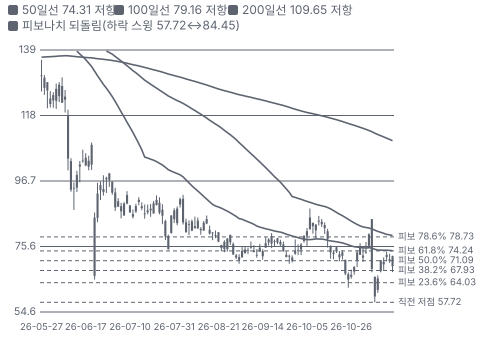

**주봉**

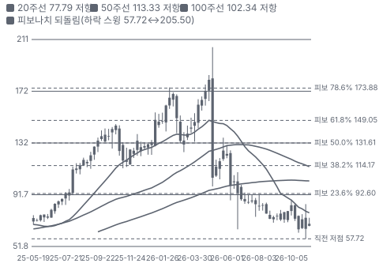

**월봉**

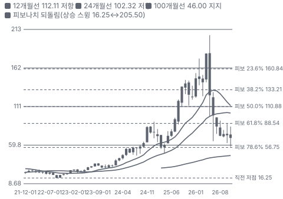

**분기 매출·EPS 실적과 컨센서스**

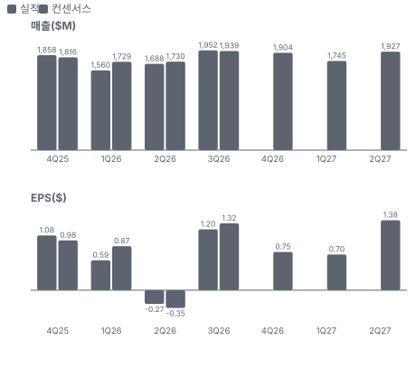

**4Q26 매출 — 지표 추세 vs 가이던스·컨센서스**

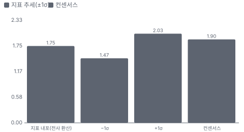

**최근 4개 분기 주가 변화 분석**

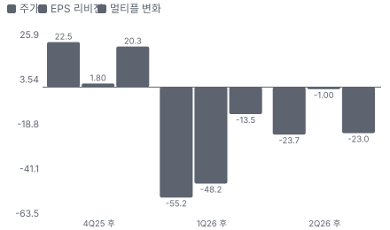

**EPS 리비전**

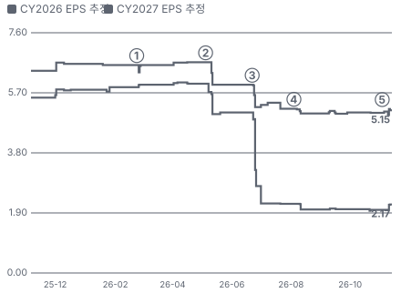

① 26-02-23 4Q25 실적·FY26 첫 가이던스 · EPS 리비전 +0%
② 26-05-05 1Q26 실적, FY26 가이던스 하향·PayneCrest 인수 발표 · EPS 리비전 -11%
③ 26-06-22 6/22 운영 업데이트 — 재생 6건 원가 초과, 가이던스 반 토막·COO 퇴임 · EPS 리비전 -11%
④ 26-08-04 2Q26 실적, 재생 손실 대부분 반영·잔고 사상 최대 · EPS 리비전 -3%
⑤ 26-11-03 3Q26 실적, 재생 \$450M 이연·가스 발전 2027 \$1B+ · EPS 리비전 +2%

**멀티플 프리미엄(Fwd 1Y P/E, 최근 4개 분기말)**

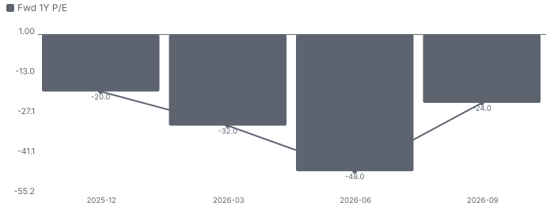

**합리적 멀티플**

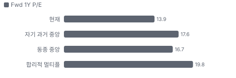

**밸류에이션 주가 시나리오**

**주가별 업사이드**

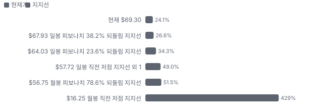
- 제품·서비스 포트폴리오

**고객 믹스(3Q26, 매출 대비)**

**공급 병목(10점, 낮을수록 병목)**

**생산능력 현재와 확충 계획(인력(명))**

**CAPEX의 매출 대비 비중**

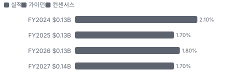

**어닝콜 변화별 주주가치 영향**

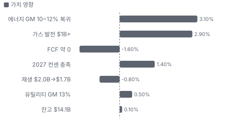

**수주·파이프라인 확실성 사다리**

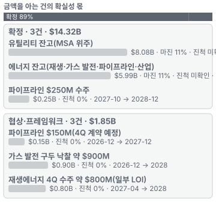

**매출 → 매출총이익 → 영업이익(매출 = 100, 최근 4분기)**

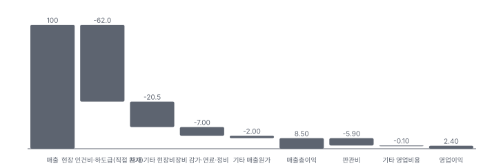

**분기 비용 비중 추이(매출 대비, 공시)**

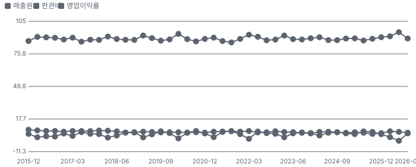

**비용 요인별 매출 대비 비중 1년 변화**

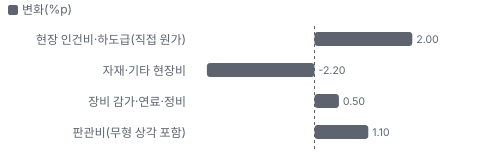

**BOM 항목 가격 +10% 시 OPM 변화**

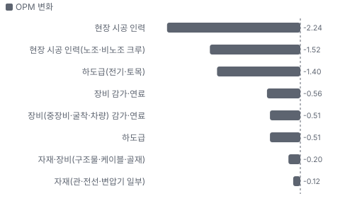

**유틸리티 BOM 원가 몫**

**에너지 BOM 원가 몫**

**투입 원가 물가·판매가 물가·회사 가격 — 1년 변화(항목별 최근 달)**

**사업별 매출 vs 물가 — 전년 대비(명목 매출 · 비교 물가 · 실질 = 물량·믹스)**

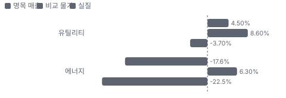

**자산 구성 — 3Q26 분기말 투하자본 \$686.5M**

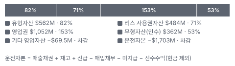

**자산별 변화율 — 최근 12개 분기(4Q23 = 0%) + 다음 4개 분기 추정**

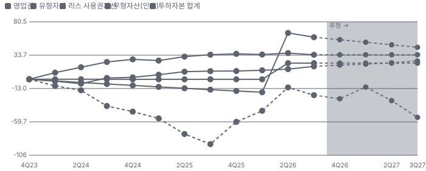

**ROIC 추이 — TTM, 최근 12개 분기 + 다음 4개 분기 추정(컨센서스 NOPAT)**

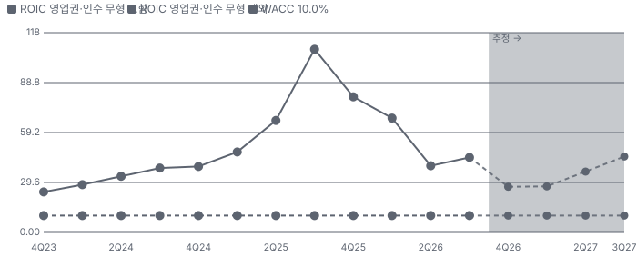

**분기 감가 비율 연율(유형자산 순액 대비)**

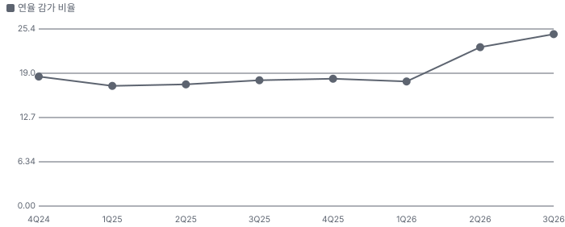

**PayneCrest Electric 시너지 램프(종류별, 확률 가중)**

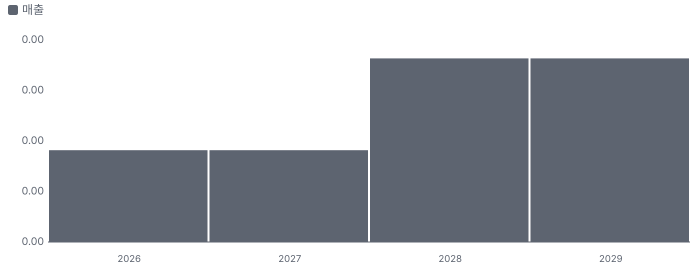

**시너지 가치 vs 웃돈**

**EPS 효과(인수 기업, 기존 대비)**

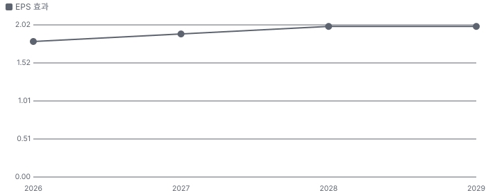

**매출·PPI·수출입 — 최근 16개 분기 같은 축(4Q22 = 100) + 다음 분기 추정**

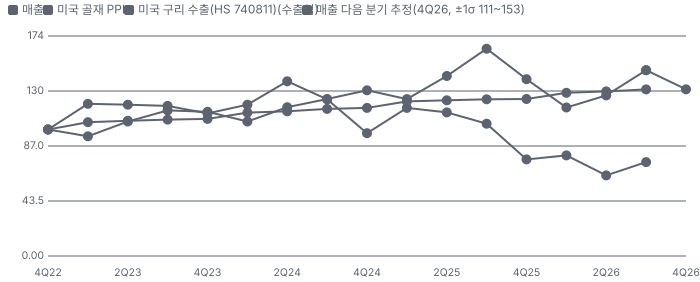

**10년 P·Q 사이클 — 추세(HP 필터) 대비 갭과 8분기 전망**

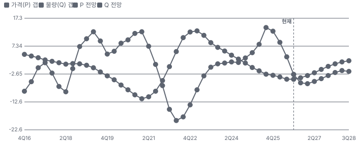

**매출 증가율의 가격·물량 분해와 8분기 전망(전년 대비)**

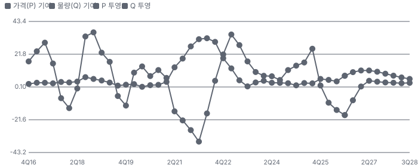

**분기별 매출 증가율 분해**

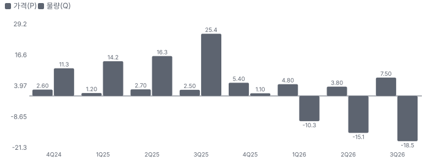

**목표주가 산정 — 약세와 기본 사이(약세 쪽 32%), 도달 확률 약 57%**

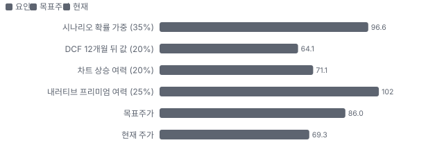

**일봉 지지·저항과 목표주가**

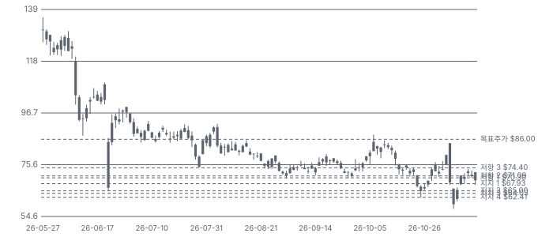

**일별 거래량 분해**

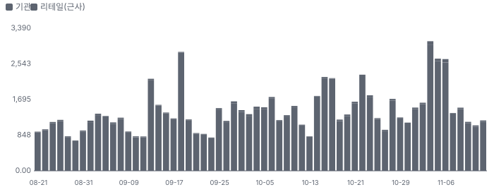

**기관 자금 흐름**

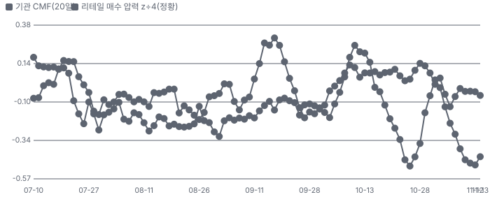

**몬테카를로**

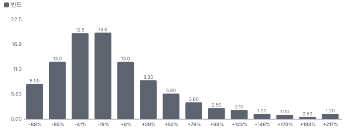

해석: 3,000번 중 1,086번(36%)에서 가치가 지금 주가 이상이었다. 가정을 흔들어도 지금 주가를 뒷받침하지 못하는 경우가 더 많다. 가운데 값은 0.81배이고, 열 번 중 여덟 번은 0.28~1.79배 사이에 든다.

## 내러티브

> **기업가치를 결정하는 이야기:** 이 회사는 크루를 보내 전력망·가스관·발전소를 짓고 고치는 시공사다. 값은 세 숫자로 갈린다. ① 에너지 매출총이익률이 2027년 10~12%로 돌아오느냐(2Q −0.3%, 3Q 8.5%) ② 4Q·1Q 수주(재생 \$800M+, 가스 \$1B)가 잔고로 들어오느냐 ③ 현금 전환(2026 FCF 약 0, 순차입/EBITDA 1.8배)이 회복되느냐.

> **멀티플·EPS 프리미엄**
> **멀티플:** Fwd 1Y P/E 13.9배로 동종 중앙값(Quanta·MasTec·MYR·Dycom) 16.7배보다 약 17% 낮다. Fwd 2Y 12.8배·3Y 11.1배로 시장은 2027~28 회복을 일부만 넣었다. 지난 36개월 자기 Fwd P/E 레인지 안에서는 하단 쪽이다.
> **EPS:** FY26 조정 EPS 가이던스 \$2.10~2.25(4월 컨센서스 \$6.0), FY27 \$4.85~\$5.15(8명)로 2.3배 반등을 가정한다. 2Q 콜 이후 4Q26 EPS는 \$1.04 → \$0.75로 내려갔고 FY27은 거의 그대로다.

### 투자자들은 왜 열광했나

2025~26년 상반기에는 '데이터센터 전력 시공' 이야기로 열광했다. 5/5 종가 \$202.92는 1년 전의 약 2.6배였다. 식은 이유는 회사 고유다 — 5/6 하루 −50%(1Q 미달·재생 원가 초과), 6/23 −22%(가이던스 하향·COO 사임), 11/4~5 −25%(3Q의 재생 이연 + 선거 뒤 업종 동반 급락).

### 무엇이 기업가치를 바꾸나

> **구조적 체질 변화**
> **변화:** 재생 고정가 EPC(설계·조달·시공 일괄 수행) 중심에서 송배전 MSA·가스 발전(원가 정산형 시작)·데이터센터 전기 시공으로 믹스가 옮겨 간다
> **증거:** 고정가 매출 비중 46.6%(3Q25) → 33.7%(3Q26), 원가 정산형 23.4% → 31.8%(10-Q 매출 분해)
> **반증:** 2027년 재생 고정가 수주가 다시 매출의 40%를 넘는다

> **고부가 믹스 확장**
> **변화:** 송배전(변전소·송전 EPC)과 가스 발전이 유틸리티·에너지 마진을 올린다
> **증거:** 3Q 송배전 매출총이익 전년 2배, 유틸리티 GM 13.0%, 회사는 가스·송배전 성장이 마진을 올린다고 했다(3Q 콜)
> **반증:** 유틸리티 연간 GM이 10% 아래

> **기술 혁신**
> **변화:** 해당 없음(시공 서비스 — 기술 차별보다 인력·안전·실행 기록)
> **증거:** 10-K 사업 설명
> **반증:** -

> **실행 속도**
> **변화:** 수주 뒤 착공까지 짧다 — 재생·가스 발전 모두 수주 다음 1~2분기 안에 매출 인식이 시작된다 **납품 리드타임 3~6개월.** 피어 비교 미확인. 이전 대비 미확인.
> **증거:** 3Q 콜(Mizuho 질문 답변): 4Q·1Q 재생 수주는 2Q~3Q27 인식, 가스는 수주 분기 또는 다음 분기
> **반증:** 4Q 수주분 착공이 3Q27 뒤로 밀린다

> **M&A**
> **변화:** PayneCrest(Primoris가 2026년 5월 인수한 중서부 전기·기계 시공사) 인수(2026-05)로 중서부 데이터센터·산업 전기 시공 진입
> **증거:** PayneCrest 인수가 \$437.5M(현금, 2026-05-01), 잔고 \$260M → \$593.6M(9/30), 8개월 매출 \$300M+ 예상(10-Q·3Q 콜)
> **반증:** 2027 PayneCrest 매출 \$500M 미달

> **정책·입법 연관성**
> **재정정책:** 청정에너지 세액공제(태양광·저장) 축소·FEOC(우려 외국 기관, 중국 등 부품 사용 제한 규정) 규정이 2026년 재생 고객의 PPA(전력 구매 계약) 재협상과 착공 지연을 낳았다 3Q 콜: 재생 착공 지연은 대부분 규제 혼란으로 고객 원가가 올라 PPA를 다시 협상한 탓 반증: 1Q27 재생 수주가 \$1.6B(회사 기대) 근처로 들어온다 의회 동의 2/10 — 하원 1/5(새 의회에서 세액공제 복원 법안은 아직 없다 — 논의 단계(선거 직후)) · 상원 1/5(같음).
> **행정명령:** 해당 없음(이 회사 매출에 직접 걸린 행정명령 확인 안 됨) - 반증: -
> **연관입법:** 인허가 개혁(송전·파이프라인)은 양당 논의 중 — 통과 전에는 영향 없음 중간선거 영향 계산(전력망 채널) 반증: -

> **고객의 지출 예산**
> **변화:** 고객 돈은 대부분 CAPEX(송배전·발전소·파이프라인 건설)이고, MSA 정비는 유틸리티 운영·유지 예산(OPEX) 성격이 섞인다
> **사업별 예산:** 유틸리티(송배전·가스 배관 MSA) — 고객 혼합(유틸리티 송배전·가스 배관 CAPEX + 정비 OPEX), 매출의 39%: 규제 요금 기반 투자·노후 설비 교체·부하 증가 · 에너지(재생·가스 발전·파이프라인) — 고객 CAPEX(발전사·개발사의 발전소 건설비, 미드스트림 파이프라인 CAPEX), 매출의 61%: 전력 수요(데이터센터)·PPA·세액공제
> **증거:** 10-K 사업 설명·3Q 콜
> **반증:** 유틸리티 5년 CAPEX 계획 하향

### 내러티브 근거

> '전력망·가스 발전·데이터센터 시공 수혜주'라는 이야기는 그대로인데, 재생에너지 고정가 프로젝트 6건의 원가 초과가 이익을 1년 늦췄다. 지금 가격은 2027년 회복을 반쯤만 믿는다. 동종 대비 멀티플 차이 -16% 중 회사 고유 몫은 -30%다. 단계는 붕괴 뒤 바닥 다지기(5/5 종가 고점 \$202.92 대비 −66%), 쏠림은 낮음(공매도 비율 유통 주식의 12.4%, 리테일 언급 거의 없음)이다.

> **전력망 투자 사이클(송배전)** · 강화
> **논리:** 유틸리티의 송배전 CAPEX가 커지고 숙련 크루가 모자라 MSA 물량과 마진이 함께 오른다.
> **숫자:** 3Q 송배전 매출총이익 전년 2배, 유틸리티 GM 13.0%(전년 11.7%), 유틸리티 잔고 +23%
> **반증:** 텍사스·남동부 유틸리티 CAPEX 축소, 유틸리티 GM 10% 아래

> **가스 발전 시공 붐** · 강화
> **논리:** 데이터센터·산업 전력 수요로 가스 발전소가 늘고, Primoris는 원가 정산형으로 시작하는 EPC로 2027 매출 \$1B+를 본다.
> **숫자:** 가스 발전 2026 \$650M+ → 2027 \$1B+, 잔고 \$1.5B·구두 \$900M·퍼널 \$7B+
> **반증:** 4Q에 구두 낙찰 \$900M이 잔고로 들어오지 않는다

> **재생에너지 정상화** · 유지
> **논리:** 원가 초과 6건이 끝나면 재생 마진이 예전 수준으로 돌아오고 2027년 소폭 성장한다.
> **숫자:** 에너지 GM FY26 6~8% → 2027 10~12%(가이던스), 5/6건 준공, 4Q 재생 수주 약 \$800M
> **반증:** 남은 1건 시운전에서 추가 손실, 4Q 재생 수주 \$500M 미만

> **데이터센터 시공(PayneCrest)** · 강화
> **논리:** 중서부 하이퍼스케일 고객 일감으로 PayneCrest가 2027 매출 \$500M+를 낸다.
> **숫자:** PayneCrest 잔고 \$260M(5월) → \$593M(9/30), 8개월 매출 \$300M+
> **반증:** 선거 뒤 지방 데이터센터 인허가 반발로 고객 일정이 밀린다

> **반대 내러티브 — 고정가 실행 위험의 재발** · 유지
> **논리:** 한 해에 6건이 터진 회사라면 내년 가스 발전 고정가 전환 때도 같은 일이 생길 수 있다. 할인은 정당하다.
> **숫자:** 2Q 에너지 GM −0.3%, FY26 EPS 컨센서스 −64%, 6/22 COO 사임
> **반증:** 2027년 상반기 에너지 GM 10% 이상

> **반대 내러티브 — 선거 뒤 정책** · 태동
> **논리:** 민주당 의회·텍사스 주지사 교체로 데이터센터 인허가와 가스 발전이 늦어지고, 재생 세액공제 쪽은 오히려 숨통이 트인다 — 믹스가 다시 바뀐다.
> **숫자:** 11/4~5 Quanta −22%·MasTec −20%·Primoris −25%, GRID ETF 선거 뒤 −2.1%
> **반증:** 1Q27 가스 발전·송배전 수주가 지연 없이 잔고에 들어온다

## 포트폴리오

| 제품·서비스 | 구분 | 무엇 | 쓰는 곳 | 돈 버는 방식 | Mix | Mix 변화(전년 대비) |
|---|---|---|---|---|---|---|
| 유틸리티 | 서비스 | 가스 배관·송배전·통신망을 MSA로 정비·교체·시공 | 유틸리티·통신사의 망 투자와 정비 | MSA 유닛 단가 + 프로젝트. 3Q 매출 \$770.9M, GM 13.0% | 39% | +5.5%p |
| 에너지 | 서비스 | 태양광·배터리·가스 발전소 EPC, 파이프라인, 산업 전기(PayneCrest) | 발전사·미드스트림·데이터센터 건설 | 고정가·원가 정산 EPC. 3Q 매출 \$1,223.8M, GM 8.5% | 61% | -5.5%p |

**Mix 변화가 가장 큰 쪽은 유틸리티(+5.5%p, 전년 대비).** 계절성 판정: 분기 매출 계절 지수 기준 있음 → 전년 같은 분기와 비교.

## 고객

> **3Q26 최대 고객 상위 10개 고객 합계(이름 미공시, top ten customers) 48%, 상위 3곳 56%, 집중도 보통.** 공시·회사 발표로 확인한 몫은 매출의 48%이고, 나머지 고객 몫은 추정이거나 미분해다. 2026년에는 매출 10%를 넘는 고객이 없다(10-Q). 상위 10곳이 3Q 매출의 48.4%이고 이름은 공시되지 않는다. FY25에는 한 고객이 12.1%, 3Q25에는 재생 고객 한 곳이 16.7%였다.

**고객별 매출 몫(3Q26)**
| 고객 | 몫 | 변화 | 근거 |
|---|---|---|---|
| 상위 10개 고객 합계(이름 미공시, top ten customers) | 48% | -5%p | 공시 |
| 최대 고객(이름 미공시, one customer) | 5~10% | -5%p | 추정 |
| 텍사스·루이지애나 교통부(주 교통부) | 미확인 | 미확인 | 공시 |
| 기타·미분해 | 44% | - | - |

> **상위 10개 고객 합계(이름 미공시, top ten customers)** · 공시
> **사는 것:** 유틸리티 MSA·재생·가스 발전 EPC
> **추정 근거:** FY25 53.1% → 3Q26 48.4%, 재생 대형 고객 비중 축소

> **최대 고객(이름 미공시, one customer)** · 추정
> **사는 것:** 미확인
> **추정 근거:** 2026년 10% 초과 고객 없음 → 10% 미만. FY25 12.1%

> **텍사스·루이지애나 교통부(주 교통부)** · 공시
> **사는 것:** 도로·교통 인프라
> **추정 근거:** 10-K 고객 명시

## 수주·파이프라인

> **2026-09-30 기준 6건.** 확정 \$14.32B, 미확정 \$1.85B. 공시 수주잔고(고정 + MSA) \$14.07B.

**수주 목록**
| 상태 | 계약 | 계약 총액 | 진척 | 기간 | 비고 |
|---|---|---|---|---|---|
| 확정 | 유틸리티 잔고(MSA 위주) | \$8.08B | 비공개 | 2026-09 → 2030 | - |
| 확정 | 에너지 잔고(재생·가스 발전·파이프라인·산업) | \$5.99B | 비공개 | 2026-09 → 2029 | - |
| 확정 | 파이프라인 \$250M 수주 | \$0.25B | 0% | 2027-10 → 2028-12 | - |
| 협상 | 파이프라인 \$150M(4Q 계약 예정) | \$0.15B | 0% | 2026-12 → 2027-12 | - |
| 협상 | 가스 발전 구두 낙찰 약 \$900M | \$0.90B | 0% | 2026-12 → 2028 | - |
| 협상 | 재생에너지 4Q 수주 약 \$800M(일부 LOI) | \$0.80B | 0% | 2027-04 → 2028 | - |

**실행 속도와 방해 요인**
| 항목 | 상태 | 실행 속도 | 방해 요인 |
|---|---|---|---|
| 유틸리티 잔고(MSA 위주) | 확정 | NTM 인식 \$2.44B | 노동력 · 통신(광 가입자망) 감소 |
| 에너지 잔고(재생·가스 발전·파이프라인·산업) | 확정 | NTM 인식 \$3.93B | 고객 PPA 재협상·계통 연결 지연 · 재생 고정가 실행 |
| 파이프라인 \$250M 수주 | 확정 | 2027 말~2028 착공 | 인허가 |
| 파이프라인 \$150M(4Q 계약 예정) | 협상 | 수주 전, 2027 매출 | 계약 미체결 |
| 가스 발전 구두 낙찰 약 \$900M | 협상 | 4Q 수주 가능 | 계약 미체결 · 고객 터빈 확보 |
| 재생에너지 4Q 수주 약 \$800M(일부 LOI) | 협상 | 2Q~3Q27 인식 시작 | 고객 PPA·계통 연결 · 정책(세액공제·FEOC) |

## 마진 구조

> **GPM 10.5%, OPM 4.9%.** 2Q26 대비 GPM +5.6%p, OPM +6.4%p. 변동비는 매출의 77%이고, 매출이 10% 늘면 OPM은 +1.6%p 움직인다. 3Q26 매출원가는 매출의 89.5%로 1년 전 89.2%와 비슷하지만 속은 바뀌었다 — 재생에너지 원가 초과가 줄고 송배전·가스 발전이 마진을 올렸다. 2Q에는 에너지 매출총이익이 −\$2.7M였다.

> **매출 100 중 매출원가 91.5, 매출총이익 8.5(최근 4분기, 공시).** 매출원가 요인 중 현장 인건비·하도급(직접 원가)이 매출의 62.0%로 가장 무겁고, 단가가 +10% 오르면 GPM이 -6.20%p 움직인다. 분기 회귀로 매출 1이 늘 때 매출원가는 0.90 늘고, 매출원가의 고정비 몫은 0%다.

**비용 요인 강도 — 비중·추세·충격(+10%)·탄력**
| 비용 | 구분 | 매출 대비 | 1년 변화 | 마진 기여 | 충격 시 마진 | 매출 탄력 | 고정비 몫 |
|---|---|---|---|---|---|---|---|
| 현장 인건비·하도급(직접 원가) | 매출원가 요인 | 62.0% | +2.0%p | -2.0%p | -6.20%p | 미확인 | 15% |
| 자재·기타 현장비 | 매출원가 요인 | 20.5% | -2.2%p | +2.2%p | -2.05%p | 미확인 | 0% |
| 장비 감가·연료·정비 | 매출원가 요인 | 7.0% | +0.5%p | -0.5%p | -0.70%p | 미확인 | 60% |
| 매출원가 | 공시 항목 | 91.5% | +2.6%p | -2.6%p | -9.15%p | 0.90 | 0% |
| 판관비 | 공시 항목 | 5.9% | +0.6%p | -0.6%p | 미확인 | 0.05 | 18% |
| 기타 영업비용 | 공시 항목 | 0.1% | +0.1%p | -0.1%p | 미확인 | -0.00 | 100% |

매출 탄력 = 분기 비용을 매출에 회귀한 기울기(매출 1당 변동비), 고정비 몫 = 절편 ÷ 평균 비용. 표본이 8분기 미만이면 미확인. 매출원가 요인 비중은 margin 재료의 추정이 섞여 있고, 공시 매출원가와의 차이는 '기타 매출원가'로 둔다.

**GPM에서 OPM까지(GAAP, 아래는 최근 4개 분기)**
| 기간 | GPM | 연구개발 | 판관비 | 기타 | OPM |
|---|---|---|---|---|---|
| 3Q25 | 10.8% | 0.0% | 4.5% | 0.0% | 6.3% |
| 2Q26 | 4.9% | 0.0% | 6.3% | 0.2% | -1.6% |
| 3Q26 | 10.5% | 0.0% | 5.6% | 0.0% | 4.9% |
| 2025-12 | 9.4% | - | - | - | 4.2% |
| 2026-03 | 8.6% | - | - | - | 1.6% |
| 2026-06 | 4.9% | - | - | - | -1.6% |
| 2026-09 | 10.5% | - | - | - | 4.9% |

**비용을 움직이는 요인**
| 비용 | 요인 |
|---|---|
| 현장 인건비·하도급(직접 원가, 매출원가) | 크루 생산성·임금·초과 근무 · 근거 추정 |
| 자재·기타 현장비(매출원가) | 주요 자재는 고객 지급, 나머지는 입찰 단가 · 근거 추정 |
| 장비 감가·연료·정비(매출원가) | 장비 가동률(저물량 때 유휴 비용) · 근거 추정 |
| 판관비(무형 상각 포함, 판관비) | PayneCrest 판관비·무형자산 상각 · 근거 공시 |

**유틸리티 BOM — 매출의 39%, GPM 13%(3Q26 유틸리티 매출총이익 \$100.2M ÷ 매출 \$770.9M(10-Q 세그먼트)), 항목 가격 +10% 시**
| 항목 | 원가 몫 | 전가 | 제품 GPM | OPM |
|---|---|---|---|---|
| 현장 시공 인력(노조·비노조 크루) | 40~50% | 미확인 | -3.9%p | -1.52%p |
| 자재(관·전선·변압기 일부) | 10~20% | 80% | -0.4%p | -0.12%p |
| 하도급 | 10~20% | 미확인 | -1.3%p | -0.51%p |
| 장비(중장비·굴착·차량) 감가·연료 | 12~18% | 미확인 | -1.3%p | -0.51%p |
| 미분해 | 10% | - | - | - |

**에너지 BOM — 매출의 61%, GPM 8%(3Q26 에너지 매출총이익 \$104.5M ÷ 매출 \$1,223.8M(10-Q 세그먼트). 2Q26 −0.3%), 항목 가격 +10% 시**
| 항목 | 원가 몫 | 전가 | 제품 GPM | OPM |
|---|---|---|---|---|
| 현장 시공 인력 | 35~45% | 미확인 | -3.7%p | -2.24%p |
| 하도급(전기·토목) | 20~30% | 미확인 | -2.3%p | -1.40%p |
| 자재·장비(구조물·케이블·골재) | 10~20% | 80% | -0.4%p | -0.20%p |
| 장비 감가·연료 | 8~12% | 미확인 | -0.9%p | -0.56%p |
| 미분해 | 10% | - | - | - |

현장 시공 인력 가격이 +10% 오르면 영업이익은 -46.2% 움직인다. 판매가 전가를 모르는 항목은 전가 0%로 계산했다.

**BOM 항목 가격을 움직이는 것**
| 항목 | 요인 |
|---|---|
| 현장 시공 인력(노조·비노조 크루) | MSA는 유닛 단가라 임금 상승을 갱신 때 넘긴다 · 전가: MSA 단가 연동(유닛 단가 계약 — 갱신 때 반영) · 근거 추정 |
| 장비(중장비·굴착·차량) 감가·연료 | 회사 소유 장비 비중이 높다 · 근거 추정 |
| 자재(관·전선·변압기 일부) | 10-K: 관·태양광 모듈·터빈 같은 주요 자재는 대개 고객이 지급하고, 물가·관세는 상한이 있는 가격 조정 조항·입찰 단가로 회수한다(상한을 넘은 적도 있다) — 전가 0.8은 그 문구로 잡은 추정 · 근거 추정 |
| 하도급 | 피크 물량을 하도급으로 메운다 · 근거 추정 |
| 현장 시공 인력 | 재생 원가 초과의 핵심 — 생산성 미달이 인건비로 바로 간다 · 전가: 고정가 EPC는 전가 안 됨, 원가 정산형은 전가 · 근거 추정 |
| 하도급(전기·토목) | eBOS(태양광 발전소의 전기 설비, 모듈 밖 배선·수배전)·말뚝 시공 일부 하도급 · 근거 추정 |
| 자재·장비(구조물·케이블·골재) | 10-K: 관·태양광 모듈·터빈 같은 주요 자재는 대개 고객이 지급하고, 물가·관세는 상한이 있는 가격 조정 조항·입찰 단가로 회수한다(상한을 넘은 적도 있다) — 전가 0.8은 그 문구로 잡은 추정 · 근거 추정 |
| 장비 감가·연료 | 장비 연료·정비비는 유휴 때 고정비처럼 남는다 · 근거 추정 |

> **원가·판매가 물가 격차 -109.3%p** — 판매가 물가가 투입 원가 물가보다 느리게 오른다.

**투입 물가 — 미국 PPI 3·6·12개월(2026-10, 개정 반영)과 해외 전년비**
| 항목 | 미국 3개월 | 6개월 | 12개월 | 전가 못 할 때 OPM | 일본 | 한국 | 대만 |
|---|---|---|---|---|---|---|---|
| 장비 감가·연료 | +38.6% | +30.2% | +115.2% | - | 미확인 | 미확인 | 미확인 |
| 자재(관·전선·변압기 일부) | +3.4% | +7.2% | +23.9% | - | +42.6% | +25.8% | +40.1% |
| 자재·장비(구조물·케이블·골재) | +0.1% | +1.7% | +6.1% | - | 미확인 | 미확인 | 미확인 |

별표는 품목보다 넓은 업종 지수다. 연결한 투입 원가의 미국 PPI(생산자물가지수)는 1년 새 가중 +115.2%이고, 판매가로 넘기지 못하면 GPM -8.1%p·OPM -8.1%p가 움직인다. 판매가 비교 물가(ppi:transformer)는 1년 새 +5.6% — 회사 가격 변화는 미확인. 물가 지수를 붙이지 못한 매출원가 항목은 현장 인건비·하도급(직접 원가), 자재·기타 현장비다(미연결). 유틸리티 매출은 2026-09 전년 대비 +4.5%이고 비교 물가 ppi:transformer의 변화 +8.6%(2026-09)를 빼면 실질 -3.7% — 성장 대부분이 가격(물가)이다. 에너지 매출은 2026-09 전년 대비 -17.6%이고 비교 물가 ppi:aggregate의 변화 +6.3%(2026-09)를 빼면 실질 -22.5% — 물가를 빼면 줄었다 — 물량이 빠진다.

## 자산 구성

> **3Q26 분기말 투하자본 \$686.5M** — 영업권 153%, 유형자산 82%. 최근 12개 분기(4Q23 → 3Q26) 가장 크게 늘어난 자산은 무형자산(인수, +59%), 투하자본 합계 -22%. 3Q27 추정 투하자본 \$411.9M(-40%, 컨센서스 매출과 회전 일수·CAPEX 강도 유지 가정). 연율 감가 비율(순액 기준)은 직전 4분기 17.80% → 최근 4분기 20.91%.

**자산·운전자본 항목별 분기말 잔액 — 최근 12개 분기와 다음 4개 분기 추정**
| 항목 | 4Q23 | 3Q25 | 3Q26(최근) | 3Q27 추정 | 12개 분기 변화 | 다음 4개 분기 변화 |
|---|---|---|---|---|---|---|
| 선급·기타 유동자산 | \$135.8M | \$134.2M | \$137.5M | \$169.2M | +1% | +23% |
| 매입채무 | \$629.0M | \$945.6M | \$720.8M | \$858.8M | +15% | +19% |
| 미지급비용 | \$263.5M | \$499.6M | \$439.5M | \$504.3M | +67% | +15% |
| 선수수익(계약부채) | \$366.5M | \$627.3M | \$680.2M | \$787.9M | +86% | +16% |
| 유형자산 | \$475.9M | \$530.2M | \$561.6M | \$598.1M | +18% | +7% |
| 리스 사용권자산 | \$360.5M | \$484.4M | \$484.2M | \$484.2M | +34% | +0% |
| 영업권 | \$857.7M | \$856.9M | \$1,051.5M | \$1,051.5M | +23% | +0% |
| 무형자산(인수) | \$227.6M | \$194.4M | \$361.7M | \$329.5M | +59% | -9% |

**자산 추정 동인 — 최근 4개 분기 평균(재무상태표 동인 모형)**
| 동인 | 값 | 곱하는 기준 |
|---|---|---|
| 선급·기타 유동자산 | 7일 | 매출 |
| 매입채무 | 40일 | 매출원가 |
| 미지급비용 | 21일 | 매출 |
| 선수수익(계약부채) | 33일 | 매출 |
| CAPEX 강도 | 1.6% | 매출(최근 4개 분기 합) |
| 분기 감가율 | 3.76% | 기초 유형자산 순액(무형 상각 제외 감가상각) |
| 매출원가율 | 91.5% | 매출(최근 4개 분기) |
| 영업권·리스 사용권·기타 | 유지 | 인수·새 리스는 공시 전 모름 |
| 인수 무형자산 | 분기 \$8.1M 상각 | 최근 4개 분기 평균 상각 |

**추정 방법:** 증권사 3표 모델(손익·재무상태표·현금흐름)의 재무상태표 동인 방식이다. 운전자본은 항목별 회전 일수(매출채권·선급·미지급·선수는 매출, 재고·매입채무는 매출원가 기준)를 최근 4개 분기 평균으로 두고 컨센서스 매출에 곱한다. 유형자산은 기초 + CAPEX − 감가상각으로 굴린다(Koller·Goedhart·Wessels 『Valuation』 재무상태표 추정). 매출 경로는 ROIC 절의 컨센서스와 같다.

**유형·무형자산 항목별 가치(2025-12-31 vs 2024-12-31)**
| 구분 | 항목 | 총액 2025-12-31 | 누적상각 | 순액 | 총액 2024-12-31 | 총액 1년 변화 | 공시 내용연수 |
|---|---|---|---|---|---|---|---|
| 유형 | 유형자산 합계(항목 미분해) | \$947.0M | 총계만 공시 | 총계만 공시 | \$913.9M | +3.6% | 미확인 |
| 영업권 | 영업권 | \$856.9M | \$0.0M | \$856.9M | \$856.9M | +0.0% | 비상각 |
| 무형 | 무형자산 합계(항목 미분해) | \$296.0M | \$105.8M | \$190.2M | \$315.2M | -6.1% | 미확인 |
| 유형 합계 | 유형자산 | \$947.0M | \$415.8M | \$531.2M | \$913.9M | +3.6% | 경과율 44%(상각 대상 기준) |

**내용연수 산식(상각 대상 유형자산 = 총액 − 토지 − 건설중)**
| 기준일 | 연 감가상각 | 상각 대상 총액 | 평균 내용연수 | 경과 연수 | 잔여 연수 | 경과율 |
|---|---|---|---|---|---|---|
| 2025-12-31 | \$74.2M | \$947.0M | 12.8년 | 5.6년 | 7.2년 | 44% |
| 2024-12-31 | \$75.9M | \$913.9M | 12.0년 | 5.6년 | 6.4년 | 47% |

산식 평균 내용연수는 12.8년. 1년 전 12.0년 → 지금 12.8년.

**분기 감가 비율(감가상각 ÷ 평균 유형자산 순액)**
| 분기 | 감가상각 | 평균 유형자산(순액) | 분기 비율 | 연율 | 연율의 역수 |
|---|---|---|---|---|---|
| 4Q24 | \$22.6M | \$486.3M | 4.64% | 18.55% | 5.4년 |
| 1Q25 | \$21.4M | \$497.4M | 4.30% | 17.21% | 5.8년 |
| 2Q25 | \$22.5M | \$516.5M | 4.36% | 17.43% | 5.7년 |
| 3Q25 | \$23.8M | \$528.3M | 4.51% | 18.02% | 5.5년 |
| 4Q25 | \$24.2M | \$530.7M | 4.56% | 18.24% | 5.5년 |
| 1Q26 | \$23.8M | \$533.6M | 4.46% | 17.84% | 5.6년 |
| 2Q26 | \$30.7M | \$539.6M | 5.69% | 22.76% | 4.4년 |
| 3Q26 | \$34.0M | \$552.5M | 6.15% | 24.62% | 4.1년 |

감가상각 기준: 손익계산서 감가상각·상각비(SEC 공시 데이터, 4분기 = 연간 − 1~3분기).

최근 4분기 연율 감가 비율 20.91%, 직전 4분기 17.80%(+17%) — 경고 문턱(-10%) 안이다.

미공시·미분해: 유형자산 항목별 총액·내용연수(10-K 주석에서 모델이 채움) · 무형자산 항목(10-K 주석에서 모델이 채움) — 이 칸은 비우고 나머지로 계산했다.

### 해석 — 자산이 어디에 쌓이고 있나

- 같은 기간 4개 분기 매출은 +15% — 매출보다 빨리 늘어난 자산: 리스 사용권자산 +34%, 무형자산(인수) +59%. 이 자산의 회전율이 떨어지면 ROIC를 희석한다.
- 다음 4개 분기 CAPEX \$125.0M vs 감가상각 \$86.3M(최근 4개 분기 CAPEX 강도·감가율 유지) — 유형자산 3Q26 \$561.6M → 3Q27 \$598.1M. 투자가 감가보다 커서 자산이 쌓이는 국면이다.
- 감가 비율이 올라갔다 — 이익을 보수적으로 잡는 쪽이다(내용연수 단축·짧은 수명 자산 증가).

## ROIC

> **TTM 3Q26 ROIC는 영업권·인수 무형 포함 44.5%, 제외 미확인**(NOPAT 마진 2.4% × 투하자본 회전율 18.26회). 최근 12개 분기 4Q23 24.0% → 3Q26 44.5%(고점 3Q25 108.6%). 컨센서스 NOPAT으로 굴리면 3Q27 45.0%(제외 미확인) — WACC 10.0% 대비 +35.0%p. 1년 변화의 가장 큰 요인은 NOPAT 마진(-50.0%p).

**ROIC 추이(TTM)와 다음 4개 분기 추정 — NOPAT ÷ 평균 투하자본(이번 분기말·4개 분기 전)**
| 분기 | 구분 | TTM 매출 | TTM NOPAT | NOPAT 마진 | 평균 투하자본 | ROIC 포함 | ROIC 제외 |
|---|---|---|---|---|---|---|---|
| 4Q23 | 실적 | \$5,715.3M | \$216.6M | 3.8% | \$902.5M | 24.0% | 미확인 |
| 1Q24 | 실적 | \$5,871.1M | \$235.6M | 4.0% | \$833.5M | 28.3% | 미확인 |
| 2Q24 | 실적 | \$6,021.4M | \$248.2M | 4.1% | \$746.3M | 33.3% | 미확인 |
| 3Q24 | 실적 | \$6,141.1M | \$258.1M | 4.2% | \$676.4M | 38.2% | 미확인 |
| 4Q24 | 실적 | \$6,366.8M | \$268.4M | 4.2% | \$685.9M | 39.1% | 미확인 |
| 1Q25 | 실적 | \$6,602.2M | \$287.8M | 4.4% | \$603.6M | 47.7% | 미확인 |
| 2Q25 | 실적 | \$6,929.2M | \$318.6M | 4.6% | \$479.5M | 66.4% | 미확인 |
| 3Q25 | 실적 | \$7,458.5M | \$346.8M | 4.6% | \$319.4M | 108.6% | 미확인 |
| 4Q25 | 실적 | \$7,574.9M | \$339.5M | 4.5% | \$422.4M | 80.4% | 미확인 |
| 1Q26 | 실적 | \$7,486.7M | \$304.8M | 4.1% | \$449.4M | 67.8% | 미확인 |
| 2Q26 | 실적 | \$7,284.2M | \$196.2M | 2.7% | \$497.0M | 39.5% | 미확인 |
| 3Q26 | 실적 | \$7,058.2M | \$171.9M | 2.4% | \$386.6M | 44.5% | 미확인 |
| 4Q26 | 추정 | \$7,105.0M | \$136.2M | 1.9% | \$501.9M | 27.1% | 미확인 |
| 1Q27 | 추정 | \$7,290.0M | \$175.2M | 2.4% | \$642.7M | 27.3% | 미확인 |
| 2Q27 | 추정 | \$7,528.6M | \$254.1M | 3.4% | \$703.8M | 36.1% | 미확인 |
| 3Q27 | 추정 | \$7,733.8M | \$248.3M | 3.2% | \$552.3M | 45.0% | 미확인 |

**다음 4개 분기 NOPAT — 컨센서스(세율 26%, 리스 이자 별도)**
| 분기 | 매출 | EBITA 마진 | EBITA | NOPAT(분기) | 근거 |
|---|---|---|---|---|---|
| 4Q26 | \$1,904.5M | 1.8% | \$33.3M | \$24.7M | 컨센서스 매출 × EBIT 마진 FY2026(조정 − 주식보상 0.3%) |
| 1Q27 | \$1,744.9M | 4.7% | \$81.5M | \$60.3M | 컨센서스 매출 × EBIT 마진 FY2027(조정 − 주식보상 0.3%) |
| 2Q27 | \$1,926.8M | 4.7% | \$90.0M | \$66.6M | 컨센서스 매출 × EBIT 마진 FY2027(조정 − 주식보상 0.3%) |
| 3Q27 | \$2,157.6M | 4.7% | \$100.8M | \$74.6M | 컨센서스 매출 × EBIT 마진 FY2027(조정 − 주식보상 0.3%) |

**추정 방법:** NOPAT은 컨센서스(분기 매출 추정 × 회계연도 EBIT 마진 추정)로 잡고, 조정(비 GAAP) 마진이면 주식보상 몫을 빼서 과거 실적과 같은 기준(영업이익 + 인수 무형 상각)으로 맞췄다. 이미 발표했지만 분기 보고서(10-Q)가 아직 없는 분기는 발표 실적을 쓴다. 투하자본은 자산 구성 절의 재무상태표 동인으로 굴렸다. ROIC는 4개 분기 NOPAT을 이번 분기말과 4개 분기 전 투하자본의 평균으로 나눈다 — 추정 분기의 ROIC에는 이미 나온 실적 분기가 섞여 있다.

**투하자본 항목별 회전율과 ROIC 기여(TTM 3Q26, 평균 잔액)**
| 항목 | 투하자본 | 매출 1달러당 자본 | 회전율(매출 ÷ 항목) | 자본 몫 | 이 항목을 빼면 ROIC |
|---|---|---|---|---|---|
| 운전자본 | −\$1,820.7M | -0.26 | 음수(자금 원천) | -471% | 7.3% |
| 유형자산 | \$545.9M | 0.08 | 12.93회 | 141% | 미확인 |
| 리스 사용권자산 | \$484.3M | 0.07 | 14.57회 | 125% | 미확인 |
| 영업권 | \$957.3M | 0.14 | 7.37회 | 248% | 미확인 |
| 무형자산(인수) | \$278.0M | 0.04 | 25.39회 | 72% | 148.4% |
| 기타 영업자산 | −\$58.3M | -0.01 | 음수(자금 원천) | -15% | 36.2% |

**ROIC 세 가지 판**
| 판 | NOPAT | 투하자본 | ROIC | 무엇을 재나 |
|---|---|---|---|---|
| 영업권·인수 무형 포함 | \$161.1M | \$386.6M | 41.7% | 인수 웃돈까지 낸 돈에 대한 수익률 |
| 영업권·인수 무형 제외 | \$161.1M | −\$848.7M | 미확인 | 본업 운영 수익률(동종 비교용) |
| 무형 자본화 조정(판관비 20%·5년, 연구개발 6년) | \$183.9M | \$599.0M | 30.7% | 비용으로 처리한 무형 투자를 자산으로 본 판 |
| 경제적 이익(포함판) | \$122.5M | \$386.6M | 자본비용 10.0% | (ROIC − 자본비용) × 투하자본 |

NOPAT = (영업이익 \$170.0M + 인수 무형 상각 + 리스 내재 이자 \$30.0M) × (1 − 세율 26%). 리스 사용권자산을 투하자본에 넣었으므로 임차료 속 이자 몫을 영업이익에 되더했다. 현금은 영업에 필요한 몫을 따로 알 수 없어 투하자본에서 뺐다. SEC 공시 데이터 자동 초안 — 운전자본 = 매출채권 + 재고 + 선급 − (매입채무 + 미지급비용 + 선수수익), 현금 제외. 손상 누계는 공시 데이터 수록분.

**ROIC 1년 변화 분해(포함판, TTM 3Q25 → TTM 3Q26)**
| 요인 | ROIC 기여 |
|---|---|
| NOPAT 마진 | -50.02%p |
| 운전자본 | +48.32%p |
| 유형자산 | -13.44%p |
| 리스 사용권자산 | -8.85%p |
| 영업권 | -29.23%p |
| 무형자산(인수) | -17.46%p |
| 기타 영업자산 | +3.43%p |
| 합계 | -67.24%p |

**무형 자본화 가정별 ROIC(2025년 지출 기준, 포함판에 더함)**
| 투자로 보는 몫 | 상각 연수 | 무형 자산 | NOPAT 조정 | 조정 ROIC |
|---|---|---|---|---|
| 판관비 20% | 2년 | \$118.2M | \$8.6M | 33.6% |
| 판관비 20% | 5년 | \$212.3M | \$22.8M | 30.7% |
| 판관비 30% | 2년 | \$177.3M | \$13.0M | 30.9% |
| 판관비 30% | 5년 | \$318.5M | \$34.2M | 27.7% |

### 해석 — 무엇이 수익성을 끌어올리고 희석하나

- 영업권: 투하자본의 248% — 빼면 ROIC 41.7% → 미확인. 이 자산의 회전율(7.37회)이 수익성을 희석하는 주된 자리다.
- 유형자산: 투하자본의 141% — 빼면 ROIC 41.7% → 미확인. 이 자산의 회전율(12.93회)이 수익성을 희석하는 주된 자리다.
- 기타 영업자산: −\$58.3M(음수), 고객 선수금·공급사 외상이 자본을 대신 댄다 — 빼면 ROIC 36.2%로 낮아진다. 수익성을 끌어올리는 쪽이다.
- 운전자본: −\$1,820.7M(음수), 고객 선수금·공급사 외상이 자본을 대신 댄다 — 빼면 ROIC 7.3%로 낮아진다. 수익성을 끌어올리는 쪽이다.
- 1년 ROIC 개선의 최대 요인은 운전자본(+48.3%p). 반대로 깎은 최대 요인은 NOPAT 마진(-50.0%p).
- 비용으로 처리한 무형 투자를 자산으로 보면 ROIC가 -11.0%p 움직인다(무형 자산 \$212.3M). 투자를 늘리는 중이라 NOPAT이 더 커지는 쪽이다.
- 추정 경로 3Q26 44.5% → 3Q27 45.0%: NOPAT 마진 +0.8%p, 투하자본 회전율 -4.25회 — 컨센서스 매출·마진이 맞고 회전 일수·CAPEX 강도가 유지된다는 가정이다. 마진 추정이 내려가거나 재고 일수가 늘면 이 경로가 먼저 틀린다.
- ROIC(포함) − WACC = +34.5%p(3Q26) — 양수면 투하자본을 늘릴수록 가치가 쌓인다.

## 공급망 병목

> **공급망 신뢰성 6.9/10, 관리 가능.** 가장 약한 고리는 숙련 시공 인력(전기·배관·용접 크루) 7.0점이고, 품목 평균은 6.7점이다. 근거가 부족한 1건(고객 지급 장비(가스 터빈·태양광 모듈·변압기))은 점수에서 뺐다. 시공사의 병목은 부품이 아니라 숙련 인력이다. 자재(태양광 모듈·터빈·변압기)는 대개 고객이 사서 넘기고, Primoris는 그 일정에 묶인다 — 고객의 터빈·모듈 확보가 늦으면 착공이 밀린다(올해 재생 \$450M 이연).

**병목과 마진 — 품목 가격 +10% 시 OPM**
| 품목 | 점수 | 판정 | 구분 | OPM |
|---|---|---|---|---|
| 하도급 업체 | 6.4 | 관리 가능 | 일반 | 미확인 |
| 숙련 시공 인력(전기·배관·용접 크루, 필수) | 7.0 | 관리 가능 | 일반 | 미확인 |

> **하도급 업체** · 6.4/10
> **왜:** 피크 물량 완충
> **병목 요인:** 인증 공급사 4곳 · 캐파 빠듯 · 리드타임 미확인 · 재인증 미확인 · 1위 점유율 미확인 · 미국 집중 100% · 물량 확보 복수구매
> **풀리는 조건:** 해당 없음

> **숙련 시공 인력(전기·배관·용접 크루)** · 7.0/10
> **왜:** 노동력 부족이 매출 상한을 정한다. 대부분 자체 시공(10-K)이라 인력은 내재화돼 있지만, 시급직의 약 30%가 노조 협약 적용이고 숙련 크루 채용·교육이 성장 속도를 정한다(qualified 4 = 자체 고용과 여러 노조 인력 풀)
> **병목 요인:** 인증 공급사 4곳 · 캐파 빠듯 · 리드타임 미확인 · 재인증 미확인 · 1위 점유율 미확인 · 미국 집중 100% · 물량 확보 내재화
> **풀리는 조건:** 아직 — 채용·교육 확대 중(3Q 콜)

**공급사**
| 품목 | 공급사 | 몫 | 근거 |
|---|---|---|---|
| 숙련 시공 인력(전기·배관·용접 크루) | 자체 고용·노조 인력 풀(현장 크루) | 미확인 | 공시 |
| 고객 지급 장비(가스 터빈·태양광 모듈·변압기) | 고객 조달(터빈·모듈 제조사, 이름 미공시, 고객이 사서 현장에 지급) | 미확인 | 회사 발표 |
| 하도급 업체 | 지역 하도급사(이름 미공시, 전기·토목 일부) | 미확인 | 공시 |

**무역 통계로 본 공급 지역**
| 품목 | EU 수입처 | 일본 수입처 | EU 1위 전년비 |
|---|---|---|---|
| 고객 지급 장비(가스 터빈·태양광 모듈·변압기) | US 94% · JP(일본) 4% · VN(베트남) 1% | アメリカ合衆国 100% | +57.3% |

## 생산능력

> **현재 명목 캐파 18,526 인력(명), 가동률 미확인.** 착공 이상 증설은 0 인력(명), 발표까지 합치면 0 인력(명)이다. 다 가동하면 지금보다 +0%, 착공 이상만이면 +0%다. FY2025 CAPEX는 \$0.13B로 매출의 1.7%다. 시공사라 캐파는 공장이 아니라 사람이다. 2025년 말 종업원 1만 8,526명(시급직 1만 5,471명, 1년 새 +22%), 소유 시설 44곳(사무소·장비 야드·정비소·교육 시설, 나머지 임차 — 수 미공시). 회사는 2027년 실행 팀이 완전 가동된다고 했다.

**생산시설 44곳**(10-K(2025-12-31) Item 2 — 소유 시설 44곳(전년 46곳), 임차 시설 수 미공시. 댈러스 본사는 임차) — 이름·위치를 밝힌 곳 2곳, 임차 1곳 · 소유 1곳. 시설별 생산능력은 공개되지 않았다 — 회사 전체 캐파만 위에 적었다.

**생산시설 44곳 — 명칭·위치·생산능력**
| 시설 | 위치 | 용도 | 생산능력 | 소유·상태 |
|---|---|---|---|---|
| 본사 | 미국 텍사스 댈러스 | 본사 사무 | 미확인 — 사무 시설 — 생산능력 개념 없음 | 임차 · 가동 |
| 지역 사무소·장비 야드·정비소(44곳 소유) | 미국 전역(주별 내역 미공시) | 크루 거점·장비 보관·정비·교육 | 미확인 — 시공사는 시설이 아니라 크루가 캐파 — 크루 수 미공시 | 소유 · 가동 |

**생산능력 확충 계획**
| 계획 | 단계 | 증설 | 가동 시점 | CAPEX |
|---|---|---|---|---|
| 송배전·가스 발전 크루 확충 | 발표 | 미확인 | 2026~2027 | 미확인 |

남은 계획의 CAPEX 합계는 \$0.00B(금액 미확인 1건 제외)다. 합계는 FY2027 매출의 0%다.

**증설 방해 요인**
| 계획 | 방해 요인 |
|---|---|
| 송배전·가스 발전 크루 확충 | 노동력 부족·교육 기간 |

**CAPEX와 매출 대비**
| 기간 | CAPEX | 매출 | 매출 대비 | 구분 |
|---|---|---|---|---|
| FY2024 | \$0.13B | \$6.37B | 2.1% | 실적 |
| FY2025 | \$0.13B | \$7.57B | 1.7% | 실적 |
| FY2026 | \$0.13B | \$7.11B | 1.8% | 가이던스 |
| FY2027 | \$0.14B | \$7.90B | 1.7% | 컨센서스 |

## M&A 시너지

> **PayneCrest Electric 인수(2026-05-01, \$0.44B): 시너지가 다 나면 연 \$0.00B(확률 가중 이익 기여).** 세후 시너지 가치는 통합 비용을 빼고 \$0.01B. EPS 효과는 2026년 +1.8%에서 2029년 +2.0%.

**PayneCrest Electric 시너지가 생기는 길**
| 종류 | 시너지 | 연 규모 | 완성 | 확률 | 어떻게 생기나 | 근거 |
|---|---|---|---|---|---|---|
| 매출 | 데이터센터·산업 전기 교차 수주 | \$0.05B(이익률 10%) | 2028 | 30% | PayneCrest의 하이퍼스케일 고객에 Primoris 에너지 부문(가스 발전·산업)을 함께 판다 | 추정 — 회사는 시너지 금액을 공시하지 않았다 |

시너지 가치 = 세후 이익 기여 5년 + 말기 가치(할인율 9%, 성장 0) − 통합 비용. 매출 시너지는 그 매출의 이익률만 반영하고, 모든 시너지에 실현 확률을 곱했다.

## 해자

> 해자는 기술이 아니라 '사람과 계약'이다 — 노동력이 모자란 시장에서 다년 정비 계약(MSA)으로 묶인 시공 인력과 고객 관계가 경쟁을 막는다. 재생에너지 고정가 EPC는 해자가 아니라 위험이었다.

> **MSA로 묶인 유틸리티 정비 인력** · 보통
> **해자:** 가스·전력 유틸리티와 다년 정비 계약을 맺고 상시 인력을 배치해 반복 매출을 받는다. 새 경쟁사가 크루·안전 기록·고객 승인을 갖추는 데 수년이 걸린다.
> **근거:** 3Q26 MSA 매출 \$835.0M(매출의 43%), 유틸리티 잔고 \$8.08B(전년 \$6.59B, +23%), 3Q MSA 잔고 +\$300M(3Q 콜)
> **숫자:** TTM MSA 매출 비중 39%, 유틸리티 잔고 전년 대비 +23%
> **깨지는 조건:** 유틸리티 MSA 갱신에서 점유율을 잃거나 유틸리티 매출총이익률이 2개 분기 연속 10% 아래

> **노동력 부족 시장의 크루 확보력** · 보통
> **해자:** 송배전·가스 발전 시공은 숙련 크루가 병목이라 인력을 가진 시공사가 일감을 고른다. 회사는 2027년 실행 팀이 완전 가동된다고 했다.
> **근거:** 3Q 콜: '2027년 실행 팀 완전 활용', PayneCrest '노동력이 성장 한도', 텍사스 송배전 고객 사이 경쟁사 크루 소진 언급. 종업원 1만 8,526명(2025년 말 사무직 3,055·시급직 1만 5,471, 전년 1만 5,716명) — 10-K
> **숫자:** 미확인(크루 수 미공시)
> **깨지는 조건:** 동종사가 같은 지역에서 인력을 늘려 입찰 마진이 내려간다(유틸리티 GM 하락)

> **가스 발전 EPC 실적(초기 개방형 계약)** · 약함
> **해자:** 가스 발전은 처음에 원가 정산형(open book)으로 시작해 나중에 고정가로 바꾸는 구조라 실행 위험이 작고, 터빈을 확보한 고객 위주로 고른다.
> **근거:** 가스 발전 잔고 약 \$1.5B, 2026 매출 \$650M+(전년 +30%), 퍼널 \$7B+(3Q 콜). 원가 정산형 매출 3Q \$620.2M(전년 \$522.1M)
> **숫자:** 가스 발전 2027 \$1B+(회사 기대)
> **깨지는 조건:** 고정가로 전환한 가스 발전 프로젝트에서 원가 초과가 나온다

## 경영진·네트워크

> 외부 출신 CEO(Jacobs 30년)가 2025년 11월 들어와 첫해에 재생 손실을 맞았다. COO는 6/22 퇴임했고 CEO가 겸한다. 연결은 업계 경력 위주이고 정계 연결은 공시상 거의 없다.

> **Koti Vadlamudi** · 사장·CEO · 2025-11
> **프로필:** 55세. Jacobs 30년 이상, 마지막 첨단 시설 부문 EVP(수석 부사장)
> **비즈니스:** Jacobs 첨단 시설(반도체·데이터센터) 부문
> **정계:** 미확인
> **동문:** Cornell 기계공학 학사
> **사모임:** 미확인

> **Kenneth Dodgen** · CFO · 2018-11
> **프로필:** 60세. 2017 회사 컨트롤러, PLH·Fulcrum·Baker Hill CFO, JPMorgan·Merrill 투자은행
> **비즈니스:** 건설·에너지 서비스 재무
> **정계:** 미확인
> **동문:** Texas A&M BBA(경영학 학사), Chicago Booth MBA, CPA(공인회계사)
> **사모임:** 미확인

> **David L. King** · 이사회 의장 · 2019-05
> **프로필:** 73세. 2025-03~11 임시 CEO, 전 CB&I
> **비즈니스:** EPC 업계
> **정계:** 미확인
> **동문:** Texas Tech 기계공학, UT Tyler MBA, INSEAD
> **사모임:** 미확인

> **James Greer** · 이사 · 2026-10
> **프로필:** 전 Oncor COO(대관 업무 포함 경력)
> **비즈니스:** 텍사스 송배전 유틸리티
> **정계:** 대관 업무 경력(공시)
> **동문:** 미확인
> **사모임:** 미확인

**네트워크 정량화**
| 연결 | 강도 | 닿는 매출 | 가중 노출 | 매출 대비 | 근거 |
|---|---|---|---|---|---|
| 비즈니스: 텍사스 송배전 유틸리티 출신 이사(Greer) — 회사의 송배전 성장 지역이 텍사스·남동부 | 2/5 | 미확인 | 미확인 | 미확인 | 송배전 매출 미공시 8-K 2026-08-31·3Q 콜 |
| 비즈니스: CEO의 Jacobs 첨단 시설(데이터센터) 경력 — PayneCrest 데이터센터 확장과 겹친다 | 2/5 | 미확인 | 미확인 | 미확인 | 연결이 매출을 만들었다는 근거 없음 DEF 14A(주주총회 위임장 설명서) |

가중 노출은 연결이 닿는 매출의 크기다. 연결이 그 매출을 만들었다는 뜻이 아니며, 인과는 공개 자료로 입증하지 못한다.

## 약세 논리 및 셀온 조건

| 약세 논리 | 근거 | 반박 | 가를 자료 |
|---|---|---|---|
| 실행 사고는 체질이다 | 2026 FY 조정 EPS 가이던스를 \$5.80~6.00(2/23) → \$4.80~5.00(5/5) → \$2.05~2.60(6/22)로 1년에 세 번 낮췄다. COO가 6/22 물러났다 | 손실은 재생 고정가 6건에 몰렸고 5건이 준공됐다. 회사는 6건을 빼면 재생도 이미 목표 마진이라고 했다 | 1Q27 에너지 매출총이익률(2027-05) |
| 미승인 변경 계약이 또 깎인다 | 고객이 승인하지 않은 변경 계약 \$196.5M 중 \$172.8M을 이미 매출로 잡았다. 9개월 추정 변경 손실은 −\$100.4M이다 | 미승인분이 6월 \$244.0M에서 9월 \$196.5M으로 줄고 3Q 추정 변경 손실은 −\$2.8M로 작아졌다 | FY2026 10-K 추정 변경·손실 충당금(2027-02) |
| 4Q가 또 낮다 | 4Q 내포 조정 EPS \$0.66으로 컨센서스 \$0.75보다 12% 낮다. 재생 착공이 1Q27로 밀렸다 | 회사는 날씨·가스 발전 램프가 좋으면 범위 상단도 가능하다고 했다 | 4Q26 실적(2027-02) |
| 선거 뒤 정책 | 11/4~5 이틀에 업종이 20%대 급락했다. 텍사스 주지사 교체로 대형 부하 연결이 불확실하다(IB 업종 리포트 요지) | 회사는 모라토리엄으로 늦어지거나 취소된 건이 없다고 했다. 재생 세액공제 쪽은 오히려 덜 나빠질 수 있다 | 4Q·1Q 가스 발전·재생 수주 공시 |
| 현금과 레버리지 | 2026 영업현금 약 \$100M·FCF 약 0, 순차입/EBITDA 1.8배, 운영 리스 부채 \$474.8M. 자사주 \$150M을 평균 \$84.27에 썼다 | 텀론 만기가 2031년이고 리볼버 \$740.7M이 비어 있다. 회사는 2027년 정상 현금 전환을 말했다 | 4Q 현금흐름·2027 가이던스 |
| 소송 | 7/21 증권 집단소송이 제기됐다. 충당금·추정은 공시되지 않았다 | 초기 단계다 | 10-K 소송 주석(2027-02) |

3Q 10-Q(2026-11-04 제출)와 FY2025 10-K에서 확인한 것: ① 계약상 의무는 FY25 말 \$1,039.9M(차입 \$472.7M·이자 \$36.7M·운영 리스 \$530.5M, 전년 \$1,355.9M), 구매 약정은 공시되지 않는다. ② 제한 현금 \$5.6M, 현금 + 리볼버 여력 \$944.2M, 매출채권 매각 \$288.5M(장부 밖), 보증 보험 \$10.1B. ③ 2026년 매출 10%를 넘는 고객은 없다. FY25에는 한 고객이 12.1%, 3Q25에는 재생 고객 한 곳이 16.7%였고 상위 10곳은 3Q26 48.4%다. ④ 정부 보조·전략 계약은 없다. 미확인: 원가 초과 6건의 고객·건별 손실, RSU·PSU(성과 조건부 주식 보상) 잔량, 크루 수, PayneCrest 시너지 금액, 회사 매출 가이던스(회사는 매출 가이던스를 내지 않는다 — 데이터 검증의 '회사 가이던스 반영' 실패 항목). 고점·낙폭은 TradingView 일봉 종가 기준이다(장중 고점은 5/5 \$205.50).

> **셀온 조건**
> **조건 1:** 4Q26 잔고가 \$14.0B 아래로 줄거나 4Q 에너지 수주가 회사가 말한 규모(가스 약 \$1B·재생 약 \$800M)의 절반에 못 미친다
> **조건 2:** 2027 조정 EPS 가이던스가 \$4.5 아래로 나온다
> **조건 3:** 남은 재생 프로젝트 1건의 시운전이나 미승인 변경 계약 정산에서 추가 손실이 공시된다
> **조건 4:** 1Q27 에너지 매출총이익률이 8% 아래다(회사 2027 목표 10~12%)
> **조건 5:** 유틸리티 연간 매출총이익률이 10% 아래로 내려간다
> **조건 6:** 순차입/EBITDA가 2.5배를 넘거나 자사주를 차입으로 늘린다

## 어닝콜 변화

**직전 콜 대비 새로 나오거나 바뀐 내용 → 가치 영향**
| 항목 | 내용 | 직전 콜 | 최신 콜 | 모델 동인 이동 | 확신도 | 가치 영향 |
|---|---|---|---|---|---|---|
| 부정 | 재생에너지 2026 매출 | \$2.0B(2Q 콜 중간) | \$1.7B, \$450M 2027로 이연 | 기준연도 매출 -\$0.04B | 0.8 | -0.8% |
| 신규 | 가스 발전 2027 | 2Q: 1.4B 수주, 2027 말 램프 | 2026 \$650M+ → 2027 \$1B+, 잔고 \$1.5B·구두 \$900M | 1년차 성장률 +2.0% | 0.5 | +2.9% |
| 업데이트 | 에너지 마진 | FY26 6~8% | FY26 6~8% 유지, 2027 10~12% 복귀(하반기 쏠림) | 목표 이익률 +0.50% | 0.8 | +3.1% |
| 업데이트 | 유틸리티 마진 | 2Q 11.9% | 3Q 13.0%, 연간 10~12% 유지 | 출발 이익률 +0.20% | 1.0 | +0.5% |
| 업데이트 | 수주잔고 | \$13.9B(6/30) | \$14.07B(9/30), MSA +\$300M, 고정가 소폭 감소 | 성장 지속(감속 계수) +0.50% | 1.0 | +0.1% |
| 부정 | 현금 전환 | 범위 미제시 | 2026 영업현금 약 \$100M·FCF 약 0, 순차입/EBITDA 1.8배 | 매출÷투하자본 -10.0% | 0.8 | -1.6% |
| 신규 | 2027 컨센서스 | 언급 없음 | 2027 매출·이익 사상 최대, 컨센서스 충족·초과 자신 | 1년차 성장률 +1.0% | 0.5 | +1.4% |
| 신규 | 자사주 | \$150M(소진) | \$250M 신규 승인 | 순차입 — | 1.0 | +0.0% |
| **합계** | 단독 합 |  |  | 동시 적용 +5.9% |  | **+5.8%** |

**사건별 EPS 리비전**
| # | 날짜 | 구분 | 사건 | CY2026 EPS 전→후 | CY2027 EPS 전→후 | 리비전 | 주가 반응 |
|---|---|---|---|---|---|---|---|
| ① | 26-02-23 | 실적 | 4Q25 실적·FY26 첫 가이던스 | \$5.88 → \$5.96 | \$6.58 → \$6.58 | +0.0% | -8.3% |
| ② | 26-05-05 | 실적 | 1Q26 실적, FY26 가이던스 하향·PayneCrest 인수 발표 | \$5.99 → \$5.03 | \$6.67 → \$5.96 | -10.7% | -50.1% |
| ③ | 26-06-22 | 내러티브 | 6/22 운영 업데이트 — 재생 6건 원가 초과, 가이던스 반 토막·COO 퇴임 | \$5.08 → \$2.20 | \$5.96 → \$5.32 | -10.6% | +6.9% |
| ④ | 26-08-04 | 실적 | 2Q26 실적, 재생 손실 대부분 반영·잔고 사상 최대 | \$2.19 → \$2.01 | \$5.20 → \$5.05 | -2.9% | -8.2% |
| ⑤ | 26-11-03 | 실적 | 3Q26 실적, 재생 \$450M 이연·가스 발전 2027 \$1B+ | \$2.00 → \$2.17 | \$5.07 → \$5.15 | +1.6% | -14.0% |

**추정치 수정 폭:** 최근 30일 EPS 추정은 상향 3건·하향 2건으로 **엇갈림**(순 비율 +0.20), 90일은 상향 3건·하향 3건으로 엇갈림(+0.00)이다. 평균이 몇 % 움직였나(리비전 크기)와 달리 몇 번 같은 방향으로 고쳤나를 본다 — 수정 1건은 애널리스트 수가 그대로인 채 컨센서스가 움직인 날(지표별 하루 1건)이라 같은 날 여러 명이 고치면 1건으로 합쳐지고, 상향 + 하향이 3건 미만이면 순 비율을 쓰지 않는다.

**추정치 수정 폭 — 열린 기간(다음 분기들·올해·내년) 컨센서스 수정 건수, 최근 30·90일**
| 지표 | 30일 상향/하향 | 30일 순 비율 | 90일 상향/하향 | 90일 순 비율 | 90일 커버리지 변화 |
|---|---|---|---|---|---|
| EPS | 3 / 2 | +0.20 | 3 / 3 | +0.00 | 5 |
| 매출 | 1 / 2 | -0.33 | 2 / 2 | +0.00 | 2 |
| EBITDA | 2 / 1 | +0.33 | 3 / 1 | +0.50 | 2 |
| EBIT | 2 / 0 | - | 2 / 1 | +0.33 | 2 |
| 전체 | 8 / 5 | +0.23 | 10 / 7 | +0.18 | 11 |

**실적 발표 예상 변동폭:** 지난 4번 실적 발표 때 주가는 하루에 평균 ±20.1%(최대 50.1%, 오른 날 0번) 움직였다.

**실적 발표 예상 변동폭 — 과거 실적 발표 다음 거래일 주가 변화**
| 분기 | 발표일 | 주가 변화 |
|---|---|---|
| 4Q25 | 2026-02-23 | -8.3% |
| 1Q26 | 2026-05-05 | -50.1% |
| 2Q26 | 2026-08-04 | -8.2% |
| 3Q26 | 2026-11-03 | -14.0% |

**해석:** 3개 구간 누적 주가 -58% = EPS 리비전 -48% × 멀티플 -20%. 더 크게 움직인 쪽은 **EPS 리비전**이다.

## 거시 지표 싱크로율

> **미국 골재 PPI와 에너지 싱크로율 86%(1분기 = 약 3개월 선행, 전년 대비, 표본 10개·t 4.8·유의·신뢰 낮음).** 이 지표가 내포하는 4Q26 에너지은 1.05B(±1σ 765M~1.33B, 확정)다. 표본 밖 검증(최근 5개 분기)에서 지표 모델 오차는 21.1%p, 기준선(직전 증가율 지속)은 17.5%p다 — **지표가 기준선을 이기지 못해(예측력 없음) 추정은 대부분 기준선이다(지표 가중 41%).** 기준선은 인수·환율 효과의 소멸을 모르므로 회사 가이던스와 차이가 크면 가이던스 쪽 설명을 먼저 본다. 세그먼트 추정에 나머지 사업(직전 증가율 지속)을 더한 전사 매출은 1.75B(1.47B~2.03B)다. 컨센서스는 +8.7%(범위 안)다. 송배전·발전소 시공 물량은 전력 설비·구리·토목 활동 지표를 따라가야 한다(원가·활동 대리 변수, 상관은 인과가 아니다)

**지표별 싱크로율(상관계수 × 100) — 위 두 줄이 제품 연관성 × 싱크로율로 고른 PPI·수출입 세부 지표**
| 지표 | 비교 대상 | 증가율 기준 | 지표 선행 | 매출(t값) | 영업이익 | 방향 일치 | 표본·신뢰 | 표본 밖 오차(지표/기준선) | 4Q26 추정 매출 |
|---|---|---|---|---|---|---|---|---|---|
| 미국 골재 PPI | 에너지 | 전년 대비 | 1분기(3개월) | 86%(t 4.8) | 23%(3분기) | 70% | 10·낮음 | 21.1/17.5%p ✘ | -11.9% → 1.05B(확정) |
| 미국 구리 수출(HS(국제 통일 상품 분류 코드) 740811) | 유틸리티 | 전년 대비 | 4분기(12개월) | 69%(t 2.7) | 24%(4분기) | 50% | 10·낮음 | 5.1/5.0%p ✘ | +2.7% → 717M(확정) |
| 미국 변압기 PPI | 유틸리티 | 전년 대비 | 2분기(6개월) | -50%(t -1.6) | 33%(4분기) | 90% | 10·낮음 | 6.6/5.0%p ✘ | +5.1% → 733M(확정) |
| 미국 구리 PPI | 유틸리티 | 전년 대비 | 2분기(6개월) | 43%(t 1.3) | -22%(2분기) | 80% | 10·낮음 | 7.9/5.0%p ✘ | +7.8% → 752M(확정 · 지표 범위 밖 → 범위 끝으로 제한) |

**지표 후보 27개 — 연관성(제품 품목 일치 × 대용 감점 × 매출 비중) × 싱크로율로 고른다. 후보가 많을수록 최대 상관은 우연히 부풀 수 있다**
| 후보 | 종류 | 연관성 | 매출 분기 일치 | 싱크로율(선행) | 점수 | 출처 |
|---|---|---|---|---|---|---|
| 미국 골재 PPI ✔ | PPI | 1.00 | 100% | 86%(1분기) | 0.86 | 모델 지정 |
| 미국 구리 PPI | PPI | 1.00 | 100% | 43%(2분기) | 0.34 | 모델 지정 |
| 일본 변압기 PPI | PPI | 0.33 | 100% | 79%(3분기) | 0.26 | 자동 |
| 미국 구리 수출(HS 740811) ✔ | 수출입 | 0.33 | 100% | 69%(4분기) | 0.23 | 자동 |
| 미국 변압기 수입(HS 850423) | 수출입 | 0.33 | 100% | 68%(4분기) | 0.23 | 자동 |
| 한국 변압기 PPI | PPI | 0.33 | 100% | 68%(1분기) | 0.23 | 자동 |
| EU(유럽연합) HS 850432 수출(변압기과 같은 4자리 품목군) | 수출입 | 0.23 | 100% | 78%(1분기) | 0.18 | 자동 |
| 미국 변압기 수출(HS 850423) | 수출입 | 0.33 | 69% | 67%(0분기) | 0.18 | 자동 |
| EU 구리 수입(HS 740811) | 수출입 | 0.33 | 100% | 55%(4분기) | 0.15 | 자동 |
| EU HS 850422 수출(변압기과 같은 4자리 품목군) | 수출입 | 0.23 | 100% | 68%(3분기) | 0.13 | 자동 |
| 대만 구리 PPI | PPI | 0.33 | 100% | 47%(4분기) | 0.13 | 자동 |
| EU HS 850431 수출(변압기과 같은 4자리 품목군) | 수출입 | 0.23 | 100% | 63%(3분기) | 0.12 | 자동 |

**선행 지표로 본 향후 분기 매출 전망(이미 나온 지표 값 기준, ±1σ)**
| 지표 | 대상 | 분기 | 지표 증가율 | 내포 매출 증가율 | 내포 매출 |
|---|---|---|---|---|---|
| 미국 변압기 PPI | 유틸리티 | 4Q26 | +3.9% | +6.1% | 740M(699M~782M) |
| 미국 변압기 PPI | 유틸리티 | 1Q27 | +8.3% | -5.2% | 600M(562M~638M) |
| 미국 구리 PPI | 유틸리티 | 4Q26 | +25.6% | +15.6% | 806M(763M~850M) |
| 미국 구리 PPI | 유틸리티 | 1Q27 | +24.4% | +15.0% | 728M(689M~767M) |
| 미국 골재 PPI | 에너지 | 4Q26 | +6.2% | -3.7% | 1.14B(1.01B~1.28B) |
| 미국 변압기 수입(HS 850423) | 유틸리티 | 4Q26 | +35.1% | +3.5% | 722M(687M~758M) |
| 미국 변압기 수입(HS 850423) | 유틸리티 | 1Q27 | -27.2% | -14.7% | 540M(508M~572M) |
| 미국 변압기 수입(HS 850423) | 유틸리티 | 2Q27 | +41.4% | +5.4% | 751M(715M~787M) |
| 미국 변압기 수입(HS 850423) | 유틸리티 | 3Q27 | +30.1% | +2.1% | 787M(748M~826M) |
| 일본 변압기 PPI | 유틸리티 | 4Q26 | +1.9% | +0.9% | 704M(675M~734M) |
| 일본 변압기 PPI | 유틸리티 | 1Q27 | +0.9% | -1.0% | 627M(600M~653M) |
| 일본 변압기 PPI | 유틸리티 | 2Q27 | +0.5% | -1.7% | 700M(670M~731M) |
| 한국 변압기 PPI | 유틸리티 | 4Q26 | +15.8% | +14.1% | 796M(761M~832M) |
| EU 구리 수출(HS 740811) | 유틸리티 | 4Q26 | +18.0% | +9.2% | 762M(718M~805M) |
| EU 구리 수출(HS 740811) | 유틸리티 | 1Q27 | +38.6% | +14.7% | 726M(687M~765M) |
| EU 구리 수입(HS 740811) | 유틸리티 | 4Q26 | +68.5% | +13.1% | 789M(749M~829M) |
| EU 구리 수입(HS 740811) | 유틸리티 | 1Q27 | +61.3% | +12.1% | 709M(673M~746M) |
| EU 구리 수입(HS 740811) | 유틸리티 | 2Q27 | +128.9% | +21.5% | 866M(825M~907M) |
| EU 구리 수입(HS 740811) | 유틸리티 | 3Q27 | +69.5% | +13.2% | 873M(829M~917M) |
| 미국 구리 수출(HS 740811) | 유틸리티 | 4Q26 | -21.3% | +0.8% | 703M(668M~738M) |
| 미국 구리 수출(HS 740811) | 유틸리티 | 1Q27 | -32.1% | -3.3% | 612M(581M~644M) |
| 미국 구리 수출(HS 740811) | 유틸리티 | 2Q27 | -43.8% | -7.6% | 658M(623M~694M) |
| 미국 구리 수출(HS 740811) | 유틸리티 | 3Q27 | -29.1% | -2.1% | 754M(716M~793M) |
| 미국 구리 수입(HS 740811) | 유틸리티 | 4Q26 | -70.5% | +5.6% | 737M(690M~783M) |
| 영국 구리 PPI | 유틸리티 | 4Q26 | +24.6% | +0.1% | 699M(652M~745M) |
| 영국 구리 PPI | 유틸리티 | 1Q27 | +31.8% | -2.3% | 618M(576M~660M) |
| 영국 구리 PPI | 유틸리티 | 2Q27 | +33.6% | -3.0% | 691M(644M~739M) |
| 한국 구리 PPI | 유틸리티 | 4Q26 | +14.9% | +10.6% | 771M(725M~818M) |
| 한국 구리 PPI | 유틸리티 | 1Q27 | +23.9% | +13.0% | 715M(673M~757M) |
| 한국 구리 PPI | 유틸리티 | 2Q27 | +28.1% | +14.2% | 813M(766M~861M) |
| 한국 구리 PPI | 유틸리티 | 3Q27 | +28.5% | +14.3% | 881M(830M~932M) |
| 대만 구리 PPI | 유틸리티 | 4Q26 | +9.0% | +9.7% | 765M(723M~807M) |
| 대만 구리 PPI | 유틸리티 | 1Q27 | +25.2% | +17.4% | 743M(705M~781M) |
| 대만 구리 PPI | 유틸리티 | 2Q27 | +32.5% | +20.9% | 861M(818M~904M) |
| 대만 구리 PPI | 유틸리티 | 3Q27 | +41.7% | +25.2% | 965M(919M~1.01B) |
| 미국 골재(모래·자갈·쇄석) 수출(HS 251710) | 에너지 | 4Q26 | -23.5% | +26.3% | 1.50B(1.28B~1.72B) |
| 미국 골재(모래·자갈·쇄석) 수출(HS 251710) | 에너지 | 1Q27 | -6.7% | +17.2% | 1.12B(946M~1.29B) |
| 미국 골재(모래·자갈·쇄석) 수출(HS 251710) | 에너지 | 2Q27 | -6.0% | +16.8% | 1.17B(986M~1.35B) |
| 미국 골재(모래·자갈·쇄석) 수입(HS 251710) | 에너지 | 4Q26 | -3.2% | +13.9% | 1.35B(1.10B~1.61B) |
| 미국 골재(모래·자갈·쇄석) 수입(HS 251710) | 에너지 | 1Q27 | -8.9% | +16.2% | 1.11B(905M~1.32B) |
| EU HS 850410 수출(변압기과 같은 4자리 품목군) | 유틸리티 | 4Q26 | -8.8% | +6.3% | 742M(724M~760M) |
| EU HS 850410 수출(변압기과 같은 4자리 품목군) | 유틸리티 | 1Q27 | -10.5% | +7.2% | 679M(662M~695M) |
| EU HS 850410 수출(변압기과 같은 4자리 품목군) | 유틸리티 | 2Q27 | -7.0% | +5.4% | 751M(733M~770M) |
| EU HS 850422 수출(변압기과 같은 4자리 품목군) | 유틸리티 | 4Q26 | +17.9% | +4.8% | 731M(696M~766M) |
| EU HS 850422 수출(변압기과 같은 4자리 품목군) | 유틸리티 | 1Q27 | -0.1% | +2.0% | 645M(613M~677M) |
| EU HS 850422 수출(변압기과 같은 4자리 품목군) | 유틸리티 | 2Q27 | -33.2% | -3.2% | 690M(654M~726M) |
| EU HS 850431 수출(변압기과 같은 4자리 품목군) | 유틸리티 | 4Q26 | +1.5% | +7.2% | 748M(711M~785M) |
| EU HS 850431 수출(변압기과 같은 4자리 품목군) | 유틸리티 | 1Q27 | +14.8% | +15.6% | 731M(698M~765M) |
| EU HS 850431 수출(변압기과 같은 4자리 품목군) | 유틸리티 | 2Q27 | +20.5% | +19.1% | 849M(810M~887M) |
| EU HS 850432 수출(변압기과 같은 4자리 품목군) | 유틸리티 | 4Q26 | +4.7% | +4.7% | 731M(701M~761M) |
| EU HS 850434 수출(변압기과 같은 4자리 품목군) | 유틸리티 | 4Q26 | +226.5% | -60.6% | 275M(239M~311M) |
| EU HS 850434 수출(변압기과 같은 4자리 품목군) | 유틸리티 | 1Q27 | +16.1% | +8.4% | 686M(654M~719M) |
| EU HS 850434 수출(변압기과 같은 4자리 품목군) | 유틸리티 | 2Q27 | -5.1% | +15.4% | 822M(786M~859M) |
| EU HS 850434 수출(변압기과 같은 4자리 품목군) | 유틸리티 | 3Q27 | +24.7% | +5.6% | 814M(774M~854M) |
| EU HS 850440 수출(변압기과 같은 4자리 품목군) | 유틸리티 | 4Q26 | +4.4% | +2.5% | 716M(687M~744M) |
| EU HS 850440 수출(변압기과 같은 4자리 품목군) | 유틸리티 | 1Q27 | +10.0% | -3.2% | 613M(587M~639M) |

지표가 k분기 앞서면 이미 발표된 지표로 k분기 뒤까지의 매출 증가율을 회귀식으로 읽는다. 표본이 작거나 t값이 2 미만이면 전망은 참고용이다.

**지표를 고른 이유**
| 지표 | 이유 |
|---|---|
| 미국 골재 PPI | 대형 토목(발전소 부지) 활동의 대리 지표 |
| 미국 구리 수출(HS 740811) | 구리 품목 일치 |
| 미국 변압기 PPI | 송배전 투자(변압기 수요)가 유틸리티 MSA 물량을 따라간다 |
| 미국 구리 PPI | 전선·배전 공사 원가 지표 |

다음 분기 추정 = 지표 회귀와 기준선(직전 증가율 지속)을 표본 밖 오차의 역제곱으로 가중 결합한 값이다(예측 결합). 지표가 회귀에 쓴 범위를 벗어나면 범위 끝으로 자르고(외삽 제한), 세그먼트 추정은 나머지 사업을 기준선으로 더해 전사로 바꾼다. 싱크로율은 증가율의 상관계수이며 인과가 아니다. 지표 단위·통화는 원자료 그대로이고 나라끼리 더하지 않는다(EU 수입만 상대국 합계). ±1σ는 회귀 잔차 표준편차이고, 지표를 예측한 분기는 지표 예측 오차까지 더해 넓혔다.

## P·Q 사이클

> **10년 위치: Q형 기업(매출 갭 분산의 9%가 가격) — 가격은 추세 대비 -4.5%(수축, 10년 분위 25%), 물량은 -2.8%(수축, 분위 30%). P 프리미엄 -41%, Q 프리미엄 -3%(매출총이익이 정상(추세) 수준보다 요인별로 이만큼 높거나 낮다).** 전망으로 가격 갭은 4분기 뒤 -1.0%·8분기 뒤 +2.1%, 물량 갭은 -4.3%·-1.7%(물량은 컨센서스 몫 52%를 섞었다). 이익이 정상보다 낮다 — 바닥 이익 기준 멀티플은 높아 보여도 정상 이익 기준으로는 낮을 수 있다.

**10년 P·Q 사이클 위치·프리미엄**
| 항목 | 가격(P) | 물량(Q) |
|---|---|---|
| 추세 대비 갭(현재) | -4.5% | -2.8% |
| 사이클 시계 | 수축 | 수축 |
| 10년 분위 | 25% | 30% |
| 프리미엄(현재) | -41% | -3% |
| 프리미엄 4분기 뒤 | -9% | -4% |
| 프리미엄 8분기 뒤 | +19% | -2% |
| 갭 반감기 | 3분기 | 미확인 |
| 갭 4분기 뒤(80% 범위) | -1.0% (-5.6%~+3.8%) | -4.3% (-11.9%~+4.0%) |
| 갭 8분기 뒤(80% 범위) | +2.1% (-4.5%~+9.2%) | -1.7% (-10.1%~+7.5%) |
| 전망 모형 | 자기회귀모델(과거 2개 시점) 정상성 보정 | 자기회귀모델(과거 2개 시점) + 컨센서스(분기 컨센서스 4개 + 연간 컨센서스 성장률 FY2027→FY2028 +9%, 4분기 뒤 몫 52%) |

방법: P = 가격 지수 4분기 평균(미국 PPI 변압기·배전 기기 대용 — 회사 판매가가 아니라 업종 가격), Q = TTM 매출 ÷ P. 추세는 로그 레벨의 HP(추세와 순환을 나누는 통계 필터, Hodrick-Prescott) 필터(λ 1600)로 정상(mid-cycle) 수준을 잡는다. 프리미엄 = 요인별 매출총이익 증분 ÷ 정상 매출총이익(정상 GPM 10.8% = 10년 중앙값, 물량 증분 마진 10.8% = 전년 대비 ΔGP÷ΔRev 회귀, 가격은 전액 이익 반영). 표본 40개 TTM 분기. 전망: 가격 갭은 BIC(모형 차수를 고르는 정보 기준)로 차수를 고른 자기회귀모델(정상성 보정), 물량은 통계 갭 자기회귀모델과 컨센서스 매출 ÷ 가격 전망(매출 = P × Q)을 분산 역수로 섞는다(Bates·Granger 1969). 끝점 편향을 줄이려고 전망 경로를 이어 붙인 뒤 HP 필터를 다시 건다(Kaiser·Maravall 1999). 80% 범위는 예측 오차(TTM이 4분기씩 겹쳐 생기는 자기상관을 뉴이·웨스트 장기 분산으로 반영)와 애널리스트 범위에서 낸다. 모형 산출이며 가이던스가 아니다.

> **P 사이클 — 최근 4분기 평균 가격 기여 +5.4%, 물량 기여 -10.7%(전년 대비 로그 증가율).** P 강도 4.6/10, Q 강도 3.1/10, 최근 8분기 중 50%가 같은 요인 우세(순환적). 다만 GPM이 전년보다 -0.3%p로 오르지 않아 원가 전가형 가격 상승일 가능성이 있다. 전망으로는 8분기 안에 전환 신호가 없다(물량은 컨센서스를 섞었다).

**P·Q 사이클 정량**
| 항목 | 가격(P) | 물량(Q) |
|---|---|---|
| 최근 4분기 평균 기여 | +5.4% | -10.7% |
| 강도(0~10, 자기 이력 z) | 4.6 | 3.1 |
| 고유 주기(자기회귀모델 과거 2개 시점일 때) | 16.5분기 | 8.7분기 |
| 다음 4분기 투영 평균 | +10.5% | -0.1% |
| 4분기 뒤 투영(80% 범위) | +10.2% (-0.2%~+20.6%) | +3.6% (-8.7%~+16.0%) |
| 장기 평균(표본 → 기저율 수축) | +8.2% → +5.8% | +5.2% → +4.7% |
| 투영 모형 | 자기회귀모델(과거 2개 시점) | 자기회귀모델(과거 2개 시점) + 컨센서스(분기 컨센서스 4개 + 연간 컨센서스 성장률 FY2027→FY2028 +9%) |

가격 근거: 미국 PPI 변압기·배전 기기 대용 — 회사 판매가가 아니라 업종 가격. PPI를 쓰면 회사 판매가가 아니라 업종 가격 대용이다. 로그 증가율이라 가격·물량 기여의 합이 매출 증가율이다. 전망: 가격은 BIC로 차수를 고른 자기회귀모델에 이미 발표된 월간 가격을 먼저 넣고(나우캐스트), 물량은 자기회귀모델과 '컨센서스 매출 증가율 − 가격 전망'을 분산 역수로 섞는다. 장기 평균은 표본 평균을 장기 기저율(가격 연 2%·물량 연 4%) 쪽으로 줄인다 — 고성장 구간만 담긴 표본이 그 성장을 끝없이 잇지 않게. 범위는 4분기 겹친 표본의 자기상관을 반영한다. 모형 산출이며 가이던스가 아니다. 회사 판매가로 잴 수 없는 이유: 시공 매출은 단가·물량(크루 시간·MW(메가와트))을 분기로 공시하지 않는다 — 업종 PPI로 대신한다

## 밸류에이션

> **목표주가 \$86, 업사이드 +24%.** 자리는 약세와 기본 사이(약세 쪽 32%)이고 도달 확률은 약 57%다. 기본 \$101, 강세 \$148(+113%), 약세 \$55(-21%). DCF 기준 업사이드는 기본 -17%, 강세 +30%, 약세 -36%다(WACC 10.0%).

기준 멀티플이 Fwd 1Y라서 EPS도 12개월 뒤의 다음 4개 분기(4Q27~3Q28)를 쓴다. 이 기간 컨센서스는 \$5.42~6.12다. 선정 배수는 18.8배(동종 중앙값 16.7배에서 펀더멘털 +9%·해자 +2%·반복 매출 +11%·수주 가시성 +1%, 판단 조정 −10%)이고 기본 \$101, 강세 \$148, 약세 \$55다. 반복 매출 가산은 MSA 매출이 39%로 동종(20%)보다 높기 때문이다. 확률은 계산값(약세 30%·기본 40%·강세 30%)에서 약세를 5%p 올리고 강세를 5%p 내렸다 — 2026년에 FY 가이던스를 세 번 깎았고 2027 숫자가 아직 회사 말뿐이어서다. DCF 기본(−17%)이 시나리오 기본(+46%)보다 크게 낮은 이유는 두 가지다. DCF는 장기 영업이익률을 6%(회사 역사 4.4~5.4%보다 높고 동종 중앙값 6.5%보다 낮게)로 묶고 매출 성장이 5년 뒤 빠르게 식는다고 보며, 배수는 2027~28 컨센서스 EPS를 그대로 곱한다. 그 차이가 '2027 회복을 얼마나 믿느냐'는 쟁점이다.

시나리오 확률: 다음 해 매출 성장 분포로 계산 — 약세 +6.3% 아래·강세 +16.1% 위 확률. 내부 관점(컨센서스 +11.2%, σ 10.4%: 범위 19.7% ÷ d2(8) × 1.5) 100% — 외부 관점 꺼짐(SEC 전 상장사 표본 없음) · 모델 조정: 약세 +5%p: 2027 EPS 회복은 회사 말뿐이고(가이던스 미제시) 2026년에 컨센서스가 −64% 깎인 기록이 있어서다. 강세 −5%p.

> **약세 \$55 (-21%)** · 확률 35%
> **가정:** 14.1배 × EPS \$3.90
> **근거:** 에너지 매출총이익률이 2027년에도 8% 안팎에 머물고 4Q·1Q 재생 수주가 회사 기대의 절반에 그친다. 선거 뒤 가스 발전·데이터센터 일정이 밀린다

> **기본 \$101 (+46%)** · 확률 40%
> **가정:** 18.8배 × EPS \$5.40
> **근거:** 에너지 GM이 2027년 하반기에 10%대로 돌아오고 가스 발전 \$1B·PayneCrest \$500M이 나온다. 다음 4개 분기(4Q27~3Q28) EPS는 컨센서스 하단 \$5.42 수준

> **강세 \$148 (+113%)** · 확률 25%
> **가정:** 23.4배 × EPS \$6.30
> **근거:** 4Q·1Q 수주가 회사 말대로 들어오고 송배전 마진 13%가 유지되며 재생이 다시 성장한다. 다음 4개 분기 EPS가 컨센서스 상단 \$6.12를 넘는다

**멀티플 선정 — Fwd 1Y P/E**
| 단계 | 조정 | 근거 |
|---|---|---|
| 동종 중앙값 | 16.7배 | 범위 12.5~28.5배, 4곳 |
| 펀더멘털 | +9% | 성장·이익률·ROIC로 본 합리적 멀티플 19.8배와의 차이의 일부만 인정 |
| 해자 | +2% | MSA로 묶인 유틸리티 정비 인력 보통 · 노동력 부족 시장의 크루 확보력 보통 · 가스 발전 EPC 실적(초기 개방형 계약) 약함 |
| 반복 매출 | +11% | 반복 매출 39%(동종 20%) · MSA(다년 정비·시공 기본 계약) · 이미 반복 단계 · 기반 유틸리티·통신 MSA 고객(수 미공시) |
| 수주 전환·가시성 | +1% | 잔고 커버리지 0.72 · book-to-bill 1.00 · RPO(잔여 이행 의무, 계약 잔고 중 아직 매출로 잡지 않은 몫) 12개월 0.79 · RPO·ACV(연간 계약 가치) 성장 − 매출 성장 1.00 → 가시성 0.88 · 전환 24개월(동종 12) |
| 내러티브 | +0% | 단계 붕괴 뒤 바닥 다지기(5/5 종가 고점 \$202.92 대비 −66%) |
| 사이클·실행 판단 | -10% | 한 해에 고정가 프로젝트 6건이 터졌고 COO가 바뀌었으며 FCF가 약 0이다. 2027 EPS가 컨센서스의 2.3배 반등을 가정하므로 실행 할인을 10% 둔다 |
| **선정** | **18.8배** | 지금 13.9배 |

**동종 레인지**
| 회사 | Fwd 1Y P/E | Fwd 2Y P/E | Fwd 3Y P/E | 성장 | 영업이익률 | ROIC |
|---|---|---|---|---|---|---|
| PWR | 28.5 | 23.4 | 20.2 | 33% | 7% | 13% |
| MTZ | 15.8 | 12.5 | 10.3 | 22% | 5% | 8% |
| MYRG | 17.6 | 15.0 | 13.1 | 22% | 7% | 19% |
| DY | 12.5 | 10.6 | 9.1 | 16% | 8% | 9% |
| **Primoris Services** | 13.9 | 12.8 | 11.1 |  |  |  |

지금 주가가 요구하는 5년 매출 CAGR 15%, 기본 시나리오 8%. 몬테카를로 중앙값 업사이드 -19%.

> 의사결정 보조(투자자문 아님): ① 매수 매력: 5년 보유 가정 연 기대수익 +9.3% — 주주가 요구하는 수익률(자기자본비용) 11.5%보다 -2.1%p · 요구수익률을 넘을 확률 34% · 안전마진 없음(비관적 경우(하위 10%) 가치가 시총의 28%) → 정량 신호 약함 / ② 위험 예산 지표(이론): 0% — 기대수익이 요구수익률에 못 미친다(켈리 기준 — 수익·손실 확률로 계산한 이론상 최대 노출 — 35%는 참고) · 5년 뒤 나쁜 경우(하위 10%) -46% · 30% 넘게 잃을 확률 16% / ③ 상방(5년): 평균 1.56배 · 2배 이상 확률 25% · 3배 이상 9% · 10배 이상 0% · 잘 풀린 경우(상위 10%) 2.90배 이상

투입 물가 점검: 지난 1년 PPI를 BOM에 넣으면 OPM -12.72%p다(매출원가의 27% 기준).

## 매수 위치(일봉)

> **현재가 \$69.30는 '지지 근접'(가장 가까운 일봉 지지 \$67.93에서 ATR 0.2배 위).** 이 자리에서 목표주가까지 +24.1%, 첫 일봉 저항까지 +1.4%, 다음 지지까지 하방 -2.0%, 손익비 12.2배. 손익비는 지지 2 \$65.00에서 21.6배로 가장 높다(목표주가까지 +32.3%).

**가격대별 업사이드(일봉 기준)**
| 가격대 | 가격 | 목표주가까지 | 첫 저항까지 | 다음 지지까지 | 손익비 | 근거 기법(강도) |
|---|---|---|---|---|---|---|
| 현재가 | \$69.30 | +24.1% | +1.4% | -2.0% | 12.2 | - |
| 지지 1 | \$67.93 | +26.6% | +3.5% | -4.3% | 6.2 | 피보 38.2%(1.0) |
| 지지 2 | \$65.00 | +32.3% | +4.5% | -1.5% | 21.6 | 120일 지그재그 저점(0.8) |
| 지지 3 | \$64.03 | +34.3% | +1.5% | -2.5% | 13.5 | 피보 23.6%(1.0) |
| 지지 4 | \$62.41 | +37.8% | +2.6% | 미확인 | 미확인 | 120일 지그재그 저점(0.8) |

**일봉 저항**
| 저항 | 가격 | 현재가 대비 | 근거 기법(강도) |
|---|---|---|---|
| 저항 1 | \$70.30 | +1.4% | 120일 지그재그 저점 · 20일선(1.3) |
| 저항 2 | \$71.09 | +2.6% | 피보 50.0%(1.0) |
| 저항 3 | \$74.40 | +7.4% | 120일 지그재그 저점 · 50일선 · 피보 61.8%(2.8) |

일봉만 쓴다(주봉·월봉 제외). 손익비 = 목표주가까지 업사이드 ÷ 다음 지지까지 하방. 가격대별 기대값 참고표이며 매수·매도 시점 지시가 아니다.

## 애널리스트 토론

> **토론 결론 Neutral(규칙 등급 Buy).** 살아남은 반박은 둘이다 — 미승인 변경 계약이 줄고 있다는 것(실행 사고 재발 가능성 하향)과 4Q 내포 EPS가 컨센서스 아래라는 것(단기 추정 하향 여지). 회복 방향은 인정하되 2월 가이던스 전까지 확인 할인을 둔다

**패널 — 등급별 자리**
| 자리 | 핵심 논리 | 틀리는 조건 | 최종 투표 |
|---|---|---|---|
| Strong Buy | 2026년은 6건의 일회성 손실이고 잔고 \$14.07B·송배전·가스 발전이 2027년 EPS를 2.3배로 되돌린다. Fwd 2Y P/E 12.8배는 동종보다 크게 싸다 | 4Q 잔고가 \$14.0B 아래로 줄거나 1Q27 에너지 GM 8% 미만 | Buy |
| Buy | 회복은 오지만 반쯤만 — 2027 EPS는 컨센서스 하단 \$4.85 정도로 잡아도 지금 배수 13.9배면 업사이드가 남는다 | FY27 가이던스가 \$4.5 아래로 나온다 | Buy |
| Neutral | 회복 방향은 맞지만 2027 숫자는 회사 말뿐이다. 4Q 수주와 2월 가이던스를 확인하기 전에는 할인이 정당하다 | 2월 가이던스가 컨센서스 이상이면 Buy 쪽 | Neutral |
| Sell | 고정가 실행 사고는 체질이다. COO가 떠났고 미승인 변경 계약 \$196.5M을 이미 매출로 잡았다 — 회수가 안 되면 2027년에도 깎인다 | 변경 계약 회수·준공 정산에서 추가 손실이 없다 | Neutral |
| Strong Sell | 선거 뒤 데이터센터·가스 발전 일정이 밀리고 재생 세액공제는 이미 줄었다. 2027 컨센서스 자체가 너무 높다 | 1Q27 가스·재생 수주가 회사 말대로 들어온다 | Sell |

**투표**
| Strong Buy | Buy | Neutral | Sell | Strong Sell |
|---|---|---|---|---|
| 0 | 2 | 2 | 1 | 0 |

> **개회 · Strong Buy**
> **발언:** 잔고가 사상 최대다. 손실 6건 중 5건은 끝났다. 2027 EPS \$5면 15배만 줘도 \$75가 아니라 \$80 위다

> **개회 · Buy**
> **발언:** 컨센서스 하단으로 잡아도 지금 배수에 업사이드가 남는다. 회사가 평균 \$84에 자사주를 샀다

> **개회 · Neutral**
> **발언:** 회복 숫자는 아직 회사 말이다. 가이던스를 1년에 세 번 깎은 회사의 말을 할인 없이 믿을 이유가 없다

> **개회 · Sell**
> **발언:** 미승인 변경 계약 \$172.8M이 이미 매출로 들어가 있다. 이것이 회수 안 되면 이익이 또 깎인다

> **개회 · Strong Sell**
> **발언:** 선거가 데이터센터·가스 일정의 위험을 키웠다. 업종 전체가 이틀에 20% 넘게 빠진 이유다

> **반박1 · Sell → Strong Buy**
> **발언:** '사상 최대 잔고'의 증가분 대부분은 MSA다. 고정가 잔고는 2분기 \$5.70B → 3분기 \$5.57B로 줄었다

> **반박1 · Strong Buy → Sell**
> **발언:** 미승인 변경 계약은 6월 \$205.9M에서 9월 \$172.8M으로 줄었다 — 정산이 진행 중이라는 뜻이다

> **반박1 · Neutral → Buy**
> **발언:** 자사주 평균 \$84는 가치 판단이 아니라 실행 시점의 결과다. 이후 주가가 더 내려갔다

> **반박1 · Buy → Strong Sell**
> **발언:** PayneCrest 잔고는 선거 뒤에도 늘었고 회사는 모라토리엄으로 늦어진 건이 없다고 했다

> **반박1 · Strong Sell → Buy**
> **발언:** 그 말은 현재 잔고 얘기다. 2027 수주 퍼널은 정책이 바뀌기 전 기준이다

> **반박2 · Strong Buy → Neutral**
> **발언:** 3Q는 조정 EPS \$1.20로 컨센서스 \$0.81을 48% 넘었다. 회복은 숫자로 시작됐다

> **반박2 · Neutral → Strong Buy**
> **발언:** 3Q 매출은 컨센서스보다 2.5% 낮았고 4Q 내포 EPS \$0.66은 컨센서스 \$0.75 아래다

> **반박2 · Sell → Buy**
> **발언:** 2026 FCF가 약 0인데 순차입/EBITDA 1.8배에 자사주 \$250M을 더 하면 여유가 줄어든다

> **반박2 · Buy → Sell**
> **발언:** 텀론 만기가 2031년으로 늘었고 리볼버 \$741M이 비어 있다. 유동성 위기는 아니다

> **반박2 · Strong Sell → Strong Buy**
> **발언:** 15배는 실행이 깨끗한 회사의 배수다. 이 회사는 아직 그 기록을 다시 쌓지 못했다

> **최종 · Strong Buy** · Buy
> **발언:** 회복 경로는 유지하지만 4Q 수주 확인 전에는 한 단계 낮춘다

> **최종 · Buy** · Buy
> **발언:** 업사이드는 남는다. 다만 2월 가이던스가 관건이다

> **최종 · Neutral** · Neutral
> **발언:** 확인 전까지 유지

> **최종 · Sell** · Neutral
> **발언:** 변경 계약이 줄고 있다는 반박은 유효하다. 한 단계 올린다

> **최종 · Strong Sell** · Sell
> **발언:** 정책 위험은 남지만 유동성 위기는 아니다

남은 반대 의견: 고정가 잔고 감소와 선거 뒤 정책 위험으로 2027 컨센서스 자체가 높다(Strong Sell)

패널은 등급별 논리를 대표하는 자리이고 실존 IB의 의견이 아니다.

## 커뮤니티 반응

통계: 관심 급증 0.0/10(결합 Z -4.0).

> **추적 커뮤니티 언급이 거의 없다(Quantral 24시간·7일 언급 없음, 월간 요약 없음, ApeWisdom 집계 밖). 가장 큰 신호는 6/22 '가이던스 하향·COO 사임 뒤 시간외 −30%' X 글 하나와 내부자 매도 신고다.**

**채널별 내러티브와 기대 소화**
| 채널 | 주된 이야기 | 기대 | 1차 자료 대조 | 비중 |
|---|---|---|---|---|
| X | 가이던스 하향과 COO 사임으로 시간외 급락 | 하향 | 확인 — 6/22 8-K로 가이던스 하향(조정 EPS \$4.80~5.00 → \$2.05~2.60)과 COO 퇴임 확인, 다음 날 종가 −21.6%(시간외 −30%는 글 주장) | 100% |

**기대가 바뀐 시점:** 6/22 운영 업데이트 직후 X 하향 글 1건, 그 뒤 추적 언급 없음 — 11월 Dycom 실적 글에서 인프라 대안으로 한 번 언급(Quantral 설명)

커뮤니티 의견은 시장 기대의 증거이지 사실이 아니며, 관심 급증은 주가·펀더멘털 변화가 아니다.

## 섹터 핵심 지표

> **산업재 틀로 본 구조적 우위 4.0/10.** 잔고 성장(+27%)은 동종 수준이고 이익률은 동종보다 4%p 낮다. 회복 논리는 '재생 원가 초과가 끝난다'는 정상화이지 구조 우위가 아니다

**섹터 핵심 지표(3Q26, 판단 틀 질문 번호 순)**
| 판단 틀 질문 | 지표 | 이 회사 | 동종 | 기간 | 출처 |
|---|---|---|---|---|---|
| 수주잔고는 얼마이고 매출 몇 개월치인가 | 수주잔고 | 14.1\$B | — | 3Q26 | 10-Q·KPI |
| 수주잔고는 얼마이고 매출 몇 개월치인가 | 잔고 ÷ TTM 매출 | 24개월 | — | 3Q26 | Chiip 계산 |
| 수주잔고는 얼마이고 매출 몇 개월치인가 | B/B(4개 분기) | 1.4배 | — | 4Q25~3Q26 | Chiip 계산 |
| 잔고의 질 | 고정가 매출 비중 | 33.7% | — | 3Q26 | 10-Q 매출 분해(전년 46.6%) |
| 잔고의 질 | MSA 매출 비중 | 42.8% | — | 3Q26 | 10-Q 매출 분해 |
| 가격 전가 | 매출총이익률 | 10.5% | — | 3Q26 | EX-99.1(2Q 4.9%, 3Q25 10.8%) |
| 동종보다 나은 숫자 1~2개 | TTM GAAP 영업이익률 | 2.4% | 6.5% | TTM 3Q26 | (동종 4곳 중앙값 6.5%) |

반증: 4Q26·1Q27 에너지 매출총이익률이 8% 아래이거나 4Q 잔고가 \$14.0B 아래로 줄면 회복 가정이 깨진다(2027-02 4Q 실적)

## 시장 평가

> **셀사이드(IB 애널리스트)**
> **한 줄:** 셀사이드는 2026년을 버리고 2027년을 본다. 목표가와 주가 차이가 큰 것은 2027 EPS를 믿느냐의 차이다.
> **의견 분포:** 강력 매수 11·매수 1·보유 6 — 매수 계열 67%
> **목표가 평균:** \$106(범위 \$64~150, 16명) — 현재가 대비 +53%
> **FY26 EPS 컨센서스:** \$2.17 — 4월 \$6.0에서 −64%
> **FY27 EPS 컨센서스:** \$4.85~5.15 — 4월 \$6.67에서 −23~27%
> **3Q 콜 질문 증권사:** 13곳 — 2027 회복·현금 전환에 집중

> **바이사이드(기관 투자자)**
> **한 줄:** 기관은 2분기에 순매도였고 액티브 일부(Wellington)는 늘렸다. 회사가 \$150M을 평균 \$84에 사들였는데 주가는 그 아래다 — 회사 스스로는 싸다고 본다는 행동 증거지만 자사주가 실적을 대신하지는 않는다.
> **13F 2Q26 보유 기관:** 410곳 — 늘림 115·줄임 149·신규 0
> **순 보유 변화(2Q):** −158만 주 — BlackRock −150만, Wellington +280만(지분 8.7%)
> **내부자 장내 매매(공시 이력):** 매수 6·매도 31 — 2026-06 이후 장내 매수 없음
> **공매도 비율:** 유통 주식의 12.4% — 공매도 일수 3.1일
> **자사주(9M26):** \$150M — 평균 \$84.27, 3Q 평균 \$75.15

> **언론·업계**
> **한 줄:** 언론은 회사보다 업종(선거 뒤 데이터센터 반발)을 말한다. 11/4~5 급락도 업종 동반이었다.
> **IB 의견 변경 제목(60일):** 4건 — 목표가 하향 위주
> **업종 제목:** 13건 — 선거 뒤 데이터센터 반발·전력 병목

## 체크리스트

| 시점 | 무엇 | 의미 |
|---|---|---|
| 2026-11 중순 | 13F 3Q 공시 | 급락 구간에 어떤 기관이 샀나(2Q는 순매도 158만 주) |
| 2026-12 | 남은 재생 프로젝트 기계적 준공 | 원가 초과 6건이 모두 끝나나 |
| 2027-02(날짜 미공지) | 4Q26 실적·FY2026 10-K·2027 가이던스 | 4Q 수주와 잔고, 2027 EPS 가이던스, 추정 변경 손실·변경 계약 |
| 2027-05 | 1Q27 실적 | 에너지 매출총이익률 10% 복귀가 시작되나, 1Q 재생 수주(회사 기대 약 \$1.6B) |
| 2027 상반기 | 텍사스 대형 부하 연결 규칙·주 의회 | 송배전·데이터센터 일정 위험 |
| 2027 하반기 | 가스 발전 원가 정산형 → 고정가 전환 | 새 고정가 실행 위험이 생기는 시점 |

## 출처
- 3Q26 10-Q(SEC, 2026-11-04 제출) https://www.sec.gov/Archives/edgar/data/1361538/000110465926122218/prim-20260930x10q.htm
- 3Q26 실적 보도자료(8-K Item 2.02, EX-99.1, 2026-11-03) https://www.sec.gov/Archives/edgar/data/1361538/000136153826000035/prim-ex99.htm
- 6/22 운영 업데이트(8-K Item 2.02·5.02·7.01, EX-99.1) https://www.sec.gov/Archives/edgar/data/1361538/000136153826000017/prim-20260622xex99.htm
- 2Q26 실적 보도자료(8-K/A, EX-99.1) https://www.sec.gov/Archives/edgar/data/1361538/000136153826000026/prim-20260731xex99.htm
- 1Q26 실적 보도자료(8-K, EX-99.1) https://www.sec.gov/Archives/edgar/data/1361538/000136153826000014/prim-20260430xex99.htm
- 4Q25 실적 보도자료(8-K, EX-99.1) https://www.sec.gov/Archives/edgar/data/1361538/000136153826000007/prim-20260217xex99.htm
- FY2025 10-K(SEC) https://www.sec.gov/Archives/edgar/data/1361538/000110465926018677/prim-20251231x10k.htm
- 2026 주주총회 위임장(DEF 14A) https://www.sec.gov/Archives/edgar/data/1361538/000110465926032237/prim-20260430xdef14a.htm
- 3Q26 어닝콜(2026-11-04)·2Q26 어닝콜(2026-08-05)
- TradingView NYSE:PRIM·PWR·MTZ·MYRG 일봉(2026-11-14 조회)
- 마스터 노션 자료: 미확인 Americas_Utilities_Power_IPPs_Updating__into_3Q_pullback_presents_compelling_opportunity_f.pdf (요지만, 외부 공유 금지)
- 마스터 노션 자료: 미확인 Americas_Utilities__US_Power_Pipeline__September_capacity_additions_accelerate_led_by_solar_and_storage.pdf (요지만, 외부 공유 금지)
- 마스터 노션 자료: BofA 2026-10-30 BofA_-_US_Power__Utilities_-_Watts_On_Tap_Next_Week_-_2026-10-30.pdf (요지만, 외부 공유 금지)
- 마스터 노션 자료: 미확인 When_AI_cannibalises_hyperscalers.pdf (요지만, 외부 공유 금지)
- 마스터 노션 자료: 미확인 Bernstein_-_U.S._Data_Center_Capacity_-_Your_seat_is_skewing_your_numbers._Five_ways_to_forecast_DC_capacity_(and_our_definitive_view)_-_2_Oct_2026.pdf (요지만, 외부 공유 금지)
- 마스터 노션 자료: 미확인 Bernstein_-_Americas_Power__Energy_Transition_-_How_much_power_will_the_US_need_-_our_power_demand_forecast_through_2030_-_6_Oct_2026.pdf (요지만, 외부 공유 금지)
- 마스터 노션 자료: 미확인 Bernstein_-_Decoding_Datacenter_Contracts_-_Key_takeaways_and_transcript_from_our_discussion_with_a_legal_expert_-_30_Oct_2026.pdf (요지만, 외부 공유 금지)
- 마스터 노션 자료: 미확인 AI_Adoption_Tracker__October_2026__Adoption_Rises_to_24.6_.pdf (요지만, 외부 공유 금지)
- 마스터 노션 자료: 미확인 Energy_Utilities__Mining_Pulse__Investors_Asking__What_Has_Been_the_Strongest__Weakest_Mid_Large_Cap_Performer_Over_the_Pa.pdf (요지만, 외부 공유 금지)
- 마스터 노션 자료: MS MS_-_Data_Center_Capacity_Model_20_CAGR_to_Over_300_GW_by_2030E.pdf (요지만, 외부 공유 금지)
- 마스터 노션 자료: 미확인 Global_Technology__Global_Data_Center_Capacity_update__Increasing_capacity_.pdf (요지만, 외부 공유 금지)
- 마스터 노션 자료: GS GS_Utilities_Daily__Fortum_takes_full_ownership_of_Elmera_Group____Enel_9M26_operating_data__Output_up_c.5__driven_by_strong_(1).pdf (요지만, 외부 공유 금지)
- 마스터 노션 자료: 미확인 US_Data_Center_Bills_Tracker.xlsx (요지만, 외부 공유 금지)
- 마스터 노션 자료: 미확인 US_Electric_Utilities_New_Texas_Democrat_Governor_Reduces_Texas.pdf (요지만, 외부 공유 금지)
- 마스터 노션 자료: 미확인 APAC Conviction List - Directors_ Cut_ October Update_ Adding Panasonic, CATL, Zijin Mining, Weichai Power, Food & Life, Hanw...(1).pdf (요지만, 외부 공유 금지)
- 마스터 노션 자료: 미확인 The great electrification_ Can Europe_s grids..-압축됨.pdf (요지만, 외부 공유 금지)
- 마스터 노션 자료: 미확인 Barclays_Data_centers_US_midterm_results_demonstrate_growing_NIMBYism.pdf (요지만, 외부 공유 금지)
- 마스터 노션 자료: 미확인 BOFA Blue Sweep, Gridlock Risks.pdf (요지만, 외부 공유 금지)
- 마스터 노션 자료: 미확인 DeskTalk - Mapping the US data center buildout.pdf (요지만, 외부 공유 금지)
- 마스터 노션 자료: 미확인 Barclays_Powering_AI_Data_Center_Participants_Signal_Execution_Risks.pdf (요지만, 외부 공유 금지)
- 마스터 노션 자료: 미확인 MS - Midterm Implications for the Time to Power Stocks.pdf (요지만, 외부 공유 금지)
- 마스터 노션 자료: 미확인 2026-11-10 MS - The State of AI Financing- Hyperscalers Are Back_20261110.pdf (요지만, 외부 공유 금지)
- 마스터 노션 자료: JPM JPM_Who_is_buying_all_the hyperscaler bonds.pdf (요지만, 외부 공유 금지)
- 마스터 노션 자료: 미확인 Bernstein - Data Center Pipeline Probabilities - Gigawatts versus Bragawatts - what_s really getting built (Oct_26).pdf (요지만, 외부 공유 금지)
- https://www.sec.gov/Archives/edgar/data/1361538/000110465926018677/prim-20251231x10k.htm
- https://www.sec.gov/Archives/edgar/data/1361538/000110465926122218/prim-20260930x10q.htm
- 3Q26 콜
- 10-K 공급 설명
- 10-K(대부분 자체 시공, 일부 하도급) — 원가 항목별 분해 미공시
- 10-Q: 재생 물량 감소로 장비·크루 유휴 비용 증가
- https://www.sec.gov/Archives/edgar/data/1361538/000136153826000035/prim-ex99.htm
- 업계 일반
- 업계 일반 — 세그먼트 원가 구성 미공시
- 업계 일반 — 주요 자재는 고객 지급 비중이 높다
- 업계 일반 — 태양광 모듈은 대개 고객 지급
- SEC 공시 데이터(10-K·10-Q) 자동 초안 — scripts/tenbagger/asset_pack.py
- 10-K
- 3Q26 콜·10-K 인적 자본
- 10-Q 2026-09-30 주석 4 — 2026-05-01 종결, 현금 \$437.5M(순현금 \$404.7M)

_구매 등급·목표주가 모두 규칙이 계산한 모델 값으로, 개인의 보유 종목·자금 사정을 반영하지 않는다 · 공개 자료 기반 분석이며 투자 권유가 아님 · 1차 판정, 미검증 · Chiip ten-bagger_