# 텐배거 리포트 2026-11-15 — 공장은 51억 개로 간다는데 주가는 1년 전보다 낮다 — 삼양식품 캐파 로드맵이 매출이 되는 조건

> 2026-11-15 · 삼양식품(003230) · 기업: 불닭볶음면 등 라면·식품 제조, 해외 수출 비중이 큰 식품 회사

## Chiip View

3Q 영업이익 ₩196.2B(+49.9%)로 분기 최대지만 주가는 1년 동안 −12%다. 이익이 늘어난 만큼 배수가 줄었다. 채널이 전한 '캐파 51억 개' 가운데 회사 자료로 확인되는 것은 자싱(중국 저장성 도시, 삼양 중국 공장 소재지) 8라인(₩207.2B, 2027년 1월 완공 목표)과 베트남 최대 8라인 수용(₩218.6B, 2029-01-31 준공)이고, 29억·11억·51억 개 같은 생산능력 숫자는 회사가 밝히지 않았다. 더 중요한 것은 늘어나는 캐파의 성격이다. ==자싱 물량 대부분이 한국에서 팔던 중국향의 이관이라면, 2027년 순증분은 한국에서 비는 캐파를 미국·유럽 수요가 채우느냐에 달렸다.== **목표주가 ₩1,231,908(업사이드 +2%), 구매 등급 Neutral**이다. 기본 시나리오는 ₩1,098,450, 약세 ₩689,724(−43%), 강세 ₩1,564,652(+29%)다. 라면 동종 중앙값(Fwd 1Y P/E 12.4배)에서 출발한 선정 배수 12.8배가 지금 14.8배보다 낮기 때문이고, DCF 기본(업사이드 +26%)은 2028년 이후 자싱·베트남이 차는 경로까지 담아 더 높다. 2027년 1월 자싱 상업 생산과 5월 1Q27 미국·유럽 법인 성장률이 가른다.

## 대시보드
| 항목 | 값 | 설명 |
|---|---|---|
| 주가 | ₩1,210,000 | 고점 대비 -22% · 1년 -12% |
| 시가총액 | ₩9T | 완전 희석 기준 · EV ₩9T |
| 업사이드 | +2% | 목표주가 ₩1,231,908 · 다운사이드 -43% · 손익비(강세÷약세) 0.7 |
| 구매등급 | Neutral | 애널리스트 18명: Strong Buy 16 · Buy 1 · Neutral 1 · Sell 0 · Strong Sell 0 |
| 멀티플 | Fwd 1Y P/E 14.8배 | 동종 중앙값 12.4배 |
| 가이던스 4Q26 |  | 컨센서스 ₩17000.00 |
| 알파 | 5.8/10 | 텐배거 가능성 점수 |
| 이벤트 | 4Q26 잠정실적(예상 — 회사 미발표, 지난해 2월 말 패턴은 미확인) | 2027-02-25 |

## 한 장 요약
- **기업가치를 결정하는 내러티브** **공장은 두 배 가까이 늘어나는데 주가는 1년 전보다 낮다.** 3Q 영업이익 ₩196.2B(+49.9%)는 분기 최대이고 컨센서스를 약 5% 웃돌았다. 그러나 매출은 3.3% 밑돌았고 주가는 1년 동안 −12%였다. 이익이 늘어난 만큼 배수가 줄었다. 시장은 '자싱·베트남 캐파가 실제로 팔리는 물량이 되나'를 묻고 있다.
- **밸류에이션 모델로 본 주가 상방은 어디까지인가?** **목표주가 ₩1,231,908(+2%), 기본과 강세 사이(강세 쪽 29%)다.** 강세 ₩1,564,652(+29%)는 Fwd 1Y P/E 16.0배를 강세 EPS에 적용한 값이다. 기본 ₩1,098,450, 약세 ₩689,724. 손익비 0.7, DCF 기준 업사이드 +26%.
- **누가 사 주나?** 최대 고객 미국 유통(Walmart·Kroger 등, IR '미국 법인') 27%, 상위 3곳 71%. 공시·회사 발표로 확인한 몫은 100%다.
- **마진과 공급망은 어디가 약한가?** GPM 46.6%, OPM 24.8%. OPM을 가장 흔드는 BOM(제품 원가를 이루는 부품·재료 명세) 항목은 스프·소스 원료이고 가격 +10%에 -0.89%p다. 공급망 신뢰성은 8.6/10(병목 낮음)이고 가장 약한 고리는 팜유다.
- **생산능력은 얼마나 늘어나나?** 현재 명목 캐파 28 억 개/년(라면), 착공 이상 증설 11 억 개/년(라면). FY2027 CAPEX는 매출의 9.3%다.
- **지금 가격은 무엇을 가정하나?** 시가총액 ₩9.02T(기본 주식)는 FY2027 EPS 추정 약 ₩86,000의 14.1배, 순현금을 뺀 EV는 FY2027 영업이익 컨센서스 ₩873.1B의 약 10.2배다. 컨센서스 FY2027 매출 ₩3.77T는 2026년보다 +21.5%로, 같은 해 자싱으로 늘어나는 명목 캐파 약 +40%의 절반 남짓만 판다는 가정이다. **지금 가격은 자싱이 2027년에 다 차는 경로가 아니라, 반쯤 차는 경로를 담고 있다.** 베트남(2029년)과 '51억 개'는 아직 숫자에 거의 들어 있지 않다.
- **왜 움직였나?** 1년 동안 −12%였다. 같은 기간 TTM 영업이익은 크게 늘어 하락의 대부분은 배수 축소다. 11/6 3Q 실적은 영업이익이 컨센서스를 약 5% 웃돌았지만 매출이 3.3% 밑돌아 다음 거래일 −5.6%였다. 11/11 베트남 공장 공시 뒤 11/12 +4.5%로 일부를 되찾았다.
- **3Q에서 무엇이 바뀌었나?** 좋아진 것은 OPM 24.8%(2Q 22.9%), 미국 법인 ₩212.5B(+36.6%), 유럽 법인 ₩86.9B(+65.5%), 베트남 생산법인 ₩218.6B 결정이다. 나빠진 것은 GPM 46.6%(2Q 48.1%), 영국 법인 −61%(거래선 교체로 이연), 외화 평가손실로 순이익 −18.9%다. 3Q 영업이익에는 관세환급금 같은 비경상 수익이 들어 있고 금액은 밝히지 않았다.
- **무엇이 바뀌면 판단이 바뀌나?** 자싱 상업 생산이 2027년 2분기 이후로 밀리거나, 1Q27 미국·유럽 법인 합산 성장률이 20% 아래로 내려가면 '비는 한국 캐파를 고단가 수요가 채운다'는 경로가 깨진다. 반대로 1Q27에 중국 법인과 미국·유럽이 함께 +30% 이상이면 이관만이 아니라 순증분이 나온다는 증거다.

## 한눈에 보기

**일봉**

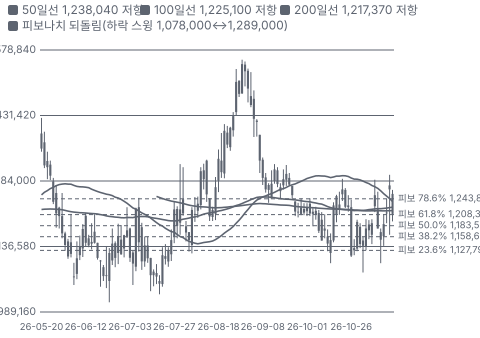

**주봉**

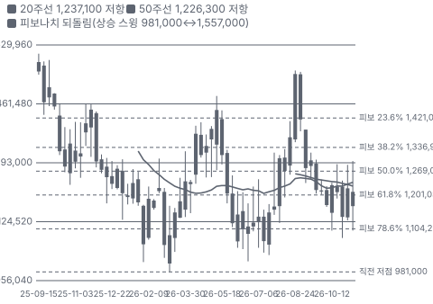

**월봉**

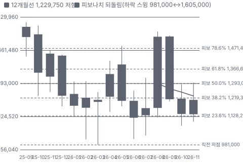

**분기 매출·EPS 실적과 컨센서스**

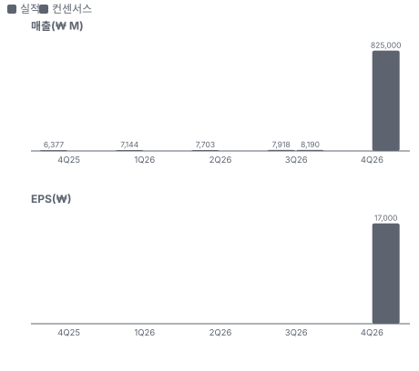

**멀티플 프리미엄(Fwd 1Y P/E 현재값 — 최근 4개 분기 추이 재료 없음(동종 분기말 배수 또는 대상 월말 배수))**

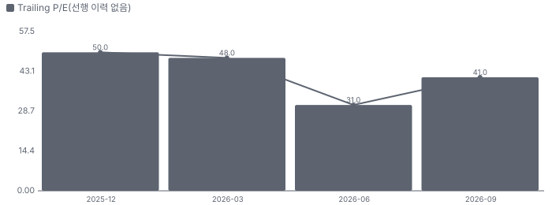

**합리적 멀티플**

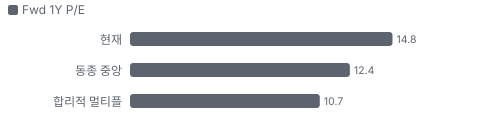

**밸류에이션 주가 시나리오**

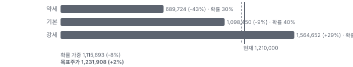

**주가별 업사이드**

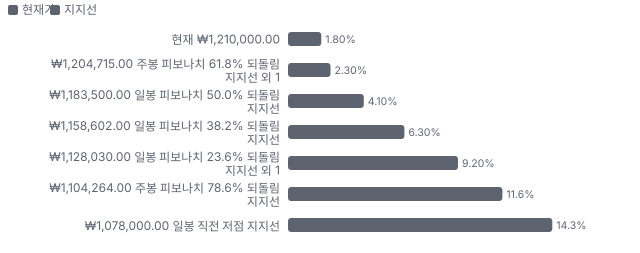
- 제품·서비스 포트폴리오

**고객 믹스(3Q26, 매출 대비)**

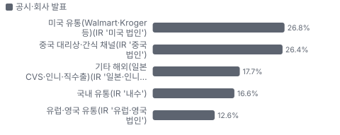

**공급 병목(10점, 낮을수록 병목)**

**생산능력 현재와 확충 계획(억 개/년(라면))**

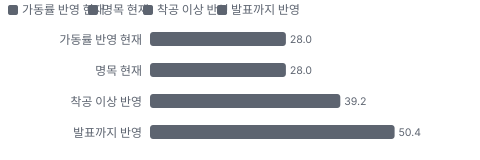

**CAPEX의 매출 대비 비중**

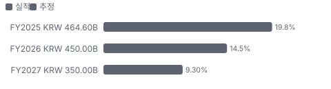

**어닝콜 변화별 주주가치 영향**

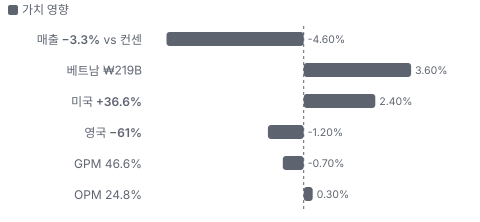

**매출 → 매출총이익 → 영업이익(매출 = 100, 최근 4분기)**

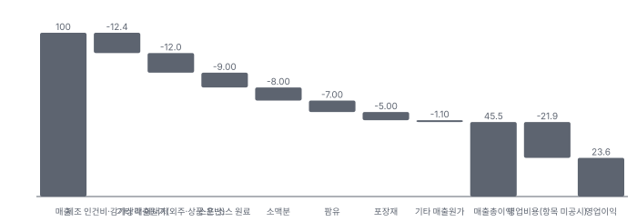

**분기 비용 비중 추이(매출 대비, 공시)**

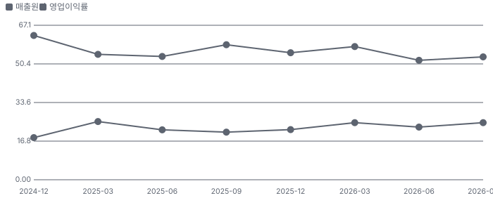

**비용 요인별 매출 대비 비중 1년 변화**

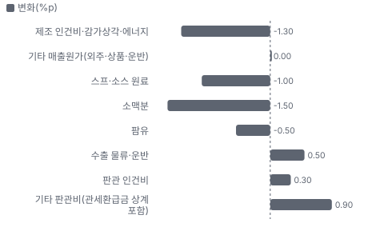

**BOM 항목 가격 +10% 시 OPM 변화**

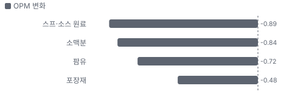

**면스낵(불닭 등) BOM 원가 몫**

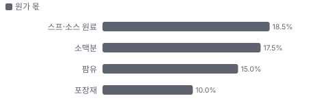

**투입 원가 물가·판매가 물가·회사 가격 — 1년 변화(항목별 최근 달)**

**시설별 생산능력(억 개/년, 큰 순)**

**매출·PPI·수출입 — 최근 8개 분기 같은 축(4Q24 = 100) + 다음 분기 추정**

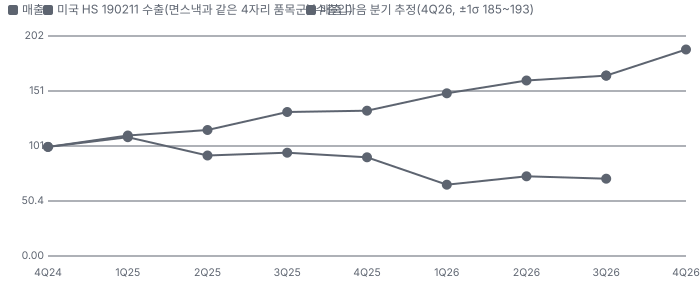

**매출 증가율의 가격·물량 분해와 8분기 전망(전년 대비)**

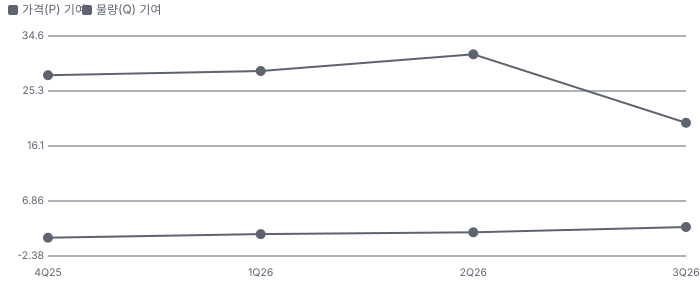

**분기별 매출 증가율 분해**

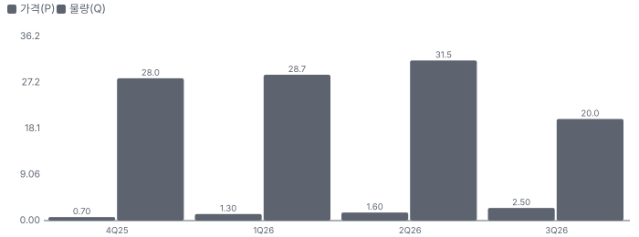

**목표주가 산정 — 기본과 강세 사이(강세 쪽 29%), 도달 확률 약 40%**

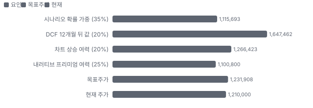

**PEG — 성장 대비 멀티플(낮을수록 성장 대비 쌈)**

**일봉 지지·저항과 목표주가**

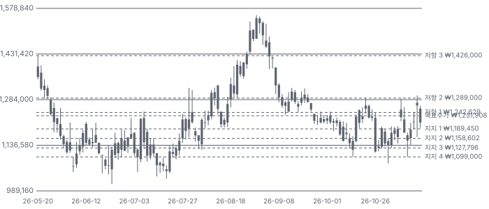

**몬테카를로**

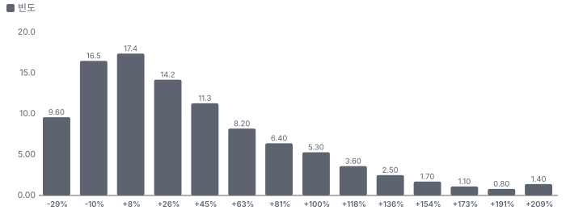

해석: 3,000번 중 2,193번(73%)에서 가치가 지금 주가 이상이었다. 가정을 흔들어도 지금 주가를 뒷받침하는 경우가 더 많다. 가운데 값은 1.25배이고, 열 번 중 여덟 번은 0.81~2.14배 사이에 든다.

## 내러티브

> **기업가치를 결정하는 이야기:** 삼양의 값은 '한 개에 얼마를 남기며 몇 개를 파느냐'다. 해외 비중 83.4%, OPM 24.8%는 해외에서 비싸게 파는 구조에서 나온다. 앞으로 2년의 숫자는 캐파가 아니라 ① 자싱이 한국 물량을 얼마나 빨리 넘겨받고 ② 비는 한국 캐파를 미국·유럽 수요가 얼마나 채우느냐로 정해진다.

> **멀티플·EPS 프리미엄**
> **멀티플:** Fwd 1Y P/E 14.9배로 라면·과자 동종 중앙(약 12.5배, TTM 근사)보다 약 20% 높다. 1년 전보다 배수가 크게 줄었다.
> **EPS:** FY2026 EPS 약 ₩66,000, FY2027 약 ₩86,000(보도 인용에서 역산한 추정).

### 투자자들은 왜 열광했나

2024~25년 불닭(삼양식품 매운맛 브랜드)이 미국 주류 유통에 들어가며 매출이 해마다 30~40% 늘었고 주가는 2025년 9월 ₩1.6M까지 올랐다. 식은 이유는 성장률이 40%대에서 25%대로 내려왔고, 원화 강세와 원가로 GPM이 꺾였으며, 2027년 이전에는 캐파가 늘지 않는다는 점이다.

### 무엇이 기업가치를 바꾸나

> **구조적 체질 변화**
> **변화:** 내수 라면 회사에서 해외 비중 83%의 수출 식품 회사로 바뀌었다.
> **증거:** 해외 비중 3Q25 80.8% → 3Q26 83.4%(IR)
> **반증:** 해외 비중이 80% 아래로 내려간다

> **고부가 믹스 확장**
> **변화:** 단가가 높은 미국·유럽 매출 비중이 오른다.
> **증거:** 미국+유럽·영국 비중 3Q25 32.9% → 3Q26 39.4%(IR)
> **반증:** 미국·유럽 비중이 2분기 연속 내린다

> **기술 혁신**
> **변화:** 해당 없음(라면 제조 기술은 업계 공통이다 — 차별점은 맛·브랜드).

> **실행 속도**
> **변화:** 해당 없음(유통 주문 즉시 출고라 납기를 공시하지 않는다 — 공장 건설 속도로 대신 잰다: 밀양(경남 도시, 삼양 수출 전용 공장 소재지) 2공장 2025-06 준공, 자싱 2025년 발표 뒤 2027년 1월 가동 목표, 베트남 공시 뒤 약 26개월)
> **증거:** 밀양 2공장 2025-06 준공, 자싱 2027-01 목표(보도)
> **반증:** 자싱 상업 생산 지연

> **M&A**
> **변화:** 해당 없음(최근 3년 인수·합병 없음).

> **정책·입법 연관성**
> **재정정책:** 해당 없음(삼양 매출과 연결된 미국 재정 사업이 없다).
> **행정명령:** 미국 상호 관세(행정명령)가 한국산 식품 수입에 붙는다 — 3Q 영업이익에 관세환급금이 비경상 수익으로 들어왔다(IR). 의회 동의는 행정명령이라 해당 없음. https://file.irgo.co.kr/data/BOARD/ATTACH_PDF/AURNVEC556KC6DJZR48SDGA3ZB4VVUBY2026116163446.pdf 반증: 관세율 인상 의회 동의 2/10 — 하원 1/5(관세 입법 논의 없음 — 행정 관세) · 상원 1/5(같다).
> **연관입법:** 해당 없음(매출을 바꾸는 계류 법안을 찾지 못했다).

> **고객의 지출 예산**
> **변화:** 소비자 장바구니(가계 식비)와 유통사의 진열·판촉 예산이다.
> **사업별 예산:** 면스낵(불닭 등) — 고객 OPEX(가계 식비·유통사 상품 구매), 매출의 91%: 해외 진열 확대·매운맛 수요 · 소스·냉동·기타 — 고객 OPEX(가계 식비), 매출의 9%: 브랜드 확장
> **증거:** 미국 Walmart·Kroger 입점(IR)
> **반증:** 미국 가계 식품 지출 둔화

### 내러티브 근거

> 불닭이 한국 라면을 해외 주류 식품으로 바꿨다는 이야기다. 증권사 18명 중 17명이 매수이고 목표가 평균은 ₩1.85M이다. 그런데 주가는 1년 전보다 낮고, 시장은 '캐파가 늘어도 수요가 따라오나'를 묻고 있다. 동종 대비 멀티플 차이 +19% 중 회사 고유 몫은 +39%다. 단계는 컨센서스, 쏠림은 중간이다.

> **불닭 글로벌 주류화** · 유지
> **논리:** 아시아 식품점을 넘어 미국 대형 유통 진열대로 들어갔다
> **숫자:** 미국 법인 3Q ₩212.5B(+36.6%), Walmart·Kroger(IR)
> **반증:** 미국 법인 성장률 2분기 연속 20% 미만
> **출처:** https://file.irgo.co.kr/data/BOARD/ATTACH_PDF/AURNVEC556KC6DJZR48SDGA3ZB4VVUBY2026116163446.pdf

> **캐파 로드맵 51억 개** · 강화
> **논리:** 공장이 두 배 가까이 늘면 매출도 따라 늘어난다
> **숫자:** 자싱 8라인 ₩207.2B·베트남 ₩218.6B(공시). 51억은 채널 전언
> **반증:** 자싱 상업 생산이 2027년 2분기 이후로 밀린다
> **출처:** https://t.me/dykim0210/1346

> **고ASP 지역 재배치** · 유지
> **논리:** 중국향 물량을 자싱으로 넘기고 한국 물량을 미국·유럽으로 돌려 단가가 오른다
> **숫자:** 3Q IR '고ASP 해외 매출 확대'. 재배치 비율 30%는 채널 전언
> **반증:** 2027년 상반기 미국·유럽 법인 합산 성장률이 중국 법인보다 낮다
> **출처:** https://file.irgo.co.kr/data/BOARD/ATTACH_PDF/AURNVEC556KC6DJZR48SDGA3ZB4VVUBY2026116163446.pdf

> **반대: 원화 강세와 원가** · 강화
> **논리:** 수출 회사라 원화가 강해지면 환산 매출과 이익률이 깎인다
> **숫자:** 3Q GPM 48.1 → 46.6%, 순이익 −18.9%(외화 평가손실)
> **반증:** 4Q GPM 47% 이상 회복
> **출처:** https://file.irgo.co.kr/data/BOARD/ATTACH_PDF/AURNVEC556KC6DJZR48SDGA3ZB4VVUBY2026116163446.pdf

> **반대: 이관은 증분이 아니다** · 강화
> **논리:** 자싱 물량 대부분은 한국에서 이미 팔던 중국향을 옮긴 것이다
> **숫자:** 채널 전언: 자싱 11억 개의 약 80%가 이관 물량. 3Q 중국 법인 매출 비중 26.4%(IR)
> **반증:** 2027년 중국 법인 매출 성장률 30% 이상
> **출처:** https://t.me/dykim0210/1346

> **반대: 단일 브랜드 유행** · 유지
> **논리:** 매운맛 챌린지 유행이 식으면 수요가 꺾인다
> **숫자:** 면스낵 90.6%(IR), 불닭 비중 미공시
> **반증:** 해외 매출 증가율 10%대 하락
> **출처:** https://file.irgo.co.kr/data/BOARD/ATTACH_PDF/AURNVEC556KC6DJZR48SDGA3ZB4VVUBY2026116163446.pdf

## 포트폴리오

| 제품·서비스 | 구분 | 무엇 | 쓰는 곳 | 돈 버는 방식 | Mix | Mix 변화(전 분기 대비) |
|---|---|---|---|---|---|---|
| 면스낵(불닭 등) | 제품 | 불닭볶음면(삼양식품의 매운 볶음면 브랜드)을 중심으로 한 유탕면(기름에 튀긴 면)·건면(튀기지 않은 면)·스낵 | 미국·중국·유럽·국내 유통 | 3Q 누적 매출의 90.6% | 91% | 미확인 |
| 소스·조미소재 | 제품 | 불닭 소스 등 병·파우치 소스 | 해외·국내 유통 | 3Q 누적 3.4% | 3% | 미확인 |
| 냉동 | 제품 | 냉동 간편식 | 국내 | 3Q 누적 2.4% | 2% | 미확인 |
| 기타(뉴트리션·용역) | 서비스 | 건강기능식품·용역 | 국내 | 3Q 누적 3.6% | 4% | 미확인 |

**Mix 변화가 가장 큰 쪽은 중국 법인(+2.9%p, 전 분기 대비).** 계절성 판정: 분기 매출 계절 지수 기준 없음 → 직전 분기와 비교.

## 고객

> **3Q26 최대 고객 미국 유통(Walmart·Kroger 등, IR '미국 법인') 27%, 상위 3곳 71%, 집중도 보통.** 공시·회사 발표로 확인한 몫은 매출의 100%이고, 나머지 고객 몫은 추정이거나 미분해다. 고객별 매출은 공시되지 않는다. 회사가 밝히는 것은 판매법인(지역)별 매출이다. 미국은 Walmart·Kroger 같은 주류 유통, 중국은 권역 대리상·간식 채널이 중심이다(3Q26 IR).

**고객별 매출 몫(3Q26)**
| 고객 | 몫 | 변화 | 근거 |
|---|---|---|---|
| 미국 유통(Walmart·Kroger 등, IR '미국 법인') | 27% | +2%p | 공시 |
| 중국 대리상·간식 채널(IR '중국 법인') | 26% | -3%p | 공시 |
| 기타 해외(일본 CVS(편의점)·인니·직수출)(IR '일본·인니·기타') | 18% | -1%p | 공시 |
| 국내 유통(IR '내수') | 17% | -3%p | 공시 |
| 유럽·영국 유통(IR '유럽·영국 법인') | 13% | +4%p | 공시 |

> **미국 유통(Walmart·Kroger 등, IR '미국 법인')** · 공시
> **사는 것:** 불닭 라면·소스
> **추정 근거:** 미국 법인 ₩212.5B ÷ ₩791.8B(3Q25 ₩155.5B ÷ ₩632.0B)

> **중국 대리상·간식 채널(IR '중국 법인')** · 공시
> **사는 것:** 불닭 라면
> **추정 근거:** 중국 법인 ₩208.9B ÷ ₩791.8B

> **기타 해외(일본 CVS·인니·직수출, IR '일본·인니·기타')** · 공시
> **사는 것:** 라면
> **추정 근거:** ₩139.9B

> **국내 유통(IR '내수')** · 공시
> **사는 것:** 라면·소스·냉동
> **추정 근거:** ₩131.1B

> **유럽·영국 유통(IR '유럽·영국 법인')** · 공시
> **사는 것:** 불닭 라면
> **추정 근거:** 유럽 ₩86.9B + 영국 ₩12.6B

## 마진 구조

> **GPM 46.6%, OPM 24.8%.** 3Q25 대비 GPM +5.3%p, OPM +4.1%p. 변동비는 매출의 55%이고, 매출이 10% 늘면 OPM은 +1.8%p 움직인다. 3Q GPM 46.6%로 전분기 48.1%에서 내렸다. 회사는 팜유 등 원재료 투입단가·유가·LNG(액화천연가스) 에너지 비용과 원화 강세를 이유로 들었다. OPM은 관세환급금 같은 비경상 수익과 광고비 통제로 24.8%까지 올랐다. 비용 요인별 몫은 회사가 밝히지 않아 모두 추정이다.

> **매출 100 중 매출원가 54.5, 매출총이익 45.5(최근 4분기, 공시).** 매출원가 요인 중 제조 인건비·감가상각·에너지이 매출의 12.4%로 가장 무겁고, 단가가 +10% 오르면 GPM이 -1.24%p 움직인다.

**비용 요인 강도 — 비중·추세·충격(+10%)·탄력**
| 비용 | 구분 | 매출 대비 | 1년 변화 | 마진 기여 | 충격 시 마진 | 매출 탄력 | 고정비 몫 |
|---|---|---|---|---|---|---|---|
| 제조 인건비·감가상각·에너지 | 매출원가 요인 | 12.4% | -1.3%p | +1.3%p | -1.24%p | 미확인 | 70% |
| 기타 매출원가(외주·상품·운반) | 매출원가 요인 | 12.0% | +0.0%p | -0.0%p | -1.20%p | 미확인 | 20% |
| 스프·소스 원료 | 매출원가 요인 | 9.0% | -1.0%p | +1.0%p | -0.90%p | 미확인 | 0% |
| 소맥분 | 매출원가 요인 | 8.0% | -1.5%p | +1.5%p | -0.80%p | 미확인 | 0% |
| 팜유 | 매출원가 요인 | 7.0% | -0.5%p | +0.5%p | -0.70%p | 미확인 | 0% |
| 포장재 | 매출원가 요인 | 5.0% | -1.0%p | +1.0%p | -0.50%p | 미확인 | 0% |
| 매출원가 | 공시 항목 | 54.5% | -2.8%p | +2.8%p | -5.45%p | 미확인 | 미확인 |

매출 탄력 = 분기 비용을 매출에 회귀한 기울기(매출 1당 변동비), 고정비 몫 = 절편 ÷ 평균 비용. 표본이 8분기 미만이면 미확인. 매출원가 요인 비중은 margin 재료의 추정이 섞여 있고, 공시 매출원가와의 차이는 '기타 매출원가'로 둔다.

**GPM에서 OPM까지(연결(K-IFRS) — 3Q26 IR 분기 손익. 원가 세부 구성은 미공시, 아래는 최근 4개 분기)**
| 기간 | GPM | 연구개발 | 판관비 | 기타 | OPM |
|---|---|---|---|---|---|
| 3Q25 | 41.3% | 0.0% | 20.6% | 0.0% | 20.7% |
| 3Q26 | 46.6% | 0.0% | 21.8% | 0.0% | 24.8% |
| 2025-12 | 44.8% | - | - | - | 21.8% |
| 2026-03 | 42.1% | - | - | - | 24.8% |
| 2026-06 | 48.1% | - | - | - | 22.9% |
| 2026-09 | 46.6% | - | - | - | 24.8% |

**비용을 움직이는 요인**
| 비용 | 요인 |
|---|---|
| 제조 인건비·감가상각·에너지(매출원가) | LNG·전력 단가, 신공장 감가 · 근거 추정 |
| 기타 매출원가(외주·상품·운반, 매출원가) | 해외 법인 상품 원가·환율 · 근거 추정 |
| 스프·소스 원료(매출원가) | 고추·향신료·조미 원료 · 근거 추정 |
| 소맥분(매출원가) | 국제 밀 가격·국내 제분 단가 · 근거 추정 |
| 팜유(매출원가) | 말레이시아·인도네시아 팜유 시세 · 근거 추정 |
| 수출 물류·운반(판관비) | 해상 운임 · 근거 추정 |
| 판관 인건비(판관비) | 해외 법인 인력 · 근거 추정 |
| 기타 판관비(관세환급금 상계 포함, 판관비) | 수수료·관세 · 근거 추정 |
| 포장재(매출원가) | 용기·필름·박스 · 근거 추정 |
| 광고선전·판촉(판관비) | 해외 마케팅 · 근거 추정 |

**면스낵(불닭 등) BOM — 매출의 91%, GPM 47%(추정 — 제품 GPM 미공시, 전사 GPM 46.6%), 항목 가격 +10% 시**
| 항목 | 원가 몫 | 전가 | 제품 GPM | OPM |
|---|---|---|---|---|
| 스프·소스 원료 | 15~22% | 미확인 | -1.0%p | -0.89%p |
| 소맥분 | 15~20% | 미확인 | -0.9%p | -0.84%p |
| 팜유 | 12~18% | 미확인 | -0.8%p | -0.72%p |
| 포장재 | 8~12% | 미확인 | -0.5%p | -0.48%p |
| 미분해 | 39% | - | - | - |

스프·소스 원료 가격이 +10% 오르면 영업이익은 -3.6% 움직인다. 판매가 전가를 모르는 항목은 전가 0%로 계산했다.

**BOM 항목 가격을 움직이는 것**
| 항목 | 요인 |
|---|---|
| 소맥분 | 면의 주원료 · 근거 추정 |
| 팜유 | 유탕면 튀김유 · 근거 추정 |
| 스프·소스 원료 | 불닭 소스가 맛을 가른다 · 근거 추정 |
| 포장재 | 봉지·용기 · 근거 추정 |

**투입 물가 — 미국 PPI 3·6·12개월(2026-10, 개정 반영)**
| 항목 | 미국 3개월 | 6개월 | 12개월 | 전가 못 할 때 OPM |
|---|---|---|---|---|
| 소맥분 | +2.2% | +12.4% | +38.5% | -3.1%p |

별표는 품목보다 넓은 업종 지수다. 연결한 투입 원가의 미국 PPI(생산자물가지수)는 1년 새 가중 +38.5%이고, 판매가로 넘기지 못하면 GPM -3.1%p·OPM -3.1%p가 움직인다. 물가 지수를 붙이지 못한 매출원가 항목은 팜유, 스프·소스 원료, 포장재, 제조 인건비·감가상각·에너지다(미연결).

## 공급망 병목

> **공급망 신뢰성 8.6/10, 병목 낮음.** 가장 약한 고리는 팜유 8.6점이고, 품목 평균은 8.6점이다. 근거가 부족한 3건(생산 캐파(자기) · 소맥분 · 포장재)은 점수에서 뺐다. 병목은 원재료가 아니라 자기 캐파다. 소맥분·팜유·포장재는 공급사가 많은 범용 원료라 물량보다 가격이 문제다. 2028년까지는 자싱과 초과 생산으로, 그 뒤는 베트남으로 막는 구조라는 것이 채널 전언이고 회사 공시로 확인되는 것은 공장 일정뿐이다.

**병목과 마진 — 품목 가격 +10% 시 OPM**
| 품목 | 점수 | 판정 | 구분 | OPM |
|---|---|---|---|---|
| 팜유(필수) | 8.6 | 병목 낮음 | 가격 위험 | -0.72%p |

> **팜유** · 8.6/10
> **왜:** 유탕면 원가
> **병목 요인:** 인증 공급사 미확인 · 캐파 여유 · 리드타임 6주(평시 6주) · 재인증 미확인 · 1위 점유율 58% · 동남아 집중 85% · 물량 확보 미확인
> **풀리는 조건:** 미확인

**공급사**
| 품목 | 공급사 | 몫 | 근거 |
|---|---|---|---|
| 생산 캐파(자기) | 삼양식품 원주(강원 도시, 삼양 본 공장)·익산(전북 도시, 삼양 공장)·밀양·자싱(예정, 자가 생산) | 미확인 | 회사 발표 |
| 소맥분 | 국내 제분사(미공시, 밀가루) | 미확인 | 추정 |
| 팜유 | 말레이시아·인도네시아 공급사(미공시, 튀김유) | 미확인 | 추정 |
| 포장재 | 미공시(필름·용기) | 미확인 | 추정 |

## 생산능력

> **현재 명목 캐파 28 억 개/년(라면), 가동률 100%.** 착공 이상 증설은 11 억 개/년(라면), 발표까지 합치면 22 억 개/년(라면)이다. 다 가동하면 지금보다 +80%, 착공 이상만이면 +40%다. FY2025 CAPEX는 KRW 464.60B로 매출의 19.8%다. 회사는 공장별 생산능력을 IR에서 숫자로 내지 않는다. 보도 기준 국내는 밀양 2공장 풀가동 때 연 약 28억 개(유안타는 2026년 약 25억 식으로 본다). 자싱(8라인)은 착공해 2027년 1월 완공 목표, 베트남(8라인 수용, 첫 1라인 건면)은 2029-01-31 준공 예정이다. 채널 Q&A의 '현재 29억 + 자싱 11억 + 베트남 11억 = 51억'은 회사 숫자로 확인되지 않는다.

**생산시설 6곳**(3Q26 IR 회사 개요 '생산기지 원주·익산·밀양·중국(증설 중)' + 밀양 1·2공장 구분 + 베트남 공시), 소유 6곳. 시설별 생산능력은 2곳만 공개됐다.

**생산시설 6곳 — 명칭·위치·생산능력**
| 시설 | 위치 | 용도 | 생산능력 | 소유·상태 |
|---|---|---|---|---|
| 원주 공장 | 강원 원주 | 라면·스낵 제조(국내 주력) | 미확인 — 공장별 캐파 미공시 | 소유 · 가동 |
| 익산 공장 | 전북 익산 | 라면 제조 | 미확인 — 공장별 캐파 미공시 | 소유 · 가동 |
| 밀양 1공장 | 경남 밀양 | 수출용 불닭 제조(2022년 준공) | 6 억 개/년 | 소유 · 가동 |
| 밀양 2공장 | 경남 밀양 | 수출용 불닭 제조(2025-06 준공, 6라인) | 8 억 개/년 | 소유 · 가동 |
| 중국 자싱 공장 | 중국 저장성 자싱 | 중국 내수용 라면 제조(8라인) | 미확인 — 회사 첫 발표 6라인 8.4억 개 → 8라인 상향 뒤 수치 미공시(증권사 11.2~11.3억) | 소유 · 건설 중 |
| 베트남 공장 | 베트남 박닌성 투언타잉(베트남 박닌성 지역, 신공장 예정지) | 유럽·아세안 수출용(초기 건면 1라인, 최대 8라인) | 미확인 — 공시는 투자액·라인 수·준공일만(증권사 10~11.2억) | 소유 · 계획 |

**생산능력 확충 계획**
| 계획 | 단계 | 증설 | 가동 시점 | CAPEX |
|---|---|---|---|---|
| 중국 자싱 공장(8라인) | 착공 | 11 억 개/년(라면) | 2027-01 | KRW 207.20B |
| 베트남 투언타잉 공장(최대 8라인) | 발표 | 11 억 개/년(라면) | 2029-01 | KRW 218.60B |

남은 계획의 CAPEX 합계는 KRW 425.80B다. 금액을 아는 계획의 단위당 CAPEX는 KRW 19.01B/억 개/년(라면)이다. 합계는 FY2027 매출의 11%다.

**증설 방해 요인**
| 계획 | 방해 요인 |
|---|---|
| 중국 자싱 공장(8라인) | 램프 속도(채널 전언 '3분기 안 램프업'), 중국 내 판매 채널 흡수, 한국 물량 이관 속도 |
| 베트남 투언타잉 공장(최대 8라인) | 현지 인허가·등록, 첫 라인은 건면 1개 — 8라인 전부 들어설 시점 미공시 |

**CAPEX와 매출 대비**
| 기간 | CAPEX | 매출 | 매출 대비 | 구분 |
|---|---|---|---|---|
| FY2025 | KRW 464.60B | KRW 2,351.80B | 19.8% | 실적 |
| FY2026 | KRW 450.00B | KRW 3,101.50B | 14.5% | 추정 |
| FY2027 | KRW 350.00B | KRW 3,768.00B | 9.3% | 추정 |

## 해자

> 해자는 '불닭'이라는 해외에서 통하는 단일 브랜드와 그 브랜드로 얻은 대형 유통 진열대다. 3Q GPM 46.6%·OPM 24.8%는 라면 동종(OPM 6~17%)보다 훨씬 높다. 다만 이 숫자는 한 브랜드·매운맛 한 카테고리에 기대고, 생산 기술 자체는 경쟁사가 따라 할 수 있다.

> **해외 브랜드 가격 프리미엄** · 강함
> **해자:** 해외에서 국내보다 비싸게 팔리는데도 물량이 늘고 있다.
> **근거:** 3Q26 IR — 고ASP 해외 매출 확대로 OPM 24.8%, 해외 비중 83.4%. 3Q 누적 한국 라면 수출의 약 66%가 삼양(IR)
> **숫자:** OPM 24.8% vs 농심 5.8%·오리온 16.9%(TTM)
> **깨지는 조건:** 해외 판촉비 비중이 오르는데 해외 매출 성장이 10%대로 꺾인다

> **미국 주류 유통 진입** · 보통
> **해자:** 아시아 식품점에서 Walmart·Kroger 같은 주류 채널로 옮겨 갔다.
> **근거:** 3Q26 IR 미국 법인 'Walmart·Kroger 등 Mainstream(미국 대형 주류 유통 채널)과 Mexico 매출 성장', 미국 법인 ₩212.5B(+36.6%)
> **숫자:** 미국 법인 4개 분기 ₩776.6B
> **깨지는 조건:** 미국 대형 유통의 진열 축소·자체 브랜드 매운 볶음면 출시

> **선제 캐파** · 보통
> **해자:** 수요보다 먼저 공장을 지어 품절 기간을 줄인다.
> **근거:** 밀양 2공장 2025-06 준공, 자싱 8라인(₩207.2B), 베트남 ₩218.6B 공시
> **숫자:** '25~27년 주요 CAPEX ₩742.6B(IR)
> **깨지는 조건:** 새 공장 가동률이 낮아 감가상각이 이익률을 깎는다

> **제품 다변화** · 약함
> **해자:** 불닭 외 브랜드로 매출을 넓힌다.
> **근거:** 3Q 누적 면스낵 90.6%·소스·조미 3.4%·냉동 2.4%(IR). 불닭 단일 브랜드 비중은 미공시
> **숫자:** 면스낵 90.6%
> **깨지는 조건:** 해당 없음 — 불닭 비중 공시 시 다시 판정

## 경영진·네트워크

> 오너 가족 경영 회사다. 김정수 부회장이 불닭 개발과 해외 확장을 이끌었다는 것은 공개 보도로 확인되지만, 개인 연결이 만든 매출은 입증되지 않는다.

> **김정수** · 대표이사 부회장(3Q26 IR 대표이사) · 미확인
> **프로필:** 창업주 가문 며느리, 불닭볶음면 개발을 주도했다고 공개 보도됨
> **비즈니스:** 지주회사 삼양라운드스퀘어 쪽 오너 일가(3Q26 IR 최대주주·특수관계인 45.0%)
> **정계:** 미확인
> **동문:** 미확인
> **사모임:** 미확인

> **김동찬** · 대표이사(3Q26 IR) · 미확인
> **프로필:** 미확인
> **비즈니스:** 미확인
> **정계:** 미확인
> **동문:** 미확인
> **사모임:** 미확인

**네트워크 정량화**
| 연결 | 강도 | 닿는 매출 | 가중 노출 | 매출 대비 | 근거 |
|---|---|---|---|---|---|
| 비즈니스: 미국 대형 유통(Walmart·Kroger) 입점 | 2/5 | ₩776.60B | ₩310.64B | 11% | 미국 법인 4개 분기 매출(IR). 유통 계약이지 인맥이 아니다 https://file.irgo.co.kr/data/BOARD/ATTACH_PDF/AURNVEC556KC6DJZR48SDGA3ZB4VVUBY2026116163446.pdf |

가중 노출은 연결이 닿는 매출의 크기다. 연결이 그 매출을 만들었다는 뜻이 아니며, 인과는 공개 자료로 입증하지 못한다.

## 약세 논리 및 셀온 조건

| 약세 논리 | 근거 | 가를 자료 |
|---|---|---|
| 늘어나는 캐파는 대부분 이관이다 | 채널 전언으로는 자싱 11억 개의 약 80%를 한국에서 팔던 중국향 물량이 채운다. 3Q 중국 법인 매출 비중 26.4%(IR)와 크게 어긋나지 않는다. 그러면 2027년 순증분은 한국에서 비는 약 8억 개를 누가 사느냐에 달렸다 | 1Q27 IR 법인별 매출(중국 vs 미국·유럽) |
| 이익률 정점 | GPM 48.1 → 46.6%(팜유·에너지·원화). 3Q OPM 회복에는 관세환급금 등 비경상 수익이 섞였다(IR, 금액 미공시) | 4Q26 GPM·OPM(2월 예상) |
| 매출이 컨센서스를 밑돈다 | 3Q 매출 ₩791.8B로 컨센서스 ₩819.0B보다 3.3% 낮다. 영국 −61%는 거래선 교체로 인한 이연이라고 회사가 밝혔지만 회복 시점은 없다 | 4Q 영국·유럽 법인 매출 |
| 단일 브랜드 | 면스낵이 매출의 90.6%이고 불닭 비중은 공시되지 않는다. 매운맛 유행이 식으면 신공장 두 곳의 고정비가 남는다 | 해외 매출 증가율 추세(2분기 연속 15% 미만이면 경고) |
| 신공장 램프 비용 | 자싱 첫 해 감가상각·인력·현지 판촉이 이익률을 깎는다. 채널 전언 '3분기 안 램프업'은 회사 공시가 아니다 | 자싱 상업 생산 공시·보도(2027-01) |
| 자료 한계 | 회사는 연간 가이던스·공장별 캐파·가동률·불닭 비중을 내지 않는다. FY2027·28 EPS는 보도 인용에서 역산한 추정이고, DART(금융감독원 전자공시) 분기보고서 원문과 IFRS(국제회계기준) 자산 주석은 열람하지 못했다(자산 구성 절 빠짐) | DART 사업보고서 '생산능력·가동률' 표(2027-03) |

**채널 Q&A 숫자 대조**(공개 텔레그램 채널 '꿈을 담은 단지' 11/14 글 — IR 질의응답 정리로 올라왔지만 작성 경위·발언자는 확인되지 않았다. 커뮤니티 신호이지 회사 발표가 아니다).

| 채널 전언 | 회사 자료·보도 | 판정 |
|---|---|---|
| 베트남 8개 라인 | 공시 보도 — 최대 8개 라인 수용 규모, 첫 1라인은 건면 | 회사 확인(단 8라인은 최종 규모) |
| 베트남 2029년 초 준공 | 공시 — 설립 일정 종료일 2029-01-31 | 회사 확인 |
| 자싱 1월 상업 생산 | 보도 — 2027년 1월 완공 목표 | 회사 확인(11월 시생산·12월 준공식 날짜는 미확인) |
| 고ASP 지역 매출 확대·환율 변수 | 3Q IR — 고ASP 해외 매출 확대로 수익성 개선, 원화 강세가 원가 부담 | 회사 확인 |
| 현재 캐파 약 29억 개 | 회사 수치 없음. 보도 28억 개(밀양 2공장 풀가동 시), 유안타 약 25억 식 | 미확인(채널 전언) |
| 자싱 약 11억 개 | 회사 첫 발표는 6라인·불닭 연 8.4억 개, 이후 8라인·₩207.2B로 상향(수치 미공시). 증권사 11.2~11.3억 | 미확인(증권사 추정과 같은 값) |
| 베트남 약 11억 개 | 공시는 투자액·라인 수뿐. 한화 11.2억, 유안타 10~11억 | 미확인(채널 전언) |
| 합계 약 51억 개 | 유안타 경로는 최대 약 49억 식 | 미확인(채널 전언) |
| 자싱 = 현 캐파 대비 약 40% | 28억 기준이면 11.2억은 +40% | 미확인(산술은 맞다) |
| 한국 생산의 약 30%가 중국향 | 3Q 중국 법인 매출 비중 26.4%(IR) — 물량 기준은 미공시 | 미확인(매출 비중과 근사) |
| 이관이 자싱의 약 80%를 채움, 중국 실질 증분 약 10%, 30% 미국·유럽 재배치 | 회사 공시 없음 | 미확인(채널 전언) |
| 자싱 3분기 내 램프업 | 회사 공시 없음 | 미확인(채널 전언) |
| 자싱 최대 14억 개(3교대·특근) | 현지 채용 공고 언급이라는 전언, 원문 확인 못함 | 미확인(채널 전언) |
| 2028년까지 자싱+초과 생산으로 대응, 2029년부터 부족 | 한화 '2029년 이후 공급 부족 대응' 해석(보도) — 회사 발언은 확인 못함 | 미확인(채널 전언) |

14개 항목 중 회사 확인 4개, 회사 자료와 다름 0개, 미확인 10개다. 판단에는 회사 확인 4개와 공시 투자액만 쓰고, 나머지는 반증 조건을 붙인 가설로 둔다.

> **셀온 조건**
> **조건 1:** 자싱 상업 생산이 2027년 2분기 이후로 밀린다는 회사 발표·보도가 나온다.
> **조건 2:** 1Q27 미국·유럽(영국 포함) 법인 합산 매출 증가율이 20% 아래로 내려간다.
> **조건 3:** 4Q26·1Q27 GPM이 두 분기 연속 45% 아래다.
> **조건 4:** 주도주 생애 단계가 '사'(고점 대비 −30% 초과, 10주선 < 40주선) — 현재 해당. 재진입 조건은 재반등 시작부터 KOSPI 200 모멘텀 상위권 복귀다.

## 어닝콜 변화

**직전 콜 대비 새로 나오거나 바뀐 내용 → 가치 영향**
| 항목 | 내용 | 직전 콜 | 최신 콜 | 모델 동인 이동 | 확신도 | 가치 영향 |
|---|---|---|---|---|---|---|
| 업데이트 | 영업이익률 회복 | 22.9%(2Q26) | 24.8%(3Q26, 관세환급금 포함) | 출발 이익률 +1.0% | 1.0 | +0.3% |
| 부정 | 매출 컨센서스 하회 | 컨센서스 ₩819.0B | ₩791.8B | 1년차 성장률 -2.0% | 1.0 | -4.6% |
| 부정 | 매출총이익률 하락 | 48.1%(2Q26) | 46.6%(3Q26) | 목표 이익률 -0.50% | 1.0 | -0.7% |
| 신규 | 베트남 생산법인 투자 | 2029년 이후 캐파 계획 없음 | ₩218.6B, 8라인 수용, 2029-01 준공 | 장기 성장 수렴값 +1.0% | 0.8 | +3.6% |
| 업데이트 | 미국 법인 고성장 | ₩203.6B(2Q26) | ₩212.5B(3Q26) | 1년차 성장률 +1.0% | 1.0 | +2.4% |
| 부정 | 영국 법인 거래선 교체 | ₩32.6B(2Q26) | ₩12.6B(3Q26) | 1년차 성장률 -0.50% | 1.0 | -1.2% |
| **합계** | 단독 합 |  |  | 동시 적용 -0.4% |  | **-0.3%** |

**실적 발표 예상 변동폭:** 지난 2번 실적 발표 때 주가는 하루에 평균 ±4.9%(최대 5.6%, 오른 날 1번) 움직였다.

**실적 발표 예상 변동폭 — 과거 실적 발표 다음 거래일 주가 변화**
| 분기 | 발표일 | 주가 변화 |
|---|---|---|
| 2Q26 | 2026-08-13 | +4.2% |
| 3Q26 | 2026-11-06 | -5.6% |

## 거시 지표 싱크로율

> **미국 HS(국제 품목 분류 코드) 190211 수출(면스낵과 같은 4자리 품목군)와 전사 매출 싱크로율 90%(2분기 = 약 6개월 선행, 전 분기 대비, 표본 7개·t 4.5·유의·신뢰 참고용).** 이 지표가 내포하는 4Q26 전사 매출은 906.46B(±1σ 887.28B~925.63B, 확정)다.  미국 법인 매출은 미국의 즉석면 수입과, 판매 단가는 미국 면류 제조 PPI와 같이 움직여야 한다

**지표별 싱크로율(상관계수 × 100) — 위 두 줄이 제품 연관성 × 싱크로율로 고른 PPI·수출입 세부 지표**
| 지표 | 비교 대상 | 증가율 기준 | 지표 선행 | 매출(t값) | 영업이익 | 방향 일치 | 표본·신뢰 | 표본 밖 오차(지표/기준선) | 4Q26 추정 매출 |
|---|---|---|---|---|---|---|---|---|---|
| 미국 HS 190211 수출(면스낵과 같은 4자리 품목군) | 전사 매출 | 전 분기 대비 | 2분기(6개월) | 90%(t 4.5) | 77%(4분기) | 29% | 7·참고용 | 미확인 | +14.5% → 906.46B(확정) |
| 미국 즉석면 수입(HS 190230) | 전사 매출 | 전 분기 대비 | 2분기(6개월) | -49%(t -1.3) | 85%(3분기) | 43% | 7·참고용 | 미확인 | -1.8% → 777.89B(확정) |
| 미국 면류 제조 PPI | 전사 매출 | 전 분기 대비 | 0분기(0개월) | -42%(t -1.0) | -63%(0분기) | 86% | 7·참고용 | 미확인 | +5.2% → 833.13B(나우캐스트 1개월 · 지표 범위 밖 → 범위 끝으로 제한) |

**지표 후보 11개 — 연관성(제품 품목 일치 × 대용 감점 × 매출 비중) × 싱크로율로 고른다. 후보가 많을수록 최대 상관은 우연히 부풀 수 있다**
| 후보 | 종류 | 연관성 | 매출 분기 일치 | 싱크로율(선행) | 점수 | 출처 |
|---|---|---|---|---|---|---|
| 미국 HS 190211 수출(면스낵과 같은 4자리 품목군) ✔ | 수출입 | 0.70 | 100% | 90%(2분기) | 0.63 | 자동 |
| 미국 즉석면·기타 면류 수출(HS 190230) | 수출입 | 1.00 | 100% | 64%(2분기) | 0.51 | 자동 |
| 미국 HS 190219 수입(면스낵과 같은 4자리 품목군) | 수출입 | 0.70 | 100% | 63%(3분기) | 0.35 | 자동 |
| 미국 HS 190220 수입(면스낵과 같은 4자리 품목군) | 수출입 | 0.70 | 100% | 59%(2분기) | 0.33 | 자동 |
| 미국 즉석면 수입(HS 190230) | 수출입 | 1.00 | 100% | -49%(2분기) | 0.00 | 모델 지정 |
| 미국 면류 제조 PPI | PPI | 1.00 | 100% | -42%(0분기) | 0.00 | 모델 지정 |
| 미국 HS 190219 수출(면스낵과 같은 4자리 품목군) | 수출입 | 0.70 | 100% | -58%(4분기) | 0.00 | 자동 |
| 미국 HS 190220 수출(면스낵과 같은 4자리 품목군) | 수출입 | 0.70 | 100% | -47%(0분기) | 0.00 | 자동 |
| 미국 HS 190240 수출(면스낵과 같은 4자리 품목군) | 수출입 | 0.70 | 100% | -82%(4분기) | 0.00 | 자동 |
| 미국 HS 190211 수입(면스낵과 같은 4자리 품목군) | 수출입 | 0.70 | 100% | -52%(4분기) | 0.00 | 자동 |
| 미국 HS 190240 수입(면스낵과 같은 4자리 품목군) | 수출입 | 0.70 | 100% | -86%(3분기) | 0.00 | 자동 |

**선행 지표로 본 향후 분기 매출 전망(이미 나온 지표 값 기준, ±1σ)**
| 지표 | 대상 | 분기 | 지표 증가율 | 내포 매출 증가율 | 내포 매출 |
|---|---|---|---|---|---|
| 미국 즉석면 수입(HS 190230) | 전사 매출 | 4Q26 | +33.2% | -1.8% | 777.89B(740.23B~815.55B) |
| 미국 즉석면·기타 면류 수출(HS 190230) | 전사 매출 | 4Q26 | +10.9% | +9.8% | 869.29B(835.84B~902.74B) |
| 미국 HS 190211 수출(면스낵과 같은 4자리 품목군) | 전사 매출 | 4Q26 | +11.8% | +14.5% | 906.46B(887.28B~925.63B) |
| 미국 HS 190219 수출(면스낵과 같은 4자리 품목군) | 전사 매출 | 4Q26 | +21.2% | +1.3% | 802.39B(767.16B~837.62B) |
| 미국 HS 190240 수출(면스낵과 같은 4자리 품목군) | 전사 매출 | 4Q26 | +56.0% | -0.9% | 785.00B(759.95B~810.05B) |
| 미국 HS 190211 수입(면스낵과 같은 4자리 품목군) | 전사 매출 | 4Q26 | +5.0% | +6.6% | 843.97B(806.88B~881.06B) |
| 미국 HS 190219 수입(면스낵과 같은 4자리 품목군) | 전사 매출 | 4Q26 | -9.0% | +3.1% | 816.16B(782.52B~849.80B) |
| 미국 HS 190220 수입(면스낵과 같은 4자리 품목군) | 전사 매출 | 4Q26 | +7.2% | +9.4% | 866.32B(831.30B~901.33B) |
| 미국 HS 190240 수입(면스낵과 같은 4자리 품목군) | 전사 매출 | 4Q26 | -1.8% | +7.4% | 850.39B(828.26B~872.51B) |

지표가 k분기 앞서면 이미 발표된 지표로 k분기 뒤까지의 매출 증가율을 회귀식으로 읽는다. 표본이 작거나 t값이 2 미만이면 전망은 참고용이다.

**지표를 고른 이유**
| 지표 | 이유 |
|---|---|
| 미국 HS 190211 수출(면스낵과 같은 4자리 품목군) | 면스낵 품목 같은 4자리 |
| 미국 즉석면 수입(HS 190230) | 불닭 대미 수출이 들어가는 품목(한국 외 원산지 포함) |
| 미국 면류 제조 PPI | 미국 판매가 비교 지수(업종 대용) |

다음 분기 추정 = 지표 회귀와 기준선(직전 증가율 지속)을 표본 밖 오차의 역제곱으로 가중 결합한 값이다(예측 결합). 지표가 회귀에 쓴 범위를 벗어나면 범위 끝으로 자르고(외삽 제한), 세그먼트 추정은 나머지 사업을 기준선으로 더해 전사로 바꾼다. 싱크로율은 증가율의 상관계수이며 인과가 아니다. 지표 단위·통화는 원자료 그대로이고 나라끼리 더하지 않는다(EU(유럽연합) 수입만 상대국 합계). ±1σ는 회귀 잔차 표준편차이고, 지표를 예측한 분기는 지표 예측 오차까지 더해 넓혔다.

## P·Q 사이클

> **Q 사이클 — 최근 4분기 평균 가격 기여 +1.5%, 물량 기여 +27.1%(전년 대비 로그 증가율).** P 강도 5.0/10, Q 강도 5.0/10, 최근 8분기 중 100%가 같은 요인 우세(구조적). 회사는 물량·ASP를 공시하지 않는다. 지역 믹스(고ASP 해외)가 가격 몫을 만든다는 회사 설명뿐이라 미국 면류 PPI를 업종 대용으로 쓴다

**P·Q 사이클 정량**
| 항목 | 가격(P) | 물량(Q) |
|---|---|---|
| 최근 4분기 평균 기여 | +1.5% | +27.1% |
| 강도(0~10, 자기 이력 z) | 5.0 | 5.0 |
| 고유 주기(자기회귀모델 과거 2개 시점일 때) | 미확인 | 미확인 |
| 다음 4분기 투영 평균 | 미확인 | 미확인 |

가격 근거: 제품 PPI. PPI를 쓰면 회사 판매가가 아니라 업종 가격 대용이다. 로그 증가율이라 가격·물량 기여의 합이 매출 증가율이다. 전망: 가격은 BIC(모형 차수를 고르는 정보 기준)로 차수를 고른 자기회귀모델에 이미 발표된 월간 가격을 먼저 넣고(나우캐스트), 물량은 자기회귀모델과 '컨센서스 매출 증가율 − 가격 전망'을 분산 역수로 섞는다. 장기 평균은 표본 평균을 장기 기저율(가격 연 2%·물량 연 4%) 쪽으로 줄인다 — 고성장 구간만 담긴 표본이 그 성장을 끝없이 잇지 않게. 범위는 4분기 겹친 표본의 자기상관을 반영한다. 모형 산출이며 가이던스가 아니다.

10년 위치·프리미엄: TTM 표본 5개로 20개에 못 미친다 — quarters.js로 분기 44개를 다시 받으면 나온다.

## 밸류에이션

> **목표주가 ₩1,231,908, 업사이드 +2%.** 자리는 기본과 강세 사이(강세 쪽 29%)이고 도달 확률은 약 40%다. 기본 ₩1,098,450, 강세 ₩1,564,652(+29%), 약세 ₩689,724(-43%). DCF 기준 업사이드는 기본 +26%, 강세 +88%, 약세 -8%다(WACC 8.2%).

세 EPS는 보도된 증권사 추정(KB 목표가 ÷ 23배, 현대차 영업이익)에서 역산한 추정이다. 확률은 다음 해 매출 성장 분포에서 계산한 값이다. DCF는 2028년 이후 자싱·베트남이 차는 경로를 담고, P/E 경로는 2027년 한 해만 본다. 두 값이 다르면 그 차이는 '2028년 이후 캐파가 팔리느냐'에 대한 가정 차이다.

시나리오 확률: 다음 해 매출 성장 분포로 계산 — 약세 +18.0% 아래·강세 +25.2% 위 확률. 내부 관점(컨센서스 +21.5%, σ 6.3%: 범위 14.5% ÷ d2(18) × 1.5) 100% — 외부 관점 꺼짐(SEC 전 상장사 표본 없음)

> **약세 ₩689,724 (-43%)** · 확률 30%
> **가정:** 9.6배 × EPS ₩72000.00
> **근거:** 자싱 램프가 2027년 하반기로 밀리고, 비는 한국 캐파를 채울 미국·유럽 수요가 늦다. 원화 강세로 GPM이 45% 아래

> **기본 ₩1,098,450 (-9%)** · 확률 40%
> **가정:** 12.8배 × EPS ₩86000.00
> **근거:** FY2027 매출 약 ₩3.77T·영업이익 약 ₩873B(컨센서스). 자싱은 3분기 안에 램프하고 이관분이 먼저 찬다

> **강세 ₩1,564,652 (+29%)** · 확률 30%
> **가정:** 16.0배 × EPS ₩98000.00
> **근거:** 자싱이 특근 포함 캐파까지 돌고(채널 전언 최대 14억 개), 한국 물량이 미국·유럽 고단가 지역으로 재배치돼 OPM이 25%를 유지한다

**멀티플 선정 — Fwd 1Y P/E**
| 단계 | 조정 | 근거 |
|---|---|---|
| 동종 중앙값 | 12.4배 | 범위 9.6~18.0배, 4곳 · 이상치 제외 농심 ev_sales 0.3 |
| 펀더멘털 | -7% | 성장·이익률·ROIC로 본 합리적 멀티플 10.7배와의 차이의 일부만 인정(로그 차이 × 0.5, 상한 ±20%에 부드럽게 수렴) |
| 해자 | +0% | 해외 브랜드 가격 프리미엄 강함 · 미국 주류 유통 진입 보통 · 선제 캐파 보통 · 제품 다변화 약함 — 점수 5.5%에서 동종 기준 5.5%를 뺌 |
| 반복 매출 | +0% | 재료 없음 |
| 수주 전환·가시성 | +0% | 가시성 재료 없음 |
| 내러티브 | +0% | 단계 컨센서스 |
| 사이클·실행 판단 | +10% | 동종(농심·오리온·닛신·도요스이산)은 매출 성장 6~11%의 성숙 회사다. 삼양은 TTM 매출 +33%에 캐파가 2027년 약 +40% 늘지만, 성장의 중심이 중국 이관과 해외 판촉이라 성장률 차이를 그대로 배수로 주지 않는다 |
| **선정** | **12.8배** | 지금 14.8배 |

**동종 레인지**
| 회사 | Fwd 1Y P/E | 성장 | 영업이익률 | ROIC |
|---|---|---|---|---|
| 농심 | 11.9 | 6% | 6% | 9% |
| 오리온 | 9.6 | 8% | 17% | 16% |
| Nissin Foods | 18.0 | 5% | 6% | 6% |
| Toyo Suisan | 13.0 | 5% | 17% | 22% |
| **삼양식품** | 14.8 |  |  |  |

> **PEG 0.81** — Fwd 1Y P/E 14.8배를 다음 해 EPS 성장 18%로 나눈 값. 성장률은 Fwd 1Y·2Y P/E에서 역산한 컨센서스라 다음 해 한 해 성장만 반영하고, 성장 지속 기간은 담지 않는다.

**PEG — Fwd 1Y P/E ÷ 다음 해 EPS 성장률**
| 회사 | Fwd 1Y P/E | 다음 해 EPS 성장 | PEG |
|---|---|---|---|
| **삼양식품** | 14.8 | +18% | 0.81 |
| 농심 | 11.9 | - | - |
| 오리온 | 9.6 | - | - |
| Nissin Foods | 18.0 | - | - |
| Toyo Suisan | 13.0 | - | - |

지금 주가가 요구하는 5년 매출 CAGR 8%, 기본 시나리오 14%. 몬테카를로 중앙값 업사이드 +25%.

> 의사결정 보조(투자자문 아님): ① 매수 매력: 5년 보유 가정 연 기대수익 +15.0% — 주주가 요구하는 수익률(자기자본비용) 8.2%보다 +6.8%p · 요구수익률을 넘을 확률 70% · 안전마진 없음(비관적 경우(하위 10%) 가치가 시총의 81%) → 정량 신호 강함 / ② 위험 예산 지표(이론): 켈리 기준(수익·손실 확률로 계산한 이론상 최대 노출)의 1/4만 반영 10.0% (상한 10%) · 5년 뒤 나쁜 경우(하위 10%) +18% · 30% 넘게 잃을 확률 0% / ③ 상방(5년): 평균 2.01배 · 2배 이상 확률 41% · 3배 이상 12% · 10배 이상 0% · 잘 풀린 경우(상위 10%) 3.12배 이상

투입 물가 점검: 지난 1년 PPI를 BOM에 넣으면 OPM -3.24%p다(매출원가의 16% 기준).

## 매수 위치(일봉)

> **현재가 ₩1,210,000는 '지지 근접'(가장 가까운 일봉 지지 ₩1,189,450에서 ATR 0.3배 위).** 이 자리에서 목표주가까지 +1.8%, 첫 일봉 저항까지 +2.7%, 다음 지지까지 하방 -1.7%, 손익비 1.1배. 손익비는 지지 3 ₩1,127,796에서 3.6배로 가장 높다(목표주가까지 +9.2%).

**가격대별 업사이드(일봉 기준)**
| 가격대 | 가격 | 목표주가까지 | 첫 저항까지 | 다음 지지까지 | 손익비 | 근거 기법(강도) |
|---|---|---|---|---|---|---|
| 현재가 | ₩1,210,000 | +1.8% | +2.7% | -1.7% | 1.1 | - |
| 지지 1 | ₩1,189,450 | +3.6% | +4.5% | -2.6% | 1.4 | 20일선 · 피보 50.0%(1.5) |
| 지지 2 | ₩1,158,602 | +6.3% | +2.7% | -2.7% | 2.4 | 피보 38.2%(1.0) |
| 지지 3 | ₩1,127,796 | +9.2% | +2.7% | -2.6% | 3.6 | 피보 23.6%(1.0) |
| 지지 4 | ₩1,099,000 | +12.1% | +2.6% | 미확인 | 미확인 | 120일 지그재그 저점(0.8) |

**일봉 저항**
| 저항 | 가격 | 현재가 대비 | 근거 기법(강도) |
|---|---|---|---|
| 저항 1 | ₩1,242,629 | +2.7% | 120일 지그재그 고점 · 50일선 · 피보 78.6%(2.8) |
| 저항 2 | ₩1,289,000 | +6.5% | 120일 지그재그 고점 · 스윙 고점(1.8) |
| 저항 3 | ₩1,426,000 | +17.9% | 120일 지그재그 고점(0.8) |

일봉만 쓴다(주봉·월봉 제외). 손익비 = 목표주가까지 업사이드 ÷ 다음 지지까지 하방. 가격대별 기대값 참고표이며 매수·매도 시점 지시가 아니다.

## 애널리스트 토론

> **토론 결론 Neutral(규칙 등급 Neutral).** 이익 성장과 배수 축소는 숫자로 확인됐지만, 캐파 증가가 순증분 매출이 되는지는 2027년 상반기 전에는 가릴 수 없다. 동종 배수로는 목표주가 업사이드가 작다.

**패널 — 등급별 자리**
| 자리 | 핵심 논리 | 틀리는 조건 | 최종 투표 |
|---|---|---|---|
| Strong Buy | 이익은 50% 늘었는데 주가는 1년 전보다 낮다 — 배수가 동종과 거의 같아졌다 | FY2027 영업이익 추정이 ₩800B 아래로 내린다 | Buy |
| Buy | 2027년 캐파 약 +40%가 2년 성장의 바닥을 깐다 | 자싱 상업 생산 지연 | Neutral |
| Neutral | 늘어나는 캐파의 대부분은 이관이다 — 순증분 수요는 아직 증명되지 않았다 | 1Q27 미국·유럽 합산 +40% 이상 | Neutral |
| Sell | 이익률 정점 신호 — GPM이 내렸고 3Q OPM에는 일회성이 섞였다 | 4Q GPM 47% 이상 | Neutral |
| Strong Sell | 단일 브랜드 유행주에 신공장 두 곳 — 수요가 꺾이면 고정비가 남는다 | 해외 매출 증가율 25% 이상 유지 | Sell |

**투표**
| Strong Buy | Buy | Neutral | Sell | Strong Sell |
|---|---|---|---|---|
| 0 | 1 | 3 | 1 | 0 |

> **개회 · Strong Buy**
> **발언:** TTM 영업이익 ₩688.7B로 1년 새 크게 늘었는데 주가는 −12%다. 배수 축소가 지나쳤다.

> **개회 · Buy**
> **발언:** 자싱은 이미 착공했고 회사는 2027년 1월 가동을 목표로 한다. 캐파가 늘면 품절 기간이 준다.

> **개회 · Neutral**
> **발언:** 자싱 물량의 80%가 이관이라는 전언이 맞다면 새 수요는 한국에서 비는 약 8억 개를 누가 사느냐에 달렸다.

> **개회 · Sell**
> **발언:** GPM이 1.5%p 내렸다. 영업이익률 회복은 관세환급금과 광고비 통제 덕이다.

> **개회 · Strong Sell**
> **발언:** 매출의 90%가 면스낵이다. 유행 상품에 공장 두 곳을 짓는 것은 위험을 키운다.

> **반박1 · Strong Buy → Sell**
> **발언:** GPM 46.6%도 동종 어느 회사보다 높다. 내린 이유는 팜유와 환율이지 가격 인하가 아니다.

> **반박1 · Sell → Strong Buy**
> **발언:** 원인이 외부 변수라는 것은 회사가 통제하지 못한다는 뜻이다. 4Q에도 같은 변수다.

> **반박1 · Neutral → Buy**
> **발언:** 캐파가 늘어도 3Q 매출은 컨센서스를 밑돌았다. 지금 막힌 것이 캐파인지 수요인지 숫자로 가려지지 않았다.

> **반박1 · Buy → Neutral**
> **발언:** 영국 −61%는 거래선 교체로 매출이 이연된 것이라고 회사가 밝혔다. 수요 둔화의 증거가 아니다.

> **반박1 · Strong Sell → Buy**
> **발언:** 이연이 4Q에도 회복되지 않으면 유럽 성장 이야기는 약해진다.

> **반박2 · Strong Buy → Strong Sell**
> **발언:** 미국 법인은 7개 분기 동안 한 번도 전년 대비 줄지 않았다. 유행보다 진열이 늘어난 결과다.

> **반박2 · Strong Sell → Strong Buy**
> **발언:** 진열은 판매가 줄면 바로 줄어든다. 유통 계약은 장기 약정이 아니다.

> **반박2 · Neutral → Strong Buy**
> **발언:** 배수가 동종 수준까지 왔다는 말은 맞지만, 동종은 성장률 6~11%다. 25% 성장이 유지돼야 지금 배수가 싸다.

> **반박2 · Buy → Sell**
> **발언:** 순현금 상태에서 짓는 공장이다. 차입 부담 없이 감가상각만 늘어난다.

> **반박2 · Sell → Buy**
> **발언:** 감가상각과 신규 인력은 램프 초기 이익률을 1~2%p 깎는다. 2027년 상반기가 시험대다.

> **최종 · Strong Buy** · Buy
> **발언:** 순증분 수요가 아직 증명되지 않았다는 반박은 받아들인다.

> **최종 · Buy** · Neutral
> **발언:** 선정 배수 12.8배로는 목표주가까지 여유가 거의 없다는 점을 받아들인다. 자싱 가동과 1Q27 해외 매출을 본 뒤 다시 올린다.

> **최종 · Neutral** · Neutral
> **발언:** 이관과 순증분을 가를 자료는 2027년 상반기에 나온다.

> **최종 · Sell** · Neutral
> **발언:** GPM 46.6%가 동종보다 높다는 점은 받아들인다.

> **최종 · Strong Sell** · Sell
> **발언:** 순현금 투자라 재무 위험은 작다는 반박을 받아들인다.

남은 반대 의견: Buy 한 표 — 1년 동안 이익이 크게 늘었는데 주가가 내려 배수가 동종에 가까워졌다

패널은 등급별 논리를 대표하는 자리이고 실존 IB의 의견이 아니다.

## 커뮤니티 반응

통계: 집계 없음.

> **최근 24시간·7일 추적 커뮤니티 언급은 없다(점수 없음 — 낮은 점수가 아니다). 국내 공개 텔레그램에서는 11/14 CAPA(생산능력) 로드맵 Q&A 정리와 11/12 증권사 톤 상향 집계가 돌았다.**

**채널별 내러티브와 기대 소화**
| 채널 | 주된 이야기 | 기대 | 1차 자료 대조 | 비중 |
|---|---|---|---|---|
| 텔레그램 공개 채널 | 캐파 51억 개 로드맵과 고ASP 재배치 | 상향 | 미확인 — 회사 숫자는 공장 일정·라인 수·투자액만 | 60% |
| 텔레그램 공개 채널 | 베트남 공시 뒤 증권사 톤 상향 | 상향 | 확인 — 목표가 유지 보도와 일치 | 40% |

**기대가 바뀐 시점:** 11/11 베트남 공시 → 11/12 증권사 톤 상향 → 11/14 CAPA Q&A 정리

커뮤니티 의견은 시장 기대의 증거이지 사실이 아니며, 관심 급증은 주가·펀더멘털 변화가 아니다.

## 섹터 핵심 지표

> **소비재 틀로 본 구조적 우위 6.5/10.** OPM이 라면 동종보다 7~18%p 높다. 지속 이유는 해외 브랜드 가격과 주류 유통 진열이고, 단일 브랜드 의존이 약점이다

**섹터 핵심 지표(3Q26, 판단 틀 질문 번호 순)**
| 판단 틀 질문 | 지표 | 이 회사 | 동종 | 기간 | 출처 |
|---|---|---|---|---|---|
| 성장이 가격·물량·점포 수 중 어디서 오나 | 해외 매출 증가율(전년) | 29.4% | — | 3Q26 | https://file.irgo.co.kr/data/BOARD/ATTACH_PDF/AURNVEC556KC6DJZR48SDGA3ZB4VVUBY2026116163446.pdf |
| 성장이 가격·물량·점포 수 중 어디서 오나 | 가격 vs 물량 분해 | 미확인 | — | 3Q26 | 회사 물량·ASP 미공시 |
| 가격 결정력 | 매출총이익률 | 46.6% | — | 3Q26 | https://file.irgo.co.kr/data/BOARD/ATTACH_PDF/AURNVEC556KC6DJZR48SDGA3ZB4VVUBY2026116163446.pdf |
| 확장 여지 | 해외 매출 비중 | 83.4% | — | 3Q26 | https://file.irgo.co.kr/data/BOARD/ATTACH_PDF/AURNVEC556KC6DJZR48SDGA3ZB4VVUBY2026116163446.pdf |
| 확장 여지 | 한국 라면 수출 중 삼양 몫(3Q 누적) | 66% | — | 3Q26 | https://file.irgo.co.kr/data/BOARD/ATTACH_PDF/AURNVEC556KC6DJZR48SDGA3ZB4VVUBY2026116163446.pdf |
| 원가·재고 위험 | 재고자산(9월 말) | ₩261.5B | — | 3Q26 | https://file.irgo.co.kr/data/BOARD/ATTACH_PDF/AURNVEC556KC6DJZR48SDGA3ZB4VVUBY2026116163446.pdf |
| 동종보다 나은 숫자 1~2개 | 영업이익률(TTM) | 23.6% | 16.9% | TTM 3Q26 | TradingView — 동종은 오리온 |

반증: 해외 매출 증가율이 2개 분기 연속 15% 아래로 내려가고 GPM이 44% 아래로 내려간다(4Q26·1Q27 IR) 미확인 1칸은 빈칸을 채우지 않고 그대로 뒀다.

## 시장 평가

> **셀사이드(IB 애널리스트)**
> **한 줄:** 의견은 거의 만장일치 매수지만 목표가는 올리지 않고 유지했다. 베트남은 2029년 이후 이야기라 이번 추정에는 들어가지 않았다
> **애널리스트 의견:** 매수 17, 중립 1 — 매도 없음
> **11/12 베트남 공시 뒤 목표가:** 한화 ₩1.80M · 키움 ₩1.85M · KB ₩1.95M · 유안타 ₩2.00M — 모두 유지 — 기대의 증거다
> **FY2027 추정:** 매출 ₩3,768B · 영업이익 ₩873.1B(현대차) — OPM 23.2%

> **바이사이드(기관 투자자)**
> **한 줄:** 기관 순매수 흐름은 받지 못했다. 확인되는 것은 지분 구성뿐이다
> **외국인 지분:** 18.8% — 3Q26 IR 주주 구성
> **국민연금:** 11.1% — 같은 자료

> **언론·업계**
> **한 줄:** '주가 뛰어도 돈 번 사람 없다'는 기사(한국경제 11/9)처럼 실적과 주가의 엇갈림이 화제다
> **주요 보도:** 3Q 영업이익 분기 최대, 순이익 −18.9%, 베트남 공장 — 환율 평가손실이 순이익을 깎았다

## 체크리스트

| 시점 | 무엇 | 의미 |
|---|---|---|
| 2026년 12월 | 자싱 준공식(채널 전언 일정) | 램프 일정이 공개로 확인되는가 |
| 2027년 1월 | 자싱 상업 생산 시작 | 명목 캐파 +40%가 실제 생산으로 |
| 2027년 2월(예상) | 4Q26 실적 | GPM 47% 회복 여부, 영국 이연 회복 |
| 2027년 3월 | DART 사업보고서 '생산능력·가동률' | 회사 공식 캐파 숫자 — 채널 29억 개와 대조 |
| 2027년 5월(예상) | 1Q27 실적 법인별 매출 | 중국은 이관, 미국·유럽은 순증분 — 비는 한국 캐파가 차는가 |
| 매월 | 미국 즉석면 수입(HS 190230)·한국 라면 수출 | 미국 수요 선행 지표 |
| 2029-01 | 베트남 공장 준공(첫 건면 1라인) | 유럽 성장 담당 캐파의 출발점 |

## 출처
- 삼양식품 2026년 3분기 경영실적(IR): https://file.irgo.co.kr/data/BOARD/ATTACH_PDF/AURNVEC556KC6DJZR48SDGA3ZB4VVUBY2026116163446.pdf
- 딜사이트 11/11 — 베트남 생산 공장 ₩218.6B 투자 공시: https://dealsite.co.kr/articles/172588
- 한국경제 11/12 — 한화투자증권 베트남 캐파 추산: https://www.hankyung.com/article/2026111216606
- 알파경제 11/12 — 유안타증권 글로벌 캐파 경로: https://www.alphabiz.co.kr/news/articleView.html?idxno=197706
- 스마트투데이 — 자싱 6개 라인 첫 발표: https://www.smarttoday.co.kr/ko-kr/articles/67664
- 세계일보 2025-07 — 자싱 투자 규모: https://www.segye.com/newsView/20250703512726
- 시대 2026-01 — 자싱 8라인·₩207.2B 상향: https://www.sidae.com/article/2026012715542743518
- 아주경제 2025-06 — 밀양 2공장·국내 캐파: https://www.ajunews.com/view/20250610090400908
- 한국금융신문 11/6 — 3Q 실적·컨센서스: https://www.fntimes.com/html/view.php?ud=202611061619034892923defd0cc_18
- 한국경제 11/9 — 3Q 실적 분석: https://www.hankyung.com/article/202611095357i
- 아시아경제 11/13 — 현대차증권 2027 추정: https://view.asiae.co.kr/article/2026111310555774285
- 서플 11/12 — 키움증권 중장기 매출: https://supple.kr/news/cmwcrugb4vgwual9p91bsr31z
- 공개 텔레그램 채널 '꿈을 담은 단지' 11/14(커뮤니티 신호, 미확인 전언): https://t.me/dykim0210/1346
- TradingView KRX:003230 시세·추정(11/13~11/15): https://www.tradingview.com/symbols/KRX-003230/
- https://file.irgo.co.kr/data/BOARD/ATTACH_PDF/AURNVEC556KC6DJZR48SDGA3ZB4VVUBY2026116163446.pdf
- 3Q26 IR '광고선전비 등 비용 통제'(방향만 회사 확인)
- 3Q26 IR '유가·LNG 에너지 비용 상승'(방향만 회사 확인)
- 3Q26 IR '팜유 등 원재료 투입단가 상승'(방향만 회사 확인)
- 라면 원가 구조 업계 통념
- 라면 원가 구조 업계 통념(추정)
- 업계 통념
- 업계 통념 · 3Q IR 원가 부담 언급
- 업계 통념(추정)
- 추정
- 3Q26 IR 원가 부담 언급(공급사 미공시)
- https://www.sidae.com/article/2026012715542743518
- 업계
- https://dealsite.co.kr/articles/172588
- https://www.ajunews.com/view/20250610090400908

_구매 등급·목표주가 모두 규칙이 계산한 모델 값으로, 개인의 보유 종목·자금 사정을 반영하지 않는다 · 공개 자료 기반 분석이며 투자 권유가 아님 · 1차 판정, 미검증 · Chiip ten-bagger_