# 텐배거 리포트 2026-11-15 — 영업이익 +142%인데 목표가는 일제히 내렸다 — 원익IPS, 메모리 정점 우려와 2027년 신규 라인 사이

> 2026-11-15 · 원익IPS(240810) · 기업: 메모리·파운드리용 증착(CVD·ALD) 장비와 디스플레이 장비를 만드는 국내 반도체 장비 회사

## Chiip View

3Q 실적은 좋았지만 지금 주가(₩77,700)는 2027년 EPS 컨센서스 ₩5,058에 15배를 주고 있어, 목표주가 ₩69,693(−10%)과 DCF 내재가치(−31%)가 모두 아래에 있다. 2Q 말 수주잔고 ₩634.6B는 약 10개월치 매출이라 4Q까지는 보이지만, 2027년 숫자는 삼성 P5(삼성전자 평택 5라인)·Y1(삼성 용인 반도체 클러스터 1기 팹) 증착(웨이퍼 위에 얇은 막을 쌓는 공정) 장비 발주 한 건에 달려 있다. 국내 증권사의 '정점' 시각과 해외 IB의 '2027·2028년 DRAM 설비투자 +50%' 시각이 갈리는 지점이며, 발주가 확인되기 전까지 배수 회복을 가정할 근거는 약하다.

## 대시보드
| 항목 | 값 | 설명 |
|---|---|---|
| 주가 | ₩77,700 | 고점 대비 -58% · 1년 +13% |
| 시가총액 | ₩4T | 완전 희석 기준 · EV ₩3T |
| 업사이드 | -10% | 목표주가 ₩69,693 · 다운사이드 -50% · 손익비(강세÷약세) 1.0 |
| 구매등급 | Neutral | 애널리스트 10명: Strong Buy 7 · Buy 2 · Neutral 0 · Sell 1 · Strong Sell 0 |
| 멀티플 | Fwd 1Y P/E 15.5배 | 동종 중앙값 17.4배 |
| 가이던스 4Q26 |  | 컨센서스 ₩1210.00 |
| 알파 | 5.8/10 | 텐배거 가능성 점수 |
| 이벤트 | 4Q26 잠정실적(예상 — 회사 미발표) | 2027-02-10 |

## 한 장 요약
- **기업가치를 결정하는 내러티브** **영업이익은 142% 늘었는데 목표가는 일제히 내렸다.** 3Q 영업이익 ₩66.7B는 컨센서스를 약 21% 웃돌았다. 그러나 순이익은 투자자산 평가손실로 ₩3.3B에 그쳤고, 증권사 6곳이 사흘 사이 목표가를 ₩75,000~125,000으로 낮췄다. 주가는 6월 고점 대비 −58%다. 이유는 이익이 아니라 메모리 정점 우려와 전공정 장비 배수 축소다.
- **밸류에이션 모델로 본 주가 상방은 어디까지인가?** **목표주가 ₩69,693(-10%), 약세와 기본 사이(약세 쪽 8%)다.** 강세 ₩116,475(+50%)는 Fwd 1Y P/E 17.9배를 강세 EPS에 적용한 값이다. 기본 ₩72,509, 약세 ₩38,706. 손익비 1.0, DCF 기준 업사이드 -31%.
- **수주는 어디까지 왔나?** 수주잔고 KRW 634.60B(2Q26 말, 별도·장비 인도 기준)
- P5·Y1 — 미확정
2Q26 말 수주잔고는 ₩634.6B로 회사가 반기보고서에 공시했다(장비 인도 기준, 부품 제외). 발주처·납기는 공시하지 않는다. 3Q26 잔고는 분기보고서 제출 전이라 미확인이다.
- **누가 사 주나?** 최대 고객 삼성전자(가설, A사) 50%, 상위 3곳 70%. 공시·회사 발표로 확인한 몫은 70%다.
- **마진과 공급망은 어디가 약한가?** GPM 41.6%, OPM 8.5%. OPM을 가장 흔드는 BOM(제품 원가를 이루는 부품·재료 명세) 항목은 공정 챔버·서셉터이고 가격 +10%에 -1.10%p다. 공급망 신뢰성은 4.9/10(병목 주의)이고 가장 약한 고리는 RF(고주파) 전원·진공 펌프·밸브다.
- **생산능력은 얼마나 늘어나나?** 현재 명목 캐파 3,072 대/년(장비 생산능력), 착공 이상 증설 0 대/년(장비 생산능력). FY2026 CAPEX는 매출의 2.6%다.
- **지금 가격은 무엇을 가정하나?** 시가총액 ₩3.78T(기본 주식)는 FY2027 EPS 컨센서스 ₩5,058의 15.4배, 순현금(약 ₩290B, FY2025 말 기준)을 뺀 값으로는 약 14.2배다. 국내 증착·식각(막을 깎아 패턴을 만드는 공정) 동종의 다음 해 P/E(13.5~17.5배)와 비슷하다. **지금 가격은 2027년 이익이 컨센서스만큼 나오되, 그 뒤 성장은 거의 없는 경로를 담고 있다.** 해외 IB가 보는 2028년 DRAM 설비투자 +52%는 숫자에 거의 들어 있지 않다.
- **왜 움직였나?** 6월 고점에서 −58%다. 같은 기간 TTM 영업이익은 늘었으므로 하락의 대부분은 배수 축소다. 10월 말~11월 초 반도체 장비주와 함께 빠졌고(11/5 −15.7%, 11/6 −8.4%, 원인 미확인), 3Q 실적 뒤 증권사 하향 속에 11/11 +16.5% 반등했다.
- **3Q에서 무엇이 바뀌었나?** 좋아진 것은 영업이익 ₩66.7B(+142%), OPM 19.7%(2Q 8.5%), 매출 ₩337.8B(+25.8%)다. 나빠진 것은 매출이 컨센서스를 약 1% 밑돈 것(일부 파운드리 매출 이연), 투자자산 평가손실로 지배주주순이익이 ₩3.3B(−88%)로 줄어든 것, 삼성증권 FY2027 EPS가 ₩5,272에서 ₩5,058로 내려간 것이다.
- **무엇이 바뀌면 판단이 바뀌나?** 삼성 P5·Y1 증착 장비 발주가 2027년 상반기 안에 보도·공시로 확인되면 2027년 매출 경로가 열린다. 반대로 삼성·SK가 4Q26 실적 발표에서 2027년 설비투자를 2026년 수준 이하로 제시하거나 4Q26 매출이 ₩400B 아래면 '정점 뒤 둔화' 경로가 맞다.

## 한눈에 보기

**일봉**

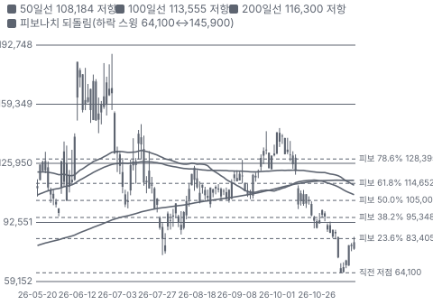

**주봉**

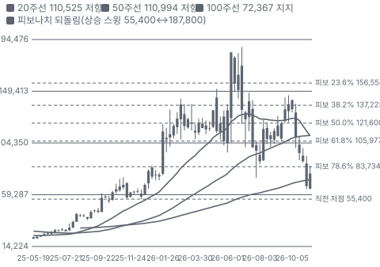

**월봉**

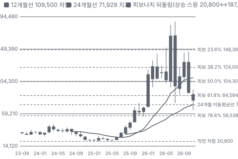

**분기 매출·EPS 실적과 컨센서스**

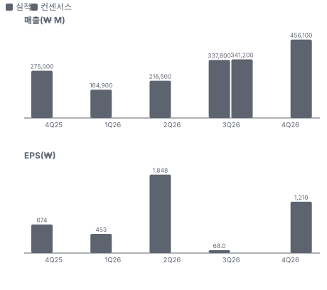

**멀티플 프리미엄(Trailing P/E(선행 이력 없음), 최근 4개 분기말)**

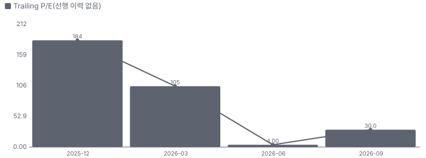

**합리적 멀티플**

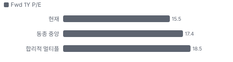

**밸류에이션 주가 시나리오**

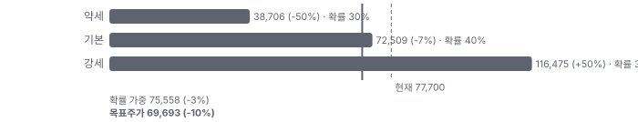

**주가별 업사이드**

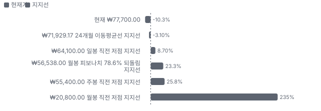
- 제품·서비스 포트폴리오

**고객 믹스(1H26, 매출 대비)**

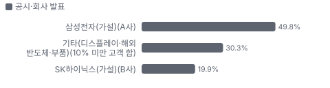

**공급 병목(10점, 낮을수록 병목)**

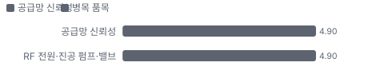

**생산능력 현재와 확충 계획(대/년(장비 생산능력))**

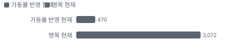

**CAPEX의 매출 대비 비중**

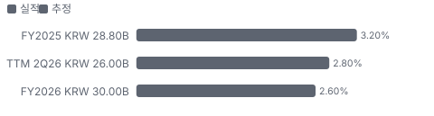

**어닝콜 변화별 주주가치 영향**

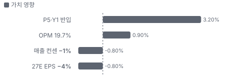

**수주·파이프라인 확실성 사다리**

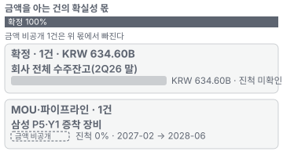

**비용 요인별 매출 대비 비중 1년 변화**

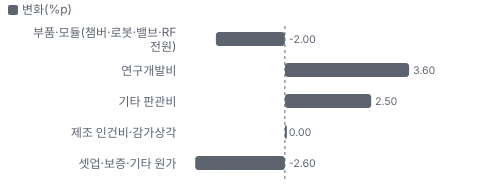

**반도체 장비 BOM 원가 몫**

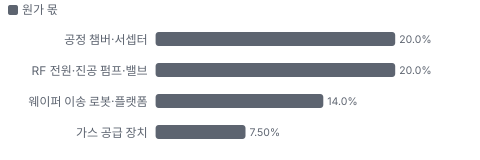

**BOM 항목 가격 +10% 시 OPM 변화**

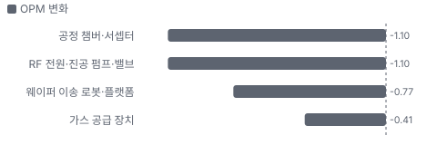

**원가 물가 vs 판매가 물가 — 1년 변화(원가가 판매가보다 더 오르면 단가를 올리지 못하는 만큼 마진이 줄어든다)**

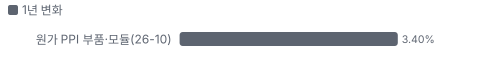

**시설별 생산능력(대/년, 큰 순)**

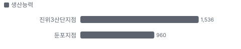

**매출·PPI·수출입 — 최근 8개 분기 같은 축(4Q24 = 100) + 다음 분기 추정**

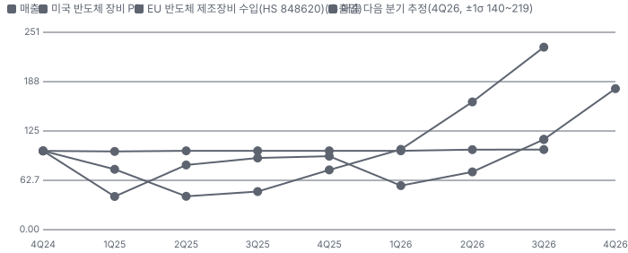

**매출 증가율의 가격·물량 분해와 8분기 전망(전년 대비)**

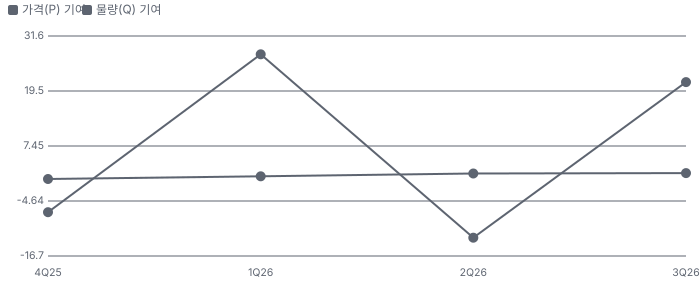

**분기별 매출 증가율 분해**

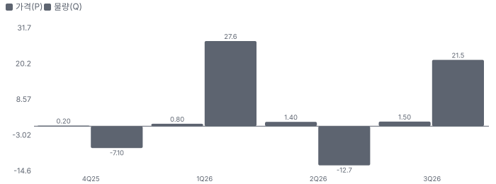

**목표주가 산정 — 약세와 기본 사이(약세 쪽 8%), 도달 확률 약 53%**

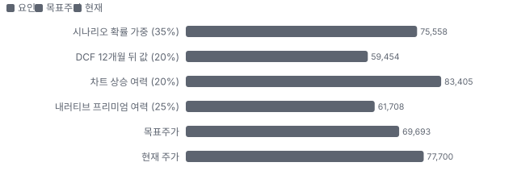

**일봉 지지·저항과 목표주가**

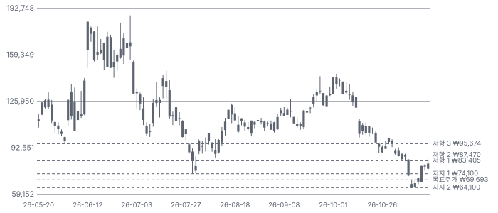

**몬테카를로**

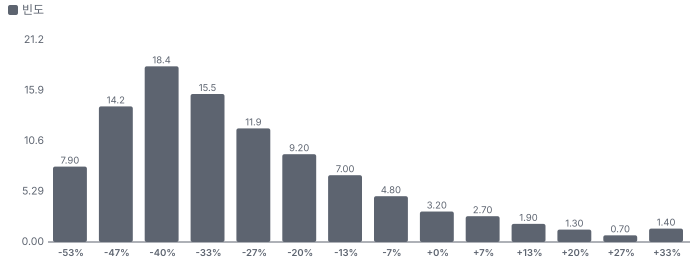

해석: 3,000번 중 283번(9%)에서 가치가 지금 주가 이상이었다. 가정을 흔들어도 지금 주가를 뒷받침하지 못하는 경우가 더 많다. 가운데 값은 0.67배이고, 열 번 중 여덟 번은 0.51~0.99배 사이에 든다.

## 내러티브

> **기업가치를 결정하는 이야기:** 원익IPS의 값은 '삼성이 언제 얼마나 새 라인을 까느냐'다. 매출의 89%가 반도체이고, 고객 발주가 늦으면 고정비가 이익률을 바로 깎는다(1Q25 적자, 2Q26 OPM 8.5%). 2027년 숫자는 P5·Y1 반입 시점과 증착 몫으로 정해진다.

> **멀티플·EPS 프리미엄**
> **멀티플:** Fwd 1Y P/E 15.5배로 국내 동종 중앙(약 17.3배)보다 약간 낮다. 6월에는 후행 P/E 47배였다.
> **EPS:** FY2026 EPS 약 ₩3,579, FY2027 약 ₩5,058(컨센서스·삼성증권).

### 투자자들은 왜 열광했나

2026년 상반기 삼성·SK의 국내 생산 거점 확대 소식에 반도체 장비주가 함께 올랐고, 원익IPS는 6월 한 달에 약 64% 올라 6/12 종가 ₩183,300을 찍었다. 식은 이유는 메모리 가격 정점 우려, 해외 장비 배수 축소, 2Q 매출 감소와 3Q 매출 이연이다.

### 무엇이 기업가치를 바꾸나

> **구조적 체질 변화**
> **변화:** 디스플레이 비중이 줄고 반도체 비중이 89%로 올랐다.
> **증거:** 1Q26 반도체 89%(SK증권 보도)
> **반증:** 디스플레이 투자 재개로 반도체 비중이 80% 아래

> **고부가 믹스 확장**
> **변화:** 부품 매출 증가가 믹스를 좋게 했다는 보도가 있다.
> **증거:** 1Q26 부품 매출 증가(보도)
> **반증:** 부품 매출 비중 공시 시 하락

> **기술 혁신**
> **변화:** D램 1c(D램 6세대 10나노급 공정)·HBM(고대역폭 메모리)용 증착 공정 전환 투자가 장비 수요를 만든다(삼성증권 D램 장비 전망 상향).
> **증거:** https://www.vegannews.co.kr/news/article.html?no=403050
> **반증:** 1c 전환 투자 축소 보도

> **실행 속도**
> **변화:** 해외 고객 물량은 지역별 리드타임 차이로 매출 인식이 이월됐다(2Q26). 리드타임 숫자는 공시되지 않는다. **납품 리드타임 10개월.** 피어 중앙값 6.4개월보다 56% 길다(Applied Materials 6.4개월 · 유진테크 미확인 · 테스 미확인). 이전 대비 미확인.
> **증거:** https://dart.fss.or.kr/dsaf001/main.do?rcpNo=20260814001845
> **반증:** 4Q에도 해외 매출 이연

> **M&A**
> **변화:** 해당 없음(최근 3년 인수·합병 미확인).

> **정책·입법 연관성**
> **재정정책:** 해당 없음(미국 재정 사업과 직접 연결된 매출이 작다 — 삼성 테일러 팹 장비 정도).
> **행정명령:** 해당 없음(매출을 바꾸는 행정명령을 찾지 못했다). 의회 동의 2/10 — 하원 1/5(논의 없음) · 상원 1/5(논의 없음).
> **연관입법:** 해당 없음(국내 반도체 특별법 등은 고객 투자에 간접 — 회사 매출 연결 근거 없음).

> **고객의 지출 예산**
> **변화:** 메모리·파운드리 고객의 설비투자(CAPEX)다.
> **사업별 예산:** **매출의 89%**: 반도체 장비 — 고객 CAPEX(고객 팹 장비 투자) · 동인: 삼성 P5·Y1, 테일러
**매출의 11%**: 디스플레이 장비 — 고객 CAPEX(OLED(유기발광 디스플레이) 라인 투자) · 동인: 삼성디스플레이 공정 업그레이드·중국 신규
> **증거:** https://www.ajunews.com/view/20261110085502084
> **반증:** 2027년 메모리 CAPEX 감소

### 내러티브 근거

> 삼성 메모리 신규 라인 투자가 증착 장비 매출로 이어진다는 이야기다. 6월 고점에서 주가는 절반 넘게 빠졌고, 증권사 6곳이 일주일 사이 목표가를 낮췄다. 시장은 '메모리 가격 정점 뒤에도 2027년 투자가 이어지나'를 묻고 있다. 동종 대비 멀티플 차이 -11% 중 회사 고유 몫은 -16%다. 단계는 소멸, 쏠림은 낮음이다.

> **삼성 신규 라인(P5·Y1) 투자** · 유지
> **논리:** 2027년 평택 P5·용인 Y1 장비 반입이 증착 장비 매출을 끌어올린다
> **숫자:** 증권사 전망: Y1·P5 반입 2027년 2월·5월(신한), 2Q27 발주(NH)
> **반증:** 삼성이 2027년 메모리 CAPEX를 줄이거나 P5 반입을 2028년 이후로 미룬다
> **출처:** https://www.ajunews.com/view/20261110085502084

> **메모리 설비투자 2년 연속 고성장** · 약화
> **논리:** 메모리 부족이 2027년까지 이어져 DRAM 설비투자가 2027·2028년 모두 늘어난다
> **숫자:** 해외 IB 전망: 2027 DRAM 설비투자 +55%, 2028 +52%. 10월 한국 장비 수입 +77%(전년)
> **반증:** 삼성·SK 4Q26 실적 발표에서 2027년 설비투자 가이던스가 2026년 수준 이하
> **출처:** 노션 자료실 IB 요지(라이선스 — 외부 공유 금지)

> **이익률 회복** · 강화
> **논리:** 매출이 분기 ₩300B를 넘으면 고정비 흡수로 OPM이 20% 가까이 오른다
> **숫자:** 3Q OPM 19.7%(2Q 8.5%)
> **반증:** 4Q 매출 ₩400B 이상인데 OPM 15% 미만
> **출처:** https://www.digitaltoday.co.kr/disclosure/articleView.html?idxno=713896

> **반대: 메모리 정점과 장비 배수 축소** · 강화
> **논리:** 메모리 가격이 2Q26 정점을 지나 고객 투자가 속도를 늦춘다
> **숫자:** 증권사 6곳 목표가 평균 약 −30%, 삼성 2027E P/E 26배→19배
> **반증:** 1Q27 삼성·SK 메모리 CAPEX 가이던스 상향
> **출처:** https://www.vegannews.co.kr/news/article.html?no=403050

> **반대: 투자자산 평가 손익** · 유지
> **논리:** 보유 투자자산 평가로 순이익이 크게 흔들려 EPS가 영업과 따로 논다
> **숫자:** 2Q 평가이익 약 ₩80B → 3Q 순이익 ₩3.3B
> **반증:** 해당 투자자산 처분 공시
> **출처:** https://www.digitaltoday.co.kr/disclosure/articleView.html?idxno=713896

## 포트폴리오

| 제품·서비스 | 구분 | 무엇 | 쓰는 곳 | 돈 버는 방식 | Mix | Mix 변화(전년 대비) |
|---|---|---|---|---|---|---|
| 반도체 장비 | 제품 | 메모리·파운드리용 PE-CVD(플라즈마 화학 기상 증착)·ALD(원자층 증착) 증착 장비와 식각·열처리 장비 | 삼성전자·SK하이닉스 팹 | 1Q26 매출의 89% | 89% | 미확인 |
| 디스플레이 장비 | 제품 | OLED용 증착·열처리 장비 | 삼성디스플레이·중국 패널사 | 1Q26 매출의 11%(기타 포함) | 11% | 미확인 |

## 고객

> **1H26 최대 고객 삼성전자(가설, A사) 50%, 상위 3곳 70%, 집중도 집중.** 공시·회사 발표로 확인한 몫은 매출의 70%이고, 나머지 고객 몫은 추정이거나 미분해다. 반기보고서 주석상 매출 10% 이상 고객은 2곳이다 — A사 ₩189.8B(연결 매출의 49.8%), B사 ₩75.8B(19.9%). 두 고객이 매출의 약 70%다. A사를 삼성전자로 보는 것은 가설이다. 나머지 약 30%는 10% 미만 고객(디스플레이·해외 반도체·부품)이다. 1H26 수출 비중은 26.4%다.

**고객별 매출 몫(1H26)**
| 고객 | 몫 | 변화 | 근거 |
|---|---|---|---|
| 삼성전자(가설, A사) | 50% | -8%p | 공시 |
| SK하이닉스(가설, B사) | 20% | +5%p | 공시 |
| 기타·미분해 | 30% | - | - |

> **삼성전자(가설, A사)** · 공시
> **사는 것:** 메모리·파운드리 증착 장비
> **추정 근거:** A사 ₩189.8B ÷ 1H26 연결 매출 ₩381.4B. 전년 반기 A사 ₩213.4B. 삼성 매출 비중 약 49% 보도와 같은 크기 — 이름은 공시되지 않았다

> **SK하이닉스(가설, B사)** · 공시
> **사는 것:** 증착 장비
> **추정 근거:** B사 ₩75.8B ÷ ₩381.4B. 전년 반기 ₩53.7B. 이름 미공시 — 국내 2위 메모리 고객이라는 매핑은 가설

## 수주·파이프라인

> **2026-06-30 기준 2건.** 확정 KRW 634.60B. 공시 수주잔고(2Q26 말, 별도·장비 인도 기준) KRW 634.60B.

**수주 목록**
| 상태 | 계약 | 계약 총액 | 진척 | 기간 | 비고 |
|---|---|---|---|---|---|
| 확정 | 회사 전체 수주잔고(2Q26 말) | KRW 634.60B | 비공개 | - | - |
| 파이프라인 | 삼성 P5·Y1 증착 장비 | 금액 비공개 | 0% | 2027-02 → 2028-06 | - |

**실행 속도와 방해 요인**
| 항목 | 상태 | 실행 속도 | 방해 요인 |
|---|---|---|---|
| 회사 전체 수주잔고(2Q26 말) | 확정 | 미확인 | 고객 반입 일정 · 해외 리드타임 |
| 삼성 P5·Y1 증착 장비 | 파이프라인 | 미확인 | 삼성 투자 일정(메모리 가격 정점 우려) |

## 마진 구조

> **GPM 41.6%, OPM 8.5%.** 3Q25 대비 GPM +4.7%p, OPM -1.7%p. 변동비는 매출의 53%이고, 매출이 10% 늘면 OPM은 +3.5%p 움직인다. TTM GPM은 약 37%, OPM 11.4%다. 장비 회사라 매출이 줄면 연구개발·인건비 같은 고정비가 이익률을 크게 깎는다(1Q25 영업적자, 2Q26 OPM 8.5%). 3Q26은 매출이 ₩337.8B로 늘며 OPM이 19.7%로 올랐다. 비용 요인별 몫은 회사가 밝히지 않아 모두 추정이다.

**GPM에서 OPM까지(연결(K-IFRS) — TradingView 분기 매출총이익·공시 영업이익. 원가 세부 구성 미공시, 아래는 최근 4개 분기)**
| 기간 | GPM | 연구개발 | 판관비 | 기타 | OPM |
|---|---|---|---|---|---|
| 3Q25 | 36.8% | 13.0% | 13.6% | 0.0% | 10.2% |
| 2Q26 | 41.6% | 16.6% | 16.4% | 0.0% | 8.5% |
| 2025-09 | 36.9% | - | - | - | 10.3% |
| 2025-12 | 36.9% | - | - | - | 6.3% |
| 2026-03 | 46.2% | - | - | - | 6.5% |
| 2026-06 | 41.6% | - | - | - | 8.5% |

**마진을 결정하는 비용 요인 — 비용 +10% 시 OPM**
| 비용 | 매출 대비 | 변화 | 고정비 | OPM |
|---|---|---|---|---|
| 부품·모듈(챔버·로봇·밸브·RF 전원) | 40.0% | -2.0%p | 0% | -4.00%p |
| 연구개발비 | 16.6% | +3.6%p | 90% | -1.66%p |
| 기타 판관비 | 16.5% | +2.5%p | 70% | -1.65%p |
| 제조 인건비·감가상각 | 12.0% | +0.0%p | 80% | -1.20%p |
| 셋업·보증·기타 원가 | 6.4% | -2.6%p | 30% | -0.64%p |

**비용을 움직이는 요인**
| 비용 | 요인 |
|---|---|
| 부품·모듈(챔버·로봇·밸브·RF 전원, 매출원가) | 부품 단가·환율 · 근거 추정 |
| 연구개발비(판관비) | 차세대 증착 개발 · 근거 추정 |
| 기타 판관비(판관비) | 인건비·수수료 · 근거 추정 |
| 제조 인건비·감가상각(매출원가) | 인력·공장 · 근거 추정 |
| 셋업·보증·기타 원가(매출원가) | 고객 반입·보증 충당 · 근거 추정 |

**반도체 장비 BOM — 매출의 89%, GPM 38%(추정 — 제품 GPM 미공시), 항목 가격 +10% 시**
| 항목 | 원가 몫 | 전가 | 제품 GPM | OPM |
|---|---|---|---|---|
| 공정 챔버·서셉터 | 15~25% | 미확인 | -1.2%p | -1.10%p |
| RF 전원·진공 펌프·밸브 | 15~25% | 미확인 | -1.2%p | -1.10%p |
| 웨이퍼 이송 로봇·플랫폼 | 10~18% | 미확인 | -0.9%p | -0.77%p |
| 가스 공급 장치 | 5~10% | 미확인 | -0.5%p | -0.41%p |
| 미분해 | 38% | - | - | - |

공정 챔버·서셉터 가격이 +10% 오르면 영업이익은 -13.0% 움직인다. 판매가 전가를 모르는 항목은 전가 0%로 계산했다.

**BOM 항목 가격을 움직이는 것**
| 항목 | 요인 |
|---|---|
| 공정 챔버·서셉터 | 증착 성능을 가르는 핵심 모듈 · 근거 추정 |
| 웨이퍼 이송 로봇·플랫폼 | 처리량 · 근거 추정 |
| RF 전원·진공 펌프·밸브 | 플라즈마·진공 유지 · 근거 추정 |
| 가스 공급 장치 | 전구체·가스 제어 · 근거 추정 |

**투입 물가 — 미국 PPI 3·6·12개월(2026-10, 개정 반영)과 해외 전년비**
| 항목 | 미국 3개월 | 6개월 | 12개월 | 전가 못 할 때 OPM | 일본 | 한국 | 대만 |
|---|---|---|---|---|---|---|---|
| 공정 챔버·서셉터 | +1.9% | +2.0% | +3.4% | - | +2.2% | +0.0% | +3.0%* |

별표는 품목보다 넓은 업종 지수다. 연결한 투입 원가의 미국 PPI(생산자물가지수)는 1년 새 가중 +3.4%이고, 판매가로 넘기지 못하면 GPM -1.4%p·OPM -1.4%p가 움직인다. 물가 지수를 붙이지 못한 매출원가 항목은 제조 인건비·감가상각, 셋업·보증·기타 원가다(미연결).

## 공급망 병목

> **공급망 신뢰성 4.9/10, 병목 주의.** 가장 약한 고리는 RF 전원·진공 펌프·밸브 4.9점이고, 품목 평균은 4.9점이다. 근거가 부족한 2건(공정 챔버·서셉터 · 고객 발주(삼성 P5·Y1))은 점수에서 뺐다. 병목은 부품이 아니라 고객의 발주 시점이다. RF 전원·진공 펌프·밸브는 해외 전문사가 많지만 공급사를 공시하지 않는다. 2026년 5월 장비사들이 1년치 부품을 한꺼번에 주문했다는 보도가 있어 부품 리드타임이 길어졌을 수 있다.

**병목과 마진 — 품목 가격 +10% 시 OPM**
| 품목 | 점수 | 판정 | 구분 | OPM |
|---|---|---|---|---|
| RF 전원·진공 펌프·밸브(필수) | 4.9 | 병목 주의 | 핵심 통제 품목 | -1.10%p |

> **RF 전원·진공 펌프·밸브** · 4.9/10
> **왜:** 플라즈마 증착의 필수 부품. 공급사 이름과 몫은 공시되지 않아 요인 값은 추정이다
> **병목 요인:** 인증 공급사 2곳 · 캐파 빠듯 · 리드타임 미확인 · 재인증 12개월 · 1위 점유율 미확인 · 지역 집중 미확인 · 물량 확보 복수구매
> **풀리는 조건:** 미확인

**공급사**
| 품목 | 공급사 | 몫 | 근거 |
|---|---|---|---|
| RF 전원·진공 펌프·밸브 | 해외 RF·진공 전문사(미공시, RF 전원·펌프) | 미확인 | 추정 |
| RF 전원·진공 펌프·밸브 | 뉴파워프라즈마 등 국내 RF 전원사(RF 전원) | 미확인 | 보도 |
| 공정 챔버·서셉터 | 원익QnC 등 계열·국내 부품사(추정, 부품) | 미확인 | 추정 |
| 고객 발주(삼성 P5·Y1) | 삼성전자(고객) | 미확인 | 보도 |

**무역 통계로 본 공급 지역**
| 품목 | EU 수입처 | 일본 수입처 | EU 1위 전년비 |
|---|---|---|---|
| RF 전원·진공 펌프·밸브 | JP 48% · US 33% · TW(대만) 8% | 大韓民国 36% · シンガポール 25% | +892.4% |
| 공정 챔버·서셉터 | JP 48% · US 33% · TW 8% | 大韓民国 36% · シンガポール 25% | +892.4% |

## 생산능력

> **현재 명목 캐파 3,072 대/년(장비 생산능력), 가동률 15%.** TTM 2Q26 CAPEX는 KRW 26.00B로 매출의 2.8%다. 회사가 공시하는 생산능력은 반도체 장비 연 1,536대(반기 768대 × 2)·디스플레이 장비 960대이고, 2026년 상반기 가동률은 반도체 20%·디스플레이 9%다. 수주 산업이라 캐파가 아니라 수주가 매출을 정한다. 증설 계획은 공시되지 않았다.

**생산시설 3곳**(2026 반기보고서 '주요 사업장 현황' — 본점(본사·R&D), 진위3산단지점(반도체 생산), 둔포지점(디스플레이 생산), 화성지점(임대). 생산 용도는 2곳), 미확인 3곳. 시설별 생산능력은 2곳만 공개됐다.

**생산시설 3곳 — 명칭·위치·생산능력**
| 시설 | 위치 | 용도 | 생산능력 | 소유·상태 |
|---|---|---|---|---|
| 진위3산단지점 | 경기 평택시 진위면 | 반도체 장비 생산 | 1,536 대/년 | 미확인 · 가동 |
| 둔포지점 | 충남 아산시 둔포면 | 디스플레이 장비 생산 | 960 대/년 | 미확인 · 가동 |
| 본점(본사·R&D 통합센터) | 경기 평택시 진위면 | 본사·R&D | 미확인 — 생산 용도가 아니다 | 미확인 · 가동 |

공개된 증설 계획은 확인되지 않았다.

**CAPEX와 매출 대비**
| 기간 | CAPEX | 매출 | 매출 대비 | 구분 |
|---|---|---|---|---|
| FY2025 | KRW 28.80B | KRW 909.80B | 3.2% | 실적 |
| TTM 2Q26 | KRW 26.00B | KRW 924.80B | 2.8% | 실적 |
| FY2026 | KRW 30.00B | KRW 1,175.30B | 2.6% | 추정 |

## 해자

> 해자는 삼성전자 메모리 라인에서 오래 인증받은 증착 장비(PE-CVD·ALD) 자리다. 한 번 공정에 들어간 장비는 다음 세대로 이어지기 쉽다. 다만 이익률은 해외 대형사·국내 동종보다 낮고, 매출이 삼성 계열 투자 일정에 크게 기대 해자가 가격 결정력으로 이어지지 않는다.

> **고객 공정 인증(전환 비용)** · 보통
> **해자:** 삼성 메모리 증착 공정에 장기간 장비를 공급해 재인증 비용이 경쟁사 진입을 늦춘다.
> **근거:** 1Q26 반도체 매출 비중 89%(SK증권 보도). 삼성전자 매출 비중 약 절반(보도 — 기간 미확인)
> **숫자:** 반도체 89%
> **깨지는 조건:** P5·Y1 증착 장비 발주에서 해외 대형사·국내 경쟁사 몫이 늘었다는 보도

> **제품 폭(증착 + 식각·열처리)** · 약함
> **해자:** 증착 외 공정 장비가 있으나 매출 대부분은 증착이다.
> **근거:** 미확인 — 제품별 매출 미공시
> **숫자:** 미확인
> **깨지는 조건:** 해당 없음 — 공시 시 다시 판정

> **이익률(가격 결정력)** · 약함
> **해자:** OPM이 동종보다 낮아 가격 결정력은 약하다.
> **근거:** TTM OPM 11.4%(TradingView) vs 유진·테스 18.5%, PSK 27.8%
> **숫자:** OPM 11.4% vs 동종 18.5~27.8%
> **깨지는 조건:** OPM이 2개 분기 연속 20% 이상

## 경영진·네트워크

> 원익그룹 계열(원익홀딩스 최대주주) 회사다. 경영진 개인 연결이 매출을 만들었다는 공개 근거는 없다.

> **미확인** · 대표이사(회사 공시 확인 전) · 미확인
> **프로필:** 미확인
> **비즈니스:** 원익홀딩스 계열(보도)
> **정계:** 미확인
> **동문:** 미확인
> **사모임:** 미확인

**네트워크 정량화**
| 연결 | 강도 | 닿는 매출 | 가중 노출 | 매출 대비 | 근거 |
|---|---|---|---|---|---|
| 비즈니스: 그룹 계열(원익홀딩스·원익QnC) | 1/5 | ₩0.00B | ₩0.00B | 0% | 계열 거래 규모 미확인 https://www.job-post.co.kr/news/articleView.html?idxno=237301 |

가중 노출은 연결이 닿는 매출의 크기다. 연결이 그 매출을 만들었다는 뜻이 아니며, 인과는 공개 자료로 입증하지 못한다.

## 약세 논리 및 셀온 조건

| 약세 논리 | 근거 | 가를 자료 |
|---|---|---|
| 메모리 정점 뒤 투자 둔화 | BNK는 2Q26을 메모리 최종 수요 정점으로 봤고, SK·NH는 2027년 이후 실적 지속성을 걱정했다. 국내 장비 동종 배수도 10배 초반까지 내려왔다(SK증권 보도) | 삼성·SK 4Q26 실적 발표의 2027년 설비투자 방향(2027년 1월) |
| 단일 고객 의존 | 1H26 매출 10% 이상 고객 두 곳(A사 49.8%·B사 19.9%)이 매출의 약 70%다(반기보고서). 삼성 일정 하나에 분기 매출이 ±50% 움직인다(1Q26 −40% QoQ, 3Q26 +56% QoQ) | P5·Y1 증착 장비 발주 보도 |
| 이익률이 동종보다 낮다 | TTM OPM 11.4% vs 유진테크·테스 18.5%, 피에스케이 27.8%. 매출이 줄면 고정비가 바로 이익률을 깎는다(1Q25 영업적자) | 4Q26 OPM — 매출 ₩400B대에서 20% 이상인가 |
| 순이익이 영업과 따로 논다 | 2Q 투자자산 평가이익 약 ₩80B → 3Q 평가손실로 순이익 ₩3.3B. EPS 기반 배수가 분기마다 흔들린다 | 투자자산 내역 — 3Q26 분기보고서(2026-11 제출 예정). 2Q 말 유동 당기손익 측정 금융자산 ₩173.3B |
| 잔고가 줄고 있을 수 있다 | 2Q26 말 잔고는 ₩634.6B(반기보고서, 장비 인도 기준)로 월평균 매출의 약 10개월치다. 3Q에 ₩337.8B가 매출로 나갔고 3Q 잔고는 분기보고서 제출 전이라 미확인이다 | 4Q26 실적 때 수주잔고 언급 |
| 자료 한계 | 회사는 연간 가이던스를 내지 않고, 수주잔고·10% 고객은 반기·사업보고서에만 쓴다(발주처·납기 미공시). FY2027 매출·OPM은 EPS에서 역산한 추정이다. 3Q26 분기보고서가 아직 제출되지 않아 재무상태표는 2Q26 말 기준이다. 자산 구성·ROIC 절은 SEC 공시가 없어 빠졌다 | DART(금융감독원 전자공시) 사업보고서(2027-03) |

**변이 관점.** 국내 증권사는 같은 주에 목표가를 약 30% 낮췄지만, 노션 자료실의 해외 IB 메모리 자료는 2027·2028년 DRAM 설비투자가 해마다 50% 넘게 늘고 삼성 DRAM 월 캐파가 4Q27까지 12만 장 늘며 P5-1 장비 반입이 2027년 7월에 시작한다고 본다. 두 기대가 동시에 맞을 수는 없다. 이 차이가 지금 배수의 근원이다. 다만 IB 전망은 기대의 증거이지 원익IPS 수주가 아니다(금지표 — 고객 투자 확대 → 특정 공급사 매출).

> **셀온 조건**
> **조건 1:** 삼성·SK가 2027년 메모리 설비투자를 2026년 수준 이하로 제시한다(4Q26 실적 발표, 2027년 1월).
> **조건 2:** P5 장비 반입이 2028년 이후로 밀린다는 회사·고객 발표나 보도가 나온다.
> **조건 3:** 4Q26 매출이 ₩400B 아래이고 OPM이 15% 아래다(2027년 2월 예상).
> **조건 4:** 주가가 2026년 11월 저점(11/6 종가 ₩66,700)을 종가로 밑돌고 장비 동종이 같이 신저가를 만든다.

## 어닝콜 변화

**직전 콜 대비 새로 나오거나 바뀐 내용 → 가치 영향**
| 항목 | 내용 | 직전 콜 | 최신 콜 | 모델 동인 이동 | 확신도 | 가치 영향 |
|---|---|---|---|---|---|---|
| 업데이트 | 영업이익률 회복 | 8.5%(2Q26) | 19.7%(3Q26) | 출발 이익률 +2.0% | 1.0 | +0.9% |
| 부정 | 파운드리 매출 이연 | 컨센서스 ₩341.2B | ₩337.8B | 1년차 성장률 -1.0% | 1.0 | -0.8% |
| 부정 | 2027 EPS 추정 하향 | ₩5,272 | ₩5,058(삼성증권) | 1년차 성장률 -1.0% | 0.8 | -0.8% |
| 신규 | 2027 신규 라인 투자 | 2028년 가동 전망 | 2027년 장비 반입 전망(증권사) | 장기 성장 수렴값 +1.0% | 0.3 | +3.2% |
| **합계** | 단독 합 |  |  | 동시 적용 +2.7% |  | **+2.6%** |

**실적 발표 예상 변동폭:** 지난 2번 실적 발표 때 주가는 하루에 평균 ±3.1%(최대 4.6%, 오른 날 1번) 움직였다.

**실적 발표 예상 변동폭 — 과거 실적 발표 다음 거래일 주가 변화**
| 분기 | 발표일 | 주가 변화 |
|---|---|---|
| 2Q26 | 2026-08-06 | -4.6% |
| 3Q26 | 2026-11-09 | +1.6% |

## 거시 지표 싱크로율

> **EU(유럽연합) 반도체 제조장비 수입(HS(국제 품목 분류 코드) 848620)와 전사 매출 싱크로율 81%(3분기 = 약 9개월 선행, 전 분기 대비, 표본 7개·t 3.0·유의·신뢰 참고용).** 이 지표가 내포하는 4Q26 전사 매출은 528.21B(±1σ 412.10B~644.33B, 확정)다.  회사 제품은 반도체 전공정 증착 장비(HS 848620)다 — 장비 PPI를 가격 대용으로, 한국 D램 수출을 고객 투자 여력의 거울로 쓴다

**지표별 싱크로율(상관계수 × 100) — 위 두 줄이 제품 연관성 × 싱크로율로 고른 PPI·수출입 세부 지표**
| 지표 | 비교 대상 | 증가율 기준 | 지표 선행 | 매출(t값) | 영업이익 | 방향 일치 | 표본·신뢰 | 표본 밖 오차(지표/기준선) | 4Q26 추정 매출 |
|---|---|---|---|---|---|---|---|---|---|
| 미국 반도체 장비 PPI | 전사 매출 | 전 분기 대비 | 0분기(0개월) | 62%(t 1.8) | -89%(3분기) | 86% | 7·참고용 | 미확인 | +96.6% → 664.21B(나우캐스트 1개월) |
| EU 반도체 제조장비 수입(HS 848620) | 전사 매출 | 전 분기 대비 | 3분기(9개월) | 81%(t 3.0) | 83%(0분기) | 71% | 7·참고용 | 미확인 | +56.4% → 528.21B(확정) |
| 일본 반도체 장비 PPI | 전사 매출 | 전 분기 대비 | 1분기(3개월) | 46%(t 1.2) | -60%(4분기) | 71% | 7·참고용 | 미확인 | +9.0% → 368.15B(확정) |

**지표 후보 25개 — 연관성(제품 품목 일치 × 대용 감점 × 매출 비중) × 싱크로율로 고른다. 후보가 많을수록 최대 상관은 우연히 부풀 수 있다**
| 후보 | 종류 | 연관성 | 매출 분기 일치 | 싱크로율(선행) | 점수 | 출처 |
|---|---|---|---|---|---|---|
| EU 반도체 제조장비 수입(HS 848620) ✔ | 수출입 | 1.00 | 100% | 81%(3분기) | 0.81 | 자동 |
| 미국 HS 848630 수입(반도체 장비과 같은 4자리 품목군) | 수출입 | 0.70 | 100% | 89%(4분기) | 0.63 | 자동 |
| EU 반도체 제조장비 수출(HS 848620) | 수출입 | 1.00 | 100% | 73%(0분기) | 0.58 | 자동 |
| 미국 HS 848690 수입(반도체 장비과 같은 4자리 품목군) | 수출입 | 0.70 | 100% | 79%(0분기) | 0.55 | 자동 |
| 미국 반도체 장비 PPI ✔ | PPI | 1.00 | 100% | 62%(0분기) | 0.49 | 모델 지정 |
| 미국 반도체 제조장비 수출(HS 848620) | 수출입 | 1.00 | 100% | 52%(4분기) | 0.41 | 자동 |
| 일본 HS 8486 수출(반도체 장비과 같은 4자리 품목군) | 수출입 | 0.70 | 88% | 68%(0분기) | 0.38 | 자동 |
| 일본 반도체 장비 PPI | PPI | 1.00 | 100% | 46%(1분기) | 0.37 | 모델 지정 |
| EU HS 848690 수출(반도체 장비과 같은 4자리 품목군) | 수출입 | 0.70 | 100% | 66%(0분기) | 0.37 | 자동 |
| EU 반도체 제조장비 PPI(업종 대용) | PPI | 0.60 | 100% | 76%(1분기) | 0.36 | 자동 |
| 미국 HS 848690 수출(반도체 장비과 같은 4자리 품목군) | 수출입 | 0.70 | 100% | 60%(4분기) | 0.34 | 자동 |
| EU HS 848610 수출(반도체 장비과 같은 4자리 품목군) | 수출입 | 0.70 | 100% | 55%(4분기) | 0.31 | 자동 |

**선행 지표로 본 향후 분기 매출 전망(이미 나온 지표 값 기준, ±1σ)**
| 지표 | 대상 | 분기 | 지표 증가율 | 내포 매출 증가율 | 내포 매출 |
|---|---|---|---|---|---|
| 일본 반도체 장비 PPI | 전사 매출 | 4Q26 | -0.3% | +9.0% | 368.15B(194.13B~542.18B) |
| EU 반도체 제조장비 수입(HS 848620) | 전사 매출 | 4Q26 | +34.3% | +56.4% | 528.21B(412.10B~644.33B) |
| 미국 반도체 제조장비 수출(HS 848620) | 전사 매출 | 4Q26 | +12.2% | +64.7% | 556.47B(388.75B~724.18B) |
| 미국 반도체 제조장비 수입(HS 848620) | 전사 매출 | 4Q26 | +66.7% | +63.6% | 552.59B(365.78B~739.41B) |
| EU HS 848610 수출(반도체 장비과 같은 4자리 품목군) | 전사 매출 | 4Q26 | +57.9% | +85.9% | 628.00B(464.69B~791.31B) |
| EU HS 848640 수출(반도체 장비과 같은 4자리 품목군) | 전사 매출 | 4Q26 | -35.6% | -29.9% | 236.64B(52.08B~421.20B) |
| EU HS 848610 수입(반도체 장비과 같은 4자리 품목군) | 전사 매출 | 4Q26 | +79.1% | -47.2% | 178.40B(85.55B~271.25B) |
| EU HS 848630 수입(반도체 장비과 같은 4자리 품목군) | 전사 매출 | 4Q26 | -62.3% | +37.3% | 463.69B(291.68B~635.69B) |
| EU HS 848640 수입(반도체 장비과 같은 4자리 품목군) | 전사 매출 | 4Q26 | +40.5% | -43.6% | 190.47B(50.88B~330.05B) |
| EU HS 848690 수입(반도체 장비과 같은 4자리 품목군) | 전사 매출 | 4Q26 | +18.3% | -25.7% | 251.09B(108.19B~394.00B) |
| 미국 HS 848610 수출(반도체 장비과 같은 4자리 품목군) | 전사 매출 | 4Q26 | -24.6% | +48.4% | 501.43B(341.29B~661.57B) |
| 미국 HS 848630 수출(반도체 장비과 같은 4자리 품목군) | 전사 매출 | 4Q26 | +1.3% | +8.8% | 367.58B(226.83B~508.32B) |
| 미국 HS 848640 수출(반도체 장비과 같은 4자리 품목군) | 전사 매출 | 4Q26 | +1.3% | +16.5% | 393.53B(210.83B~576.24B) |
| 미국 HS 848690 수출(반도체 장비과 같은 4자리 품목군) | 전사 매출 | 4Q26 | -6.3% | -20.2% | 269.46B(112.99B~425.92B) |
| 미국 HS 848610 수입(반도체 장비과 같은 4자리 품목군) | 전사 매출 | 4Q26 | -38.1% | +34.1% | 453.03B(277.74B~628.32B) |
| 미국 HS 848630 수입(반도체 장비과 같은 4자리 품목군) | 전사 매출 | 4Q26 | -73.1% | -57.5% | 143.52B(55.60B~231.44B) |
| EU 반도체 제조장비 PPI(업종 대용) | 전사 매출 | 4Q26 | +0.6% | +41.9% | 479.26B(351.32B~607.21B) |

지표가 k분기 앞서면 이미 발표된 지표로 k분기 뒤까지의 매출 증가율을 회귀식으로 읽는다. 표본이 작거나 t값이 2 미만이면 전망은 참고용이다.

**지표를 고른 이유**
| 지표 | 이유 |
|---|---|
| 미국 반도체 장비 PPI | 장비 가격 대용 |
| EU 반도체 제조장비 수입(HS 848620) | 반도체 장비 품목 일치 |
| 일본 반도체 장비 PPI | 아시아 장비 가격 대용 |

다음 분기 추정 = 지표 회귀와 기준선(직전 증가율 지속)을 표본 밖 오차의 역제곱으로 가중 결합한 값이다(예측 결합). 지표가 회귀에 쓴 범위를 벗어나면 범위 끝으로 자르고(외삽 제한), 세그먼트 추정은 나머지 사업을 기준선으로 더해 전사로 바꾼다. 싱크로율은 증가율의 상관계수이며 인과가 아니다. 지표 단위·통화는 원자료 그대로이고 나라끼리 더하지 않는다(EU 수입만 상대국 합계). ±1σ는 회귀 잔차 표준편차이고, 지표를 예측한 분기는 지표 예측 오차까지 더해 넓혔다.

## P·Q 사이클

> **Q 사이클 — 최근 4분기 평균 가격 기여 +1.0%, 물량 기여 +7.3%(전년 대비 로그 증가율).** P 강도 5.0/10, Q 강도 5.0/10, 최근 8분기 중 50%가 같은 요인 우세(순환적).

**P·Q 사이클 정량**
| 항목 | 가격(P) | 물량(Q) |
|---|---|---|
| 최근 4분기 평균 기여 | +1.0% | +7.3% |
| 강도(0~10, 자기 이력 z) | 5.0 | 5.0 |
| 고유 주기(자기회귀모델 과거 2개 시점일 때) | 미확인 | 미확인 |
| 다음 4분기 투영 평균 | 미확인 | 미확인 |

가격 근거: 미국 PPI 반도체 제조 장비 대용 — 회사 판매가가 아니라 업종 가격. PPI를 쓰면 회사 판매가가 아니라 업종 가격 대용이다. 로그 증가율이라 가격·물량 기여의 합이 매출 증가율이다. 전망: 가격은 BIC(모형 차수를 고르는 정보 기준)로 차수를 고른 자기회귀모델에 이미 발표된 월간 가격을 먼저 넣고(나우캐스트), 물량은 자기회귀모델과 '컨센서스 매출 증가율 − 가격 전망'을 분산 역수로 섞는다. 장기 평균은 표본 평균을 장기 기저율(가격 연 2%·물량 연 4%) 쪽으로 줄인다 — 고성장 구간만 담긴 표본이 그 성장을 끝없이 잇지 않게. 범위는 4분기 겹친 표본의 자기상관을 반영한다. 모형 산출이며 가이던스가 아니다. 회사 판매가로 잴 수 없는 이유: 장비 대수·ASP를 공시하지 않는다 — 업종 PPI 대용으로 잰다

10년 위치·프리미엄: 구조 단절(2Q25 전후 분기 매출 급변·되돌림(재작성·분리 자료가 섞인 것으로 보임) — 그 뒤만 쓴다) 뒤 TTM 표본이 2개로 20개에 못 미쳐 10년 비교를 하지 않는다 — 단절 전후 매출은 같은 회사 범위가 아니다.

## 밸류에이션

> **목표주가 ₩69,693, 업사이드 -10%.** 자리는 약세와 기본 사이(약세 쪽 8%)이고 도달 확률은 약 53%다. 기본 ₩72,509, 강세 ₩116,475(+50%), 약세 ₩38,706(-50%). DCF 기준 업사이드는 기본 -31%, 강세 -12%, 약세 -43%다(WACC 11.6%).

기본 EPS는 보도된 증권사 추정이고 약세·강세는 그 위아래 추정이다. 확률은 다음 해 매출 성장 분포에서 계산한 값이다. DCF는 장기 OPM 19%와 업황 순환을 담고, P/E 경로는 2027년 한 해만 본다. 두 값이 다르면 그 차이는 '2028년 이후에도 설비투자가 이어지느냐'에 대한 가정 차이다.

시나리오 확률: 다음 해 매출 성장 분포로 계산 — 약세 +14.9% 아래·강세 +31.9% 위 확률. 내부 관점(컨센서스 +23.4%, σ 16.6%: 범위 34.0% ÷ d2(10) × 1.5) 100% — 외부 관점 꺼짐(SEC 전 상장사 표본 없음)

> **약세 ₩38,706 (-50%)** · 확률 30%
> **가정:** 10.8배 × EPS ₩3600.00
> **근거:** 삼성 P5 발주가 2027년 하반기 이후로 밀리고 메모리 가격 하락으로 고객이 투자를 늦춘다. 매출은 2026년 수준, OPM 15% 안팎

> **기본 ₩72,509 (-7%)** · 확률 40%
> **가정:** 14.3배 × EPS ₩5058.00
> **근거:** FY2027 EPS 컨센서스(삼성증권 ₩5,058). P5·Y1 장비가 2027년 중 반입되고 OPM 약 20%

> **강세 ₩116,475 (+50%)** · 확률 30%
> **가정:** 17.9배 × EPS ₩6500.00
> **근거:** 해외 IB 전망처럼 2027 DRAM 설비투자가 +50% 넘게 늘고 1c 전환 투자가 더해져 매출이 ₩1.6T를 넘고 OPM 22%

**멀티플 선정 — Fwd 1Y P/E**
| 단계 | 조정 | 근거 |
|---|---|---|
| 동종 중앙값 | 17.4배 | 범위 13.5~19.4배, 4곳 |
| 펀더멘털 | +3% | 성장·이익률·ROIC로 본 합리적 멀티플 18.5배와의 차이의 일부만 인정(로그 차이 × 0.5, 상한 ±20%에 부드럽게 수렴) |
| 해자 | -7% | 고객 공정 인증(전환 비용) 보통 · 제품 폭(증착 + 식각·열처리) 약함 · 이익률(가격 결정력) 약함 — 점수 -1.5%에서 동종 기준 5.5%를 뺌 |
| 반복 매출 | +0% | 재료 없음 |
| 수주 전환·가시성 | +1% | 가시성 재료 없음 |
| 내러티브 | -10% | 단계 소멸 |
| 사이클·실행 판단 | -5% | 동종(유진·테스·PSK)보다 이익률이 낮고(OPM 14.5% vs 19~28%), 삼성 계열 고객 의존이 커 단일 고객 투자 일정에 매출이 흔들린다. 3Q처럼 투자자산 평가 손익이 순이익을 크게 흔든다 |
| **선정** | **14.3배** | 지금 15.5배 |

**동종 레인지**
| 회사 | Fwd 1Y P/E | 성장 | 영업이익률 | ROIC |
|---|---|---|---|---|
| 유진테크 | 13.5 | 17% | 18% | 29% |
| 테스 | 17.3 | 5% | 19% | 22% |
| 피에스케이 | 17.5 | 3% | 28% | 41% |
| Applied Materials | 19.4 | 38% | 33% | 39% |
| **원익IPS** | 15.5 |  |  |  |

지금 주가가 요구하는 5년 매출 CAGR 23%, 기본 시나리오 9%. 몬테카를로 중앙값 업사이드 -33%.

> 의사결정 보조(투자자문 아님): ① 매수 매력: 5년 보유 가정 연 기대수익 +3.1% — 주주가 요구하는 수익률(자기자본비용) 11.6%보다 -8.5%p · 요구수익률을 넘을 확률 7% · 안전마진 없음(비관적 경우(하위 10%) 가치가 시총의 51%) → 정량 신호 약함 / ② 위험 예산 지표(이론): 0% — 기대수익이 요구수익률에 못 미친다(켈리 기준 — 수익·손실 확률로 계산한 이론상 최대 노출 — 0%는 참고) · 5년 뒤 나쁜 경우(하위 10%) -20% · 30% 넘게 잃을 확률 2% / ③ 상방(5년): 평균 1.17배 · 2배 이상 확률 3% · 3배 이상 0% · 10배 이상 0% · 잘 풀린 경우(상위 10%) 1.63배 이상

투입 물가 점검: 지난 1년 PPI를 BOM에 넣으면 OPM -0.21%p다(매출원가의 19% 기준).

## 매수 위치(일봉)

> **현재가 ₩77,700는 '지지 근접'(가장 가까운 일봉 지지 ₩74,100에서 ATR 0.5배 위).** 이 자리에서 목표주가까지 -10.3%, 첫 일봉 저항까지 +7.3%, 다음 지지까지 하방 -4.6%, 손익비 -2.2배. 손익비는 지지 1 ₩74,100에서 -0.4배로 가장 높다(목표주가까지 -5.9%).

**가격대별 업사이드(일봉 기준)**
| 가격대 | 가격 | 목표주가까지 | 첫 저항까지 | 다음 지지까지 | 손익비 | 근거 기법(강도) |
|---|---|---|---|---|---|---|
| 현재가 | ₩77,700 | -10.3% | +7.3% | -4.6% | -2.2 | - |
| 지지 1 | ₩74,100 | -5.9% | +12.6% | -13.5% | -0.4 | 120일 지그재그 저점(0.8) |
| 지지 2 | ₩64,100 | +8.7% | +15.6% | 미확인 | 미확인 | 120일 지그재그 저점 · 스윙 저점(1.8) |

**일봉 저항**
| 저항 | 가격 | 현재가 대비 | 근거 기법(강도) |
|---|---|---|---|
| 저항 1 | ₩83,405 | +7.3% | 피보 23.6%(1.0) |
| 저항 2 | ₩87,470 | +12.6% | 20일선(0.5) |
| 저항 3 | ₩95,674 | +23.1% | 120일 지그재그 저점 · 피보 38.2%(1.8) |

일봉만 쓴다(주봉·월봉 제외). 손익비 = 목표주가까지 업사이드 ÷ 다음 지지까지 하방. 가격대별 기대값 참고표이며 매수·매도 시점 지시가 아니다.

## 애널리스트 토론

> **토론 결론 Neutral(규칙 등급 Sell).** 영업이익 회복과 배수 축소는 숫자로 확인됐지만, 2027년 발주 시점은 아직 회사·고객 공시로 확인되지 않는다. 토론은 Buy를 냈지만 규칙 등급에서 1단계까지만 옮길 수 있어 Neutral로 정했다.

**패널 — 등급별 자리**
| 자리 | 핵심 논리 | 틀리는 조건 | 최종 투표 |
|---|---|---|---|
| Strong Buy | 영업이익은 늘고 주가는 절반이 됐다 — Fwd 1Y P/E 15.5배는 동종보다 낮다 | FY2027 EPS 추정이 ₩4,500 아래로 | Buy |
| Buy | 2027년 P5·Y1 반입이 매출을 다시 키운다 | P5 반입 2028년 이후로 지연 | Buy |
| Neutral | 이익률은 좋아졌지만 2027년 발주 시점이 확인되지 않았다 | 삼성 P5 장비 PO(장비 구매 주문) 보도 | Neutral |
| Sell | 메모리 정점 뒤 장비 투자는 늦어진다 | 1Q27 메모리 CAPEX 가이던스 상향 | Neutral |
| Strong Sell | 단일 고객 의존에 이익률은 동종보다 낮다 | OPM 2개 분기 연속 20% 이상 | Sell |

**투표**
| Strong Buy | Buy | Neutral | Sell | Strong Sell |
|---|---|---|---|---|
| 0 | 2 | 2 | 1 | 0 |

> **개회 · Strong Buy**
> **발언:** TTM 영업이익 ₩113.0B로 1년 새 크게 늘었는데 주가는 6월 고점의 절반 아래다.

> **개회 · Buy**
> **발언:** 증권사들은 2027년 P5·Y1 반입을 본다. 목표가를 내렸어도 매수 의견은 유지했다.

> **개회 · Neutral**
> **발언:** 발주가 언제 나오는지 회사가 말하지 않는다. 지금은 확인할 숫자가 없다.

> **개회 · Sell**
> **발언:** 메모리 가격이 2Q를 정점으로 꺾였다는 시각이 늘었다. 장비 투자는 그 뒤를 따라 줄어든다.

> **개회 · Strong Sell**
> **발언:** 매출의 절반이 한 고객이다. 그 고객 일정이 밀리면 이익이 바로 꺾인다.

> **반박1 · Strong Buy → Sell**
> **발언:** 삼성증권은 이익을 내리면서도 D램 장비 전망은 올렸다. 메모리 투자 전체가 줄어든다는 숫자는 없다.

> **반박1 · Sell → Strong Buy**
> **발언:** 같은 보고서가 2027E P/E를 26배에서 19배로 낮췄다. 배수가 빠지는 이유가 바로 정점 우려다.

> **반박1 · Neutral → Buy**
> **발언:** 1Q 잔고 ₩400B 이후 3Q 잔고는 공시되지 않았다. 잔고가 줄고 있는지 알 수 없다.

> **반박1 · Buy → Neutral**
> **발언:** 3Q 매출이 전분기보다 56% 늘었다. 잔고가 매출로 바뀌는 중이다.

> **반박1 · Strong Sell → Buy**
> **발언:** 매출이 늘수록 잔고는 줄어든다. 새 발주가 없으면 2027년 상반기가 빈다.

> **반박2 · Strong Buy → Strong Sell**
> **발언:** 삼성 의존은 10년 넘게 같았다. 이번 하락은 고객이 바뀌어서가 아니라 업종 배수가 빠져서다.

> **반박2 · Strong Sell → Strong Buy**
> **발언:** OPM이 동종보다 7~16%p 낮은 것은 협상력이 약하다는 뜻이다.

> **반박2 · Neutral → Strong Buy**
> **발언:** Fwd 1Y P/E 15.5배는 FY2027 EPS ₩5,058이 맞아야 싸다. 그 숫자도 내려가는 중이다.

> **반박2 · Buy → Sell**
> **발언:** 순현금 상태라 업황이 늦어져도 버틸 여력이 있다.

> **반박2 · Sell → Buy**
> **발언:** 버틸 여력과 주가는 다르다. 배수는 발주가 보일 때까지 오르기 어렵다.

> **최종 · Strong Buy** · Buy
> **발언:** FY2027 EPS 추정이 아직 내려가는 중이라는 반박은 받아들인다.

> **최종 · Buy** · Buy
> **발언:** 발주 시점 확인 전에는 업사이드를 확신하기 어렵다는 점을 받아들인다.

> **최종 · Neutral** · Neutral
> **발언:** P5 장비 PO 보도가 판단을 가른다.

> **최종 · Sell** · Neutral
> **발언:** D램 장비 전망이 올랐다는 점은 받아들인다.

> **최종 · Strong Sell** · Sell
> **발언:** 순현금이라 재무 위험은 작다는 반박을 받아들인다.

남은 반대 의견: Sell 한 표 — 메모리 정점 뒤 장비 투자 둔화

패널은 등급별 논리를 대표하는 자리이고 실존 IB의 의견이 아니다.

## 커뮤니티 반응

통계: 관심 급증 0.0/10(결합 Z -0.4).

> **최근 24시간·7일 추적 커뮤니티 언급은 없다(점수 없음 — 낮은 점수가 아니다). 9~10월에는 네이버 블로그·유튜브 경제 채널에서 'HBM·D램 팹 증설 수혜 증착 대표주'라는 강세 글이 이어졌고, 11월에는 공개 텔레그램에서 목표가 하향 요약이 돌았다.**

**채널별 내러티브와 기대 소화**
| 채널 | 주된 이야기 | 기대 | 1차 자료 대조 | 비중 |
|---|---|---|---|---|
| 네이버 블로그·유튜브 | HBM·D램 팹 증설에 따른 증착 장비 수주 증가 | 상향 | 일부 확인 — 1Q26 잔고 약 ₩400B(보도). 3Q 잔고는 미공시 | 60% |
| 공개 텔레그램 | 실적은 좋지만 목표가 일제 하향 | 하향 | 확인 — 증권사 6곳 하향 보도와 일치 | 40% |

**기대가 바뀐 시점:** 10/11 메리츠 목표가 ₩169,000 상향 → 11/9 3Q 실적 → 11/10~11 증권사 6곳 하향

커뮤니티 의견은 시장 기대의 증거이지 사실이 아니며, 관심 급증은 주가·펀더멘털 변화가 아니다.

## 시장 평가

> **셀사이드(IB 애널리스트)**
> **한 줄:** 의견은 대부분 매수를 유지했지만 목표가는 일제히 30% 안팎 낮췄다. 이유는 이익이 아니라 국내외 전공정 장비 배수 축소다. 반면 해외 IB 메모리 자료는 2027·2028년 DRAM 설비투자가 해마다 50% 넘게 늘어난다고 본다 — 국내 증권사의 배수 하향과 같은 시기에 나온 반대 방향 기대다
> **애널리스트 의견:** 매수 9, 매도 1 — TradingView 10명
> **11/10~11 목표가:** NH ₩125,000 · 신한 ₩125,000 · 메리츠·SK ₩120,000 · 삼성 ₩100,000 · BNK ₩75,000(중립) — 모두 하향 — 기대의 증거다
> **FY2027 추정:** EPS ₩5,058(삼성, 직전 ₩5,272) — −4%
> **해외 IB 메모리 설비투자 전망:** 2027 DRAM +55%·2028 +52%, 삼성 DRAM 월 캐파 4Q26→4Q27 +12만 장, P5-1 장비 반입 2027-07 전망 — 시장 기대의 증거 — 수주가 아니다

> **바이사이드(기관 투자자)**
> **한 줄:** 기관 순매수 흐름은 받지 못했다. 해외 매크로 투자자 방문 전언은 회사·보도로 확인되지 않는다
> **해외 투자자 방문:** 드러켄밀러 방문(딘스티커 채널 전언) — 사실 미확인

> **언론·업계**
> **한 줄:** 실적 개선과 목표가 하향이 같은 날 나와 해석이 갈린다
> **주요 보도:** 3Q 영업이익 +142%, 순이익 −88%, 목표가 하향 — 투자자산 평가손실이 순이익을 깎았다

## 체크리스트

| 시점 | 무엇 | 의미 |
|---|---|---|
| 2026년 12월~2027년 1월 | 삼성 P5·Y1 증착 장비 PO 보도 | 2027년 매출 경로가 열리는가 |
| 2027년 1월 말 | 삼성전자·SK하이닉스 4Q26 실적과 2027년 설비투자 방향 | 메모리 정점 우려 vs 해외 IB 설비투자 +50% 전망 |
| 2027년 2월(예상) | 원익IPS 4Q26 잠정실적 | 매출 ₩400B대·OPM 20% 회복, 파운드리 이연분 인식 |
| 2027년 3월 | DART 사업보고서 | 수주잔고·고객 집중도·투자자산 내역 확인 |
| 매월 1일 | 한국 반도체 장비 수입·D램 수출 | 고객 장비 반입의 거울 지표 |
| 2027년 7월(IB 전망) | P5-1 장비 반입 시작 | 증착 장비 매출 인식 시점 |

## 출처
- 원익IPS 3Q26 잠정실적(공정공시 보도): https://www.digitaltoday.co.kr/disclosure/articleView.html?idxno=713896
- 재경일보 11/9 — 3Q 영업이익 ₩66.7B·순이익: https://news.jkn.co.kr/post/1080555
- 아주경제 11/10 — NH투자증권 목표가 하향·P5 일정: https://www.ajunews.com/view/20261110085502084
- 비건뉴스 — 삼성증권 목표가 ₩100,000·2027 EPS: https://www.vegannews.co.kr/news/article.html?no=403050
- 서플 — 삼성증권 데이터센터 증설 기대: https://supple.kr/news/cmw9wynn7st5nal9p4lbsoxqt
- 시대 2026-05 — SK증권 1Q26 리뷰(반도체 89%): https://www.sidae.com/article/2026051108431180904
- 2Q26 실적 이벤트(8/6): https://www.akrostec.com/indices/ASHKSEM/events/2026-08-06t00-00-00z-wonik-ips-co-ltd-240810-financial-results-fa7da15f
- 다음 7/18 — 수주잔고 약 ₩400B: https://v.daum.net/v/20260718215404109
- 다음 7/3 — 장비사 부품 선주문: https://v.daum.net/v/20260703084342850
- 잡포스트 10/30 — 장비 발주 변동성: https://www.job-post.co.kr/news/articleView.html?idxno=235682
- 공개 텔레그램 — 증권사 목표가 하향 요약(11/10~11/11, 커뮤니티 신호): https://t.me/ked_epic_ai/39088
- 공개 텔레그램 — 잠정실적 안내(11/9): https://t.me/merITz_tech/19471
- 노션 자료실 IB 메모리·장비 요지 — 라이선스 자료 요지 포함, 외부 공유 금지
- TradingView KRX:240810 시세·재무·추정(11/13~11/15): https://www.tradingview.com/symbols/KRX-240810/
- 마스터 노션 자료: 미확인 Japan_Machinery__Automation__Trade_statistics__September_2026_robot_Robodrill_volume_trends.pdf (요지만, 외부 공유 금지)
- 마스터 노션 자료: 미확인 Japan_Machinery__Construction__September_2026_trade_statistics.pdf (요지만, 외부 공유 금지)
- 마스터 노션 자료: 미확인 Americas_Technology__Semiconductors__SIA_data_shows_mostly_below-seasonal_trends_in_September_following_a_strong_August.pdf (요지만, 외부 공유 금지)
- 마스터 노션 자료: UBS UBS_Memory_Semis_Monthly：October_'26_Edition：_Is_the_Wall_of_Worry.pdf (요지만, 외부 공유 금지)
- 마스터 노션 자료: 미확인 JP Morgan SemiconductorsSemi Cap Equipment 3Q26 Sector Preview.pdf (요지만, 외부 공유 금지)
- 마스터 노션 자료: 미확인 Bernstein - Global Memory & Storage - HBF Deep Dive - Could HBF be the solution to the Memory bottleneck - 27 Oct 2026.pdf (요지만, 외부 공유 금지)
- 마스터 노션 자료: 미확인 South Korea Tech_ Memory Pricing Tracker_ Oct. 2026_ 4Q26 DRAM ASP forecast for PC higher, server_mobile in-line, NAND lower ....pdf (요지만, 외부 공유 금지)
- 마스터 노션 자료: 미확인 South Korea Tech_ October 2026 export tracker_ Another record-high DRAM exports at US\$34bn (+595_ yoy).pdf (요지만, 외부 공유 금지)
- 마스터 노션 자료: JPM 2026-11-03 JPM_Memory_Market_Update_2026-11-03_5522344.pdf (요지만, 외부 공유 금지)
- 마스터 노션 자료: 미확인 Global_Semiconductors_2027E_Global_Memory_Supply_Demand_Projection.pdf (요지만, 외부 공유 금지)
- 마스터 노션 자료: JPM 2026-11-09 JPM_Semiconductors_Septe_2026-11-09_5521351.pdf (요지만, 외부 공유 금지)
- 마스터 노션 자료: BofA 2026-11-11 BofA_Taiwan Semiconductor Manufacturing Co. Capital budget toward advanced nodes_ investing into frontier labs and semis chain_20261111.pdf (요지만, 외부 공유 금지)
- https://dart.fss.or.kr/dsaf001/main.do?rcpNo=20260814001845
- https://www.ajunews.com/view/20261110085502084
- 업계 통념
- 장비 원가 구조 업계 통념
- 장비 원가 구조 업계 통념(추정)
- 추정
- https://v.daum.net/v/20260703084342850
- 업계
- 업계 통념(추정)

_구매 등급·목표주가 모두 규칙이 계산한 모델 값으로, 개인의 보유 종목·자금 사정을 반영하지 않는다 · 공개 자료 기반 분석이며 투자 권유가 아님 · 1차 판정, 미검증 · Chiip ten-bagger_