# 텐배거 리포트 2026-11-15 — Seiko Group — 두 번 올린 가이던스에도 주가는 고점의 70%, 엔화와 미국 시계 붐을 뺀 이익이 배수를 가른다

> 2026-11-15 · Seiko Group(8050) · 기업: 그랜드세이코 시계·긴자 와코 백화점·수정 진동자 IC 같은 전자 부품·기업 IT 시스템을 가진 일본 회사(도쿄증권거래소 8050)

## Chiip View

주가는 11/13 ¥8,220, 시가총액 ¥668.9B(희석 증권이 없어 기본·완전 희석 같다), 순유이자부채 ¥57.9B를 더한 EV는 ¥726.8B다. 1H FY3/27 매출 ¥196.3B(+22.3%)·영업이익 ¥31.4B(+86.5%)이고, 회사는 통기 가이던스를 5월 영업이익 ¥33.5B → 8월 ¥41.0B → 11월 ¥47.0B로 두 번 올렸다. 그런데 주가는 9월 종가 고점 ¥11,810에서 −30%이고, 두 번째 상향 다음 날에도 −10.8%였다. **우리가 다르게 보는 곳은 '연속 상향 = 더 오른다'는 읽기다.** ==1년 만에 3배가 된 주가는 이미 상향을 앞서 샀다== — Fwd 1Y P/E 18.3배로 시계·명품 동종 6곳 중앙값 17.3배 위이고, 이익에는 엔화 약세(1H 평균 ¥159.5/달러, 계획 ¥155)와 미국 그랜드세이코 +70% 붐이 함께 들어 있다. 목표주가는 ¥7,699(−6%)로 규칙 등급 Neutral, 애널리스트 토론도 Neutral이다. 기본 ¥7,279(선정 배수 16.2배 × 다음 4개 분기 EPS ¥450, 추정), 약세 ¥4,367(−47%), 강세 ¥10,716(+30%)이다. __DCF 기준 업사이드는 −38%로 배수 기준보다 더 낮다__ — 매출 성장이 6%에서 장기 2%로 내려가고 영업이익률이 12%대에 머문다는 가정이 차이를 만든다. 경쟁 가설 ① 미국 성장이 현지 통화로 이어져 영업이익률 12% 이상이 굳는다(가를 자료: 3Q 결산 EVS(세이코의 시계·와코, 백화점 등 소비자 사업 영역, Emotional Value Solution) 증가율, 2027-02) ② 이익의 상당 몫이 엔화 약세다(가를 자료: 엔화 강세 구간의 총이익률) ③ 하반기 계획이 낮은 건 계절성일 뿐이다(가를 자료: 3Q 영업이익 ¥12B 이상). 커버리지 4명이 모두 매수라는 점은 표본이 작아 반대 신호로도 읽힌다.

## 대시보드
| 항목 | 값 | 설명 |
|---|---|---|
| 주가 | ¥8,220 | 고점 대비 -30% · 1년 +136% |
| 시가총액 | ¥668.91B | 완전 희석 기준 · EV ¥726.79B |
| 업사이드 | -6% | 목표주가 ¥7,699 · 다운사이드 -47% · 손익비(강세÷약세) 0.6 |
| 구매등급 | Neutral | 애널리스트 4명: Strong Buy 4 · Buy 0 · Neutral 0 · Sell 0 · Strong Sell 0 |
| 멀티플 | Fwd 1Y P/E 18.3배 | 동종 중앙값 17.3배 |
| 가이던스 3Q27 | ¥96,850M · ¥56.00 | 컨센서스 ¥97,350M |
| 알파 | 5.0/10 | 텐배거 가능성 점수 |
| 이벤트 | 3Q FY3/27 결산 발표(예정, 전년 일정 기준 2월 초) — 10~12월 연말 시계 수요와 영업이익률 16% 유지 여부 | 2027-02-06 |

## 한 장 요약
- **기업가치를 결정하는 내러티브** Seiko Group(8050)은 시계(그랜드세이코·세이코 글로벌 브랜드)와 긴자 와코 백화점, 수정 진동자 IC(수정 결정의 일정한 진동으로 기준 시계 신호를 만드는 칩 — 서버·광모듈의 타이밍 부품)·마이크로 전지 같은 전자 부품, 기업용 IT(정보기술) 시스템을 가진 일본 회사다. 1H FY3/27 매출 ¥196.3B(+22.3%)·영업이익 ¥31.4B(+86.5%)이고, 11/10 통기를 매출 ¥390.0B·영업이익 ¥47.0B·순이익 ¥32.0B로 두 번째 올렸다. 주가는 11/13 ¥8,220, 시가총액 ¥669B
- **밸류에이션 모델로 본 주가 상방은 어디까지인가?** **목표주가 ¥7,699(-6%), 기본과 강세 사이(강세 쪽 12%)다.** 강세 ¥10,716(+30%)는 Fwd 1Y P/E 20.2배를 강세 EPS에 적용한 값이다. 기본 ¥7,279, 약세 ¥4,367. 손익비 0.6, DCF 기준 업사이드 -38%.
- **누가 사 주나?** 최대 고객 시계 소비자·유통(국내·인바운드(방일 외국인 관광객 소비)·해외)(EVS 영역) 65%, 상위 3곳 100%. 공시·회사 발표로 확인한 몫은 100%다.
- **마진과 공급망은 어디가 약한가?** GPM 49.6%, OPM 16.0%. OPM을 가장 흔드는 BOM(제품 원가를 이루는 부품·재료 명세) 항목은 기계식·스프링드라이브(태엽 동력에 전자 조속기를 더한 세이코 고유 무브먼트) 무브먼트(시계 안의 동력·구동 장치)이고 가격 +10%에 -0.41%p다. 공급망 신뢰성은 2.3/10(병목 심각)이고 가장 약한 고리는 고급 기계식 무브먼트(자체 공방)다.
- **생산능력은 얼마나 늘어나나?** 현재 명목 캐파 미확인, 착공 이상 증설 0 미확인. 1H FY3/27 CAPEX는 매출의 4.1%다.
- **지금 가격은 무엇을 가정하나?** Fwd 1Y P/E 18.3배(다음 4개 분기 EPS ¥450, 추정)로 시계·명품 동종 6곳 중앙값 17.3배보다 높다 — 시티즌 13.0배·카시오 16.3배 같은 일본 시계 회사보다 리치몬트 24.4배 쪽에 가깝게 값이 매겨졌다. 선정 배수는 16.2배, 목표주가는 ¥7,699다. 가격은 '일본 시계 회사'에서 '명품 브랜드'로 넘어가는 중간쯤을 이미 가정한다.
- **왜 움직였나?** 2025년 10월 ¥4,000대에서 2026년 8월 1Q 상향 다음 날 +16%로 ¥10,000을 넘었고, 9월 종가 고점 ¥11,810이 됐다. 11/10 2Q 결산(통기 재상향·배당 ¥120) 다음 날은 −10.8%(거래량 245만 주, 평소의 7배)였고 사흘 뒤 ¥8,220이다. 상향 폭보다 회사의 하반기 순이익 계획(¥9.5B, 상반기의 42%)과 환율 전제가 더 크게 읽혔다 — 원인은 보도로 확인하지 못했다(원인 미확인).
- **2Q 결산에서 무엇이 바뀌었나?** 통기 매출 ¥375.0B → ¥390.0B, 영업이익 ¥41.0B → ¥47.0B, 순이익 ¥32.0B, 배당 ¥105 → ¥120. 1H 매출총이익률 49.6%(+3.4pt), 2Q는 51.0%다. 사업별로 시계·와코(EVS) 1H 영업이익 ¥15.9B → ¥27.7B, 디바이스(DS(세이코의 디바이스 솔루션 영역 — 수정 진동자 IC·마이크로 전지·잉크젯 헤드·정밀 부품)) ¥2.0B → ¥4.9B, 시스템(SS(세이코의 시스템 솔루션 영역 — IT 인프라·결제·보안)) ¥2.2B. 새로 나온 말은 ① AI 서버·광통신용 수정 진동자 IC·Co-Ni 합금(코발트·니켈 합금 — 정밀 스프링·부품 소재) 수요 강화 ② 미국 그랜드세이코 약 +70%·SGB(세이코 글로벌 브랜드 — 해외용 고가 세이코 시계 라인) 약 +90%(현지 통화) ③ 미국 일부 제품 품귀다.
- **회사는 쟁점에 뭐라고 답했나?** 쟁점은 '하반기 이익이 왜 이렇게 낮나'다. 어닝콜 질의응답 전문은 확보하지 못했다(어닝콜 미확보). 회사 자료에는 환율 전제(¥155/달러)와 유럽 경기 불확실만 적혀 있다. 전년 4Q(1~3월) EPS가 ¥17.7에 그친 계절성을 생각하면 하반기 계획은 보수적일 수 있으나, ==회사 스스로 설명하지 않은 숫자다==.
- **무엇이 바뀌면 판단이 달라지나?** 위로는 3Q 영업이익이 ¥12B를 넘고 엔화가 ¥150대 중반에서도 총이익률 49%가 유지되면 강세 ¥10,716 쪽이다. 아래로는 __엔화가 ¥145/달러 쪽으로 가며 3Q EVS 성장이 한 자릿수로 꺾이면__ 약세 ¥4,367(−47%) 쪽이다.

## 한눈에 보기

**일봉**

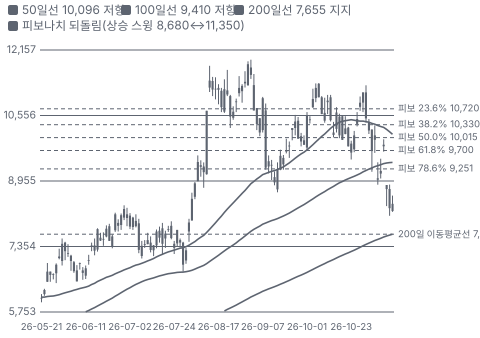

**주봉**

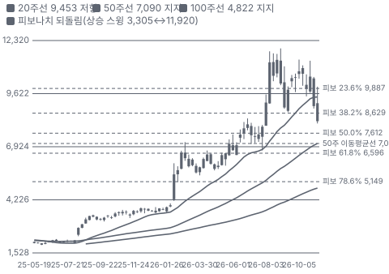

**월봉**

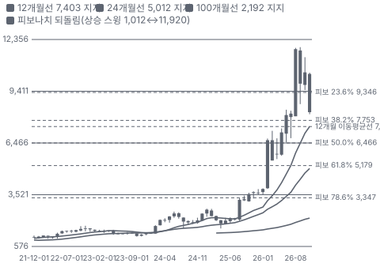

**분기 매출·EPS 실적과 컨센서스**

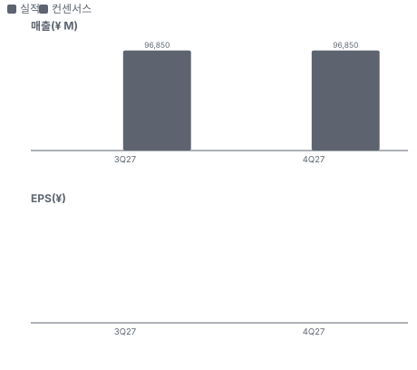

**멀티플 프리미엄(Fwd 1Y P/E 현재값 — 최근 4개 분기 추이 재료 없음(동종 분기말 배수 또는 대상 월말 배수))**

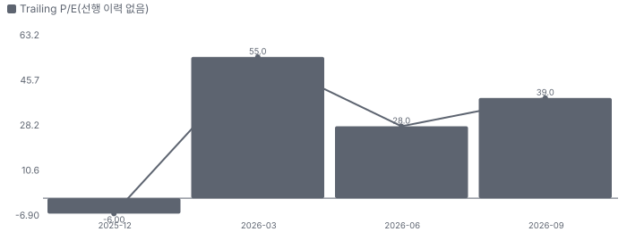

**합리적 멀티플**

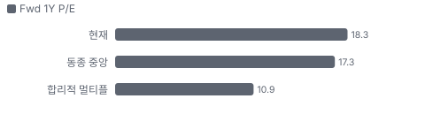

**밸류에이션 주가 시나리오**

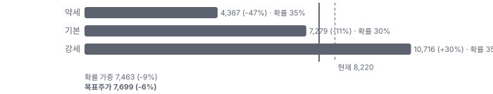

**주가별 업사이드**

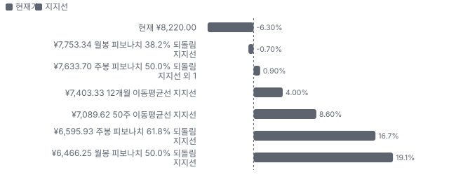
- 제품·서비스 포트폴리오

**고객 믹스(1H FY3/27, 매출 대비)**

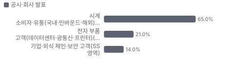

**공급 병목(10점, 낮을수록 병목)**

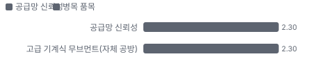

**CAPEX의 매출 대비 비중**

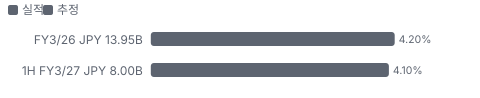

**어닝콜 변화별 주주가치 영향**

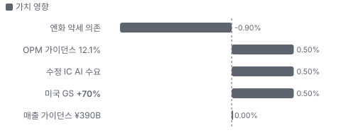

**매출 → 매출총이익 → 영업이익(매출 = 100, 최근 4분기)**

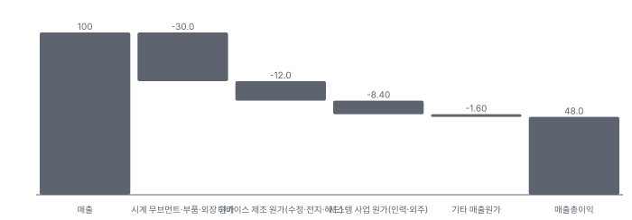

**분기 비용 비중 추이(매출 대비, 공시)**

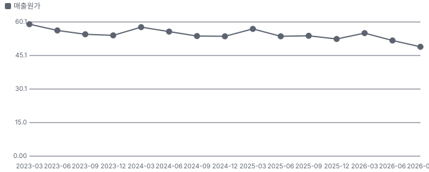

**비용 요인별 매출 대비 비중 1년 변화**

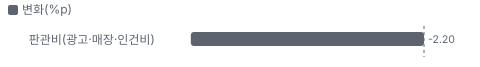

**시계(EVS) BOM 원가 몫**

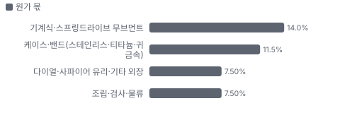

**BOM 항목 가격 +10% 시 OPM 변화**

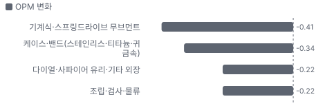

**매출 증가율의 가격·물량 분해와 8분기 전망(전년 대비)**

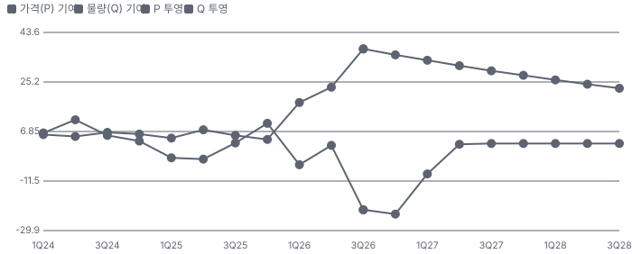

**분기별 매출 증가율 분해**

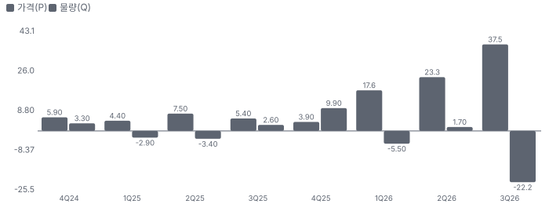

**목표주가 산정 — 기본과 강세 사이(강세 쪽 12%), 도달 확률 약 46%**

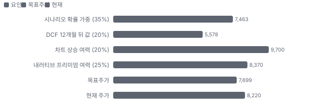

**일봉 지지·저항과 목표주가**

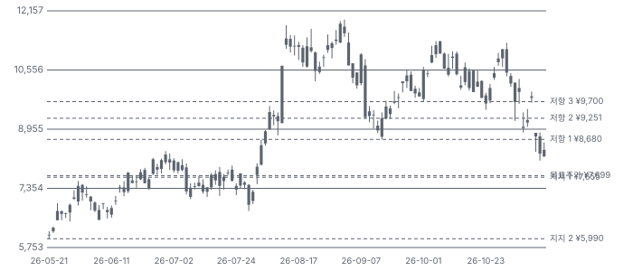

**몬테카를로**

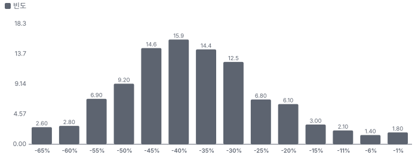

해석: 3,000번 중 35번(1%)에서 가치가 지금 주가 이상이었다. 가정을 흔들어도 지금 주가를 뒷받침하지 못하는 경우가 더 많다. 가운데 값은 0.62배이고, 열 번 중 여덟 번은 0.46~0.80배 사이에 든다.

## 내러티브

> **기업가치를 결정하는 이야기:** Fwd 1Y P/E 18.3배(12개월 선행 EPS ¥450, 추정)로 시계·명품 동종 6곳 중앙값 17.3배 수준이다. 이 값은 '일본 시계 회사'와 '명품 브랜드' 사이 어디에 세이코를 둘지의 문제다. 가치를 정하는 것은 ① 미국 그랜드세이코 성장이 엔화 효과를 빼고도 이어지는지 ② 영업이익률 12% 이상이 연간으로 굳는지 ③ DS의 AI 부품이 이익의 한 축이 되는지다

> **멀티플·EPS 프리미엄**
> **멀티플:** Fwd 1Y P/E 18.3배, 동종 6곳 중앙값 17.3배(시티즌 13.0·카시오 16.3·스와치 46.6·리치몬트 24.4·LVMH 18.3·니혼덴파고교 12.6 — 다음 회계연도 컨센서스 기준)
> **EPS:** TTM EPS ¥391 → FY3/27 컨센서스 ¥428.8(+10%) → 12개월 선행 ¥450(추정). 회사 가이던스 EPS는 약 ¥393으로 TTM보다 낮다 — 하반기 계획이 보수적이다

### 투자자들은 왜 열광했나

2025년 9월 ¥3,600대에서 10월 ¥5,000대로 뛰고, 2026년 8월 1Q 상향 다음 날 +16%로 ¥10,000을 넘어 9월 종가 고점 ¥11,810이 됐다. 미국 그랜드세이코 성장과 AI 부품이라는 두 이야기가 겹쳤다. 2Q 결산(11/10) 뒤에는 상향에도 −10.8%, 사흘 만에 ¥8,220으로 고점 대비 −30%다 — 기대가 식는 쪽이다

### 무엇이 기업가치를 바꾸나

> **구조적 체질 변화**
> **변화:** 국내 중심 시계 회사 → 미국·해외 명품 브랜드(그랜드세이코). 미국 GS(그랜드세이코, Grand Seiko) +70%·SGB +90%
> **증거:** 2Q 설명자료
> **반증:** 미국 성장률이 2분기 연속 20% 아래

> **고부가 믹스 확장**
> **변화:** 총이익률 46.2% → 49.6%(1H), 2Q 51.0%
> **증거:** 2Q 설명자료
> **반증:** 총이익률 47% 미만

> **기술 혁신**
> **변화:** AI 서버·광통신용 수정 진동자 IC 수요 — 기존 기술의 새 용도이지 신기술은 아니다
> **증거:** 2Q 설명자료
> **반증:** DS 성장 둔화

> **실행 속도**
> **변화:** 해당 없음(주문 생산이 아니라 재고를 두고 파는 소비재라 주문→인도 리드타임을 공시하지 않는다. 2Q 자료의 미국 일부 제품 품귀는 공급이 수요를 못 따라간다는 정황) **납품 리드타임 미확인.** 피어 비교 미확인. 이전 대비 미확인.
> **증거:** 2Q 설명자료
> **반증:** 품귀 해소와 매출 유지

> **M&A**
> **변화:** 1H 소규모 인수(염가 매수 차익 ¥0.4B, 대상 미공시) — 의미 있는 인수 없음
> **증거:** 2Q 설명자료
> **반증:** 해당 없음

> **정책·입법 연관성**
> **재정정책:** 해당 없음(회사를 겨냥한 재정정책 미확인) 미확인 반증: 해당 없음 의회 동의 2/10 — 하원 1/5(관련 논의 없음) · 상원 1/5(같음).
> **행정명령:** 미국 수입 관세 — 1Q 자료에 관세 환급 효과 약 ¥2.2B. 관세율이 바뀌면 미국 시계 마진에 직접 걸린다 1Q FY3/27 결산설명자료(2026-08-06, Quartr 경유 TradingView 문서 요약) https://www.seiko.co.jp/ir/ 반증: 일본산 시계 관세율 인상 의회 동의 2/10 — 하원 1/5(시계 품목 겨냥 법안 미확인) · 상원 1/5(같음).
> **연관입법:** 해당 없음(회사를 겨냥한 법안 미확인) 미확인 반증: 해당 없음

> **고객의 지출 예산**
> **변화:** 시계는 소비자 재량 지출(가처분소득·자산 효과), DS는 고객 데이터센터·광모듈 CAPEX, SS는 고객 IT OPEX
> **사업별 예산:** **매출의 65%**: 시계(EVS) — 고객 해당 없음(소비자 재량 지출(고가품)) · 동인: 미국·일본 고소득층 소비·환율
**매출의 21%**: 디바이스(DS) — 고객 CAPEX(데이터센터 서버·광모듈 투자) · 동인: AI 서버 출하
**매출의 14%**: 시스템(SS) — 고객 OPEX(기업 IT·보안 운영 예산) · 동인: DX(디지털 전환)·보안 수요
> **증거:** 사업 구조
> **반증:** 미국 고가품 소비 둔화 지표

### 내러티브 근거

> 일본 시계 회사가 그랜드세이코로 '명품 브랜드'가 되고, 덤으로 AI 데이터센터용 수정 부품까지 가진 회사라는 이야기다. 2025년 9월 ¥4,000 아래에서 2026년 9월 종가 고점 ¥11,810까지 약 3배가 됐다. 그런데 11/10 두 번째 상향에도 다음 날 −10.8%, 사흘 만에 ¥8,220이 됐다 — 시장은 하반기 순이익 계획이 상반기의 절반도 안 된다는 점과 엔화·미국 수요의 지속성을 의심한다. 동종 대비 멀티플 차이 +6% 중 회사 고유 몫은 +68%다. 단계는 확산, 쏠림은 중간이다.

> **그랜드세이코 명품화** · 강화
> **논리:** 그랜드세이코·SGB가 미국에서 크게 늘며 고가 믹스가 총이익률을 끌어올린다
> **숫자:** 미국 GS +70%·SGB +90%(2Q 누적), 총이익률 49.6%
> **반증:** 3Q EVS 매출 증가율 10% 미만
> **출처:** 2Q FY3/27 결산설명자료(2026-11-10, Quartr 경유 TradingView 문서 요약) https://www.seiko.co.jp/ir/

> **가이던스 연속 상향** · 강화
> **논리:** 회사가 1Q·2Q 연속 통기를 올렸고 컨센서스가 그 위에 있다
> **숫자:** 영업이익 가이던스 ¥33.5B → ¥41.0B → ¥47.0B
> **반증:** 3Q 결산에서 통기 유지·하향
> **출처:** 2Q FY3/27 결산설명자료(2026-11-10, Quartr 경유 TradingView 문서 요약) https://www.seiko.co.jp/ir/

> **AI 데이터센터 타이밍 부품** · 강화
> **논리:** AI 서버·광통신용 수정 진동자 IC가 DS 이익을 두 배 넘게 키운다
> **숫자:** DS 1H 영업이익 ¥2.0B → ¥4.9B
> **반증:** DS 영업이익이 2분기 연속 감소
> **출처:** 2Q FY3/27 결산설명자료(2026-11-10, Quartr 경유 TradingView 문서 요약) https://www.seiko.co.jp/ir/

> **주주환원 확대** · 유지
> **논리:** 배당을 ¥90 → ¥120으로 올렸다
> **숫자:** 연간 배당 ¥120, 배당수익률 1.5%
> **반증:** 배당 계획 하향
> **출처:** 2Q FY3/27 결산설명자료(2026-11-10, Quartr 경유 TradingView 문서 요약) https://www.seiko.co.jp/ir/

> **반대: 엔화 약세·미국 붐 정점** · 유지
> **논리:** 이익의 상당 부분이 엔화 약세(1H ¥159.5/달러)와 미국 일시 수요에서 왔다 — 되돌면 이익률이 내려간다
> **숫자:** 회사 하반기 순이익 계획 ¥9.5B = 상반기의 42%
> **반증:** 엔화 ¥145/달러 아래에서도 영업이익률 15% 유지
> **출처:** 2Q FY3/27 결산설명자료(2026-11-10, Quartr 경유 TradingView 문서 요약) https://www.seiko.co.jp/ir/

> **반대: 인바운드 의존** · 유지
> **논리:** 국내 시계 판매에 외국인 관광객 소비가 섞여 있다 — 관광 흐름이 꺾이면 국내 매출이 준다
> **숫자:** 인바운드 비중 미공시(미확인)
> **반증:** 국내 EVS 매출 2분기 연속 증가
> **출처:** 2Q FY3/27 결산설명자료(2026-11-10, Quartr 경유 TradingView 문서 요약) https://www.seiko.co.jp/ir/

이미지 없음(아직 생성 전) — 그랜드세이코·세이코 시계

## 포트폴리오

| 제품·서비스 | 구분 | 무엇 | 쓰는 곳 | 돈 버는 방식 | Mix | Mix 변화(1H EVS ¥131.1B ÷ 부문 합 ¥200.9B, 전년 ¥105.3B ÷ ¥172.6B(추정)) |
|---|---|---|---|---|---|---|
| 그랜드세이코·세이코 시계 | 제품 | 자체 무브먼트를 쓰는 기계식·스프링드라이브·쿼츠 시계 | 고가 손목시계(국내·해외 부티크·백화점) | 완제품 판매(소매·도매) | 65% | +4.0%p |
| 수정 진동자 IC·마이크로 전지 | 제품 | 기준 클록 신호를 만드는 수정 진동자 IC와 초소형 전지 | AI 서버·광통신 모듈·웨어러블 | 부품 판매 | 21% | +2.0%p |
| 시스템 솔루션 | 서비스 | IT 인프라·외식 체인 주문 시스템·보안 솔루션 | 기업 고객 | 구축·유지보수 | 14% | 미확인 |

**Mix 변화가 가장 큰 쪽은 그랜드세이코·세이코 시계(+4.0%p, 1H EVS ¥131.1B ÷ 부문 합 ¥200.9B, 전년 ¥105.3B ÷ ¥172.6B(추정)).** 계절성 판정: 분기 매출 계절 지수 기준 없음 → 직전 분기와 비교.

## 고객

> **1H FY3/27 최대 고객 시계 소비자·유통(국내·인바운드·해외, EVS 영역) 65%, 상위 3곳 100%, 집중도 집중.** 공시·회사 발표로 확인한 몫은 매출의 100%이고, 나머지 고객 몫은 추정이거나 미분해다. 소비재(시계)라 고객 집중은 낮다. 매출은 유통(백화점·전문점·자사 부티크·온라인)과 기업 고객(디바이스·시스템)으로 나뉘며 고객 이름별 비중은 공시되지 않는다

**고객별 매출 몫(1H FY3/27)**
| 고객 | 몫 | 변화 | 근거 |
|---|---|---|---|
| 시계 소비자·유통(국내·인바운드·해외, EVS 영역) | 65% | +4%p | 회사 발표 |
| 전자 부품 고객(데이터센터·광통신·프린터, DS 영역) | 21% | +2%p | 회사 발표 |
| 기업·외식 체인·보안 고객(SS 영역) | 14% | 미확인 | 회사 발표 |

> **시계 소비자·유통(국내·인바운드·해외, EVS 영역)** · 회사 발표
> **사는 것:** 그랜드세이코·세이코 글로벌 브랜드·크레도르 시계, 와코 백화점 상품
> **추정 근거:** 1H EVS 매출 ¥131.1B ÷ 부문 합계 ¥200.9B(조정 전). 전년 ¥105.3B ÷ ¥172.6B 추정 — 비중은 부문 합 기준(자체 계산)

> **전자 부품 고객(데이터센터·광통신·프린터, DS 영역)** · 회사 발표
> **사는 것:** 수정 진동자 IC·마이크로 전지·Co-Ni 합금·잉크젯 헤드
> **추정 근거:** 1H DS ¥41.7B ÷ ¥200.9B — 고객 이름 미공시

> **기업·외식 체인·보안 고객(SS 영역)** · 회사 발표
> **사는 것:** IT 인프라·주문 시스템·보안 솔루션
> **추정 근거:** 1H SS ¥28.1B ÷ ¥200.9B

## 마진 구조

> **GPM 49.6%, OPM 16.0%.** 1H FY3/26 대비 GPM +3.3%p, OPM +5.5%p. 변동비는 매출의 44%이고, 매출이 10% 늘면 OPM은 +3.7%p 움직인다. 1H 매출총이익률 49.6%(+3.4pt), 영업이익률 16.0%(+5.5pt). 영업이익 증가 ¥14.6B = 매출 증가 +¥17.7B + 총이익률 개선 +¥5.4B − 판관비 증가(회사 분해). 고가 시계(그랜드세이코) 비중과 엔화 약세가 이익률을 끌어올렸다

> **매출 100 중 매출원가 52.0, 매출총이익 48.0(최근 4분기, 공시).** 매출원가 요인 중 시계 무브먼트·부품·외장 원가이 매출의 30.0%로 가장 무겁고, 단가가 +10% 오르면 GPM이 -3.00%p 움직인다. 분기 회귀로 매출 1이 늘 때 매출원가는 0.39 늘고, 매출원가의 고정비 몫은 29%다.

**비용 요인 강도 — 비중·추세·충격(+10%)·탄력**
| 비용 | 구분 | 매출 대비 | 1년 변화 | 마진 기여 | 충격 시 마진 | 매출 탄력 | 고정비 몫 |
|---|---|---|---|---|---|---|---|
| 시계 무브먼트·부품·외장 원가 | 매출원가 요인 | 30.0% | 미확인 | 미확인 | -3.00%p | 미확인 | 30% |
| 디바이스 제조 원가(수정·전지·헤드) | 매출원가 요인 | 12.0% | 미확인 | 미확인 | -1.20%p | 미확인 | 50% |
| 시스템 사업 원가(인력·외주) | 매출원가 요인 | 8.4% | 미확인 | 미확인 | -0.84%p | 미확인 | 60% |
| 매출원가 | 공시 항목 | 52.0% | -2.5%p | +2.5%p | -5.20%p | 0.39 | 29% |

매출 탄력 = 분기 비용을 매출에 회귀한 기울기(매출 1당 변동비), 고정비 몫 = 절편 ÷ 평균 비용. 표본이 8분기 미만이면 미확인. 매출원가 요인 비중은 margin 재료의 추정이 섞여 있고, 공시 매출원가와의 차이는 '기타 매출원가'로 둔다.

**GPM에서 OPM까지(J-GAAP)**
| 기간 | GPM | 연구개발 | 판관비 | 기타 | OPM |
|---|---|---|---|---|---|
| 1H FY3/26 | 46.2% | 0.0% | 35.8% | 0.0% | 10.5% |
| 1H FY3/27 | 49.6% | 0.0% | 33.6% | 0.0% | 16.0% |

**비용을 움직이는 요인**
| 비용 | 요인 |
|---|---|
| 판관비(광고·매장·인건비, 판관비) | 브랜드 광고·해외 부티크 · 근거 공시 |
| 시계 무브먼트·부품·외장 원가(매출원가) | 고가 모델 비중·자체 무브먼트 생산 · 근거 추정 |
| 디바이스 제조 원가(수정·전지·헤드, 매출원가) | 가동률 · 근거 추정 |
| 시스템 사업 원가(인력·외주, 매출원가) | 인력 · 근거 추정 |

**시계(EVS) BOM — 매출의 65%, GPM 55%(추정 — 제품별 총이익률 미공시. 전사 49.6%보다 높게 본 값(EVS 영업이익률 21.1% = 27.7/131.1, 판관비 비중이 큰 소매 구조)), 항목 가격 +10% 시**
| 항목 | 원가 몫 | 전가 | 제품 GPM | OPM |
|---|---|---|---|---|
| 기계식·스프링드라이브 무브먼트 | 10~18% | 미확인 | -0.6%p | -0.41%p |
| 케이스·밴드(스테인리스·티타늄·귀금속) | 8~15% | 미확인 | -0.5%p | -0.34%p |
| 다이얼·사파이어 유리·기타 외장 | 5~10% | 미확인 | -0.3%p | -0.22%p |
| 조립·검사·물류 | 5~10% | 미확인 | -0.3%p | -0.22%p |
| 미분해 | 60% | - | - | - |

기계식·스프링드라이브 무브먼트 가격이 +10% 오르면 영업이익은 -2.6% 움직인다. 판매가 전가를 모르는 항목은 전가 0%로 계산했다.

**BOM 항목 가격을 움직이는 것**
| 항목 | 요인 |
|---|---|
| 기계식·스프링드라이브 무브먼트 | 그랜드세이코 무브먼트는 자체 공방 생산 — 숙련 인건비가 중심(추정) · 근거 추정 |
| 케이스·밴드(스테인리스·티타늄·귀금속) | 금속 소재값 연동 여부 미확인 · 근거 추정 |
| 다이얼·사파이어 유리·기타 외장 | 다이얼 마감이 그랜드세이코 차별 요소(추정) · 근거 추정 |
| 조립·검사·물류 | 일본 내 조립 — 미국 판매분은 관세가 붙는다 · 근거 추정 |

물가 지수를 붙이지 못한 매출원가 항목은 시계 무브먼트·부품·외장 원가, 디바이스 제조 원가(수정·전지·헤드), 시스템 사업 원가(인력·외주)다(미연결).

## 공급망 병목

이미지 없음(아직 생성 전) — 그랜드세이코·세이코 시계

> **공급망 신뢰성 2.3/10, 병목 심각.** 가장 약한 고리는 고급 기계식 무브먼트(자체 공방) 2.3점이고, 품목 평균은 2.3점이다. 근거가 부족한 1건(수정 진동자·발진 IC(집적회로 칩) 웨이퍼)은 점수에서 뺐다. 공급 사슬 세부 공시가 없다. 2Q 자료에 '미국 일부 제품 품귀'가 언급돼 고가 시계 생산 능력이 수요를 못 따라가는 정황이 있다(제품명·원인 미공시)

**병목과 마진 — 품목 가격 +10% 시 OPM**
| 품목 | 점수 | 판정 | 구분 | OPM |
|---|---|---|---|---|
| 고급 기계식 무브먼트(자체 공방, 필수) | 2.3 | 병목 심각 | 출하 차질 위험 | 미확인 |

> **고급 기계식 무브먼트(자체 공방)** · 2.3/10
> **왜:** 숙련 기능공 의존 공정은 단기 증설이 어렵다(추정)
> **병목 요인:** 인증 공급사 1곳 · 캐파 부족 · 리드타임 미확인 · 재인증 미확인 · 1위 점유율 100% · 지역 집중 미확인 · 물량 확보 내재화
> **풀리는 조건:** 미확인

**공급사**
| 품목 | 공급사 | 몫 | 근거 |
|---|---|---|---|
| 고급 기계식 무브먼트(자체 공방) | 세이코 그룹 내제(무브먼트 조립·조정) | 미확인 | 회사 발표 |
| 수정 진동자·발진 IC 웨이퍼 | 미공시(IC 웨이퍼 제조(외부 파운드리 여부 미확인)) | 미확인 | 추정 |

## 생산능력

> **현재 명목 캐파 미확인, 가동률 미확인.** 착공 이상 증설은 0 미확인, 발표까지 합치면 0 미확인이다. FY3/26 CAPEX는 JPY 13.95B로 매출의 4.2%다. 회사는 시계·디바이스 생산능력을 수치로 밝히지 않는다. FY3/27 투자 계획 ¥12.7B(8/7 계획 유지)

**생산시설 1곳**(회사 자료에서 이름을 확인한 시설 1곳만 센다(생산 거점 전체 수는 미확인) — 유가증권보고서 '설비의 상황'을 이번 회차에 열지 못해 생산 거점 수는 미확인. 회사가 자료에서 이름을 밝힌 시설만 적는다), 미확인 1곳. 시설별 생산능력은 공개되지 않았다 — 회사 전체 캐파만 위에 적었다.

**생산시설 1곳 — 명칭·위치·생산능력**
| 시설 | 위치 | 용도 | 생산능력 | 소유·상태 |
|---|---|---|---|---|
| 와코 본관(긴자) | 일본 도쿄 주오구 긴자 | 소매(백화점·부티크) — 생산시설 아님 | 미확인 — 소매 시설 | 미확인 · 가동 |

**생산능력 확충 계획**
| 계획 | 단계 | 증설 | 가동 시점 | CAPEX |
|---|---|---|---|---|
| FY3/27 설비투자 | 발표 | 미확인 | 2027-03 | JPY 12.70B |

남은 계획의 CAPEX 합계는 JPY 12.70B다. 합계는 1H FY3/27 매출의 6%다.

**증설 방해 요인**
| 계획 | 방해 요인 |
|---|---|
| FY3/27 설비투자 | 미확인(회사가 막힘 요인을 밝히지 않았다) |

**CAPEX와 매출 대비**
| 기간 | CAPEX | 매출 | 매출 대비 | 구분 |
|---|---|---|---|---|
| FY3/26 | JPY 13.95B | JPY 335.69B | 4.2% | 실적 |
| 1H FY3/27 | JPY 8.00B | JPY 196.30B | 4.1% | 추정 |

## 해자

> 해자는 브랜드(그랜드세이코)와 자체 무브먼트 수직 통합이다. 디바이스 쪽은 수정 진동자 IC 같은 틈새 부품이다 — 점유율 수치는 미공시

> **브랜드 가격 결정력** · 강함
> **해자:** 그랜드세이코가 미국에서 현지 통화 기준 약 70% 늘며 총이익률이 49.6%로 올랐다
> **근거:** 2Q 설명자료
> **숫자:** 1H 총이익률 49.6%(+3.4pt)
> **깨지는 조건:** 엔화 강세 구간에서 총이익률이 46% 아래로

> **수직 통합(무브먼트·부품)** · 보통
> **해자:** 무브먼트와 수정 진동자를 자체 생산
> **근거:** 회사 사업 설명
> **숫자:** 미확인
> **깨지는 조건:** 외부 무브먼트 의존 확대

> **AI 부품 틈새** · 약함
> **해자:** AI 서버·광통신용 수정 진동자 IC 수요 강화
> **근거:** 2Q 설명자료
> **숫자:** DS 1H 영업이익률 11.8%
> **깨지는 조건:** DS 영업이익률이 2분기 연속 8% 미만

## 경영진·네트워크

> 경영진 이름·경력은 이번 회차에 1차 자료로 대조하지 못했다(미확인)

> **미확인** · 대표이사 · 미확인
> **프로필:** 미확인
> **비즈니스:** 미확인
> **정계:** 미확인
> **동문:** 미확인
> **사모임:** 미확인

**네트워크 정량화**
| 연결 | 강도 | 닿는 매출 | 가중 노출 | 매출 대비 | 근거 |
|---|---|---|---|---|---|
| 비즈니스: 미확인 — 공개 연결 기록 미대조 | 0/5 | ¥0.00B | ¥0.00B | 0% | 공개 자료 미대조 미확인 |

가중 노출은 연결이 닿는 매출의 크기다. 연결이 그 매출을 만들었다는 뜻이 아니며, 인과는 공개 자료로 입증하지 못한다.

## 약세 논리 및 셀온 조건

| 강세 논리 | 근거 | 반박 | 가를 자료 |
|---|---|---|---|
| 하반기 계획은 보수적이다 | 하반기 영업이익 계획 ¥15.6B는 전년 하반기 ¥14.1B와 비슷한데 상반기는 +86% | 4Q(1~3월)는 원래 약하다 — 전년 4Q EPS ¥17.7 | 3Q 영업이익(2027년 2월 결산) ¥12B 이상 |
| 미국 성장은 환율이 아니다 | 그랜드세이코 약 +70%·SGB 약 +90%(현지 통화) | 미국 품귀로 성장 일부가 공급에 막혔고, 관세 변화가 마진에 직접 걸린다 | 3Q 미국 매출 증가율·관세율 |
| AI 부품이 새 축이다 | DS 1H 영업이익 ¥2.0B → ¥4.9B, 수정 진동자 IC 수요 강화 | DS는 전사 영업이익의 16%다 | DS 영업이익 2분기 연속 증가 |
| 컨센서스가 가이던스 위 | FY3/27 EPS 컨센서스 ¥428.8 vs 가이던스 약 ¥393 | 커버리지 4명 — 표본이 작다 | 3Q 뒤 추정 수정 |
| 주주환원 확대 | 배당 ¥90 → ¥120 | 배당수익률 1.5%로 배수를 받칠 크기는 아니다 | 자사주 매입 발표 여부 |

데이터 공백: 1순위 재무·컨센서스 데이터 서비스가 이 회사를 다루지 않아 재무는 공개 시세 서비스의 분기 재무와 회사 결산설명자료 요약으로, 컨센서스는 공개 시세 서비스(4명)로 채웠다. 결산단신(일본 상장사의 분기 실적 속보 공시, 決算短信) 원문·유가증권보고서·어닝콜 질의응답을 열지 못해 지역별 매출, 생산 거점 수와 캐파, 인바운드 비중, 경영진은 미확인이다. 3Q·4Q FY3/26 분기 영업이익은 분기 EBITDA에서 뺀 추정이고, 다음 4개 분기 EPS ¥450과 Fwd 2Y·3Y EPS는 모델 외삽이다. 분기 발표 직전 컨센서스가 없어 서프라이즈 표가 빠졌다.

> **셀온 조건**
> **조건 1:** 3Q(10~12월) 영업이익이 ¥10B 아래 — 상반기 이익률이 계절이 아니라 정점이었다는 뜻
> **조건 2:** 엔화가 ¥145/달러 쪽으로 가며 총이익률이 47% 아래로 내려간다
> **조건 3:** 미국 그랜드세이코 성장률이 현지 통화로 20% 아래
> **조건 4:** 일본산 시계에 대한 미국 관세율 인상
> **조건 5:** FY3/28 첫 가이던스가 FY3/27 실적보다 낮다

## 어닝콜 변화

**직전 콜 대비 새로 나오거나 바뀐 내용 → 가치 영향**
| 항목 | 내용 | 직전 콜 | 최신 콜 | 모델 동인 이동 | 확신도 | 가치 영향 |
|---|---|---|---|---|---|---|
| 업데이트 | 통기 매출 가이던스 | ¥375.0B(8/6) | ¥390.0B(11/10) | 기준연도 매출 +0.04 BJPY(십억 엔 단위) | 0.8 | +0.0% |
| 업데이트 | 통기 영업이익률 | 10.9%(¥41.0B/¥375B) | 12.1%(¥47.0B/¥390B) | 출발 이익률 +1.2% | 0.8 | +0.5% |
| 신규 | DS AI 데이터센터 수요 | 1Q '타이밍 디바이스 수요 증가' | AI 서버·광통신용 수정 진동자 IC·Co-Ni 합금 수요 강화, DS 1H 영업이익 ¥2.0B → ¥4.9B | 1년차 성장률 +1.0% | 0.8 | +0.5% |
| 업데이트 | 미국 시계 성장 | 1Q '세계 전 지역 성장' | 그랜드세이코 약 +70%·SGB 약 +90%(2Q 누적, 현지 통화) | 1년차 성장률 +1.0% | 1.0 | +0.5% |
| 부정 | 환율 전제 | 1Q 환율 효과 매출 +¥3.8B·영업이익 +¥1.3B | 1H 평균 ¥159.5/달러 vs 계획 ¥155 — 엔화가 계획대로 가면 하반기 이익 감소 | 목표 이익률 -0.50% | 0.5 | -0.9% |
| **합계** | 단독 합 |  |  | 동시 적용 +0.6% |  | **+0.6%** |

**실적 발표 예상 변동폭:** 지난 3번 실적 발표 때 주가는 하루에 평균 ±4.7%(최대 11.0%, 오른 날 1번) 움직였다.

**실적 발표 예상 변동폭 — 과거 실적 발표 다음 거래일 주가 변화**
| 분기 | 발표일 | 주가 변화 |
|---|---|---|
| 4Q26 | 2026-05-12 | +1.6% |
| 1Q27 | 2026-08-06 | -1.4% |
| 2Q27 | 2026-11-10 | -11.0% |

## P·Q 사이클

> **P 사이클 — 최근 4분기 평균 가격 기여 +20.6%, 물량 기여 -4.0%(전년 대비 로그 증가율).** P 강도 6.8/10, Q 강도 4.0/10, 최근 8분기 중 88%가 같은 요인 우세(구조적). 전망으로는 8분기 안에 전환 신호가 없다(물량은 컨센서스를 섞었다).

**P·Q 사이클 정량**
| 항목 | 가격(P) | 물량(Q) |
|---|---|---|
| 최근 4분기 평균 기여 | +20.6% | -4.0% |
| 강도(0~10, 자기 이력 z) | 6.8 | 4.0 |
| 고유 주기(자기회귀모델 과거 2개 시점일 때) | 미확인 | 미확인 |
| 다음 4분기 투영 평균 | +32.3% | -7.2% |
| 4분기 뒤 투영(80% 범위) | +29.4% (+16.3%~+42.6%) | +2.4% (-10.8%~+15.5%) |
| 장기 평균(표본 → 기저율 수축) | -20.6% → -5.7% | -0.8% → +2.5% |
| 투영 모형 | 자기회귀모델(과거 1개 시점) | 자기회귀모델(과거 1개 시점) + 컨센서스(분기 컨센서스 2개) |

가격 근거: 미국 PPI(생산자물가지수) 인쇄회로기판 대용 — 회사 판매가가 아니라 업종 가격. PPI를 쓰면 회사 판매가가 아니라 업종 가격 대용이다. 로그 증가율이라 가격·물량 기여의 합이 매출 증가율이다. 전망: 가격은 BIC(모형 차수를 고르는 정보 기준)로 차수를 고른 자기회귀모델에 이미 발표된 월간 가격을 먼저 넣고(나우캐스트), 물량은 자기회귀모델과 '컨센서스 매출 증가율 − 가격 전망'을 분산 역수로 섞는다. 장기 평균은 표본 평균을 장기 기저율(가격 연 2%·물량 연 4%) 쪽으로 줄인다 — 고성장 구간만 담긴 표본이 그 성장을 끝없이 잇지 않게. 범위는 4분기 겹친 표본의 자기상관을 반영한다. 모형 산출이며 가이던스가 아니다. 회사 판매가로 잴 수 없는 이유: 판매 개수·평균 단가 미공시

10년 위치·프리미엄: TTM 표본 12개로 20개에 못 미친다 — quarters.js로 분기 44개를 다시 받으면 나온다.

## 밸류에이션

> **목표주가 ¥7,699, 업사이드 -6%.** 자리는 기본과 강세 사이(강세 쪽 12%)이고 도달 확률은 약 46%다. 기본 ¥7,279, 강세 ¥10,716(+30%), 약세 ¥4,367(-47%). DCF 기준 업사이드는 기본 -38%, 강세 -33%, 약세 -42%다(WACC 9.5%).

배수 기준 기본 ¥7,279는 다음 4개 분기 EPS ¥450(추정)에 선정 배수 16.2배를 곱한 값이고, DCF 기본 업사이드는 −38%다. 둘 다 현재가 아래다. 배수는 동종 중앙값(17.3배)에서 엔화·미국 붐 위험을 반영해 10% 낮췄다(판단 조정). DCF는 매출 성장이 FY3/28 6%에서 장기 2%(일본 명목)로 내려가고 영업이익률이 12.5% 근처에 머문다고 둔다 — 1H 16.0%는 계절 강세라 연간으로 보지 않았다. DCF가 더 낮은 이유는 높은 지금 배수를 정당화할 장기 성장을 가정하지 않기 때문이다. 약세 ¥4,367은 EPS ¥360, 강세 ¥10,716은 EPS ¥530에 Fwd 1Y P/E 20.2배다.

시나리오 확률: 다음 해 매출 성장 분포로 계산 — 약세 +4.8% 아래·강세 +7.2% 위 확률. 내부 관점(컨센서스 +6.0%, σ 6.5%: 추정 범위 없음 — 5% + 0.25 × |성장률|) 100% — 외부 관점 꺼짐(SEC 전 상장사 표본 없음) · 모델 조정: 사상 최고 실적·상향 뒤라 이익률 정점 위험을 더 무겁게 본다

> **약세 ¥4,367 (-47%)** · 확률 35%
> **가정:** 12.1배 × EPS ¥360.00
> **근거:** 엔화가 ¥145/달러 쪽으로 강해지고 미국 시계 붐이 식어 EVS 성장이 한 자릿수로 내려간다. 영업이익률 10~11%. 다음 4개 분기 EPS ¥360

> **기본 ¥7,279 (-11%)** · 확률 30%
> **가정:** 16.2배 × EPS ¥450.00
> **근거:** FY3/27 컨센서스(EPS ¥428.8)를 지키고 FY3/28 상반기 이익이 8% 늘어 영업이익률 12~13%. 다음 4개 분기 EPS ¥450(추정)

> **강세 ¥10,716 (+30%)** · 확률 35%
> **가정:** 20.2배 × EPS ¥530.00
> **근거:** 미국 그랜드세이코 성장이 이어지고 DS가 AI 부품으로 이익을 더 늘려 영업이익률 14%. 다음 4개 분기 EPS ¥530

**멀티플 선정 — Fwd 1Y P/E**
| 단계 | 조정 | 근거 |
|---|---|---|
| 동종 중앙값 | 17.3배 | 범위 12.6~46.6배, 6곳 · 이상치 제외 리치몬트 ev_sales 4.3 |
| 펀더멘털 | +0% | 합리적 멀티플 10.9배는 쓰지 않음 — 심리 배율 표본 3곳·동종 중앙값의 0.6배 |
| 해자 | -2% | 브랜드 가격 결정력 강함 · 수직 통합(무브먼트·부품) 보통 · AI 부품 틈새 약함 — 점수 4.0%에서 동종 기준 5.5%를 뺌 |
| 반복 매출 | +0% | 재료 없음 |
| 수주 전환·가시성 | +0% | 가시성 재료 없음 |
| 내러티브 | +5% | 단계 확산 |
| 사이클·실행 판단 | -10% | 동종 중앙값에는 스와치(이익 급감으로 46.6배)와 리치몬트 24.4배가 섞였다. 세이코 이익은 2Q 누적 미국 시계 매출 급증과 엔화 약세(1H 평균 ¥159.5/달러, 계획 ¥155)를 탔다 — 환율·미국 수요가 되돌면 이익률이 내려갈 수 있어 10% 낮춘다 |
| **선정** | **16.2배** | 지금 18.3배 |

**동종 레인지**
| 회사 | Fwd 1Y P/E | 성장 | 영업이익률 | ROIC |
|---|---|---|---|---|
| 시티즌 | 13.0 | 24% | 12% | 13% |
| 카시오 | 16.3 | 17% | 12% | 21% |
| 스와치 | 46.6 | 0% | 2% | - |
| 리치몬트 | 24.4 | 8% | 23% | - |
| LVMH | 18.3 | -4% | 22% | - |
| 니혼덴파고교 | 12.6 | 11% | 6% | 6% |
| **Seiko Group** | 18.3 |  |  |  |

몬테카를로 중앙값 업사이드 -38%.

> 의사결정 보조(투자자문 아님): ① 매수 매력: 5년 보유 가정 연 기대수익 -0.1% — 주주가 요구하는 수익률(자기자본비용) 9.9%보다 -10.0%p · 요구수익률을 넘을 확률 1% · 안전마진 없음(비관적 경우(하위 10%) 가치가 시총의 46%) → 정량 신호 약함 / ② 위험 예산 지표(이론): 0% — 기대수익이 요구수익률에 못 미친다(켈리 기준 — 수익·손실 확률로 계산한 이론상 최대 노출 — 0%는 참고) · 5년 뒤 나쁜 경우(하위 10%) -25% · 30% 넘게 잃을 확률 6% / ③ 상방(5년): 평균 1.00배 · 2배 이상 확률 0% · 3배 이상 0% · 10배 이상 0% · 잘 풀린 경우(상위 10%) 1.26배 이상

## 매수 위치(일봉)

> **현재가 ¥8,220는 '지지 근접'(가장 가까운 일봉 지지 ¥7,655에서 ATR 0.8배 위).** 이 자리에서 목표주가까지 -6.3%, 첫 일봉 저항까지 +5.6%, 다음 지지까지 하방 -6.9%, 손익비 -0.9배. 손익비는 지지 1 ¥7,655에서 0.0배로 가장 높다(목표주가까지 +0.6%).

**가격대별 업사이드(일봉 기준)**
| 가격대 | 가격 | 목표주가까지 | 첫 저항까지 | 다음 지지까지 | 손익비 | 근거 기법(강도) |
|---|---|---|---|---|---|---|
| 현재가 | ¥8,220 | -6.3% | +5.6% | -6.9% | -0.9 | - |
| 지지 1 | ¥7,655 | +0.6% | +13.4% | -21.7% | 0.0 | 200일선(1.0) |
| 지지 2 | ¥5,990 | +28.5% | +27.8% | 미확인 | 미확인 | 120일 지그재그 저점(0.8) |

**일봉 저항**
| 저항 | 가격 | 현재가 대비 | 근거 기법(강도) |
|---|---|---|---|
| 저항 1 | ¥8,680 | +5.6% | 120일 지그재그 저점 · 스윙 저점(1.8) |
| 저항 2 | ¥9,251 | +12.5% | 피보 78.6%(1.0) |
| 저항 3 | ¥9,700 | +18.0% | 피보 61.8%(1.0) |

일봉만 쓴다(주봉·월봉 제외). 손익비 = 목표주가까지 업사이드 ÷ 다음 지지까지 하방. 가격대별 기대값 참고표이며 매수·매도 시점 지시가 아니다.

## 애널리스트 토론

> **토론 결론 Neutral(규칙 등급 Neutral).** 연속 상향·현지 통화 미국 성장 반박이 살아남았지만, 엔화·계절성·표본 4명 반박도 살아남았다. 목표주가가 현재가 아래(−6%)라 규칙 등급 Neutral을 출발점으로 둔다

**패널 — 등급별 자리**
| 자리 | 핵심 논리 | 틀리는 조건 | 최종 투표 |
|---|---|---|---|
| Strong Buy | 두 번 올린 가이던스도 보수적이다 — 컨센서스 EPS가 가이던스보다 9% 높고, 주가는 고점 대비 −30%다 | 3Q 영업이익 ¥12B 미만 | Buy |
| Buy | 그랜드세이코의 미국 성장은 환율을 빼도 현지 통화로 +70%다 | 3Q EVS 증가율 10% 미만 | Buy |
| Neutral | 회사 자신이 하반기 순이익을 상반기의 42%로 잡았다. 계절성인지 정점 신호인지 아직 가를 수 없다 | 3Q 순이익 ¥8B 이상 | Neutral |
| Sell | 엔화가 계획 ¥155로 가면 이익이 깎인다 — 1H 평균 ¥159.5였다 | 엔화 강세에도 영업이익률 15% 유지 | Neutral |
| Strong Sell | 주가가 1년 만에 3배가 된 건 소비재 회사의 이익 정점을 사는 것이다 — 상향 다음 날 −10.8%가 그 신호다 | FY3/28 가이던스가 FY3/27보다 높게 나온다 | Sell |

**투표**
| Strong Buy | Buy | Neutral | Sell | Strong Sell |
|---|---|---|---|---|
| 0 | 2 | 2 | 1 | 0 |

> **개회 · Strong Buy**
> **발언:** 상반기 영업이익 ¥31.4B는 전년의 1.9배다. 연간 ¥47.0B면 하반기는 ¥15.6B로 전년 하반기 ¥14.1B와 비슷하다 — 보수적이다

> **개회 · Buy**
> **발언:** 미국 그랜드세이코 +70%는 현지 통화 기준이다. 환율이 아니라 물량·가격이다

> **개회 · Neutral**
> **발언:** DS 영업이익 ¥4.9B는 아직 전사의 16%다. AI 이야기만으로 배수를 바꾸기엔 작다

> **개회 · Sell**
> **발언:** 상반기 평균 환율이 계획보다 4.5엔 약했다. 그 몫이 하반기에는 없다

> **개회 · Strong Sell**
> **발언:** 1년 만에 주가가 3배가 됐고, 두 번째 상향 다음 날 −10.8%였다. 좋은 소식이 더는 주가를 올리지 못한다

> **반박1 · Buy → Sell**
> **발언:** 1Q 환율 효과는 영업이익 +¥1.3B였다. 분기 영업이익 ¥15B대에서 환율만으로 설명되는 몫은 10% 안팎이다

> **반박1 · Strong Sell → Strong Buy**
> **발언:** 커버리지 4명이 모두 매수다. 표본이 작아 '보수적 가이던스'는 이미 가격에 들어 있을 수 있다

> **반박1 · Neutral → Buy**
> **발언:** 미국 품귀가 있다는 건 다음 분기 성장의 일부가 공급에 막힌다는 뜻이기도 하다

> **반박1 · Sell → Neutral**
> **발언:** DS가 작다는 데 동의한다. 이익을 끄는 건 시계이고, 시계는 소비 경기와 환율을 탄다

> **반박1 · Strong Buy → Strong Sell**
> **발언:** −10.8%는 50일선 ¥10,000 위에서 나온 차익 실현이다. 실적 추정은 그날 내려가지 않았다

> **반박2 · Neutral → Strong Buy**
> **발언:** 하반기에는 1~3월(4Q)이 들어 있다 — 전년 4Q EPS는 ¥17.7에 그쳤다. 하반기 계획이 낮은 건 계절성 탓이 크다

> **반박2 · Buy → Strong Sell**
> **발언:** Fwd 1Y P/E 18.3배는 리치몬트 24.4배보다 낮고 시티즌 13.0배보다 높다 — 명품 쪽으로 다 옮겨 간 값이 아니다

> **반박2 · Sell → Buy**
> **발언:** 총이익률 49.6%는 엔화 약세의 해에 나온 값이다. 엔화가 강하던 해와 비교할 자료가 아직 없다

> **반박2 · Strong Sell → Neutral**
> **발언:** 인바운드 비중을 회사가 밝히지 않는다. 관광 수요가 꺾이면 국내 매출도 같이 빠진다

> **반박2 · Strong Buy → Sell**
> **발언:** 배당을 ¥90에서 ¥120으로 올렸다. 회사가 이익의 지속을 믿는다는 신호다

> **최종 · Strong Buy**
> **발언:** 3Q 영업이익이 ¥12B를 넘으면 가이던스는 다시 오른다

> **최종 · Buy**
> **발언:** 미국 성장이 현지 통화로 이어지는 한 배수는 지킨다

> **최종 · Neutral**
> **발언:** 엔화와 미국 수요를 뺀 이익을 확인하기 전에는 판단을 크게 옮기지 않는다

> **최종 · Sell**
> **발언:** 엔화 강세 구간의 이익률을 봐야 한다

> **최종 · Strong Sell**
> **발언:** 소비재 이익 정점의 할인을 반영해야 한다

남은 반대 의견: Strong Sell 자리: 주가 3배 뒤 상향에도 빠진 것은 이익 정점 신호다

패널은 등급별 논리를 대표하는 자리이고 실존 IB의 의견이 아니다.

## 커뮤니티 반응

언급 적음 — Quantral 미수록

## 시장 평가

> **셀사이드(IB 애널리스트)**
> **한 줄:** 커버리지가 4명뿐이고 모두 매수다. 컨센서스 EPS가 가이던스보다 11% 높아, 회사가 하반기를 보수적으로 잡았다고 본다
> **의견 분포:** 4명 모두 매수 — 4명
> **목표가 평균:** ¥13,600 — 현재가 +65%
> **FY3/27 EPS 컨센서스:** ¥428.8 — 가이던스 ¥393 위

> **바이사이드(기관 투자자)**
> **한 줄:** 일본에는 13F 같은 분기 보유 공시가 없어 보유 변화는 미확인. 내부자 33%는 창업가 계열·법인 지분을 포함한 값으로 보인다(구성 미대조)
> **기관 보유:** 27.5% — 공개 시세 개요
> **내부자 보유:** 33.1% — 공개 시세 개요

> **언론·업계**
> **한 줄:** 일본 시황 매체 보도는 이번 회차에 확인하지 못했다
> **보도 초점:** 미확인

## 체크리스트

| 시점 | 무엇 | 의미 |
|---|---|---|
| 2027-02 초(예정) | 3Q FY3/27 결산 — EVS·DS 매출·영업이익, 환율 효과 | 연말 수요와 이익률 16% 유지 여부 |
| 매월 | 스위스 시계 수출 통계(미국행)·일본 백화점 고가품 매출 | 미국·인바운드 수요의 외부 확인 |
| 수시 | 엔/달러 환율(계획 ¥155) | 달러 ¥1당 매출 약 ¥0.26B |
| 2027-05(예정) | FY3/27 결산·FY3/28 첫 가이던스 | 이익 성장이 이어지는지 |

## 출처
- 2Q FY3/27 결산설명자료(2026-11-10) https://www.seiko.co.jp/ir/
- 1Q FY3/27 결산설명자료(2026-08-06) https://www.seiko.co.jp/ir/
- 시세·분기 재무·동종(TradingView) https://www.tradingview.com/symbols/TSE-8050/
- 2Q FY3/27 결산설명자료(2026-11-10, Quartr 경유 TradingView 문서 요약) https://www.seiko.co.jp/ir/
- 업계 구조(추정)
- 원가 내역 미공시
- 회사 사업 설명(자체 무브먼트) — 원가 비중 미공시

_구매 등급·목표주가 모두 규칙이 계산한 모델 값으로, 개인의 보유 종목·자금 사정을 반영하지 않는다 · 공개 자료 기반 분석이며 투자 권유가 아님 · 1차 판정, 미검증 · Chiip ten-bagger_