# 텐배거 리포트 2026-11-15 — 이익 추정은 15% 올랐는데 주가는 고점의 절반, 데이터센터 MEP 시공사를 시장이 정점 경기주로 다시 값매겼다

> 2026-11-15 · Comfort Systems USA(FIX) · 기업: 미국 데이터센터·반도체 팹·병원 등의 냉난방·배관·전기 설비를 시공하고 공장에서 만든 모듈러 설비를 공급하는 MEP 시공사

## Chiip View

이익은 남고 배수만 꺼졌다. 3Q 매출 \$3.77B(+54%)·EPS \$13.91은 컨센서스를 넘었고 수주잔고는 \$17.81B(+90%)로 사상 최대다. 그런데 주가는 6월 종가 고점보다 46% 낮고 Fwd 1Y P/E는 44배에서 17.4배가 됐다. 선정 배수 17.0배로 매긴 목표주가는 \$1,062로 지금보다 5% 낮고, 장기 영업이익률을 11%로 되돌린 DCF 기본은 −33%다 — 지금 값은 이미 동종 수준 배수를 반영한다(Neutral). 상방은 정점 이익률 16.7%가 2027년에도 유지된다는 증거가 열어 준다. 가를 자료는 12/10 텍사스 대형 부하 결정과 2월 4Q 매출총이익률·잔고다.

## 대시보드
| 항목 | 값 | 설명 |
|---|---|---|
| 주가 | \$1,112.50 | 고점 대비 -46% · 1년 +24% |
| 시가총액 | \$39.10B | 완전 희석 기준 · EV \$37.32B |
| 업사이드 | -5% | 목표주가 \$1,062 · 다운사이드 -34% · 손익비(강세÷약세) 1.6 |
| 구매등급 | Neutral | 애널리스트 13명: Strong Buy 12 · Buy 0 · Neutral 1 · Sell 0 · Strong Sell 0 |
| 멀티플 | Fwd 1Y P/E 17.4배 | 동종 중앙값 16.4배 |
| 가이던스 | 없음 | 회사가 숫자를 내지 않았다 |
| 알파 | 5.5/10 | 텐배거 가능성 점수 |
| 이벤트 | 4Q26 실적(날짜 미공지, 전년 2/19 기준 추정) — 그 전 12/10 ERCOT·PUCT 대형 부하 결정 | 2027-02-18 |

## 한 장 요약
- **기업가치를 결정하는 내러티브** Comfort Systems의 기업가치는 **잔고 \$17.81B가 2027년 EPS \$66~67로 바뀌는가**와 **그 이익에 시장이 몇 배를 주는가**로 갈린다. 넉 달 동안 이익 추정은 15% 올랐지만 Fwd 1Y P/E는 44배에서 17배로 내려가 주가가 절반이 됐다. 지금 값은 데이터센터 MEP(기계·전기·배관 설비 시공) 시공사를 '정점 이익을 낸 경기순환주'로 본다는 뜻이다
- **밸류에이션 모델로 본 주가 상방은 어디까지인가?** **목표주가 \$1,062(-5%), 약세와 기본 사이(약세 쪽 28%)다.** 강세 \$1,695(+52%)는 Fwd 1Y P/E 21.2배를 강세 EPS에 적용한 값이다. 기본 \$1,187, 약세 \$738. 손익비 1.6, DCF 기준 업사이드 -33%.
- **수주는 어디까지 왔나?** 수주잔고 \$17.82B(= 잔여 이행 의무)
- 기계 부문 잔고(전통 시공 + 모듈러(공장에서 미리 조립해 현장으로 옮기는 설비 묶음, 전기실·냉각 플랜트 등)) — 확정 · \$12.21B · 진척 비공개 · 2028 종료
- 전기 부문 잔고 — 확정 · \$5.61B · 진척 비공개 · 2028 종료
- Frontier Lab(초대형 AI 모델 개발사)·코로케이션(여러 고객에게 데이터센터 공간을 빌려주는 사업)용 모듈 제품 — 미확정
- 애리조나 반도체 프로젝트 다음 단계 — 미확정
건별 진척은 공개되지 않는다. 잔고 \$17.81B(전년 +90%) 중 12개월 안 65~75%가 매출이 된다. 3Q 한 분기에 잔고가 \$3.75B 늘었다(동일점포 +\$3.67B)
- **누가 사 주나?** 최대 고객 기술 고객 합계(데이터센터·반도체 팹 등, Technology) 59%, 상위 3곳 83%. 공시·회사 발표로 확인한 몫은 83%다.
- **마진과 공급망은 어디가 약한가?** GPM 24.8%, OPM 16.4%. OPM을 가장 흔드는 BOM(제품 원가를 이루는 부품·재료 명세) 항목은 현장 인건비(배관·용접·HVAC(냉난방·공조 설비) 기능공)이고 가격 +10%에 -2.31%p다. 공급망 신뢰성은 8.3/10(병목 낮음)이고 가장 약한 고리는 전선·케이블(구리)이다.
- **생산능력은 얼마나 늘어나나?** 현재 명목 캐파 25,000 인력(명)·모듈러 공간(제곱피트), 착공 이상 증설 0 인력(명)·모듈러 공간(제곱피트). FY2027 CAPEX는 매출의 4.0%다.
- **지금 가격은 무엇을 가정하나?** Fwd 1Y P/E 17.4배로 동종 중앙값 16.4배보다 6% 높을 뿐이다. 동종보다 영업이익률이 2.5배이고 잔고 성장이 훨씬 빠른데도 프리미엄을 거의 주지 않는다는 뜻이다. 시장은 FY27 EPS 컨센서스 \$66~67이 정점 이익에 가깝고 그 뒤 성장이 빠르게 식는다고 본다.
- **왜 움직였나?** 6월 종가 고점보다 46% 내렸다. 같은 기간 FY27 EPS 추정은 15% 올랐으니 하락은 전부 배수 축소다. 하락은 세 번에 몰렸다. 7~8월 AI CAPEX 정점 논쟁과 내부자 매도, 10/23 3Q 실적 다음 날 −9.3%(매출총이익률 하락·CFO 은퇴·숫자 가이던스 없음), 11/4~5 중간선거 뒤 텍사스 데이터센터 규제 위험으로 이틀 −25%다.
- **3Q 콜에서 무엇이 바뀌었나?** FY26 동일점포 성장(인수 효과를 뺀 기존 사업 매출 성장) 전망이 중·후반 30%대에서 중반 40%대로 올랐고, FY27 중반 20%대가 처음 나왔다. 모듈러 공간 목표는 2027말 약 600만 제곱피트로 커졌다. 나빠진 것은 매출총이익률(전분기보다 1.1%p 하락, 장비·자재 선투입 탓)과 CFO 교체다. 신규 모듈러 고객은 생산 중이지만 지급 조건 합의 전이라 장기 계약이 아니다.
- **판단이 바뀌는 조건은?** 올라갈 조건은 12/10 텍사스 결정이 대형 부하 연결을 늦추지 않고, 4Q에 잔고가 다시 늘며 매출총이익률이 25% 근처로 돌아오는 것이다. 내려갈 조건은 잔고가 2개 분기 연속 줄거나(수주 < 매출) 매출총이익률이 23% 아래로 내려가는 것, 텍사스 주 의회가 데이터센터 인허가를 늦추는 법안을 위원회에서 통과시키는 것이다.

## 한눈에 보기

**일봉**

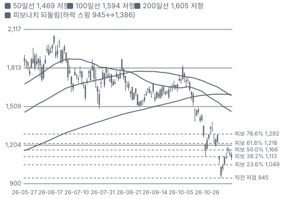

**주봉**

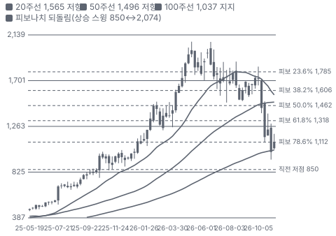

**월봉**

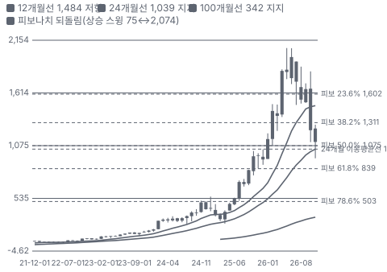

**분기 매출·EPS 실적과 컨센서스**

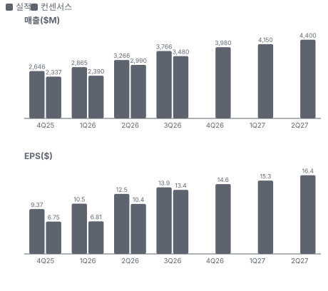

**4Q26 매출 — 지표 추세 vs 가이던스·컨센서스**

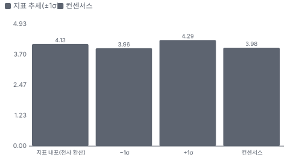

**최근 4개 분기 주가 변화 분석**

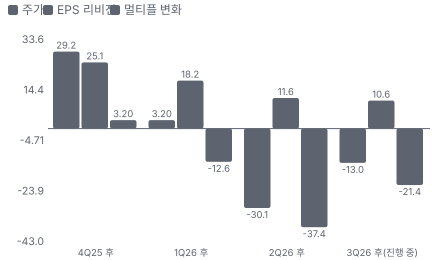

**EPS 리비전**

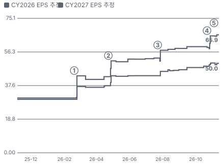

① 26-02-19 4Q25 실적·잔고 \$11.94B · EPS 리비전 +44%
② 26-04-23 1Q26 실적 EPS \$10.51(추정 \$6.8) · EPS 리비전 +20%
③ 26-07-23 2Q26 실적·잔고 \$14.06B · EPS 리비전 +8%
④ 26-10-22 3Q26 실적·잔고 \$17.81B·CFO 은퇴 · EPS 리비전 +10%
⑤ 26-11-04 중간선거 뒤 텍사스 데이터센터 규제 위험 · 실적 창과 겹침

**멀티플 프리미엄(Fwd 1Y P/E, 최근 4개 분기말)**

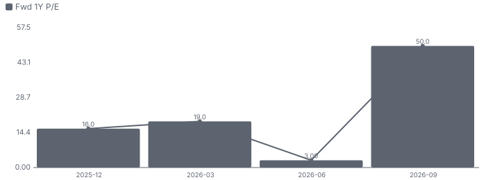

**합리적 멀티플**

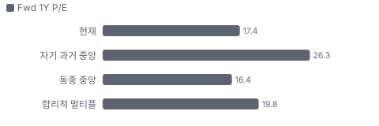

**밸류에이션 주가 시나리오**

**주가별 업사이드**

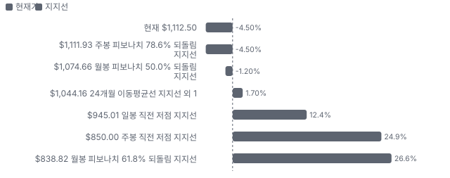
- 제품·서비스 포트폴리오

**고객 믹스(9M26, 매출 대비)**

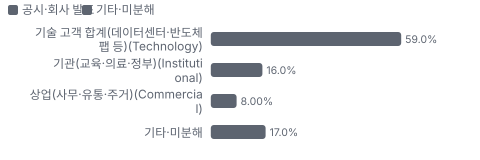

**공급 병목(10점, 낮을수록 병목)**

**생산능력 현재와 확충 계획(인력(명)·모듈러 공간(제곱피트))**

**CAPEX의 매출 대비 비중**

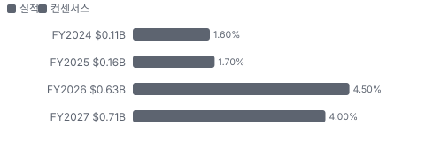

**어닝콜 변화별 주주가치 영향**

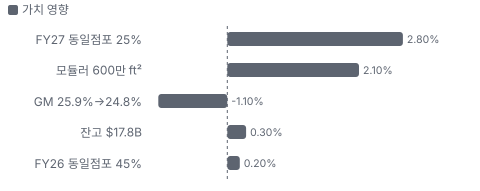

**수주·파이프라인 확실성 사다리**

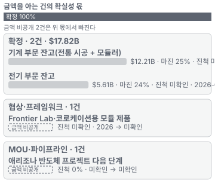

**수주/출하 비율 × 재고 일수 — 분기별(B/B 100 = 수주와 출하가 같다)**

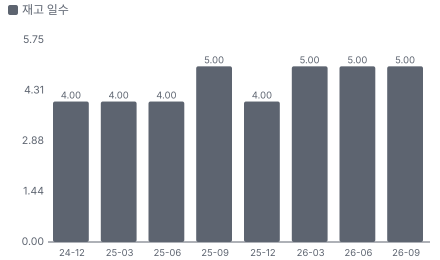

**매출 → 매출총이익 → 영업이익(매출 = 100, 최근 4분기)**

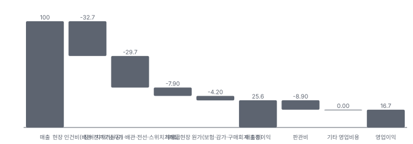

**분기 비용 비중 추이(매출 대비, 공시)**

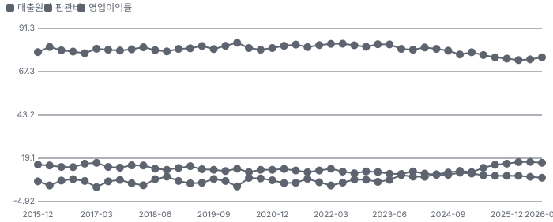

**비용 요인별 매출 대비 비중 1년 변화**

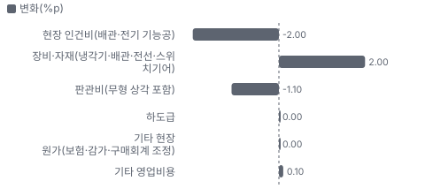

**BOM 항목 가격 +10% 시 OPM 변화**

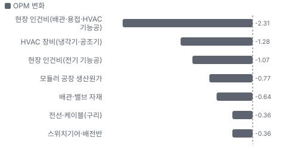

**기계 부문 BOM 원가 몫**

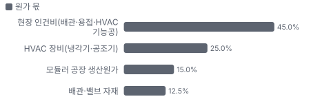

**전기 부문 BOM 원가 몫**

**투입 원가 물가·판매가 물가·회사 가격 — 1년 변화(항목별 최근 달)**

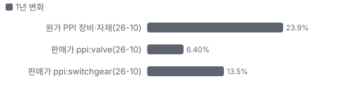

**사업별 매출 vs 물가 — 전년 대비(명목 매출 · 비교 물가 · 실질 = 물량·믹스)**

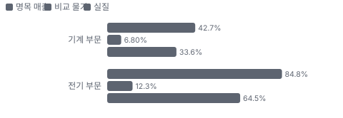

**자산 구성 — 3Q26 분기말 투하자본 −\$1,751.9M**

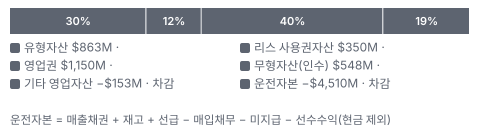

**자산별 변화율 — 최근 12개 분기(4Q23 = 0%) + 다음 4개 분기 추정**

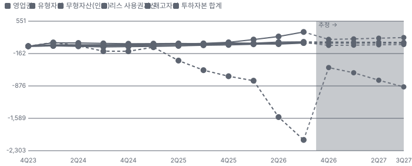

**ROIC 추이 — TTM, 최근 12개 분기 + 다음 4개 분기 추정(컨센서스 NOPAT)**

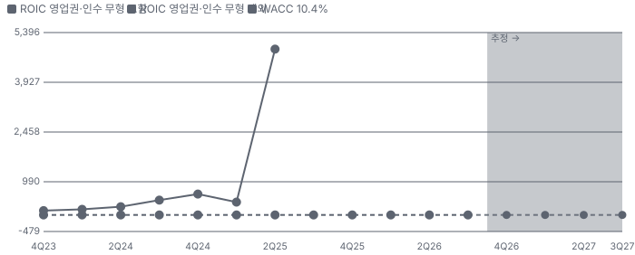

**매출·PPI·수출입 — 최근 16개 분기 같은 축(4Q22 = 100) + 다음 분기 추정**

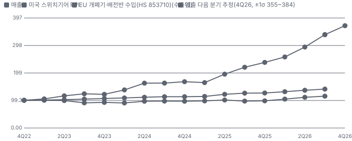

**10년 P·Q 사이클 — 추세(HP 필터) 대비 갭과 8분기 전망**

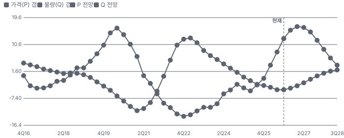

**매출 증가율의 가격·물량 분해와 8분기 전망(전년 대비)**

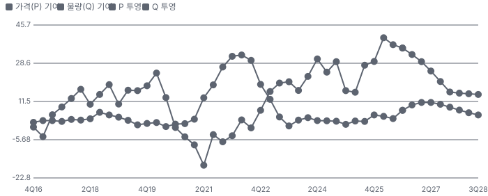

**분기별 매출 증가율 분해**

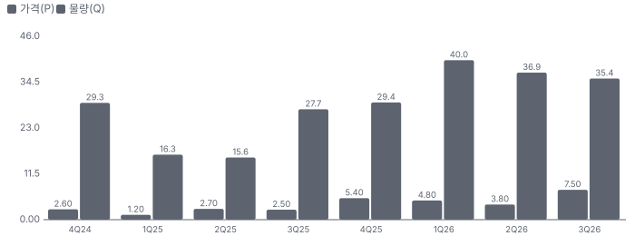

**목표주가 산정 — 약세와 기본 사이(약세 쪽 28%), 도달 확률 약 58%**

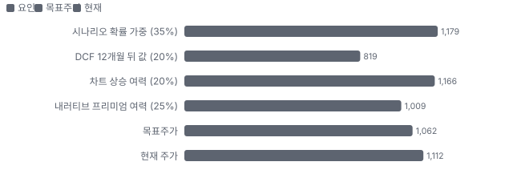

**일봉 지지·저항과 목표주가**

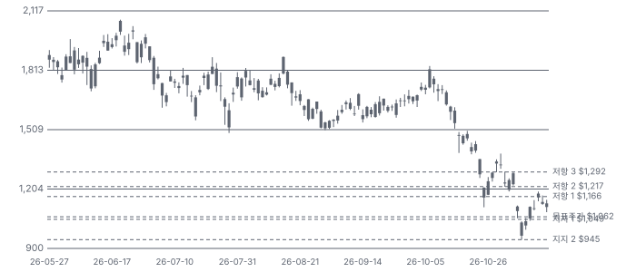

**커뮤니티 언급 수(최근 30일, 채널별)**

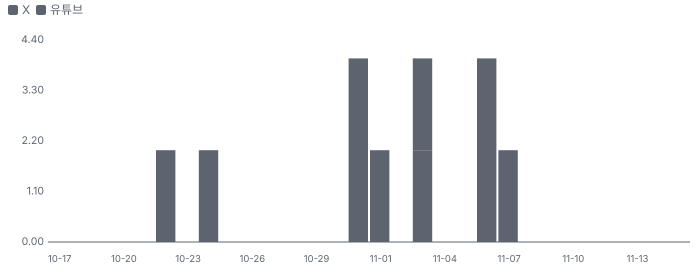

**일별 거래량 분해**

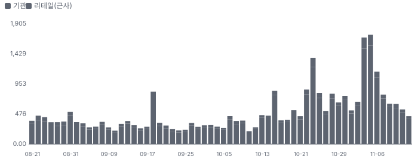

**기관 자금 흐름**

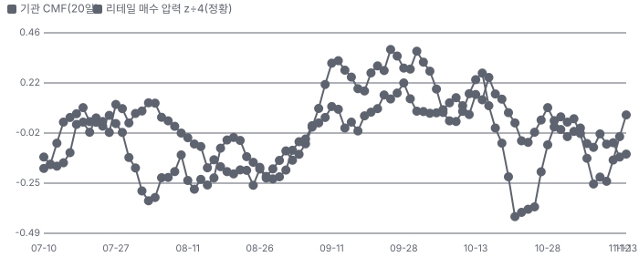

**몬테카를로**

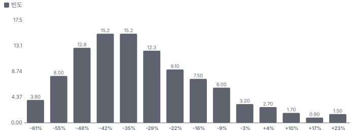

해석: 3,000번 중 210번(7%)에서 가치가 지금 주가 이상이었다. 가정을 흔들어도 지금 주가를 뒷받침하지 못하는 경우가 더 많다. 가운데 값은 0.66배이고, 열 번 중 여덟 번은 0.47~0.94배 사이에 든다.

## 내러티브

> **기업가치를 결정하는 이야기:** 이 회사는 데이터센터·반도체 팹·병원의 냉난방·배관·전기 설비를 짓고, 공장에서 만든 모듈을 보낸다. 돈은 프로젝트 계약가(9,399건, 평균 \$3.8M)와 모듈 납품에서 나오고, 숙련 인력이 모자라 고객이 생산능력을 미리 예약한다. 가치를 결정하는 것은 ① 잔고 전환 속도(12개월 안 65~75%) ② 매출총이익률 24~26% 유지 ③ 텍사스·하이퍼스케일러 수요의 지속

> **멀티플·EPS 프리미엄**
> **멀티플:** Fwd 1Y P/E 17.4배로 동종 중앙값 16.4배보다 6% 높을 뿐이다 — 6월에는 44배로 2.7배였다. 동종보다 영업이익률이 2.5배·잔고 성장이 3배 이상인데 프리미엄이 거의 사라졌다
> **EPS:** FY27 EPS 컨센서스 \$65.9~67.0(+30%), FY28 \$74.6~81.4. 회사는 숫자 가이던스 없이 FY27 동일점포 성장 중반 20%대만 말했다

### 투자자들은 왜 열광했나

2025~26년 상반기에는 'MEP가 데이터센터 건설비의 큰 몫이고 인력이 병목'이라는 이야기에 8분기 연속 서프라이즈가 겹쳐 S&P 500 5년 최고 수익 종목이 됐다. 식은 이유는 세 단계다 — 7~8월 AI CAPEX 정점 논쟁과 내부자 매도, 10/23 3Q 매출총이익률 하락·CFO 은퇴·숫자 가이던스 없음(−9.3%), 11/4~5 중간선거 뒤 텍사스 데이터센터 규제 위험(이틀 −25%)

### 무엇이 기업가치를 바꾸나

> **구조적 체질 변화**
> **변화:** 상업·기관 개보수 시공사에서 데이터센터·반도체 중심 산업 시공사로 바뀌었다
> **증거:** 기술 고객 매출 비중 9M25 42% → 9M26 59%, 신축 건설 75%(3Q 콜)
> **반증:** 기술 고객 비중이 50% 아래로 내려간다

> **고부가 믹스 확장**
> **변화:** 모듈러가 회사 평균 마진 근처로 올라오고 전기 부문이 커진다
> **증거:** 기계 GM 24.3% → 25.1%, 전기 매출 +85%, 모듈러 17%(3Q 콜)
> **반증:** 모듈러 마진이 다시 회사 평균보다 크게 낮아진다

> **기술 혁신**
> **변화:** 공장형 모듈러(로봇·자동 도장·회전 설비)로 현장 인력 의존을 줄인다
> **증거:** 3Q 콜: 25만~70만 제곱피트 건물, 로봇·자동 도장 부스
> **반증:** 모듈러 경쟁사가 같은 제품을 더 싼 지급 조건으로 공급

> **실행 속도**
> **변화:** 평균 프로젝트 6~9개월이지만 대형 데이터센터 잔고는 18~24개월로 길어졌다 **납품 리드타임 6~9개월.** 피어 비교 미확인. 약 10년 전 잔고 가시 기간(3Q 콜) 9개월보다 17% 짧다.
> **증거:** 10-Q: 진행 9,399건 평균 6~9개월. 3Q 콜: 잔고 기간 18~24개월(10년 전 9개월)
> **반증:** 12개월 안 인식 비중이 65% 아래로

> **M&A**
> **변화:** 지역 MEP·전기 회사를 사서 인력과 지역을 넓힌다
> **증거:** 2026: Hunt Electric(5월, 연 매출 약 \$250M)·Boys Electrical(2026년 8월 인수한 플로리다 전기 시공사)·NeoPod(8월, 합산 \$100M+). 9M26 인수 현금 \$262.9M
> **반증:** 인수 가격이 높아 순현금을 크게 깎는 대형 거래

> **정책·입법 연관성**
> **재정정책:** 해당 없음(연방 재정 지원·세액공제에 직접 걸린 매출 확인 안 됨 — 정부 고객 매출 3.7%) 10-Q 고객 분해 반증: - 의회 동의 2/10 — 하원 1/5(데이터센터 건설에 직접 걸린 연방 세출 법안 없음) · 상원 1/5(같음).
> **행정명령:** 해당 없음(이 회사 매출에 직접 걸린 행정명령 확인 안 됨) - 반증: -
> **연관입법:** 텍사스 주 의회(2027-01-12 개회)에 송전 심사 연장·수자원·소음 등 데이터센터 법안 예상 — 발의 전(주 정책 0단계) Citi 노트 요지(마스터 노션, 2026-11-04) 반증: 법안이 발의되지 않거나 위원회를 넘지 못한다

> **고객의 지출 예산**
> **변화:** 고객 돈은 거의 CAPEX(데이터센터·팹·병원 신축)이고 서비스만 운영 예산(OPEX)이다
> **사업별 예산:** 데이터센터·반도체 신축(기술 고객) — 고객 CAPEX(하이퍼스케일러·코로케이션·팹의 건설비), 매출의 59%: AI 컴퓨팅 투자 · 기관·상업 신축·개보수 — 고객 CAPEX(병원·학교·정부 건물 건설·개보수 예산), 매출의 31%: 공공 예산·리쇼어링 · 서비스(정비·모니터링) — 고객 OPEX(건물 운영·유지 예산), 매출의 10%: 설치 기반
> **증거:** 3Q 콜: 건설 90%(신축 75%)·서비스 10%
> **반증:** 하이퍼스케일러 2027 CAPEX 계획 하향

### 내러티브 근거

> 6/22 종가 고점 \$2,066.51에서 11/5 종가 \$964.94까지 −53% 무너진 뒤 바닥을 다지는 중이다. 'AI 데이터센터의 블루칼라 수혜주'라는 이야기가 6월 Fwd P/E 44배를 만들었고, 넉 달 동안 이익 추정은 올랐는데 배수가 17배로 꺼졌다. 시장은 지금 '데이터센터 건설이 정점을 지나는가'를 값매긴다. 동종 대비 멀티플 차이 +7% 중 회사 고유 몫은 -12%다. 단계는 소멸, 쏠림은 낮음(공매도 유통 주식의 2.9%, 리테일 언급 적음)이다.

> **AI 데이터센터 MEP 슈퍼사이클** · 강화
> **논리:** 데이터센터 건설비의 상당 몫이 기계·전기 설비이고 숙련 인력이 모자라 시공사가 일감과 가격을 고른다.
> **숫자:** 기술 고객 59%(전년 42%), 잔고 +90%, 영업이익률 15.5% → 16.6%
> **반증:** 잔고가 2개 분기 연속 감소, 기술 고객 비중 하락
> **출처:** 3Q26 어닝콜(2026-10-23)·10-Q

> **모듈러 공장 생산** · 유지
> **논리:** 공장에서 만든 전기실·냉각 플랜트가 현장 인력 병목을 우회하고 지역 규제에도 덜 노출된다.
> **숫자:** 모듈러 매출 17%, 공간 2027말 약 600만 제곱피트
> **반증:** 신규 고객이 프로그램형으로 넘어오지 않고 기존 2곳 물량이 줄어든다
> **출처:** 3Q26 어닝콜(2026-10-23)

> **이익 추정 상향 연속(100% 서프라이즈)** · 약화
> **논리:** 8개 분기 연속 EPS가 추정을 넘었고 추정이 계속 올라간다.
> **숫자:** FY27 EPS 7/28 \$57.3 → 11/9 \$65.9(+15%), 3Q EPS 서프라이즈 +4~8%
> **반증:** 4Q 서프라이즈가 0% 근처이거나 FY27 추정이 내려간다
> **출처:** 이력

> **반대 — AI CAPEX 정점·텍사스 정치 위험** · 강화
> **논리:** 하이퍼스케일러 CAPEX 증가율이 꺾이고, 텍사스 새 주지사·의회가 데이터센터 인허가·전력 연결을 늦추면 가장 강한 시장이 식는다.
> **숫자:** 11/4~5 이틀 −25%, 텍사스는 2026 연초 대비 유기 성장의 42%(8월 IB 노트 인용 글 — 미확인)
> **반증:** 12/10 ERCOT(텍사스 전력망 운영기구)·PUCT(텍사스 공공요금 위원회) 결정이 대형 부하 연결을 늦추지 않고 1월 의회 법안이 위원회를 넘지 못한다
> **출처:** Citi 노트 요지(마스터 노션)·뉴스 제목

> **반대 — 정점 이익률** · 유지
> **논리:** 영업이익률 16.7%는 MEP 시공사 역사에 없던 수준이라 평균 회귀가 오면 EPS와 배수가 함께 내려간다.
> **숫자:** 영업이익률 2019 6.5% → 2024 10.7% → TTM 16.7%, 동종 중앙값 6.5%
> **반증:** 2027년 상반기 프로젝트 성숙 뒤 매출총이익률이 25% 이상으로 돌아온다
> **출처:** 분기 손익

> **자본 배분(자사주·무차입)** · 유지
> **논리:** 순현금 약 \$1.8B·FCF 연 \$2B대가 하락기 자사주를 받친다.
> **숫자:** 9M26 FCF 약 \$2.0B, 자사주 \$349M, 순현금(리스 제외) \$2.11B
> **반증:** M&A에 비싼 값을 치르거나 선수금이 빠지며 FCF가 순이익 아래로
> **출처:** 10-Q

## 포트폴리오

| 제품·서비스 | 구분 | 무엇 | 쓰는 곳 | 돈 버는 방식 | Mix | Mix 변화(전 분기 대비) |
|---|---|---|---|---|---|---|
| 기계 부문 | 서비스 | HVAC·배관·공정 배관·모듈러 냉각 플랜트 시공 | 데이터센터·팹·병원의 냉각과 배관 | 프로젝트 계약가 + 모듈 납품. 3Q 매출 \$2.58B, GM 25.1% | 69% | -1.7%p |
| 전기 부문 | 서비스 | 전력 배선·배전·전기실 시공 | 데이터센터 전력 계통 | 프로젝트 계약가. 3Q 매출 \$1.18B(+85%), GM 24.3% | 31% | +1.7%p |
| 모듈러 설비(공장 제작) | 제품 | 공장에서 조립한 냉각 플랜트·전기실 모듈 | 하이퍼스케일 데이터센터·병원 현장 설치 | 프로그램형 고객 5년 물량 약정, 선급금·납품 시 지급. 9M26 매출의 17% | 17% | 미확인 |

**Mix 변화가 가장 큰 쪽은 기계 부문(-1.7%p, 전 분기 대비).** 계절성 판정: 분기 매출 계절 지수 기준 없음 → 직전 분기와 비교.

## 고객

> **9M26 최대 고객 기술 고객 합계(데이터센터·반도체 팹 등, Technology) 59%, 상위 3곳 83%, 집중도 집중.** 공시·회사 발표로 확인한 몫은 매출의 83%이고, 나머지 고객 몫은 추정이거나 미분해다. 최대 고객이 2025년 매출의 12.8%(이름 미공시)이고, 업종으로는 기술(데이터센터·반도체)이 9M26 매출의 59%(전년 42%)다. 모듈러 대형 고객 두 곳이 프로그램형 장기 고객이다

**고객별 매출 몫(9M26)**
| 고객 | 몫 | 변화 | 근거 |
|---|---|---|---|
| 기술 고객 합계(데이터센터·반도체 팹 등, Technology) | 59% | +17%p | 공시 |
| 기관(교육·의료·정부, Institutional) | 16% | 미확인 | 공시 |
| 상업(사무·유통·주거, Commercial) | 8% | 미확인 | 공시 |
| 최대 고객(이름 미공시, top customer) | 미확인 | 미확인 | 추정 |
| 모듈러 프로그램형 고객 2곳(하이퍼스케일러로 추정, 이름 미공시, two large customers) | 미확인 | 미확인 | 추정 |
| 기타·미분해 | 17% | - | - |

> **기술 고객 합계(데이터센터·반도체 팹 등, Technology)** · 공시
> **사는 것:** 신축 MEP·모듈러
> **추정 근거:** 9M26 산업 76% 중 기술 59%

> **기관(교육·의료·정부, Institutional)** · 공시
> **사는 것:** 신축·개보수 MEP
> **추정 근거:** 9M26

> **상업(사무·유통·주거, Commercial)** · 공시
> **사는 것:** 서비스·개보수
> **추정 근거:** 서비스 매출 대부분

> **최대 고객(이름 미공시, top customer)** · 추정
> **사는 것:** 데이터센터 MEP·모듈러(추정)
> **추정 근거:** 10-K: 2025년 12.8%, 해마다 바뀐다. 2026년 비중 미공시 — 기술 고객 합계 안에 들어 있어 몫을 따로 더하지 않는다

> **모듈러 프로그램형 고객 2곳(하이퍼스케일러로 추정, 이름 미공시, two large customers)** · 추정
> **사는 것:** 모듈러 전기실·냉각 플랜트 5년 물량
> **추정 근거:** 콜: '두 대형 고객' — 특정 회사로 옮기면 가설

## 수주·파이프라인

> **2026-09-30 기준 4건.** 확정 \$17.82B. 공시 수주잔고(= 잔여 이행 의무) \$17.82B.

**수주 목록**
| 상태 | 계약 | 계약 총액 | 진척 | 기간 | 비고 |
|---|---|---|---|---|---|
| 확정 | 기계 부문 잔고(전통 시공 + 모듈러) | \$12.21B | 비공개 | 2026-09 → 2028 | - |
| 확정 | 전기 부문 잔고 | \$5.61B | 비공개 | 2026-09 → 2028 | - |
| 협상 | Frontier Lab·코로케이션용 모듈 제품 | 금액 비공개 | 비공개 | 2026 → 미확인 | - |
| 파이프라인 | 애리조나 반도체 프로젝트 다음 단계 | 금액 비공개 | 0% | 미확인 → 미확인 | - |

**실행 속도와 방해 요인**
| 항목 | 상태 | 실행 속도 | 방해 요인 |
|---|---|---|---|
| 기계 부문 잔고(전통 시공 + 모듈러) | 확정 | 12개월 안 65~75%(회사 전체 기준) | 숙련 인력 · 장비 납기 |
| 전기 부문 잔고 | 확정 | 12개월 안 65~75%(회사 전체 기준) | 전기 기능공 · 스위치기어 납기 |
| Frontier Lab·코로케이션용 모듈 제품 | 협상 | 생산 중이나 프로그램형 계약 아님 | 지급 조건·고객 신용 |
| 애리조나 반도체 프로젝트 다음 단계 | 파이프라인 | 미확인 | 텍사스 일감이 많아 수주 규모 미정 |

## 마진 구조

> **GPM 24.8%, OPM 16.4%.** 2Q26 대비 GPM -1.0%p, OPM -0.7%p. 변동비는 매출의 73%이고, 매출이 10% 늘면 OPM은 +1.0%p 움직인다. 3Q26 매출원가는 매출의 75.2%로 1년 전과 같지만, 장비·자재 몫이 상반기 평균보다 약 2%p 높아져 전분기(74.1%)보다 올랐다. 판관비 비율은 9.4% → 8.3%로 내려가 영업이익률은 15.5% → 16.6%

> **매출 100 중 매출원가 74.4, 매출총이익 25.6(최근 4분기, 공시).** 매출원가 요인 중 현장 인건비(배관·전기 기능공)이 매출의 33.0%로 가장 무겁고, 단가가 +10% 오르면 GPM이 -3.30%p 움직인다. 분기 회귀로 매출 1이 늘 때 매출원가는 0.74 늘고, 매출원가의 고정비 몫은 5%다. 매출원가 요인 비중은 요인별 공시 기간 값이라 합이 최근 4분기 매출원가를 넘어, 그림에서는 0.99배로 비례 조정했다.

**비용 요인 강도 — 비중·추세·충격(+10%)·탄력**
| 비용 | 구분 | 매출 대비 | 1년 변화 | 마진 기여 | 충격 시 마진 | 매출 탄력 | 고정비 몫 |
|---|---|---|---|---|---|---|---|
| 현장 인건비(배관·전기 기능공) | 매출원가 요인 | 33.0% | -2.0%p | +2.0%p | -3.30%p | 미확인 | 10% |
| 장비·자재(냉각기·배관·전선·스위치기어) | 매출원가 요인 | 30.0% | +2.0%p | -2.0%p | -3.00%p | 미확인 | 0% |
| 하도급 | 매출원가 요인 | 8.0% | +0.0%p | -0.0%p | -0.80%p | 미확인 | 0% |
| 기타 현장 원가(보험·감가·구매회계 조정) | 매출원가 요인 | 4.2% | +0.0%p | -0.0%p | -0.42%p | 미확인 | 50% |
| 매출원가 | 공시 항목 | 74.4% | -2.1%p | +2.1%p | -7.44%p | 0.74 | 5% |
| 판관비 | 공시 항목 | 8.9% | -1.2%p | +1.2%p | 미확인 | 0.08 | 27% |
| 기타 영업비용 | 공시 항목 | -0.0% | -0.0%p | +0.0%p | 미확인 | -0.00 | -20% |

매출 탄력 = 분기 비용을 매출에 회귀한 기울기(매출 1당 변동비), 고정비 몫 = 절편 ÷ 평균 비용. 표본이 8분기 미만이면 미확인. 매출원가 요인 비중은 margin 재료의 추정이 섞여 있고, 공시 매출원가와의 차이는 '기타 매출원가'로 둔다.

**GPM에서 OPM까지(GAAP, 아래는 최근 4개 분기)**
| 기간 | GPM | 연구개발 | 판관비 | 기타 | OPM |
|---|---|---|---|---|---|
| 3Q25 | 24.8% | 0.0% | 9.4% | 0.0% | 15.4% |
| 2Q26 | 25.9% | 0.0% | 8.8% | 0.0% | 17.0% |
| 3Q26 | 24.8% | 0.0% | 8.3% | 0.1% | 16.4% |
| 2025-12 | 25.5% | - | - | - | 16.1% |
| 2026-03 | 26.3% | - | - | - | 17.0% |
| 2026-06 | 25.9% | - | - | - | 17.1% |
| 2026-09 | 24.8% | - | - | - | 16.6% |

**비용을 움직이는 요인**
| 비용 | 요인 |
|---|---|
| 현장 인건비(배관·전기 기능공, 매출원가) | 숙련 인력 시간당 임금·생산성 · 근거 추정 |
| 장비·자재(냉각기·배관·전선·스위치기어, 매출원가) | 대형 프로젝트 초기 장비 투입·구리 가격 · 근거 추정 |
| 판관비(무형 상각 포함, 판관비) | 인력·혁신 투자, 매출 대비 레버리지 · 근거 공시 |
| 하도급(매출원가) | 자체 시공 못 하는 공종 · 근거 추정 |
| 기타 현장 원가(보험·감가·구매회계 조정, 매출원가) | 인수 구매회계 조정(3Q는 2Q보다 약 \$12M 많음) · 근거 추정 |
| 기타 영업비용(기타) | 자산 처분 등 · 근거 공시 |

**기계 부문 BOM — 매출의 69%, GPM 25%(3Q26 기계 매출총이익 \$647.3M ÷ 매출 \$2,582.9M(10-Q 세그먼트)), 항목 가격 +10% 시**
| 항목 | 원가 몫 | 전가 | 제품 GPM | OPM |
|---|---|---|---|---|
| 현장 인건비(배관·용접·HVAC 기능공) | 40~50% | 미확인 | -3.4%p | -2.31%p |
| HVAC 장비(냉각기·공조기) | 20~30% | 미확인 | -1.9%p | -1.28%p |
| 모듈러 공장 생산원가 | 10~20% | 미확인 | -1.1%p | -0.77%p |
| 배관·밸브 자재 | 10~15% | 미확인 | -0.9%p | -0.64%p |
| 미분해 | 2% | - | - | - |

**전기 부문 BOM — 매출의 31%, GPM 24%(3Q26 전기 매출총이익 \$287.2M ÷ 매출 \$1,183.4M(10-Q 세그먼트)), 항목 가격 +10% 시**
| 항목 | 원가 몫 | 전가 | 제품 GPM | OPM |
|---|---|---|---|---|
| 현장 인건비(전기 기능공) | 40~50% | 미확인 | -3.4%p | -1.07%p |
| 전선·케이블(구리) | 10~20% | 미확인 | -1.1%p | -0.36%p |
| 스위치기어·배전반 | 10~20% | 미확인 | -1.1%p | -0.36%p |
| 미분해 | 25% | - | - | - |

현장 인건비(배관·용접·HVAC 기능공) 가격이 +10% 오르면 영업이익은 -14.1% 움직인다. 판매가 전가를 모르는 항목은 전가 0%로 계산했다.

**BOM 항목 가격을 움직이는 것**
| 항목 | 요인 |
|---|---|
| 현장 인건비(배관·용접·HVAC 기능공) | 고정가 계약이 많아 임금 상승은 입찰 때 반영 · 근거 추정 |
| HVAC 장비(냉각기·공조기) | 대형 데이터센터 프로젝트 초기 투입 · 근거 추정 |
| 배관·밸브 자재 | 구리·스테인리스 가격 · 근거 추정 |
| 모듈러 공장 생산원가 | 공장 가동률·로봇화 · 근거 추정 |
| 현장 인건비(전기 기능공) | 인력 병목이 마진의 원천 · 근거 추정 |
| 전선·케이블(구리) | 구리 가격 · 근거 추정 |
| 스위치기어·배전반 | 납기 긴 장비 · 근거 추정 |

> **원가·판매가 물가 격차 -13.9%p** — 판매가 물가가 투입 원가 물가보다 느리게 오른다.

**투입 물가 — 미국 PPI 3·6·12개월(2026-10, 개정 반영)과 해외 전년비**
| 항목 | 미국 3개월 | 6개월 | 12개월 | 전가 못 할 때 OPM | 일본 | 한국 | 대만 |
|---|---|---|---|---|---|---|---|
| 배관·밸브 자재 | +0.4% | +0.3% | +6.4%* | - | 미확인 | 미확인 | 미확인 |
| 전선·케이블(구리) | +3.4% | +7.2% | +23.9% | - | +42.6% | +25.8% | +40.1% |
| 스위치기어·배전반 | +4.1% | +4.9% | +13.5% | - | +23.2% | +1.6% | +10.6%* |

별표는 품목보다 넓은 업종 지수다. 연결한 투입 원가의 미국 PPI(생산자물가지수)는 1년 새 가중 +23.9%이고, 판매가로 넘기지 못하면 GPM -7.2%p·OPM -7.2%p가 움직인다. 판매가 비교 물가(ppi:valve)는 1년 새 +6.4% — 회사 가격 변화는 미확인. 물가 지수를 붙이지 못한 매출원가 항목은 현장 인건비(배관·전기 기능공), 하도급다(미연결). 기계 부문 매출은 2026-09 전년 대비 +42.7%이고 비교 물가 ppi:valve의 변화 +6.8%(2026-09)를 빼면 실질 +33.6% — 물량·믹스가 성장을 이끌었다. 전기 부문 매출은 2026-09 전년 대비 +84.8%이고 비교 물가 ppi:switchgear의 변화 +12.3%(2026-09)를 빼면 실질 +64.5% — 물량·믹스가 성장을 이끌었다.

## 자산 구성

> 최근 12개 분기(4Q23 → 3Q26) 가장 크게 늘어난 자산은 유형자산(+314%), 투하자본 합계 -2065%. 3Q27 추정 투하자본 −\$709.8M(미확인, 컨센서스 매출과 회전 일수·CAPEX 강도 유지 가정).

**자산·운전자본 항목별 분기말 잔액 — 최근 12개 분기와 다음 4개 분기 추정**
| 항목 | 4Q23 | 3Q25 | 3Q26(최근) | 3Q27 추정 | 12개 분기 변화 | 다음 4개 분기 변화 |
|---|---|---|---|---|---|---|
| 재고자산 | \$65.5M | \$78.8M | \$120.9M | \$90.0M | +85% | -26% |
| 선급·기타 유동자산 | \$54.3M | \$63.2M | \$187.6M | \$146.4M | +245% | -22% |
| 매입채무 | \$420.0M | \$665.1M | \$946.0M | \$671.9M | +125% | -29% |
| 선수수익(계약부채) | \$909.5M | \$1,734.3M | \$3,872.0M | \$2,746.0M | +326% | -29% |
| 유형자산 | \$208.6M | \$337.5M | \$862.7M | \$606.9M | +314% | -30% |
| 리스 사용권자산 | \$205.7M | \$274.7M | \$349.6M | \$349.6M | +70% | +0% |
| 영업권 | \$666.8M | \$928.2M | \$1,149.7M | \$1,149.7M | +72% | +0% |
| 무형자산(인수) | \$280.4M | \$431.9M | \$548.4M | \$518.4M | +96% | -5% |

**자산 추정 동인 — 최근 4개 분기 평균(재무상태표 동인 모형)**
| 동인 | 값 | 곱하는 기준 |
|---|---|---|
| 재고자산 | 2일 | 매출원가 |
| 선급·기타 유동자산 | 3일 | 매출 |
| 매입채무 | 18일 | 매출원가 |
| 선수수익(계약부채) | 54일 | 매출 |
| 유형자산 ÷ 분기 매출 | 0.13배 | CAPEX·감가 재료 없음 — 비율 유지 |
| 매출원가율 | 73.2% | 매출(최근 4개 분기) |
| 영업권·리스 사용권·기타 | 유지 | 인수·새 리스는 공시 전 모름 |
| 인수 무형자산 | 분기 \$7.5M 상각 | 최근 4개 분기 평균 상각 |

**추정 방법:** 증권사 3표 모델(손익·재무상태표·현금흐름)의 재무상태표 동인 방식이다. 운전자본은 항목별 회전 일수(매출채권·선급·미지급·선수는 매출, 재고·매입채무는 매출원가 기준)를 최근 4개 분기 평균으로 두고 컨센서스 매출에 곱한다. 유형자산은 기초 + CAPEX − 감가상각으로 굴린다(Koller·Goedhart·Wessels 『Valuation』 재무상태표 추정). 매출 경로는 ROIC 절의 컨센서스와 같다.

**유형·무형자산 항목별 가치(2025-12-31 vs 2024-12-31)**
| 구분 | 항목 | 총액 2025-12-31 | 누적상각 | 순액 | 총액 2024-12-31 | 총액 1년 변화 | 공시 내용연수 |
|---|---|---|---|---|---|---|---|
| 유형 | 유형자산 합계(항목 미분해) | \$680.6M | 총계만 공시 | 총계만 공시 | \$526.8M | +29.2% | 미확인 |
| 영업권 | 영업권 | \$1,025.5M | \$0.0M | \$1,025.5M | \$875.3M | +17.2% | 비상각 |
| 무형 | 무형자산 합계(항목 미분해) | \$838.6M | \$353.5M | \$485.2M | \$757.0M | +10.8% | 미확인 |
| 유형 합계 | 유형자산 | \$680.6M | \$292.6M | \$388.0M | \$526.8M | +29.2% | 경과율 43%(상각 대상 기준) |

**내용연수 산식(상각 대상 유형자산 = 총액 − 토지 − 건설중)**
| 기준일 | 연 감가상각 | 상각 대상 총액 | 평균 내용연수 | 경과 연수 | 잔여 연수 | 경과율 |
|---|---|---|---|---|---|---|
| 2025-12-31 | \$14.0M | \$680.6M | 48.6년 | 20.9년 | 27.7년 | 43% |
| 2024-12-31 | \$48.2M | \$526.8M | 10.9년 | 5.2년 | 5.7년 | 47% |

산식 평균 내용연수는 48.6년. 1년 전 10.9년 → 지금 48.6년.

미공시·미분해: 분기 감가상각·유형자산(순액) 9분기 · 유형자산 항목별 총액·내용연수(10-K 주석에서 모델이 채움) · 무형자산 항목(10-K 주석에서 모델이 채움) — 이 칸은 비우고 나머지로 계산했다.

### 해석 — 자산이 어디에 쌓이고 있나

- 같은 기간 4개 분기 매출은 -19% — 매출보다 빨리 늘어난 자산: 재고자산 +85%, 유형자산 +314%, 리스 사용권자산 +70%, 영업권 +72%, 무형자산(인수) +96%. 이 자산의 회전율이 떨어지면 ROIC를 희석한다.

## ROIC

**ROIC 추이(TTM)와 다음 4개 분기 추정 — NOPAT ÷ 평균 투하자본(이번 분기말·4개 분기 전)**
| 분기 | 구분 | TTM 매출 | TTM NOPAT | NOPAT 마진 | 평균 투하자본 | ROIC 포함 | ROIC 제외 |
|---|---|---|---|---|---|---|---|
| 4Q23 | 실적 | \$5,206.8M | \$358.6M | 6.9% | \$261.7M | 137.0% | 미확인 |
| 1Q24 | 실적 | \$5,569.1M | \$418.6M | 7.5% | \$239.8M | 174.5% | 미확인 |
| 2Q24 | 실적 | \$6,083.0M | \$501.0M | 8.2% | \$198.0M | 253.0% | 미확인 |
| 3Q24 | 실적 | \$6,517.2M | \$564.5M | 8.7% | \$126.1M | 447.8% | 미확인 |
| 4Q24 | 실적 | \$7,027.5M | \$653.4M | 9.3% | \$104.3M | 626.4% | 미확인 |
| 1Q25 | 실적 | \$7,321.7M | \$707.0M | 9.7% | \$181.6M | 389.4% | 미확인 |
| 2Q25 | 실적 | \$7,684.8M | \$789.1M | 10.3% | \$16.1M | 4906.5% | 미확인 |
| 3Q25 | 실적 | \$8,323.4M | \$920.2M | 11.1% | −\$129.8M | 미확인 | 미확인 |
| 4Q25 | 실적 | \$1,831.3M | \$186.9M | 10.2% | −\$190.5M | 미확인 | 미확인 |
| 1Q26 | 실적 | \$2,865.3M | \$397.4M | 13.9% | −\$194.6M | 미확인 | 미확인 |
| 2Q26 | 실적 | \$3,957.7M | \$595.7M | 15.1% | −\$683.4M | 미확인 | 미확인 |
| 3Q26 | 실적 | \$5,273.0M | \$788.4M | 15.0% | −\$1,001.8M | 미확인 | 미확인 |
| 4Q26 | 추정 | \$13,877.0M | \$1,847.8M | 13.3% | −\$350.5M | 미확인 | 미확인 |
| 1Q27 | 추정 | \$15,161.7M | \$2,019.9M | 13.3% | −\$445.8M | 미확인 | 미확인 |
| 2Q27 | 추정 | \$16,296.0M | \$2,167.6M | 13.3% | −\$876.4M | 미확인 | 미확인 |
| 3Q27 | 추정 | \$17,149.7M | \$2,292.7M | 13.4% | −\$1,165.9M | 미확인 | 미확인 |

**다음 4개 분기 NOPAT — 컨센서스(세율 24%, 리스 이자 별도)**
| 분기 | 매출 | EBITA 마진 | EBITA | NOPAT(분기) | 근거 |
|---|---|---|---|---|---|
| 4Q26 | \$3,979.7M | 16.9% | \$674.5M | \$512.6M | 컨센서스 매출 × EBIT 마진 FY2026 |
| 1Q27 | \$4,150.0M | 17.7% | \$732.5M | \$556.7M | 컨센서스 매출 × EBIT 마진 FY2027 |
| 2Q27 | \$4,400.0M | 17.6% | \$776.2M | \$589.9M | 컨센서스 매출 × EBIT 마진 FY2027 |
| 3Q27 | \$4,620.0M | 17.6% | \$814.6M | \$619.1M | 컨센서스 매출 × EBIT 마진 FY2027 |

**추정 방법:** NOPAT은 컨센서스(분기 매출 추정 × 회계연도 EBIT 마진 추정)로 잡고, 조정(비 GAAP) 마진이면 주식보상 몫을 빼서 과거 실적과 같은 기준(영업이익 + 인수 무형 상각)으로 맞췄다. 이미 발표했지만 분기 보고서(10-Q)가 아직 없는 분기는 발표 실적을 쓴다. 투하자본은 자산 구성 절의 재무상태표 동인으로 굴렸다. ROIC는 4개 분기 NOPAT을 이번 분기말과 4개 분기 전 투하자본의 평균으로 나눈다 — 추정 분기의 ROIC에는 이미 나온 실적 분기가 섞여 있다.

**투하자본 항목별 회전율과 ROIC 기여(TTM 3Q26, 평균 잔액)**
| 항목 | 투하자본 | 매출 1달러당 자본 | 회전율(매출 ÷ 항목) | 자본 몫 | 이 항목을 빼면 ROIC |
|---|---|---|---|---|---|
| 운전자본 | −\$3,383.5M | -0.64 | 음수(자금 원천) | 미확인 | 32.8% |
| 유형자산 | \$600.1M | 0.11 | 8.79회 | 미확인 | 미확인 |
| 리스 사용권자산 | \$312.2M | 0.06 | 16.89회 | 미확인 | 미확인 |
| 영업권 | \$1,103.9M | 0.21 | 4.78회 | 미확인 | 미확인 |
| 무형자산(인수) | \$490.2M | 0.09 | 10.76회 | 미확인 | 미확인 |
| 기타 영업자산 | −\$124.7M | -0.02 | 음수(자금 원천) | 미확인 | 미확인 |

**ROIC 세 가지 판**
| 판 | NOPAT | 투하자본 | ROIC | 무엇을 재나 |
|---|---|---|---|---|
| 영업권·인수 무형 포함 | \$780.8M | −\$1,001.8M | 미확인 | 인수 웃돈까지 낸 돈에 대한 수익률 |
| 영업권·인수 무형 제외 | \$780.8M | −\$2,595.9M | 미확인 | 본업 운영 수익률(동종 비교용) |
| 무형 자본화 조정(판관비 20%·5년, 연구개발 6년) | \$718.7M | −\$722.9M | 미확인 | 비용으로 처리한 무형 투자를 자산으로 본 판 |
| 경제적 이익(포함판) | \$885.3M | −\$1,001.8M | 자본비용 10.4% | (ROIC − 자본비용) × 투하자본 |

NOPAT = (영업이익 \$989.5M + 인수 무형 상각 + 리스 내재 이자 \$17.8M) × (1 − 세율 24%). 리스 사용권자산을 투하자본에 넣었으므로 임차료 속 이자 몫을 영업이익에 되더했다. 현금은 영업에 필요한 몫을 따로 알 수 없어 투하자본에서 뺐다. SEC 공시 데이터 자동 초안 — 운전자본 = 매출채권 + 재고 + 선급 − (매입채무 + 미지급비용 + 선수수익), 현금 제외. 손상 누계는 공시 데이터 수록분.

투하자본 또는 NOPAT이 0 이하라 ROIC 분해는 비교 불가 — 경제적 이익으로 본다.

**무형 자본화 가정별 ROIC(2025년 지출 기준, 포함판에 더함)**
| 투자로 보는 몫 | 상각 연수 | 무형 자산 | NOPAT 조정 | 조정 ROIC |
|---|---|---|---|---|
| 판관비 20% | 2년 | \$112.0M | −\$91.5M | 미확인 |
| 판관비 20% | 5년 | \$278.9M | −\$62.1M | 미확인 |
| 판관비 30% | 2년 | \$168.0M | −\$137.2M | 미확인 |
| 판관비 30% | 5년 | \$418.4M | −\$93.2M | 미확인 |

### 해석 — 무엇이 수익성을 끌어올리고 희석하나

- 유형자산: 투하자본의 미확인 — 빼면 ROIC 미확인 → 미확인. 이 자산의 회전율(8.79회)이 수익성을 희석하는 주된 자리다.
- 리스 사용권자산: 투하자본의 미확인 — 빼면 ROIC 미확인 → 미확인. 이 자산의 회전율(16.89회)이 수익성을 희석하는 주된 자리다.
- 운전자본: −\$3,383.5M(음수), 고객 선수금·공급사 외상이 자본을 대신 댄다 — 빼면 ROIC 32.8%로 낮아진다. 수익성을 끌어올리는 쪽이다.
- 기타 영업자산: −\$124.7M(음수), 고객 선수금·공급사 외상이 자본을 대신 댄다 — 빼면 ROIC 미확인로 낮아진다. 수익성을 끌어올리는 쪽이다.

## 공급망 병목

> **공급망 신뢰성 8.3/10, 병목 낮음.** 가장 약한 고리는 전선·케이블(구리) 8.3점이고, 품목 평균은 8.3점이다. 근거가 부족한 3건(현장 인건비(배관·전기 기능공) · HVAC 장비(냉각기·공조기) · 스위치기어·배전반)은 점수에서 뺐다. 병목은 부품이 아니라 숙련 기능인력이다. 냉각기·스위치기어 같은 장비는 고객 또는 회사가 발주하고 납기가 길지만, 회사는 '제약은 노동력'이라고 말한다

**병목과 마진 — 품목 가격 +10% 시 OPM**
| 품목 | 점수 | 판정 | 구분 | OPM |
|---|---|---|---|---|
| 전선·케이블(구리) | 8.3 | 병목 낮음 | 일반 | -0.36%p |

> **전선·케이블(구리)** · 8.3/10
> **왜:** 가격 위험(구리)만 있다
> **병목 요인:** 인증 공급사 3곳 · 캐파 여유 · 리드타임 미확인 · 재인증 0개월 · 1위 점유율 미확인 · 지역 집중 미확인 · 물량 확보 현물
> **풀리는 조건:** 해당 없음

**공급사**
| 품목 | 공급사 | 몫 | 근거 |
|---|---|---|---|
| 현장 인건비(배관·전기 기능공) | 자체 고용 인력·이동형 계약 인력(Kodiak·Pivot(Comfort Systems의 계약 인력 사업))(현장 시공) | 미확인 | 공시 |
| HVAC 장비(냉각기·공조기) | 장비 제조사(이름 미공시, 냉각기·공조기 공급) | 미확인 | 추정 |
| 스위치기어·배전반 | 전력 기기 제조사(이름 미공시, 배전 장비) | 미확인 | 추정 |
| 전선·케이블(구리) | 전선 유통사(이름 미공시, 자재) | 미확인 | 추정 |

**무역 통계로 본 공급 지역**
| 품목 | EU 수입처 | 일본 수입처 | EU 1위 전년비 |
|---|---|---|---|
| 스위치기어·배전반 | CN(중국) 55% · US 25% · JP(일본) 6% | 中華人民共和国 47% · アメリカ合衆国 10% | +33.5% |
| 전선·케이블(구리) | MY(말레이시아) 77% · KR(한국) 11% · VN(베트남) 7% | マレーシア 58% · タイ 36% | 미확인 |

## 생산능력

> **현재 명목 캐파 25,000 인력(명)·모듈러 공간(제곱피트), 가동률 미확인.** 착공 이상 증설은 0 인력(명)·모듈러 공간(제곱피트), 발표까지 합치면 0 인력(명)·모듈러 공간(제곱피트)이다. 다 가동하면 지금보다 +0%, 착공 이상만이면 +0%다. FY2025 CAPEX는 \$0.16B로 매출의 1.7%다. 시공사의 캐파는 사람이고, 모듈러는 공장 공간이다. 직원 2만 5,000명 이상, 모듈러 공간은 2026말 400만 제곱피트 이상 → 2027말 약 600만 제곱피트

**생산시설 25곳**(10-K(2025-12-31) Item 2 — 소유 부동산 25곳, 그 밖은 임차(27개 주, 사무·작업장·제작·정비·창고). 임차 시설 수는 미공시) — 이름·위치를 밝힌 곳 3곳, 임차 1곳 · 미확인 1곳 · 소유·임차 1곳. 시설별 생산능력은 1곳만 공개됐다.

**생산시설 25곳 — 명칭·위치·생산능력**
| 시설 | 위치 | 용도 | 생산능력 | 소유·상태 |
|---|---|---|---|---|
| 본사 | 미국 텍사스 휴스턴 | 본사 사무 | 미확인 — 사무 시설 — 생산능력 개념 없음 | 임차 · 가동 |
| 모듈러 생산 공장(텍사스 등, 건물별 위치 미공시) | 미국(텍사스 모듈러 사업장 등) | 데이터센터·의료용 모듈 제작 | 4,000,000 제곱피트(2026말 목표) | 미확인 · 증설 중 |
| 지역 사업장·제작소(소유 25곳 포함) | 미국 27개 주 | 사무·제작·정비·창고 | 미확인 — 시공 캐파는 인력 — 사업장별 인력 미공시 | 소유·임차 · 가동 |

**생산능력 확충 계획**
| 계획 | 단계 | 증설 | 가동 시점 | CAPEX |
|---|---|---|---|---|
| 모듈러 생산 공간 확충(프로그램형 고객용, 2026말 400만+ → 2027말 약 600만 제곱피트) | 발표 | 미확인 | 2027 | 미확인 |
| 전통 시공용 사전 제작·조립 시설 | 발표 | 미확인 | 2026~2027 | \$0.10B |

남은 계획의 CAPEX 합계는 \$0.10B(금액 미확인 1건 제외)다. 합계는 FY2027 매출의 1%다.

**증설 방해 요인**
| 계획 | 방해 요인 |
|---|---|
| 모듈러 생산 공간 확충(프로그램형 고객용, 2026말 400만+ → 2027말 약 600만 제곱피트) | 공장 인력 수천 명 채용·로봇 설비 |
| 전통 시공용 사전 제작·조립 시설 | 인력 |

**CAPEX와 매출 대비**
| 기간 | CAPEX | 매출 | 매출 대비 | 구분 |
|---|---|---|---|---|
| FY2024 | \$0.11B | \$7.03B | 1.6% | 실적 |
| FY2025 | \$0.16B | \$9.10B | 1.7% | 실적 |
| FY2026 | \$0.63B | \$13.88B | 4.5% | 컨센서스 |
| FY2027 | \$0.71B | \$17.90B | 4.0% | 컨센서스 |

## 해자

> 해자는 '숙련 인력 + 공장형 모듈러 생산'이다 — 노동력이 수요보다 모자란 시장에서 고객이 생산능력을 미리 사 간다

> **숙련 기능인력 풀과 이동 인력** · 강함
> **해자:** MEP 시공은 배관·전기 기능공이 병목이고, 2만 5,000명 이상의 인력과 이동형 계약 인력(Kodiak·Pivot)으로 일감을 고른다
> **근거:** 3Q 콜: '제약은 수요가 아니라 노동력', 잔고 매출 1달러마다 인력 계획을 세운다. 동일점포 성장 9M26 47%
> **숫자:** 직원 2만 5,000명+, 잔고 \$17.81B(전년 +90%)
> **깨지는 조건:** 동종(EMCOR 등)이 같은 지역에서 인력을 늘려 입찰 마진이 떨어진다 — 매출총이익률 2개 분기 연속 23% 아래

> **모듈러 공장 생산능력과 프로그램형 장기 고객** · 강함
> **해자:** 데이터센터 전기실·냉각 플랜트를 공장에서 만들어 보내는 생산 공간이 2027년 말 약 600만 제곱피트로 커지고, 대형 고객 두 곳이 5년 물량을 약정한다
> **근거:** 3Q 콜: 모듈러 9M26 매출의 17%, 2026말 400만+·2027말 약 600만 제곱피트. 한 고객과 20년 관계, 두 고객이 공급 부족으로 다른 공급원을 찾는다
> **숫자:** 모듈러 매출 비중 17%(9M26)
> **깨지는 조건:** 신규 모듈러 진입자가 지급 조건을 완화해 대형 프로그램을 가져간다, 또는 프로그램형 고객 1곳 이탈

> **분권형 지역 브랜드(약 40개 사업 단위)** · 보통
> **해자:** 지역 MEP 회사를 사서 이름과 경영진을 남기고 전국 구매·자본·인력 이동만 붙인다
> **근거:** 3Q 콜: 사업 단위 약 40개 중 20개가 슈퍼사이클에 노출. 2025~26년 Feyen Zylstra·Meisner·Boys Electrical·NeoPod 인수
> **숫자:** 영업권 \$1.15B(총자산의 12%)
> **깨지는 조건:** 인수 회사의 잔고·마진이 인수 뒤 2년 안에 낮아진다(구매회계 조정 뒤에도)

> **고객 지급 구조의 신용 보호** · 보통
> **해자:** 전통 시공은 대형 종합건설사가 지급하고 유치권이 있으며, 모듈러는 선급금·납품 시 지급이라 고객 신용 위험이 작다
> **근거:** 3Q 콜(Oppenheimer 질문 답변). 9/30 운전자본이 음수(선수금·초과청구)
> **숫자:** 투하자본 \$1.55B로 TTM 매출 \$12.5B를 돌린다
> **깨지는 조건:** 데이터센터 개발사 자금 경색으로 대금 지연·미수금 급증(9M26 매출채권 +\$1.17B는 성장분으로 해석 중)

## 경영진·네트워크

> 1997년 상장 뒤 내부 출신이 오래 운영해 온 회사다. CEO Brian Lane이 2011년부터 이끌고, 30년 CFO가 2026년 10-K 뒤 은퇴하며 회계 책임자가 승계한다

> **Brian Lane** · CEO·이사 · 2011-12
> **프로필:** 2003년 입사, 지역 부사장·사장을 거쳐 CEO
> **비즈니스:** MEP 시공 경영
> **정계:** 미확인
> **동문:** 미확인
> **사모임:** 미확인

> **William George** · EVP·CFO(2026년 10-K 제출 뒤 은퇴) · 2005
> **프로필:** 약 30년 근무, 2026-10-16 은퇴 통보 — 회사와 이견 없음
> **비즈니스:** 재무·M&A
> **정계:** 미확인
> **동문:** 미확인
> **사모임:** 미확인

> **Julie Shaeff** · SVP·최고회계책임자 → 차기 EVP·CFO · 2026-10 지명
> **프로필:** 회사 재무·회계 조직 장기 근무
> **비즈니스:** 회계
> **정계:** 미확인
> **동문:** 미확인
> **사모임:** 미확인

> **Craig Sasser** · COO · 2026-07
> **프로필:** 65세. 2018년 입사 지역 부사장, 이전 대형 MEP 회사 34년
> **비즈니스:** MEP 지역 운영
> **정계:** 미확인
> **동문:** Purdue 건설관리 학사, MCAA(미국 기계설비 시공사 협회) 리더십 과정
> **사모임:** 미확인

> **Trent McKenna** · 경영진(2026-07 전환, 3Q 콜 주요 답변자) · 2026-07
> **프로필:** 6/22 보도자료 전환 대상 — 직책 세부 미확인
> **비즈니스:** 미확인
> **정계:** 미확인
> **동문:** 미확인
> **사모임:** 미확인

**네트워크 정량화**
| 연결 | 강도 | 닿는 매출 | 가중 노출 | 매출 대비 | 근거 |
|---|---|---|---|---|---|
| 비즈니스: 대형 MEP 회사 출신 지역 리더 영입(COO Sasser) — 대형 프로젝트 실행 조직 | 2/5 | 미확인 | 미확인 | 미확인 | 연결이 매출을 만들었다는 근거 없음 https://www.sec.gov/Archives/edgar/data/1035983/000110465926076386/tm2618408d1_8k.htm |
| 내부자 매매: 2026년 임원·이사 장내 매도 54건(장내 매수 0건) — CEO \$21.9M(5/5)·\$25.8M(8/26) | 1/5 | 미확인 | 미확인 | 미확인 | 보상 주식 매도가 대부분일 수 있다(10b5-1 여부 미확인) insider_transactions·Form 4 |

가중 노출은 연결이 닿는 매출의 크기다. 연결이 그 매출을 만들었다는 뜻이 아니며, 인과는 공개 자료로 입증하지 못한다.

## 약세 논리 및 셀온 조건

| 약세 논리 | 근거 | 반박 | 가를 자료 |
|---|---|---|---|
| 정점 이익률 | 영업이익률 2019년 6.5% → 2024년 10.7% → TTM 16.7%, 동종 중앙값 약 6.5%. 1Q26에는 이례적 이익 \$43M도 있었다 | 회사는 시간당 매출총이익이 계속 오르고, 3Q 하락은 장비 선투입·구매회계 조정(+\$12M) 때문이라고 했다 | 4Q26·1Q27 매출총이익률(25% 근처 복귀 여부) |
| AI CAPEX 정점 | 넉 달 동안 배수가 44배 → 17.4배. 업종 동반 하락(Sterling·IES 등) | 3Q 잔고 +\$3.75B로 수요는 아직 공급보다 크다. 고객이 생산능력을 미리 예약한다(3Q 콜) | 하이퍼스케일러 2027 CAPEX 계획, 4Q 수주 |
| 텍사스 정치 위험 | 11/4 주지사 선거 뒤 이틀 −25%. 텍사스가 가장 강한 시장이다(3Q 콜) | 현재 잔고 중 규제로 늦어진 건은 없다. 모듈러(17%)는 운송이 가능해 지역 규제에 덜 노출된다 | 2026-12-10 ERCOT·PUCT 결정, 2027-01 주 의회 법안 |
| 수주 앞당김 | 회사가 '같은 프로젝트를 두 번 수주할 수 없다'고 했다. 3Q 대형 수주 뒤 다음 분기 수주가 줄 수 있다 | 8개 분기 연속 잔고 증가, 사업 단위 20곳이 처리할 수 있는 것보다 많은 일감 | 4Q·1Q B/B(수주 ÷ 매출)가 1 아래인지 |
| 내부자 매도·CFO 교체 | 2026년 장내 매도 54건·매수 0, CEO \$47.7M(5월·8월). 30년 CFO 은퇴 | 회사는 3Q에 \$200M 자사주를 샀고 한도를 보충했다. 승계자는 회사 회계 책임자 | 4Q 실적과 2027 첫 자본 배분 계획 |

10-K(2025)·10-Q(2026-09-30) 확인: ① 구매 약정 표는 공시되지 않는다(프로젝트별 발주 — 미확인) ② 제한 현금 별도 공시 없음, 9/30 리볼버 차입 0·신용장 \$86.0M·여유 \$1.01B ③ 매출 10% 초과 고객은 2025년 한 곳(12.8%, 이름 미공시) ④ 정부 보조·전략 계약 공시 없음(정부 고객 매출 3.7%). 회사는 매출·EPS 숫자 가이던스를 내지 않는다 — 데이터 검증의 '가이던스' 칸은 미확인이다.

> **셀온 조건**
> **조건 1:** 4Q26 또는 1Q27 잔고가 전분기보다 줄어 B/B가 2개 분기 연속 1 아래다
> **조건 2:** 매출총이익률이 2개 분기 연속 23% 아래로 내려간다
> **조건 3:** 텍사스 ERCOT·PUCT가 대형 부하 연결을 늦추고, 회사가 텍사스 프로젝트 지연을 처음 공시한다
> **조건 4:** 모듈러 프로그램형 고객 한 곳이 물량을 줄이거나 다른 공급원으로 옮긴다
> **조건 5:** FY27 EPS 컨센서스가 하향 전환한다(30일 순 하향)

## 어닝콜 변화

**직전 콜 대비 새로 나오거나 바뀐 내용 → 가치 영향**
| 항목 | 내용 | 직전 콜 | 최신 콜 | 모델 동인 이동 | 확신도 | 가치 영향 |
|---|---|---|---|---|---|---|
| 업데이트 | FY26 동일점포 성장 | 중·후반 30%대(2Q) | 중반 40%대(3Q) | 기준연도 매출 +\$0.03B | 0.8 | +0.2% |
| 신규 | FY27 동일점포 성장 | 언급 없음(2Q: 20%대 후반 출구 질문) | 중반 20%대 | 1년차 성장률 +3.0% | 0.8 | +2.8% |
| 업데이트 | 수주잔고 | \$14.06B(6/30) | \$17.81B(9/30), 동일점포 +\$3.67B | 성장 지속(감속 계수) +1.0% | 1.0 | +0.3% |
| 업데이트 | 모듈러 공간 | 2027 늦여름 약 500만 | 2027말 약 600만(기존 프로그램 고객 몫) | 장기 성장 수렴값 +0.50% | 0.5 | +2.1% |
| 부정 | 매출총이익률 | 25.9%(2Q) | 24.8%(3Q) — 장비·자재 +2%p·구매회계 +\$12M | 출발 이익률 -1.1% | 1.0 | -1.1% |
| 부정 | CFO 교체 | Bill George(2005~) | 2026년 10-K 뒤 은퇴, Julie Shaeff 승계 | 할인율(WACC) — | 1.0 | +0.0% |
| 업데이트 | CAPEX | 매출의 약 5% | 4~5%, 2027 상반기도 높은 수준 | 매출÷투하자본 — | 0.8 | +0.0% |
| 신규 | 자사주 | 상반기 매입 느림 | 3Q \$200M, 11/5 한도 100만 주로 보충 | 순차입 — | 1.0 | +0.0% |
| **합계** | 단독 합 |  |  | 동시 적용 +4.2% |  | **+4.3%** |

**사건별 EPS 리비전**
| # | 날짜 | 구분 | 사건 | CY2026 EPS 전→후 | CY2027 EPS 전→후 | 리비전 | 주가 반응 |
|---|---|---|---|---|---|---|---|
| ① | 26-02-19 | 실적 | 4Q25 실적·잔고 \$11.94B | \$30.61 → \$37.01 | \$29.89 → \$42.99 | +43.8% | +6.5% |
| ② | 26-04-23 | 실적 | 1Q26 실적 EPS \$10.51(추정 \$6.8) | \$37.48 → \$42.74 | \$42.53 → \$50.88 | +19.6% | -2.7% |
| ③ | 26-07-23 | 실적 | 2Q26 실적·잔고 \$14.06B | \$43.09 → \$45.48 | \$52.93 → \$57.27 | +8.2% | -5.3% |
| ④ | 26-10-22 | 실적 | 3Q26 실적·잔고 \$17.81B·CFO 은퇴 | \$48.41 → \$50.18 | \$59.29 → \$65.30 | +10.1% | -9.3% |
| ⑤ | 26-11-04 | 내러티브 | 중간선거 뒤 텍사스 데이터센터 규제 위험 | \$50.18 → \$49.96 | \$65.30 → \$65.90 | 실적 창과 겹침 | -15.1% |

**추정치 수정 폭:** 최근 30일 EPS 추정은 상향 4건·하향 0건으로 **상향 우세**(순 비율 +1.00), 90일은 상향 5건·하향 0건으로 상향 우세(+1.00)이다. 평균이 몇 % 움직였나(리비전 크기)와 달리 몇 번 같은 방향으로 고쳤나를 본다 — 수정 1건은 애널리스트 수가 그대로인 채 컨센서스가 움직인 날(지표별 하루 1건)이라 같은 날 여러 명이 고치면 1건으로 합쳐지고, 상향 + 하향이 3건 미만이면 순 비율을 쓰지 않는다.

**추정치 수정 폭 — 열린 기간(다음 분기들·올해·내년) 컨센서스 수정 건수, 최근 30·90일**
| 지표 | 30일 상향/하향 | 30일 순 비율 | 90일 상향/하향 | 90일 순 비율 | 90일 커버리지 변화 |
|---|---|---|---|---|---|
| EPS | 4 / 0 | +1.00 | 5 / 0 | +1.00 | 6 |
| 매출 | 3 / 0 | +1.00 | 4 / 1 | +0.60 | 6 |
| EBITDA | 2 / 0 | - | 3 / 0 | +1.00 | 6 |
| EBIT | 2 / 0 | - | 2 / 0 | - | 6 |
| 전체 | 11 / 0 | +1.00 | 14 / 1 | +0.87 | 24 |

**실적 발표 예상 변동폭:** 지난 4번 실적 발표 때 주가는 하루에 평균 ±5.9%(최대 9.3%, 오른 날 1번) 움직였다.

**실적 발표 예상 변동폭 — 과거 실적 발표 다음 거래일 주가 변화**
| 분기 | 발표일 | 주가 변화 |
|---|---|---|
| 4Q25 | 2026-02-19 | +6.5% |
| 1Q26 | 2026-04-23 | -2.7% |
| 2Q26 | 2026-07-23 | -5.3% |
| 3Q26 | 2026-10-22 | -9.3% |

**해석:** 4개 구간(누적) 주가 -19% = EPS 리비전 +82% × 멀티플 -56%. 더 크게 움직인 쪽은 **EPS 리비전**이다.

## 거시 지표 싱크로율

> **미국 스위치기어 PPI와 전기 부문 싱크로율 85%(0분기 = 약 0개월 선행, 전년 대비, 표본 10개·t 4.5·유의·신뢰 낮음).** 이 지표가 내포하는 4Q26 전기 부문은 1.53B(±1σ 1.36B~1.69B, 나우캐스트 1개월)다. 표본 밖 검증(최근 5개 분기)에서 지표 모델 오차는 41.6%p, 기준선(직전 증가율 지속)은 13.9%p다 — **지표가 기준선을 이기지 못해(예측력 없음) 추정은 대부분 기준선이다(지표 가중 8%).** 기준선은 인수·환율 효과의 소멸을 모르므로 회사 가이던스와 차이가 크면 가이던스 쪽 설명을 먼저 본다. 세그먼트 추정에 나머지 사업(직전 증가율 지속)을 더한 전사 매출은 4.13B(3.96B~4.29B)다. 컨센서스는 -3.5%(범위 안)다. MEP 시공 원가와 활동은 구리·밸브·배전 장비 가격을 따라간다(원가·활동 대리 변수, 상관은 인과가 아니다)

**지표별 싱크로율(상관계수 × 100) — 위 두 줄이 제품 연관성 × 싱크로율로 고른 PPI·수출입 세부 지표**
| 지표 | 비교 대상 | 증가율 기준 | 지표 선행 | 매출(t값) | 영업이익 | 방향 일치 | 표본·신뢰 | 표본 밖 오차(지표/기준선) | 4Q26 추정 매출 |
|---|---|---|---|---|---|---|---|---|---|
| 미국 스위치기어 PPI | 전기 부문 | 전년 대비 | 0분기(0개월) | 85%(t 4.5) | 60%(3분기) | 100% | 10·낮음 | 41.6/13.9%p ✘ | +85.2% → 1.53B(나우캐스트 1개월) |
| EU(유럽연합) 개폐기·배전반 수입(HS(국제 통일 상품 분류 코드) 853710) | 전기 부문 | 전년 대비 | 3분기(9개월) | 80%(t 3.8) | 20%(4분기) | 50% | 10·낮음 | 30.9/13.9%p ✘ | +84.5% → 1.52B(확정) |
| 미국 구리 PPI | 전기 부문 | 전년 대비 | 4분기(12개월) | 72%(t 3.0) | -23%(0분기) | 80% | 10·낮음 | 44.0/13.9%p ✘ | +83.1% → 1.51B(확정) |
| 미국 밸브 PPI | 기계 부문 | 전년 대비 | 3분기(9개월) | 78%(t 3.5) | 48%(1분기) | 100% | 10·낮음 | 13.7/8.8%p ✘ | +46.1% → 2.66B(확정 · 지표 범위 밖 → 범위 끝으로 제한) |

**지표 후보 27개 — 연관성(제품 품목 일치 × 대용 감점 × 매출 비중) × 싱크로율로 고른다. 후보가 많을수록 최대 상관은 우연히 부풀 수 있다**
| 후보 | 종류 | 연관성 | 매출 분기 일치 | 싱크로율(선행) | 점수 | 출처 |
|---|---|---|---|---|---|---|
| 미국 스위치기어 PPI ✔ | PPI | 1.00 | 100% | 85%(0분기) | 0.85 | 모델 지정 |
| 미국 밸브 PPI | PPI | 1.00 | 100% | 78%(3분기) | 0.78 | 모델 지정 |
| 미국 구리 PPI | PPI | 1.00 | 100% | 72%(4분기) | 0.72 | 모델 지정 |
| EU 개폐기·배전반 수입(HS 853710) ✔ | 수출입 | 0.33 | 100% | 80%(3분기) | 0.27 | 자동 |
| 한국 구리 PPI | PPI | 0.33 | 100% | 78%(4분기) | 0.26 | 자동 |
| EU HS 740821 수입(구리과 같은 4자리 품목군) | 수출입 | 0.23 | 100% | 95%(4분기) | 0.22 | 자동 |
| EU HS 740822 수출(구리과 같은 4자리 품목군) | 수출입 | 0.23 | 100% | 91%(2분기) | 0.21 | 자동 |
| EU HS 740821 수출(구리과 같은 4자리 품목군) | 수출입 | 0.23 | 100% | 88%(0분기) | 0.20 | 자동 |
| EU HS 740819 수입(구리과 같은 4자리 품목군) | 수출입 | 0.23 | 100% | 76%(0분기) | 0.18 | 자동 |
| EU 구리 수출(HS 740811) | 수출입 | 0.33 | 100% | 66%(4분기) | 0.18 | 자동 |
| 영국 구리 PPI | PPI | 0.33 | 100% | 62%(0분기) | 0.17 | 자동 |
| 대만 구리 PPI | PPI | 0.33 | 100% | 53%(4분기) | 0.14 | 자동 |

**선행 지표로 본 향후 분기 매출 전망(이미 나온 지표 값 기준, ±1σ)**
| 지표 | 대상 | 분기 | 지표 증가율 | 내포 매출 증가율 | 내포 매출 |
|---|---|---|---|---|---|
| 미국 구리 PPI | 전기 부문 | 4Q26 | +7.9% | +68.1% | 1.38B(1.17B~1.60B) |
| 미국 구리 PPI | 전기 부문 | 1Q27 | +18.0% | +107.8% | 1.67B(1.47B~1.88B) |
| 미국 구리 PPI | 전기 부문 | 2Q27 | +25.6% | +137.3% | 2.30B(2.05B~2.55B) |
| 미국 구리 PPI | 전기 부문 | 3Q27 | +24.4% | +132.6% | 2.75B(2.45B~3.06B) |
| 미국 밸브 PPI | 기계 부문 | 4Q26 | +8.8% | +52.6% | 2.78B(2.63B~2.93B) |
| 미국 밸브 PPI | 기계 부문 | 1Q27 | +8.2% | +50.2% | 3.10B(2.92B~3.27B) |
| 미국 밸브 PPI | 기계 부문 | 2Q27 | +6.9% | +44.4% | 3.32B(3.12B~3.51B) |
| EU 구리 수출(HS 740811) | 전기 부문 | 4Q26 | +9.5% | +56.9% | 1.29B(1.06B~1.52B) |
| EU 구리 수출(HS 740811) | 전기 부문 | 1Q27 | +27.0% | +96.1% | 1.58B(1.35B~1.80B) |
| EU 구리 수출(HS 740811) | 전기 부문 | 2Q27 | +18.0% | +76.1% | 1.71B(1.44B~1.98B) |
| EU 구리 수출(HS 740811) | 전기 부문 | 3Q27 | +38.6% | +122.0% | 2.63B(2.30B~2.96B) |
| 한국 구리 PPI | 전기 부문 | 4Q26 | +14.9% | +106.0% | 1.70B(1.51B~1.89B) |
| 한국 구리 PPI | 전기 부문 | 1Q27 | +23.9% | +149.0% | 2.00B(1.82B~2.19B) |
| 한국 구리 PPI | 전기 부문 | 2Q27 | +28.1% | +169.0% | 2.61B(2.38B~2.83B) |
| 한국 구리 PPI | 전기 부문 | 3Q27 | +28.5% | +171.3% | 3.21B(2.94B~3.48B) |
| 대만 구리 PPI | 전기 부문 | 4Q26 | +9.0% | +66.4% | 1.37B(1.11B~1.63B) |
| 대만 구리 PPI | 전기 부문 | 1Q27 | +25.2% | +113.5% | 1.72B(1.47B~1.97B) |
| 대만 구리 PPI | 전기 부문 | 2Q27 | +32.5% | +134.7% | 2.27B(1.97B~2.58B) |
| 대만 구리 PPI | 전기 부문 | 3Q27 | +41.7% | +161.2% | 3.09B(2.72B~3.46B) |
| EU 산업용 밸브·유량 제어 부품 수출(HS 848180) | 기계 부문 | 4Q26 | -1.8% | +56.5% | 2.85B(2.75B~2.95B) |
| EU 산업용 밸브·유량 제어 부품 수출(HS 848180) | 기계 부문 | 1Q27 | +6.8% | +30.0% | 2.68B(2.57B~2.79B) |
| EU 산업용 밸브·유량 제어 부품 수출(HS 848180) | 기계 부문 | 2Q27 | +6.3% | +31.7% | 3.02B(2.90B~3.15B) |
| EU 산업용 밸브·유량 제어 부품 수입(HS 848180) | 기계 부문 | 4Q26 | +1.9% | +37.9% | 2.51B(2.42B~2.61B) |
| EU 산업용 밸브·유량 제어 부품 수입(HS 848180) | 기계 부문 | 1Q27 | +9.1% | +28.8% | 2.65B(2.55B~2.76B) |
| 미국 산업용 밸브·유량 제어 부품 수출(HS 848180) | 기계 부문 | 4Q26 | +7.1% | +30.5% | 2.38B(2.26B~2.50B) |
| 미국 산업용 밸브·유량 제어 부품 수출(HS 848180) | 기계 부문 | 1Q27 | +10.1% | +24.6% | 2.57B(2.43B~2.70B) |
| 미국 산업용 밸브·유량 제어 부품 수입(HS 848180) | 기계 부문 | 4Q26 | +0.8% | +40.0% | 2.55B(2.38B~2.73B) |
| 미국 산업용 밸브·유량 제어 부품 수입(HS 848180) | 기계 부문 | 1Q27 | +9.3% | +25.3% | 2.58B(2.38B~2.78B) |
| 미국 산업용 밸브·유량 제어 부품 수입(HS 848180) | 기계 부문 | 2Q27 | +9.9% | +24.2% | 2.85B(2.63B~3.07B) |
| EU 개폐기·배전반 수출(HS 853710) | 전기 부문 | 4Q26 | +8.5% | +48.1% | 1.22B(1.09B~1.35B) |
| EU 개폐기·배전반 수출(HS 853710) | 전기 부문 | 1Q27 | +8.4% | +48.3% | 1.19B(1.06B~1.32B) |
| EU 개폐기·배전반 수출(HS 853710) | 전기 부문 | 2Q27 | +3.5% | +68.3% | 1.63B(1.47B~1.79B) |
| EU 개폐기·배전반 수출(HS 853710) | 전기 부문 | 3Q27 | +5.8% | +59.0% | 1.88B(1.69B~2.07B) |
| EU 개폐기·배전반 수입(HS 853710) | 전기 부문 | 4Q26 | +6.5% | +83.4% | 1.51B(1.33B~1.69B) |
| EU 개폐기·배전반 수입(HS 853710) | 전기 부문 | 1Q27 | +9.7% | +98.7% | 1.60B(1.42B~1.78B) |
| EU 개폐기·배전반 수입(HS 853710) | 전기 부문 | 2Q27 | +18.5% | +141.7% | 2.34B(2.13B~2.56B) |
| 미국 개폐기·배전반 수출(HS 853710) | 전기 부문 | 4Q26 | -2.8% | +94.1% | 1.60B(1.34B~1.86B) |
| 미국 개폐기·배전반 수출(HS 853710) | 전기 부문 | 1Q27 | -1.6% | +90.6% | 1.53B(1.28B~1.79B) |
| 미국 개폐기·배전반 수출(HS 853710) | 전기 부문 | 2Q27 | +9.9% | +56.4% | 1.52B(1.21B~1.83B) |
| 미국 개폐기·배전반 수출(HS 853710) | 전기 부문 | 3Q27 | +14.9% | +41.9% | 1.68B(1.30B~2.06B) |
| 미국 개폐기·배전반 수입(HS 853710) | 전기 부문 | 4Q26 | +3.8% | +75.6% | 1.45B(1.18B~1.71B) |
| 미국 개폐기·배전반 수입(HS 853710) | 전기 부문 | 1Q27 | +5.1% | +70.2% | 1.37B(1.11B~1.63B) |
| 미국 개폐기·배전반 수입(HS 853710) | 전기 부문 | 2Q27 | +19.9% | +5.1% | 1.02B(708M~1.33B) |
| 미국 개폐기·배전반 수입(HS 853710) | 전기 부문 | 3Q27 | +17.5% | +15.7% | 1.37B(990M~1.75B) |
| 일본 개폐기·배전반 PPI | 전기 부문 | 4Q26 | +20.6% | -27.3% | 599M(395M~803M) |
| 일본 개폐기·배전반 PPI | 전기 부문 | 1Q27 | +18.4% | -14.0% | 692M(493M~892M) |
| 한국 개폐기·배전반 PPI | 전기 부문 | 4Q26 | +2.1% | +38.8% | 1.14B(896M~1.39B) |
| EU HS 740819 수출(구리과 같은 4자리 품목군) | 전기 부문 | 4Q26 | -8.5% | +49.1% | 1.23B(980M~1.48B) |
| EU HS 740819 수출(구리과 같은 4자리 품목군) | 전기 부문 | 1Q27 | +25.6% | +118.5% | 1.76B(1.52B~2.00B) |
| EU HS 740819 수출(구리과 같은 4자리 품목군) | 전기 부문 | 2Q27 | -2.5% | +61.2% | 1.56B(1.27B~1.85B) |
| EU HS 740819 수출(구리과 같은 4자리 품목군) | 전기 부문 | 3Q27 | +2.3% | +71.0% | 2.02B(1.67B~2.38B) |
| EU HS 740822 수출(구리과 같은 4자리 품목군) | 전기 부문 | 4Q26 | -10.2% | +44.5% | 1.19B(1.06B~1.32B) |
| EU HS 740822 수출(구리과 같은 4자리 품목군) | 전기 부문 | 1Q27 | +1.9% | +60.6% | 1.29B(1.17B~1.41B) |
| EU HS 740829 수출(구리과 같은 4자리 품목군) | 전기 부문 | 4Q26 | -2.9% | +54.2% | 1.27B(971M~1.57B) |
| EU HS 740821 수입(구리과 같은 4자리 품목군) | 전기 부문 | 4Q26 | +8.4% | +82.4% | 1.50B(1.40B~1.60B) |
| EU HS 740821 수입(구리과 같은 4자리 품목군) | 전기 부문 | 1Q27 | -9.4% | +53.7% | 1.24B(1.14B~1.33B) |
| EU HS 740821 수입(구리과 같은 4자리 품목군) | 전기 부문 | 2Q27 | +1.9% | +71.9% | 1.67B(1.55B~1.78B) |
| EU HS 740821 수입(구리과 같은 4자리 품목군) | 전기 부문 | 3Q27 | +14.0% | +91.4% | 2.26B(2.12B~2.41B) |

지표가 k분기 앞서면 이미 발표된 지표로 k분기 뒤까지의 매출 증가율을 회귀식으로 읽는다. 표본이 작거나 t값이 2 미만이면 전망은 참고용이다.

**지표를 고른 이유**
| 지표 | 이유 |
|---|---|
| 미국 스위치기어 PPI | 데이터센터 전기실 장비 수요 |
| EU 개폐기·배전반 수입(HS 853710) | 개폐기·배전반 품목 일치 |
| 미국 구리 PPI | 전선·배전 공사 자재 |
| 미국 밸브 PPI | 배관·HVAC 자재 |

다음 분기 추정 = 지표 회귀와 기준선(직전 증가율 지속)을 표본 밖 오차의 역제곱으로 가중 결합한 값이다(예측 결합). 지표가 회귀에 쓴 범위를 벗어나면 범위 끝으로 자르고(외삽 제한), 세그먼트 추정은 나머지 사업을 기준선으로 더해 전사로 바꾼다. 싱크로율은 증가율의 상관계수이며 인과가 아니다. 지표 단위·통화는 원자료 그대로이고 나라끼리 더하지 않는다(EU 수입만 상대국 합계). ±1σ는 회귀 잔차 표준편차이고, 지표를 예측한 분기는 지표 예측 오차까지 더해 넓혔다.

## P·Q 사이클

> **10년 위치: Q형 기업(매출 갭 분산의 0%가 가격) — 가격은 추세 대비 -4.5%(수축, 10년 분위 25%), 물량은 +12.6%(확장, 분위 92%). P 프리미엄 -25%, Q 프리미엄 +18%(매출총이익이 정상(추세) 수준보다 요인별로 이만큼 높거나 낮다).** 전망으로 가격 갭은 4분기 뒤 -1.0%·8분기 뒤 +2.1%, 물량 갭은 +14.8%·+3.7%(물량은 컨센서스 몫 19%를 섞었다).

**10년 P·Q 사이클 위치·프리미엄**
| 항목 | 가격(P) | 물량(Q) |
|---|---|---|
| 추세 대비 갭(현재) | -4.5% | +12.6% |
| 사이클 시계 | 수축 | 확장 |
| 10년 분위 | 25% | 92% |
| 프리미엄(현재) | -25% | +18% |
| 프리미엄 4분기 뒤 | -6% | +22% |
| 프리미엄 8분기 뒤 | +11% | +5% |
| 갭 반감기 | 3분기 | 7분기 |
| 갭 4분기 뒤(80% 범위) | -1.0% (-5.6%~+3.8%) | +14.8% (+6.8%~+23.3%) |
| 갭 8분기 뒤(80% 범위) | +2.1% (-4.5%~+9.2%) | +3.7% (-6.2%~+14.5%) |
| 전망 모형 | 자기회귀모델(과거 2개 시점) 정상성 보정 | 자기회귀모델(과거 2개 시점) + 컨센서스(분기 컨센서스 4개 + 연간 컨센서스 성장률 FY2027→FY2028 +12%, 4분기 뒤 몫 19%) |

방법: P = 가격 지수 4분기 평균(미국 PPI 변압기·배전 기기 대용 — 회사 판매가가 아니라 업종 가격), Q = TTM 매출 ÷ P. 추세는 로그 레벨의 HP(추세와 순환을 나누는 통계 필터, Hodrick-Prescott) 필터(λ 1600)로 정상(mid-cycle) 수준을 잡는다. 프리미엄 = 요인별 매출총이익 증분 ÷ 정상 매출총이익(정상 GPM 20.0% = 10년 중앙값, 물량 증분 마진 29.2% = 전년 대비 ΔGP÷ΔRev 회귀, 가격은 전액 이익 반영). 표본 40개 TTM 분기. 전망: 가격 갭은 BIC(모형 차수를 고르는 정보 기준)로 차수를 고른 자기회귀모델(정상성 보정), 물량은 통계 갭 자기회귀모델과 컨센서스 매출 ÷ 가격 전망(매출 = P × Q)을 분산 역수로 섞는다(Bates·Granger 1969). 끝점 편향을 줄이려고 전망 경로를 이어 붙인 뒤 HP 필터를 다시 건다(Kaiser·Maravall 1999). 80% 범위는 예측 오차(TTM이 4분기씩 겹쳐 생기는 자기상관을 뉴이·웨스트 장기 분산으로 반영)와 애널리스트 범위에서 낸다. 모형 산출이며 가이던스가 아니다.

> **Q 사이클 — 최근 4분기 평균 가격 기여 +5.4%, 물량 기여 +35.4%(전년 대비 로그 증가율).** P 강도 4.6/10, Q 강도 8.3/10, 최근 8분기 중 100%가 같은 요인 우세(구조적). 전망으로는 8분기 안에 전환 신호가 없다(물량은 컨센서스를 섞었다).

**P·Q 사이클 정량**
| 항목 | 가격(P) | 물량(Q) |
|---|---|---|
| 최근 4분기 평균 기여 | +5.4% | +35.4% |
| 강도(0~10, 자기 이력 z) | 4.6 | 8.3 |
| 고유 주기(자기회귀모델 과거 2개 시점일 때) | 16.5분기 | 미확인 |
| 다음 4분기 투영 평균 | +10.5% | +26.8% |
| 4분기 뒤 투영(80% 범위) | +10.2% (-0.2%~+20.6%) | +20.4% (+8.2%~+32.5%) |
| 장기 평균(표본 → 기저율 수축) | +8.2% → +5.8% | +23.0% → +15.5% |
| 투영 모형 | 자기회귀모델(과거 2개 시점) | 자기회귀모델(과거 1개 시점) + 컨센서스(분기 컨센서스 4개 + 연간 컨센서스 성장률 FY2027→FY2028 +12%) |

가격 근거: 미국 PPI 변압기·배전 기기 대용 — 회사 판매가가 아니라 업종 가격. PPI를 쓰면 회사 판매가가 아니라 업종 가격 대용이다. 로그 증가율이라 가격·물량 기여의 합이 매출 증가율이다. 전망: 가격은 BIC로 차수를 고른 자기회귀모델에 이미 발표된 월간 가격을 먼저 넣고(나우캐스트), 물량은 자기회귀모델과 '컨센서스 매출 증가율 − 가격 전망'을 분산 역수로 섞는다. 장기 평균은 표본 평균을 장기 기저율(가격 연 2%·물량 연 4%) 쪽으로 줄인다 — 고성장 구간만 담긴 표본이 그 성장을 끝없이 잇지 않게. 범위는 4분기 겹친 표본의 자기상관을 반영한다. 모형 산출이며 가이던스가 아니다. 회사 판매가로 잴 수 없는 이유: 시공 매출은 단가·물량(작업 시간·프로젝트 수 추이)을 분기로 공시하지 않는다 — 업종 PPI 대용으로 잰다

## 밸류에이션

> **목표주가 \$1,062, 업사이드 -5%.** 자리는 약세와 기본 사이(약세 쪽 28%)이고 도달 확률은 약 58%다. 기본 \$1,187, 강세 \$1,695(+52%), 약세 \$738(-34%). DCF 기준 업사이드는 기본 -33%, 강세 -14%, 약세 -45%다(WACC 10.4%).

기준 멀티플이 Fwd 1Y라서 EPS도 12개월 뒤의 다음 4개 분기(4Q27~3Q28)를 쓴다. 이 기간 컨센서스는 \$66.7~72.7이다. 세 시나리오 모두 잔고가 있는 2027년 매출은 크게 다르지 않고, 차이는 이익률과 2028년으로 이어지는 수주에서 나온다. DCF는 장기 영업이익률을 11%로 되돌리는 보수적 가정이라 배수 기준 목표보다 낮게 나올 수 있다 — 그 차이는 '정점 이익률이 얼마나 오래 가나'에 대한 판단 차이다.

시나리오 확률: 다음 해 매출 성장 분포로 계산 — 약세 +23.2% 아래·강세 +35.1% 위 확률. 내부 관점(컨센서스 +29.0%, σ 13.2%: 범위 23.8% ÷ d2(7) × 1.5) 100% — 외부 관점 꺼짐(SEC 전 상장사 표본 없음) · 모델 조정: 잔고·인력 계획은 강하지만 이익률 16~17%는 MEP 시공사 역사 범위의 상단이고 텍사스 정책 결정(12/10·1월 의회) 전이라 약세 몫을 지킨다

> **약세 \$738 (-34%)** · 확률 30%
> **가정:** 12.7배 × EPS \$58.00
> **근거:** AI CAPEX 증가율이 꺾이고 텍사스 인허가가 늦어져 2027 수주가 매출 아래로 떨어진다. 매출총이익률이 22~23%로 내려가 영업이익률이 14% 안팎으로 돌아간다

> **기본 \$1,187 (+7%)** · 확률 45%
> **가정:** 17.0배 × EPS \$70.00
> **근거:** 잔고 \$17.81B가 계획대로 전환되고 매출총이익률 24~25%·영업이익률 16%대가 유지된다. 다음 4개 분기(4Q27~3Q28) EPS는 컨센서스 범위 \$66.7~72.7의 가운데

> **강세 \$1,695 (+52%)** · 확률 25%
> **가정:** 21.2배 × EPS \$80.00
> **근거:** 모듈러 신규 고객이 프로그램형으로 넘어오고 프로젝트 성숙으로 2027 상반기 이익 조정이 커진다. 영업이익률이 17%를 넘고 EPS가 컨센서스 상단을 넘는다

**멀티플 선정 — Fwd 1Y P/E**
| 단계 | 조정 | 근거 |
|---|---|---|
| 동종 중앙값 | 16.4배 | 범위 13.9~28.5배, 5곳 · 이상치 제외 IESC pe_fwd 5.0 |
| 펀더멘털 | +9% | 성장·이익률·ROIC로 본 합리적 멀티플 19.8배와의 차이의 일부만 인정(로그 차이 × 0.5, 상한 ±20%에 부드럽게 수렴) |
| 해자 | +6% | 숙련 기능인력 풀과 이동 인력 강함 · 모듈러 공장 생산능력과 프로그램형 장기 고객 강함 · 분권형 지역 브랜드(약 40개 사업 단위) 보통 · 고객 지급 구조의 신용 보호 보통 — 점수 11.0%에서 동종 기준 5.5%를 뺌 |
| 반복 매출 | -3% | 반복 매출 10%(동종 20%) · 서비스(정비·모니터링·서비스 콜) · 이미 반복 단계 · 기반 상업 고객 서비스 계약(수 미공시) |
| 수주 전환·가시성 | +2% | 잔고 커버리지 0.57 · book-to-bill 1.00 · RPO(잔여 이행 의무, 계약 잔고 중 아직 매출로 잡지 않은 몫) 12개월 0.80 · RPO·ACV(연간 계약 가치) 성장 − 매출 성장 1.00 → 가시성 0.84 · 전환 17개월(동종 12) |
| 내러티브 | -10% | 단계 소멸 |
| 사이클·실행 판단 | +0% | 이익률이 역사 최고(16.7%)라 사이클 정점 할인 근거가 있지만, 잔고 +90%·ROIC가 동종보다 압도적이라 상쇄 — 판단 조정 없음 |
| **선정** | **17.0배** | 지금 17.4배 |

**동종 레인지**
| 회사 | Fwd 1Y P/E | Fwd 2Y P/E | Fwd 3Y P/E | 성장 | 영업이익률 | ROIC |
|---|---|---|---|---|---|---|
| EME | 16.4 | 14.0 | 12.3 | 20% | 10% | 38% |
| PWR | 28.5 | 23.4 | 20.2 | 33% | 7% | 13% |
| MTZ | 15.8 | 12.5 | 10.3 | 22% | 5% | 8% |
| PRIM | 13.9 | 12.8 | 11.1 | 10% | 4% | 8% |
| MYRG | 17.6 | 15.0 | 13.1 | 22% | 7% | 20% |
| **Comfort Systems USA** | 17.4 | 15.3 | 13.8 |  |  |  |

지금 주가가 요구하는 5년 매출 CAGR 23%, 기본 시나리오 11%. 몬테카를로 중앙값 업사이드 -34%.

> 의사결정 보조(투자자문 아님): ① 매수 매력: 5년 보유 가정 연 기대수익 +1.2% — 주주가 요구하는 수익률(자기자본비용) 10.4%보다 -9.2%p · 요구수익률을 넘을 확률 5% · 안전마진 없음(비관적 경우(하위 10%) 가치가 시총의 47%) → 정량 신호 약함 / ② 위험 예산 지표(이론): 0% — 기대수익이 요구수익률에 못 미친다(켈리 기준 — 수익·손실 확률로 계산한 이론상 최대 노출 — 0%는 참고) · 5년 뒤 나쁜 경우(하위 10%) -28% · 30% 넘게 잃을 확률 9% / ③ 상방(5년): 평균 1.06배 · 2배 이상 확률 1% · 3배 이상 0% · 10배 이상 0% · 잘 풀린 경우(상위 10%) 1.46배 이상

투입 물가 점검: 지난 1년 PPI를 BOM에 넣으면 OPM -2.07%p다(매출원가의 18% 기준).

## 매수 위치(일봉)

> **현재가 \$1,112는 '지지 근접'(가장 가까운 일봉 지지 \$1,049에서 ATR 0.7배 위).** 이 자리에서 목표주가까지 -4.5%, 첫 일봉 저항까지 +4.8%, 다음 지지까지 하방 -5.7%, 손익비 -0.8배. 손익비는 지지 1 \$1,049에서 0.1배로 가장 높다(목표주가까지 +1.2%).

**가격대별 업사이드(일봉 기준)**
| 가격대 | 가격 | 목표주가까지 | 첫 저항까지 | 다음 지지까지 | 손익비 | 근거 기법(강도) |
|---|---|---|---|---|---|---|
| 현재가 | \$1,112 | -4.5% | +4.8% | -5.7% | -0.8 | - |
| 지지 1 | \$1,049 | +1.2% | +11.1% | -9.9% | 0.1 | 피보 23.6%(1.0) |
| 지지 2 | \$945 | +12.4% | +11.0% | 미확인 | 미확인 | 120일 지그재그 저점 · 스윙 저점(1.8) |

**일봉 저항**
| 저항 | 가격 | 현재가 대비 | 근거 기법(강도) |
|---|---|---|---|
| 저항 1 | \$1,166 | +4.8% | 피보 50.0%(1.0) |
| 저항 2 | \$1,217 | +9.4% | 20일선 · 피보 61.8%(1.5) |
| 저항 3 | \$1,292 | +16.1% | 피보 78.6%(1.0) |

일봉만 쓴다(주봉·월봉 제외). 손익비 = 목표주가까지 업사이드 ÷ 다음 지지까지 하방. 가격대별 기대값 참고표이며 매수·매도 시점 지시가 아니다.

## 애널리스트 토론

> **토론 결론 Neutral(규칙 등급 Neutral).** 살아남은 반박은 둘이다 — 12개월 인식 잔고가 FY27 매출의 70% 안팎을 덮는다는 것(이익 하방 제한)과 정점 이익률 할인이 정당하다는 것(배수 상방 제한). 이익은 남고 배수만 꺼졌지만 지금 배수가 이미 동종 수준이라, 상방은 정점 이익률이 2027년에도 유지된다는 증거(4Q 마진·텍사스 결정)가 나와야 열린다

**패널 — 등급별 자리**
| 자리 | 핵심 논리 | 틀리는 조건 | 최종 투표 |
|---|---|---|---|
| Strong Buy | 넉 달 동안 이익 추정은 15% 올랐고 배수만 44배에서 17배로 꺼졌다. 잔고 \$17.81B(+90%)가 2027년을 거의 덮는다 | 4Q 잔고 감소와 매출총이익률 23% 미만 | Buy |
| Buy | 정점 이익률 위험을 인정해도 Fwd 2Y P/E 15.3배는 잔고 가시성에 비해 싸다 | FY27 EPS 추정이 하향 전환 | Neutral |
| Neutral | 잔고는 확인됐지만 텍사스 정책(12/10·1월)과 4Q 마진이 나오기 전에는 배수 회복 근거가 없다 | 12/10 결정이 우호적이고 4Q GM이 25% 이상 | Neutral |
| Sell | 영업이익률 16.7%는 업종 역사상 정점이고 잔고 기간이 길어져 고정가 위험도 커졌다 | 2027 상반기 프로젝트 성숙 뒤 GM 상승 | Neutral |
| Strong Sell | AI CAPEX가 정점을 지나면 데이터센터 시공 수주가 먼저 꺾이고, 가장 강한 텍사스가 정치 위험에 걸렸다 | 4Q·1Q 수주가 매출보다 크다(B/B>1) | Sell |

**투표**
| Strong Buy | Buy | Neutral | Sell | Strong Sell |
|---|---|---|---|---|
| 0 | 1 | 3 | 1 | 0 |

> **개회 · Strong Buy**
> **발언:** 주가 −46%는 전부 배수다. 같은 기간 FY27 EPS 추정은 \$57.3에서 \$65.9로 올랐다

> **개회 · Buy**
> **발언:** Fwd 2Y 15배면 정점 이익률을 조금 깎아도 가격이 버틴다

> **개회 · Neutral**
> **발언:** 배수가 왜 꺼졌는지 — 정치·CAPEX·마진 — 셋 중 아무것도 아직 풀리지 않았다

> **개회 · Sell**
> **발언:** 16.7% 이익률을 영구적으로 보는 순간 틀린다. 2024년에는 10.7%였다

> **개회 · Strong Sell**
> **발언:** 기술 고객 59%면 데이터센터 수주 한 사이클에 회사가 걸렸다

> **반박1 · Sell → Strong Buy**
> **발언:** 잔고가 늘어난 만큼 기간도 18~24개월로 늘었다. 1년 매출로 바뀌는 몫은 65~75%뿐이다

> **반박1 · Strong Buy → Sell**
> **발언:** 그 65~75%만으로 \$11.6~13.4B다. FY27 매출 컨센서스 \$16.7~17.9B의 70% 안팎을 이미 들고 있다

> **반박1 · Neutral → Buy**
> **발언:** 8분기 서프라이즈는 3Q에 +4~8%로 줄었다. 추정이 따라붙었다는 뜻이다

> **반박1 · Buy → Strong Sell**
> **발언:** 회사는 현재 잔고 중 유예로 늦어진 건이 없다고 했고 모듈러는 지역 규제를 피한다

> **반박1 · Strong Sell → Buy**
> **발언:** 그 말은 기존 잔고 얘기다. 텍사스 batch zero 결정은 12/10이고 그 뒤 수주가 문제다

> **반박2 · Strong Buy → Neutral**
> **발언:** 3Q GM 하락은 장비 선투입·구매회계 \$12M이다. 시간당 이익은 올랐다고 회사가 말했다

> **반박2 · Neutral → Strong Buy**
> **발언:** 그건 회사 설명이고 숫자는 4Q에 나온다. 확인 전에는 할인을 둔다

> **반박2 · Sell → Buy**
> **발언:** 동종 중앙값 16.4배가 EMCOR 배수다. 이익률이 낮은 동종과 같은 배수면 싸다는 주장이 맞지만, 정점 이익률을 감안하면 그 차이가 정당하다

> **반박2 · Buy → Sell**
> **발언:** 정점이라도 투하자본 \$1.55B로 영업이익 \$2.1B다. 자본 효율은 동종이 따라오지 못한다

> **반박2 · Strong Sell → Strong Buy**
> **발언:** 자사주 평균 \$1,644는 회사가 비싸게 샀다는 증거이기도 하다

> **최종 · Strong Buy** · Buy
> **발언:** 배수 회복은 시간 문제지만 12/10 결과 전에는 한 단계 낮춘다

> **최종 · Buy** · Neutral
> **발언:** 선정 배수로 매긴 값이 지금 주가 근처다 — 이익 상향이 배수로 이어지는 증거가 나올 때까지 한 단계 낮춘다

> **최종 · Neutral** · Neutral
> **발언:** 4Q 마진·텍사스 결정 확인 전까지 유지

> **최종 · Sell** · Neutral
> **발언:** 자본 효율 반박은 유효하다. 한 단계 올린다

> **최종 · Strong Sell** · Sell
> **발언:** 수주 감속 증거가 아직 없다. 한 단계 올린다

남은 반대 의견: AI CAPEX 정점과 텍사스 규제로 2027 수주가 꺾이면 잔고가 줄기 시작하고 배수가 더 내려간다(Strong Sell)

패널은 등급별 논리를 대표하는 자리이고 실존 IB의 의견이 아니다.

## 커뮤니티 반응

통계: 관심 급증 0.0/10(결합 Z -4.0).

> **추적 커뮤니티 언급이 적다(Quantral 24시간·7일 언급 없음, ApeWisdom 331위). X에서는 업종 실적 읽기 글이 FIX 잔고를 근거로 인용하는 정도다**

**채널별 내러티브와 기대 소화**
| 채널 | 주된 이야기 | 기대 | 1차 자료 대조 | 비중 |
|---|---|---|---|---|
| X | 동종 실적(EMCOR·Sterling·Eaton) 읽기 — 데이터센터 수요는 강하고 병목은 실행 인력 | 상향 | 확인 — 3Q 콜 '제약은 노동력', 잔고 \$17.81B | 60% |
| YouTube | 선거 뒤 데이터센터 정치 위험은 헤드라인보다 작다(증권사 애널리스트 방송) | 혼재 | 미확인 — 회사는 지연 사례 없다고 했지만 텍사스 정책은 12월·1월 결정 전 | 20% |
| X | 3Q 뒤 차트 훼손·AI 인프라주 동반 하락 | 하향 | 확인 — 10/23 −9.3%, 11/4~5 −25% | 20% |

**기대가 바뀐 시점:** 10/23(3Q 실적 다음 날) 이후 하향 글이 나왔고 11/4 선거 뒤 업종 위험 논쟁으로 옮겨 갔다

커뮤니티 의견은 시장 기대의 증거이지 사실이 아니며, 관심 급증은 주가·펀더멘털 변화가 아니다.

## 수주·출하·재고 사이클

> **수주 미공시 — 재고만 본다.** 재고 일수 5일(2024-12 4일에서) · 재고 전년 대비 +53% vs 매출(4개 분기) +51%.

**수주/출하 비율 × 재고 — 분기별**
| 분기 말 | B/B(분기) | B/B(4분기) | 재고 일수 | 재고 전년 대비 | 매출 전년 대비(4분기) |
|---|---|---|---|---|---|
| 2024-12 | - | - | 4 | -10% | +35% |
| 2025-03 | - | - | 4 | -11% | +31% |
| 2025-06 | - | - | 4 | +11% | +26% |
| 2025-09 | - | - | 5 | +42% | +28% |
| 2025-12 | - | - | 4 | +42% | +30% |
| 2026-03 | - | - | 5 | +49% | +38% |
| 2026-06 | - | - | 5 | +48% | +46% |
| 2026-09 | - | - | 5 | +53% | +51% |

B/B가 1을 넘으면 받은 주문이 내보낸 물건보다 많아 잔고가 쌓이고, 재고가 매출보다 빨리 늘면 수요보다 생산이 앞선다는 뜻이다. 둘을 함께 봐야 '주문이 많아 쌓이는 재고'와 '안 팔려 쌓이는 재고'를 가른다.

## 섹터 핵심 지표

> **산업재 틀로 본 구조적 우위 7.0/10.** 잔고 성장(+90%)과 영업이익률(16.7%)이 동종 중앙값(약 6.5%)의 2.5배다. 다만 이익률이 회사 역사 최고라 지속성은 검증 중

**섹터 핵심 지표(3Q26, 판단 틀 질문 번호 순)**
| 판단 틀 질문 | 지표 | 이 회사 | 동종 | 기간 | 출처 |
|---|---|---|---|---|---|
| 수주잔고는 얼마이고 매출 몇 개월치인가 | 수주잔고 | 17.8\$B | — | 3Q26 | 10-Q |
| 수주잔고는 얼마이고 매출 몇 개월치인가 | 잔고 ÷ TTM 매출 | 17개월 | — | 3Q26 | Chiip 계산 |
| 수주잔고는 얼마이고 매출 몇 개월치인가 | B/B(4개 분기) | 1.7배 | — | 4Q25~3Q26 | Chiip 계산(인수 잔고 포함) |
| 잔고의 질 | 기술 고객 매출 비중 | 59% | — | 9M26 | 3Q 콜(전년 42%) |
| 잔고의 질 | 최대 고객 비중 | 12.8% | — | FY2025 | 10-K |
| 가격 전가 | 매출총이익률 | 24.8% | — | 3Q26 | EX-99.1(전년 24.8%, 2Q 25.9%) |
| 반복 매출 비중 | 서비스 매출 비중 | 10% | — | 3Q26 | 3Q 콜 |
| 동종보다 나은 숫자 1~2개 | TTM GAAP 영업이익률 | 16.7% | 6.5% | TTM 3Q26 | (동종 6곳 중앙값 6.5%) |

반증: 4Q26·1Q27 잔고가 2개 분기 연속 줄거나 매출총이익률이 23% 아래로 내려간다

## 시장 평가

> **셀사이드(IB 애널리스트)**
> **한 줄:** 셀사이드는 3Q 뒤에도 추정을 올렸다(FY27 EPS +15%). 목표가와 주가의 차이 75%는 이익이 아니라 배수에 대한 의견 차이다.
> **의견 분포:** 강력 매수 12·보유 1(13명) — 매수 계열 92%
> **목표가 평균:** \$1,948(범위 \$1,478~2,500, 11명) — 현재가 대비 +75%
> **FY27 EPS 컨센서스:** \$65.9~67.0 — 7/28 \$57.3에서 +15%
> **3Q 콜 질문 증권사:** 9곳 — 마진·잔고 기간·신규 모듈러 고객·정치 위험

> **바이사이드(기관 투자자)**
> **한 줄:** 기관은 3분기에 소폭 순매도였고 내부자는 고점 부근에서 팔았다. 회사는 평균 \$1,644에 샀는데 주가는 그 아래다 — 회사는 싸다고 보지만 자사주가 배수를 지키지는 못했다.
> **13F 3Q26 보유 기관:** 1,006곳 — 늘림 363·줄임 385·신규 0
> **순 보유 변화(3Q):** −14.5만 주 — Westfield −29만·First Trust −20만, Renaissance +9만
> **내부자 장내 매매(2026):** 매수 0·매도 54 — CEO 5/5 \$21.9M·8/26 \$25.8M
> **자사주(9M26):** \$349.1M — 평균 \$1,643.85, 3Q \$200M

> **언론·업계**
> **한 줄:** 언론은 실적보다 '왜 안 오르나'와 선거 뒤 데이터센터 반발을 말한다.
> **IB 의견 변경 제목(60일):** 8건 — 업종 제목 13건
> **주요 헤드라인:** '강한 실적에도 급락' (Barron's 10/23) — CFO 교체·가이던스 없음

## 체크리스트

| 시점 | 무엇 | 의미 |
|---|---|---|
| 2026-12-10 | 텍사스 ERCOT·PUCT 대형 부하(batch zero) 결정 | 가장 강한 시장의 새 데이터센터 착공 속도 — 2027 수주의 선행 신호 |
| 2027-01-12~ | 텍사스 주 의회 개회, 데이터센터 법안(송전 심사·수자원·소음) 발의 여부 | 법안 단계(발의·위원회·본회의)를 나눠 본다 — 발의만으로 시행이 아니다 |
| 2027-02(날짜 미공지) | 4Q26 실적 — 매출총이익률·잔고·B/B·2027 동일점포 성장 재확인 | 프로젝트 성숙 효과와 수주 지속 여부 |
| 2027-02~03 | 2026년 10-K 제출과 CFO 승계 | 재무 리더십 교체 뒤 자본 배분(자사주·M&A) 방향 |
| 분기마다 | 모듈러 신규 고객의 프로그램형 전환, 공간 400만 → 600만 제곱피트 진행 | 성장의 두 번째 다리가 생기는지 |

## 출처
- 3Q26 10-Q(SEC, 2026-10-22 제출) https://www.sec.gov/Archives/edgar/data/1035983/000110465926118159/fix-20260930x10q.htm
- 3Q26 실적 보도자료(8-K Item 2.02, 2026-10-22) https://www.sec.gov/Archives/edgar/data/1035983/000110465926118156/fix-20261022x8k.htm
- CFO 은퇴·승계(8-K Item 5.02, 2026-10-22) https://www.sec.gov/Archives/edgar/data/1035983/000110465926118149/tm2628079d1_8k.htm
- 자사주 한도 보충(8-K Item 8.01, 2026-11-05) https://www.sec.gov/Archives/edgar/data/1035983/000110465926122938/tm2629087d1_8k.htm
- COO 선임(8-K Item 5.02, 2026-06-22) https://www.sec.gov/Archives/edgar/data/1035983/000110465926076386/tm2618408d1_8k.htm
- FY2025 10-K(SEC, 2026-02-19 제출) https://www.sec.gov/Archives/edgar/data/1035983/000110465926017530/fix-20251231x10k.htm
- 3Q26·2Q26 어닝콜(2026-10-23·2026-07-24)
- 텍사스 데이터센터 전망 IB 리포트 요지(마스터 노션, 라이선스 자료 요지 포함 — 외부 공유 금지)
- 마스터 노션 자료: 미확인 Americas_Utilities_Power_IPPs_Updating__into_3Q_pullback_presents_compelling_opportunity_f.pdf (요지만, 외부 공유 금지)
- 마스터 노션 자료: 미확인 Americas_Utilities__US_Power_Pipeline__September_capacity_additions_accelerate_led_by_solar_and_storage.pdf (요지만, 외부 공유 금지)
- 마스터 노션 자료: BofA 2026-10-30 BofA_-_US_Power__Utilities_-_Watts_On_Tap_Next_Week_-_2026-10-30.pdf (요지만, 외부 공유 금지)
- 마스터 노션 자료: 미확인 When_AI_cannibalises_hyperscalers.pdf (요지만, 외부 공유 금지)
- 마스터 노션 자료: 미확인 Bernstein_-_U.S._Data_Center_Capacity_-_Your_seat_is_skewing_your_numbers._Five_ways_to_forecast_DC_capacity_(and_our_definitive_view)_-_2_Oct_2026.pdf (요지만, 외부 공유 금지)
- 마스터 노션 자료: 미확인 Bernstein_-_Americas_Power__Energy_Transition_-_How_much_power_will_the_US_need_-_our_power_demand_forecast_through_2030_-_6_Oct_2026.pdf (요지만, 외부 공유 금지)
- 마스터 노션 자료: 미확인 Bernstein_-_Decoding_Datacenter_Contracts_-_Key_takeaways_and_transcript_from_our_discussion_with_a_legal_expert_-_30_Oct_2026.pdf (요지만, 외부 공유 금지)
- 마스터 노션 자료: 미확인 AI_Adoption_Tracker__October_2026__Adoption_Rises_to_24.6_.pdf (요지만, 외부 공유 금지)
- 마스터 노션 자료: 미확인 Energy_Utilities__Mining_Pulse__Investors_Asking__What_Has_Been_the_Strongest__Weakest_Mid_Large_Cap_Performer_Over_the_Pa.pdf (요지만, 외부 공유 금지)
- 마스터 노션 자료: MS MS_-_Data_Center_Capacity_Model_20_CAGR_to_Over_300_GW_by_2030E.pdf (요지만, 외부 공유 금지)
- 마스터 노션 자료: 미확인 Global_Technology__Global_Data_Center_Capacity_update__Increasing_capacity_.pdf (요지만, 외부 공유 금지)
- 마스터 노션 자료: GS GS_Utilities_Daily__Fortum_takes_full_ownership_of_Elmera_Group____Enel_9M26_operating_data__Output_up_c.5__driven_by_strong_(1).pdf (요지만, 외부 공유 금지)
- 마스터 노션 자료: 미확인 US_Data_Center_Bills_Tracker.xlsx (요지만, 외부 공유 금지)
- 마스터 노션 자료: 미확인 US_Electric_Utilities_New_Texas_Democrat_Governor_Reduces_Texas.pdf (요지만, 외부 공유 금지)
- 마스터 노션 자료: 미확인 APAC Conviction List - Directors_ Cut_ October Update_ Adding Panasonic, CATL, Zijin Mining, Weichai Power, Food & Life, Hanw...(1).pdf (요지만, 외부 공유 금지)
- 마스터 노션 자료: 미확인 2026-11-02 BofA - Savita Subramanian- Equity Strategy Theme Screens There will be no moment of clarity. Investment ideas for the here and now_20261102.pdf (요지만, 외부 공유 금지)
- 마스터 노션 자료: 미확인 The great electrification_ Can Europe_s grids..-압축됨.pdf (요지만, 외부 공유 금지)
- 마스터 노션 자료: 미확인 Barclays_Data_centers_US_midterm_results_demonstrate_growing_NIMBYism.pdf (요지만, 외부 공유 금지)
- 마스터 노션 자료: 미확인 BOFA Blue Sweep, Gridlock Risks.pdf (요지만, 외부 공유 금지)
- 마스터 노션 자료: 미확인 DeskTalk - Mapping the US data center buildout.pdf (요지만, 외부 공유 금지)
- 마스터 노션 자료: 미확인 Barclays_Powering_AI_Data_Center_Participants_Signal_Execution_Risks.pdf (요지만, 외부 공유 금지)
- 마스터 노션 자료: 미확인 MS - Midterm Implications for the Time to Power Stocks.pdf (요지만, 외부 공유 금지)
- 마스터 노션 자료: 미확인 2026-11-10 MS - The State of AI Financing- Hyperscalers Are Back_20261110.pdf (요지만, 외부 공유 금지)
- 마스터 노션 자료: JPM JPM_Who_is_buying_all_the hyperscaler bonds.pdf (요지만, 외부 공유 금지)
- 마스터 노션 자료: 미확인 Bernstein - Data Center Pipeline Probabilities - Gigawatts versus Bragawatts - what_s really getting built (Oct_26).pdf (요지만, 외부 공유 금지)
- 3Q26 어닝콜(2026-10-23)
- https://www.sec.gov/Archives/edgar/data/1035983/000110465926017530/fix-20251231x10k.htm
- https://www.sec.gov/Archives/edgar/data/1035983/000110465926118159/fix-20260930x10q.htm
- 10-Q·3Q 콜: 장비·자재 몫이 2%p 늘었다 — 원가 항목별 금액 미공시
- 3Q 콜
- 3Q 콜(장비 비중 상승)
- 3Q 콜: 모듈러 마진이 회사 평균 근처로 개선
- 3Q 콜: 원가 중 장비·자재 비중 상반기 평균 대비 약 +2%p
- EX-99.1: 3Q26 SG&A \$314.2M(매출의 8.3%), 3Q25 \$229.6M(9.4%)
- 업계 일반
- 업계 일반 — 미공시
- SEC 공시 데이터(10-K·10-Q) 자동 초안 — scripts/tenbagger/asset_pack.py
- 업계 자료

_구매 등급·목표주가 모두 규칙이 계산한 모델 값으로, 개인의 보유 종목·자금 사정을 반영하지 않는다 · 공개 자료 기반 분석이며 투자 권유가 아님 · 1차 판정, 미검증 · Chiip ten-bagger_