# 텐배거 리포트 2026-11-15 — Fwd EV/EBITDA 6.4배는 프랙 값, 전력 3GW는 첫 계약서 한 장을 기다리는 옵션

> 2026-11-15 · Liberty Energy(LBRT) · 기업: 북미 셰일 유정 수압파쇄·완결 서비스 2위권 회사. 자회사 LPI로 데이터센터·산업용 가스 현장 발전소를 짓고 15년 전력 계약으로 운영하는 사업을 키운다

## Chiip View

시장은 Liberty를 '빚을 진 프랙 회사'로 값매기고, 전력 3GW는 첫 계약서가 나올 때까지 거의 셈하지 않는다. EV \$3.67B(완전 희석, 시가총액 \$2.18B)에서 프랙 순수 동종 배수(Fwd 1Y EV/EBITDA 중앙 4.4배)로 TTM 조정 EBITDA \$576M을 빼면 전력에 남는 값은 약 \$1.1B, 확보한 3GW 기준 GW당 약 \$0.4B다. 회사는 3GW에 CAPEX \$5~6B를 들여 비레버리지 IRR 10%대 후반을 노린다고 말한다. 그 말이 계약서로 확인되면 이 값은 싸고, 확인되지 않으면 장비 잔여 약정 \$1.6B가 순차입 \$1.2B 위에 얹힌 부담이다. 구매 등급은 Sell(규칙 등급 Strong Sell에서 토론으로 한 단계 조정), 목표주가 \$7.70으로 업사이드 −41%다. 멀티플 방법은 12개월 뒤 다음 4개 분기 EBITDA에 동종의 2년 뒤 배수(4.1배)를 기준으로 낮춘 배수(약세 2.4배·기본 3.2배·강세 4.0배)를 걸어 약세 −\$0.15·기본 \$5.66·강세 \$12.82를 낸다. 반면 DCF 내재가치(기본)는 현재가보다 10% 높다 — DCF는 장기 영업이익률이 11%로 회복하고 전력이 15년 계약 현금을 낸다고 가정하고, 멀티플 방법은 사이클 바닥의 동종 배수를 그대로 쓰기 때문이다. 두 방법의 차이가 곧 이 종목의 쟁점이다: 순차입(리스 포함 약 \$1.55B)이 시가총액의 70%를 넘어, EBITDA \$0.6B 기준 배수 0.5배 차이가 주당 약 \$1.8씩 움직인다. 이 판단을 가를 자료는 12월 첫 ESA(약 500MW)의 MW(메가와트)당 투자·요금 조건과 2027년 초 비소구 프로젝트 금융이다. 10배 후보가 아니라 '계약과 금융을 먼저 증명해야 하는' 후보다.

## 대시보드
| 항목 | 값 | 설명 |
|---|---|---|
| 주가 | \$13.06 | 고점 대비 -62% · 1년 -15% |
| 시가총액 | \$2.18B | 완전 희석 기준 · EV \$3.67B |
| 업사이드 | -41% | 목표주가 \$8 · 다운사이드 -101% · 손익비(강세÷약세) -0.0 |
| 구매등급 | Sell | 애널리스트 14명: Strong Buy 8 · Buy 1 · Neutral 5 · Sell 0 · Strong Sell 0 |
| 멀티플 | Fwd 1Y EV/EBITDA 6.4배 | 동종 중앙값 5.3배 |
| 가이던스 4Q26 |  | 컨센서스 \$1,160M · \$0.05 |
| 알파 | 5.6/10 | 텐배거 가능성 점수 |
| 이벤트 | 4Q26 실적·2027 전망(날짜 미공지, 1월 말 추정 — 2026년은 1/28) | 2027-01-27 |

## 한 장 요약
- **기업가치를 결정하는 내러티브** Liberty의 기업가치는 **프랙 본업 EBITDA(연 약 \$550M)가 얼마나 버티느냐 × 전력 3GW가 언제·몇 % IRR로 계약되느냐 × 그 \$5~6B를 누구 돈으로 대느냐**로 갈린다. 지금 주가는 본업만 겨우 값을 쳐 준 수준이고, 전력은 첫 ESA 서명(12월 목표) 전이라 옵션으로만 남아 있다
- **밸류에이션 모델로 본 주가 상방은 어디까지인가?** **목표주가 \$7.70(-41%), 기본과 강세 사이(강세 쪽 28%)다.** 강세 \$12.82(-2%)는 Fwd 1Y EV/EBITDA 4.0배를 강세 EBITDA에 적용한 값이다. 기본 \$5.66, 약세 \$-0.15. 손익비 의미 없음(강세가 지금 주가 아래거나 약세가 5% 안), DCF 기준 업사이드 +10%. 기본 이익이 2년 뒤 컨센서스와 맞아 2년 뒤 멀티플(동종 2년 뒤 중앙값 4.1배 ÷ 1년 뒤 5.3배)을 쓰고 1년을 자기자본비용으로 할인.
- **수주는 어디까지 왔나?** - 1.2GW 용량 요금 선급 — 확정 · \$0.30B · 진척 0% · 착수 전
- 프런티어 AI 랩 첫 ESA(약 500MW) — 미확정
- 프런티어 AI 랩 나머지 700MW — 미확정
- PowerBridge(미국 데이터센터 전력 부지 개발사) Alpha Digital(PowerBridge 텍사스 2GW 부지) JV(합작 법인) 300MW — 미확정
- Vantage Data Centers 400MW — 미확정
- 와이오밍 Buffalo Run(와이오밍 데이터센터 전력 부지, 인허가 신청) — 미확정
구속력 있는 전력 ESA는 아직 0건이다. 1.2GW 개발 계약은 상업 조건과 선급금(약 \$300M)이 있어 MOU(양해각서)보다 강하지만 ESA 서명 전이다. Vantage 400MW·PowerBridge 300MW는 조건 미공시
- **누가 사 주나?** 최대 고객 Customer C(Customer C) 13%, 상위 3곳 24%. 공시·회사 발표로 확인한 몫은 24%다.
- **마진과 공급망은 어디가 약한가?** GPM 16.8%, OPM 1.6%. OPM을 가장 흔드는 BOM(제품 원가를 이루는 부품·재료 명세) 항목은 현장 인건비이고 가격 +10%에 -2.42%p다. 공급망 신뢰성은 4.5/10(병목 주의)이고 가장 약한 고리는 프랙 펌프·차세대 함대 장비다.
- **생산능력은 얼마나 늘어나나?** 현재 명목 캐파 미확인, 착공 이상 증설 300 MW(현장 발전 용량). FY2027 CAPEX는 매출의 48.5%다.
- **지금 가격은 무엇을 가정하나?** 시가총액 \$2.13B(기본 주식, 대시보드는 완전 희석 \$2.18B·EV \$3.67B)는 Fwd 1Y EV/EBITDA **6.4배**로 프랙 순수 동종(PUMP 4.4배·PTEN 4.2배·ACDC 5.3배)보다 높고 HAL(7.3배)·SEI(8.4배)보다 낮다. 프랙 본업을 동종 배수로 값매기면 시장이 전력에 주는 몫은 약 **\$1.1B**(주당 약 \$7)로, 회사가 3GW에 들이겠다는 CAPEX \$5~6B의 5분의 1 수준이다. 컨센서스 FCF는 FY2026 −\$0.69B, FY2027 −\$1.75B로 음수다. 지금 가격은 '전력은 계약되겠지만 그 돈은 주주가 일부 대야 한다'는 가정에 가깝다. 몬테카를로 중앙값은 현재가보다 6% 높다.
- **왜 움직였나?** 2026-05-04 종가 고점 \$33.93에서 61.5% 내렸다. 결정타는 두 번이다. 7월 2Q 실적에서 3GW에 CAPEX \$5~6B가 든다는 숫자가 나오자 다음 날 −22.0%, 이틀에 −31%였다. 같은 시기 FY2027 EPS 컨센서스는 \$0.57에서 \$0.18로 내려갔다. 10월 1.2GW 계약 발표에도 3Q EBITDA가 추정에 못 미쳐 다음 날 −7.8%였고, 11/2~11/5 유전 서비스 업종 매도와 3Q GAAP 적자(지분 평가손 \$63M)가 겹쳐 사흘 하락일에 −13.0%·−11.2%·−13.7%로 종가 \$11.35까지 갔다. 그 뒤 경영진 장내 매수가 공시되며 \$13.06으로 15% 반등했다. 주가 하락 대부분은 이익 추정 하향보다 배수 축소다.
- **3Q 콜에서 무엇이 바뀌었나?** 좋아진 것은 프런티어 AI 랩과의 1.2GW 개발 계약(첫 ESA 약 500MW 12월 목표, 2027년 4분기~2029년 1분기 단계 가동), ESA와 무관한 용량 요금 선급 약 \$300M, 2027 프랙 가격 인상 자신감(유휴 장비 없음·추가 크루 수요 15~18개)이다. 나빠진 것은 3Q 조정 EBITDA \$142M이 발표 전 추정 \$165M에 못 미친 것, 레버리지 약정을 3.5배에서 4.5배로 한시 완화한 것, 지분 평가손 \$63M으로 GAAP 순손실 \$39M을 낸 것이다. 돈은 어디서 오느냐는 질문에 CFO는 '4Q에 추가 금융이 필요 없고, 프로젝트 금융(부채 80%)을 2027년 초에 시작한다'고 답했다. 2026 CAPEX 약 \$1.5B는 유지했다.
- **무엇이 바뀌면 판단이 달라지나?** 첫 ESA(약 500MW)가 12월에 서명되고 MW당 투자·요금 조건이 IRR 10%대 후반과 맞게 공시되면, 전력은 옵션이 아니라 15년 계약 인프라로 다시 잰다 — 그때는 순차입 대신 프로젝트 부채가 장비 대금을 지고 배수 할인 이유가 줄어든다. 반대로 ESA가 2027년 1분기를 넘기거나 프로젝트 금융 대신 회사 차입·증자로 장비 대금을 내면 약세 쪽이다. 프랙은 1월 4Q 실적의 2027 가격 폭이 인플레이션을 넘는지가 기준이다. 가설별 가를 자료: 전력 가치 → ESA 서명 8-K(2026-12), 자금 → 프로젝트 금융 종결 공시(2027년 초), 본업 이익률 → 4Q 서비스 원가 비중(2027-01 말).

## 한눈에 보기

**일봉**

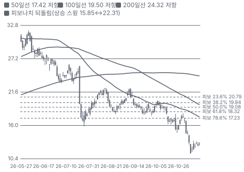

**주봉**

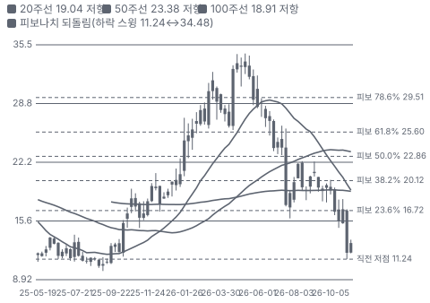

**월봉**

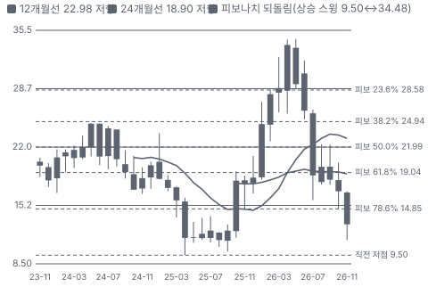

**분기 매출·EPS 실적과 컨센서스**

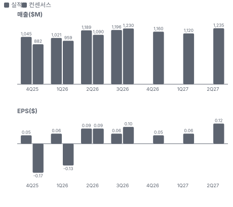

**4Q26 매출 — 지표 추세 vs 가이던스·컨센서스**

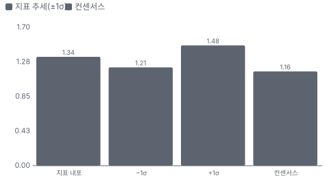

**최근 4개 분기 주가 변화 분석**

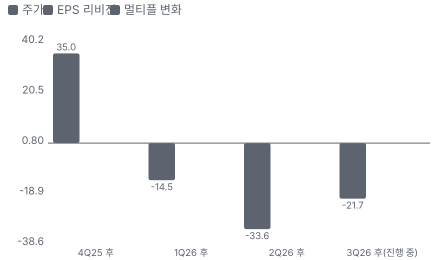

**EPS 리비전**

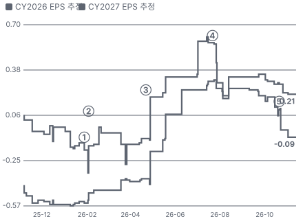

① 26-01-28 4Q25 실적 · EPS 리비전 +14%
② 26-02-03 2031 전환사채 \$770M · 실적 창과 겹침
③ 26-04-22 1Q26 실적 · EPS 리비전 -281%
④ 26-07-22 2Q26 실적·대형 CAPEX · EPS 리비전 -68%
⑤ 26-10-21 3Q26 실적·1.2GW 계약 · EPS 리비전 -195%

**멀티플 프리미엄(현재값 — 최근 4개 분기 추이 재료 없음)**

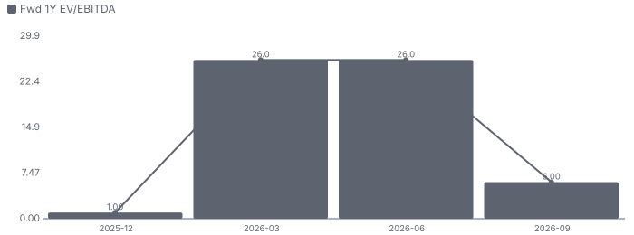

**합리적 멀티플**

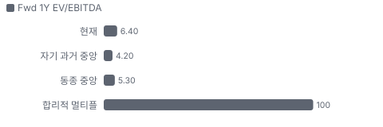

**밸류에이션 주가 시나리오**

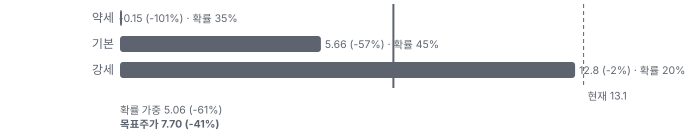

**주가별 업사이드**

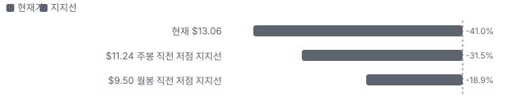
- 제품·서비스 포트폴리오

**고객 믹스(3Q26, 매출 대비)**

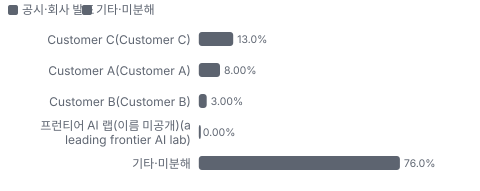

**공급 병목(10점, 낮을수록 병목)**

**CAPEX의 매출 대비 비중**

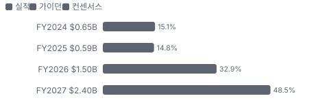

**어닝콜 변화별 주주가치 영향**

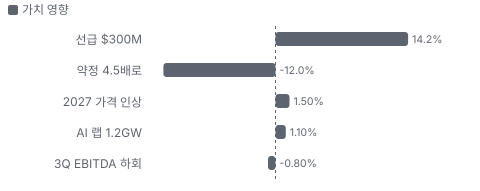

**수주·파이프라인 확실성 사다리**

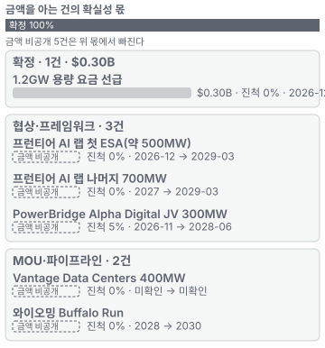

**매출 → 매출총이익 → 영업이익(매출 = 100, 최근 4분기)**

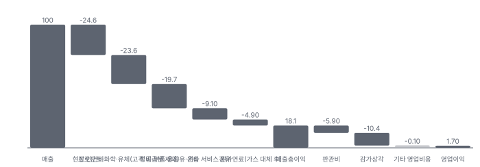

**분기 비용 비중 추이(매출 대비, 공시)**

**비용 요인별 매출 대비 비중 1년 변화**

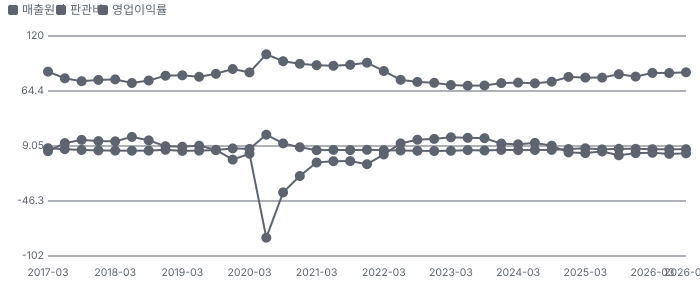

**BOM 항목 가격 +10% 시 OPM 변화**

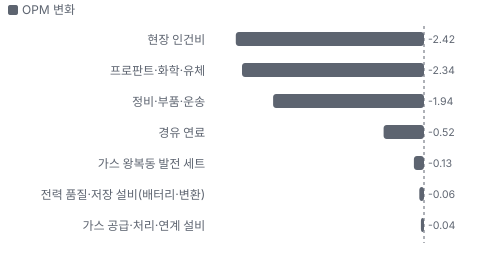

**수압파쇄·완결 서비스 BOM 원가 몫**

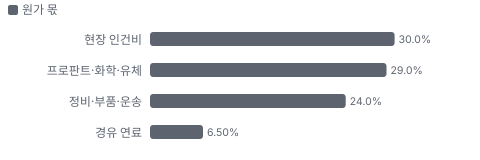

**LPI 현장 전력 BOM 원가 몫**

**투입 원가 물가·판매가 물가·회사 가격 — 1년 변화(항목별 최근 달)**

**자산 구성 — 3Q26 분기말 투하자본 \$2,858.7M**

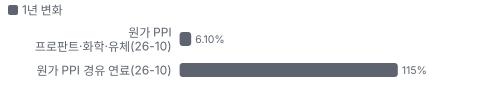

**자산별 변화율 — 최근 12개 분기(4Q23 = 0%) + 다음 4개 분기 추정**

**ROIC 추이 — TTM, 최근 12개 분기 + 다음 4개 분기 추정(컨센서스 NOPAT)**

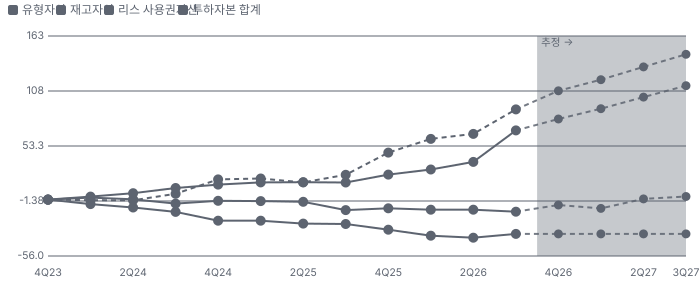

**분기 감가 비율 연율(유형자산 순액 대비)**

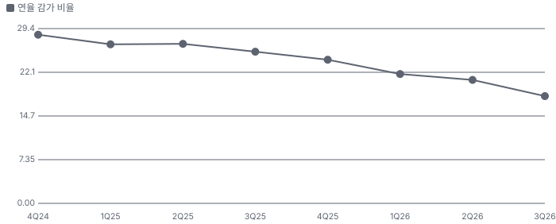

**매출·PPI·수출입 — 최근 16개 분기 같은 축(4Q22 = 100) + 다음 분기 추정**

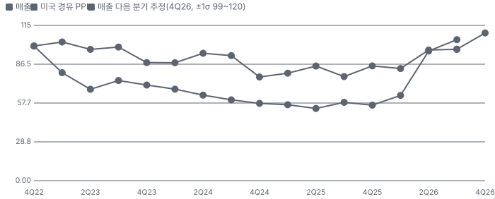

**10년 P·Q 사이클 — 추세(HP 필터) 대비 갭과 8분기 전망**

**매출 증가율의 가격·물량 분해와 8분기 전망(전년 대비)**

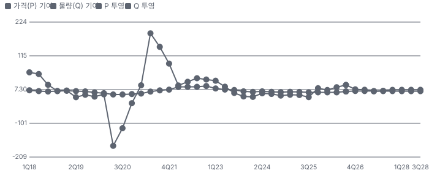

**분기별 매출 증가율 분해**

**목표주가 산정 — 기본과 강세 사이(강세 쪽 28%), 도달 확률 약 33%**

**PEG — 성장 대비 멀티플(낮을수록 성장 대비 쌈)**

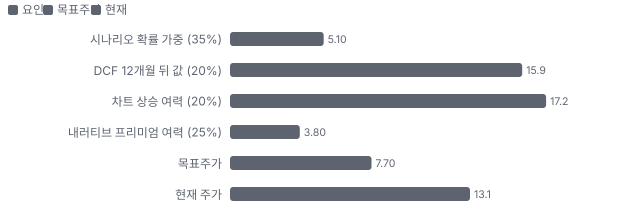

**일봉 지지·저항과 목표주가**

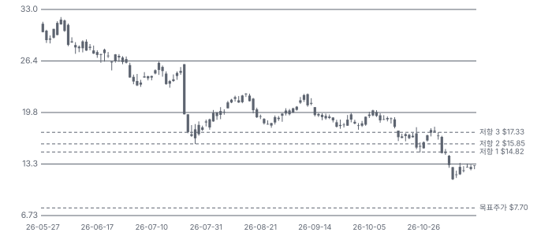

**커뮤니티 언급 수(최근 30일, 채널별)**

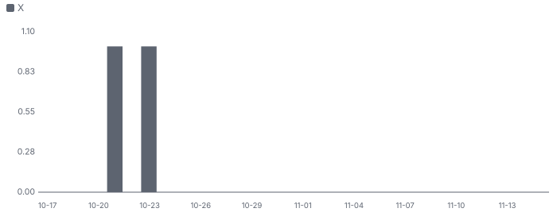

**수주/출하 비율 × 재고 일수 — 분기별(B/B 100 = 수주와 출하가 같다)**

**일별 거래량 분해**

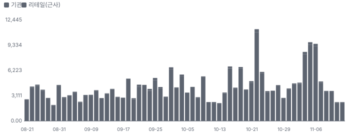

**기관 자금 흐름**

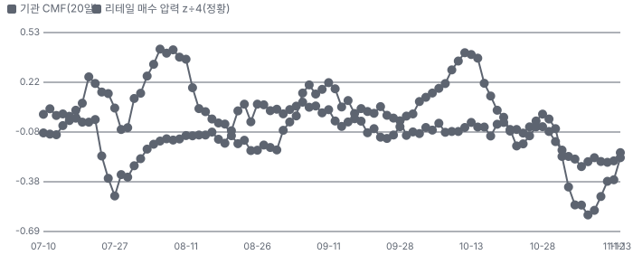

**몬테카를로**

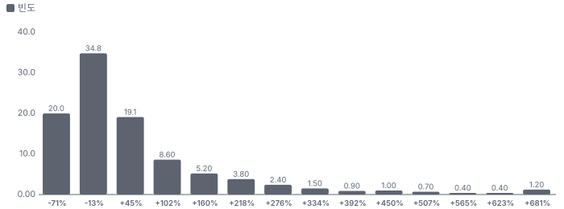

해석: 3,000번 중 1,612번(54%)에서 가치가 지금 주가 이상이었다. 지금 주가를 뒷받침하는 경우와 그렇지 않은 경우가 반반에 가깝다. 가운데 값은 1.06배이고, 열 번 중 여덟 번은 0.30~3.22배 사이에 든다.

## 내러티브

> **기업가치를 결정하는 이야기:** 프랙은 경기 순환 사업이라 값은 정상 EBITDA × 배수다. 전력은 15년 계약 인프라라 값은 계약 MW × kW당 투하자본 × IRR이다. 두 사업을 한 회사가 하면서 프랙 현금과 전환사채로 전력 장비를 먼저 사 둔 구조다

> **멀티플·EPS 프리미엄**
> **멀티플:** Fwd 1Y EV/EBITDA 6.4배로 프랙 순수 동종(PUMP 4.4배·PTEN 4.2배·ACDC 5.3배)보다 높고 HAL(7.3배)·SEI(8.4배)보다 낮다. 차이가 전력 옵션 몫이다
> **EPS:** 조정 EPS는 FY2026 \$0.26 → FY2027 \$0.45 → FY2028 \$1.00(컨센서스)지만 FY2027 범위가 −\$1.21~\$0.80으로 넓다

### 투자자들은 왜 열광했나

2026년 1~5월에는 유가 급등(호르무즈), AI 전력난, Oklo·Fervo 지분 상승이 겹쳐 종가가 \$33.93(5/4)까지 올랐다. 식은 이유는 7월에 3GW CAPEX \$5~6B와 FCF 적자가 숫자로 나왔고, 10월 계약이 'ESA 전'이었으며, 11월 초 업종 매도에 GAAP 적자(지분 평가손 \$63M)가 겹쳤기 때문이다

### 무엇이 기업가치를 바꾸나

> **구조적 체질 변화**
> **변화:** 프랙 서비스 회사에서 '프랙 + 독립 발전 사업자'로 바꾸는 중
> **증거:** LPI 1.2GW 개발 계약, 3GW 장비 확보, Liberty Wholesale Commodities(ERCOT(텍사스 전력망 운영기구) 시장 참여, 2Q 콜)
> **반증:** 2027년 말까지 가동 MW가 0

> **고부가 믹스 확장**
> **변화:** 디젤 함대 → 가스 연소 digiFleet(Liberty 차세대 프랙 함대, digiFrac·digiPrime), 그 위에 15년 전력 계약
> **증거:** 가스 대체율 60%(3Q), digiPrime(Liberty 천연가스 엔진 직결 수압파쇄 펌프) 캐나다 첫 배치(2Q 콜)
> **반증:** 디지털 함대 가격이 디젤 함대와 같아진다

> **기술 혁신**
> **변화:** 가스 직결 펌프(digiPrime)·AI 운영 소프트웨어, 발전 제어 TEMPO(LPI 발전 제어 시스템)
> **증거:** NLR 계통 연계 시험 완료(3Q), 대체율 기록
> **반증:** 첫 데이터센터 가동에서 전력 품질 문제

> **실행 속도**
> **변화:** 발전 장비 인도 2027년부터, 첫 전력 2027년 4분기 목표 **납품 리드타임 10~12개월.** 피어 비교 미확인. 이전 대비 미확인.
> **증거:** 3Q 콜(2027 하반기 공급 가능), PowerBridge 2027년 4분기 첫 전력(2Q 콜). 납기 기준 = 계약 → 첫 전력 지금 값 = 첫 ESA 목표 서명(2026-12) → 첫 가동(2027년 4분기) 약 10~12개월
> **반증:** 첫 ESA 2027년 1분기 넘김

> **M&A**
> **변화:** IMG Energy Solutions 인수(2025-03)로 분산 전력 개발 역량을 들였다
> **증거:** 10-Q(IMG 인수)
> **반증:** -

> **정책·입법 연관성**
> **재정정책:** 가스 발전은 청정에너지 세액공제 대상이 아니다. 유가·LNG(액화천연가스) 수출 정책이 E&P 활동을 통해 간접 영향 10-K 위험 요인 반증: - 의회 동의 2/10 — 하원 1/5(직접 관련 세출 없음) · 상원 1/5(같음).
> **행정명령:** 연방 데이터센터 인허가 가속 행정명령(2025)과 에너지 지배력 행정명령이 가스 발전·인허가 쪽에 우호 공개 행정명령 반증: 주·카운티 단위 데이터센터 반발 규제 의회 동의 2/10 — 하원 1/5(행정명령 — 의회 의결 없음) · 상원 1/5(같음).
> **연관입법:** 해당 없음(이 회사에 직접 걸린 연관 입법 확인 안 됨) - 반증: -

> **고객의 지출 예산**
> **변화:** 프랙은 E&P의 유정 완결 CAPEX, 전력은 하이퍼스케일러 데이터센터 CAPEX·운영 전력 예산에서 나온다
> **사업별 예산:** 수압파쇄·완결 서비스 — 고객 CAPEX(E&P 유정 완결 투자), 매출의 97%: 유가·리그 수 · LPI 현장 전력 — 고객 혼합(데이터센터 전력 확보(선급 CAPEX) + 15년 전력 요금(OPEX)), 매출의 3%: AI 데이터센터 증설
> **증거:** 10-K 매출 구조, 3Q 콜(용량 요금 선급)
> **반증:** E&P 2027 예산 삭감

### 내러티브 근거

> '프랙 현금으로 AI 데이터센터 전력 회사를 만든다'는 이야기는 5월 정점(\$33.93 종가, 5/4) 뒤 꺾였다. 7월 2Q 실적에서 3GW에 CAPEX \$5~6B가 든다는 숫자가 나오자 이틀에 −31%, 10월 1.2GW 계약 발표에도 11월 초 업종 매도와 겹쳐 신저가를 찍었다. 지금 \$13.06은 그 종가 고점 대비 −61.5%다. 동종 대비 멀티플 차이 +21% 중 회사 고유 몫은 -94%다. 단계는 소멸, 쏠림은 낮음이다.

> **AI 데이터센터 현장 전력** · 유지
> **논리:** 계통 접속이 막힌 데이터센터가 가스 현장 발전을 산다
> **숫자:** 1.2GW 개발 계약·선급 약 \$300M, 3GW 장비 확보, 구속력 ESA 0건
> **반증:** 12월 첫 ESA 서명
> **출처:** 3Q 보도자료·콜

> **2027 프랙 가격 회복** · 강화
> **논리:** 유휴 장비가 없고 유가 선물이 올라 2027 가격을 올린다
> **숫자:** 2027 유가 선물 \$85 이상(CEO), 추가 크루 수요 15~18개
> **반증:** 4Q 실적에서 2027 가격 인상 폭이 인플레이션 이하
> **출처:** 3Q 콜

> **CAPEX·자금 부담(반대 내러티브)** · 강화
> **논리:** 3GW에 \$5~6B, FCF가 2028년까지 음수라 증자·희석이 온다
> **숫자:** FY2027 FCF 컨센서스 −\$1.75B, 레버리지 약정 4.5배로 완화
> **반증:** 프로젝트 금융(부채 80%) 2027년 초 종결
> **출처:** 컨센서스·10-Q

> **가스 대체 기술 웃돈** · 유지
> **논리:** 가스 연소 함대가 연료비를 줄여 가격 협상력을 준다
> **숫자:** 대체율 60%, 고객 연 \$1B 절감
> **반증:** 경유-가스 가격 차 축소
> **출처:** 3Q 보도자료

> **지분 투자(Oklo·Fervo)** · 약화
> **논리:** 에너지 전환 지분이 숨은 가치다
> **숫자:** 9/30 공정가치 \$122M(시총의 약 6%)
> **반증:** -
> **출처:** 3Q 10-Q

## 포트폴리오

| 제품·서비스 | 구분 | 무엇 | 쓰는 곳 | 돈 버는 방식 | Mix | Mix 변화(전 분기 대비) |
|---|---|---|---|---|---|---|
| 수압파쇄·완결 서비스 | 서비스 | 셰일 유정에 고압 유체·모래를 넣어 균열을 내는 완결 작업, 와이어라인·모래·CNG(압축천연가스) 포함 | 미국·캐나다 E&P 유정 완결 | 작업(단계)당 요금. 매출 대부분, TTM \$4.45B | 미확인 | 미확인 |
| LPI 현장 전력 | 서비스 | 가스 왕복동 발전·전력 품질·계통 연계를 묶은 현장 발전소를 짓고 운영한다 | 데이터센터·산업·유전 전력 | 15년 ESA 용량·에너지 요금. 가동 0MW, 2027년 4분기 시작 | 미확인 | 미확인 |
| 에너지 전환 지분 | 투자 | Oklo·Fervo·Tamboran 상장 지분 | 전략 투자 | 공정가치 \$122M(9/30), 평가손익이 GAAP 이익에 잡힌다 | 미확인 | 미확인 |

## 고객

> **3Q26 최대 고객 Customer C(Customer C) 13%, 상위 3곳 24%, 집중도 분산.** 공시·회사 발표로 확인한 몫은 매출의 24%이고, 나머지 고객 몫은 추정이거나 미분해다. 매출 10% 이상 고객은 이름 없이 A·B·C로만 공시된다. 3Q에는 C가 13%, A가 8%, B가 3%다. 1년 전 A 12%·B 11%였다 — 상위 고객이 바뀌는 E&P 완결 시장 구조를 보여 준다. 전력 고객(프런티어 AI 랩)은 아직 매출이 없다

**고객별 매출 몫(3Q26)**
| 고객 | 몫 | 변화 | 근거 |
|---|---|---|---|
| Customer C(Customer C) | 13% | +9%p | 공시 |
| Customer A(Customer A) | 8% | -4%p | 공시 |
| Customer B(Customer B) | 3% | -8%p | 공시 |
| 프런티어 AI 랩(이름 미공개, a leading frontier AI lab) | 0% | +0%p | 공시 |
| 기타·미분해 | 76% | - | - |

> **Customer C(Customer C)** · 공시
> **사는 것:** 수압파쇄·완결
> **추정 근거:** 3Q 매출 13%, 매출채권 14%

> **Customer A(Customer A)** · 공시
> **사는 것:** 수압파쇄·완결
> **추정 근거:** 9M 9%

> **Customer B(Customer B)** · 공시
> **사는 것:** 수압파쇄·완결
> **추정 근거:** 9M 8%

> **프런티어 AI 랩(이름 미공개, a leading frontier AI lab)** · 공시
> **사는 것:** 1.2GW 통합 전력(개발 계약, 선급 약 \$300M)
> **추정 근거:** 매출은 2027년 4분기 가동부터

## 수주·파이프라인

> **2026-11-13 기준 6건.** 확정 \$0.30B.

**수주 목록**
| 상태 | 계약 | 계약 총액 | 진척 | 기간 | 비고 |
|---|---|---|---|---|---|
| 확정 | 1.2GW 용량 요금 선급 | \$0.30B | 0% | 2026-12 → 2031 | - |
| 협상 | 프런티어 AI 랩 첫 ESA(약 500MW) | 금액 비공개 | 0% | 2026-12 → 2029-03 | - |
| 프레임워크 | 프런티어 AI 랩 나머지 700MW | 금액 비공개 | 0% | 2027 → 2029-03 | - |
| 프레임워크 | PowerBridge Alpha Digital JV 300MW | 금액 비공개 | 5% | 2026-11 → 2028-06 | - |
| 파이프라인 | Vantage Data Centers 400MW | 금액 비공개 | 0% | 미확인 → 미확인 | - |
| 파이프라인 | 와이오밍 Buffalo Run | 금액 비공개 | 0% | 2028 → 2030 | - |

**실행 속도와 방해 요인**
| 항목 | 상태 | 실행 속도 | 방해 요인 |
|---|---|---|---|
| 1.2GW 용량 요금 선급 | 확정 | 4Q26 수령 예상, 첫 5년 상각 | 수령 시점 확인 전 |
| 프런티어 AI 랩 첫 ESA(약 500MW) | 협상 | 2026-10 개발 계약 → 12월 ESA 목표 → 2027년 4분기 첫 가동 | ESA 법률 문서·부지 조건 · 지역 반발 시 대체 부지(지연) · 프로젝트 금융 종결 |
| 프런티어 AI 랩 나머지 700MW | 프레임워크 | 건물별 ESA | 데이터센터 단계 건설 |
| PowerBridge Alpha Digital JV 300MW | 프레임워크 | 11/14 착공 보도, 첫 전력 2027년 4분기 | 입주사 전력 구매 계약 |
| Vantage Data Centers 400MW | 파이프라인 | 미확인 | 조건 미공시 |
| 와이오밍 Buffalo Run | 파이프라인 | 인허가 16~18개월 | 대형 부하 인허가 |

## 마진 구조

> **GPM 16.8%, OPM 1.6%.** 3Q25 대비 GPM -1.9%p, OPM +1.9%p. 변동비는 매출의 60%이고, 매출이 10% 늘면 OPM은 +3.5%p 움직인다. 3Q 서비스 원가(감가상각 제외)는 매출의 83.2%로 1년 전 81.2%보다 2.0%p 높다. 매출이 26% 늘었는데 영업이익률은 1.6%에 머문 이유다 — 인건비·운송·윤활유·관세 인플레이션과 시추 지연에 따른 공백(3Q 콜). 감가상각은 매출의 9.5%로 1년 전 13.0%보다 낮다(장비 내용연수 만료)

> **매출 100 중 매출원가 81.9, 매출총이익 18.1(최근 4분기, 공시).** 매출원가 요인 중 현장 인건비이 매출의 25.0%로 가장 무겁고, 단가가 +10% 오르면 GPM이 -2.50%p 움직인다. 분기 회귀로 매출 1이 늘 때 매출원가는 0.71 늘고, 매출원가의 고정비 몫은 9%다. 매출원가 요인 비중은 요인별 공시 기간 값이라 합이 최근 4분기 매출원가를 넘어, 그림에서는 0.98배로 비례 조정했다.

**비용 요인 강도 — 비중·추세·충격(+10%)·탄력**
| 비용 | 구분 | 매출 대비 | 1년 변화 | 마진 기여 | 충격 시 마진 | 매출 탄력 | 고정비 몫 |
|---|---|---|---|---|---|---|---|
| 현장 인건비 | 매출원가 요인 | 25.0% | 미확인 | 미확인 | -2.50%p | 미확인 | 50% |
| 프로판트·화학·유체(고객 공급분 제외) | 매출원가 요인 | 24.0% | 미확인 | 미확인 | -2.40%p | 미확인 | 0% |
| 정비·부품·윤활유·운송 | 매출원가 요인 | 20.0% | 미확인 | 미확인 | -2.00%p | 미확인 | 30% |
| 기타 서비스 원가 | 매출원가 요인 | 9.2% | 미확인 | 미확인 | -0.92%p | 미확인 | 60% |
| 경유 연료(가스 대체 후) | 매출원가 요인 | 5.0% | 미확인 | 미확인 | -0.50%p | 미확인 | 0% |
| 매출원가 | 공시 항목 | 81.9% | +3.0%p | -3.0%p | -8.19%p | 0.71 | 9% |
| 감가상각 | 공시 항목 | 10.4% | -2.7%p | +2.7%p | 미확인 | 0.09 | 3% |
| 판관비 | 공시 항목 | 5.9% | -0.2%p | +0.2%p | 미확인 | 0.05 | 12% |
| 기타 영업비용 | 공시 항목 | 0.1% | +0.1%p | -0.1%p | 미확인 | -0.00 | 100% |

매출 탄력 = 분기 비용을 매출에 회귀한 기울기(매출 1당 변동비), 고정비 몫 = 절편 ÷ 평균 비용. 표본이 8분기 미만이면 미확인. 매출원가 요인 비중은 margin 재료의 추정이 섞여 있고, 공시 매출원가와의 차이는 '기타 매출원가'로 둔다.

**GPM에서 OPM까지(GAAP, 아래는 최근 4개 분기)**
| 기간 | GPM | 연구개발 | 판관비 | 기타 | OPM |
|---|---|---|---|---|---|
| 3Q25 | 18.7% | 0.0% | 6.2% | 12.9% | -0.3% |
| 3Q26 | 16.8% | 0.0% | 5.8% | 9.4% | 1.6% |
| 2025-12 | 21.1% | - | - | - | 1.9% |
| 2026-03 | 17.4% | - | - | - | 2.2% |
| 2026-06 | 17.5% | - | - | - | 1.1% |
| 2026-09 | 16.8% | - | - | - | 1.6% |

**비용을 움직이는 요인**
| 비용 | 요인 |
|---|---|
| 현장 인건비(매출원가) | 크루 임금 — 데이터센터 건설과 같은 인력 풀(3Q 콜) · 근거 추정 |
| 프로판트·화학·유체(고객 공급분 제외, 매출원가) | 작업량·모래 가격(2Q 콜: 모래 가격 회복 안 됨) · 근거 추정 |
| 정비·부품·윤활유·운송(매출원가) | 윤활유(올해 중반 급등 뒤 안정)·관세·트럭 운송 · 근거 추정 |
| 감가상각·상각(기타) | 함대 내용연수 만료로 감소, 2027년부터 발전 설비 감가 시작 · 근거 공시 |
| 기타 서비스 원가(매출원가) | 모래 광산 운영·LPI 초기 비용 · 근거 추정 |
| 일반관리비(SBC 포함, 판관비) | 보상·본사 간접비(3Q +\$3M), SBC \$10M · 근거 공시 |
| 경유 연료(가스 대체 후, 매출원가) | 경유 가격 — 가스 대체율 60%(3Q)라 남은 경유 몫만 · 근거 추정 |

**수압파쇄·완결 서비스 BOM — 매출의 97%, GPM 17%(3Q 회사 전체: 매출 \$1,196.2M − 서비스 원가 \$995.0M(감가상각 전)), 항목 가격 +10% 시**
| 항목 | 원가 몫 | 전가 | 제품 GPM | OPM |
|---|---|---|---|---|
| 현장 인건비 | 27~33% | 미확인 | -2.5%p | -2.42%p |
| 프로판트·화학·유체 | 25~33% | 미확인 | -2.4%p | -2.34%p |
| 정비·부품·운송 | 20~28% | 미확인 | -2.0%p | -1.94%p |
| 경유 연료 | 4~9% | 미확인 | -0.5%p | -0.52%p |
| 미분해 | 10% | - | - | - |

**LPI 현장 전력 BOM — 매출의 3%, GPM 17%(부문 손익 미공시 — 회사 전체 3Q 감가상각 전 매출총이익률을 대용(추정)), 항목 가격 +10% 시**
| 항목 | 원가 몫 | 전가 | 제품 GPM | OPM |
|---|---|---|---|---|
| 가스 왕복동 발전 세트 | 45~60% | 미확인 | -4.4%p | -0.13%p |
| 전력 품질·저장 설비(배터리·변환) | 15~30% | 미확인 | -1.9%p | -0.06%p |
| 가스 공급·처리·연계 설비 | 10~25% | 미확인 | -1.5%p | -0.04%p |
| 미분해 | 7% | - | - | - |

현장 인건비 가격이 +10% 오르면 영업이익은 -150.0% 움직인다. 판매가 전가를 모르는 항목은 전가 0%로 계산했다.

**BOM 항목 가격을 움직이는 것**
| 항목 | 요인 |
|---|---|
| 현장 인건비 | 크루 임금 · 근거 추정 |
| 프로판트·화학·유체 | 자체 퍼미안 모래 광산 2곳이 일부를 자급 · 전가: 일부 — 계약 대부분이 시장 연동 가격(10-K) · 근거 추정 |
| 경유 연료 | 가스 대체 뒤 남은 경유 · 근거 추정 |
| 정비·부품·운송 | 관세·윤활유·트럭 운송 · 근거 추정 |
| 가스 왕복동 발전 세트 | Bergen·Wärtsilä·Caterpillar 장비 계약 \$2.1B(10-Q) · 근거 추정 |
| 전력 품질·저장 설비(배터리·변환) | AI 부하 변동 대응 · 근거 추정 |
| 가스 공급·처리·연계 설비 | 분자에서 메가와트까지 일괄 수행 · 근거 추정 |

**투입 물가 — 미국 PPI 3·6·12개월(2026-10, 개정 반영)**
| 항목 | 미국 3개월 | 6개월 | 12개월 | 전가 못 할 때 OPM |
|---|---|---|---|---|
| 프로판트·화학·유체 | +0.1% | +1.7% | +6.1% | - |
| 경유 연료 | +38.6% | +30.2% | +115.2% | - |

별표는 품목보다 넓은 업종 지수다. 연결한 투입 원가의 미국 PPI(생산자물가지수)는 1년 새 가중 +24.9%이고, 판매가로 넘기지 못하면 GPM -7.2%p·OPM -7.2%p가 움직인다. 판매가 비교 물가(ppi_id:PCU213112213112)는 1년 새 미확인 — 회사 가격 변화는 미확인. 물가 지수를 붙이지 못한 매출원가 항목은 현장 인건비, 정비·부품·윤활유·운송다(미연결).

## 자산 구성

> **3Q26 분기말 투하자본 \$2,858.7M** — 유형자산 97%, 기타 영업자산 3%. 최근 12개 분기(4Q23 → 3Q26) 가장 크게 늘어난 자산은 유형자산(+69%), 투하자본 합계 +90%. 3Q27 추정 투하자본 \$3,683.5M(+29%, 컨센서스 매출과 회전 일수·CAPEX 강도 유지 가정). 연율 감가 비율(순액 기준)은 직전 4분기 26.87% → 최근 4분기 21.00%, 직전 비율이면 감가상각이 \$129.2M 더 컸다(영업이익의 174.1%).

**자산·운전자본 항목별 분기말 잔액 — 최근 12개 분기와 다음 4개 분기 추정**
| 항목 | 4Q23 | 3Q25 | 3Q26(최근) | 3Q27 추정 | 12개 분기 변화 | 다음 4개 분기 변화 |
|---|---|---|---|---|---|---|
| 매출채권 | 미확인 | 미확인 | \$429.1M | \$500.7M | 비교 불가 | +17% |
| 재고자산 | \$205.9M | \$184.4M | \$181.1M | \$212.3M | -12% | +17% |
| 선급·기타 유동자산 | \$124.1M | \$122.7M | \$61.4M | \$69.2M | -50% | +13% |
| 매입채무 | \$293.7M | \$350.1M | \$446.2M | \$455.4M | +52% | +2% |
| 미지급비용 | \$261.1M | \$201.8M | \$292.9M | \$298.4M | +12% | +2% |
| 선수수익(계약부채) | \$5.2M | \$7.7M | \$0.0M | \$2.4M | -100% | — |
| 유형자산 | \$1,645.4M | \$1,925.9M | \$2,775.8M | \$3,507.0M | +69% | +26% |
| 리스 사용권자산 | \$92.6M | \$70.2M | \$61.0M | \$61.0M | -34% | +0% |

**자산 추정 동인 — 최근 4개 분기 평균(재무상태표 동인 모형)**
| 동인 | 값 | 곱하는 기준 |
|---|---|---|
| 매출채권 | 36일 | 매출 |
| 재고자산 | 19일 | 매출원가 |
| 선급·기타 유동자산 | 5일 | 매출 |
| 매입채무 | 40일 | 매출원가 |
| 미지급비용 | 22일 | 매출 |
| 선수수익(계약부채) | 0일 | 매출 |
| CAPEX 강도 | 27.3% | 매출(최근 4개 분기 합) |
| 분기 감가율 | 5.52% | 기초 유형자산 순액(무형 상각 제외 감가상각) |
| 매출원가율 | 82.0% | 매출(최근 4개 분기) |
| 영업권·리스 사용권·기타 | 유지 | 인수·새 리스는 공시 전 모름 |
| 인수 무형자산 | 분기 \$0.0M 상각 | 최근 4개 분기 평균 상각 |

**추정 방법:** 증권사 3표 모델(손익·재무상태표·현금흐름)의 재무상태표 동인 방식이다. 운전자본은 항목별 회전 일수(매출채권·선급·미지급·선수는 매출, 재고·매입채무는 매출원가 기준)를 최근 4개 분기 평균으로 두고 컨센서스 매출에 곱한다. 유형자산은 기초 + CAPEX − 감가상각으로 굴린다(Koller·Goedhart·Wessels 『Valuation』 재무상태표 추정). 매출 경로는 ROIC 절의 컨센서스와 같다.

**유형·무형자산 항목별 가치(2023-12-31 vs 2022-12-31)**
| 구분 | 항목 | 총액 2023-12-31 | 누적상각 | 순액 | 총액 2022-12-31 | 총액 1년 변화 | 공시 내용연수 |
|---|---|---|---|---|---|---|---|
| 유형 | 유형자산 합계(항목 미분해) | \$2,990.5M | 총계만 공시 | 총계만 공시 | \$2,345.5M | +27.5% | 미확인 |
| 유형 합계 | 유형자산 | \$2,990.5M | \$1,501.7M | \$1,488.8M | \$2,345.5M | +27.5% | 경과율 50%(상각 대상 기준) |

**내용연수 산식(상각 대상 유형자산 = 총액 − 토지 − 건설중)**
| 기준일 | 연 감가상각 | 상각 대상 총액 | 평균 내용연수 | 경과 연수 | 잔여 연수 | 경과율 |
|---|---|---|---|---|---|---|
| 2023-12-31 | \$428.3M | \$2,990.5M | 7.0년 | 3.5년 | 3.5년 | 50% |
| 2022-12-31 | \$448.1M | \$2,345.5M | 5.2년 | 2.5년 | 2.7년 | 49% |

산식 평균 내용연수는 7.0년. 1년 전 5.2년 → 지금 7.0년.

**분기 감가 비율(감가상각 ÷ 평균 유형자산 순액)**
| 분기 | 감가상각 | 평균 유형자산(순액) | 분기 비율 | 연율 | 연율의 역수 |
|---|---|---|---|---|---|
| 4Q24 | \$132.2M | \$1,862.6M | 7.10% | 28.38% | 3.5년 |
| 1Q25 | \$127.7M | \$1,908.5M | 6.69% | 26.77% | 3.7년 |
| 2Q25 | \$129.4M | \$1,927.7M | 6.71% | 26.84% | 3.7년 |
| 3Q25 | \$123.0M | \$1,927.6M | 6.38% | 25.52% | 3.9년 |
| 4Q25 | \$120.2M | \$1,990.0M | 6.04% | 24.17% | 4.1년 |
| 1Q26 | \$114.1M | \$2,095.4M | 5.44% | 21.77% | 4.6년 |
| 2Q26 | \$114.2M | \$2,199.9M | 5.19% | 20.77% | 4.8년 |
| 3Q26 | \$113.7M | \$2,519.5M | 4.51% | 18.05% | 5.5년 |

감가상각 기준: 손익계산서 감가상각·상각비(SEC 공시 데이터, 4분기 = 연간 − 1~3분기). 분기 유형자산 총액이 없어 순액 기준.

**감가율 하락 경고: 연율 26.87% → 21.00%(-22%).** 직전 4분기 비율을 그대로 쓰면 최근 4분기 감가상각이 \$129.2M 더 컸다(영업이익의 174.1%). 내용연수 연장·상각 끝난 자산 증가·건설중 자산 증가(믹스) 중 무엇인지는 공시 주석으로 가린다(자체추론).

미공시·미분해: 영업권 · 무형자산 · 유형자산 항목별 총액·내용연수(10-K 주석에서 모델이 채움) · 무형자산 항목(10-K 주석에서 모델이 채움) — 이 칸은 비우고 나머지로 계산했다.

### 해석 — 자산이 어디에 쌓이고 있나

- 같은 기간 4개 분기 매출은 0% — 매출보다 빨리 늘어난 자산: 유형자산 +69%. 이 자산의 회전율이 떨어지면 ROIC를 희석한다.
- 다음 4개 분기 CAPEX \$1,303.7M vs 감가상각 \$672.4M(최근 4개 분기 CAPEX 강도·감가율 유지) — 유형자산 3Q26 \$2,775.8M → 3Q27 \$3,507.0M. 투자가 감가보다 커서 자산이 쌓이는 국면이다.
- 감가 비율 하락으로 최근 4분기 영업이익에 \$129.2M(174.1%)가 보태졌을 수 있다 — 내용연수 변경 공시가 없으면 건설중 자산·토지 같은 비상각 자산 몫이 커진 믹스 효과일 가능성이 크다(자체추론).

## ROIC

> **TTM 3Q26 ROIC는 영업권·인수 무형 포함 2.6%, 제외 2.6%**(NOPAT 마진 1.4% × 투하자본 회전율 1.88회). 최근 12개 분기 4Q23 36.5% → 3Q26 2.6%(고점 4Q23 36.5%). 컨센서스 NOPAT으로 굴리면 3Q27 3.0%(제외 3.0%) — WACC 8.2% 대비 -5.2%p. 1년 변화의 가장 큰 요인은 NOPAT 마진(-0.6%p).

**ROIC 추이(TTM)와 다음 4개 분기 추정 — NOPAT ÷ 평균 투하자본(이번 분기말·4개 분기 전)**
| 분기 | 구분 | TTM 매출 | TTM NOPAT | NOPAT 마진 | 평균 투하자본 | ROIC 포함 | ROIC 제외 |
|---|---|---|---|---|---|---|---|
| 4Q23 | 실적 | \$4,747.9M | \$584.1M | 12.3% | \$1,599.4M | 36.5% | 36.5% |
| 1Q24 | 실적 | \$4,559.0M | \$500.4M | 11.0% | \$1,638.4M | 30.5% | 30.5% |
| 2Q24 | 실적 | \$4,523.9M | \$451.3M | 10.0% | \$1,701.4M | 26.5% | 26.5% |
| 3Q24 | 실적 | \$4,446.5M | \$376.8M | 8.5% | \$1,784.7M | 21.1% | 21.1% |
| 4Q24 | 실적 | \$4,315.2M | \$301.3M | 7.0% | \$1,659.4M | 18.2% | 18.2% |
| 1Q25 | 실적 | \$4,219.5M | \$227.2M | 5.4% | \$1,662.1M | 13.7% | 13.7% |
| 2Q25 | 실적 | \$4,102.1M | \$147.4M | 3.6% | \$1,631.8M | 9.0% | 9.0% |
| 3Q25 | 실적 | \$3,911.0M | \$63.9M | 1.6% | \$1,737.7M | 3.7% | 3.7% |
| 4Q25 | 실적 | \$4,006.1M | \$59.6M | 1.5% | \$2,011.4M | 3.0% | 3.0% |
| 1Q26 | 실적 | \$4,049.8M | \$62.6M | 1.5% | \$2,121.3M | 3.0% | 3.0% |
| 2Q26 | 실적 | \$4,195.9M | \$43.9M | 1.0% | \$2,129.6M | 2.1% | 2.1% |
| 3Q26 | 실적 | \$4,444.7M | \$60.5M | 1.4% | \$2,369.1M | 2.6% | 2.6% |
| 4Q26 | 추정 | \$4,566.0M | \$57.6M | 1.3% | \$2,675.3M | 2.2% | 2.2% |
| 1Q27 | 추정 | \$4,664.8M | \$65.7M | 1.4% | \$2,861.2M | 2.3% | 2.3% |
| 2Q27 | 추정 | \$4,711.2M | \$83.9M | 1.8% | \$2,994.8M | 2.8% | 2.8% |
| 3Q27 | 추정 | \$4,780.1M | \$97.9M | 2.0% | \$3,271.1M | 3.0% | 3.0% |

**다음 4개 분기 NOPAT — 컨센서스(세율 24%, 리스 이자 별도)**
| 분기 | 매출 | EBITA 마진 | EBITA | NOPAT(분기) | 근거 |
|---|---|---|---|---|---|
| 4Q26 | \$1,160.1M | 1.4% | \$16.2M | \$12.3M | 컨센서스 매출 × EBIT 마진 FY2026 |
| 1Q27 | \$1,120.0M | 3.0% | \$33.3M | \$25.3M | 컨센서스 매출 × EBIT 마진 FY2027 |
| 2Q27 | \$1,235.0M | 3.0% | \$36.7M | \$27.9M | 컨센서스 매출 × EBIT 마진 FY2027 |
| 3Q27 | \$1,265.0M | 3.0% | \$37.6M | \$28.6M | 컨센서스 매출 × EBIT 마진 FY2027 |

**추정 방법:** NOPAT은 컨센서스(분기 매출 추정 × 회계연도 EBIT 마진 추정)로 잡고, 조정(비 GAAP) 마진이면 주식보상 몫을 빼서 과거 실적과 같은 기준(영업이익 + 인수 무형 상각)으로 맞췄다. 이미 발표했지만 분기 보고서(10-Q)가 아직 없는 분기는 발표 실적을 쓴다. 투하자본은 자산 구성 절의 재무상태표 동인으로 굴렸다. ROIC는 4개 분기 NOPAT을 이번 분기말과 4개 분기 전 투하자본의 평균으로 나눈다 — 추정 분기의 ROIC에는 이미 나온 실적 분기가 섞여 있다.

**투하자본 항목별 회전율과 ROIC 기여(TTM 3Q26, 평균 잔액)**
| 항목 | 투하자본 | 매출 1달러당 자본 | 회전율(매출 ÷ 항목) | 자본 몫 | 이 항목을 빼면 ROIC |
|---|---|---|---|---|---|
| 운전자본 | −\$160.0M | -0.04 | 음수(자금 원천) | -7% | 2.4% |
| 유형자산 | \$2,350.8M | 0.53 | 1.89회 | 99% | 331.3% |
| 리스 사용권자산 | \$65.6M | 0.01 | 67.75회 | 3% | 2.6% |
| 기타 영업자산 | \$112.7M | 0.03 | 39.44회 | 5% | 2.7% |

**ROIC 세 가지 판**
| 판 | NOPAT | 투하자본 | ROIC | 무엇을 재나 |
|---|---|---|---|---|
| 영업권·인수 무형 포함 | \$60.5M | \$2,369.1M | 2.6% | 인수 웃돈까지 낸 돈에 대한 수익률 |
| 영업권·인수 무형 제외 | \$60.5M | \$2,369.1M | 2.6% | 본업 운영 수익률(동종 비교용) |
| 경제적 이익(포함판) | −\$132.9M | \$2,369.1M | 자본비용 8.2% | (ROIC − 자본비용) × 투하자본 |

NOPAT = (영업이익 \$74.2M + 인수 무형 상각 + 리스 내재 이자 \$5.4M) × (1 − 세율 24%). 리스 사용권자산을 투하자본에 넣었으므로 임차료 속 이자 몫을 영업이익에 되더했다. 현금은 영업에 필요한 몫을 따로 알 수 없어 투하자본에서 뺐다. SEC 공시 데이터 자동 초안 — 운전자본 = 매출채권 + 재고 + 선급 − (매입채무 + 미지급비용 + 선수수익), 현금 제외. 손상 누계는 공시 데이터 수록분.

**ROIC 1년 변화 분해(포함판, TTM 3Q25 → TTM 3Q26)**
| 요인 | ROIC 기여 |
|---|---|
| NOPAT 마진 | -0.56%p |
| 운전자본 | -0.23%p |
| 유형자산 | -0.30%p |
| 리스 사용권자산 | +0.03%p |
| 기타 영업자산 | -0.05%p |
| 합계 | -1.12%p |

### 해석 — 무엇이 수익성을 끌어올리고 희석하나

- 유형자산: 투하자본의 99% — 빼면 ROIC 2.6% → 331.3%. 이 자산의 회전율(1.89회)이 수익성을 희석하는 주된 자리다.
- 기타 영업자산: 투하자본의 5% — 빼면 ROIC 2.6% → 2.7%. 이 자산의 회전율(39.44회)이 수익성을 희석하는 주된 자리다.
- 운전자본: −\$160.0M(음수), 고객 선수금·공급사 외상이 자본을 대신 댄다 — 빼면 ROIC 2.4%로 낮아진다. 수익성을 끌어올리는 쪽이다.
- 영업권·인수 무형을 빼면 ROIC가 +0.0%p 오른다 — 과거 인수에 치른 웃돈이 주주 수익률을 그만큼 낮춘다(본업 수익률은 제외판, 인수까지 포함한 가치 창출은 포함판으로 본다).
- 1년 ROIC 개선의 최대 요인은 리스 사용권자산(+0.0%p). 반대로 깎은 최대 요인은 NOPAT 마진(-0.6%p).
- 추정 경로 3Q26 2.6% → 3Q27 3.0%: NOPAT 마진 +0.7%p, 투하자본 회전율 -0.41회 — 컨센서스 매출·마진이 맞고 회전 일수·CAPEX 강도가 유지된다는 가정이다. 마진 추정이 내려가거나 재고 일수가 늘면 이 경로가 먼저 틀린다.
- ROIC(포함) − WACC = -5.6%p(3Q26) — 양수면 투하자본을 늘릴수록 가치가 쌓인다.

## 공급망 병목

이미지 없음(검수 실패) — 에너지 전환 지분

> **공급망 신뢰성 4.5/10, 병목 주의.** 가장 약한 고리는 프랙 펌프·차세대 함대 장비 4.5점이고, 품목 평균은 4.5점이다. 근거가 부족한 4건(가스 왕복동 발전 세트 · 현장 인력(프랙·전력 크루) · 프로판트(모래) · 경유·천연가스 연료)은 점수에서 뺐다. 약한 고리는 발전 설비 인도와 현장 인력이다. 발전 장비 계약 총 \$2.1B 중 \$1.6B가 남았고 인도는 2027~2030년이다(10-Q). 프랙 쪽은 자체 제조(Liberty Advanced Equipment Technologies)라 장비 병목은 작고, 인력·운송비가 원가를 민다

**병목과 마진 — 품목 가격 +10% 시 OPM**
| 품목 | 점수 | 판정 | 구분 | OPM |
|---|---|---|---|---|
| 프랙 펌프·차세대 함대 장비 | 4.5 | 병목 주의 | 출하 차질 위험 | 미확인 |

> **프랙 펌프·차세대 함대 장비** · 4.5/10
> **왜:** 자체 제조라 외부 병목이 작다
> **병목 요인:** 인증 공급사 1곳 · 캐파 여유 · 리드타임 미확인 · 재인증 미확인 · 1위 점유율 100% · 미국 집중 100% · 물량 확보 미확인
> **풀리는 조건:** 해당 없음

**공급사**
| 품목 | 공급사 | 몫 | 근거 |
|---|---|---|---|
| 가스 왕복동 발전 세트 | Bergen Engines(가스 엔진 발전 설비) | 미확인 | 회사 발표 |
| 가스 왕복동 발전 세트 | Wärtsilä(가스 엔진 발전 설비) | 미확인 | 회사 발표 |
| 가스 왕복동 발전 세트 | Caterpillar(엔진·발전기, 재정비 장비 금융) | 미확인 | 공시 |
| 현장 인력(프랙·전력 크루) | 자체 고용(약 5,800명, 크루) | 미확인 | 회사 발표 |
| 프랙 펌프·차세대 함대 장비 | Liberty Advanced Equipment Technologies(자회사, digiFleet 설계·제조) | 미확인 | 공시 |
| 프로판트(모래) | 자체 퍼미안 모래 광산 2곳(모래 공급) | 미확인 | 공시 |
| 프로판트(모래) | 외부 모래 공급 계약(구매 약정 \$22.9M(2026년 안 지급)) | 미확인 | 공시 |
| 경유·천연가스 연료 | 미공개(현장 가스·CNG 일부 자체 공급, 연료) | 미확인 | 추정 |

**무역 통계로 본 공급 지역**
| 품목 | EU 수입처 | 일본 수입처 | EU 1위 전년비 |
|---|---|---|---|
| 프로판트(모래) | CN(중국) 76% · US 19% · JP 2% | 中華人民共和国 47% · ベトナム 27% | -32.5% |
| 경유·천연가스 연료 | US 75% · CN 12% · KR(한국) 6% | 大韓民国 74% · シンガポール 7% | +133.6% |

## 생산능력

> **현재 명목 캐파 미확인, 가동률 미확인.** 착공 이상 증설은 300 MW(현장 발전 용량), 발표까지 합치면 1,900 MW(현장 발전 용량)이다. FY2025 CAPEX는 \$0.59B로 매출의 14.8%다. 전력 가동 용량은 데이터센터 기준 0MW다. 2029년 말까지 3GW 발전 장비를 확보했고(장비 계약 \$2.1B, 인도 2027~2030), 그중 1.2GW가 개발 계약, Vantage 400MW·PowerBridge 1단계 300MW가 발표 단계다. 프랙은 가동 함대 약 40개로 2027 배치처가 대부분 정해졌다(3Q 콜)

**생산시설 4곳**(10-K Item 2는 Item 1을 참조하고 시설 목록을 따로 두지 않는다. 10-K·10-Q가 밝힌 것: 덴버 본사, 퍼미안 분지 모래 광산 2곳, 가동 프랙 함대 약 40개(이동 설비). 모래 광산 이름은 10-K 본문에 없어 count에만 센다) — 이름·위치를 밝힌 곳 3곳, 미확인 2곳 · 소유·임차 1곳. 시설별 생산능력은 2곳만 공개됐다.

**생산시설 4곳 — 명칭·위치·생산능력**
| 시설 | 위치 | 용도 | 생산능력 | 소유·상태 |
|---|---|---|---|---|
| 본사 | 미국 콜로라도 덴버 | 경영·엔지니어링 | 미확인 — 사무 시설 | 미확인 · 가동 |
| 프랙 함대(이동 설비) | 미국·캐나다 셰일 분지, 호주 노던 준주 | 수압파쇄 서비스 | 40 가동 함대 | 소유·임차 · 가동 |
| PowerBridge Alpha Digital 부지(JV) | 미국 텍사스 Reeves 카운티 | 데이터센터 현장 발전 | 300 MW(1단계 계획) | 미확인 · 건설 중 |

**생산능력 확충 계획**
| 계획 | 단계 | 증설 | 가동 시점 | CAPEX |
|---|---|---|---|---|
| 프런티어 AI 랩 데이터센터 전력(첫 ESA) | 발표 | 500 MW(현장 발전 용량) | 2027년 4분기~ | 미확인 |
| 프런티어 AI 랩 나머지 700MW | 발표 | 700 MW(현장 발전 용량) | ~2029년 1분기 | 미확인 |
| Vantage Data Centers | 발표 | 400 MW(현장 발전 용량) | 미확인 | 미확인 |
| PowerBridge Alpha Digital 1단계(텍사스 Reeves 카운티) | 착공 | 300 MW(현장 발전 용량) | 2027년 4분기 첫 전력 | 미확인 |

남은 계획의 CAPEX 합계는 \$0.00B(금액 미확인 4건 제외)다. 합계는 FY2027 매출의 0%다.

**증설 방해 요인**
| 계획 | 방해 요인 |
|---|---|
| 프런티어 AI 랩 데이터센터 전력(첫 ESA) | ESA 법률 문서·부지별 조건(12월 목표), 프로젝트 금융 8주~4개월 |
| 프런티어 AI 랩 나머지 700MW | 건물별 ESA |
| Vantage Data Centers | 계약 조건 미공시 |
| PowerBridge Alpha Digital 1단계(텍사스 Reeves 카운티) | 데이터센터 입주사 전력 구매 계약 |

**CAPEX와 매출 대비**
| 기간 | CAPEX | 매출 | 매출 대비 | 구분 |
|---|---|---|---|---|
| FY2024 | \$0.65B | \$4.32B | 15.1% | 실적 |
| FY2025 | \$0.59B | \$4.01B | 14.8% | 실적 |
| FY2026 | \$1.50B | \$4.57B | 32.9% | 가이던스 |
| FY2027 | \$2.40B | \$4.95B | 48.5% | 컨센서스 |

## 해자

> 프랙에서는 '가스로 돌리는 차세대 함대 + 서비스 품질'이 마지막까지 일하는 함대를 만든다. 전력에서는 3GW 장비를 2029년까지 먼저 묶어 둔 것이 진입 장벽이지만, 계약·가동 기록이 없어 아직 해자라 부르기 이르다

> **가스 연소 차세대 함대(연료 차익)** · 보통
> **해자:** 가스 대체율 60%로 고객 연료비를 연 \$1B 넘게 줄여 가격 인상 여지를 만든다
> **근거:** 3Q 보도자료(대체율 60% 초과, 연 \$1B 절감), 3Q 콜(디젤→가스 전환 시 고객당 연 약 \$50M 절감, 회수 3년 미만 가격)
> **숫자:** 대체율 60%
> **깨지는 조건:** 경유·가스 가격 차가 좁혀져 웃돈이 사라진다

> **서비스 품질·고객 관계** · 보통
> **해자:** 다운사이클에도 가동률을 지켰고 일부 고객은 입찰 없이 2027년 계약을 이어 갔다
> **근거:** 3Q 콜(RFP(입찰 제안 요청) 없이 재계약, 2027 배치처 대부분 확정)
> **숫자:** 가동 함대 약 40개
> **깨지는 조건:** 2027 가격 인상이 동종보다 작다

> **발전 장비 선점** · 약함
> **해자:** 엔진 공급이 빠듯한 시장에서 2029년까지 3GW를 확보했다
> **근거:** 10-Q(장비 계약 \$2.1B, 잔여 \$1.6B, 인도 2027~2030), 3Q 콜(상위 8개 프로젝트가 3GW를 크게 넘음)
> **숫자:** 3GW
> **깨지는 조건:** 장비가 들어오는데 ESA가 따라오지 않아 유휴 장비가 생긴다

> **통합 전력 역량(가스~전력 품질)** · 미확인
> **해자:** 가스 조달·발전·전력 품질·계통 연계를 한 회사가 한다
> **근거:** 3Q 콜(NLR 계통 시험, IEEE(국제전기전자공학회 표준) 기준 검증), 상업 가동 기록 0MW
> **숫자:** 미확인
> **깨지는 조건:** 첫 프로젝트 가동 지연

## 경영진·네트워크

> 창업 CEO Chris Wright가 2025년 에너지부 장관으로 떠난 뒤 Ron Gusek이 CEO다. 경영진은 11월 초 저점에서 장내 매수했다(Quantral: 30일 내부자 매수 3건 \$646K, 1년 중 최다). 전 CEO의 장관직은 정책 연결이지만 회사 매출로 이어졌다는 근거는 없다

> **Ron Gusek** · CEO(사장 겸임) · 2025
> **프로필:** Liberty 초기 경영진, 엔지니어 출신
> **비즈니스:** 11/7 공시 장내 매수(보유 +2.0%)
> **정계:** 미확인
> **동문:** 미확인
> **사모임:** 미확인

> **Michael Stock** · CFO · 미확인
> **프로필:** 재무 총괄
> **비즈니스:** 11/3 10b5-1 계획 매도(보도)
> **정계:** 미확인
> **동문:** 미확인
> **사모임:** 미확인

> **Chris Wright** · 창업자·전 CEO(현 미국 에너지부 장관) · 2011
> **프로필:** Liberty 창업, 2025년 장관 인준으로 사임
> **비즈니스:** 사임 관련 비현금 SBC \$10.2M(2025, 10-Q)
> **정계:** 에너지부 장관(공직)
> **동문:** 미확인
> **사모임:** 미확인

**네트워크 정량화**
| 연결 | 강도 | 닿는 매출 | 가중 노출 | 매출 대비 | 근거 |
|---|---|---|---|---|---|
| 정계: 창업자 Chris Wright가 에너지부 장관이다 | 3/5 | 미확인 | 미확인 | 미확인 | DOE(미국 에너지부) 연구소 시험(NLR)은 공개 협업이지만 매출과 연결된 계약은 확인되지 않는다 3Q 보도자료(NLR 시험)·10-Q |
| 비즈니스: Oklo·Fervo·Tamboran 지분(9/30 공정가치 \$122M) | 2/5 | \$0.00B | \$0.00B | 0% | 투자 평가손익이 GAAP 이익을 흔든다(3Q −\$62.9M) 3Q 10-Q Note 8 |

가중 노출은 연결이 닿는 매출의 크기다. 연결이 그 매출을 만들었다는 뜻이 아니며, 인과는 공개 자료로 입증하지 못한다.

## 약세 논리 및 셀온 조건

| 약세 논리 | 근거 | 반박 | 가를 자료 |
|---|---|---|---|
| CAPEX가 주주 가치를 먼저 먹는다 | 3GW에 CAPEX \$5~6B(2Q 콜 CFO), FY2027 FCF 컨센서스 −\$1.75B, 9M26 CAPEX가 영업현금의 2.8배 | 선급 약 \$300M이 4Q에 들어오고, ESA 서명 뒤 SPV(특수목적법인)로 옮겨 부채 80%로 장비 대금을 회수한다(3Q 콜) | 첫 프로젝트 금융 종결 공시(2027년 초 목표) |
| 희석·차입이 커진다 | 전환사채 \$1.295B(전환가 \$34.50·\$37.44), 레버리지 약정 3.5배 → 4.5배 한시 완화(10/20), 현금 \$119M | 전환사채는 0% 쿠폰·원금 현금 결제이고 지금 주가에선 내가격이 아니다. 캡드콜로 실질 전환가가 \$65·\$72다 | 4Q 10-K 순차입·약정 비율, 증자 8-K |
| 본업 이익률이 구조적으로 낮아졌다 | 서비스 원가 비중 81.2% → 83.2%(3Q 전년비), 3Q 조정 EBITDA가 추정보다 14% 낮았다 | 3Q 공백은 시추가 완결을 못 따라온 일회성이라고 CEO가 답했고, 유휴 장비가 없어 2027 가격 인상 여지가 있다 | 4Q26 서비스 원가 비중·2027 가격 폭(2027-01 4Q 실적) |
| 첫 ESA가 늦어진다 | 데이터센터 지역 반발, 법률 문서·부지 조건이 남았다. 구속력 있는 ESA는 0건 | 상업 조건은 1.2GW 전체에 합의됐고 대체 부지를 다른 주에 마련했다(3Q 콜) | 12월 ESA 서명 8-K |
| 현장 발전 경쟁이 치열하다 | Solaris·ProPetro·Atlas·Bloom 등 같은 데이터센터 현장 발전 시장을 노린다. 발전 장비는 3GW 위로 추가 확보가 없다 | 가스 조달부터 전력 품질·계통 연계까지 일괄 수행하고 NLR 계통 시험을 마쳤다 | 다음 ESA 상대·MW당 투자·IRR 공시 |
| 지분 평가가 이익을 흔든다 | Oklo·Fervo·Tamboran 지분 \$122M, 3Q 평가손 \$63M | 현금 영향은 없고 시총의 약 6%다 | 분기 GAAP 순이익의 투자 손익 줄 |

3Q 10-Q(2026-10-22 제출)에서 확인한 것: ① 약정 — 발전 설비(엔진·주변 설비·서비스) 공급 계약 총 약 \$2.1B 중 9/30 잔여 약정 \$1.6B, 인도 2027~2030년, 모래 구매 약정 \$22.9M(2026년 안 지급). ② 유동성 — 현금 \$119.0M, ABL(자산 담보 회전 대출) 인출 없음(신용장 \$30.2M), 총 유동성 약 \$669M. 제한 현금 공시 없음. ③ 10% 이상 고객 — 3Q 매출 기준 Customer C 13%·A 8%·B 3%(1년 전 A 12%·B 11%), 이름 미공시. ④ 정부 지원·전략 계약 — 정부 보조금 공시 없음, 에너지부 국립 로키 연구소(NLR)와 계통 연계 시험(회사 발표), 창업자 Chris Wright가 에너지부 장관이나 회사 매출과 연결된 계약은 확인되지 않는다. 미확인은 ESA 가격·MW당 투하자본, Vantage·PowerBridge 계약 조건, 프랙 단가다. 고점은 TradingView 일봉 종가 기준 2026-05-04 \$33.93(장중 2026-05-14 \$34.48), 저점은 종가·장중 모두 2026-11-05(\$11.35·\$11.24)다.

> **셀온 조건**
> **조건 1:** 첫 ESA(약 500MW)가 2027년 1분기 안에 서명되지 않는다
> **조건 2:** 프로젝트 금융이 2027년 상반기에 종결되지 않고 회사 차입·증자로 장비 대금을 낸다
> **조건 3:** 4Q26 조정 EBITDA가 \$120M 아래로 내려가거나 2027 프랙 가격 인상이 인플레이션보다 작다
> **조건 4:** 레버리지 약정을 다시 완화하거나 배당을 줄인다
> **조건 5:** 발전 장비 인도가 시작됐는데 계약 MW가 따라오지 않아 유휴 장비가 생긴다

## 어닝콜 변화

**직전 콜 대비 새로 나오거나 바뀐 내용 → 가치 영향**
| 항목 | 내용 | 직전 콜 | 최신 콜 | 모델 동인 이동 | 확신도 | 가치 영향 |
|---|---|---|---|---|---|---|
| 신규 | 1.2GW 개발 계약·첫 ESA 500MW 12월 목표 | Vantage 400MW·PowerBridge 300MW 발표 | 프런티어 AI 랩 1.2GW 개발 계약, 첫 ESA 약 500MW 12월, 2027년 4분기~2029년 1분기 단계 가동 | 장기 성장 수렴값 +1.0% | 0.5 | +1.1% |
| 신규 | 용량 요금 선급 약 \$300M | 없음 | 4Q 수령 예상, ESA와 무관, 첫 5년 상각 | 순차입 -\$0.30B | 0.8 | +14.2% |
| 부정 | 3Q 조정 EBITDA 컨센서스 하회 | 2Q 조정 EBITDA \$151M | 3Q \$142M(발표 전 추정 \$165M), 시추 지연·비용 인플레이션 | 출발 이익률 -0.50% | 1.0 | -0.8% |
| 업데이트 | 2027 프랙 가격 인상 자신감 | 2Q: 가격 회복은 완만, 거시 불확실 | 2027 분기별 소폭 인상 추진, 유휴 장비 없음, 크루 15~18개 추가 수요 | 1년차 성장률 +1.0% | 0.5 | +1.5% |
| 부정 | 레버리지 약정 한시 완화 | 최대 3.5배 | 2026-09-30~2027-03-31 4.5배, 2027년 말까지 단계 하향(10/20 2차 수정) | 할인율(WACC) +0.30% | 1.0 | -12.0% |
| 반복 | 전력 IRR 목표 | 2Q: 비레버리지 17~18%, 회수 5~6년 | 3Q: 높은 10%대 유지, 15년 계약 회수 5년 | 목표 이익률 — | 0.5 | +0.0% |
| **합계** | 단독 합 |  |  | 동시 적용 +1.7% |  | **+4.1%** |

**사건별 EPS 리비전**
| # | 날짜 | 구분 | 사건 | CY2026 EPS 전→후 | CY2027 EPS 전→후 | 리비전 | 주가 반응 |
|---|---|---|---|---|---|---|---|
| ① | 26-01-28 | 실적 | 4Q25 실적 | \$-0.54 → \$-0.46 | \$-0.13 → \$-0.14 | +14.0% | +16.2% |
| ② | 26-02-03 | 내러티브 | 2031 전환사채 \$770M | \$-0.53 → \$-0.46 | \$-0.34 → \$-0.02 | 실적 창과 겹침 | -0.2% |
| ③ | 26-04-22 | 실적 | 1Q26 실적 | \$-0.38 → \$-0.19 | \$-0.10 → \$0.19 | -280.5% | +9.9% |
| ④ | 26-07-22 | 실적 | 2Q26 실적·대형 CAPEX | \$0.30 → \$0.20 | \$0.57 → \$0.18 | -67.7% | -22.0% |
| ⑤ | 26-10-21 | 실적 | 3Q26 실적·1.2GW 계약 | \$0.29 → \$0.21 | \$0.10 → \$-0.09 | -195.2% | -7.8% |

**추정치 수정 폭:** 최근 30일 EPS 추정은 상향 2건·하향 3건으로 **엇갈림**(순 비율 -0.20), 90일은 상향 2건·하향 9건으로 하향 우세(-0.64)이다. 평균이 몇 % 움직였나(리비전 크기)와 달리 몇 번 같은 방향으로 고쳤나를 본다 — 수정 1건은 애널리스트 수가 그대로인 채 컨센서스가 움직인 날(지표별 하루 1건)이라 같은 날 여러 명이 고치면 1건으로 합쳐지고, 상향 + 하향이 3건 미만이면 순 비율을 쓰지 않는다.

**추정치 수정 폭 — 열린 기간(다음 분기들·올해·내년) 컨센서스 수정 건수, 최근 30·90일**
| 지표 | 30일 상향/하향 | 30일 순 비율 | 90일 상향/하향 | 90일 순 비율 | 90일 커버리지 변화 |
|---|---|---|---|---|---|
| EPS | 2 / 3 | -0.20 | 2 / 9 | -0.64 | 2 |
| 매출 | 4 / 2 | +0.33 | 4 / 6 | -0.20 | 0 |
| EBITDA | 1 / 3 | -0.50 | 2 / 7 | -0.56 | 3 |
| EBIT | 1 / 2 | -0.33 | 1 / 4 | -0.60 | 3 |
| 전체 | 8 / 10 | -0.11 | 9 / 26 | -0.49 | 8 |

**실적 발표 예상 변동폭:** 지난 4번 실적 발표 때 주가는 하루에 평균 ±14.0%(최대 22.0%, 오른 날 2번) 움직였다.

**실적 발표 예상 변동폭 — 과거 실적 발표 다음 거래일 주가 변화**
| 분기 | 발표일 | 주가 변화 |
|---|---|---|
| 4Q25 | 2026-01-28 | +16.2% |
| 1Q26 | 2026-04-22 | +9.9% |
| 2Q26 | 2026-07-22 | -22.0% |
| 3Q26 | 2026-10-21 | -7.8% |

**해석:** 1개 구간 누적 주가 -48% = EPS 리비전 -90% × 멀티플 +431%. 더 크게 움직인 쪽은 **멀티플**이다.

## 거시 지표 싱크로율

> **미국 경유 PPI와 전사 매출 싱크로율 63%(0분기 = 약 0개월 선행, 전년 대비, 표본 35개·t 4.7·유의·신뢰 보통).** 이 지표가 내포하는 4Q26 전사 매출은 1.34B(±1σ 1.21B~1.48B, 나우캐스트 1개월 · 지표 범위 밖 → 범위 끝으로 제한)다. 표본 밖 검증(최근 6개 분기)에서 지표 모델 오차는 68.3%p, 기준선(직전 증가율 지속)은 10.6%p다 — **지표가 기준선을 이기지 못해(예측력 없음) 추정은 대부분 기준선이다(지표 가중 2%).** 기준선은 인수·환율 효과의 소멸을 모르므로 회사 가이던스와 차이가 크면 가이던스 쪽 설명을 먼저 본다. 컨센서스는 -13.7%(범위 아래)다. 매출이 미국 E&P 완결 활동에 묶여 있고 원가에 경유·윤활유가 들어간다. 유전 지원 서비스 PPI(가격)와 경유 PPI가 매출·영업이익을 따라가는지 본다

**지표별 싱크로율(상관계수 × 100) — 위 두 줄이 제품 연관성 × 싱크로율로 고른 PPI·수출입 세부 지표**
| 지표 | 비교 대상 | 증가율 기준 | 지표 선행 | 매출(t값) | 영업이익 | 방향 일치 | 표본·신뢰 | 표본 밖 오차(지표/기준선) | 4Q26 추정 매출 |
|---|---|---|---|---|---|---|---|---|---|
| 미국 경유 PPI | 전사 매출 | 전년 대비 | 0분기(0개월) | 63%(t 4.7) | 30%(3분기) | 89% | 35·보통 | 68.3/10.6%p ✘ | +28.7% → 1.34B(나우캐스트 1개월 · 지표 범위 밖 → 범위 끝으로 제한) |

**지표 후보 1개 — 연관성(제품 품목 일치 × 대용 감점 × 매출 비중) × 싱크로율로 고른다. 후보가 많을수록 최대 상관은 우연히 부풀 수 있다**
| 후보 | 종류 | 연관성 | 매출 분기 일치 | 싱크로율(선행) | 점수 | 출처 |
|---|---|---|---|---|---|---|
| 미국 경유 PPI ✔ | PPI | 1.00 | 100% | 63%(0분기) | 0.63 | 모델 지정 |

**지표를 고른 이유**
| 지표 | 이유 |
|---|---|
| 미국 경유 PPI | 연료 원가와 가스 연소 함대 웃돈 |

다음 분기 추정 = 지표 회귀와 기준선(직전 증가율 지속)을 표본 밖 오차의 역제곱으로 가중 결합한 값이다(예측 결합). 지표가 회귀에 쓴 범위를 벗어나면 범위 끝으로 자르고(외삽 제한), 세그먼트 추정은 나머지 사업을 기준선으로 더해 전사로 바꾼다. 싱크로율은 증가율의 상관계수이며 인과가 아니다. 지표 단위·통화는 원자료 그대로이고 나라끼리 더하지 않는다(EU(유럽연합) 수입만 상대국 합계). ±1σ는 회귀 잔차 표준편차이고, 지표를 예측한 분기는 지표 예측 오차까지 더해 넓혔다.

## P·Q 사이클

> **10년 위치: Q형 기업(매출 갭 분산의 25%가 가격) — 가격은 추세 대비 -4.4%(수축, 10년 분위 19%), 물량은 -0.6%(회복, 분위 57%). P 프리미엄 -19%, Q 프리미엄 -1%(매출총이익이 정상(추세) 수준보다 요인별로 이만큼 높거나 낮다).** 전망으로 가격 갭은 4분기 뒤 -0.9%·8분기 뒤 +2.4%, 물량 갭은 +3.2%·+0.7%(물량은 컨센서스 몫 44%를 섞었다). 이익이 정상보다 낮다 — 바닥 이익 기준 멀티플은 높아 보여도 정상 이익 기준으로는 낮을 수 있다.

**10년 P·Q 사이클 위치·프리미엄**
| 항목 | 가격(P) | 물량(Q) |
|---|---|---|
| 추세 대비 갭(현재) | -4.4% | -0.6% |
| 사이클 시계 | 수축 | 회복 |
| 10년 분위 | 19% | 57% |
| 프리미엄(현재) | -19% | -1% |
| 프리미엄 4분기 뒤 | -4% | +6% |
| 프리미엄 8분기 뒤 | +10% | +1% |
| 갭 반감기 | 3분기 | 1분기 |
| 갭 4분기 뒤(80% 범위) | -0.9% (-3.6%~+2.0%) | +3.2% (-2.9%~+9.6%) |
| 갭 8분기 뒤(80% 범위) | +2.4% (-1.1%~+6.0%) | +0.7% (-6.7%~+8.7%) |
| 전망 모형 | 자기회귀모델(과거 2개 시점) | 자기회귀모델(과거 3개 시점) 정상성 보정 + 컨센서스(분기 컨센서스 4개 + 연간 컨센서스 성장률 FY2027→FY2028 +9%, 4분기 뒤 몫 44%) |

방법: P = 가격 지수 4분기 평균(제품 PPI), Q = TTM 매출 ÷ P. 추세는 로그 레벨의 HP(호드릭-프레스콧 추세 필터) 필터(λ 1600)로 정상(mid-cycle) 수준을 잡는다. 프리미엄 = 요인별 매출총이익 증분 ÷ 정상 매출총이익(정상 GPM 23.1% = 10년 중앙값, 물량 증분 마진 46.1% = 전년 대비 ΔGP÷ΔRev 회귀, 가격은 전액 이익 반영). 표본 21개 TTM 분기. 전망: 가격 갭은 BIC(모형 차수를 고르는 정보 기준)로 차수를 고른 자기회귀모델(정상성 보정), 물량은 통계 갭 자기회귀모델과 컨센서스 매출 ÷ 가격 전망(매출 = P × Q)을 분산 역수로 섞는다(Bates·Granger 1969). 끝점 편향을 줄이려고 전망 경로를 이어 붙인 뒤 HP 필터를 다시 건다(Kaiser·Maravall 1999). 80% 범위는 예측 오차(TTM이 4분기씩 겹쳐 생기는 자기상관을 뉴이·웨스트 장기 분산으로 반영)와 애널리스트 범위에서 낸다. 모형 산출이며 가이던스가 아니다.

> **Q 사이클 — 최근 4분기 평균 가격 기여 -0.9%, 물량 기여 +13.6%(전년 대비 로그 증가율).** P 강도 4.0/10, Q 강도 5.1/10, 최근 8분기 중 50%가 같은 요인 우세(순환적). 전망으로는 3분기 뒤(2Q27) P 사이클로 전환(물량은 컨센서스를 섞었다). 회사가 단가·단계 수를 공시하지 않아 미국 유정 시추 업종 PPI(NAICS(북미 산업 분류 코드) 213111)를 유전 서비스 가격의 업종 대용으로 쓴다 — 프랙 단가 자체가 아니다

**P·Q 사이클 정량**
| 항목 | 가격(P) | 물량(Q) |
|---|---|---|
| 최근 4분기 평균 기여 | -0.9% | +13.6% |
| 강도(0~10, 자기 이력 z) | 4.0 | 5.1 |
| 고유 주기(자기회귀모델 과거 2개 시점일 때) | 미확인 | 미확인 |
| 다음 4분기 투영 평균 | +2.6% | +4.9% |
| 4분기 뒤 투영(80% 범위) | +2.4% (-7.5%~+12.3%) | +3.3% (-9.7%~+16.4%) |
| 장기 평균(표본 → 기저율 수축) | +1.4% → +1.6% | +6.9% → +5.7% |
| 투영 모형 | 자기회귀모델(과거 1개 시점) · 4Q26 월간 가격 1개월 반영 | 자기회귀모델(과거 1개 시점) + 컨센서스(분기 컨센서스 4개 + 연간 컨센서스 성장률 FY2027→FY2028 +9%) |

가격 근거: 제품 PPI. PPI를 쓰면 회사 판매가가 아니라 업종 가격 대용이다. 로그 증가율이라 가격·물량 기여의 합이 매출 증가율이다. 전망: 가격은 BIC로 차수를 고른 자기회귀모델에 이미 발표된 월간 가격을 먼저 넣고(나우캐스트), 물량은 자기회귀모델과 '컨센서스 매출 증가율 − 가격 전망'을 분산 역수로 섞는다. 장기 평균은 표본 평균을 장기 기저율(가격 연 2%·물량 연 4%) 쪽으로 줄인다 — 고성장 구간만 담긴 표본이 그 성장을 끝없이 잇지 않게. 범위는 4분기 겹친 표본의 자기상관을 반영한다. 모형 산출이며 가이던스가 아니다.

## 밸류에이션

> **목표주가 \$8, 업사이드 -41%.** 자리는 기본과 강세 사이(강세 쪽 28%)이고 도달 확률은 약 33%다. 기본 \$6, 강세 \$13(-2%), 약세 \$-0(-101%). DCF 기준 업사이드는 기본 +10%, 강세 +175%, 약세 -16%다(WACC 8.2%).

주요 지표가 조정 EBITDA라(감가상각이 EBITDA의 80%) 기준 멀티플은 Fwd 1Y EV/EBITDA이고, 12개월 뒤의 다음 4개 분기(4Q27~3Q28) EBITDA를 쓴다. 이 기간 컨센서스는 약 \$0.89B로 전력 가동을 일부 넣은 값이다. 기본 \$0.78B는 그보다 약 12% 낮게 잡았다 — 첫 전력이 2027년 4분기에 시작해도 손익에 의미 있게 잡히는 것은 2028년부터라는 회사 설명(2Q 콜) 때문이다. 선정 배수 4.2배는 동종 중앙 5.3배에서 해자(−4%)·반복 매출 없음(−4%)·내러티브 소멸(−10%)·FCF 음수 판단(−15%)을 반영했고, 기본 이익이 2년 뒤 컨센서스에 가까워 동종 2년 뒤 배수로 한 번 더 낮췄다(시나리오 배수 2.4·3.2·4.0배). 약세가 −\$0.15인 것은 EBITDA \$0.6B × 2.4배가 순차입(리스·전환사채 액면 포함 약 \$1.55B)을 겨우 덮기 때문이다 — 실제로는 0% 전환사채가 2031~2032년 만기라 지분이 곧바로 0이 되지는 않는다. DCF 기본은 현재가보다 10% 높아 방향이 반대다. 차이는 장기 이익률 11% 회복과 전력 계약 현금을 DCF가 담고, 멀티플 방법은 사이클 바닥 동종 배수만 담기 때문이다. 확률은 계산값(약세 30%·기본 40%·강세 30%)에서 강세를 10%p 내리고 약세·기본을 5%p씩 올렸다. 첫 ESA 서명 전이고 약정을 완화했기 때문이다. 투입 물가 점검의 OPM −7.5%p는 경유 PPI +115%를 남은 경유 몫에 그대로 얹은 값이라 과대다 — 3Q 실제 서비스 원가 비중 상승은 +2.0%p였다. 대시보드 시가총액은 RSU·PSU 380만 주를 더한 완전 희석 기준이다.

시나리오 확률: 다음 해 매출 성장 분포로 계산 — 약세 +2.4% 아래·강세 +14.4% 위 확률. 내부 관점(컨센서스 +8.4%, σ 11.1%: 범위 24.1% ÷ d2(14) × 1.5) 100% — 외부 관점 꺼짐(SEC 전 상장사 표본 없음) · 모델 조정: 프랙 본업은 2027 가격 인상 쪽으로 돌았지만 TTM 영업이익률 1.7%로 얇고, 전력은 첫 ESA(500MW) 서명 전이다. 3GW 전체에 CAPEX \$5~6B가 필요하고 레버리지 약정을 4.5배로 완화했다 — 자금 경로가 확인되기 전까지 약세 쪽에 무게

> **약세 \$-0 (-101%)** · 확률 35%
> **가정:** 2.4배 × EBITDA \$0.60B
> **근거:** 2027 프랙 가격 인상이 노동·운송비 인플레이션에 묻혀 EBITDA가 지금 수준(연 약 \$0.58B)에 머물고, 첫 ESA가 2027년으로 밀려 전력 기여가 2028년 하반기 이후로 간다

> **기본 \$6 (-57%)** · 확률 45%
> **가정:** 3.2배 × EBITDA \$0.78B
> **근거:** 프랙 EBITDA가 소폭 인상으로 약 \$0.66B, 첫 500MW·PowerBridge 1단계가 2027년 4분기부터 순차 가동해 전력 EBITDA가 일부 붙는다. 컨센서스 \$0.89B보다 약 12% 낮게 잡았다

> **강세 \$13 (-2%)** · 확률 20%
> **가정:** 4.0배 × EBITDA \$0.95B
> **근거:** 프랙 가격이 분기마다 오르고 1.2GW 중 첫 500MW가 일정대로, Vantage 400MW도 계약으로 넘어간다

**멀티플 선정 — Fwd 1Y EV/EBITDA**
| 단계 | 조정 | 근거 |
|---|---|---|
| 동종 중앙값 | 5.3배 | 범위 4.2~8.4배, 5곳 · 이상치 제외 SEI ev_sales 7.1 |
| 펀더멘털 | +0% | 합리적 멀티플 100.1배는 쓰지 않음 — 심리 배율 표본 3곳·동종 중앙값의 18.9배 |
| 해자 | -4% | 가스 연소 차세대 함대(연료 차익) 보통 · 서비스 품질·고객 관계 보통 · 발전 장비 선점 약함 · 통합 전력 역량(가스~전력 품질) 미확인 — 점수 1.5%에서 동종 기준 5.5%를 뺌 |
| 반복 매출 | -4% | 반복 매출 0%(동종 20%) · 전력 ESA(15년 용량·에너지 요금) — 아직 가동 0MW · 반복 단계까지 2년(할인 ×0.63) · 기반 계약 전 단계: 1.2GW 개발 계약(첫 ESA 500MW 12월 목표), Vantage 400MW, PowerBridge 300MW JV(2Q 콜) |
| 수주 전환·가시성 | +0% | 가시성 재료 없음 |
| 내러티브 | -10% | 단계 소멸 |
| 사이클·실행 판단 | -15% | Fwd 1Y EV/EBITDA 6.4배는 동종 중앙(5.3배) 위다. 프렉 순수 동종(PUMP 4.4배·PTEN 4.2배·ACDC 5.3배)보다 전력 옵션 몫을 받고 있지만, 그 전력 EBITDA는 2028년부터다(2Q 콜). EV/EBITDA는 CAPEX를 보지 않는데 컨센서스 FCF가 2028년까지 음수(FY2027 −\$1.75B) — 그만큼 되돌린다 |
| **선정** | **4.2배** | 지금 6.4배 |

**동종 레인지**
| 회사 | Fwd 1Y EV/EBITDA | Fwd 2Y EV/EBITDA | Fwd 3Y EV/EBITDA | 성장 | 영업이익률 | ROIC |
|---|---|---|---|---|---|---|
| HAL | 7.3 | 6.5 | 5.9 | 2% | 13% | 13% |
| PUMP | 4.4 | 3.0 | 2.3 | -6% | 0% | 0% |
| PTEN | 4.2 | 3.9 | 3.5 | 0% | 1% | 1% |
| ACDC | 5.3 | 4.1 | 3.6 | -3% | -12% | -11% |
| SEI | 8.4 | 6.0 | 4.7 | 74% | 23% | 4% |
| **Liberty Energy** | 6.4 | 4.4 | 3.1 |  |  |  |

> **PEG 0.25** — Fwd 1Y P/E 35.3배를 다음 해 EPS 성장 139%로 나눈 값, 동종 중앙 0.45(성장 대비 싸다). 성장률은 Fwd 1Y·2Y P/E에서 역산한 컨센서스라 다음 해 한 해 성장만 반영하고, 성장 지속 기간은 담지 않는다.

**PEG — Fwd 1Y P/E ÷ 다음 해 EPS 성장률**
| 회사 | Fwd 1Y P/E | 다음 해 EPS 성장 | PEG |
|---|---|---|---|
| **Liberty Energy** | 35.3 | +139% | 0.25 |
| HAL | 12.5 | +21% | 0.58 |
| PUMP | 65.8 | +145% | 0.45 |
| PTEN | 24.2 | +77% | 0.31 |
| ACDC | - | - | - |
| SEI | 20.1 | - | - |

몬테카를로 중앙값 업사이드 +6%.

> 의사결정 보조(투자자문 아님): ① 매수 매력: 5년 보유 가정 연 기대수익 +18.5% — 주주가 요구하는 수익률(자기자본비용) 10.3%보다 +8.2%p · 요구수익률을 넘을 확률 52% · 안전마진 없음(비관적 경우(하위 10%) 가치가 시총의 30%) → 정량 신호 중립 / ② 위험 예산 지표(이론): 켈리 기준(수익·손실 확률로 계산한 이론상 최대 노출)의 1/4만 반영 5.8% (상한 10%) · 5년 뒤 나쁜 경우(하위 10%) -43% · 30% 넘게 잃을 확률 13% / ③ 상방(5년): 평균 2.33배 · 2배 이상 확률 40% · 3배 이상 22% · 10배 이상 2% · 잘 풀린 경우(상위 10%) 4.88배 이상

투입 물가 점검: 지난 1년 PPI를 BOM에 넣으면 OPM -7.47%p다(매출원가의 34% 기준).

## 매수 위치(일봉)

> **현재가 \$13.06는 '지지선 미확인'.** 이 자리에서 목표주가까지 -41.0%, 첫 일봉 저항까지 +13.5%, 다음 지지까지 하방 미확인.

**가격대별 업사이드(일봉 기준)**
| 가격대 | 가격 | 목표주가까지 | 첫 저항까지 | 다음 지지까지 | 손익비 | 근거 기법(강도) |
|---|---|---|---|---|---|---|
| 현재가 | \$13.06 | -41.0% | +13.5% | 미확인 | 미확인 | - |

**일봉 저항**
| 저항 | 가격 | 현재가 대비 | 근거 기법(강도) |
|---|---|---|---|
| 저항 1 | \$14.82 | +13.5% | 20일선(0.5) |
| 저항 2 | \$15.85 | +21.4% | 120일 지그재그 저점 · 스윙 저점(1.8) |
| 저항 3 | \$17.33 | +32.7% | 50일선 · 피보 78.6%(2.0) |

일봉만 쓴다(주봉·월봉 제외). 손익비 = 목표주가까지 업사이드 ÷ 다음 지지까지 하방. 가격대별 기대값 참고표이며 매수·매도 시점 지시가 아니다.

## 애널리스트 토론

> **토론 결론 Sell(규칙 등급 Strong Sell).** 본업 배수는 낮지만 전력의 값을 정할 ESA 조건·금융이 없다. 살아남은 반박은 CAPEX·약정 완화와 원가 인플레이션이다 토론은 Neutral를 냈지만 규칙 등급에서 1단계까지만 옮길 수 있어 Sell로 정했다.

**패널 — 등급별 자리**
| 자리 | 핵심 논리 | 틀리는 조건 | 최종 투표 |
|---|---|---|---|
| Strong Buy | EV \$3.6B에 프랙 EBITDA \$0.55~0.6B, 전력 3GW 장비와 선급금까지 공짜로 붙어 있다 | 12월 첫 ESA 불발 | Buy |
| Buy | 2027 프랙 가격 인상이 EBITDA를 끌어올리고 전력은 2028년부터 더해진다 | 4Q 실적의 2027 가격 인상이 인플레이션 이하 | Buy |
| Neutral | 본업 값은 맞지만 전력은 서명·금융 전이라 셀 수 없다 | 첫 ESA + 프로젝트 금융 종결 | Neutral |
| Sell | CAPEX가 FCF를 2028년까지 삼키고 약정을 완화했다 — 다음은 증자다 | 비소구 금융(부채 80%) 2027년 초 종결 | Neutral |
| Strong Sell | 프랙 영업이익률 1.7%는 사이클 바닥이 아니라 원가 인플레이션의 결과다 | 4Q 서비스 원가 비중 80% 아래 | Sell |

**투표**
| Strong Buy | Buy | Neutral | Sell | Strong Sell |
|---|---|---|---|---|
| 0 | 2 | 2 | 1 | 0 |

> **개회 · Strong Buy**
> **발언:** 본업 값에 전력이 공짜다

> **개회 · Buy**
> **발언:** 2027 가격이 오른다

> **개회 · Neutral**
> **발언:** 전력은 아직 셀 수 없다

> **개회 · Sell**
> **발언:** 돈이 모자란다

> **개회 · Strong Sell**
> **발언:** 본업 이익률이 무너졌다

> **반박1 · Sell → Strong Buy**
> **발언:** 공짜가 아니다. 전력 장비 잔여 약정 \$1.6B가 이미 순차입 \$1.2B 위에 얹혀 있다

> **반박1 · Strong Buy → Sell**
> **발언:** 선급 \$300M과 프로젝트 금융 80%가 장비 대금을 되돌려 준다. CFO가 4Q에 추가 금융이 필요 없다고 했다

> **반박1 · Strong Sell → Buy**
> **발언:** 가격을 올려도 노동·운송비가 먼저 오른다. 3Q 매출 +26%에 이익률은 그대로였다

> **반박1 · Buy → Strong Sell**
> **발언:** 3Q는 시추 지연으로 생긴 공백이 컸고 CEO는 일회성이라 했다. 4Q 계절 감소도 평년보다 작다

> **반박1 · Neutral → Strong Buy**
> **발언:** 선급금은 계약 의지를 보여 주지만 ESA 조건(가격·MW당 투자)을 모르면 IRR을 확인할 수 없다

> **반박2 · Strong Buy → Neutral**
> **발언:** IRR 10%대 후반·회수 5년은 두 분기 연속 같은 숫자다. 상업 조건이 1.2GW 전체에 합의됐다고 했다

> **반박2 · Neutral → Strong Buy**
> **발언:** 같은 숫자를 말한 것과 계약서로 확인된 것은 다르다. 12월이 가를 자료다

> **반박2 · Sell → Buy**
> **발언:** FY2028 EBITDA \$0.95B는 전력 가동을 넣은 값인데 가동은 2028년 중반부터다

> **반박2 · Buy → Sell**
> **발언:** 그래도 FY2027 프랙만으로 EBITDA \$0.66B면 지금 EV는 5.5배다

> **반박2 · Strong Sell → Strong Buy**
> **발언:** 내부자 매수 \$646K는 시총 \$2.1B에 비하면 신호일 뿐 받침이 아니다

> **최종 · Strong Buy** · Buy
> **발언:** ESA 서명이면 의견을 지킨다

> **최종 · Buy**
> **발언:** 4Q 실적의 2027 가격 폭이 다음 가를 자료다

> **최종 · Neutral**
> **발언:** ESA와 금융 둘 다 오면 올린다

> **최종 · Sell** · Neutral
> **발언:** 금융 종결이면 중립으로 간다

> **최종 · Strong Sell** · Sell
> **발언:** 4Q 원가 비중이 내려오면 철회한다

남은 반대 의견: FCF 음수 3년이면 증자는 시간 문제다(Strong Sell)

패널은 등급별 논리를 대표하는 자리이고 실존 IB의 의견이 아니다.

## 커뮤니티 반응

통계: 관심 급증 0.0/10(결합 Z -0.4).

> **Quantral 24시간·7일 언급 없음(점수 없음), 월간 요약도 없다. 리테일 대화가 거의 없는 종목이다. 눈에 띄는 것은 30일 내부자 매수 3건(\$646K, 1년 중 최다)뿐이다**

언급 적음 — 풀이할 만한 논지가 모이지 않았다.

**기대가 바뀐 시점:** 미확인 — 추적 대화 없음

커뮤니티 의견은 시장 기대의 증거이지 사실이 아니며, 관심 급증은 주가·펀더멘털 변화가 아니다.

## 수주·출하·재고 사이클

> **수주 미공시 — 재고만 본다.** 재고 일수 18일(2024-09 22일에서) · 재고 전년 대비 -2% vs 매출(4개 분기) +14%.

**수주/출하 비율 × 재고 — 분기별**
| 분기 말 | B/B(분기) | B/B(4분기) | 재고 일수 | 재고 전년 대비 | 매출 전년 대비(4분기) |
|---|---|---|---|---|---|
| 2024-09 | - | - | 22 | -7% | -9% |
| 2024-12 | - | - | 23 | -1% | -9% |
| 2025-06 | - | - | 23 | -2% | -9% |
| 2025-09 | - | - | 22 | -7% | -12% |
| 2025-12 | - | - | 22 | -8% | -7% |
| 2026-03 | - | - | 21 | - | -4% |
| 2026-06 | - | - | 20 | -8% | +2% |
| 2026-09 | - | - | 18 | -2% | +14% |

B/B가 1을 넘으면 받은 주문이 내보낸 물건보다 많아 잔고가 쌓이고, 재고가 매출보다 빨리 늘면 수요보다 생산이 앞선다는 뜻이다. 둘을 함께 봐야 '주문이 많아 쌓이는 재고'와 '안 팔려 쌓이는 재고'를 가른다.

## 섹터 핵심 지표

> **에너지·소재 틀로 본 구조적 우위 5.0/10.** 가스 대체율 60%는 업계 최상위권(회사 주장, 동종 비교 수치 미공시)이고 유휴 장비가 없는 시장에서 가격 협상력이 있다. 전력은 3GW 장비를 먼저 묶어 둔 것이 차별점이지만 계약 전이라 아직 숫자로 앞서지 않는다

**섹터 핵심 지표(3Q26, 판단 틀 질문 번호 순)**
| 판단 틀 질문 | 지표 | 이 회사 | 동종 | 기간 | 출처 |
|---|---|---|---|---|---|
| 단위 원가가 업계 원가 곡선의 어디인가 | 천연가스 연료 대체율 | 60% | — | 3Q26 | 3Q 보도자료(경유 대비 고객 연료비 연 \$1B 이상 절감) |
| 물량 성장의 근거 | 확보 발전 용량(2029년 말까지) | 3.0GW | — | 3Q26 | 3Q 콜(장비 계약 \$2.1B, 잔여 약정 \$1.6B, 인도 2027~2030 — 10-Q) |
| 물량 성장의 근거 | 개발 계약 전력(첫 ESA 전) | 1.2GW | — | 3Q26 | 3Q 보도자료 |
| 자본 규율 | CAPEX ÷ 영업현금(9M26) | 2.8배 | — | 9M26 | 현금흐름(CAPEX \$1,007M ÷ 영업현금 \$364M) |
| 자본 규율 | 순차입(리스 제외) | 1.2\$B | — | 3Q26 | 3Q 10-Q(전환사채 \$1,295M 등) |
| 동종보다 나은 숫자 1~2개 | TTM 조정 ROCE(세전) | 2% | — | TTM 3Q26 | 3Q 보도자료 |
| 동종보다 나은 숫자 1~2개 | TTM GAAP 영업이익률 | 1.7% | 0.9% | TTM 3Q26 | 손익(동종 5곳 중앙값 0.9%) |

반증: 첫 ESA(약 500MW)가 2027년 1분기 안에 서명되지 않거나, 4Q26 조정 EBITDA가 \$120M 아래로 내려가면 '프랙 현금으로 전력을 키운다'는 경로가 깨진다(2027-01 4Q 실적)

## 시장 평가

> **셀사이드(IB 애널리스트)**
> **한 줄:** 셀사이드는 목표가를 거의 내리지 않았고, 질문은 '언제 서명하고 어떻게 돈을 대나'로 옮겨 갔다. 목표가는 기대의 증거일 뿐 결론이 아니다.
> **의견 분포:** 14명 중 Strong Buy 8·Buy 1·Hold 5 — 매도 의견 없음
> **목표가 평균·범위:** \$26.64(\$19~\$36, 14명) — 지금 주가의 2배 — 주가를 따라 내려오지 않았다
> **EPS 추정:** FY2027 \$0.15~\$0.80(평균 \$0.45), FY2028 \$1.00 — 전력 감가·이자 시점에 합의가 없다
> **콜 질문 초점:** 선급금(Stifel·Cowen), 12월 ESA 지연(Barclays), 금융 구조(Piper) — 수요가 아니라 서명·자금을 묻는다

> **바이사이드(기관 투자자)**
> **한 줄:** 인컴·가치 펀드가 떠나고(배당보다 CAPEX), 공매도가 15%다. 경영진 장내 매수는 바닥 신호로 읽히지만 금액은 작다.
> **13F 보유:** BlackRock 27.5M주·Vanguard 18.5M주·Dimensional 9.7M주 — 지수형 보유가 중심
> **펀드 레터:** Miller Howard 청산(3Q), Signia 청산(2Q) — 가치·인컴 펀드 이탈
> **공매도:** 유동 주식의 14.9%, 상환 3.8일 — 높은 편
> **내부자:** 30일 매수 3건 \$646K — 1년 중 최다

> **언론·업계**
> **한 줄:** 언론은 계약을 크게 썼지만 주가는 업종 매도와 GAAP 적자에 더 반응했다.
> **2026-10-21:** 1.2GW AI 랩 계약 보도 — 헤드라인은 강세
> **2026-11-02~05:** 유전 서비스 업종 매도·3Q GAAP 적자 재조명 — 하락 원인으로 인용

## 체크리스트

| 시점 | 무엇 | 의미 |
|---|---|---|
| 2026-12 | 첫 ESA(약 500MW) 서명 | 1.2GW가 계약 매출로 바뀌는 첫 단계 — ESA 기간·MW당 투자·요금 구조 공시 여부 |
| 2026-12 | 용량 요금 선급 약 \$300M 수령 | 4Q 현금흐름과 순차입 |
| 2026-12-18 | 분기 배당 \$0.10 지급 | 자금 압박 속 배당 유지 |
| 2027-01(날짜 미공지, 2026년은 1/28) | 4Q26 실적·2027 전망 | 2027 프랙 가격 폭, 2027 CAPEX, 서비스 원가 비중 |
| 2027년 초 | 비소구 프로젝트 금융 종결 | 장비 대금 회수(부채 80%)로 회사 차입이 줄어드는지 |
| 2027-03까지 | 레버리지 약정 4.5배 구간 | 4.25배(2027-06)로 낮아지기 전 비율 |
| 2027년 4분기 | PowerBridge·첫 ESA 첫 전력 | 전력 EBITDA의 시작 |

## 출처
- 3Q26 10-Q(SEC, 2026-10-22 제출) https://www.sec.gov/Archives/edgar/data/1694028/000169402826000062/lbrt-20260930.htm
- 3Q26 실적 보도자료(8-K EX-99.1, Item 2.02, 2026-10-21) https://www.sec.gov/Archives/edgar/data/0001694028/000169402826000055/q32026-earningsrelease.htm
- FY2025 10-K(SEC, 2026-02-02) https://www.sec.gov/Archives/edgar/data/1694028/000169402826000006/lbrt-20251231.htm
- 3Q26 어닝콜(2026-10-22)
- 2Q26 어닝콜(2026-07-23)
- TradingView NYSE:LBRT 일봉(2026-11-15 조회)
- 라이선스 자료 요지 포함 — 외부 공유 금지
- 마스터 노션 자료: 미확인 Energy_Utilities__Mining_Pulse__Investors_Asking__What_Has_Been_the_Strongest__Weakest_Mid_Large_Cap_Performer_Over_the_Pa.pdf (요지만, 외부 공유 금지)
- https://www.sec.gov/Archives/edgar/data/0001694028/000169402826000055/q32026-earningsrelease.htm
- https://www.sec.gov/Archives/edgar/data/1694028/000169402826000062/lbrt-20260930.htm
- 2Q 콜·업계 보도
- 3Q 보도자료·콜
- 3Q 콜
- 3Q 콜(CFO: 약 \$300M)
- 10-K 재고 구성
- 10-K 재고 구성(프로판트·화학·정비 부품)
- 3Q 보도자료(가스 대체율 60%)
- 3Q 보도자료(가스 대체율)·3Q 콜
- 3Q 콜(노동비가 앞으로 주된 인플레이션)
- 3Q 콜(복잡한 데이터센터는 총 투하자본이 발전 설비 원가의 약 2배)
- 잔여(서비스 원가 83.2% − 위 세 항목 중간값)
- SEC 공시 데이터(10-K·10-Q) 자동 초안 — scripts/tenbagger/asset_pack.py
- 2Q26 콜
- 2Q26 콜(2026-07-23)
- 3Q 콜 2026-10-22
- https://www.sec.gov/Archives/edgar/data/1694028/000169402826000006/lbrt-20251231.htm
- 회사 개요(yfinance)
- 2Q 콜·업계 보도(11/14 착공)
- 3Q 콜(UBS 질문)

_구매 등급·목표주가 모두 규칙이 계산한 모델 값으로, 개인의 보유 종목·자금 사정을 반영하지 않는다 · 공개 자료 기반 분석이며 투자 권유가 아님 · 1차 판정, 미검증 · Chiip ten-bagger_